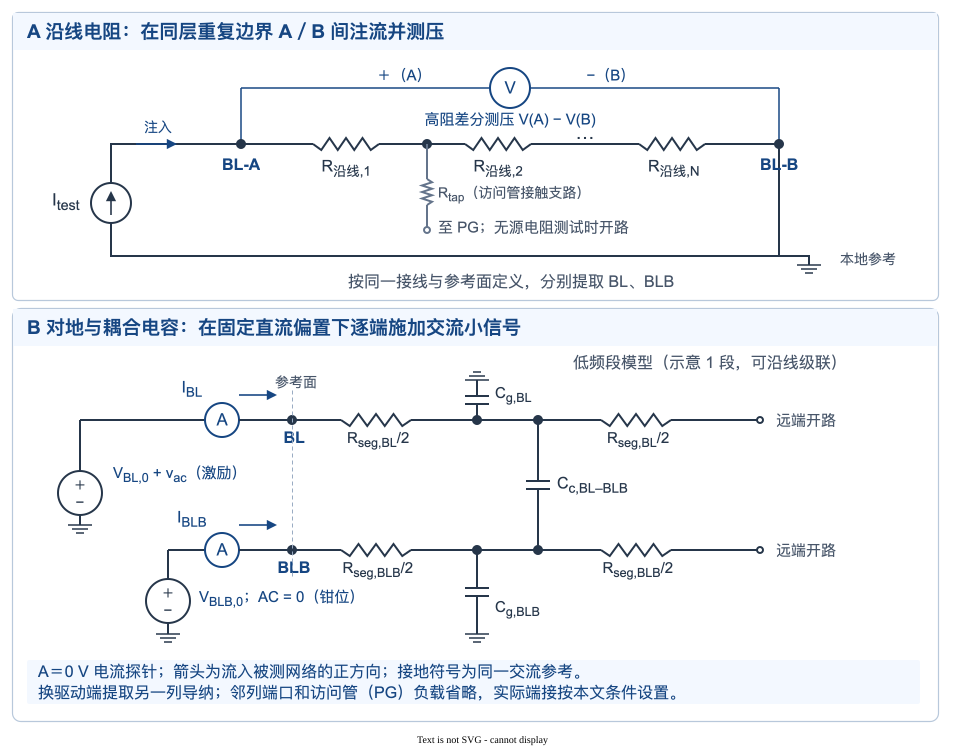

# CELL_BL RC

## 定义与适用范围

**单元节距位线寄生（Bitcell-Pitch Bitline Resistance and Capacitance，CELL_BL RC）**是阵列内部位线（Bitline，BL）或互补位线（BLB）沿列方向跨一个铺排节距的增量电阻和电容。对 BL／BLB 分别报告沿线电阻 $R_{\mathrm{BL,seg}}$、对参考节点电容 $C_g$ 及与另一侧位线、邻列或其他保留导体的耦合电容 $C_c$。单段用 Ω 和 F 表示；按一个物理行节距归一时用 Ω/cell 与 F/cell，电容也可用 aF/cell（$1\,\mathrm{aF}=10^{-18}\,\mathrm{F}$）。须注明是否包含访问管（Pass-Gate，PG）位线侧端子的结电容及栅端耦合。[1, Sec. III, Fig. 3] [2, Sec. II, Figs. 3–4]

一个列方向节距对应相邻字线（Wordline，WL）行之间的距离。若合法镜像铺排、位线换层或接触分布每 $m$ 行才重复，以完整周期的两个同相位端面为界，按 $m$ 归一，并保留周期内各段差异。整列分布式网络见 [BL RC](../Subarray/BL_RC.md)。高频或大摆幅使用完整网络或注明条件的有效电容；延迟以 s 另报。

## 物理机制与器件变异

### 沿线导体与访问管支路

| 分量 | 记录范围 | 主要变化因素 |
| --- | --- | --- |
| 沿线电阻 $R_{\mathrm{BL,seg}}$ | 位线主通路两端参考面之间的导线、串联换层通孔及接触。若存在并联通路，按实际连接求端到端等效值。 | 线宽、厚度、材料与尺寸相关电阻率、通孔数量及金属温度。 |
| 支路电阻 $R_{\mathrm{tap}}$ | 从位线抽头到 PG 位线侧端子的局部互连、通孔和接触。并入器件模型的部分注明端面。 | 接触结构、垂直堆叠及 PG 位置；开放支路不承载沿线直流测试电流。 |
| 对参考节点电容 $C_g$ | 位线到参考节点的电容，以及按约定合并至参考节点的固定交流电位导体贡献。 | 至参考导体间距、绝缘介质、衬底及屏蔽结构。 |
| 耦合电容 $C_{c,ij}$ | 与互补位线、邻列、WL 和其他保留动态端口 $j$ 的正值跨节点电容。 | 横向间距、上下层重叠、屏蔽与对端波形。 |

加宽位线可降低沿线电阻，同时改变耦合面积和间距。Liu 等的互补场效应晶体管（Complementary Field-Effect Transistor，CFET）投影中，单元高度缩小挤窄位线；连接底层 PG 的高通孔增加外部电容。Mathur 等在 N5 投影中对比了埋入式电源轨（Buried Power Rail，BPR）、埋入式位线（Buried Bitline，BBL）和组合结构，显示降低位线电阻的同时，电容可在衬底、VSS 和其他相邻导体之间重新分配。金属几何及通孔变异须与器件变异分别记录；Bao 等也分别统计了金属单位长度电阻和电容的离散。[5, Sec. II-E, Figs. 7–8] [8, Sec. III, Figs. 6–7] [10, Secs. II–III, Figs. 7–10] [11, Sec. III-A, Figs. 7, 10]

### 关断访问管与有效电容

WL 关断时，PG 位线侧端子的结电容、栅端重叠／边缘电容以及模型给出的其他端子电荷仍可能加载位线。按工艺设计套件（Process Design Kit，PDK）规定划分版图寄生提取（Parasitic Extraction，PEX）网表与紧凑模型：标明结电容由模型根据扩散面积／周长等计算，还是由提取规则实例化；对重叠、边缘电容和端子接触电阻作同样检查。建立**互连口径**和**带器件口径**两组记录。后一组须注明 WL、BL／BLB、存储节点及体端偏置、电源和温度。65 nm 编译器的简化读模型将每行 PG 结电容与列端预充管电容分别计入，说明两项须分开记录。[13, p. 1564, Fig. 5]若写低侧或负位线辅助（Negative Bitline，NBL）使未选 PG 导通，须将其非线性电流作为器件支路保留。[2, Fig. 4] [2, Sec. III–V, Figs. 7–8, 14] [5, Sec. II-E] [7, Sec. 3.1]

电流取从端口流入网络为正。线性互连中，端口 $i$ 的电容电流为 $i_{C,i}=C_{g,i}\,\mathrm{d}v_i/\mathrm{d}t+\sum_{j\ne i}C_{c,ij}\,\mathrm{d}(v_i-v_j)/\mathrm{d}t$。在各有关导体沿测量段近似等电位且 $\mathrm{d}v_i/\mathrm{d}t\ne0$ 时，按本端斜率换算的有效电容随邻线波形变化：同斜率同向时对应耦合项近似为零，对端静止时为 $C_{c,ij}$，同斜率反向时为 $2C_{c,ij}$。须按实际邻线状态使用这些关系。带器件或电位沿列显著不均匀时，保留分布式网络及器件模型计算波形。

## 重复单元与整列网络边界

沿 BL 方向取两个**同层、同相位、横跨相同导线截面的电气参考面** A／B。两端使用相同方法生成端口，参考面夹住待统计节距；BLB 取对应端面。阵列内部窗口须保留本列、相邻 BL／BLB、邻列、上下层相关金属、供电及衬底环境，按提取规则加外围重复行列，确认扩大窗口后的段参数收敛。若主通路换层，把实际串联通孔计入段内；PG 局部支路独立保留。镜像铺排、交织、隔离行及周期性跨接须按真实映射拼接，跨边界元件只归属一次。[1, Sec. III, Fig. 3] [8, Sec. III, Figs. 8–9]

| 对象 | 保留内容 | 交付用途 |
| --- | --- | --- |
| 阵列内部重复单元 | 对应参考面之间的 BL／BLB 主通路、PG 抽头及周期内对地／跨线电容。 | 跨方案比较与位线重复段模型。 |
| 完整列 | 重复段、首末非重复段、跨接、隔离行、预充、列复用及感测放大器端的实际连接与负载。 | 从列端到近／中／远端的电位、读建差和写入验证。 |

对于均匀、无并联旁路的串联主通路，可按重复周期累加电阻，再加入边缘和端部接入电阻；固定边界条件下可按元件计数累加电容。须用完整列 PEX 比对拼接结果。列分段后，局部位线、全局位线与中间开关须分别连接和表征。CACTI 5.0 及 Amrutur 等的整列读路径模型均另外计入位线外围负载；Liu 等的分段子阵列则对不同信号线分别提取互连 RC 后仿真完整路径。[4, Sec. 4.3.2, Fig. 22] [9, Secs. II-B–C, Tables II–III] [12, Sec. III-C, pp. 178–180]

## 测量与提取方法

参考 [铺排与端口图](Cell_Height_Width.md#测量与提取方法) 定位重复边界。下图 A 为纯互连直流（Direct Current，DC）注流，PG 支路在 DC 测试时开路；图 B 为低频交流（Alternating Current，AC）端口提取，示意 BL／BLB 两端口，远端开路。实际提取按边界清单扩展到邻列、WL 等端口，必要时保留 PG 紧凑模型。图中 GND 为 AC 参考；与 VSS 的连接须按实际偏置定义。

### 版图与仿真提取

**【前置条件】** 使用通过版图与原理图一致性检查（Layout Versus Schematic，LVS）的铺排版图，选取两个以上不同节距数且端部几何相同、同相位的内部窗口；建议包含至少三个长度以检查残差。记录版图版本、提取器和规则集、工艺角、温度、参考面、通孔合并选项、耦合阈值、参考节点及保留端口。若有独立的纯互连与含器件网表，使用同一几何和端口配置。[1, Sec. II–III] [3, Extract Parasitics]

**【步骤／方法】**

1. **提取主通路和抽头电阻**：在无有源电流的电阻网络中，向 A 注入直流 $I$（A）并使电流由 B 返回，记录 $\Delta V=V_A-V_B$（V），求 $R(N)=\Delta V/I$（Ω）。以物理节距数 $N$ 为横轴取斜率 $[R(N_2)-R(N_1)]/(N_2-N_1)$（Ω/cell）；两点须属于同相位端面。另在主线抽头与 PG 位线侧端子参考面之间提取 $R_{\mathrm{tap}}$，记录从版图到模型的接触归属和串／并联连接。
2. **读取 PEX 电容**：按网表元件分离对参考节点电容与 BL–BLB、邻列及其他端口的耦合电容，统一为正值元件量；网表按两侧重复列出同一耦合元件时只统计一次。记录被工具合入参考节点的量和规则。对各电容分量分别按相同几何窗口的长度增量求 F/cell；有明确边界元件归属时，也可直接汇总完整周期再除以周期行数。[3, Extract Parasitics] [8, Sec. III, Figs. 6–7]
3. **用多端 AC 核验**：在指定 DC 工作点逐个激励端口 $j$，其余独立端口保持既定 DC 偏置且 AC 小信号电压为零；同一导体的其他引出端开路，或同相同幅驱动并对各引出端的电流求和。确认各线沿测量段近似等电位后，记录流入端口 $i$ 的电流增量并求 $Y_{ij}=\Delta I_i/\Delta V_j$（S）。在 $e^{j\omega t}$ 约定下，$\omega=2\pi f$，$f$ 以 Hz 计；对无源互连选取 $\operatorname{Im}(Y)/\omega$ 足够稳定的低频平台，计算

   $$
   C_{\mathrm{tot},i}=\frac{\operatorname{Im}(Y_{ii})}{\omega},\qquad
   C_{c,ij}=-\frac{\operatorname{Im}(Y_{ij})}{\omega}\ (i\ne j),\qquad
   C_{g,i}=C_{\mathrm{tot},i}-\sum_{j\ne i}C_{c,ij}.
   $$

   上式各项以 F 计；$C_{\mathrm{tot},i}$ 是其他端口交流固定时本端总值。$C_{g,i}$ 只在纳入所有须独立区分的耦合端口时等于对应 PEX 对参考节点值；只有被固定在 AC 参考电位的未单列导体可直接折入对参考节点项；若无法独立钳位的浮置导体参与耦合，则保留浮置条件并报告其端口有效电容。带器件时另做 WL 关断、两种存储状态、BL 预充及实际读写摆幅的工作点扫描，记录 $\operatorname{Re}(Y)$、频带及偏置。若只能测单端，报告指定邻线终端下的端口有效电容；若无稳定平台，保存 $Y(f)$ 或用完整 PEX 网络验证波形，禁止用单频值拆分物理电容（分布电阻或器件响应已影响端口导纳）。

**注意事项**：禁止在纯互连测量中将 PG 支路接到导通返回通路（分流会改变沿线电阻）。

**注意事项**：禁止同时实例化同一份端子结电容或栅端重叠电容（重复实例化会放大位线负载）。

**【结果处理和验证】** 检查端口连通性、BL／BLB 映射及电流守恒；无源互易网络还须检查耦合对称性、对参考节点电容和耦合分量的非负性。比较 PEX 元件汇总与 AC 结果，核对窗口扩大、频率、激励幅度和耦合阈值敏感度。若端部截距、残差或不同长度斜率超出项目容差，先核对端口／边缘和周期映射；仍不满足时按段交付原始网络。

### 硅片电阻与电容量测

**【前置条件】** 制作多个长度且外围和边缘等效的位线测试结构，包含两端四线（Kelvin）引出、邻线偏置端口及匹配开路、短路和空列参考结构。按需要制作纯互连组和含未选 PG 组；保持目标线周边环境可比，记录探针、焊盘、列复用器和参考面的连接方式。若空列移除了会改变电场的结构，须注明差分量，禁止直接将差值归于单项电容（几何环境同时改变）。

**【步骤／方法】**

1. **校准并测量 R**：两端强制注流，独立高阻感测线直接接至 A／B，用 $[\Delta V(+I)-\Delta V(-I)]/(2I)$ 抵消零点和热电势；比较两个以上低电流幅值，确认线性且自热在允许范围内。
2. **校准并测量 C**：以相同连接和终端测量开路／短路参考，按已验证的夹具等效网络去嵌焊盘、引线和开关寄生，再用匹配空列或长度差分消除剩余端部与外围负载；两者涵盖同一项时只扣一次。可采用上述多端 AC，或在已知电压阶跃、邻线状态和测量窗口下由净充电量求 $C_{\mathrm{eff}}=\Delta Q/\Delta V$（$\Delta Q$ 用库仑，已扣除夹具、开关瞬态和可辨识的漏电贡献）。记录 BL DC 电平、两种存储状态、温度、激励幅度、频率或积分窗口。无法分离漏电时，报告端口充电波形和测试条件。

**注意事项**：禁止由单条充放电时间常数独立反推 $R$ 和 $C$（驱动电阻、分布式网络及有效电容会同时影响波形）。

**【结果处理和验证】** 用校验件核对去嵌残差，按校准后 R 和 C 对节距数的斜率分别归一至 Ω/cell、F/cell，并记录重复测量噪声、可分辨的最小长度差及归一后不确定度。电容差分低于量测分辨率时，增大匹配结构长度差或报告上限。通过功能列的近／中／远端读写波形验证网络；将该结果标作功能交叉验证。

**文献结论（版图建模）**：在 Liu 等的 2 nm 纳米片布局模型中，高密度（High Density，HD）列为 256 位，BL 为 38 Ω/cell、30 aF/cell；高性能（High Performance，HP）列为 128 位，BL 为 18 Ω/cell、33 aF/cell。两种设计的单元内晶体管宽度配比和列高不同。原文未报告对应结构的单节距直接硅测。[2, Table II] A14 纳米片分段子阵列的另一案例将器件电容排除后，MINT 局部位线采用 16 Ω/cell、56.6 aF/cell 的 QuickCap 估算参数；比较前须统一电容边界和布线结构。[9, Secs. II-B–C, Tables II–III]

## 数据可视化与评估

- **分离重复段和端部**：横轴用 $N$（节距数），纵轴分别用 R（Ω）和各电容分量（F 或 aF）。显示同相位样本、拟合斜率、端部截距、置信区间及残差。分开呈现 BL 和 BLB，对成对样本报告差值。
- **核对工艺与偏置**：按列内位置、线层、通孔、金属角、温度、BL 偏置、数据状态和邻线终端分组。每组报告样本数与统计口径；工艺角与统计分布分别记录。有多片数据时保留晶圆／芯片／列位置和重复测量标识，分别计算量测重复性与结构变异。
- **验证长列模型**：按已知共因保留同一金属层和重复段的相关性，传播几何离散与拟合误差；无相关性数据时说明采用的假设。比较简化网络和全 PEX 的端到端电阻、端口导纳及近／中／远端波形，按项目误差限判断能否使用。先进节点的电阻和未选 PG 漏电可共同改变写低侧波形。[2, Sec. III–V, Figs. 7–8, 14] [11, Sec. III-A, Fig. 10]

## 应用场景与指标关系

- **单元设计与工艺协同优化（Design–Technology Co-Optimization，DTCO）**：比较位线端口位置、主线宽度、通孔、PG 接触及金属层。R 与 C 较小通常有利于读写时序；须同时核对面积、耦合和写驱动裕量。[5, Secs. III-A–B] [6, Secs. 3.1–3.3, 6.2] [7, Sec. 3.1]
- **阵列读写**：将重复段拼成子阵列 [BL RC](../Subarray/BL_RC.md)，配合 [Read Current](Read_Current.md) 与 [BL Leakage](../Subarray/BL_Leakage.md) 估算读建差；按近／中／远端核对实际差分与写低电位。延迟、压降和读写裕量独立报告。

## 参考文献

2026-11-17，Zotero Bitcell 收藏中精确标签 CELL_BL RC 初检 5 条，补检后 12 条均有可读 PDF。归档包括 10 篇期刊／会议论文、1 份技术报告及 1 本专著；另保留在线提取器文档。位单元 RC 数值均来自所述版图建模。

[1] M. Karner et al., “Variability-aware DTCO flow: Projections to N3 FinFET and nanosheet 6T SRAM,” in Proc. SISPAD, 2021. [DOI 10.1109/SISPAD54002.2021.9592527](https://doi.org/10.1109/SISPAD54002.2021.9592527). [公开文献](https://doi.org/10.1109/SISPAD54002.2021.9592527) [Zotero](https://www.zotero.org/users/7333024/items/2NIBZCPG)

**相关摘要：** 本文通过三维寄生提取把完整SRAM结构中的电阻、电容和器件转换为SPICE电路，图3示出包括局部互连在内的电阻网络。该流程支持在位线及访问管连接中保留互连影响，并用TCAD与SPICE的标称结果核验模型一致性。然而论文的输出重点为SNM、写翻转点和读电流分布，没有给出每单元RBL/CBL的独立表格、整列缩放规则或实验测量。因而只能作为三维PEX建模流程依据，不能从图3颜色网络或图11性能指标反推出可复现位线RC。

**原文定位：** Sec. II–III、V-B；Figs. 2–3、9–11，PDF pp. 1–3。

[2] H.-H. Liu et al., “Extended methodology to determine SRAM write margin in resistance-dominated technology node,” IEEE Trans. Electron Devices, 2022, author manuscript. [DOI 10.1109/TED.2022.3165738](https://doi.org/10.1109/TED.2022.3165738). [公开文献](https://doi.org/10.1109/TED.2022.3165738) · [Zotero](https://www.zotero.org/users/7333024/items/9HKACZ7P)

**相关摘要：** 本文研究电阻主导的2 nm nanosheet SRAM 写入，把位线拆成逐单元的电阻、电容和未选访问管支路，分别构建128段与256段列网络。有限写脉冲、负位线辅助及邻位访问管意外导通会使局部位线电压偏离驱动端，静态扫描因此不能充分表示写入能力。表II把每单元 BL寄生与整列长度分开，强调本页的单元段 RC 需要在明确列长及数据状态下累加后才能用于动态分析。文中失效和时延变化是完整寄生网络仿真结果，不能记成单个 bitcell 的固有 RC 或直接硅片实测。

**原文定位：** Secs. II–III，Table II、Fig. 4，作者稿PDF 第2–3页。

[3] The OpenROAD Project, “Parasitics extraction,” OpenROAD documentation. [原文](https://openroad.readthedocs.io/en/latest/main/src/rcx/README.html) （本次 Zotero 标签检索未命中，保留原有来源。）

**相关摘要：** OpenROAD 文档说明 OpenRCX 从已布线的 LEF/DEF设计和工艺提取规则获得线电阻、对地电容及耦合电容，可输出 SPEF，并设置过孔电阻是否与线电阻合并。用于本页时，应先确定一个单元位线重复段的边界，再区分该段与整列网络的寄生。文档提供通用提取方法，没有 SRAM 单元段 RC 实测值，也不会自动完成 bitcell 与阵列边界划分；层次抽象、工艺角和相邻线环境需要在实际提取设置中明确。

**原文定位：** Parasitics Extraction、Extract Parasitics、Write SPEF；访问日期2026-11-13。

[4] S. Thoziyoor, N. Muralimanohar, and N. P. Jouppi, “CACTI 5.0,” Hewlett-Packard Laboratories, Tech. Rep. HPL-2007-167, Oct. 19, 2007.  · [Zotero](https://www.zotero.org/users/7333024/items/JYDVTQLK)；DOI：Zotero未收录或尚未核实。

**相关摘要：** 附件实际为2007年的CACTI 5.0技术报告，采用非理想互连的一节π型RC模型，按线长与单位长度电阻、电容计算互连负载，并建立从SRAM单元到感放输入的位线读通路。单元扩散、位线金属、列复用和预充等负载均属于所建阵列模型的组成部分；报告还说明工艺缩放不能简单假设单位长度电容不变。该方法服务于宏观设计探索，没有提供某个先进节点的单元硅测RC，整列值必须按行数及外围连接计算，不能直接称为CELL_BL寄生。

**原文定位：** Sec. 2.3、4.1、4.3.2；Figs. 12–13、18–22，正文pp. 5–6、15、18–22。

[5] H. H. Liu et al., “CFET SRAM DTCO, interconnect guideline, and benchmark for CMOS scaling,” IEEE Transactions on Electron Devices, vol. 70, no. 3, pp. 883-890, 2023. [公开文献](https://doi.org/10.1109/TED.2023.3235701) · [DOI 10.1109/TED.2023.3235701](https://doi.org/10.1109/TED.2023.3235701) · [Zotero](https://www.zotero.org/users/7333024/items/W99KL789)

**相关摘要：** 本文用Cadence取得器件本征电容，结合QuickCap提取BEOL电阻及BEOL、MEOL、FEOL外部电容，明确以每单元的RBL和CBL比较A14至A3 SRAM。单元高度缩小挤压位线宽度，导致RBL增加；CFET连接到底层访问管的高通孔还会提高电容。采用背面电源和局部spacer merge释放正面布线空间，可加宽位线减轻限制。图中的每单元寄生随后用于288列、256行子阵列仿真，不能把其数值当成整列RC或硅实测。

**原文定位：** Sec. II-E、III-A–B；Figs. 7–10，pp. 885–886。

[6] H. H. Liu, and F. Catthoor, “Circuit-technology Co-optimization of SRAM design in advanced CMOS nodes,” Cham, Springer Nature Switzerland, 2025. [公开文献](https://doi.org/10.1007/978-3-031-76109-6) · [DOI 10.1007/978-3-031-76109-6](https://doi.org/10.1007/978-3-031-76109-6) · [Zotero](https://www.zotero.org/users/7333024/items/CHVFC3IE)

**相关摘要：** 本书在第6章将QuickCap提取的每单元RBL/CBL用于HD、HP及LP子阵列比较，明确区分单元寄生与阵列行列数。高度压缩挤窄位线，而CFET到底层访问管的高通孔增加外部电容，故面积缩放未必带来RC改善。A5.s2p至A3.h3p案例中RBL增加216%，加宽位线可减轻该增幅但增加单元面积；该百分比只适用于列出的投影结构。第3章进一步显示RC与访问管作用具有时间依赖，不能将纯DC单元写裕量直接用于有长位线的子阵列。

**原文定位：** Secs. 3.1–3.3、6.2；Figs. 3.1、6.1–6.2，pp. 57–65、137–139。

[7] X. Cheng et al., “A novel design for SRAM bitcell with 3-complementary-FETs,” Microelectronics Journal, vol. 173, Art. no. 107180, 2026. [公开文献](https://doi.org/10.1016/j.mejo.2026.107180) · [DOI 10.1016/j.mejo.2026.107180](https://doi.org/10.1016/j.mejo.2026.107180) · [Zotero](https://www.zotero.org/users/7333024/items/QJ3K3I2Z)

**相关摘要：** 本文在3-CFET SRAM三维结构上用Raphael提取MEOL/BEOL电容，电阻则因SPX不能直接提取而按金属长度乘单位长度电阻估算，采用Ru 795 Ω/μm及BPR钼50 Ω/μm。位线须从M1连接到底层访问管所在的M0B，最坏连接长度接近单元宽度，因此其电阻明显大于其他节点。随nanosheet数增加还需重算垂直连接与耦合电容。结果是给定单元结构的寄生模型，既不是整列位线阻值，也不是实测；出版信息按PDF首页2026年期刊版修正。

**原文定位：** Sec. 3.1；Fig. 8，PDF pp. 4–6。

[8] R. Mathur et al., “Buried interconnects for sub-5 nm SRAM design,” IEEE Trans. Electron Devices, vol. 69, no. 3, pp. 1041–1047, 2022. [公开文献](https://doi.org/10.1109/TED.2022.3143078)（期刊早期版） · [DOI 10.1109/TED.2022.3143078](https://doi.org/10.1109/TED.2022.3143078) · [Zotero](https://www.zotero.org/users/7333024/items/H35G9VFR)

**相关摘要：** 使用 N5 几何和 QuickCap 三维求解器对不同埋入式互连结构提取寄生。图 6 按耦合对象拆分位线电容，图 7 对比 HD 和高电流（High Current，HC）位单元的每单元 R 与 C。图 8–9 说明如何拼接提取的位单元网表并仿真 258 行 × 136 列子阵列。图中的阻容和读写结果来自建模。

**原文定位：** Sec. III，Figs. 6–9，归档 PDF 第 4–5 页。

[9] H.-H. Liu et al., “Future design direction for SRAM data array: Hierarchical subarray with active interconnect,” IEEE Trans. Circuits Syst. I, Reg. Papers, vol. 71, no. 12, pp. 6495–6506, 2024. [公开文献](https://doi.org/10.1109/TCSI.2024.3410518)（作者稿） · [DOI 10.1109/TCSI.2024.3410518](https://doi.org/10.1109/TCSI.2024.3410518) · [Zotero](https://www.zotero.org/users/7333024/items/FKMH67JE)

**相关摘要：** 对常规与有源互连分段子阵列使用 QuickCap 估算每位单元 RC，并在表中明确排除器件电容。两种结构的 MINT 局部位线条目均为 16 Ω、56.6 aF；全局位线和层间连接另列。结果为 A14 纳米片设计投影；完整定制版图提取才可核对层间连接近似。

**原文定位：** Secs. II-B–C，Figs. 3–4、7–9，Tables II–III，作者稿 PDF 第 3–5 页。

[10] R. Mathur et al., “Buried bitline for sub-5 nm SRAM design,” in IEDM Tech. Dig., 2020, pp. 20.2.1–20.2.4. [公开文献](https://doi.org/10.1109/IEDM13553.2020.9372042) · [DOI 10.1109/IEDM13553.2020.9372042](https://doi.org/10.1109/IEDM13553.2020.9372042) · [Zotero](https://www.zotero.org/users/7333024/items/M8TVQJ29)

**相关摘要：** 对埋入式位线的埋入金属厚度做参数扫描，通过三维提取比较适合低电容、低电阻和低 RC 的几何。埋入金属到衬底的贡献随厚度下降而减小，电阻则上升；与 [8] 的多种埋入式互连电容拆分配合使用。结果为 imec N5 结构建模，归档版本的几何扫描不作为阻容硅测。

**原文定位：** Secs. II–III，Figs. 6–10，Table II，归档 PDF 第 1–4 页。

[11] T. H. Bao et al., “Circuit and process co-design with vertical gate-all-around nanowire FET technology to extend CMOS scaling for 5nm and beyond technologies,” in Proc. ESSDERC, 2014, pp. 102–105. [公开文献](https://doi.org/10.1109/ESSDERC.2014.6948768) · [DOI 10.1109/ESSDERC.2014.6948768](https://doi.org/10.1109/ESSDERC.2014.6948768) · [Zotero](https://www.zotero.org/users/7333024/items/BBASQA5H)

**相关摘要：** 按不同金属走线比较单位长度电阻和电容的均值及标准差，并评估加宽位线后的单元面积与读访问时序良率。单位长度参数用于解释互连离散，读访问时间还受器件与电路负载影响。

**原文定位：** Sec. III-A，Figs. 7、10，p. 104（PDF 第 3 页）。

[12] B. S. Amrutur and M. A. Horowitz, “Speed and power scaling of SRAM's,” IEEE J. Solid-State Circuits, vol. 35, no. 2, pp. 175–185, 2000. [公开文献](https://doi.org/10.1109/4.823443) · [DOI 10.1109/4.823443](https://doi.org/10.1109/4.823443) · [Zotero](https://www.zotero.org/users/7333024/items/CH2EXX7I)

**相关摘要：** SRAM 解析模型以阵列组织为输入。读通路的位线负载包括线与单元负载、列复用开关负载和感测放大器输入电容；建差时间还与单元电流及字线输入有关。该模型支持列负载归属，应用到其他工艺时须重新提取分量。

**原文定位：** Sec. III-C，pp. 178–180（PDF 第 4–6 页）。

[13] Q. Song, C. Y. Peng, H. G. Zhou, and S. B. Tan, “Time delay model for SRAM compiler,” Appl. Mech. Mater., vols. 373–375, pp. 1561–1566, 2013. [公开文献](https://doi.org/10.4028/www.scientific.net/AMM.373-375.1561) · [DOI 10.4028/www.scientific.net/AMM.373-375.1561](https://doi.org/10.4028/www.scientific.net/AMM.373-375.1561) · [Zotero](https://www.zotero.org/users/7333024/items/CJ32UAW9)

**相关摘要：** 65 nm 编译器读模型将位线接入管的结、栅端耦合与预充管端子负载分开说明，以行数乘接入管结电容近似列内主要负载。图 5 中等效放电电阻来自读通路晶体管，其简化模型不可用于替代现代节点的沿线金属电阻与耦合提取。

**原文定位：** p. 1564，Eq. (5)，Figs. 4–5（PDF 第 4 页）。
