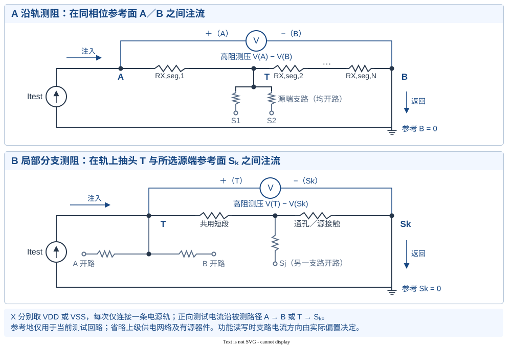

# CELL_R_VDD & CELL_R_VSS

## 定义与适用范围

**单元节距电源轨电阻（Bitcell-Pitch Supply-Rail Resistance，CELL_R_VDD／CELL_R_VSS）**是静态随机存取存储器（Static Random-Access Memory，SRAM）阵列内部沿 VDD 或 VSS 局部电源轨跨一个位单元节距的直流（Direct Current，DC）电阻增量，记为 $R_{X,\mathrm{seg}}$，$X$ 为 VDD 或 VSS，单位为 Ω/cell。两轨按实际布线方向独立定义。若镜像、换层或轨道分叉每 $m$ 个位单元才重复，须保留完整周期内的连接顺序，满足沿线串接或长度线性判据时才按 $m$ 归一。[1, Sec. III, Fig. 3]

| 报告量 | 端口与边界 |
| --- | --- |
| **沿轨节距电阻** $R_{X,\mathrm{seg}}$（Ω/cell） | 同一轨道上两个同相位参考面 A／B 之间的长度增量。保留沿轨方向导通的金属、换层通孔和指定并联跨接；各源端支路的器件负载开路。 |
| **轨到源端支路电阻** $R_{X,\mathrm{tap},k}$（Ω） | 轨道接点 T 到第 $k$ 个器件源端参考面 $S_k$ 的电阻。常规 6T 位单元中，VDD 支路接上拉管（Pull-Up，PU），VSS 支路接下拉管（Pull-Down，PD）。局部金属、分支通孔、源接触按实际边界计入；有共用段时标出共用接点和连接顺序。 |
| **指定边界下的等效电阻** $R_{X,\mathrm{eff}}$（Ω） | 给定注流、感测端口及其他端口终端后，由完整网络的压差对所加电流的斜率求得。可用于指定位置和馈电方式，须与每节距值分列。 |

上级分布式供电网络和运行压降见 [R_VDD & R_VSS](../Subarray/R_VDD_R_VSS.md)。静态电源网络的电阻性压降（IR Drop）取决于馈电位置和电流分布，单位为 V。[2, Analyze Power Grid]

## 物理机制与布图变异

对截面均匀、处于线性导电区的导线，一段长度 $L$ 的电阻可近似为 $R=\rho_{\mathrm{eff}}L/A_{\mathrm{cond}}$。$L$ 以 m 计，$A_{\mathrm{cond}}$ 为有效导电截面（m²），$\rho_{\mathrm{eff}}$ 为提取工艺和温度对应的有效电阻率（Ω·m）。缩窄导线、减薄导电层或增加串联通孔一般会提高电阻；通孔或接触的并联效果须按电流分担验证。接触界面、通孔落点和导体收窄还会产生电流拥挤，须由适用的提取模型或测试结构表征。加宽电源轨、增加并联通孔或调整馈电方向时，须重新核对单元节距、上层布线和耦合电容。

互补场效应晶体管（Complementary Field-Effect Transistor，CFET）位单元可以为两条电源轨选择不同层和垂直连接。Liu 等在 A3 投影中以背面 VDD、正面 M1 VSS 分别经纳米硅通孔（Nano Through-Silicon Via，nTSV）和高通孔（Supervia）连接器件；其专著进一步按源端路径讨论互连电阻对读写的影响。Cheng 等对三 CFET 单元采用金属长度乘单位长度电阻估算互连，Lee 等在三层 CFET 投影中将上拉管由三叠层减至两叠层，对应上方 VDD 金属至源端的通孔缩短，VDD 路径电阻由 51.4 Ω 降至 41.1 Ω。不同工艺的几何、材料、接触和路径定义不同，须在统一参考面后比较。[3, Sec. II-E–F, Figs. 6–9] [4, Secs. 6.3–6.5.1] [5, Sec. 3.1, Fig. 8] [6, Parasitic RC decomposition in various CFET architectures, Fig. 4(d)]

- **布图与互连变异**：按层记录线宽、厚度、金属电阻率、通孔数量及落点偏移、源接触和温度。镜像与共用接触可能使两个源端的路径不等；同一段的几何或材料变化可同时影响多个单元，阵列统计须保留可用的空间相关性。
- **器件变异**：阈值电压、驱动强度和漏电的变化会改变工作电流及局部压降；纯互连提取时不计入这些工作电流。在工艺设计套件（Process Design Kit，PDK）定义的界面上核对寄生提取（Parasitic Extraction，PEX）和紧凑模型的接触、扩散区访问电阻及源端串联电阻归属，避免重复实例化。[1, Sec. III, Fig. 3]

## 重复单元与阵列网络边界

按[铺排与端口图](Cell_Height_Width.md#测量与提取方法)确定合法重复方向。选两个同层、同相位且截面一致的轨道参考面，提取含中心位单元、邻居和共享接触的铺排窗；增大提取窗，检查中心段及支路电阻是否收敛。周期内固定出现的换层通孔、埋入式电源轨（Buried Power Rail，BPR）及共享接点按版图连接建模。宏边缘、上下层电源接入、非周期跨接、馈电抽头和封装属于下一层网络；记录共享元件归属，拼接时只计一次。Mathur 等展示了通过拼接单元 PEX 网表组装子阵列的方法；Nibhanupudi 等对逻辑供电网络分别列出局部轨道、跨层通孔和供电间距，可作为划分网格边界的例子。[7, Sec. III, Figs. 8–9] [8, Secs. II–IV, Fig. 1, Tables I–II]

当多点馈电、成对并联轨或跨接改变电流分布时，保留 A／B、接入抽头及各源端的多端电阻网络。单次两端注流只确定该终端条件下的一项等效电阻。Kim 等的 Intel 4 SRAM 在阵列周边引入 PowerVia，同一子阵列的 VSS 等效电阻随位置变化；在该文的静态压降仿真和共同归一基准下，周边馈电方案最大值为 2.24（阵列中央 D），正面供电方案最大值为 1.02（边缘 C），硅片则给出最低工作电压（Minimum Operating Voltage，$V_{\min}$）和电压–频率测试结果。[9, Figs. 15.2.2, 15.2.6]

## 测量与提取方法

图 A 用于沿轨测试：在所选轨道 A 注流、由 B 返回，两源端支路末端开路；在 A／B 独立取差分电压。图 B 用于支路测试：在 T 注流、由 $S_k$ 返回，A／B 及其余源端开路，在 T／$S_k$ 独立感测。图中省略有源器件与上级电源网。VDD 和 VSS 分两次独立提取；测试回流端设为求解参考，电流正方向为从第一端流入被测网络。实际运行时 VSS 电流可与测试方向相反。

### 版图与仿真提取

**【前置条件】** 使用通过版图与原理图一致性检查（Layout Versus Schematic，LVS）的版图。记录铺排周期、节距方向、参考面、金属／接触角、温度、提取与网络约简规则。先生成去除器件有源路径的被动电阻网表，保留所定义的金属、通孔和接触；核对全局网名或隐式理想连接是否短接参考面。然后保留全寄生网表供电路功能检查。[1, Sec. III, Fig. 3] [2, Analyze Power Grid]

**【步骤／方法】**

1. **提取沿轨电阻**：依次从 A 向 B 施加零偏和至少两档小 DC 电流，读取 $\Delta V_{AB}=V_A-V_B$ （V）及测试源实际电流 $I$（A）。按 $R_X(N)=\mathrm{d}\Delta V_{AB}/\mathrm{d}I$（Ω）求跨 $N$ 个节距的电阻。用至少三种长度、相同端部接入结构、同相位参考面及相同重复拓扑拟合 $R_X(N)=R_{\mathrm{end}}+N R_{X,\mathrm{seg}}$；只有斜率在残差与不确定度内稳定时才报告 Ω/cell。若同相位周期可直接串接且边界已去嵌，可将一个周期的电阻除以节距数；仍须核对至少一个更长提取窗。$R_{\mathrm{end}}$ 表示测量参考面内保留的常数端部贡献。
2. **分离轨到源端的支路**：按图 B 将 A／B 和其余源端开路，分别量取 $\Delta V_{T S_k}=V_T-V_{S_k}$，以其对注流 $I$ 的斜率计算各 $R_{X,\mathrm{tap},k}$。核对接触、通孔和两支路共用段的实际电流路径，记录共用段与分叉节点。若无法独立访问 T，须改用明确的可访问端口报告组合路径；禁止将合并供电端到 $S_k$ 的斜率记为单独接触电阻。
3. **复算真实馈电网络**：以实际接入网和相同参考面恢复并联馈电、跨接或共享通孔。各感测端使用同一参考节点。依次对端口 $j$ 施加电流增量 $\Delta I_j$，取流入被动网络为正；保持其他端口的独立电流激励不变，馈电端维持指定电位或阻抗。在各端口 $i$ 记录相对该参考节点的电位增量 $\Delta V_i$，计算 $R_{ij}=\Delta V_i/\Delta I_j$（Ω），并记录馈电端分流。功能运行时，负载从 VDD 网络取流、向 VSS 网络注流；用带符号的电位增量复算代表性同时导通工况，并与完整阵列 PEX 网表核对。

**注意事项**：禁止以休眠电流或读电流直接除入未分解的供电压差来代替纯轨道提取（器件负载与馈电并联路径没有被分离）。

**【结果处理和验证】** 检查 DC 电流守恒、供电轨间误连、端口开路／终端和正向注流时的驱动端电阻符号。对单一串联路径核对各段阻值之和；对并联路径核对分流、电位降和边界条件。记录各温度和工艺角的拟合斜率、截距、残差与并联路径清单。斜率不可分辨或不随长度稳定时，保留指定长度与终端的总阻值。用多个布局位置和合法镜像重复提取，区分边缘、内部和共享接触。

### 硅片专用结构与运行代理

**【前置条件】** 为 VDD 和 VSS 分设长度可变的重复轨段测试链及通孔／接触链，复现目标金属层、截面、落点和邻近几何。为两测量参考面各布置独立注流端和高阻感测端。接触若需分离，采用复现目标几何的四端开尔文结构或交叉桥开尔文电阻（Cross-Bridge Kelvin Resistor，CBKR），并设置用于扣除夹具和端段的对照结构。[10, Secs. II–III, Figs. 1–5]

**【步骤／方法】**

1. **执行四端开尔文量测（Four-Terminal Kelvin Measurement）**：对同一结构施加等幅正负电流，记录 $\Delta V(+I)$ 和 $\Delta V(-I)$。以 $[\Delta V(+I)-\Delta V(-I)]/(2I)$（Ω）扣除稳定零偏；以多档激励复核线性和自热，记录探针、量程、温度和参考面。
2. **分离长度项和接触项**：对端部接入相同且参考面同相位的至少三种轨道长度取斜率，检查残差；对通孔／接触链比较相同金属长度、不同单元数的结构，或用 CBKR 直接测量指定参考面之间的电阻。接触几何和引出导体的电流拥挤仍可能计入四端读数，须与几何匹配对照或校准模型核对。[10, Secs. II–III, Figs. 1–5]
3. **独立记录运行代理**：若芯片只能观测宏端压降，记录馈电条件、活动图样、并行访问数、当前数据状态、电流波形、采样点和带宽。用同样的条件校验完整电源网模型；路径分量无法辨识时，交付端口压降及其适用范围。[9, Figs. 15.2.2, 15.2.6] [11, Sec. III, Figs. 3–8]

**注意事项**：禁止把测试链的阻值或拟合的宏端压降直接标为功能 6T 位单元的独立电源轨和源支路实测值（感测端口和电流路径不同）。

**【结果处理和验证】** 报告重复样本、晶片和芯片位置、去嵌范围、不确定度、最小可分辨压差及互连结构与实际位单元的差异。Noh 等对硅化物接触的测试表明，接触尺寸与感测臂几何会改变测得的比接触电阻率。Jacobs 的埋入式电源轨测试链包含 W 轨、纳米硅通孔及背面金属，可用于校核组合路径与定位异常通孔。已核验原文中，位单元内部的独立供电路径电阻来自版图提取或估算，未见对同一功能 6T 位单元逐个分离测得 VDD／VSS 源支路电阻的报告。[12, Secs. 2–5, Figs. 1, 5–8] [13, Figs. 5, 7, Methods: Backside power delivery network test structure]

## 数据可视化与评估

- **验证节距归一**：横轴用节距数，纵轴用四端测得或仿真所得的电阻（Ω）；分别绘制 VDD／VSS 和镜像组，标注斜率（Ω/cell）、截距、残差和置信区间。把源端分支和不宜归一的等效网络值另列。
- **找出压降瓶颈**：以图或表标出各通孔、接触、轨段的阻值及终端。只有同一电流贯穿的串联段可按阻值堆叠；有并联时，按完整网络绘出支路电流或指定路径节点间电位差。比较局部电压时，固定馈电、活动工况和观察时间。
- **比较角与分布**：在相同提取边界下分别比较互连工艺角、温度、共享接触和芯片位置。典型值用于初步预算；量产评估报告样本量、分位、不确定度及空间相关性。仿真工艺角、模型统计及硅测分布须注明来源。

## 应用场景与指标关系

- **分配供电压降预算**：将局部轨段与支路网络接入[子阵列电源轨](../Subarray/R_VDD_R_VSS.md)。在给定电源端口与负载条件下，记录 VDD 从馈电端到 PU 源端的电位降以及 VSS 从馈电端到 PD 源端的电位升；用局部 $V_{\mathrm{DD,local}}-V_{\mathrm{SS,local}}$ 表征对应两源端的可用供电压差。完整功能仿真还须保留局部 VDD、VSS 各自相对 WL、BL／BLB 和体端的电位。
- **验证工作裕量**：以本地电源波形或偏置分别验证[读电流](Read_Current.md)、[RSNM](RSNM.md)、[DRV](DRV.md) 及[写时序](../Subarray/Write_Time.md)。同一串联段的电流固定时，减小该段电阻可减小该段压降；多点馈电须复算分流与目标节点电位。功能电流与稳态裕量须按实际局部偏置和存储状态复算。写入期间削弱锁存器的局部供电可能减轻争用，应同时验证半选单元、保持和写辅助结束后的恢复。[3, Sec. III-C, Figs. 11–12] [4, Secs. 6.3–6.5.1] [11, Sec. III]
- **比较布图选项**：在设计与工艺协同优化（Design–Technology Co-Optimization，DTCO）中，先用分段电阻区分线宽、通孔与接触瓶颈，再比较前／背面供电、抽头间距、[单元尺寸](Cell_Height_Width.md)及位线／字线寄生。对照模型与硅测时，使用同一物理层级和电气参考面。

## 参考文献

2026-11-17，Zotero Bitcell 集合按精确标签 `CELL_R_VDD & CELL_R_VSS` 初检 3 条，补检后共有 11 篇期刊／会议论文和 1 本专著具备归档全文。另有 [Jourdain 等的 BPR／nTSV 会议论文](https://doi.org/10.1109/ECTC51906.2022.00244)仅存 [Zotero 题录](https://www.zotero.org/users/7333024/items/XNNVB3HH)，未用于支撑本文结论。在线工具文档 [2] 沿用原有来源。

[1] M. Karner et al., “Variability-aware DTCO flow: Projections to N3 FinFET and nanosheet 6T SRAM,” in Proc. SISPAD, 2021. [DOI 10.1109/SISPAD54002.2021.9592527](https://doi.org/10.1109/SISPAD54002.2021.9592527). [公开文献](https://doi.org/10.1109/SISPAD54002.2021.9592527) [Zotero](https://www.zotero.org/users/7333024/items/2NIBZCPG)

**相关摘要：** 本文的三维PEX框架提取完整SRAM单元中的全部电阻、电容及器件，图3以三维视图展示提取后的电阻网络。该流程允许将局部供电和接地互连保留在SPICE模型中，适合说明电源路径不能一律视为理想短路。但论文未给出独立的每单元RVDD、RVSS数值、Kelvin量测结构或阵列IR-drop分解；主要结果是变异引起的稳定性与读电流变化。不能用其图11的读电流或SNM统计直接代替电源轨电阻的测量与归因。

**原文定位：** Sec. II–III、V-B；Figs. 2–3、9–11，PDF pp. 1–3。

[2] The OpenROAD Project, “IR drop analysis,” OpenROAD documentation. [原文](https://openroad.readthedocs.io/en/latest/main/src/psm/README.html) （本次 Zotero 标签检索未命中，保留原有来源。）

**相关摘要：** OpenROAD 的 PDNSim 文档提供静态电源网络分析，可分别选择电源或地网络、设置工艺角和供电源位置，输出压降、分段电流及 SPICE网络。它分析的是给定供电边界与负载下的网络响应，不能直接将最差 IR drop当作 bitcell 内局部 VDD/VSS电阻。用于本指标时，需要先界定单元局部供电段及连接端点，再区分局部寄生与上级电源网、封装电阻。文档没有 SRAM 单元电源轨的实测电阻值，主要支持后续网络建模和边界条件设置。

**原文定位：** IR Drop Analysis、Analyze Power Grid、Write Spice Power Grid、Source grid options；访问日期2026-11-13。

[3] H. H. Liu et al., “CFET SRAM DTCO, interconnect guideline, and benchmark for CMOS scaling,” IEEE Transactions on Electron Devices, vol. 70, no. 3, pp. 883-890, 2023. [公开文献](https://doi.org/10.1109/TED.2023.3235701) · [DOI 10.1109/TED.2023.3235701](https://doi.org/10.1109/TED.2023.3235701) · [Zotero](https://www.zotero.org/users/7333024/items/W99KL789)

**相关摘要：** 本文直接讨论CFET单元VDD和VSS互连的布线位置与通孔路径。A3高度缩小后，背面空间不足以同时容纳两条电源轨，因此采用背面VDD经nTSV连接、正面M1上的VSS经supervia连接顶层器件，并利用局部交叉耦合释放信号布线空间。这些结构说明供电与接地路径的电阻必须按各自金属和通孔网络提取。论文图10量化的是BL/WL寄生，未提供可直接引用的每单元RVDD、RVSS独立阻值，也未以其代替阵列电源网IR-drop。

**原文定位：** Sec. II-E–F；Figs. 6–9，pp. 885–886。

[4] H. H. Liu, and F. Catthoor, “Circuit-technology Co-optimization of SRAM design in advanced CMOS nodes,” Cham, Springer Nature Switzerland, 2025. [公开文献](https://doi.org/10.1007/978-3-031-76109-6) · [DOI 10.1007/978-3-031-76109-6](https://doi.org/10.1007/978-3-031-76109-6) · [Zotero](https://www.zotero.org/users/7333024/items/CHVFC3IE)

**相关摘要：** 本书明确把RVDD/RVSS定义为单元读写通路中金属与相连通孔造成的供电／接地电阻。Fin-on-Fin CFET的较长VBPR或nTSV使相关电源路径电阻高于NS-on-NS，可能降低静态噪声裕量；写入时供电路径变弱又可能减轻争用，故不能把降低所有电源电阻等同于所有裕量改善。第6章通过相同器件模型区分器件强度与互连影响，并说明增高fin或增加片数会同时增强驱动和拉长通孔。这属于局部路径模型，不是整个宏电源网的等效电阻或IR-drop实测。

**原文定位：** Secs. 6.3–6.5.1；Fig. 6.4，pp. 140、144–145。

[5] X. Cheng et al., “A novel design for SRAM bitcell with 3-complementary-FETs,” Microelectronics Journal, vol. 173, Art. no. 107180, 2026. [公开文献](https://doi.org/10.1016/j.mejo.2026.107180) · [DOI 10.1016/j.mejo.2026.107180](https://doi.org/10.1016/j.mejo.2026.107180) · [Zotero](https://www.zotero.org/users/7333024/items/QJ3K3I2Z)

**相关摘要：** 作者以金属长度乘单位长度电阻估算 3-CFET 位单元的导线寄生，采用钌 795 Ω/μm 和埋入式钼轨 50 Ω/μm；SPX 流程未直接求解这些电阻。该方案中 VDD 和字线位于结构两端，其估算电阻对中间纳米片数变化不敏感。归档为期刊出版版，对应 Zotero 预印本条目的同题出版版附件。

**原文定位：** Sec. 3.1，Figs. 4、8(b)，PDF 第 4–6 页。

[6] J. Lee et al., “3-Tier CFET 6T-SRAM with 2D-TMDs channels for Angstrom technology node,” Scientific Reports, vol. 16, Art. no. 16857, 2026. [公开文献](https://doi.org/10.1038/s41598-026-37881-5) · [DOI 10.1038/s41598-026-37881-5](https://doi.org/10.1038/s41598-026-37881-5) · [Zotero](https://www.zotero.org/users/7333024/items/XVJWQR63)

**相关摘要：** 图 4(d) 分列位线、字线、存储节点与 VDD／VSS 的中段和后段互连电阻；采用两叠层 PU 的三层结构中，VDD 金属至 PU 源端的垂直连接较短。图中的 VDD 为给定结构下的路径电阻，正文用该路径与器件驱动共同解释稳定性；未按沿轨节距定义单独量测。

**原文定位：** “Parasitic RC decomposition in various CFET architectures”，Fig. 4，PDF 第 7–8 页；“Static stability evaluation”，Fig. 5，PDF 第 9–10 页。

[7] R. Mathur et al., “Buried interconnects for sub-5 nm SRAM design,” IEEE Transactions on Electron Devices, vol. 69, no. 3, pp. 1041–1047, 2022. [公开文献](https://doi.org/10.1109/TED.2022.3143078)（期刊早期出版版） · [DOI 10.1109/TED.2022.3143078](https://doi.org/10.1109/TED.2022.3143078) · [Zotero](https://www.zotero.org/users/7333024/items/H35G9VFR)

**相关摘要：** imec N5 位单元采用 QuickCap 三维场求解比较常规布线、埋入式电源轨和其他埋入式互连方案，并拼接提取后的位单元网表仿真子阵列。图 7 量化的是每单元的位线和字线寄生；图 8–9 可核对铺排与建模边界。

**原文定位：** Secs. II–III，Figs. 2–4、7–9，归档 PDF 第 2–5 页。

[8] S. S. T. Nibhanupudi et al., “A holistic evaluation of buried power rails and back-side power for sub-5 nm technology nodes,” IEEE Transactions on Electron Devices, vol. 69, no. 8, pp. 4453–4459, 2022. [公开文献](https://doi.org/10.1109/TED.2022.3186657)（作者稿） · [DOI 10.1109/TED.2022.3186657](https://doi.org/10.1109/TED.2022.3186657) · [Zotero](https://www.zotero.org/users/7333024/items/LBN2M4RH)

**相关摘要：** 对 iN6 Cortex-A53 的前面供电、前面供电加埋入式电源轨及背面供电加埋入式电源轨进行分析。分别定义轨道所在层、接入结构和供电间距，对照芯片静态压降与受封装影响的瞬态供电波形。对象是逻辑设计，可用于参考网络层级和馈电分解。

**原文定位：** Secs. II–IV，Fig. 1，Tables I–II，作者稿第 2–5 页。

[9] D. Kim et al., “15.2 A 2048×60m4 SRAM design in Intel 4 with an around-the-array power-delivery scheme using PowerVia,” in ISSCC Dig. Tech. Papers, 2024, pp. 278–280. [公开文献](https://doi.org/10.1109/ISSCC49657.2024.10454501)（会议出版版摘档） · [DOI 10.1109/ISSCC49657.2024.10454501](https://doi.org/10.1109/ISSCC49657.2024.10454501) · [Zotero](https://www.zotero.org/users/7333024/items/PLNKQVE2)

**相关摘要：** 作者将 PowerVia 放在阵列边缘的过渡区，由前面 M1–M4 局部网格向阵列供电。作者仿真四个位置的 VSS 等效电阻和读时延，最差压降与最慢读访问出现在不同位置。芯片的最低工作电压分布和电压–频率结果为硅片实测；VSS 等效量来自静态网络仿真。

**原文定位：** Figs. 15.2.1–15.2.2、15.2.6–15.2.7，pp. 278–280。

[10] N. Stavitski, J. H. Klootwijk, H. W. van Zeijl, A. Y. Kovalgin, and R. A. M. Wolters, “Cross-bridge Kelvin resistor structures for reliable measurement of low contact resistances and contact interface characterization,” IEEE Transactions on Semiconductor Manufacturing, vol. 22, no. 1, pp. 146–152, 2009. [公开文献](https://doi.org/10.1109/TSM.2008.2010746) · [DOI 10.1109/TSM.2008.2010746](https://doi.org/10.1109/TSM.2008.2010746) · [Zotero](https://www.zotero.org/users/7333024/items/SVZMUV5U)

**相关摘要：** 作者制备不同形状与尺寸的金属–金属交叉桥结构，以 1／2 端注流、3／4 端感测。对接触窗口周围横向电流、重叠几何及金属方块电阻建立修正模型。适用于说明接触四端测量的感测边界与误差来源。

**原文定位：** Secs. II–III，Figs. 1–5，pp. 146–150。

[11] M. Khellah et al., “Effect of power supply noise on SRAM dynamic stability,” in Symp. VLSI Circuits Dig. Tech. Papers, 2007, pp. 76–77. [公开文献](https://doi.org/10.1109/VLSIC.2007.4342772) · [DOI 10.1109/VLSIC.2007.4342772](https://doi.org/10.1109/VLSIC.2007.4342772) · [Zotero](https://www.zotero.org/users/7333024/items/MC7UPYEF)

**相关摘要：** 以仿真和 65 nm CMOS 测试芯片比较供电扰动相位、幅度和相对字线脉宽的时间尺度对读写失效的影响。其供电扰动与功能失效数据用于验证动态工况，文中未提取位单元的各个供电电阻分量。

**原文定位：** Secs. III–IV，Figs. 3–11，pp. 76–77。

[12] H. Noh, C. Chae, Y. Jeon, D. Oh, and S. Kim, “Optimization of cross-bridge Kelvin resistor (CBKR) layout for the precise contact resistance measurement of TiSi₂/n⁺ Si,” Electronics, vol. 14, no. 4, Art. no. 762, 2025. [公开文献](https://doi.org/10.3390/electronics14040762) · [DOI 10.3390/electronics14040762](https://doi.org/10.3390/electronics14040762) · [Zotero](https://www.zotero.org/users/7333024/items/56EI63RN)

**相关摘要：** 作者对不同接触孔面积及对准余量的 TiSi₂／n⁺ Si 交叉桥结构进行硅片量测与仿真。其接触尺寸与传输长度的关系，以及感测引线附近的电流分布，可用于设计几何匹配的对照结构。结果对应指定界面与版图，数值不直接移用于 SRAM 通孔。

**原文定位：** Secs. 2–5，Figs. 1、5–8，PDF 第 2–9 页。

[13] K. J. P. Jacobs, “Inkjet-printed electrical interconnects for high resolution integrated circuit diagnostics,” Communications Engineering, vol. 2, Art. no. 21, 2023. [公开文献](https://doi.org/10.1038/s44172-023-00073-4) · [DOI 10.1038/s44172-023-00073-4](https://doi.org/10.1038/s44172-023-00073-4) · [Zotero](https://www.zotero.org/users/7333024/items/HGC7J228)

**相关摘要：** 作者制备交错连接的 W 埋入式电源轨、纳米硅通孔与背面 M1 测试链。结合电阻测量和标称模型区分长轨道的贡献与通孔异常，并用光束诱导电阻变化量测定位缺陷。链路几何和感测边界明确，数据用于组合互连及异常定位。

**原文定位：** Figs. 5、7；Methods 中 “Backside power delivery network test structure”，PDF 第 5、7–8 页。
