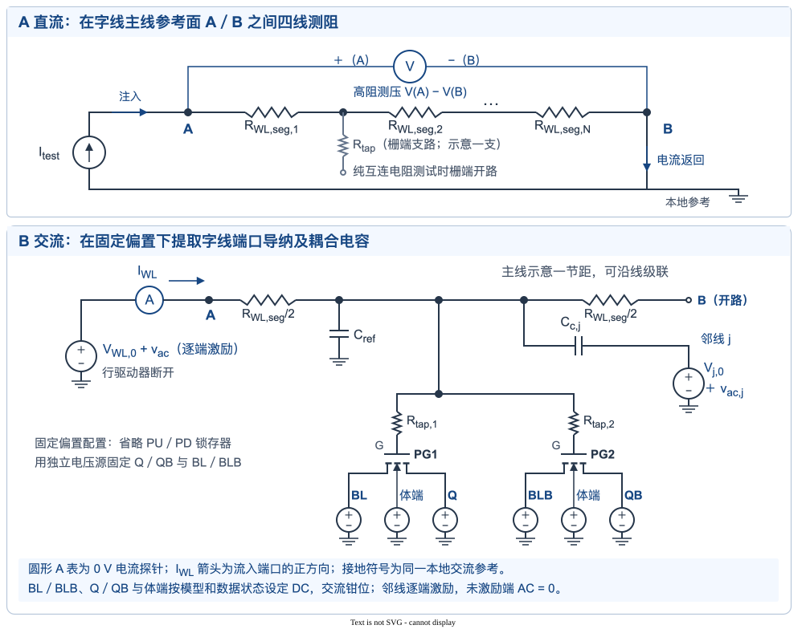

# CELL_WL RC

## 定义与适用范围

**单元节距字线寄生（Bitcell-Pitch Wordline Resistance and Capacitance，CELL_WL RC）**是阵列内部字线（Wordline，WL）沿行方向跨一个列节距的电阻与电容增量。沿线电阻 $R_{\mathrm{WL,seg}}$ 以 Ω/cell 报告；几何电容及指定条件下的端口电容以 F/cell 或 aF/cell 报告。对常规 6T 位单元，还须分别记录主线至两只访问管（Pass-Gate，PG）栅端的支路电阻，以及两个 PG 的栅端负载。支路电阻按实际接触或共用支路报告，单位为 Ω，禁止并入主线段电阻（两者电流路径不同）。[1, Sec. 5.5, Fig. 9] [5, Sec. III-A, Fig. 10] [8, Sec. III, Fig. 7]

一个列节距沿 WL 方向计数。若镜像铺排、导体换层或跨接每 $m$ 列才重复，以完整重复周期两侧的同相位参考面为界；将周期等效量除以 $m$ 报告每节距增量，并保留周期内各段的顺序和接点。含器件的电容须注明 WL 偏置、存储节点、位线与邻线条件。时延和边沿另报。

## 物理机制与器件变异

| 分量 | 电气范围与控制条件 |
| --- | --- |
| 主线段电阻 $R_{\mathrm{WL,seg}}$ | 指两侧参考面间的 WL 沿线导体及实际串联换层通孔；若存在并联金属跨接，按实际网络求两端等效电阻。线宽、厚度、有效电阻率和温度会改变该值。 |
| 支路电阻 $R_{\mathrm{tap}}$ | 保留从主线抽头至 PG 栅端参考面之间的局部金属、通孔和栅接触。两只 PG 共用的阻段只实例化一次；器件模型已包含的栅电阻按模型边界另记。 |
| 几何电容 $C_{\mathrm{ref}}$、$C_{\mathrm{c},j}$ | $C_{\mathrm{ref}}$ 为到所定义参考导体的电容，$C_{\mathrm{c},j}$ 为到另一导体 $j$ 的正值跨节点电容。随相邻 WL、位线（Bitline，BL／BLB）、电源轨、上下层金属和屏蔽几何变化。 |
| 两只 PG 的栅端负载 | 接入紧凑模型后，栅端电荷随 WL、BL／BLB、存储节点 Q／QB 和体端偏置变化。固定其他端子时可报告两只 PG 的微分栅电容；其他端子运动时，保留端子电荷模型及其终端。 |

通过工艺设计套件（Process Design Kit，PDK）确定版图寄生提取（Parasitic Extraction，PEX）与紧凑模型的交界，核对重叠／边缘电容、栅电阻和接触分别由哪部分实例化。导线可用宽度增大时，线阻通常降低，几何电容须按邻近导体及间距重新提取。互补场效应晶体管（Complementary Field-Effect Transistor，CFET）结构中，连接底层 PG 的高通孔可能增加外部电容；改用不同线层、垂直互连或埋入式布线时，须分别比较线阻和电容分量。[2, Sec. III, Fig. 3] [5, Sec. II-E, Figs. 7–10] [6, Sec. 6.2] [7, Sec. 3.1, Fig. 8] [8, Sec. III, Figs. 6–7]

对线性几何电容，在沿线电位近似均匀的测量段内，规定电流从 WL 端口流入网络为正，则 $i_C=C_{\mathrm{ref}}\,\mathrm{d}v_{\mathrm{WL}}/\mathrm{d}t+\sum_j C_{\mathrm{c},j}\,\mathrm{d}(v_{\mathrm{WL}}-v_j)/\mathrm{d}t$。若本端斜率非零，邻线静止、同斜率同向、同斜率反向时，其等效贡献依次为 $C_{\mathrm{c},j}$、$0$、$2C_{\mathrm{c},j}$。实际分布网络及带器件负载须使用各节点的实际波形和端子条件。

## 重复单元与整行网络边界

以两处同层、同相位且截面一致的 WL 主线参考面 A／B 界定重复段。提取窗保留邻行、交叉 BL／BLB、电源和上下层金属；按提取规则扩大重复铺排范围，检查内部参数是否收敛。首末非重复段、驱动接入、跨接、分段开关以及远端终端，均按各自实际连接加入整行 [WL RC](../Subarray/WL_RC.md)。组装时对跨参考面的元件只计一次，并用完整行 PEX 核验。

CACTI 6.0 将每节距线阻、线电容、PG 栅负载和驱动器的电阻、电容分别建模。均匀单端驱动的串联 RC 梯形网络中，沿线电阻依次为下游多段负载充电，线延迟项随行单元数近似二次增长；这一标度须按驱动位置、终端和分段结构验证。实际行分段时，局部 WL、全局 WL 及中间驱动分别建模；短行可在全分布模型校验后使用集总近似。[1, Sec. 5.5, Fig. 9] [4, Sec. 4.3.1] [9, Sec. II, Tables II–III] [10, Sec. III-B, Fig. 5] [11, Fig. 3]

## 测量与提取方法

按[铺排端口图](Cell_Height_Width.md#测量与提取方法)定位 WL 方向和重复边界。图 A 用于纯互连直流（Direct Current，DC）提取：电流由 A 流入，由 B 返回；高阻探针在 A／B 取差分电压。图 B 用于交流（Alternating Current，AC）提取：断开行驱动器，从 A 注入激励并记录口面电流，B 开路；示意一个可级联节距，邻线端口可置 AC 零激励或轮流驱动。两只 PG 的源漏两端分别连接 BL 与 Q、BLB 与 QB，体端按器件模型偏置。图示钳位测试省略交叉耦合反相器，由独立偏置固定 Q／QB；功能波形验证时须恢复锁存器和实际位线端接。

### 版图与仿真提取

**【前置条件】** 使用通过版图与原理图一致性检查（Layout Versus Schematic，LVS）的铺排版图。构造端部相同、边界同相位的多个长度，建议至少三种以检查斜率残差。记录版图版本、PEX 规则与工艺角、温度、通孔简化方式、耦合保留阈值和参考节点。纯互连及含器件两组网表使用同一几何和端口。直接以选定参考面驱动，或在结果中去嵌已知接口网络。[3, Extract Parasitics]

**【步骤／方法】**

1. **提取线阻及栅支路电阻**：断开行驱动器；在保留实际导线和跨接的纯电阻网络中，使 PG 栅支路末端开路，对 A／B 注入小电流。以 $R(N)=(V_A-V_B)/I$（Ω）求端到端电阻，对节距数 $N$ 拟合斜率得到 $R_{\mathrm{WL,seg}}$（Ω/cell）。另在抽头与各栅端参考面之间计算支路电阻；标出共用部分及模型内栅电阻的边界。
2. **读取几何电容**：从 PEX 网表按 WL 对参考导体、WL–邻行、WL–BL／BLB 及其他保留网络分组，读取正值元件电容。逐分量取长度斜率（F/cell），或在边界归属明确时按完整周期归一。到动态邻线的电容须保留跨节点连接；若导体按约定固定于 AC 参考电位，可将相应电容并入对参考节点项。[3, Extract Parasitics] [8, Sec. III, Figs. 6–7]
3. **用多端导纳核验**：沿用 [CELL_BL RC](CELL_BL_RC.md#测量与提取方法) 的低频导纳口径。设测试参考为本地交流参考节点并注明其是否与 VSS 同网。逐个端口 $j$ 加小信号，其他独立端口保持既定 DC 电位及零 AC 电压；测量流入端口 $i$ 的电流增量，计算 $Y_{ij}=\Delta I_i/\Delta V_j$（S）。在 $e^{j\omega t}$ 约定下，$\omega=2\pi f$（rad/s）；对近似等电位且呈稳定平台的无源互连，取
   $$
   C_{\mathrm{tot,WL}}=\frac{\operatorname{Im}Y_{\mathrm{WL,WL}}}{\omega},\qquad
   C_{\mathrm{c},j}=-\frac{\operatorname{Im}Y_{\mathrm{WL},j}}{\omega}.
   $$
   上式单位为 F；若所有需要分列的耦合端口均已纳入，则对参考节点的等效项为 $C_{\mathrm{tot,WL}}-\sum_j C_{\mathrm{c},j}$。记录折入该项的固定交流电位导体。浮置导体保留其终端条件，报告端口有效值。带器件时在 WL 低、中、高电位扫描，分别设置两种存储状态、BL／BLB 预充及代表性读写偏置，并固定体端及电源条件。记录端口 $\operatorname{Re}Y$、频带和交流幅度。在 $\operatorname{Im}Y_{\mathrm{WL,WL}}/\omega$ 存在低频平台时，以该值报告指定偏置与终端下的端口有效电容；禁止将含器件或浮置终端的导纳按无源电容矩阵拆分（端口响应包含这些负载的影响）。需要单列 PG 负载时，在相同端面及其他端子固定条件下读取模型两只 PG 的栅端电荷导数，核对与 PEX 的重叠归属。
4. **按实际边沿取开关等效电容**：以本地 WL 端口从 $t_1$ 到 $t_2$ 的非零电压变化 $\Delta V_{\mathrm{WL}}$ 为分母，积分流入端口的净电流，求
   $$
   C_{\mathrm{eff}}=\frac{\Delta Q}{\Delta V_{\mathrm{WL}}},\qquad
   \Delta Q=\int_{t_1}^{t_2}\left[I_{\mathrm{WL}}(t)-I_{\mathrm{leak}}(t)\right]\,\mathrm{d}t.
   $$
   $\Delta Q$ 以库仑计；$I_{\mathrm{leak}}$ 为在匹配偏置下能独立辨识的传导电流基线。记录上升／下降边沿、端口摆幅、积分起止条件和收敛情况，以及邻行静止、同向或反向切换的配置。实际读写时恢复锁存器、位线波形以及适用的字线助推／降压，按该波形重新提取。

**注意事项**：禁止从驱动器输入端或未去嵌的测试夹具端直接计入单元电容（驱动器输出和接口负载属于不同层级）。

**注意事项**：禁止重复实例化已在紧凑模型中计入的栅端重叠／边缘电容（会高估 WL 负载）。

**【结果处理和验证】** 比较 PEX 元件汇总与低频导纳，核对 A／B 连通、探针电流方向、无源耦合对称性、取窗和激励幅度收敛。若长线无稳定平台，保留 $Y(f)$ 与分布网络；漏电基线无法分离时交付原始电流和积分条件。在相同偏置、口面摆幅、邻线波形和积分条件下，只有总量随节距数近似线性时，才按斜率归一有效电容；否则保留各长度的口面总值。对可归一的量同时报告端部截距和拟合残差。负斜率或明显随长度变化的结果须回查端面、周期相位、终端及量测分辨率。

### 硅片电阻与电容量测

**【前置条件】** 制作多个长度且端部、金属层、通孔和邻线环境匹配的 WL 专用结构，预留两端独立注流／感测端与邻线偏置端，提供匹配开路、短路和驱动器对照。按用途分设纯互连测试结构与含 PG 的负载结构；记录焊盘、引线、测试开关和驱动器的电气参考面。栅支路需独立量测时，另用复现材料及几何的栅接触链或专用 Kelvin 结构。

**【步骤／方法】**

1. **四线量测 R**：从 A 注流并由 B 返回，独立高阻感测线测 $V_A-V_B$。可用正反向等幅电流所得压差之差除以两倍电流幅值，去除零点和热电势；扫低电流幅值验证线性并控制自热。
2. **去嵌后量测 C**：将开路、短路和驱动器对照置于与被测件相同的连接与偏置；用校验件验证夹具模型，再将参考面移至被测 WL。记录低频导纳，或在已知本地电压阶跃、末端和邻线条件下由净注入电荷计算有效电容；校准剩余的驱动、开关瞬态及可辨识的漏电。校准和长度差分覆盖同一项时只扣一次。
3. **获取功能波形**：恢复实际行驱动和负载，采样近／中／远端的电平、边沿和脉宽，记录采样负载与带宽。用相同输入边沿、终端和偏置，对照整行提取模型。

**注意事项**：禁止将单次传播延时拆成独立 R、C（驱动、分布线阻、端口负载和采样电路共同决定时延）。

**【结果处理和验证】** 分别拟合去嵌后电阻和电容随节距数的增量，记录同相位样本、重复量测不确定度与可分辨的最小长度差。增量低于分辨率时增加匹配长度差或报告上限。整行波形作为功能验证独立标注。本文核验来源未报告同一单节距结构的独立 R、C 硅测；Toh 等的 45 nm 芯片数据为 WL 脉宽和波形采样，Mathur 等和 Liu 等的每节距参数来自提取或模型。[5, Sec. III-A, Fig. 10] [8, Fig. 7] [9, Tables II–III] [13, Secs. III–IV, Figs. 8, 13]

**文献结论（版图建模）**：Liu 等的 A14 纳米片分段子阵列中，假设钌互连，M1 局部 WL 的 150 nm 节距估算值为 9.45 Ω/cell、164 aF/cell；表中电容明确排除器件电容。该设计另列局部 WL 至逻辑门的垂直连接参数。Lee 等在三层 CFET 位单元中按不同对端拆分 WL 几何电容，并由单元寄生搭建分布式阵列模型。比较两组数据时，须核对提取路径、PG 栅端边界和耦合折算条件。[9, Secs. II-B–C, Tables II–III] [14, Fig. 4, pp. 7–8]

## 数据可视化与评估

- **检查归一口径**：横轴用 WL 节距数，纵轴分别用 Ω、F 或 aF；显示各组的斜率、截距、拟合残差及不确定度。栅支路独立按接触结构分组。对铺排周期不同的方案，同时给出周期总值和每节距值。
- **比较电容分量**：用堆叠条形图展示对参考导体与各邻线的几何电容；用独立曲线展示两种存储状态、BL 偏置和邻线条件下的微分或开关等效电容。注明工艺角、温度、交流频段或积分窗口；几何分量与已含几何项的端口总负载须分图或显式区分。
- **校核行时序及分位**：固定驱动、行长及输入边沿后，比较重建网络与完整行 PEX 或硅测波形。分别检查近／中／远端幅度、传播时间及边沿残差。典型值用于布图比较；最慢行评估还须保留同一金属层及相关通孔的空间相关性、采样数和位置分位。模型角、统计分布与硅片量测不确定度分别记录。CACTI 的验证对照是分布模型与 SPICE 时延。[1, Sec. 8, Fig. 13(a)] [10, Sec. III-B, Fig. 5] [13, Fig. 13]

## 应用场景与指标关系

- **单元与布线选择**：设计与工艺协同优化（Design–Technology Co-Optimization，DTCO）时，对比 WL 线层、位单元宽度及 PG 栅接触；用拆分后的阻容确定瓶颈位于主线、局部接触还是栅负载。[5, Secs. II-E, III-A] [7, Sec. 3.1] [8, Sec. III] [12, Fig. 11]
- **行驱动和读写校核**：将重复段用于 [WL RC](../Subarray/WL_RC.md)，加入实际驱动及行结构后验证 [WL Slew](../Subarray/WL_Slew.md) 与 [Write Time](../Subarray/Write_Time.md)。在相同驱动和行长下，降低线阻或负载通常有助于缩短远端边沿。按最差位置的实际选通电位设定准静态 [WM](WM.md) 测试偏置；以完整 WL 波形验证动态写入和读扰，分别记录局部选通电位、有效脉宽和读写判据。[9, Sec. II] [10, Sec. III-B, Fig. 5] [12, Figs. 11–12] [13, Secs. III–IV]

## 参考文献

2026-11-17，Zotero Bitcell 收藏精确标签 `CELL_WL RC` 初检 5 条，补检后 12 条均有可读 PDF，含 10 篇期刊／会议论文、1 份技术报告及 1 本专著。另保留原有 CACTI 6.0 报告及在线提取器文档。

[1] N. Muralimanohar, R. Balasubramonian, and N. P. Jouppi, “CACTI 6.0: A tool to model large caches,” HP Labs, Tech. Rep. HPL-2009-85, 2009. [公开文献](https://shiftleft.com/mirrors/www.hpl.hp.com/techreports/2009/HPL-2009-85.pdf) （本次 Zotero 标签检索未命中，保留原有来源。）

**相关摘要：** 报告在分布字线模型中将一条字线表示为多个单元宽度的互连段，每段具有线电阻、线电容以及访问管栅负载，并把驱动器电阻与漏端电容单独加入延迟公式。式中的 n 是整行连接的单元数，因而延迟包含随长度增大的分布 RC 项，不能将整行时间常数称为单元段 RC。该模型有助于把本页指标作为阵列时延分析输入，也说明采用集总电容可能遗漏电阻主导工艺中的波形影响。其验证基于 PTM/HSPICE及解析模型，属于架构估算方法，不提供特定 SRAM 版图的独立单元寄生提取值。

**原文定位：** 分布式 WL 模型见 Sec. 5.5、Fig. 9、p. 17（PDF 第 18 页）；模型与 SPICE 对照见 Sec. 8、Fig. 13(a)、p. 21。旧版引用标记 [1, Sec. 6.1.1, Fig. 9]、[1, Sec. 6, Figs. 9, 13(a)] 的章节号按本归档更正。

[2] M. Karner et al., “Variability-aware DTCO flow: Projections to N3 FinFET and nanosheet 6T SRAM,” in Proc. SISPAD, 2021. [DOI 10.1109/SISPAD54002.2021.9592527](https://doi.org/10.1109/SISPAD54002.2021.9592527). [公开文献](https://doi.org/10.1109/SISPAD54002.2021.9592527) [Zotero](https://www.zotero.org/users/7333024/items/2NIBZCPG)

**相关摘要：** 本文采用完整三维单元的寄生提取，生成包含电阻、电容及晶体管的SPICE模型，并研究N3 FinFET与nanosheet结构的局部工艺变化。该方法可在字线到访问管栅的路径中保留互连寄生，避免只用理想连线模拟。但文中未单独报告RWL/CWL、每单元栅负载或整行分布式字线参数；图11给出的是稳定性及读电流统计，不是字线RC。引用范围应限于PEX与统计模型连接方式，整行电容和驱动延迟仍需另行提取。

**原文定位：** Sec. II–III、V-B；Figs. 2–3、9–11，PDF pp. 1–3。

[3] The OpenROAD Project, “Parasitics extraction,” OpenROAD documentation. [原文](https://openroad.readthedocs.io/en/latest/main/src/rcx/README.html) （本次 Zotero 标签检索未命中，保留原有来源。）

**相关摘要：** OpenRCX 文档介绍基于布线几何和工艺规则提取电阻、对地及耦合电容，并允许保留过孔电阻和输出 SPEF。对字线指标，应将输出网络按单元重复节距定位，再与整行连接及器件栅负载区分；这一划分是使用者需要明确的分析边界。该文档可作为实际寄生提取流程的工具依据，却未给出 SRAM 字线单元段的固定数值、偏置或时延模型，不能由通用功能说明推导某工艺的 CELL_WL RC。

**原文定位：** Parasitics Extraction、Extract Parasitics、Write SPEF；访问日期2026-11-13。

[4] S. Thoziyoor, N. Muralimanohar, and N. P. Jouppi, “CACTI 5.0,” Hewlett-Packard Laboratories, Tech. Rep. HPL-2007-167, Oct. 19, 2007.  · [Zotero](https://www.zotero.org/users/7333024/items/JYDVTQLK)；DOI：Zotero未收录或尚未核实。

**相关摘要：** 附件实际为2007年的CACTI 5.0技术报告，采用按线长计算电阻和电容的π型互连模型，并结合逻辑努力对译码器与字线驱动器进行尺寸设计。阵列分段参数改变每行单元数量及字线长度，因此字线负载不仅与单元栅电容有关，还受金属RC和驱动链影响。报告讨论局部与全局线参数的工艺投影假设，适于建立整行延迟估算框架；它没有测量每单元字线RC，也不能把整行驱动和译码开销归入单元本征电容。引用时应保留单元负载、整行连线及外围三级边界。

**原文定位：** Sec. 2.2–2.3、4.1–4.3.1；Figs. 12–17，正文pp. 4–6、15–18。

[5] H. H. Liu et al., “CFET SRAM DTCO, interconnect guideline, and benchmark for CMOS scaling,” IEEE Transactions on Electron Devices, vol. 70, no. 3, pp. 883-890, 2023. [公开文献](https://doi.org/10.1109/TED.2023.3235701) · [DOI 10.1109/TED.2023.3235701](https://doi.org/10.1109/TED.2023.3235701) · [Zotero](https://www.zotero.org/users/7333024/items/W99KL789)

**相关摘要：** 本文在A14至A3 SRAM版图中提取每单元字线电阻和电容，并与位线寄生分开比较。字线连接到底层访问管的高通孔使CFET的BEOL电容增加，说明缩小单元平面面积并不保证字线负载同步降低。作者将器件本征电容与互连及外部电容分别提取，再用于包含行译码和远端最坏单元的子阵列电路。图10属于每单元字线寄生，288列阵列的总负载还取决于重复单元、连线及驱动器，不能直接用该图作为整行延迟或片上测量结果。

**原文定位：** Sec. II-E、III-A–B；Figs. 8–10，pp. 885–886。

[6] H. H. Liu, and F. Catthoor, “Circuit-technology Co-optimization of SRAM design in advanced CMOS nodes,” Cham, Springer Nature Switzerland, 2025. [公开文献](https://doi.org/10.1007/978-3-031-76109-6) · [DOI 10.1007/978-3-031-76109-6](https://doi.org/10.1007/978-3-031-76109-6) · [Zotero](https://www.zotero.org/users/7333024/items/CHVFC3IE)

**相关摘要：** 本书以每单元RWL和CWL比较多种CFET SRAM，再结合子阵列尺寸分析行驱动影响。第6章指出高度比宽度缩放更激进，字线可用宽度往往大于位线，因而其电阻较低，但连接底层器件的高通孔可能增加电容。A5.s2p到A3.h3p的特定比较中，RWL和CWL分别减少44%和32%；这些是每单元模型变化，不是整行字线延迟降幅。分段字线及额外驱动器还会改变外围面积和宏级互连开销，应分别报告单元RC、行长度和驱动拓扑。

**原文定位：** Sec. 6.2；Figs. 6.1–6.2，pp. 137–139；Ch. 8。

[7] X. Cheng et al., “A novel design for SRAM bitcell with 3-complementary-FETs,” Microelectronics Journal, vol. 173, Art. no. 107180, 2026. [公开文献](https://doi.org/10.1016/j.mejo.2026.107180) · [DOI 10.1016/j.mejo.2026.107180](https://doi.org/10.1016/j.mejo.2026.107180) · [Zotero](https://www.zotero.org/users/7333024/items/QJ3K3I2Z)

**相关摘要：** 本文针对不同上下nanosheet组合提取3-CFET SRAM互连寄生。字线位于结构中心并连接堆叠器件栅，因而具有较大的耦合电容，增加片数会使包括WL在内的中心节点电容上升；字线互连位于结构端部，其电阻对中间片数增加较不敏感。电容来自Raphael，而电阻依据金属长度和指定单位长度电阻估算，两者的方法应分别注明。这是单元内部和单元跨度的互连分析，未单独给出整行WL驱动延迟或硅片测量，不能直接外推整行字线RC。

**原文定位：** Sec. 3.1；Fig. 8，PDF pp. 4–6。

[8] R. Mathur et al., “Buried interconnects for sub-5 nm SRAM design,” IEEE Transactions on Electron Devices, vol. 69, no. 3, pp. 1041–1047, 2022. [DOI](https://doi.org/10.1109/TED.2022.3143078) · [公开文献](https://doi.org/10.1109/TED.2022.3143078) · [Zotero](https://www.zotero.org/users/7333024/items/H35G9VFR)

**相关摘要：** N5 高密度和高电流位单元采用三维场求解提取不同埋入式布线方案。图 6 分列字线与邻行、位线、电源及其他导体的耦合；图 7 比较每节距归一阻容。在部分埋入式布线方案中，加宽 WL 降低了电阻，电容则因相邻导体布局变化而重新分配。拼接子阵列后的读、写及动态功耗结果来自仿真。

**原文定位：** Sec. III，Figs. 6–9，归档版 pp. 4–5。

[9] H. H. Liu et al., “Future design direction for SRAM data array: Hierarchical subarray with active interconnect,” IEEE Transactions on Circuits and Systems I: Regular Papers, vol. 71, no. 12, pp. 6495–6506, 2024. [DOI](https://doi.org/10.1109/TCSI.2024.3410518) · [公开文献](https://doi.org/10.1109/TCSI.2024.3410518) · [Zotero](https://www.zotero.org/users/7333024/items/FKMH67JE)

**相关摘要：** 评估 A14 纳米片常规分段结构，以及把部分局部逻辑移至后端有源层的结构。表 II、III 将局部 WL、全局 WL 和多种信号线的每单元互连阻容分别列出，排除器件电容。表 III 另列局部 WL 至逻辑门的垂直通孔。该归属可用于评估分段结构的瓶颈；电路结果属于仿真。

**原文定位：** Secs. II-B–C，Tables II–III，Figs. 6–9。

[10] B. S. Amrutur and M. A. Horowitz, “Speed and power scaling of SRAM's,” IEEE Journal of Solid-State Circuits, vol. 35, no. 2, pp. 175–185, 2000. [DOI](https://doi.org/10.1109/4.823443) · [公开文献](https://doi.org/10.1109/4.823443) · [Zotero](https://www.zotero.org/users/7333024/items/CH2EXX7I)

**相关摘要：** 分别建模预译码、全局字线和局部字线，按真实负载所在层级计算分布线延迟，并讨论从中心驱动时的等效两段网络。末端字线边沿影响位线读取速度；该延迟模型用于阵列尺寸和组织选择。

**原文定位：** Sec. III-B，Fig. 5，Eqs. (2)–(4)，pp. 178–179。

[11] Q. Song, C. Y. Peng, H. G. Zhou, and S. B. Tan, “Time delay model for SRAM compiler,” Applied Mechanics and Materials, vol. 373–375, pp. 1561–1566, 2013. [DOI](https://doi.org/10.4028/www.scientific.net/AMM.373-375.1561) · [公开文献](https://doi.org/10.4028/www.scientific.net/AMM.373-375.1561) · [Zotero](https://www.zotero.org/users/7333024/items/CJ32UAW9)

**相关摘要：** 65 nm 编译器模型按列数累加访问管栅电容，用驱动器等效电阻计算 WL 延迟。原文在其尺寸及工艺下忽略相邻单元间线阻；用作集总近似时须先检查全分布波形误差。

**原文定位：** Fig. 3，Eqs. (1)–(4)，pp. 1562–1563。

[12] W. Peng et al., “PPA scaling of flip FET technology down to A2 node enabled by architecture innovations: Self-aligned gate, 2T design with embedded power rail and ultra-stacked 4-tier transistors,” in 2025 Symposium on VLSI Technology and Circuits, 2025, pp. 1–3. [DOI](https://doi.org/10.23919/VLSITechnologyandCir65189.2025.11074822) · [公开文献](https://doi.org/10.23919/VLSITechnologyandCir65189.2025.11074822) · [Zotero](https://www.zotero.org/users/7333024/items/98D5AA4T)

**相关摘要：** 比较多种堆叠晶体管位单元的每单元字线、位线阻容，并分别分析行折叠与列折叠条件下的最差位单元读写。行组织改变负载节距数；文中器件工艺演示与阵列电路投影须分开引用。

**原文定位：** SRAM Design 部分，Figs. 11(e)–12，PDF 第 2–3 页。

[13] S. O. Toh, Z. Guo, T.-J. K. Liu, and B. Nikolić, “Characterization of dynamic SRAM stability in 45 nm CMOS,” IEEE Journal of Solid-State Circuits, vol. 46, no. 11, pp. 2702–2712, 2011. [DOI](https://doi.org/10.1109/JSSC.2011.2164300) · [公开文献](https://doi.org/10.1109/JSSC.2011.2164300) · [Zotero](https://www.zotero.org/users/7333024/items/PTWVUSQP)

**相关摘要：** 45 nm 测试芯片以片上采样器观测局部 WL 波形，并校准脉宽码与实际脉宽的关系。该结构支持动态读写和字线激励的硅片交叉验证；原文没有提供独立的单节距线阻和电容测量。

**原文定位：** Secs. III–IV-A，Figs. 8、13，pp. 2705–2708。

[14] J. Lee, J. Lee, J. Lee, S. Ahn, D. Jin, and J. Jeon, “3-Tier CFET 6T-SRAM with 2D-TMDs channels for Angstrom technology node,” Scientific Reports, vol. 16, Art. no. 16857, 2026. [DOI](https://doi.org/10.1038/s41598-026-37881-5) · [公开文献](https://doi.org/10.1038/s41598-026-37881-5) · [Zotero](https://www.zotero.org/users/7333024/items/XVJWQR63)

**相关摘要：** 对两层和三层 CFET 位单元进行三维寄生提取，覆盖局部栅接触及上层互连。图 4(d) 给出指定路径的器件中段互连（Middle of Line，MOL）与后段互连（Back End of Line，BEOL）电阻，图 4(g) 按耦合对端拆分几何字线电容；栅接触链与纯金属主线的参考面不同，比较时须注明路径。32 × 32 阵列结果由单元参数搭建的分布网络计算。

**原文定位：** Fig. 4(d, g)，pp. 7–8；分布式模型见 p. 11。
