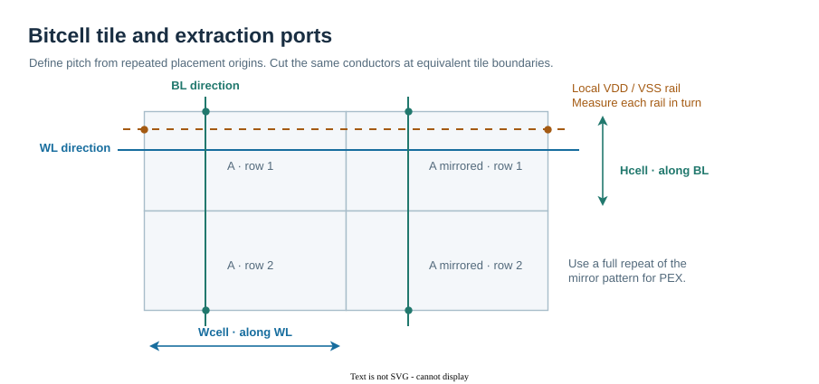

# Cell Area

## 定义与适用范围

**单元版图面积**（Bitcell Area，$A_{\mathrm{cell}}$）指静态随机存储器（Static Random Access Memory，SRAM）阵列内部合法周期铺排中每个物理存储位分摊的平面占地，单位为 μm²/bit。以字线（Wordline，WL）跨列方向为 $x$，位线（Bitline，BL）跨行方向为 $y$。对正交、均匀且无额外间隙的矩形铺排，$W_{\mathrm{cell}}$ 与 $H_{\mathrm{cell}}$ 分别为两方向的位单元节距，$A_{\mathrm{cell}}=W_{\mathrm{cell}}H_{\mathrm{cell}}$。需要多单元镜像、错位或共享接触才能完整重复时，以最小完整重复块面积 $A_{\mathrm{tile}}$ 除以其中的物理存储位数 $N_{\mathrm{tile}}$。[Cell Height & Width](Cell_Height_Width.md) 给出方向和节距定义。

比较 6T、8T 等位单元时，须注明拓扑、端口数、工艺规则和面积边界。单元有源区面积、晶体管有效沟道面积、宏面积/bit 和阵列有效位密度须分别报告。

## 物理机制与器件变异

**尺寸约束**：在平面 CMOS 中，下拉管（Pull-Down，PD）、访问管（Pass-Gate，PG）和上拉管（Pull-Up，PU）的宽长连同扩散区间距、栅图形与接触孔间距及图形包围规则，共同决定可铺排节距。加宽器件只有在触及当前主导约束、需要增加扩散跨度或跨到下一布线轨道时，才增大外框。文献中的 $\lambda$ 规则面积公式只适用于对应版图，$\lambda$ 为该规则模型的最小特征尺寸。[5, Sec. VI-C, Eq. (37), Fig. 22] [12, Sec. II-A.5, Eq. (1), Fig. 1(b)]

**离散尺寸与布线**：鳍式场效应晶体管（Fin Field-Effect Transistor，FinFET）的鳍数按整数配置；改变鳍数须核对鳍间距、鳍切割、栅接触节距（Contacted Poly Pitch，CPP）、金属轨道及与外围的网格匹配。Karner 等的 N3 投影在 45 nm CPP、21 nm M0 节距下建立 1:1:1 FinFET 单元和每管四片、片宽 16 nm 的纳米片单元，图 2 展示 FinFET 版图；器件截面尺寸与单元平面节距须分别提取。互补场效应晶体管（Complementary Field-Effect Transistor，CFET）采用垂直堆叠，可减少平面内的 N/P 器件分离占地；栅切割、共享电源轨和位线布线仍会限制最终尺寸。[1, Sec. II, Fig. 2] [16, Sec. II, Fig. 1, Table 1] [20, Secs. II-B–E, Figs. 3–5]

**固定版图与器件变异**：对同一版图数据库，工艺、电压与温度（Process, Voltage and Temperature，PVT）角及局部器件失配不改变标称铺排面积。线宽、栅长和套刻偏差影响寄生和电性，须另行表征。若为满足统计良率而调整器件尺寸、接触或布线，须对修改后的版图重提面积。Lu 等按 65 nm 规则估算，优化后的单鳍 PD 方案为 0.702 μm²，双鳍方案为 1.027 μm²；该差异对应满足文中读写约束的两组尺寸。[1, Sec. II, V, Figs. 2, 9–11] [11, Sec. IV-B, Table II]

## 本征铺排与阵列面积边界

| 边界 | 纳入范围 | 用途 |
| --- | --- | --- |
| **单元本征铺排** | 构成最小完整周期的单元本体、周期内必需间距及共享接触或电源轨分摊 | 报告 $A_{\mathrm{cell}}$，比较位单元版图 |
| **物理阵列** | 实际存储单元位点（含数据位、备用位及校验位等）、另插的阱接触和字线跨接单元、边缘虚设单元、端接与阵列内间隔 | 核算阵列占地 $A_{\mathrm{array}}$ 与物理位密度 |
| **可放置宏** | 物理阵列、行列外围、控制电路、宏内布线通道及边界留量；宏外放置间距另列 | 用宏占地 $A_{\mathrm{macro}}$ 和用户可用数据位数估算产品密度 |

**共享归属**：每个周期边界上的共用接触或电源轨只计入一次。每隔若干单元才插入的阱接触或字线跨接单元，其增加的间距计入物理阵列。若所用重复块已含这些结构，须单列「含周期插入开销」的每位面积；只有可从实际版图明确划出纯位单元的铺排边界时，才另报 $A_{\mathrm{cell}}$。3-CFET 版图按两侧埋入式电源轨空间的邻接共享划定面积边界；原文报告的 37% 缩减已包含该共享，且对应所比较的传统 CFET 版图。[4, Sec. 1] [24, Sec. 2.2, Figs. 2–3]

**测试结构边界**：硅片测试结构（Test Key）可能带有额外的探针焊盘、开关、采样或校准电路，也可能采用不同的单元间距。须先核对被测区域的单元版图版本、铺排朝向和测试连线；能够复现目标铺排的内部区域可用于节距量测。其余区域按测试结构面积或测试版节距单列。Hsiao 等的 0.18 μm 测试芯片以 512 行 × 16 列为子阵列重复块，边界另布置阱接触、字线跨接、电源连接及虚设结构。[4, Sec. 2, Figs. 3–4] [13, Figs. 1–3]

## 测量与提取方法

### 标称版图面积提取

**【前置条件】** 准备目标工艺设计套件（Process Design Kit，PDK）、已明确版本的 GDSII 或 OASIS 版图、与版图配套的网表和铺排规则。记录单元名称、拓扑、PU/PG/PD 尺寸或鳍数／纳米片配置、规则选项、金属轨道、接触方案及数据库单位（Database Unit，DBU）对应的物理长度。[1, Sec. II, Fig. 2] [2, Sec. 3]

**【步骤/方法】**

1. **验证合法邻接**：在版图中建立带邻居的完整内部铺排，含左右、上下及实际使用的镜像接缝。核对跨缝扩散区与接触孔的共享、WL、BL、互补位线（Complementary Bitline，BLB）和电源轨的连通，以及 PG 接入端口的对齐。按目标 PDK 规则核对接缝，再对按目标规则配置阱接触、字线跨接和端接结构的代表性物理阵列执行设计规则检查（Design Rule Check，DRC）和版图与网表一致性检查（Layout Versus Schematic，LVS）。[2, Sec. 4]
2. **确定重复边界**：在版图中标记最小完整重复块的放置边界，或以朝向、连线和共享结构均等价的重复原点确定切边。记录 $x,y$ 方向、镜像顺序、重复边界坐标与 $N_{\mathrm{tile}}$，每个一位存储节点对只计一位。对非矩形铺排，按实际可平铺多边形提取面积。
3. **换算每位面积**：从版图读取重复边界面积 $S_{\mathrm{DBU}}$（DBU²），以 $s$ 表示每 DBU 对应的长度（μm/DBU）。矩形重复块可用两方向等价原点距离相乘；若分别跨 $n_x$ 列、$n_y$ 行且铺满同规格位单元，按下式用节距交叉核算：

   $$
   A_{\mathrm{tile}}=S_{\mathrm{DBU}}s^2,\qquad
   A_{\mathrm{cell}}=\frac{A_{\mathrm{tile}}}{N_{\mathrm{tile}}}
     =\frac{\Delta x}{n_x}\frac{\Delta y}{n_y}\quad\text{（均匀矩形铺排）}
   $$

   式中 $\Delta x$、$\Delta y$ 均以 μm 计。图中 2 行 × 2 列可作为核对块：取四格边界，按 $N_{\mathrm{tile}}=4$ 核算。图中彩色连线为寄生提取示意，面积由铺排格线界定。

   

**注意事项**：须使用合法重复切边（版图层外溢、标注和各层图形集合的外接矩形可能跨入相邻单元）。

**【结果处理和验证】** 确认邻接检查通过、无重叠计数或遗漏间隙，连续两个完整重复块的面积与位数按相同比例增加。矩形铺排的两种算法须在坐标取整容差内一致；如不一致，先排查 DBU 标度、镜像周期和位数。交付边界坐标、方向、位数、节距、面积和检查报告。几何面积提取无需电气仿真。

### 硅片铺排核验

**【前置条件】** 选取版图边界已知的阵列内部区域，使用平面扫描电子显微镜（Scanning Electron Microscopy，SEM）或相应量测设备，标定图像尺度和测量方向。记录批次、晶圆、裸片及阵列位置、成像层、同相位标志和校准条件。

**【步骤/方法】** 在同一图层标出多个同朝向、同相位的重复标志，用位置对周期序号拟合重复距离。对均匀矩形铺排，按所跨列数和行数换算为每位节距后求面积。对不等节距或非正交铺排，在校准后的正交图像坐标中拟合两条独立的完整重复平移向量 $\mathbf{u}=(u_x,u_y)$、$\mathbf{v}=(v_x,v_y)$，各分量以 μm 计；取平行四边形面积 $\lvert u_xv_y-u_yv_x\rvert$，再除以该平行四边形所覆盖周期的物理位数。

**注意事项**：须将线宽或临界尺寸（Critical Dimension，CD）与重复节距分开报告（刻蚀线宽的局部差异不等于铺排节距变化）。

**【结果处理和验证】** 保存原图、尺度校准、跨周期距离、节距、位置和量测不确定度；在约定容差内核对与同版本版图的差异。研究实测节距时按裸片和位置分组，报告样本数及置信区间。已有引用未报告逐位单元的 SEM 面积分布；公开文献只给面积时保留原值与单位，未披露的节距和铺排边界标为“原文未报告”。

## 数据可视化与评估

| 图表 | 记录或坐标 | 用于判断 |
| --- | --- | --- |
| **铺排比较表** | 工艺和 PDK 版本、规则、拓扑／端口数、PU/PG/PD 配置、$W_{\mathrm{cell}}$、$H_{\mathrm{cell}}$、$A_{\mathrm{cell}}$、估算／版图／硅片来源 | 核对面积边界及规则；跨节点同时列明宏容量和比较口径 |
| **节距与等面积线图** | 横轴为 $W_{\mathrm{cell}}$、纵轴为 $H_{\mathrm{cell}}$（均为 μm）；仅对矩形铺排绘制等面积线 | 区分同面积而长宽不同的方案，判断 WL、BL 走线长度的变化 |
| **宏面积分解图** | 为选定宏以 μm² 绘制按互不重叠区域统计的位点阵列、插入及边缘结构、外围、走线通道和留量；标注物理位数与用户容量 | 判断密度差异来自单元压缩、阵列组织还是外围及布线 |

设 $N_{\mathrm{phys}}$ 为 $A_{\mathrm{array}}$ 内实际存储位数，含备用位与校验位；$N_{\mathrm{use}}$ 为宏对外提供的数据容量，单位为 bit。按下式分别计算理想铺排密度、物理阵列毛密度和宏有效密度：

$$
D_{\mathrm{tile}}=\frac{1}{A_{\mathrm{cell}}},\qquad
D_{\mathrm{array}}=\frac{N_{\mathrm{phys}}}{A_{\mathrm{array}}},\qquad
D_{\mathrm{macro}}=\frac{N_{\mathrm{use}}}{A_{\mathrm{macro}}}
$$

当面积用 μm²、位数用 bit 时，结果的数值以 bit/μm² 表示，也等于以十进制 Mbit/mm² 表示的数值。以 Trivedi 等的 2 nm 双端口 SRAM 为例，图 15.2.7 中单个 64 Kib 实例轮廓为 83.76 μm × 37.18 μm；用 65,536 bit 除以实例面积可复核原文的 21.04 Mb/mm²。该面积边界包含实例内部电路，测试芯片上另列的内建自测试（Memory Built-In Self-Test，MBIST）模块不计入；单元面积须另从铺排边界提取。[2, Sec. 5, Table 2] [25, Figs. 15.2.1–15.2.2, 15.2.6–15.2.7]

## 应用场景与指标关系

**密度预算**：在设计与工艺协同优化（Design Technology Co-Optimization，DTCO）或编译器规划中，按各类物理位数与各自 $A_{\mathrm{cell}}$ 估算存储位点占地，再加入插入结构、边缘、布线与外围的实际开销。使用已含周期插入结构的每位面积时，仅另加边界之外的开销。最终按宏版图复核目标容量下的 $D_{\mathrm{macro}}$，并以同一容量、端口配置、冗余策略及宏面积边界计算能量延时面积积 [EDAP](../Macro/EDAP.md)。[2, Sec. 5, Figs. 4–5] [5, Sec. VI-E]

**产品判据**：候选须先通过目标工艺的邻接检查并满足宏有效密度或宏面积规格，再按目标供电、温度、时序和良率约束核对 [静态读噪声裕量（RSNM）](RSNM.md)、[静态写噪声裕量（WSNM）](WSNM.md)、[位单元读电流](Read_Current.md)及局部寄生。固定行列数时，较短节距缩短同方向线路，但较窄金属或更密集接触可增加电阻或耦合；须按实际栅格重新提取 [字线 RC](CELL_WL_RC.md) 与 [位线 RC](CELL_BL_RC.md)。比较通过同一组功能和良率门限的候选时，再以面积或能量延时面积积排序。[1, Sec. II, V, Figs. 2, 9–11] [11, Sec. IV-B, Table II] [20, Sec. III-A, Fig. 10]

## 参考文献

[1] M. Karner et al., “Variability-aware DTCO flow: Projections to N3 FinFET and nanosheet 6T SRAM,” in Proc. SISPAD, 2021. [DOI 10.1109/SISPAD54002.2021.9592527](https://doi.org/10.1109/SISPAD54002.2021.9592527). [公开文献](https://doi.org/10.1109/SISPAD54002.2021.9592527) [Zotero](https://www.zotero.org/users/7333024/items/2NIBZCPG)

**相关摘要：** 本文以N3 FinFET的111配置及每管四片、16 nm宽nanosheet单元建立三维结构，在相同45 nm CPP下比较统计稳定性。器件尺寸、M0间距21 nm与图2版图可用于理解单元面积受器件布置和互连约束；但论文未给出独立的面积优化百分比或宏面积结果。其核心结论是金属栅晶粒与几何变化对阈值、读SNM、写翻转点和读电流的影响。因此应把该文作为具体版图及变异建模依据，不能把沟道有效面积、片数或器件尺寸直接当作bitcell平面面积。

**原文定位：** Sec. II–III、V-B；Figs. 2–3、9–11，PDF pp. 1–3。

[2] M. R. Guthaus et al., “OpenRAM: An open-source memory compiler,” in Proc. IEEE/ACM ICCAD, 2016. [DOI 10.1145/2966986.2980098](https://doi.org/10.1145/2966986.2980098). [公开文献](https://doi.org/10.1145/2966986.2980098) （本次 Zotero 标签检索未命中，保留原有来源。）

**相关摘要：** 本文介绍 OpenRAM 存储编译器，以可移植的技术库和层次化版图构造不同容量、字宽及银行数的 SRAM。bitcell 属于技术相关基础单元，完整宏块还包括行列外围、控制逻辑、译码器和布线；章节展示的面积随组织变化属于生成 SRAM 的总面积，不能直接当作单元 footprint。图形与网表生成及层次化 DRC/LVS 检查说明，单元面积必须从实际单元版图取得，而宏块利用率另受外围摊销及分割影响。该文主要为面积核算的层级边界提供依据，并未提出统一工艺下缩小标准6T单元的器件技术。

**原文定位：** Secs. 4–5，Figs. 4–5，PDF 第4–5页。

[3] S. Mukhopadhyay, H. Mahmoodi, and K. Roy, “Statistical design and optimization of SRAM cell for yield enhancement,” in IEEE/ACM International Conference on Computer Aided Design, 2004. ICCAD-2004., 2004, pp. 10-13. [公开文献](https://doi.org/10.1109/ICCAD.2004.1382534) · [DOI 10.1109/ICCAD.2004.1382534](https://doi.org/10.1109/ICCAD.2004.1382534) · [Zotero](https://www.zotero.org/users/7333024/items/GDX5LJIK)

**相关摘要：** 本文在6T SRAM 统计良率优化中将面积与漏电设为约束，同时寻找上拉、下拉和访问管的宽长。器件尺寸变化既改变驱动比和保持能力，也改变阈值失配敏感度，因此以典型 SNM 最大化替代整体良率优化可能付出不必要面积。示例采用50 nm栅长、25 nm有效沟道器件，并分别建模访问、读扰动、写及保持失败；面积限制作用于这一特定模型及布局假设。文章的结果用于证明尺寸统计优化的价值，不是对制造后单元外框的独立测量；转用于其他工艺时应重新建立面积模型、失配分布及各项失效门限。

**原文定位：** Secs. 3–5，PDF 第2–4页。

[4] Ching-Hua Hsiao, and Ding-Ming Kwai, “Measurement and characterization of 6T SRAM cell current,” in 2005 IEEE International Workshop on Memory Technology, Design, and Testing (MTDT'05), 2005, pp. 140-145. [公开文献](https://doi.org/10.1109/MTDT.2005.28) · [DOI 10.1109/MTDT.2005.28](https://doi.org/10.1109/MTDT.2005.28) · [Zotero](https://www.zotero.org/users/7333024/items/G6DMQ5GY)

**相关摘要：** 本文将 bitcell 面积视为工艺制造能力及高密度竞争力的指标，展示0.35 μm至90 nm节点的面积趋势，并说明存储密集应用的压缩单元与标准设计有不同面积目标。文中还强调井接触和字线跨接常以若干单元为周期插入，而非全部画入每个 bitcell；这意味着阵列实际面积除了单元外框，还受周期结构、边界及外围影响。论文的主要实测对象是0.18 μm SRAM 单元读电流及其分布，面积图属于背景比较，不能用测试电路面积或缓存容量反推出单元 footprint，也不能把跨节点图当作本文的统一工艺优化实验。

**原文定位：** Sec. 1，Fig. 1，PDF 第1页。

[5] S. Mukhopadhyay, H. Mahmoodi, and K. Roy, “Modeling of failure probability and statistical design of SRAM array for yield enhancement in nanoscaled CMOS,” IEEE Transactions on Computer-Aided Design of Integrated Circuits and Systems, vol. 24, no. 12, pp. 1859-1880, 2005. [公开文献](https://doi.org/10.1109/TCAD.2005.852295) · [DOI 10.1109/TCAD.2005.852295](https://doi.org/10.1109/TCAD.2005.852295) · [Zotero](https://www.zotero.org/users/7333024/items/P33WUEER)

**相关摘要：** 本文在统计良率优化中显式建立单元版图面积模型，以布局两个方向尺寸乘积表示 Acell，并让晶体管宽长与最小间距规则共同决定尺寸。式(37)及图22给出的50 nm示例说明，单元尺寸选择还影响读、写和保持失败概率；阵列优化则同时分配单元面积与冗余列资源。后续讨论提醒冗余外围本身也占面积，不能只用有效位数乘单元面积得到完整宏块面积。模型针对所选拓扑和λ规则，并非所有工艺的通用面积公式；其主要用途是在同一设计约束下比较良率与面积，而非提供量产版图面积实测。

**原文定位：** Sec. VI-C、VI-E，Eq. (37)、Fig. 22，pp.1874、1877（PDF 第16、19页）。

[6] Ding-Ming Kwai et al., “SRAM cell current in low leakage design,” in 2006 IEEE International Workshop on Memory Technology, Design, and Testing (MTDT'06), 2006, pp. 65-70. [公开文献](https://doi.org/10.1109/MTDT.2006.28) · [DOI 10.1109/MTDT.2006.28](https://doi.org/10.1109/MTDT.2006.28) · [Zotero](https://www.zotero.org/users/7333024/items/RNB3WGBW)

**相关摘要：** 本文的核心是0.25 μm、2.5 V CMOS SRAM 的读电流及低漏电阈值调整实测，面积只作为高密度设计的背景约束。作者指出 SRAM 晶体管常做得短而窄，例如访问管沟道长0.3 μm、宽0.26 μm，这会使短沟道、窄宽及阈值失配影响显著。提高阈值可降低待机功耗，但也改变低供电下的读电流分布和感测要求。上述尺寸是单个晶体管参数，全文未据此给出可核验的 bitcell 外框面积；因此本条仅间接支持面积压缩与器件变化的权衡，不能把其1 Mb测试芯片容量或沟道面积当作单元占地。

**原文定位：** Sec. 1，PDF 第1页。

[7] 蔡斌君, “静态随机存储器位单元与测试结构设计优化,” 硕士学位论文, 上海交通大学, 上海, 2007. [公开文献](https://kns.cnki.net/kcms2/article/abstract?v=3uoqIhG8C475KOm_zrgu4lQARvep2SAkAYAgqaTO4OyKkcOJ4w_0uBMMDBd31Rzz6lvqN7floCYwOJ74euUL69fh0K1aE59J&uniplatform=NZKPT) · [原文](https://kns.cnki.net/kcms2/article/abstract?v=3uoqIhG8C475KOm_zrgu4lQARvep2SAkAYAgqaTO4OyKkcOJ4w_0uBMMDBd31Rzz6lvqN7floCYwOJ74euUL69fh0K1aE59J&uniplatform=NZKPT) · [Zotero](https://www.zotero.org/users/7333024/items/Q2T3EHCM)；DOI：Zotero未收录或尚未核实。

**相关摘要：** 本文面向90 nm嵌入式 SRAM 开发，在专用紧缩规则及 OPC 支持下比较分离字线与共用字线版图，并选择四组器件尺寸形成0.99、1.15及1.27 μm²等单元。面积不是单独优化目标：需同时满足读稳定性、漏电及工艺容限，最小单元的实测较弱侧 SNM 为210 mV，大尺寸实例约250 mV。文中因此把面积缩小与失配、光刻形变及电性折衷联系起来。这里的面积是实际单元布局占地，测试结构及阵列外围不包含在内；相应 SNM 采用论文的读偏置，不能移作保持噪声裕量。

**原文定位：** Secs. 2.3–2.4、4，Table 4、Figs. 17、38，pp.19–24、46–47（PDF 第26–31、53–54页）。

[8] A. E. Carlson, “Device and Circuit Techniques for Reducing Variation in Nanoscale SRAM,” Ph.D. dissertation, University of California, Berkeley, 2008. [公开文献](https://www2.eecs.berkeley.edu/Pubs/TechRpts/2008/EECS-2008-51.html) · [原文](https://www.semanticscholar.org/paper/Device-and-circuit-techniques-for-reducing-in-SRAM-Carlson/68ca92891093c2c6f9f1c15a32a5a00832ea7a05) · [Zotero](https://www.zotero.org/users/7333024/items/8IJZ6UEH)；DOI：Zotero未收录或尚未核实。

**相关摘要：** 本论文把单元面积作为评估器件结构和抗变化技术的重要约束，指出只比较标称 SNM 与面积不能充分反映实际良率。平面与三栅器件的案例在相同面积及其他条件下比较读稳定性分布，说明降低器件失配有时比扩大单元更有效；图3.7又显示增大下拉尺寸改善 SNM 会出现递减收益。后续独立栅辅助方案讨论新增接触及金属资源，可在所给布局中保持单元面积，却不意味着外围电路没有成本。文中面积结论依赖对应布局、器件和配线假设，应区分 bitcell footprint、辅助电路和整个 SRAM 宏块开销。

**原文定位：** Sec. 3.2.2，Figs. 3.5–3.7；Ch. 4，Fig. 4.27（PDF 第85–90、154页）。

[9] S. Thoziyoor, J. H. Ahn, M. Monchiero, J. B. Brockman, and N. P. Jouppi, “A comprehensive memory modeling tool and its application to the design and analysis of future memory hierarchies,” in 2008 International Symposium on Computer Architecture, 2008, pp. 51-62. [公开文献](https://doi.org/10.1109/ISCA.2008.16) · [DOI 10.1109/ISCA.2008.16](https://doi.org/10.1109/ISCA.2008.16) · [Zotero](https://www.zotero.org/users/7333024/items/ALMCHI4R)

**相关摘要：** 本文在 CACTI-D 存储层次建模中把 SRAM 单元面积设为146F²，并与逻辑工艺 DRAM 的30F²及商用 DRAM 的6F²分开，用作容量、时延和能耗分析的技术输入。该数字是模型中的归一化单元占地假设，F表示特征尺寸，不是本文重新绘制并制造的某一 SRAM 单元面积。模型还包含阵列组织及外围线路，因此计算出的缓存或整个存储层次面积不能直接作为 bitcell area。引用此文适合解释架构分析如何使用单元面积参数；用于具体工艺比较时，应替换为对应规则下的实际单元外框并保留外围开销口径。

**原文定位：** Sec. 2，Table 1，PDF 第1–3页。

[10] Z. Guo, “Large-scale variability characterization and robust design techniques for nanoscale SRAM,” Doctoral dissertation, EECS Department, University of California, Berkeley, 2009. [公开文献](https://www2.eecs.berkeley.edu/Pubs/TechRpts/2009/EECS-2009-190.html) · [原文](http://www2.eecs.berkeley.edu/Pubs/TechRpts/2009/EECS-2009-190.html) · [Zotero](https://www.zotero.org/users/7333024/items/A56QIF3W)；DOI：Zotero未收录或尚未核实。

**相关摘要：** 本论文在技术缩放背景中整理 SRAM 单元面积随节点变化的行业数据，并强调高密度单元使用小尺寸器件，容易受到局部阈值变化影响，因此面积、良率和最低工作电压需要共同评估。面积趋势图约每代减半的关系属于跨工艺、跨发表年份的归纳，不能当作本文设计优化的直接实测收益；ITRS量产年份与会议技术展示年份也不能混为一谈。论文主要贡献是大规模电性变化表征与稳健设计，测试基础设施和辅助线路的开销还需另计。对本指标应引用其面积缩放背景和统计约束，而非由测试阵列容量推导 bitcell footprint。

**原文定位：** Sec. 1.1，Fig. 1.2，p.4（PDF 第29页）。

[11] D. D. Lu et al., “Design of FinFET SRAM cells using a statistical compact model,” in 2009 International Conference on Simulation of Semiconductor Processes and Devices, 2009, pp. 1-4. [公开文献](https://doi.org/10.1109/SISPAD.2009.5290234) · [DOI 10.1109/SISPAD.2009.5290234](https://doi.org/10.1109/SISPAD.2009.5290234) · [Zotero](https://www.zotero.org/users/7333024/items/UAIFGKYQ)

**相关摘要：** 本文使用经硅片数据校准的 FinFET 统计紧凑模型，在读 SNM 和字线写裕量的统计要求下优化 SRAM 鳍数与栅长。下拉管从多鳍变为单鳍可减小布局，但会削弱读稳定性，需要调整访问与负载管长度来满足约束；面积依据65 nm设计规则估算。文中报告单鳍下拉方案相对双鳍方案面积约小30%，这一比较针对表II中已满足相同设计限制的具体组合，不能单纯把鳍数减少比例当成单元面积收益。面积结果属于模型及规则估计，硅片用于校准电性和变化，并不意味着每个优化候选都被制造验证。

**原文定位：** Sec. IV-A–B，Table II，PDF 第3–4页。

[12] V. Gupta, and M. Anis, “Statistical design of the 6T SRAM bit cell,” IEEE Transactions on Circuits and Systems I: Regular Papers, vol. 57, no. 1, pp. 93-104, 2010. [公开文献](https://doi.org/10.1109/TCSI.2009.2016633) · [DOI 10.1109/TCSI.2009.2016633](https://doi.org/10.1109/TCSI.2009.2016633) · [Zotero](https://www.zotero.org/users/7333024/items/CJL8HZFZ)

**相关摘要：** 本文将6T单元面积写成版图两个方向尺寸的乘积，而不是六只晶体管栅面积之和；宽、长由上拉、下拉、访问管尺寸以及接触孔、扩散区间隔和多晶硅延伸共同决定。采用45 nm布局和专用紧缩规则，面积约束与 SNM、写翻转点、读电流及漏电的统计约束一起进入优化。作者强调阈值和尺寸波动必须在设计阶段考虑，单纯扩大某器件虽可改善一种指标，也可能增加占地或恶化其他指标。式(1)针对所选拓扑，换用不同版图必须重新建立几何关系，不能把统计优化的面积结果当作通用工艺规则。

**原文定位：** Sec. II-A.5，Eq. (1)、Fig. 1(b)，PDF 第2–3页。

[13] S. O. Toh, Z. Guo, and B. Nikolic, “Dynamic SRAM stability characterization in 45nm CMOS,” in 2010 Symposium on VLSI Circuits, 2010, pp. 35-36. [公开文献](https://doi.org/10.1109/VLSIC.2010.5560259) · [DOI 10.1109/VLSIC.2010.5560259](https://doi.org/10.1109/VLSIC.2010.5560259) · [Zotero](https://www.zotero.org/users/7333024/items/5YV9U9A5)

**相关摘要：** 本文在45 nm SRAM 测试芯片中实现可编程字线脉冲和逐行采样电路，用于比较动态读写稳定性与静态指标，主结果是脉冲测量精度及失效分布。其测试基础设施包含字线采样器、相位校准、位线开关和 BIST，这些属于阵列或外围测试开销，不应算作标准6T bitcell 外框面积。论文没有给出可用于同工艺面积比较的单元高度、宽度或 footprint，也没有证明动态测试技术本身降低单元占地。因此虽然被标记为面积相关，其对本页仅提供测试电路与存储单元面积应分开统计的间接背景。

**原文定位：** Dynamic Stability Characterization Circuits，Figs. 1–4，PDF 第1–2页。

[14] M. H. Abu-Rahma, and M. Anis, “Nanometer variation-tolerant SRAM: circuits and statistical design for yield,” New York, NY, Springer New York, 2013. [公开文献](https://doi.org/10.1007/978-1-4614-1749-1) · [DOI 10.1007/978-1-4614-1749-1](https://doi.org/10.1007/978-1-4614-1749-1) · [Zotero](https://www.zotero.org/users/7333024/items/RA2TPQV2)

**相关摘要：** 本书把 SRAM 单元面积缩放与随机失配约束联系起来：高密度单元依赖最小器件，面积压缩同时提高阈值变化对稳定性和良率的影响。28 nm示例单元面积约0.12 μm²，相关集成密度是单元密度尺度而非包含全部外围的宏块利用率。后续表3.1以归一化单元面积说明增大器件能降低变化并改善最低工作电压，但面积成本限制其适用规模；独立读端口等拓扑也会增加版图负担。该书汇集多代技术及既有设计，比较时应保持工艺与规则一致，不能把跨节点趋势当作单一版图优化的实测收益。

**原文定位：** Sec. 2.2，Figs. 2.3–2.4；Sec. 3.3，Table 3.1，pp.58–59（PDF 第15–17、67–68页）。

[15] T. H. Bao et al., “Circuit and process co-design with vertical gate-all-around nanowire FET technology to extend CMOS scaling for 5nm and beyond technologies,” in 2014 44th European Solid State Device Research Conference (ESSDERC), 2014, pp. 102-105. [公开文献](https://doi.org/10.1109/ESSDERC.2014.6948768) · [DOI 10.1109/ESSDERC.2014.6948768](https://doi.org/10.1109/ESSDERC.2014.6948768) · [Zotero](https://www.zotero.org/users/7333024/items/BBASQA5H)

**相关摘要：** 本文用垂直环栅纳米线 FET 的器件和版图协同设计研究5 nm及后续节点的 SRAM 面积缩放。6T案例将两个上拉晶体管安排在同一行，借助垂直源漏结构降低平面占地，并报告相对所比较 FinFET 版图约30%的单元面积节省。该结论建立在指定接触栅距、金属间距和可制造的布线约束上，不能仅从晶体管数量推算；文中的逻辑单元轨道数、触发器面积与乘法器布线面积是其他对象。对本指标的价值是展示器件结构改变后布局自由度如何影响 bitcell footprint，属于设计比较而非量产 SRAM 宏块面积实测。

**原文定位：** Sec. II-C、III-C，Figs. 12–13，PDF 第2–4页。

[16] D. Burnett, S. Parihar, H. Ramamurthy, and S. Balasubramanian, “FinFET SRAM design challenges,” in 2014 IEEE International Conference on IC Design & Technology, 2014, pp. 1-4. [公开文献](https://doi.org/10.1109/ICICDT.2014.6838606) · [DOI 10.1109/ICICDT.2014.6838606](https://doi.org/10.1109/ICICDT.2014.6838606) · [Zotero](https://www.zotero.org/users/7333024/items/PV3YYQMN)

**相关摘要：** 本文指出 FinFET 的驱动能力随鳍数离散变化，使 SRAM 稳定性、最低工作电压和面积形成直接权衡。高密度1:1:1单元使用最少鳍数，而增加访问管和下拉管鳍数能改善能力，却扩大布局占地；单元宽度还必须与外围鳍间距匹配，避免阵列到外围的过渡浪费。文中22及14 nm设计说明，面积比较必须同时保留鳍数配比、鳍间距和布局兼容要求。后续辅助电路改善工作电压的结果不能解读为单元面积自动缩小；该文主要给出版图约束和模型仿真之间的联系，不提供统一尺寸下所有 FinFET 单元的面积定律。

**原文定位：** Sec. II，Fig. 1、Table 1，PDF 第1页。

[17] X. Fan, R. Wang, and T. Gemmeke, “Physical modeling of bitcell stability in subthreshold SRAMs for leakage-area optimization under PVT variations,” in Proceedings of the International Conference on Computer-Aided Design, 2018, pp. 1-8. [公开文献](https://doi.org/10.1145/3240765.3240836) · [DOI 10.1145/3240765.3240836](https://doi.org/10.1145/3240765.3240836) · [Zotero](https://www.zotero.org/users/7333024/items/XMZID3FK)

**相关摘要：** 本文在规定保持稳定性统计约束下联合优化亚阈值锁存器尺寸、供电及漏电，指出简单采用最小沟道长度并不一定得到最佳面积与功耗组合。分析围绕交叉耦合反相器，利用 SNM 分布模型指导28 nm尺寸搜索；固定待机电压下可分别找到更低漏电或更小面积的设计。文章摘要所述12倍漏电下降和约3倍面积缩减是不同优化方向下相对最小长度基准的结果，不能视为同一实例同时取得，也不能泛化到包含所有读端口及外围的 SRAM 宏块。其贡献是统计稳定性约束下的设计权衡，属于模型及仿真结果。

**原文定位：** Sec. 1及设计优化章节，PDF 第1–2页；保持锁存器范围见Sec. 2.2、Fig. 1。

[18] H. Kwon, D. Kim, Y. H. Kim, and S. Kang, “Variation-aware SRAM cell optimization using deep neural network-based sensitivity analysis,” IEEE Transactions on Circuits and Systems I: Regular Papers, vol. 68, no. 4, pp. 1567-1577, 2021. [公开文献](https://doi.org/10.1109/TCSI.2021.3052985) · [DOI 10.1109/TCSI.2021.3052985](https://doi.org/10.1109/TCSI.2021.3052985) · [Zotero](https://www.zotero.org/users/7333024/items/GSQ32SKE)

**相关摘要：** 本文用深度神经网络估计 SRAM 读稳定性对尺寸和阈值参数的敏感度，再在漏电和面积限制下优化六个晶体管。面积函数按引用的6T布局模型计算，漏电由 HSPICE 估计，因此最终尺寸属于模型约束下的设计选择，并非完成实物版图后直接测得的占地。方法把裕量均值提高与方差控制分开，避免只扩大器件追求标称性能而忽略失配及面积代价。对本页的用途是展示单元面积作为统计优化约束的作用；神经网络预测精度或良率改善不能转述成相同幅度的 bitcell 面积缩减，也不能代替工艺设计规则检查。

**原文定位：** Sec. IV及优化算法，Fig. 6、Algorithm 1，PDF 第4–5页。

[19] M. U. Mohammed, A. Nizam, L. Ali, and M. H. Chowdhury, “FinFET based SRAMs in Sub-10nm domain,” Microelectronics Journal, vol. 114, pp. 105116, 2021. [公开文献](https://doi.org/10.1016/j.mejo.2021.105116) · [DOI 10.1016/j.mejo.2021.105116](https://doi.org/10.1016/j.mejo.2021.105116) · [Zotero](https://www.zotero.org/users/7333024/items/6WSN399K)

**相关摘要：** 本文讨论亚10 nm FinFET SRAM 的拓扑及器件优化，指出6T的器件数和布局紧凑性有利于高密度，而增加独立读通路或其他控制晶体管通常要付出面积及布线成本。7 nm 规则模型用图14的布局和式(3)–(5)得到对照值，6T、8T 单元面积分别为7938、9261 nm²，8T 大16.67%。后续以不同上拉、下拉和访问管配比比较稳定性、漏电及速度；配比本身是器件尺寸参数。文献未提供覆盖全部比较结构的统一设计规则版图面积表，所列两种面积属于特定版图模型。

**原文定位：** Secs. 2、7，PDF 第2–5、10–11页；面积对照见 Eqs. (3)–(5)、Fig. 14、Table 2，PDF 第6–7页。

[20] H. H. Liu et al., “CFET SRAM DTCO, interconnect guideline, and benchmark for CMOS scaling,” IEEE Transactions on Electron Devices, vol. 70, no. 3, pp. 883-890, 2023. [公开文献](https://doi.org/10.1109/TED.2023.3235701) · [DOI 10.1109/TED.2023.3235701](https://doi.org/10.1109/TED.2023.3235701) · [Zotero](https://www.zotero.org/users/7333024/items/W99KL789)

**相关摘要：** 本文以A14 nanosheet、A10 forksheet及A5/A3 CFET进行高密度SRAM版图比较。CFET上下堆叠减少平面n/p分离需求，A5相对A14和A10的单元面积分别最多缩小55%和40%。Sec. II-C 给出仅用介质隔离墙替代栅切割时序贯、单片 CFET 单元高度最多分别缩小8%、17%；Sec. II-D 给出结合自对准 M0A／栅合并时 A5 至 A3 的单元面积最多缩小29%。上述比例对应具体规则与集成假设下的位单元版图投影；面积压缩可挤压位线布线空间并增加寄生，宏面积与性能须按各自边界复核。

**原文定位：** Sec. II-B–E；Table I，Figs. 3–5，pp. 883–885。

[21] B. S. Reniwal, P. Singh, A. P. Shah, and S. K. Vishvakarma, “Energy efficient and reliable embedded nanoscale SRAM design,” Boca Raton, CRC Press, 2023. [公开文献](https://doi.org/10.1201/9781003213451) · [DOI 10.1201/9781003213451](https://doi.org/10.1201/9781003213451) · [Zotero](https://www.zotero.org/users/7333024/items/Q47DS2TG)

**相关摘要：** 本书在 PT10T 低功耗 SRAM 案例中同时讨论单元占地和宏块面积，说明二者不应混用。章节给出的 PT10T bitcell footprint 相对6T与RD8T分别增加35%和12.5%，而与 ST10T、LP10T 比较的17%和27%减小则明确属于 macroblock area，涉及阵列及外围组织。该设计通过更复杂的单元连接换取泄漏与稳定性收益，尺寸比较需要保留参考拓扑及统计、供电条件。书中结果来自具体设计的版图后仿真和已有研究归纳，并非统一制造规则下所有10T单元面积都会缩小的结论。

**原文定位：** Sec. 3.4.7，Table 3.8前后，pp.102–103（PDF 第117–118页）。

[22] H. H. Liu, and F. Catthoor, “Circuit-technology Co-optimization of SRAM design in advanced CMOS nodes,” Cham, Springer Nature Switzerland, 2025. [公开文献](https://doi.org/10.1007/978-3-031-76109-6) · [DOI 10.1007/978-3-031-76109-6](https://doi.org/10.1007/978-3-031-76109-6) · [Zotero](https://www.zotero.org/users/7333024/items/CHVFC3IE)

**相关摘要：** 本书从CPP、金属间距、n/p分离及gate-cut等约束讨论SRAM面积缩放，比较FinFET、nanosheet、forksheet和多种CFET版图。第4章说明堆叠器件可消除部分平面分离需求，A3引入介质隔离墙及自对准接触合并，相对A5最多缩小29%的单元面积；这一结果来自指定设计规则的DTCO投影。后续章节强调更小单元可能增加互连RC和外围占比，导致宏级收益饱和。因此bitcell占地、子阵列面积及包括外围的宏面积必须分别统计，不能直接用单元面积比例推导宏密度。

**原文定位：** Secs. 4.1–4.6、6.2；Figs. 4.1–4.2、6.1，pp. 79–82、137–139。

[23] S. Shen et al., “OpenYield: An Open-Source SRAM Yield Analysis and Optimization Benchmark Suite,” arXiv:2508.04106v2, 2025. [公开文献](https://doi.org/10.48550/arXiv.2508.04106) · [DOI 10.48550/arXiv.2508.04106](https://doi.org/10.48550/arXiv.2508.04106) · [Zotero](https://www.zotero.org/users/7333024/items/Z4REBP9X)

**相关摘要：** 本文将单元面积作为 SRAM 尺寸优化的目标组成部分，并与保持、读写裕量及访问功耗结合构成综合评价函数。示例在32×2阵列环境中搜索器件类型及宽长，宽长在标称值附近变化，同时要求读写时间满足约束。由此得到的面积变化依赖所用 FreePDK45模型、几何估算与电路配置，并不等于制造后的 bitcell footprint 或完整 SRAM 宏块面积实测。框架中的分布 RC 和外围影响用于提高电路评估范围，不能据此把优化报告中的单元面积自动理解为包含译码、感测及电源网络的总面积。

**原文定位：** Sec. III-C、IV-D，Eqs. (2)–(3)，PDF 第4–5页及优化结果章节。

[24] X. Cheng et al., “A novel design for SRAM bitcell with 3-complementary-FETs,” Microelectronics Journal, vol. 173, Art. no. 107180, 2026. [公开文献](https://doi.org/10.1016/j.mejo.2026.107180) · [DOI 10.1016/j.mejo.2026.107180](https://doi.org/10.1016/j.mejo.2026.107180) · [Zotero](https://www.zotero.org/users/7333024/items/QJ3K3I2Z)

**相关摘要：** 本文将两只n型访问管竖直堆叠，用三组CFET构成6T单元，减少传统四组CFET结构中闲置p型器件造成的面积。版图采用CPP 42 nm、fin pitch 28 nm及栅长12 nm等假定规则；单元面积按图2虚线边界计算，并考虑两侧埋入式电源轨与相邻单元共享，较所比较的传统CFET版图缩小37%。该结果为工艺和版图仿真投影，不是2D面积简单按晶体管数比例换算，更不等于宏总面积收益；实际可用性还取决于路由和器件变异。出版年份按PDF首页2026年修正。

**原文定位：** Sec. 2.1–2.3；Table 1，Figs. 2–3，PDF pp. 2–3。

[25] M. Trivedi et al., “15.2 a 350mV single-rail SRAM using a custom-logic-bitcell in 2nm-CMOS-nanosheet technology for mobile and edge-AI applications,” in 2026 IEEE International Solid-State Circuits Conference (ISSCC), 2026, pp. 256-258. [公开文献](https://doi.org/10.1109/ISSCC49663.2026.11409350) · [DOI 10.1109/ISSCC49663.2026.11409350](https://doi.org/10.1109/ISSCC49663.2026.11409350) · [Zotero](https://www.zotero.org/users/7333024/items/2DMRRST6)

**相关摘要：** 本文介绍2 nm nanosheet工艺的双端口 logic-bitcell SRAM，以互补 NBIT/PBIT 构成2行×1列的 xBIT 布局，使 NMOS/PMOS数量和双位线组织更平衡，减少不规则空白。逻辑单元虽然可能大于专用 foundry bitcell，却可直接邻接逻辑并省去分隔单元及逻辑到存储间距，从而改善实际实现密度。文中21.04 Mb/mm²是 SRAM 实现密度，不能直接当作单个 bitcell 面积的倒数；写掩码及外围组织也有额外开销。该条支持区别单元占地、阵列形状与完整宏块面积，避免把系统集成收益误算成晶体管级面积缩小。

**原文定位：** 正文及Figs. 15.2.1–15.2.3、15.2.5，PDF 第1页及对应图页；宏密度与版图轮廓见 Figs. 15.2.6–15.2.7，PDF 第2–3页。
