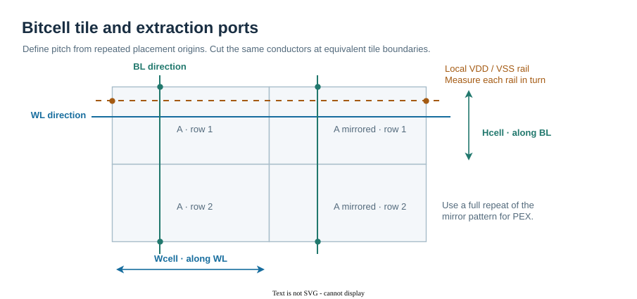

# Cell Height & Width

## 定义与适用范围

**位单元高度与宽度**（Bitcell Height and Width，$H_{\mathrm{cell}}$、$W_{\mathrm{cell}}$）是静态随机存储器（Static Random Access Memory，SRAM）阵列内部合法正交铺排中每行、每列分摊的平面节距，单位为 nm 或 μm。本文以字线（Wordline，WL）跨列方向为 $x$，以位线（Bitline，BL）跨行方向为 $y$；$W_{\mathrm{cell}}$ 对应同一行的列间距，$H_{\mathrm{cell}}$ 对应同一列的行间距。镜像后须用等价原点量取完整平移周期。宏旋转后仍按阵列逻辑行列定义 $x,y$，并记录其与版图数据库坐标的映射；引用文献尺寸时须先按图中 WL、BL 方向换算。

该口径适用于行列可分的矩形铺排。相邻间距交替时须同时记录各段节距和全周期平均值。错列或非正交铺排须报告两个独立的平移向量及重复位数；面积按实际重复块核算，见 [Cell Area](Cell_Area.md)。单管沟道宽长、鳍高度及金属线宽须分别记录。例如，Kwai 等报告的 0.3 μm 沟道长度和 0.26 μm 沟道宽度属于 0.25 μm 工艺的访问管（Pass-Gate，PG）。[3, Sec. 1]

## 物理机制与器件变异

**平面布局约束**：平面 CMOS 位单元高度和宽度分别受器件宽长、扩散区间隔、接触孔及栅图形间距等几何约束。对由多个几何分支取最大值的尺寸公式，只有当器件加宽或加长抬高最大值、或触及下一个可用放置／走线格点，才须扩大对应方向的节距。Mukhopadhyay 等的 $X_{\mathrm{cell}}$、$Y_{\mathrm{cell}}$ 与 Gupta 和 Anis 的 `xdim`、`ydim` 分别适用于各自的 6T 版图。[2, Sec. VI-C, Eq. (37), Fig. 22] [5, Sec. II-A.5, Eq. (1), Fig. 1(b)]

**鳍数与互连网格**：鳍式场效应晶体管（Fin Field-Effect Transistor，FinFET）位单元须核对鳍间距、鳍切割、栅接触节距（Contacted Poly Pitch，CPP）和金属轨道。Karner 等的 N3 投影采用 45 nm CPP 和 21 nm M0 节距，图 2 给出接触与鳍切割布局。[1, Sec. II, Fig. 2] Burnett 等给出单元与外围鳍网格对齐的条件：文中 22 nm 单元采用 60 nm 外围鳍间距，高密度与低压单元宽度分别为 8.5 倍和 10 倍；二列复用允许半整数倍。14 nm 例若采用 48 nm 外围鳍间距，高密度与高性能单元宽度分别为 8 倍和 10 倍。使用这些原文宽度时须保留其外围对齐条件。[6, Sec. II, Fig. 1, Table 1]

**垂直堆叠约束**：互补场效应晶体管（Complementary Field-Effect Transistor，CFET）叠放可减少平面内的 N/P 器件分离空间；栅切割、栅延伸与接触合并仍可限制外框。Liu 等的 A3 设计用 7 nm 介质隔离墙分别代替顺序和单片 CFET 的 12 nm、16 nm 光刻栅切割，按原文定义的高度分别最多缩减 8% 和 17%。须同时检查栅延伸、位线和电源轨空间。[7, Secs. II-B–E, Figs. 3–8] [8, Secs. 4.1–4.6, 6.5, Fig. 4.1]

**标称版图与硅片变异**：同一版图版本的放置坐标由数据库确定，工艺、电压与温度（Process, Voltage and Temperature，PVT）角和局部失配不改写标称节距。制造会引入临界尺寸（Critical Dimension，CD）、套刻和边缘位置偏差；须按同层等价标志量取硅片节距，并单独表征线宽和器件尺寸。若为满足规则、连通性或良率而修改布局版本，须重新提取标称节距。[1, Secs. II–III, V-B, Figs. 2–3, 9–11]

## 本征铺排与阵列节距边界

| 口径 | 重复块包含的结构 | 报告量 |
| --- | --- | --- |
| **位单元本征铺排** | 完整重复所需的镜像、间隙与共享扩散区、接触孔或电源轨；共用部分按周期计一次 | $W_{\mathrm{cell}}$、$H_{\mathrm{cell}}$，并记录镜像序列 |
| **阵列内部有效铺排** | 本征铺排及周期插入的阱接触、字线跨接或电源连接；按实际几何计入额外跨度 | $W_{\mathrm{eff}}$、$H_{\mathrm{eff}}$，并记录每个方向的插入周期与跨度 |
| **物理阵列与宏边界** | 物理阵列另含边缘虚设单元、端接、非周期间隔；宏另含外围和布线通道 | 行列总长、阵列外框或宏外框 |

对含周期插入的矩形阵列，分别量取沿 $x$、$y$ 的含插入完整周期长度 $L_x$、$L_y$，单位与本征节距相同。若分别跨 $N_x$ 个物理存储列间隔和 $N_y$ 个物理存储行间隔，则 $W_{\mathrm{eff}}=L_x/N_x$、$H_{\mathrm{eff}}=L_y/N_y$；不存储数据的附加结构不计入分母。周期插入若未增加两方向跨度，有效节距可等于本征节距。没有可独立验证的纯位单元铺排时，只报含插入的有效值。

Hsiao 和 Kwai 的 0.18 μm 测试芯片以 512 行 × 16 列为子阵列重复块，阱接触、字线跨接、电源连接及虚设结构另布置于子阵列边界。使用该类硅片测试结构（Test Key）量取本征节距时，须在与目标铺排相同的阵列内部取点；跨子阵列重复测得的节距须按含边界开销归档。[11, Secs. 1–2, Figs. 3–4]

ASAP5 的 122 型 6T 单元将鳍切割与浅沟槽隔离（Shallow Trench Isolation，STI）移到相邻单元接缝，在隔离两侧 PMOS 的同时保留字线所需的栅接触；图 12(e) 的虚线为共用边界。提取该版图时须按邻接后的切边计距。[10, Sec. 6.2, Fig. 12(b), (e)]

## 测量与提取方法

图中横向为 WL、纵向为 BL。2 行 × 2 列的四个格位展示左右相邻单元交替镜像；要量取两个方向的完整重复距离，可沿四格外边界分别跨两列、两行，记录 $2W_{\mathrm{cell}}$、$2H_{\mathrm{cell}}$。彩色连线及切点仅示意跨边界的寄生提取位置，几何尺寸由格线界定；省略器件、完整电源轨及外围电路。

### 标称版图提取

**【前置条件】** 准备目标工艺设计套件（Process Design Kit，PDK）及其签核规则、版本明确的 GDSII／OASIS 版图、匹配的网表及阵列铺排配置。可从配套的版图交换格式（Library Exchange Format，LEF）读取已验证的放置边界和端口位置。记录拓扑、规则选项、金属层、镜像顺序与数据库单位（Database Unit，DBU）的换算系数。

**【步骤/方法】**

1. **确认邻接与方向**：选择阵列内部完整重复块并保留实际邻居，核对跨接缝的 WL、BL、互补位线（Complementary Bitline，BLB）及电源轨的网络和端口对齐。对代表性铺排执行设计规则检查（Design Rule Check，DRC）及版图与网表一致性检查（Layout Versus Schematic，LVS），记录版图与阵列坐标的映射。
2. **选取等价量测原点**：沿两轴选取朝向、镜像相位和共享方式均相同的放置边界角点或同层同名端口。记录原点、另一端坐标、所跨的列间隔数 $n_x$、行间隔数 $n_y$ 及中间各相邻间距。
3. **换算尺度**：若两方向端点距离为 $d_x,d_y$（DBU），以 $s$ 表示每 DBU 的物理长度（nm/DBU），则

   $$
   \Delta x=s\,d_x,\qquad \Delta y=s\,d_y,\qquad
   W_{\mathrm{cell}}=\frac{\Delta x}{n_x},\qquad
   H_{\mathrm{cell}}=\frac{\Delta y}{n_y}.
   $$

   $\Delta x,\Delta y$ 和结果均以 nm 表示。含阱接触或跨接的实际阵列另选其完整的插入周期，按有效节距口径重测。

**注意事项**：须以合法放置边界或等价原点取距（几何图形的外接框可能越过接缝或包含抽象布线留量）。

**【结果处理和验证】** 用两个连续完整周期复测，确认距离和间隔数同时倍增、节距在约定数据库取整容差内一致；均匀矩形铺排用 $W_{\mathrm{cell}}H_{\mathrm{cell}}$ 与同边界的每位面积互校。交付坐标、方向、镜像相位、间隔数、节距及检查结果。几何提取无需电气偏置或仿真。

### 硅片节距核验

**【前置条件】** 选择已知版图版本和朝向的阵列区域，用平面扫描电子显微镜（Scanning Electron Microscopy，SEM）成像。用溯源节距标样在相同成像设定下标定两轴尺度及旋转，按设备规程检查视场畸变。记录批次、晶圆、裸片、阵列位置、成像层和校准条件。

**【步骤/方法】** 在同一成像层中为两个方向各选取多个同相位的周期标志，例如同名走线中心或形状已知的接触孔中心。将校准后的坐标投影到阵列两轴，以位置对完整周期序号分别作直线拟合；将斜率除以每个周期跨越的列数或行数，得到实测平均节距。要分辨镜像周期内的相邻间隔，须另取各相位对应的放置边界标志，或用经版图核对的标志偏移量换算。

**注意事项**：须单独报告线宽、刻蚀 CD、鳍高度和套刻偏差（这些量的变化不能直接换算成同层重复节距）。

**【结果处理和验证】** 检查拟合残差、重复拍摄的离散和量测不确定度；残差出现周期性跳变时先核对标志相位、图像畸变与插入位置。按事先规定的口径和容差比较同版本标称值；若量测不确定度跨越规格界限，须提高量测精度再判定。交付原图、标点数据、拟合区间与不确定度，按裸片和阵列位置报告样本数及区间。Karner 等未报告逐位单元的实测高宽统计。[1, Fig. 2]

## 数据可视化与评估

| 图表 | 记录字段或坐标 | 评估目标 |
| --- | --- | --- |
| **节距对照表** | 工艺、版图版本、拓扑、鳍数／纳米片配置、方向映射、$W_{\mathrm{cell}}$、$H_{\mathrm{cell}}$、$W_{\mathrm{cell}}/H_{\mathrm{cell}}$、插入周期、量测边界与数据来源 | 在同一口径下比较邻接、编译器网格及尺寸预算 |
| **等面积线图** | 横轴 $W_{\mathrm{cell}}$、纵轴 $H_{\mathrm{cell}}$，统一用 nm 或 μm；矩形铺排绘制 $W_{\mathrm{cell}}H_{\mathrm{cell}}$ 等值线 | 比较同面积的不同纵横比，区分单轴缩减与整体缩减 |
| **位置拟合及残差图** | 横轴为重复周期序号，纵轴分别为投影位置及拟合残差（nm）；按轴向、裸片、位置及同相位标志分组 | 判断节距一致性，定位周期插入或局部位置偏差，并评估不确定度 |

同一数据库和配置以标称节距复核面积；硅片对比须统一量测层和校准方法，并报告各方向样本数。候选须满足目标网格、合法邻接和项目规定的相关节距容差，再比较大小。原文只给面积时须将未披露的两轴尺寸标为“原文未报告”。

**轴向换算示例**：下表均为设计版图。原图的 WL 沿纵向，BL 沿横向，因此原文的纵向高度计入本文的 $W_{\mathrm{cell}}$。

| 版图与条件 | 本文宽度 $W_{\mathrm{cell}}$（nm） | 本文高度 $H_{\mathrm{cell}}$（nm） | 数值依据 |
| --- | ---: | ---: | --- |
| Mathur 等，imec N5 规则，1-1-1 鳍高密度位单元 | 168 | 90 | 图 2 四种互连方案外框相同；栅节距 45 nm、鳍节距 21 nm。[9, Sec. II, Figs. 2–3, Table I] |
| Mathur 等，同一规则，1-2-2 鳍高电流位单元，采用埋入式位线与 VSS | 210 | 90 | 图 3 给出该配置的外框，两方向分别比上例增加 42 nm 和维持不变。[9, Sec. II, Fig. 3] |
| Vashishtha 和 Clark，ASAP5 预测 PDK，122／111 型纳米线位单元 | 208／160 | 88 | 纵向原文给定；横向按图 12(b)、13(b) 的两栅节距和 44 nm 栅节距复算。M2 为 WL，M1 为 BL。[10, Sec. 6.2, Figs. 12–13] |

## 应用场景与指标关系

**宏尺寸和铺排**：在设计与工艺协同优化（Design Technology Co-Optimization，DTCO）及编译器规划中，按物理行列数分别用本征节距估算内部长度，再加上阱接触、跨接和边缘的额外跨度。若采用有效节距，只另计未纳入周期的边缘虚设单元、端接、非周期间隔及外围，并按实际位置处理末端的不完整周期。核对阵列与外围的端口网格、WL/BL 布线方向和电源轨邻接后，按实际边界复核宏纵横比。

**互连电阻与电容**（Resistance and Capacitance，RC）：在行列数、分段和插入配置固定时，减小宽度缩短 WL 的平面跨度，减小高度缩短 BL 的平面跨度。压缩后若降低导体线宽或改变接触与耦合，须重新对合法铺排执行寄生提取（Parasitic Extraction，PEX），并按 [CELL_WL RC](CELL_WL_RC.md)、[CELL_BL RC](CELL_BL_RC.md) 的端口和负载口径验证。宏组织确定后再检查 [字线 RC](../Subarray/WL_RC.md) 和 [位线 RC](../Subarray/BL_RC.md)。

## 参考文献

[1] M. Karner et al., “Variability-aware DTCO flow: Projections to N3 FinFET and nanosheet 6T SRAM,” in Proc. SISPAD, 2021. [DOI 10.1109/SISPAD54002.2021.9592527](https://doi.org/10.1109/SISPAD54002.2021.9592527). [公开文献](https://doi.org/10.1109/SISPAD54002.2021.9592527) [Zotero](https://www.zotero.org/users/7333024/items/2NIBZCPG)

**相关摘要：** 本文给出N3 FinFET 111 SRAM的三维结构和版图，工艺假设包括45 nm CPP及21 nm M0间距，并将其与每管四片、片宽16 nm的nanosheet单元比较。这里5×55 nm的fin截面和16×5 nm的片截面属于器件沟道尺寸，并非单元高度和宽度。图2展示可供几何核验的单元布局，但文章重点是统计变异，没有给出通用高宽比例、边界共享规则或高度缩减收益；引用时需依据完整版图确定单元边界和方向。

**原文定位：** Sec. II–III、V-B；Figs. 2–3、9–11，PDF pp. 1–3。

[2] S. Mukhopadhyay, H. Mahmoodi, and K. Roy, “Modeling of failure probability and statistical design of SRAM array for yield enhancement in nanoscaled CMOS,” IEEE Transactions on Computer-Aided Design of Integrated Circuits and Systems, vol. 24, no. 12, pp. 1859-1880, 2005. [公开文献](https://doi.org/10.1109/TCAD.2005.852295) · [DOI 10.1109/TCAD.2005.852295](https://doi.org/10.1109/TCAD.2005.852295) · [Zotero](https://www.zotero.org/users/7333024/items/P33WUEER)

**相关摘要：** 本文通过图22的6T布局建立 Xcell、Ycell 表达式，横向尺寸包含访问管宽度及下拉/上拉管长的最大约束，纵向尺寸包含上拉与下拉管宽度以及访问管长度，再相乘得到面积。公式中的λ与最小工艺尺寸有关，示例采用约50 nm，不应把λ本身当作整个单元长宽。由于多个几何约束采用最大值，增大某一晶体管只有成为主导限制时才改变外框尺寸。该表达式服务于特定版图的统计良率优化，未涵盖所有共享扩散、井接触和外围布线组织，移植到其他布局或工艺时必须重新检查规则。

**原文定位：** Sec. VI-C，Eq. (37)、Fig. 22，p.1874（PDF 第16页）。

[3] Ding-Ming Kwai et al., “SRAM cell current in low leakage design,” in 2006 IEEE International Workshop on Memory Technology, Design, and Testing (MTDT'06), 2006, pp. 65-70. [公开文献](https://doi.org/10.1109/MTDT.2006.28) · [DOI 10.1109/MTDT.2006.28](https://doi.org/10.1109/MTDT.2006.28) · [Zotero](https://www.zotero.org/users/7333024/items/RNB3WGBW)

**相关摘要：** 本文为解释高密度 SRAM 的读电流变化，列出0.25 μm工艺访问晶体管的沟道长度0.3 μm及宽度0.26 μm，并讨论小尺寸器件的阈值失配及提高阈值后的低电压读电流分散。这里的长、宽明确属于晶体管沟道几何，不能直接等同于 SRAM bitcell 的版图长宽。论文主要报告1 Mb测试芯片上的电流与漏电行为，未给出单元外框高度、宽度、重复节距或相应布局规则。因此它对本指标是器件尺寸与高密度布局约束的间接参考，不足以作为单元长宽的数值来源。

**原文定位：** Sec. 1，PDF 第1页。

[4] 蔡斌君, “静态随机存储器位单元与测试结构设计优化,” 硕士学位论文, 上海交通大学, 上海, 2007. [公开文献](https://kns.cnki.net/kcms2/article/abstract?v=3uoqIhG8C475KOm_zrgu4lQARvep2SAkAYAgqaTO4OyKkcOJ4w_0uBMMDBd31Rzz6lvqN7floCYwOJ74euUL69fh0K1aE59J&uniplatform=NZKPT) · [原文](https://kns.cnki.net/kcms2/article/abstract?v=3uoqIhG8C475KOm_zrgu4lQARvep2SAkAYAgqaTO4OyKkcOJ4w_0uBMMDBd31Rzz6lvqN7floCYwOJ74euUL69fh0K1aE59J&uniplatform=NZKPT) · [Zotero](https://www.zotero.org/users/7333024/items/Q2T3EHCM)；DOI：Zotero未收录或尚未核实。

**相关摘要：** 本文以90 nm设计规则和分离字线布局说明 SRAM 单元的几何压缩：直线化的有源区、字线及金属连接减轻共用字线布局的弯折和光刻问题，但两侧器件相距较远也需考虑工艺失配。表4列出四组上拉、下拉及访问晶体管的宽长与最终单元面积；这些宽长是器件沟道参数，不能当作 bitcell 外框高度和宽度。文中0.99、1.15及1.27 μm²提供占地对照，却未给出完整可复用的单元外框长宽表。使用本条应结合图14、17及所列规则读取方向与布局约束，不能仅由面积唯一推算长宽。

**原文定位：** Sec. 2.3及尺寸选择，Figs. 14、17、Table 4，pp.18–24（PDF 第25–31页）。

[5] V. Gupta, and M. Anis, “Statistical design of the 6T SRAM bit cell,” IEEE Transactions on Circuits and Systems I: Regular Papers, vol. 57, no. 1, pp. 93-104, 2010. [公开文献](https://doi.org/10.1109/TCSI.2009.2016633) · [DOI 10.1109/TCSI.2009.2016633](https://doi.org/10.1109/TCSI.2009.2016633) · [Zotero](https://www.zotero.org/users/7333024/items/CJL8HZFZ)

**相关摘要：** 本文给出6T版图两个方向尺寸的显式构成：xdim取两种横向约束最大值的两倍，ydim取两种纵向约束最大值，再相乘得到面积。约束同时包括晶体管宽长、P/N扩散间隔、接触孔宽度、栅与接触间距及多晶硅延伸，因此尺寸调整往往在某条限制成为主导后才改变单元外框。模型基于文中45 nm拓扑及紧缩 SRAM 规则，便于理解长宽和器件尺寸之间的非线性关系；它不是直接可移植的矩形尺寸清单，也没有把阵列外围高度、井接触条带或全阵列布线面积包含在单个 bitcell 外框内。

**原文定位：** Sec. II-A.5，Eq. (1)、Fig. 1(b)，PDF 第2–3页。

[6] D. Burnett, S. Parihar, H. Ramamurthy, and S. Balasubramanian, “FinFET SRAM design challenges,” in 2014 IEEE International Conference on IC Design & Technology, 2014, pp. 1-4. [公开文献](https://doi.org/10.1109/ICICDT.2014.6838606) · [DOI 10.1109/ICICDT.2014.6838606](https://doi.org/10.1109/ICICDT.2014.6838606) · [Zotero](https://www.zotero.org/users/7333024/items/PV3YYQMN)

**相关摘要：** 本文直接讨论 FinFET SRAM 宽度与外围鳍间距的对齐：单元宽度应为外围鳍间距的整数倍，若采用二列复用也可为半整数倍，以保持阵列和外围的连续过渡。22 nm例子使用60 nm外围鳍间距，高密度和低压单元宽度分别对应8.5及10个鳍间距；14 nm例子在48 nm间距下，高密度和高性能单元分别对应8及10个间距。这里的宽度是布局方向上的重复节距，不能同晶体管有效沟道宽度混淆。文章没有据此给出所有单元高度，面积和长宽比较仍需采用对应拓扑、鳍数及设计规则。

**原文定位：** Sec. II，Fig. 1、Table 1，PDF 第1页。

[7] H. H. Liu et al., “CFET SRAM DTCO, interconnect guideline, and benchmark for CMOS scaling,” IEEE Transactions on Electron Devices, vol. 70, no. 3, pp. 883-890, 2023. [公开文献](https://doi.org/10.1109/TED.2023.3235701) · [DOI 10.1109/TED.2023.3235701](https://doi.org/10.1109/TED.2023.3235701) · [Zotero](https://www.zotero.org/users/7333024/items/W99KL789)

**相关摘要：** 本文把CFET SRAM高度的缩放限制定位到gate-cut及接触合并间距，而不是仅由沟道长度决定。A5中gate-cut最多占高度44%；A3以7 nm介质隔离墙取代顺序和单片CFET分别12 nm、16 nm的光刻gate-cut，单凭该改动分别获得最多8%和17%的高度缩减，但仍须增加栅延伸以支持双功函数形成。高度减少会限制位线宽度和电源轨安排，因此高、宽及其方向必须结合图示规则与布线一并报告，不能将面积缩减百分比当作两个方向均同比缩减。

**原文定位：** Sec. II-B–E；Figs. 3–8，pp. 884–885。

[8] H. H. Liu, and F. Catthoor, “Circuit-technology Co-optimization of SRAM design in advanced CMOS nodes,” Cham, Springer Nature Switzerland, 2025. [公开文献](https://doi.org/10.1007/978-3-031-76109-6) · [DOI 10.1007/978-3-031-76109-6](https://doi.org/10.1007/978-3-031-76109-6) · [Zotero](https://www.zotero.org/users/7333024/items/CHVFC3IE)

**相关摘要：** 本书将单元高宽与版图方向、CPP及gate-cut分开描述。单片CFET较大的gate-cut要求会阻碍高度缩放；若gate-cut不变，单纯缩小CPP仅能带来有限的宽度与面积收益。以介质隔离墙分离栅、减少n/p分离和自对准接触合并，可进一步压缩高度，但需要同时处理位线及电源轨空间。书中还指出增加nanosheet宽度会增大单元高度，而增加片数可在固定平面尺寸下增强驱动并引入更长通孔。故沟道截面、单元高宽与面积应按同一版图边界分别报告。

**原文定位：** Secs. 4.1–4.6、6.5；Fig. 4.1，pp. 79–82、145。

[9] R. Mathur et al., “Buried Interconnects for Sub-5 nm SRAM Design,” IEEE Transactions on Electron Devices, vol. 69, no. 3, pp. 1041–1047, 2022. [DOI 10.1109/TED.2022.3143078](https://doi.org/10.1109/TED.2022.3143078) · [公开文献](https://doi.org/10.1109/TED.2022.3143078) · [Zotero](https://www.zotero.org/users/7333024/items/H35G9VFR)

**相关摘要：** 文中用 imec N5 规则绘制 1-1-1 鳍高密度 6T 单元，在四种互连配置中保持 168 nm × 90 nm 外框；埋入式位线与 VSS 配置下，1-2-2 鳍高电流单元为 210 nm × 90 nm。原文按图示纵向称“高度”，WL 也沿纵向。固定高宽时，改用埋入式互连仍会改变线宽、电阻及耦合；文中寄生通过三维场求解器提取。

**原文定位：** Sec. II，Figs. 2–3、Table I，PDF 第 2–3 页。

[10] V. Vashishtha and L. T. Clark, “ASAP5: A predictive PDK for the 5 nm node,” Microelectronics Journal, vol. 126, 105481, 2022. [DOI 10.1016/j.mejo.2022.105481](https://doi.org/10.1016/j.mejo.2022.105481) · [公开文献](https://doi.org/10.1016/j.mejo.2022.105481) · [Zotero](https://www.zotero.org/users/7333024/items/EK39D2QW)

**相关摘要：** ASAP5 为预测 PDK。文中 122 型与 111 型纳米线 6T 单元的图示纵向高度分别为 208 nm 和 160 nm；两者使用 44 nm 栅节距，横向外框跨两个栅节距，复算为 88 nm。122 型采用非均匀纳米线间距，在相邻位单元边界设置隔离结构；111 型采用均匀纳米线间距，其 M2 字线为满足与 VSS 的间距约束而采用偏移走线。

**原文定位：** Sec. 6.2，Figs. 12–13，PDF 第 10–12 页。

[11] C.-H. Hsiao and D.-M. Kwai, “Measurement and characterization of 6T SRAM cell current,” in 2005 IEEE International Workshop on Memory Technology, Design, and Testing (MTDT'05), pp. 140–145, 2005. [DOI 10.1109/MTDT.2005.28](https://doi.org/10.1109/MTDT.2005.28) · [公开文献](https://doi.org/10.1109/MTDT.2005.28) · [Zotero](https://www.zotero.org/users/7333024/items/G6DMQ5GY)

**相关摘要：** 0.18 μm、2 Mb 实测芯片以 512 行 × 16 列存储位为子阵列重复块，阱接触、字线跨接、电源连接和虚设结构沿边界布置。文章报告边界与内部的读电流分布，可用于核对测试结构与位单元本征铺排的边界；未给出实际单元高宽。

**原文定位：** Secs. 1–2，Figs. 3–4，PDF 第 1–3 页。
