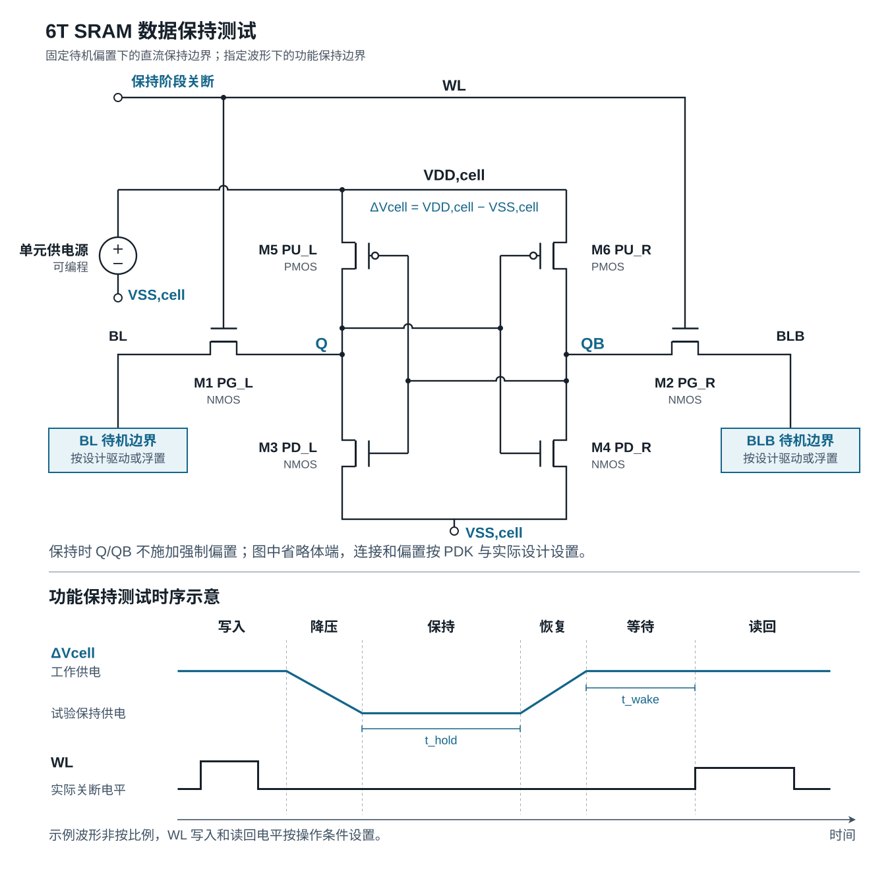

# 数据保持电压（Data Retention Voltage，DRV）

## 定义与适用范围

**数据保持电压**（Data Retention Voltage，DRV）是位单元在规定待机偏置下维持原存储态所需的最低供电压差，单位 V。以单元局部电源网为准，供电压差定义为 $\Delta V_{\mathrm{cell}}=V_{\mathrm{DD,cell}}-V_{\mathrm{SS,cell}}$。存 0 时存储节点 Q 为低，互补存储节点 QB 为高；存 1 时相反。硅测须记录逻辑数据与物理节点的映射。同一单元须分别测量两种状态；在相同测试口径下取两者较高值作为该单元的保持下限。[1, Sec. 2.1–2.4, Fig. 2.2] [7, Eq. (1)]

| 指标 | 观测量与判据 |
| --- | --- |
| 静态 $\mathrm{DRV}_{\mathrm{DC}}$ | 固定保持偏置及温度，降低单元供电；原存储态的稳定平衡解在临界点消失，对应的[保持静态噪声容限（Hold Static Noise Margin，HSNM）](HSNM.md)叶瓣闭合。 |
| 功能 $\mathrm{DRV}_{\mathrm{hold}}(t_{\mathrm{hold}})$ | 按规定降压、停留、恢复和读回流程，在结果可重复且单调时，提取仍能读回原数据的最低保持平台电压。$t_{\mathrm{hold}}$ 为平台停留时间；波形、读回条件和判据须随结果报告。[2, Sec. 4.1, Fig. 7] |
| 宏保持最低电压（retention $V_{\min}$） | 在规定的宏端口电压参考点、数据模式、唤醒／读回、纠错配置和目标失效率下，满足保持功能的最低外部供电条件。若宏有独立保持电源，须注明该电压对应的引脚或电源域。 |

## 物理机制与器件变异

6T 单元在字线（Wordline，WL）关断时，由两个交叉耦合反相器维持 Q／QB 互补状态。供电下降后，反相器的电压传输特性（Voltage Transfer Characteristic，VTC）变缓，恢复节点电压的能力减弱。低压下，上拉管（Pull-up，PU）、下拉管（Pull-down，PD）及关断访问管（Pass-gate，PG）的亚阈值电流参与节点电流平衡。高节点的下拉漏电或低节点经 PG 的注入电流增大时，相应存储态的裕量会减小；PG 电流方向由位线和存储节点的实际电位决定。[1, Secs. 2.1–2.4] [2, Sec. 2, Fig. 2] [4, Sec. II-D]

在典型失配单元中，较弱存储态的稳定交点与相邻不稳定交点合并，目标叶瓣闭合。此时两条蝶形曲线相切，两个反相器各自的输出对输入电压导数在临界点的乘积等于 1。阈值失配、器件尺寸和老化可改变哪一侧先失稳。温度和体偏置会同时改变多条电流路径，须对实际模型和偏置复核温度趋势。接近临界点时，有限时间内的 Q／QB 轨迹还取决于节点电容、供电斜率和扰动持续时间，因此静态临界点与定时波形下的读回边界须分别提取。[1, Eq. (2.1), Figs. 2.2, 2.4–2.5] [9, Fig. 7] [12, Secs. II–III] [15, Sec. IV-B]

## 本征保持与阵列环境

| 表征边界 | 须固定或记录的条件 | 工程用途 |
| --- | --- | --- |
| 孤立位单元 | 局部 VDD、VSS、体偏置、WL 关断电位、位线（Bitline，BL）与互补位线（BLB）待机边界；同一失配样本配对测试存 0 与存 1。 | 提取本征保持下限，隔离器件、数据极性及端口偏置的影响。 |
| 阵列或宏 | 真实电源开关、局部压降及波形、邻行／邻列数据、位线泄漏和耦合、温度、模式时序、辅助电路（Assist Circuits）的实际状态及读回配置。 | 验证供电分布、进出待机与读回是否满足宏的功能和失效率要求。 |

阵列待机位线可为钳位、随电源变化或预置后浮置，须按实际电路配置。浮置位线须注明初始电位、相关数据图样及观察时刻；若在某一时刻的端电压下做静态提取，应注明该 DRV 仅适用于该固定端电压。降低 VDD 与抬高 VSS 会改变 WL、位线和体端相对局部电源的电位；即使 $\Delta V_{\mathrm{cell}}$ 相同，也须分别记录两条电源轨及其偏置。本征保持期间 WL 关断；如阵列模式包含半选、字线脉冲或辅助时序重叠，须按实际扰动波形另测并单列结果。[2, Secs. 2, 3.1] [5, Secs. II–IV-A] [8, Sec. III-C]

## 测量与提取方法

### 共同条件与测试端口

**【前置条件】** 固定工艺设计套件（Process Design Kit，PDK）模型与版本、网表及寄生范围、器件尺寸、工艺和温度、体偏置与目标电压分辨率。按下图闭合交叉耦合反馈，通过局部 VDD／VSS 施加和测量 $\Delta V_{\mathrm{cell}}$；WL、BL、BLB 使用独立的指定偏置或真实驱动，Q、QB 仅作高阻观测。记录电压参考点、波形测量带宽、读写偏置及电源允许范围。

图：6T 单元的保持供电和字线时序示意。BL／BLB 待机边界按被测模式配置；图中省略体端、寄生和阵列外围，仿真须按网表和实际保持偏置连接。平台和转换时间仅示意。

### 仿真：静态平衡边界

**【前置条件】** 将 WL 置于实际关断电位。逐点按保持偏置路径设置 WL、两条位线及体端，在每个供电点提取时固定各端电位并注明参考节点。对每种数据极性，在额定供电初始化并确认原存储态稳定；设置求解容差和最小步长。

**【步骤／方法】**

1. 沿规定供电偏置路径从额定向安全低限扫压。保持同一失配样本，延拓两种原存储态的闭环直流平衡支路，或按 [HSNM 提取方法](HSNM.md#测量与提取方法) 逐点计算两侧叶瓣并映射到对应数据状态。
2. 对首次失去目标稳态的区域加密扫压，保留最低确认稳定点 $V_{\mathrm{pass}}$ 和相邻较低的确认失效点 $V_{\mathrm{fail}}$。用叶瓣闭合或稳定性分析交叉确认；在临界点上方可用小幅双向扰动确认撤除激励后恢复到原平衡点。

**注意事项**：禁止把求解器不收敛或重启后收敛到另一状态直接判作静态失效（初值、步长和数值容差都可能导致跳支）。

**【结果处理和验证】** 逐极性报告临界区间 $[V_{\mathrm{fail}},V_{\mathrm{pass}}]$、步长、模型及判据。若扫至安全低限仍稳定，报告低端截尾；若在扫描上限已确认目标稳态不存在，报告高端截尾。初始化失败或求解未能确定稳态时标为未分辨。另报两极性取较高值的单元保持下限。

### 仿真：闭环降压、保持和恢复

**【前置条件】** 采用含所需寄生的闭环网表；规定单元局部供电的目标平台、降压和恢复斜率、平台容差、$t_{\mathrm{hold}}$、唤醒等待 $t_{\mathrm{wake}}$ 和读回条件。$t_{\mathrm{hold}}$ 从供电进入并保持在平台容差内开始计时；$t_{\mathrm{wake}}$ 从供电恢复至规定范围并稳定后计至首次读回。

**【步骤／方法】** 先用合法写入时序写 0 或 1，再关断 WL 并设置待机位线，完成降压、停留和恢复，等待 $t_{\mathrm{wake}}$ 后执行首次读回。逐次重写初态，扫保持平台电压、停留时间和温度；阵列仿真按测试目标改变邻近数据图样和辅助电路状态。同步记录 $V_{\mathrm{DD,cell}}$、$V_{\mathrm{SS,cell}}$、WL、BL／BLB 和 Q／QB，标记下降沿、平台、恢复沿和读回的异常。[2, Sec. 2, 4.1, Figs. 2, 7]

**注意事项**：须保留同一初始化和读回条件的额定供电对照（便于排除写入或读回本身的故障）。

**【结果处理和验证】** 首次读回与写入一致且读回有效时记通过；结合 Q／QB 波形区分保持失稳、恢复阶段翻转和读扰动。记录实际平台和最低瞬时压差；若斜坡或过冲引入失效，单列波形条件。在结果可重复且随电压单调时，用相邻失效／通过点给出边界区间；否则报告各电压、停留时间下的失败次数、重复次数和概率估计。

### 硅测：独立保持供电和功能读回

**【前置条件】** 选择可独立控制保持供电的阵列或带直接端口的测试结构；校准电源、温控与读回功能。可就近感测的供电端口建议采用四线感测并同步观测 VDD／VSS；无法直接测量单元局部电压时，须注明感测端口与局部压降估计。

**【步骤／方法】**

1. 在工作供电下写入并验证初态，先跑无降压对照；至少覆盖全 0、全 1，按邻近泄漏和耦合补充棋盘及其反相等图样。分别记录温度、地址范围、数据图样、辅助电路、纠错／修复的配置和是否可读取原始位错。
2. 在 WL 关断后降到保持供电，记录实际平台、最低瞬时压差、降压／恢复斜率、纹波及停留时间。恢复工作供电并等待规定时间后读回，记录失败地址和位数。每个电压点重写初态，从额定向安全低限扫描，加密首个通过／失效边界。可用延长唤醒等待和已验证的低扰动读回，定位进出待机与读回的影响。

**注意事项**：须分别记录可观测的原始位失败与纠错后的功能失败；原始位错无法读取时须标明（两者对应不同失效率口径）。

**【结果处理和验证】** 用同一图样、温度、恢复和读回配置重测临界点；报告通过／失效区间、截尾及未分辨数。对随机翻转或不单调结果，按电压和停留时间报告成功概率及重复次数。仅有读回数据时，将异常标为序列失败；在有内部节点或对照证据时再细分故障阶段。

**文献例证**：Qin 等在 0.13 μm、4 KB 原型用双电源轨切换，在前一工作周期末写入、恢复后的下一工作周期初读回。[2, Sec. 3–4, Figs. 4–5, 7–8] Guo 等在 45 nm 测试结构中沿用静态读最低工作电压（Minimum Operating Voltage，$V_{\min}$）的流程框架，在低压保持与供电切换时均关断 WL；高压验证读的 WL 降低 200 mV，以降低读扰动，状态由初始化为低电平一侧的位线电流判别。Fig. 9(a) 给出静态读流程，保持模式的变更见 Sec. III-C 正文。[8, Sec. III-C, Fig. 9(a)]

具备内部节点观测端口时，可像 Chien 等一样直接记录降压中 Q／QB 翻转时的电压。须保留降压斜率与观测端口负载；作为静态边界使用前，须验证该结果对进一步减慢扫描不敏感，并与平衡边界交叉检查。[15, Sec. III, Fig. 3(b)]

## 数据可视化与评估

| 图表 | 坐标、分组与检查 |
| --- | --- |
| 供电与状态波形 | 横轴时间（s），纵轴电压（V）。分轨标出 $\Delta V_{\mathrm{cell}}$、WL、BL／BLB、Q／QB 和读回时刻；标记最低瞬时供电、平台及唤醒等待。 |
| HSNM 与静态边界 | 横轴 $\Delta V_{\mathrm{cell}}$（V），纵轴两侧 HSNM（V）；标注供电步长和临界区间。必要时绘制边界两侧的 VTC，以确认叶瓣闭合。 |
| 保持失败曲线 | 横轴实际平台电压（V）或停留时间（s），纵轴失败数或失败比例。按温度、数据图样及模式分组，标明样本数、重复次数、测试分辨率和未分辨数；硅测附故障地址热图检查聚集。 |
| DRV 分布 | 分别画存 0 与存 1 的配对散点图及较高值的上尾分布，注明截尾、测试条件、分组和置信区间。 |

在单调且测试口径相同的条件下，按待评估的局部供电压差与阈值区间分类：不高于确认失效点计失败，不低于确认通过点计通过，落在两点之间须加密测量或计入未分辨。按晶圆、芯片、阵列和地址保留层级，分开报告重复试验与独立样本的数量；使用重要性抽样时须覆盖存 0 和存 1 两类失效区域并记录权重。估计宏失效率时须检查共享供电和地址相关性，说明位、字或整宏的失败判据及适用的纠错配置。尾部统计方法见 [RSNM](RSNM.md#数据分析与评价方法)。[6, Sec. IV-A] [7, Eq. (1), Figs. 5–8] [10, Secs. II–V-A]

Qin 等在上述样片测得 50 个单元的 DRV 为 80–250 mV、均值约 170 mV（Fig. 8）；Fig. 9 给出漏电实测，Fig. 10 给出工艺和温度敏感度仿真。[2, Sec. 4.1, Figs. 8–10] 漏电评估采用 350 mV 作为带 100 mV 额外裕量的待机供电。[2, Sec. 4.2, Fig. 9] Qin 在博士论文中另报告一个 32 Kbit 阵列的全地址结果为 60–390 mV、均值约 122 mV。比较时须注明样本覆盖范围；先进节点及目标良率须用对应工艺和样本验证。[1, Sec. 3.1.3, Figs. 3.4–3.5]

## 应用场景与指标关系

- **保持供电与唤醒**：用目标 DRV 上尾或阵列失败率选择保持平台，依据实测供电波形分配压降、纹波和恢复时序预算，再按整宏读回判据验证。降低 DRV 可扩大低压待机范围；结合 [待机漏电](Standby_Leakage.md) 和进出待机的能耗、延迟，评估可用的供电降幅。[1, Secs. 3.1.3, 5.2] [2, Secs. 3.1.1, 4.2]
- **单元及宏优化**：设计与工艺协同优化（Design-Technology Co-Optimization，DTCO）可用目标分位的静态 DRV 筛选尺寸、体偏置和器件选项，再复测 HSNM、读写最低工作电压及阵列功能。哨兵单元（canary cell）可跟踪全局变化，仍须按阵列局部失配的尾部校准裕量；启用纠错后须同时保留原始位失败和宏级功能阈值。[1, Secs. 4.2, 5.2] [5, Secs. II–IV-A]

## 参考文献

[1] H. Qin, “Deep sub-micron SRAM design for ultra-low leakage standby operation,” Ph.D. dissertation, Univ. California, Berkeley, Tech. Rep. UCB/EECS-2007-74, 2007. [公开文献](https://www2.eecs.berkeley.edu/Pubs/TechRpts/2007/EECS-2007-74.html) （本次 Zotero 标签检索未命中，保留原有来源。）

**相关摘要：** 论文将 DRV 作为 SRAM 保持双稳态的最低供电，分析亚阈值电流、阈值失配、温度和尺寸比对该下限的影响，并通过降低待机供电、恢复正常供电后读回验证数据保存。130 nm测试阵列的 DRV 分布说明典型单元值不能代表最差位；后续90 nm设计还结合单元优化及纠错降低阵列保持要求。实际待机供电需要高于 DRV，以覆盖供电噪声和变化。论文的低压待机电压、保持阈值与正常读写工作电压分别使用，不能把加入裕量后的供电或纠错后阵列指标当作单元固有 DRV。

**原文定位：** Secs. 2.3–2.4、3.1.3、4.2、5.2，Figs. 3.5、3.7、5.5–5.6。

[2] H. Qin, Y. Cao, D. Marković, A. Vladimirescu, and J. M. Rabaey, “SRAM leakage suppression by minimizing standby supply voltage,” in Proc. ISQED, 2004. [公开文献](https://www2.eecs.berkeley.edu/bears/2004/STARS/final/qin.pdf) （本次 Zotero 标签检索未命中，保留原有来源。）

**相关摘要：** 本文在0.13 μm、4 KB SRAM 测试芯片中，先在正常供电写入，再降低待机供电保持，恢复正常供电后读回，以此界定 DRV。50个单元的测量值分布于80–250 mV，均值约170 mV，显示失配使实际保持阈值显著分散；这些样本不能直接视为整个阵列所有位的完整尾部分布。作者将350 mV作为带额外裕量的低功耗待机供电，而非把它定义成实测 DRV。分析还联系温度、器件参数和亚阈值锁存稳定性，为最低保持电压与可靠待机电压之间的区别提供依据。

**原文定位：** Secs. 2、3.1.1、4.1，Figs. 7–8，PDF 第2–4页。

[3] S. Mukhopadhyay, H. Mahmoodi, and K. Roy, “Statistical design and optimization of SRAM cell for yield enhancement,” in IEEE/ACM International Conference on Computer Aided Design, 2004. ICCAD-2004., 2004, pp. 10-13. [公开文献](https://doi.org/10.1109/ICCAD.2004.1382534) · [DOI 10.1109/ICCAD.2004.1382534](https://doi.org/10.1109/ICCAD.2004.1382534) · [Zotero](https://www.zotero.org/users/7333024/items/GDX5LJIK)

**相关摘要：** 本文把保持失效单独定义为单元的最低保持电压高于预设待机电压，并以高电平存储节点降到对侧反相器翻转点建立概率模型。50 nm 栅长、25 nm 有效沟道器件的分析考虑六个晶体管独立的阈值波动，指出关断下拉管漏电会拉低高节点，而增大上拉管可改善保持；下拉管过宽则可能因漏电增大而恶化保持良率。因此 DRV 优化必须同时考虑尺寸、失配和面积限制，文中的保持失效概率不应与读取或写入失败概率混用，也不是硅后阵列 DRV 测量。

**原文定位：** Sec. 3.5，Eqs. (12)–(13)，PDF 第3页。

[4] S. Mukhopadhyay, H. Mahmoodi, and K. Roy, “Modeling of failure probability and statistical design of SRAM array for yield enhancement in nanoscaled CMOS,” IEEE Transactions on Computer-Aided Design of Integrated Circuits and Systems, vol. 24, no. 12, pp. 1859-1880, 2005. [公开文献](https://doi.org/10.1109/TCAD.2005.852295) · [DOI 10.1109/TCAD.2005.852295](https://doi.org/10.1109/TCAD.2005.852295) · [Zotero](https://www.zotero.org/users/7333024/items/P33WUEER)

**相关摘要：** 本文把保持失败定义为待机供电低于单元自身的最低保持电压，并用存储高电平下降到对侧反相器翻转点建立分析模型。在50 nm栅长、25 nm有效沟道器件的统计研究中，阈值失配、关断下拉管漏电和上拉能力共同决定保持极限；增大器件并非总能改善保持，尤其需兼顾漏电及版图面积。文章把保持、读扰动、访问和写入失败分别建模，再用于阵列良率及冗余优化。因此其 DRV 相关结果属于统计建模和仿真，不能把总的工作电压或修复后良率等同于单个硅片单元实测的保持电压。

**原文定位：** Sec. II-D及保持失败分析，p.1862（PDF 第4页），PDF 第8页。

[5] J. Wang, and B. H. Calhoun, “Canary replica feedback for near-DRV standby VDD scaling in a 90nm SRAM,” in 2007 IEEE Custom Integrated Circuits Conference, 2007, pp. 29-32. [公开文献](https://doi.org/10.1109/CICC.2007.4405675) · [DOI 10.1109/CICC.2007.4405675](https://doi.org/10.1109/CICC.2007.4405675) · [Zotero](https://www.zotero.org/users/7333024/items/5EUSJASV)

**相关摘要：** 本文以保持 SNM 消失对应的 DRV 为反馈降压下限，提出用可调、刻意较弱的 canary 单元跟踪环境变化，使阵列供电保持在最差单元的保持电压之上。其关键是区分少量副本所反映的全局变化与大阵列局部失配的尾部风险：需要通过整片全0/全1写入、降压、恢复供电后读回等校准方法设置裕量，不能直接把 canary 翻转电压当作阵列 DRV。90 nm 设计中的可调 PMOS 供电和不利位线偏置用于提前暴露保持失败；结论针对待机数据保存，不表示同一电压可正常读写。

**原文定位：** Secs. II–IV-A，Figs. 2–7，PDF 第1–3页。

[6] L. Dolecek, M. Qazi, D. Shah, and A. Chandrakasan, “Breaking the simulation barrier: SRAM evaluation through norm minimization,” in 2008 IEEE/ACM International Conference on Computer-Aided Design, 2008, pp. 322-329. [公开文献](https://doi.org/10.1109/ICCAD.2008.4681593) · [DOI 10.1109/ICCAD.2008.4681593](https://doi.org/10.1109/ICCAD.2008.4681593) · [Zotero](https://www.zotero.org/users/7333024/items/BW8B4ULZ)

**相关摘要：** 本文以 32 nm 6T SRAM 保持为重要性抽样案例，通过寻找导致失效的最小范数阈值偏移，提高稀有失效估计效率。在该文独立高斯阈值模型下，按对称性选定的单叶瓣闭合事件在 400 mV 供电的概率约为 3×10⁻⁶。引用此结果须保留单叶瓣、统计模型和仿真条件；按目标失效率选定阵列保持电压时，须验证两种极性的联合失效事件。

**原文定位：** Sec. IV-A；Fig. 4、Tables I–II，PDF pp. 5–7。

[7] A. Singhee, J. Wang, B. H. Calhoun, and R. A. Rutenbar, “Recursive statistical blockade: an enhanced technique for rare event simulation with application to SRAM circuit design,” in 21st International Conference on VLSI Design (VLSID 2008), 2008, pp. 131-136. [公开文献](https://doi.org/10.1109/VLSI.2008.54) · [DOI 10.1109/VLSI.2008.54](https://doi.org/10.1109/VLSI.2008.54) · [Zotero](https://www.zotero.org/users/7333024/items/Y54K567B)

**相关摘要：** 本文明确将单元DRV取为保存0和保存1时两种DRV的最大值。失配使两个分支不等，并在参数空间形成分离的高DRV尾区，单一分类边界可能漏掉其中一类失效；递归统计阻断分别学习各分支后合并尾部样本。工业90 nm 6T模型的验证表明，其尾部预测与参考解析模型相符，而用少量样本拟合普通正态或对数正态DRV分布会失准。结果服务于给定保持失效率的供电设计，不是读写最低工作电压，也不证明所有条件下DRV具有同一分布。

**原文定位：** Secs. 3–5；Eq. (1)，Figs. 5–8，pp. 133–135。

[8] Z. Guo, A. Carlson, L. T. Pang, K. T. Duong, T. J. K. Liu, and B. Nikolic, “Large-scale SRAM variability characterization in 45 nm CMOS,” IEEE Journal of Solid-State Circuits, vol. 44, no. 11, pp. 3174-3192, 2009. [公开文献](https://doi.org/10.1109/JSSC.2009.2032698) · [DOI 10.1109/JSSC.2009.2032698](https://doi.org/10.1109/JSSC.2009.2032698) · [Zotero](https://www.zotero.org/users/7333024/items/5RBES89L)

**相关摘要：** 本文的直接位线接入方法可测量单元保持、读及写三类最低电压。Fig. 9(a) 给出静态读流程；Sec. III-C 正文规定，在保持测试中先在标称供电写入，再降低单元供电且保持 WL 关闭，恢复供电后检查数据。切换电压时关闭 WL，高压验证读降低字线电压 200 mV，以减少读扰动。可用该流程逐位测量功能保持边界；文章的主要统计结果为读写裕量的相关性和空间分布。

**原文定位：** Sec. III-C；Fig. 9，pp. 3179–3180。

[9] X. Deng, T. W. Houston, A. Duong, and W. K. Loh, “A universal structure for SRAM cell characterization,” in 2010 International Conference on Microelectronic Test Structures (ICMTS), 2010, pp. 216-219. [公开文献](https://doi.org/10.1109/ICMTS.2010.5466815) · [DOI 10.1109/ICMTS.2010.5466815](https://doi.org/10.1109/ICMTS.2010.5466815) · [Zotero](https://www.zotero.org/users/7333024/items/UFY8SIZT)

**相关摘要：** 本文提出通用单元测试结构UTS，可在同一个SRAM位单元上重连端点，测量各管参数及保持、读、写Vmin。晶圆实测把数据保持Vmin与六只器件阈值直接关联，图7的存0案例主要对上拉负载管阈值敏感，说明DRV诊断应结合具体数据状态和失配来源。该结论来自所测晶圆，不能推广为所有工艺都只受上拉管决定；保持Vmin与读扰动、写入Vmin仍须分别设置偏置。该结构已用于65、45、28 nm，而不是给出这些节点统一的保持电压数值。

**原文定位：** UTS Measurements/Applications；Figs. 4、6–7，PDF pp. 2–4。

[10] J. Wang, and B. H. Calhoun, “Minimum supply voltage and yield estimation for large SRAMs under parametric variations,” IEEE Transactions on Very Large Scale Integration (VLSI) Systems, vol. 19, no. 11, pp. 2120-2125, 2011. [公开文献](https://doi.org/10.1109/TVLSI.2010.2071890) · [DOI 10.1109/TVLSI.2010.2071890](https://doi.org/10.1109/TVLSI.2010.2071890) · [Zotero](https://www.zotero.org/users/7333024/items/MESZRU7A)

**相关摘要：** 本文通过保持SNM分布随供电变化的趋势推导保持Vmin及失效概率，而非预先假定DRV服从正态或对数正态。45 nm工艺的版图前、典型角、室温仿真分别处理存0与存1，并将可接受噪声裕量设为0；6T案例在标准正态分位不超过4的比较区间，保持Vmin估计相对Monte Carlo最大误差为2.4%。该误差限属于指定验证区间，不能外推极端尾部。文章还报告读写Vmin，但它们采用不同操作偏置，不应作为数据保持电压合并引用。

**原文定位：** Secs. II–V-A；Eqs. (3)–(7)，Figs. 3–5，PDF pp. 2–4。

[11] M. H. Abu-Rahma, and M. Anis, “Nanometer variation-tolerant SRAM: circuits and statistical design for yield,” New York, NY, Springer New York, 2013. [公开文献](https://doi.org/10.1007/978-1-4614-1749-1) · [DOI 10.1007/978-1-4614-1749-1](https://doi.org/10.1007/978-1-4614-1749-1) · [Zotero](https://www.zotero.org/users/7333024/items/RA2TPQV2)

**相关摘要：** 本书在数据保持失败章节明确区分关闭字线时的 DRV 与读写最低工作电压，以供电下降过程中 Q/QB 及反相器传输曲线的退化解释保持极限。对于对称单元，两侧保持 SNM 同时缩小；阈值失配造成不平衡后，较弱一侧先降到零，使 DRV 升高。图示强调片内变化及其尾部决定低压保存的风险，不能用典型单元替代整阵列要求。该部分是对既有研究的机制归纳，适合作为 DRV 定义与统计解释来源；后续增大面积和读写辅助降低 Vmin 的数据不应直接移作保持电压改善值。

**原文定位：** Sec. 2.6.1.4，Fig. 2.26，p.25（PDF 第35页）。

[12] A. Teman, “Dynamic stability and noise margins of SRAM arrays in nanoscaled technologies,” in 2014 IEEE Faible Tension Faible Consommation, 2014, pp. 1-5. [公开文献](https://doi.org/10.1109/FTFC.2014.6828617) · [DOI 10.1109/FTFC.2014.6828617](https://doi.org/10.1109/FTFC.2014.6828617) · [Zotero](https://www.zotero.org/users/7333024/items/LGCD8PBV)

**相关摘要：** 本文从静态与动态稳定性的区别解释最低保持电压：保持模式的 SNM 下降到负值意味着双稳态消失，即使没有外加噪声也不能可靠保存数据，因而低电压保持必须控制失配分布尾部出现负 SNM 的概率。文章强调正的静态裕量仍不能完整描述有限持续时间扰动，需要结合状态轨迹与分界线分析恢复或翻转。它支持以保持稳定性分布解释 DRV 的方法，但主要贡献是动态稳定性分析，没有把独立单元的临界电压等同于带目标良率的阵列 DRV，也未给出可直接移植的实测 DRV 数值。

**原文定位：** Secs. II–III，PDF 第2–4页。

[13] A. Dosi, “6T-SRAM 1Mb Design with Test Structures and Post Silicon Validation,” M.S. thesis, Arizona State University, Aug. 2017. [公开文献](https://keep.lib.asu.edu/items/155708) · [Zotero](https://www.zotero.org/users/7333024/items/C5Y4VDC4)；DOI：Zotero未收录或尚未核实。

**相关摘要：** 论文在55 nm低功耗6T SRAM设计中，将存储节点初始化为互补状态、WL关闭后降低供电，以保持SNM趋近零识别DRV。仿真比较300 mV与270 mV时的蝶形曲线，并因失配及版图影响保留设计余量，最终采用350 mV作为保持电压选择。该数值是设计阶段的保守选择，不能标为所有1 Mb位单元的实测最大DRV或读写最低电压。需要区分所展示的TT、标称温度曲线、随机变异条件与整片上硅验证，不能仅由单条标称曲线推定阵列保持良率。

**原文定位：** Sec. 2.2.2；Figs. 2.4–2.6，正文pp. 8–10。

[14] P. Sharma, and M. Sharma, “A comprehensive study of various parameters pertaining to stability and leakage in 8T and 9T deep submicron SRAM bitcells,” in 2018 Conference on Emerging Devices and Smart Systems (ICEDSS), 2018, pp. 82-87. [公开文献](https://doi.org/10.1109/ICEDSS.2018.8544342) · [DOI 10.1109/ICEDSS.2018.8544342](https://doi.org/10.1109/ICEDSS.2018.8544342) · [Zotero](https://www.zotero.org/users/7333024/items/DIMPP3FJ)

**相关摘要：** 本文用 Symica 对45、65和90 nm节点的四种8T/9T单元进行仿真，把保持状态仍具双稳态、能保存数据的最低供电定义为 DRV，并通过将供电从额定值扫到0 V、监测 Q/QB 的变化提取。表VII分别列出各结构和节点的临界电压，显示低漏电或较好读写裕量并不自动意味着最低 DRV；比较必须保留具体拓扑和工艺。正文关于 WRE8T 最低的概括不能覆盖表中所有节点，65及90 nm下8T SE-DFC数值更低。本文结果是单元模型仿真，没有局部失配尾部及整阵列良率验证。

**原文定位：** Sec. III-E、IV-E，Fig. 10、Table VII，PDF 第4–6页。

[15] W. T. K. Chien, and F. Hao, “An extended building-In reliability methodology on evaluating SRAM reliability by wafer-level reliability systems,” IEEE Transactions on Device and Materials Reliability, vol. 20, no. 1, pp. 106-118, 2020. [公开文献](https://doi.org/10.1109/TDMR.2020.2964999) · [DOI 10.1109/TDMR.2020.2964999](https://doi.org/10.1109/TDMR.2020.2964999) · [Zotero](https://www.zotero.org/users/7333024/items/KIUC7NK4)

**相关摘要：** 本文通过可直接访问两个存储节点的单比特结构进行晶圆级保持测试：先初始化互补数据，再关闭字线、逐步降低单元供电，监测节点翻转时记录 VDR。125 °C条件下比较对称读写循环老化与持续保存同一数据的非对称老化，发现后者引入的左右器件阈值失配使保持电压退化更显著。该结果把 DRV 的变化与失配联系起来，而不只是单管阈值漂移的绝对大小。文中的晶圆级 VDR 与封装级保持测试建立关联，但仍应保留测试结构、温度和应力条件，不能将其当成读写最低工作电压。

**原文定位：** Sec. III、IV-B，Figs. 3(b)、5，pp.109–111（PDF 第4–6页）。

[16] B. S. Reniwal, P. Singh, A. P. Shah, and S. K. Vishvakarma, “Energy efficient and reliable embedded nanoscale SRAM design,” Boca Raton, CRC Press, 2023. [公开文献](https://doi.org/10.1201/9781003213451) · [DOI 10.1201/9781003213451](https://doi.org/10.1201/9781003213451) · [Zotero](https://www.zotero.org/users/7333024/items/Q47DS2TG)

**相关摘要：** 本书将 DRV 定义为字线关闭时仍可保存数据的最低供电，并用交叉耦合反相器的电压传输曲线和保持 SNM 退化说明临界点。供电接近 DRV 时，亚阈值导电及片内阈值失配的作用增强；不对称单元的较小一侧蝴蝶曲线裕量先消失，因此其 DRV 通常高于平衡单元。后续锁存器章节进一步给出亚阈值模型推导，适合解释尺寸和器件参数为何影响保持电压。该部分主要为理论归纳，不能把书中各读写最低电压或不同 SRAM 架构的工作电压直接当作6T单元 DRV 实测值。

**原文定位：** Secs. 1.5.3、2.1.3，Figs. 1.8–1.9、2.16，pp.12–14、55–56（PDF 第27–29、70–71页）。
