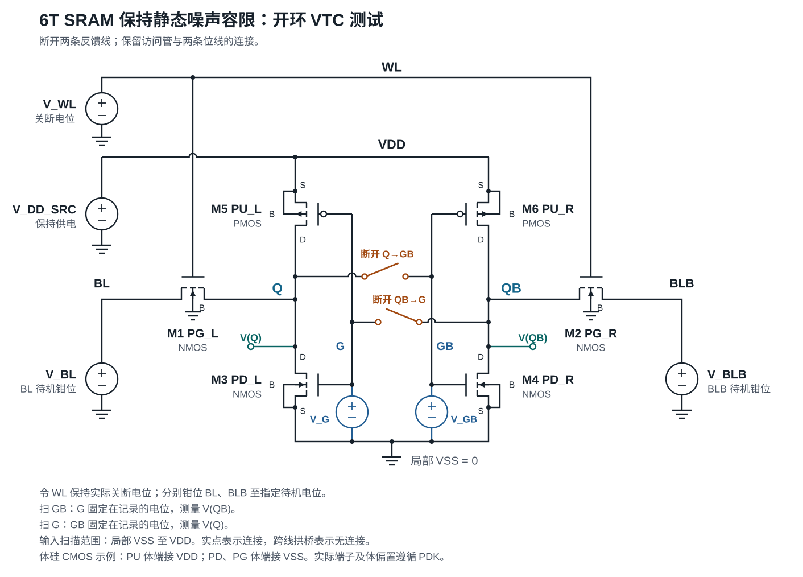
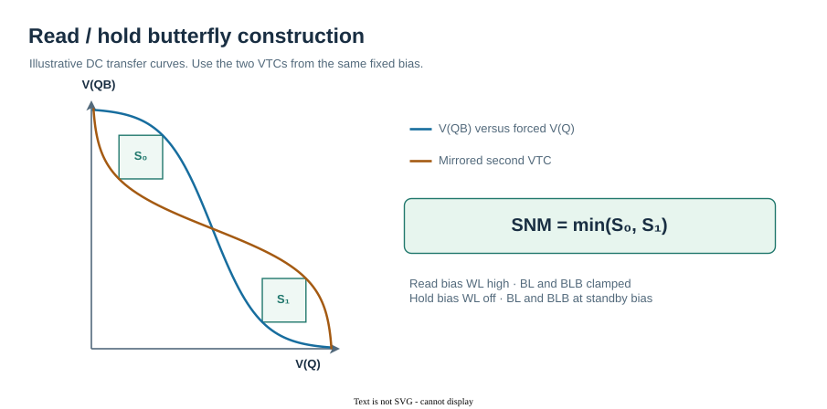
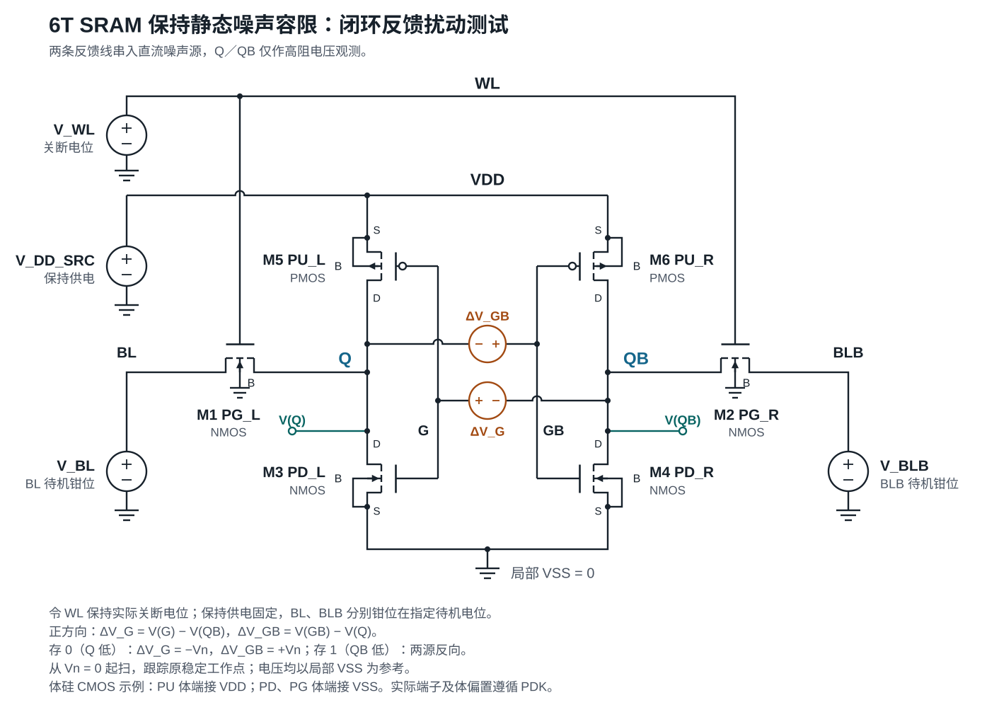

# 保持静态噪声容限（Hold Static Noise Margin，HSNM）

## 定义与适用范围

**保持静态噪声容限（HSNM）**是静态随机存取存储器（Static Random-Access Memory，SRAM）位单元（Bitcell）在规定待机偏置下，维持原存储态所能承受的最坏方向、等幅反极性的直流反馈电压扰动，单位 V。对具有两级交叉反馈反相器的 6T 位单元，将两侧电压传输特性（Voltage Transfer Characteristic，VTC）叠合成蝴蝶图。存 0 时存储节点 Q 低、互补存储节点 QB 高，存 1 时相反。分别求两个叶瓣中最大轴对齐内接正方形的边长 $S_0$ 和 $S_1$，以 $\mathrm{HSNM}=\min(S_0,S_1)$ 表征该单元。若确认任一目标存储态不存在，记该方向静态失效；若仅求解或测量未能分辨，单列未分辨。[1, Sec. 2.1, 2.4, Figs. 2.2, 2.6–2.7] [4, Sec. II, Figs. 1, 3] [8, Sec. 2.2, Fig. 2.2]

基准为字线（Wordline，WL）关断，位线（Bitline，BL）及互补位线（BLB）维持指定待机电位，单元使用额定或降低后的保持供电。以单元局部 VSS 为电压参考，供电压差记为 $\Delta V_{\mathrm{cell}}=V_{\mathrm{DD,cell}}-V_{\mathrm{SS,cell}}$。须说明参考点、实际 WL、BL／BLB、电源轨、体偏置（Body Bias）及温度。HSNM 对应固定工作点；有限时长的电源或节点扰动及其恢复结果须另测。[6, Secs. 2–4, Figs. 1–2]

## 物理机制与器件变异

WL 关断后，常规 6T 单元由交叉耦合的两级反相器维持双稳态。以存 0 为例，Q 侧下拉管（Pull-Down，PD）将 Q 拉向 VSS，QB 侧上拉管（Pull-Up，PU）将 QB 拉向 VDD。关断的访问管（Access Transistor，PG）仍会漏电；当高电位位线通过 PG 向低节点注入电流，或低电位位线通过 PG 从高节点吸取电流时，节点电位会偏离各自电源轨。影响方向和大小取决于实际位线、WL、体端和节点偏置。降低保持供电会削弱锁存器的恢复能力；在常规 6T 的静态保持边界上，较弱存储态的稳定交点与相邻不稳定交点合并，对应叶瓣闭合。[1, Secs. 2.1–2.4, Figs. 2.2, 2.4–2.7] [3, Sec. 2, Fig. 2] [23, Secs. II–III, Fig. 1]

PU／PD 强度和局部阈值失配会改变两侧反相器的翻转区，PG 漏电失配会改变两侧的节点电流平衡。温度、体偏置和老化可同时改变多条电流路径，须分别检查两瓣和较弱方向。针对低压保持，优先检查反相器配比、PG 关断漏电与局部供电；读态的 PD／PG 单元比仅表征部分作用路径。[5, Sec. IV-A, Fig. 4] [18, Secs. 2.1–2.5] [20, Sec. IV-D, Fig. 7]

## 本征保持稳定性与阵列环境

| 表征边界 | 设置与观测 | 用途 |
| --- | --- | --- |
| **孤立位单元、固定待机偏置** | 对同一器件样本固定局部 VDD／VSS、WL 关断电位、BL／BLB 和体端电位；记录温度、器件模型和寄生范围 | 提取两瓣及较小值，比较拓扑、器件尺寸和局部失配 |
| **阵列的条件化静态工作点** | 指定邻近数据图样、阵列位置和外围状态；在指定时刻记录局部端电位，再以该组端电位钳位提取 HSNM | 比较静态压降、位线偏置与数据极性的影响；注明是否保留共享节点或驱动阻抗 |
| **阵列待机及唤醒过程** | 使用实际供电轨、WL 与 BL／BLB 波形、外围工作状态、温度和读回时序；记录翻转位置、失败次数和异常阶段 | 验证规定时序下的保持功能与失效率 |

钳位到高位、低位、独立电位或随供电变化的位线须分别表征。预置后浮置的位线须在包含列漏电和所需寄生的瞬态网表中指定初始电位、邻近数据图样和观察时刻；以该时刻端压重新钳位所得 HSNM 仅表征该组固定端压。两种初态产生不同浮置端压时，分别报告各自快照及对应方向的裕量，并注明条件不同。抬高 VSS 与降低 VDD 可产生相同供电压差，两者的 WL、位线和体端相对偏置仍须分别记录。半选或唤醒重叠期间若 WL 导通，须按其实际波形另测。[1, Secs. 2.2, 3.1] [6, Secs. 3–4] [13, Secs. II–III]

**拓扑差异**：带独立读端口的 8T 位单元须按实际待机模式固定读字线、读位线与写入端口，并保留影响存储节点的支路和寄生。PMOS 访问管的 6T 单元可采用 WL 高位关断、BL／BLB 置 VSS 的配置；须核对实际端压。带电源门控的单元须以锁存器的局部电源轨为准；非对称拓扑须检查两侧反馈和电源控制。若开环后无法用两条单输入 VTC 表示完整直流平衡，则采用与拓扑相符的闭环扰动，明确激励端口、幅值和失效判据。[10, Sec. III, Fig. 2] [25, Sec. 3.4.2] [26, Sec. 2.2.3, Fig. 2.5]

## 测量与提取方法

### 仿真：双 VTC 蝴蝶法

**【前置条件】** 使用已标定的工艺设计套件（Process Design Kit，PDK）模型，记录模型版本、工艺、电压和温度（Process, Voltage and Temperature，PVT）、同一单元的器件尺寸与失配参数、寄生范围及目标分辨率。按实测或设计值建立各端口偏置。以 NMOS 访问管的 6T 单元为例，局部 VSS 为 0 V，$V_{\mathrm{WL}}=V_{\mathrm{SS}}$、$V_{\mathrm{BL}}=V_{\mathrm{BLB}}=V_{\mathrm{DD}}$；低压保持时须核对位线是否仍跟随单元 VDD。[8, Sec. 2.2.1, Fig. 2.2(a)]

图中 G 与 GB 分别驱动 Q 侧、QB 侧反相器的 PU／PD 栅端；断开 QB→G 与 Q→GB 两条反馈线，保留访问管及其 BL／BLB 支路。图示体端接法对应常规体硅 CMOS，实际连接遵循 PDK 和待机模式。固定端压与叠合方法见 [RSNM 的双 VTC 夹具和图](RSNM.md#测量与提取方法)。

**【步骤／方法】**

1. **扫描两条 VTC**：分别将 GB、G 从局部 VSS 扫至 VDD，读取对应的 $V(\mathrm{QB})$、$V(Q)$；每次将未扫描的输入固定在已记录的电位。以同一局部 VSS 为参考，记录输入和输出的直流电压。
2. **叠合并求两瓣**：以 $V(Q)$ 为横轴、$V(\mathrm{QB})$ 为纵轴，将 $(V(\mathrm{GB}),V(\mathrm{QB}))$ 与 $(V(Q),V(\mathrm{G}))$ 叠合。包含 Q 低、QB 高稳定交点的叶瓣记为存 0，另一瓣记为存 1。逐瓣搜索边与原坐标轴平行、完整落在叶瓣内的最大正方形；以减半扫描和搜索步长复算，检查边长变化是否小于目标分辨率。[4, Secs. II–III, Fig. 3] [8, Sec. 2.2, Fig. 2.2]

**注意事项**：两条 VTC 须使用同一器件样本、待机偏置和温度（跨样本或跨偏置拼接会改变叶瓣）。若改变未扫输入的电位会明显移动被测 VTC，须改用闭环扰动（两侧存在不可忽略的直流耦合）。

**【结果处理和验证】** 保存两条原始 VTC、交点、$S_0$、$S_1$、HSNM 与较弱极性。临近叶瓣闭合时，细化输入和供电步长，恢复反馈并校验目标存储态。若确认无目标叶瓣，标记该方向静态失效；可在分布图上用零标出失效样本，须注明为分类值。求解跳支或扫压范围不足且无法确认时标为未分辨。

### 仿真：闭环反馈扰动验证

**【前置条件】** 移除开环输入源，在 QB→G 和 Q→GB 的反馈线中各串入一个直流电压源。固定与开环相同的局部供电、WL 关断电位、BL／BLB 和温度；Q／QB 仅作高阻观测。两源初值为零，分别初始化并释放存 0、存 1，确认对应状态在保持偏置下稳定。[1, Sec. 2.4, Fig. 2.6] [4, Sec. II, Fig. 1]

**【步骤／方法】** 按 $\Delta V_{\mathrm{G}}=V(\mathrm{G})-V(\mathrm{QB})$ 和 $\Delta V_{\mathrm{GB}}=V(\mathrm{GB})-V(Q)$ 定义源极性。存 0 时取 $\Delta V_{\mathrm{G}}=-V_n$、$\Delta V_{\mathrm{GB}}=+V_n$；存 1 时反向，其中 $V_n\ge 0$ 为每个源的幅值，单位 V。由零逐步增加 $V_n$，从上一稳定工作点延拓目标支路，记录 Q／QB 电压并细化静态边界。确认最后通过点时，保持两源幅值不变，另对存储节点施加并撤除小幅短脉冲，检查能否返回原平衡点。结合平衡支路延拓和局部稳定性分析确认失稳。

**注意事项**：禁止将直流求解不收敛或一次跳支直接判作翻转（须先排除步长、求解容差和初值导致的数值误判）。

**【结果处理和验证】** 各方向分别记录仍稳定与已确认失稳的相邻幅值，注明步长和确认依据。若两条单调 VTC 可分别表示相同固定偏置下的两侧直流特性，闭环失稳门限应与相应最大正方形边长一致；差异超出目标分辨率时检查源极性、探测负载、模型耦合及步长。若在 $V_n=0$ 已验证目标状态不存在，记静态失效；无法确认稳定支路边界时标未分辨。

### 硅测：直接曲线与保持功能读回

**【前置条件】** 直接曲线法须使用有内部节点端口、可切换反馈或可重连半单元的测试结构。校准探针、模拟开关及复用通路的串联压降和漏电；记录局部供电感测位置、温度、输出测量阻抗和稳态判定窗口。仅有数字端口时，使用经额定供电对照验证的写入、唤醒和读回流程。[2, Figs. 3–5] [9, Fig. 3(d)] [28, Sec. II-A–C, Figs. 3–5]

**【步骤／方法】**

| 路径 | 操作及记录 |
| --- | --- |
| **直接 VTC** | 在规定待机边界下逐点强制一个反相器输入，待稳定后高阻测量对应输出，再交换端口。若测试结构仅引出 Q／QB，可逐次强制一个存储节点并测量对侧，须核对强制端的实际电压、反馈连接和跨侧耦合。记录两侧原始曲线并计算两瓣。 |
| **直接扰动** | 有可串入反馈电压的专用结构时，可按闭环方法扫描两种扰动极性；记录两源端实际电压、Q／QB、最后稳定和首次失稳的相邻点。 |
| **功能读回** | 分别写入两种初态，关断 WL，按规定波形降压和停留，恢复供电后以已验证的读出条件读取。记录实际平台与最低瞬时压差、停留时间、温度、数据图样和各地址的读回结果；测试时序与判据见 [DRV](DRV.md)。[3, Sec. 4.1, Fig. 7] |

**注意事项**：须以同偏置对照校验模拟探测路径对曲线的偏移（开关压降、漏电及输出负载会改变取方结果）。禁止将功能读回阈值或半单元固定连线的离散代理量直接记为 HSNM（两者的激励和判据不同）。

**【结果处理和验证】** 直接曲线法归档 VTC、两瓣和测量分辨率；直接扰动法按极性归档临界区间；功能法另报保持电压区间或失败比例。对近边界样本复测，核查无降压读回与开关路径对照，区分可确认失效和未分辨。

**硅测案例**：Deng 等在 45 nm 6T 通用测试结构上，将所测半单元的电源和位线钳位在 VDD、WL 置低，输入与输出分别接源测量单元（Source Measure Unit，SMU），所得待机 SNM 蝴蝶曲线见 Fig. 4(f)。[9, UTS Measurements, Figs. 2, 3(d), 4(f)] Qin 等的 0.13 μm 原型在恢复供电后读回，得到功能保持电压边界。[3, Sec. 4.1, Fig. 7]

## 数据可视化与评估

| 建议图表 | 标注与判断 |
| --- | --- |
| **蝴蝶图与 $S_0$–$S_1$ 配对散点图** | 标明电压轴（V）、实际端压、温度、样本 ID、交点和两瓣取方。仅一瓣变弱时检查数据极性、配对器件、布局方向与不对称位线偏置。 |
| **裕量随供电变化曲线** | 横轴为局部供电压差（V），纵轴为 $S_0$、$S_1$ 及 HSNM（V）。注明温度、位线随供电的关系及步长；在较弱瓣闭合处标出静态边界区间。 |
| **低尾分布与保持失败曲线** | 分开绘制 HSNM 经验累积分布（Empirical Cumulative Distribution Function，ECDF）和定时读回失败比例。标明样本数、规格门槛、置信区间、未分辨数和阵列数据图样；有地址数据时用热图检查共享供电或位置相关性。 |

在各 PVT 条件下保留器件局部变异及相关性，配对记录同一单元的两瓣。单元任一方向确认静态失效或低于规定裕量下限时，按一个失败单元计数；单列未分辨样本、晶圆／芯片／阵列共享条件与可观测的原始位错。须区分物理失效门槛（叶瓣闭合）与工程裕量门槛；例如 Jiang 等的 40 nm 6T 仿真以 20 mV 为良率优化门槛。[5, Sec. IV-A, Fig. 4, Table II] [15, Sec. 3.3, Fig. 3] [23, Secs. II–III]

按目标尾部采样精度选择蒙特卡洛（Monte Carlo，MC）样本数，记录低分位及其置信区间；目标尾部超出直接抽样覆盖时，可用覆盖两种极性失效区的混合重要性抽样，在可比区间与直接抽样对照。须先核验相关性和尾部形状，再外推，方法见 [RSNM 的统计方法](RSNM.md#数据分析与评价方法)。[1, Sec. 2.3–2.4] [7, Sec. 5.1, Figs. 5–8] [10, Secs. III–V]

闭环瞬态须按实际噪声幅度、脉宽和恢复时序验证。Dong 等在 600 个采用独立高斯阈值失配的 6T 仿真样本中未观察到 HSNM 与动态保持噪声容限的强相关性。[6, Sec. 4.3, Fig. 2]

## 应用场景与指标关系

- **选择待机供电**：沿实际供电偏置路径逐点提取 HSNM，以较弱叶瓣闭合区间估计静态 [DRV](DRV.md)，再按目标低尾裕量、供电压降和纹波设定保持平台，结合 [待机漏电](Standby_Leakage.md) 与唤醒／读回验证功能。Qin 等的 0.13 μm 仿真中，供电高出 DRV 100 mV 时，单元 HSNM 约为 60 mV；在 20 mV 峰峰值供电纹波下，所报告的最坏 HSNM 约为 55 mV。这是该设计的供电裕量与反馈噪声容限关系，应用到其他设计须重提取。[3, Sec. 3.1.1]
- **定位保持或读扰弱点**：在相同局部供电、温度和样本下分别提取 HSNM 和 [读静态噪声容限（Read Static Noise Margin，RSNM）](RSNM.md)。两者均低时优先检查锁存器、失配与供电；仅读态降低时优先核查 WL、位线预充和 PG。荆郁然报告的 6T 电路仿真在 1.2 V、25 ℃ 下给出 HSNM 375 mV、RSNM 210 mV。[8, Sec. 2.2, Fig. 2.2] [24, Sec. 3.2.3, Fig. 3.10]
- **建立设计约束**：设计与工艺协同优化（Design-Technology Co-Optimization，DTCO）可用较弱方向及低尾 HSNM 筛选 PU／PD 配比、PG 漏电与体偏置；以瞬态恢复、软错误和宏级读回结果验证最终方案。宏级验收须注明位错门槛、纠错配置以及原始位和宏输出的观测口径。[1, Secs. 2.4, 3.1.1, 5.2] [6, Secs. 3–4]

## 参考文献

Zotero `02-SRAM-DTCO/SRAM-Metrics/Bitcell`（`YHY2NKEE`）于 2026-11-17 按精确标签 `HSNM` 核对，命中 25 条独立记录，对应 25 份可读归档 PDF。保持稳定性、提取、量测与变异等直接相关全文已超过 10 篇；另保留 3 条既有来源。本页共 28 条，无缺失归档，无需补检或导入。标为 PDF 页的定位使用归档文件的物理页码。

[1] H. Qin, “Deep sub-micron SRAM design for ultra-low leakage standby operation,” Ph.D. dissertation, Univ. California, Berkeley, Tech. Rep. UCB/EECS-2007-74, 2007. [公开文献](https://www2.eecs.berkeley.edu/Pubs/TechRpts/2007/EECS-2007-74.html) （本次 Zotero 标签检索未命中，保留原有来源。）

**相关摘要：** 论文以交叉耦合反相器的传输曲线及最大内接正方形刻画低压保持 SNM，解释供电下降到 DRV 时裕量趋于零；器件失配使两侧保持能力不对称，必须按较弱极性及分布尾部设置待机供电。其保持稳定性章节强调实际供电应留出噪声裕量，进一步讨论降低供电对临界电荷和软错误敏感性的影响。因此有正的静态裕量并不能替代瞬态抗扰或纠错要求。论文可支持 HSNM、DRV和待机供电之间的关系，相关读写最低电压及纠错后阵列保存结果需保持独立口径。

**原文定位：** Sec. 2.1、Fig. 2.2，p. 11（PDF 第 22 页）；Sec. 2.4、Figs. 2.6–2.7，pp. 22–25（PDF 第 33–36 页）；Sec. 3.1.1，p. 28（PDF 第 39 页）。

[2] W. K. Loh and D. J. Redwine, “SRAM static noise margin test structure suitable for on chip parametric measurements,” U.S. Patent 7 385 864 B2, 2008. [公开文献](https://patents.google.com/patent/US7385864B2/en) （本次 Zotero 标签检索未命中，保留原有来源。）

**相关摘要：** 本专利提出用于片上参数测试的半单元结构，以固定连接的左右半位取得保持 SNM 相关离散点，并用另一组结构获取 cell ratio 信息，减少逐点扫描和处理完整蝴蝶曲线的测试成本。原文明确定义字线关闭时的 standby SNM，并区分读取状态的稳定性；所得参数用于评估真实单元，而非直接对每个功能位施加任意噪声。专利强调这是一种近似或与 SNM 相关的测试方法，结构代表性、探测负载和左右失配仍需校验。它支持保持裕量测试结构设计，不提供可直接套用的某工艺 HSNM 实测分布。

**原文定位：** 说明书cols.9–14，Figs. 2A–2C、3A–3C、5（PDF 第20–22页及图页）。

[3] H. Qin, Y. Cao, D. Marković, A. Vladimirescu, and J. M. Rabaey, “SRAM leakage suppression by minimizing standby supply voltage,” in Proc. ISQED, 2004. [公开文献](https://www2.eecs.berkeley.edu/bears/2004/STARS/final/qin.pdf) （本次 Zotero 标签检索未命中，保留原有来源。）

**相关摘要：** 本文明确指出把待机供电压到 DRV 会使保持 SNM 消失，因此实际低压保存必须设置额外裕量。0.13 μm设计的仿真显示，在 DRV 之上增加100 mV供电 guardband 可得到约60 mV SNM，并讨论20 mV峰峰值供电纹波下的最坏裕量。这里100 mV是供电间隔，60 mV是蝴蝶曲线定义的静态噪声容限，不能混为同一指标。文章还指出低压会降低临界电荷，软错误风险不能仅由静态 SNM 排除；上述裕量关系是特定单元和偏置下的仿真结果，不是跨工艺的固定换算系数。

**原文定位：** Sec. 3.1.1，PDF 第 3 页；Sec. 4.1、Fig. 7，PDF 第 4 页。

[4] E. Seevinck, F. J. List, and J. Lohstroh, “Static-noise margin analysis of MOS SRAM cells,” IEEE Journal of Solid-State Circuits, vol. 22, no. 5, pp. 748-754, 1987. [公开文献](https://doi.org/10.1109/JSSC.1987.1052809) · [DOI 10.1109/JSSC.1987.1052809](https://doi.org/10.1109/JSSC.1987.1052809) · [Zotero](https://www.zotero.org/users/7333024/items/2HME7GPM)

**相关摘要：** 本文建立 SRAM 静态噪声裕量的经典图形定义及分析方法，以交叉耦合反相器加入最坏方向直流噪声后仍保持双稳态为依据，用蝴蝶曲线最大内接正方形提取 SNM。它为 HSNM 的几何提取提供基础，但文中具体比较的电阻负载与全 CMOS 单元、电路简化和主要数值曲线采用读访问偏置，不能直接标记成字线关闭的保持裕量。供电下降会压缩裕量、器件配比影响稳定性的结论需结合原假设解释。引用到本页时，应保留方法学意义，并在实际保持测试中重新指定访问管关断与位线状态。

**原文定位：** Secs. II–IV，Figs. 1–4，pp.749–753（PDF 第2–6页）。

[5] L. Dolecek, M. Qazi, D. Shah, and A. Chandrakasan, “Breaking the simulation barrier: SRAM evaluation through norm minimization,” in 2008 IEEE/ACM International Conference on Computer-Aided Design, 2008, pp. 322-329. [公开文献](https://doi.org/10.1109/ICCAD.2008.4681593) · [DOI 10.1109/ICCAD.2008.4681593](https://doi.org/10.1109/ICCAD.2008.4681593) · [Zotero](https://www.zotero.org/users/7333024/items/BW8B4ULZ)

**相关摘要：** 本文用 32 nm 6T 单元的保持蝴蝶曲线展示阈值失配如何压缩稳定区，并用最小范数重要性抽样估计低概率事件。在 400 mV 供电下，标称阈值产生两个稳定存储点，特定均值偏移使一个叶瓣接近闭合。Sec. IV-A 利用对称性只统计一个叶瓣闭合的事件；评估非对称或相关失效时，须分别覆盖两种极性。该文提供仿真抽样方法，未提出新的 HSNM 硅测结构。

**原文定位：** Sec. IV-A；Fig. 4、Table II，PDF pp. 5–7。

[6] W. Dong, P. Li, and G. M. Huang, “SRAM dynamic stability: theory, variability and analysis,” in 2008 IEEE/ACM International Conference on Computer-aided Design, 2008, pp. 378-385. [公开文献](https://doi.org/10.1109/ICCAD.2008.4681601) · [DOI 10.1109/ICCAD.2008.4681601](https://doi.org/10.1109/ICCAD.2008.4681601) · [Zotero](https://www.zotero.org/users/7333024/items/GPS3KS3V)

**相关摘要：** 本文以保持模式下两条反相器电压传输曲线之间的最大内接正方形定义静态保持裕量，并比较静态指标与动态保持稳定性的关系。对600个带独立高斯阈值失配的6T单元样本，图中显示保持 SNM 与动态噪声裕量缺乏强相关性；失配使两个稳定状态之间的分界线偏离理想对称位置，瞬态是否翻转因此取决于扰动方向与状态轨迹。该结果用于提醒 HSNM 只刻画指定偏置下的直流稳定性，不能从单一较大的蝴蝶曲线直接推断更强的有限脉冲抗扰能力。

**原文定位：** Secs. 2–4，Figs. 1–2（PDF 第 2–3 页）；保持动态噪声容限定义见 Sec. 4.3（PDF 第 3 页）。

[7] A. Singhee, J. Wang, B. H. Calhoun, and R. A. Rutenbar, “Recursive statistical blockade: an enhanced technique for rare event simulation with application to SRAM circuit design,” in 21st International Conference on VLSI Design (VLSID 2008), 2008, pp. 131-136. [公开文献](https://doi.org/10.1109/VLSI.2008.54) · [DOI 10.1109/VLSI.2008.54](https://doi.org/10.1109/VLSI.2008.54) · [Zotero](https://www.zotero.org/users/7333024/items/Y54K567B)

**相关摘要：** 本文指出带最大或最小运算的稳定性指标可能具有多个分离失效区，不能用单一分类器代表全部尾部。直接实验对象是90 nm单元两种存储状态的DRV，解析对照模型由参考电压下的SNM均值、标准差及SNM对供电的敏感度构建，因此与保持SNM统计建模间接相关。对HSNM而言，需要分别处理蝶形曲线两个叶片或两种状态再合并，而不能只拟合平均裕量。文中未给出新的HSNM测量结果，递归阻断的加速也不能当作保持裕量本身的提高。

**原文定位：** Secs. 3.1–3.2、5.1；Eqs. (1)、(3)–(5)，Figs. 5–8，pp. 133–135。

[8] Z. Guo, “Large-scale variability characterization and robust design techniques for nanoscale SRAM,” Doctoral dissertation, EECS Department, University of California, Berkeley, 2009. [公开文献](https://www2.eecs.berkeley.edu/Pubs/TechRpts/2009/EECS-2009-190.html) · [原文](http://www2.eecs.berkeley.edu/Pubs/TechRpts/2009/EECS-2009-190.html) · [Zotero](https://www.zotero.org/users/7333024/items/A56QIF3W)；DOI：Zotero未收录或尚未核实。

**相关摘要：** 本论文明确给出保持噪声裕量的偏置和提取流程：单元供电与两条位线置 VDD、字线置 VSS，扫描一个存储节点并测量另一个节点，获得两条反相器传输曲线；对应数据极性的最大内接正方形边长即单侧裕量。商业低功耗45 nm模型的图2.2分别展示保持和读取蝴蝶曲线，解释读取时访问管使低节点抬升并削弱裕量。这个定义适合本项目 HSNM，不能与字线有效时的 RSNM 或 SRRV 混淆。论文的大规模变化测量主要围绕读写指标，保持示例及其图形结果应按仿真方法引用。

**原文定位：** Sec. 2.2，Figs. 2.2–2.4，pp. 20–24（PDF 第 45–49 页）；保持蝴蝶图见 Sec. 2.2.1、Fig. 2.2(a)。

[9] X. Deng, T. W. Houston, A. Duong, and W. K. Loh, “A universal structure for SRAM cell characterization,” in 2010 International Conference on Microelectronic Test Structures (ICMTS), 2010, pp. 216-219. [公开文献](https://doi.org/10.1109/ICMTS.2010.5466815) · [DOI 10.1109/ICMTS.2010.5466815](https://doi.org/10.1109/ICMTS.2010.5466815) · [Zotero](https://www.zotero.org/users/7333024/items/UFY8SIZT)

**相关摘要：** 本文的UTS结构通过可重连的端点同时支持单管参数与完整单元特性测量，图4包含待机SNM蝶形曲线，并与传统单元测试结构取得相似结果。其作用是保留同一单元的器件失配信息，便于把保持稳定性与上拉、下拉及访问管特性关联，避免用不同结构样本替代。文章同时测试active SNM和保持Vmin，但这些是不同偏置下的指标，不能互相直接替换。该文主要提供可测性与关联分析方法，未建立通用HSNM通过门槛或完整阵列的保持噪声统计。

**原文定位：** UTS Measurements／Applications；Figs. 2–4、6–7（PDF 第 2–4 页）；待机接线 Fig. 3(d) 在第 2 页，实测蝴蝶曲线 Fig. 4(f) 在第 3 页。

[10] J. Wang, and B. H. Calhoun, “Minimum supply voltage and yield estimation for large SRAMs under parametric variations,” IEEE Transactions on Very Large Scale Integration (VLSI) Systems, vol. 19, no. 11, pp. 2120-2125, 2011. [公开文献](https://doi.org/10.1109/TVLSI.2010.2071890) · [DOI 10.1109/TVLSI.2010.2071890](https://doi.org/10.1109/TVLSI.2010.2071890) · [Zotero](https://www.zotero.org/users/7333024/items/MESZRU7A)

**相关摘要：** 本文将保持SNM分解为存0和存1的两个分支，观察其均值和标准差随供电的变化，以此预测保持失效率。单个分支可近似正态，并不意味着两分支取最小值后的完整HSNM或DRV仍服从同一正态分布；文中为尾部计算采用分支独立的一阶近似。45 nm、典型角、室温版图前验证分别比较保持、读和写模式，保持失败阈值设为零裕量。该框架适于从HSNM统计推导目标可靠性，但应用时需重新验证相关性、噪声阈值和低供电外推范围。

**原文定位：** Secs. II–V；Figs. 3–7，PDF pp. 2–4。

[11] M. H. Abu-Rahma, and M. Anis, “Nanometer variation-tolerant SRAM: circuits and statistical design for yield,” New York, NY, Springer New York, 2013. [公开文献](https://doi.org/10.1007/978-1-4614-1749-1) · [DOI 10.1007/978-1-4614-1749-1](https://doi.org/10.1007/978-1-4614-1749-1) · [Zotero](https://www.zotero.org/users/7333024/items/RA2TPQV2)

**相关摘要：** 本书通过待机字线关闭时的蝴蝶曲线说明保持 SNM 与数据保存的关系：当供电降低，两侧裕量缩小，失配单元的一侧先消失，对应保持状态失稳。这个分析把保持稳定性与访问期间由访问管引起的读扰动分开，也说明典型对称单元的裕量不足以代表大阵列的最差尾部。书中独立读端口8T相对6T的 SNM 比较主要反映消除读扰动后的读稳定性，不能把相关增益全部记作 HSNM 提升。该书提供器件变化、偏置和静态保持裕量之间的系统解释，并非新的统一条件 HSNM 实测报告。

**原文定位：** Sec. 2.6.1.4，Fig. 2.26；Sec. 3.3，Figs. 3.12–3.13，pp.25、58–59（PDF 第35、67–68页）。

[12] J. Singh, S. P. Mohanty, and D. K. Pradhan, Robust SRAM Designs and Analysis. New York, NY: Springer, 2013. [公开文献](https://doi.org/10.1007/978-1-4614-0818-5) · [DOI 10.1007/978-1-4614-0818-5](https://doi.org/10.1007/978-1-4614-0818-5) · [Zotero](https://www.zotero.org/users/7333024/items/JG3ZTL9Y)

**相关摘要：** 本书将保持 SNM 定义为在不改变内部存储状态的条件下能够容忍的最大直流噪声，并明确区分保持、读操作与写入稳定性的度量。相关章节指出蝴蝶曲线需要访问内部节点，并且电压裕量本身不包含电流驱动信息；用于大量单元的统计测试还受探测连接和版图开销限制。书中随后介绍的 N 曲线、SRRV 和 WRRV 多在字线有效的读取偏置下提取，不能直接代替字线关闭时的 HSNM。因而本书对本指标的主要贡献是定义、测量条件及适用范围的梳理，而不是一组可跨工艺复用的保持裕量数值。

**原文定位：** Secs. 2.2–2.3.1，Fig. 2.9，pp.39–47（PDF 第51–59页）。

[13] A. Teman, “Dynamic stability and noise margins of SRAM arrays in nanoscaled technologies,” in 2014 IEEE Faible Tension Faible Consommation, 2014, pp. 1-5. [公开文献](https://doi.org/10.1109/FTFC.2014.6828617) · [DOI 10.1109/FTFC.2014.6828617](https://doi.org/10.1109/FTFC.2014.6828617) · [Zotero](https://www.zotero.org/users/7333024/items/LGCD8PBV)

**相关摘要：** 本文将保持 SNM 解释为交叉耦合反相器能够承受的最坏方向直流噪声，蝴蝶曲线中的最大内接正方形给出静态边界；负 SNM 对应保持状态不再双稳态。文章进一步指出静态方法不包含噪声持续时间和状态轨迹，有限脉冲是否导致翻转应由动态恢复过程及分界线判断。因此 HSNM 适合描述直流保持稳定性及其失配尾部，不能单独替代软错误、瞬态扰动或动态稳定性指标。本文贡献是建立这些指标之间的适用范围，而不是提供统一工艺下 HSNM 增益的硅片测量。

**原文定位：** Secs. II–III，PDF 第2–4页。

[14] A. Teman, and R. Visotsky, “A fast modular method for true variation-aware separatrix tracing in nanoscaled SRAMs,” IEEE Transactions on Very Large Scale Integration (VLSI) Systems, vol. 23, no. 10, pp. 2034-2042, 2015. [公开文献](https://doi.org/10.1109/TVLSI.2014.2358699) · [DOI 10.1109/TVLSI.2014.2358699](https://doi.org/10.1109/TVLSI.2014.2358699) · [Zotero](https://www.zotero.org/users/7333024/items/SEEQWPLJ)

**相关摘要：** 本文把静态噪声裕量作为动态分界线分析的对照：HSNM 可通过保持偏置下两反相器的蝴蝶曲线及旋转坐标后的等价几何关系提取。文中以40 nm 6T、1 V、25 °C条件下的10000次全局及局部变化蒙特卡洛仿真比较保持、读和写裕量分布，随后说明静态最坏噪声假设不能描述有限持续时间扰动。其主要成果是考虑失配的快速分界线追踪算法，因此算法加速不能解读为 HSNM 本身提高；有关保持裕量的图表属于仿真及方法比较，未形成独立的实测单元 HSNM 数据集。

**原文定位：** Sec. II，Figs. 1–2，PDF 第2–3页。

[15] Z. J. Jiang, Z. C. Ye, and Y. Wang, “Efficient SRAM yield optimization with mixture surrogate modeling,” Journal of Semiconductors, vol. 37, no. 12, pp. 125001, 2016. [公开文献](https://doi.org/10.1088/1674-4926/37/12/125001) · [DOI 10.1088/1674-4926/37/12/125001](https://doi.org/10.1088/1674-4926/37/12/125001) · [Zotero](https://www.zotero.org/users/7333024/items/PNYCN2F8)

**相关摘要：** 本文用保持相关的静态噪声裕量作为良率优化指标，把 SNM 小于0.02 V定义为数据保持失效的工程判据，并以混合代理模型替代大量 SPICE 评估。验证电路是商业40 nm工艺的6T单元，包含18个工艺变量及六个尺寸变量；晶体管宽度范围56–290 nm、长度40–80 nm。该阈值是论文设置的20 mV裕量要求，不是双稳态必然消失的零裕量物理边界。结果主要证明代理模型及尺寸搜索的效率与精度，未报告硅片保持裕量测量，移用于其他设计时必须重新规定偏置、统计模型和失效门限。

**原文定位：** Secs. 3.3–4.1，Fig. 3，PDF 第4–5页。

[16] A. Dosi, “6T-SRAM 1Mb Design with Test Structures and Post Silicon Validation,” M.S. thesis, Arizona State University, Aug. 2017. [公开文献](https://keep.lib.asu.edu/items/155708) · [Zotero](https://www.zotero.org/users/7333024/items/C5Y4VDC4)；DOI：Zotero未收录或尚未核实。

**相关摘要：** 论文用交叉耦合反相器的蝶形曲线表征保持稳定性，WL关断后在不同供电下观察可容纳的噪声正方形；当供电低于保持边界，曲线失去相应稳定区域，SNM变为零。55 nm设计给出0.4、0.3、0.25 V示例，并指出阈值失配使仅用标称曲线判断稳定性不足。文中最终保留350 mV供电选择，属于DRV设计余量，不能作为HSNM的数值。该节主要是电路仿真与设计说明，而非完整阵列HSNM实测分布，需保留保持状态与读扰动状态的区别。

**原文定位：** Sec. 2.2.2；Figs. 2.4–2.6，正文pp. 8–10。

[17] M. Wang, C. Yan, X. Li, D. Zhou, and X. Zeng, “High-dimensional and multiple-failure-region importance sampling for SRAM yield analysis,” IEEE Transactions on Very Large Scale Integration (VLSI) Systems, vol. 25, no. 3, pp. 806-819, 2017. [公开文献](https://doi.org/10.1109/TVLSI.2016.2601606) · [DOI 10.1109/TVLSI.2016.2601606](https://doi.org/10.1109/TVLSI.2016.2601606) · [Zotero](https://www.zotero.org/users/7333024/items/9WPTVQV8)

**相关摘要：** 本文在良率估计方法的低维验证案例中同时考察6T单元的 SNM、读噪声裕量及读电流，并将六个晶体管局部阈值失配建模为独立高斯变量。这里一般 SNM 与读 RNM 分开统计，可作为保持相关的静态稳定性分析案例；其独立单元直流模型与后续包含外围电路的高维动态案例不是同一指标口径。主要结论是重要抽样对稀有失效概率的估计能力，而非提升保持裕量的电路技术。论文没有提供可直接套用的硅后 HSNM 数值，使用结果时应保留工艺、失配模型以及单元/阵列分析范围。

**原文定位：** Sec. IV-A–B，PDF 第9–10页。

[18] X. Fan, R. Wang, and T. Gemmeke, “Physical modeling of bitcell stability in subthreshold SRAMs for leakage-area optimization under PVT variations,” in Proceedings of the International Conference on Computer-Aided Design, 2018, pp. 1-8. [公开文献](https://doi.org/10.1145/3240765.3240836) · [DOI 10.1145/3240765.3240836](https://doi.org/10.1145/3240765.3240836) · [Zotero](https://www.zotero.org/users/7333024/items/XMZID3FK)

**相关摘要：** 本文从亚阈值反相器传输特性推导双侧 SNM 模型，以较小一侧裕量决定保持稳定性，并用折叠正态与非中心卡方分布描述阈值失配带来的非线性统计。其8T示例通过独立读端口隔离存储节点，保持及读取分析均假定相关访问支路漏电可忽略；因此可用于保持锁存器，但不能直接覆盖有读扰动的6T读裕量。28及40 nm蒙特卡洛验证用于检验分布模型，指出上拉/下拉强度平衡同时影响均值与方差。模型的尾部精度和尺寸优化结果应与假设一起引用，不能作为新硅片 HSNM 测量。

**原文定位：** Secs. 2.1–2.5及模型验证，Fig. 1，PDF 第2–3页。

[19] K. Mehra, and T. Sharma, “Analysis of SRAM cell design: a better perspective for reducing the chip area and power consumption by increasing the stability of SRAM cell,” in Proceedings of the Third International Conference on Advanced Informatics for Computing Research, 2019, pp. 1-7. [公开文献](https://doi.org/10.1145/3339311.3339338) · [DOI 10.1145/3339311.3339338](https://doi.org/10.1145/3339311.3339338) · [Zotero](https://www.zotero.org/users/7333024/items/YTAP24PL)

**相关摘要：** 本文是一篇 SRAM 单元设计综述，介绍保持模式中关闭访问通路、由交叉耦合反相器维持存储状态，并以蝴蝶曲线最大内接正方形说明静态噪声裕量。文中讨论体偏置、独立读端口和电源门控对稳定性、面积及待机功耗的影响，但所引用电路和比较值来自不同研究，不能视为本文在统一偏置下测得的 HSNM。对本指标的用途是说明保持稳定性的基本定义与设计权衡；文章未提供明确的逐单元保持裕量分布、可复现实测设置或相应阵列保持良率。

**原文定位：** Secs. 1.2、2–3.1，PDF 第2–4页。

[20] W. T. K. Chien, and F. Hao, “An extended building-In reliability methodology on evaluating SRAM reliability by wafer-level reliability systems,” IEEE Transactions on Device and Materials Reliability, vol. 20, no. 1, pp. 106-118, 2020. [公开文献](https://doi.org/10.1109/TDMR.2020.2964999) · [DOI 10.1109/TDMR.2020.2964999](https://doi.org/10.1109/TDMR.2020.2964999) · [Zotero](https://www.zotero.org/users/7333024/items/KIUC7NK4)

**相关摘要：** 本文用内部节点可访问的单比特测试结构，按 Fig. 3(d) 扫描两侧反相器传输曲线。125 °C 老化实验显示，非对称应力下上拉管和下拉管退化增大失配，导致保持裕量收缩；对称退化可能部分抵消。Sec. IV-D 和 Fig. 7(a) 区分保持与读状态：未老化单元的保持 SNM 约为 0.33 V，读 SNM 约为 0.105 V，后者用于该文的可靠性判据。两数值及寿命口径须分开。

**原文定位：** Secs. III、IV-D，Figs. 3(d)、7，pp.109–110、112–113（PDF 第4–5、7–8页）。

[21] M. Devi, C. Madhu, and N. Garg, “Design and analysis of CMOS based 6T SRAM cell at different technology nodes,” Materials Today: Proceedings, vol. 28, pp. 1695-1700, 2020. [公开文献](https://doi.org/10.1016/j.matpr.2020.05.130) · [DOI 10.1016/j.matpr.2020.05.130](https://doi.org/10.1016/j.matpr.2020.05.130) · [Zotero](https://www.zotero.org/users/7333024/items/8JC23IGQ)

**相关摘要：** 本文采用 HSPICE 与 BSIM3/PTM 模型比较180、90、65及45 nm的6T单元，以蝴蝶曲线提取保持噪声裕量。表1给出的本研究 HSNM 依次为350、300、275及200 mV，随所列节点缩小而降低；表中另一栏是各参考文献的数据，不能混作本文结果或当成严格同条件的改善比例。保持模式被描述为访问管断开、反相器继续供电保存数据。文章同时分析读写裕量与延迟，但摘要中的读写改善结论不代表 HSNM 同向改善；这些数值属于模型仿真，没有硅片保持噪声测试及完整失配统计。

**原文定位：** Sec. 2.1、Table 1，PDF 第2页；Sec. 3。

[22] M. U. Mohammed, A. Nizam, L. Ali, and M. H. Chowdhury, “FinFET based SRAMs in Sub-10nm domain,” Microelectronics Journal, vol. 114, pp. 105116, 2021. [公开文献](https://doi.org/10.1016/j.mejo.2021.105116) · [DOI 10.1016/j.mejo.2021.105116](https://doi.org/10.1016/j.mejo.2021.105116) · [Zotero](https://www.zotero.org/users/7333024/items/6WSN399K)

**相关摘要：** 本文综述亚10 nm FinFET SRAM，并比较 underlap 器件及不同晶体管配比对稳定性的影响。6T/8T AUF案例在500 mV供电下分别列出保持、读、写 SNM，表7中的 HSNM 为181.3与185.8 mV，不能与另列的读裕量或 N 曲线电压裕量互换。文章也指出某些门控结构减少保持漏电的代价是 HSNM 下降。相关数值引用了具体既有设计和模型，蒙特卡洛 N 曲线结果亦非保持蝴蝶曲线分布；因此应按综述及仿真案例使用，不能当作本文统一工艺硅片测得的保持稳定性提升。

**原文定位：** Secs. 2、6–7，Table 7，PDF 第5、9–11页。

[23] L. Van Brandt, R. Saeidi, D. Bol, and D. Flandre, “Accurate and insightful closed-form prediction of subthreshold SRAM hold failure rate,” IEEE Transactions on Circuits and Systems I: Regular Papers, vol. 69, no. 7, pp. 2767-2780, 2022. [公开文献](https://doi.org/10.1109/TCSI.2022.3164680) · [DOI 10.1109/TCSI.2022.3164680](https://doi.org/10.1109/TCSI.2022.3164680) · [Zotero](https://www.zotero.org/users/7333024/items/PBA3T3YB)

**相关摘要：** 本文针对亚阈值 SRAM 保持失败率建立解析预测，把每侧反相器的阈值不平衡映射到二维空间，并将 SNM 大于零判为可保持、SNM 小于等于零判为失败。模型利用器件阈值标准差和最好、最坏情形的两次直流 SNM 提取，预测低概率尾部，并在28 nm FDSOI 6T单元上用仿真验证。其贡献是把保持裕量、失配统计与失败概率连接起来，减少稀有事件计算成本；零裕量分类不是带外部噪声要求的工程 guardband，也不意味着正 SNM 就保证所有瞬态扰动下可靠。结果属于模型验证而非硅片 HSNM 测量。

**原文定位：** Secs. I–III，Fig. 1，PDF 第1–4页。

[24] 荆郁然, “高速大容量SRAM关键电路的研究与设计,” Master thesis, 西安电子科技大学, 西安, 2023.  · [Zotero](https://www.zotero.org/users/7333024/items/PBCF329U)；DOI：Zotero未收录或尚未核实。

**相关摘要：** 论文在存储单元设计章节说明，保持期间访问管关断，交叉耦合反相器维持数据。Itrip/Iread 与蝴蝶曲线法的读偏置说明将 WL 与 BL／BLB 设为 VDD。原文另在 1.2 V、25 ℃ 下报告同一 6T 电路的 HSNM 375 mV 与 RSNM 210 mV（图 3.10），两者均为仿真结果。原文未给出完整的保持模式供电扫描、HSNM 分布或保持良率测量。

**原文定位：** Sec. 3.2.3，Figs. 3.8–3.10，pp.30–31（PDF 第44–45页）。

[25] B. S. Reniwal, P. Singh, A. P. Shah, and S. K. Vishvakarma, “Energy efficient and reliable embedded nanoscale SRAM design,” Boca Raton, CRC Press, 2023. [公开文献](https://doi.org/10.1201/9781003213451) · [DOI 10.1201/9781003213451](https://doi.org/10.1201/9781003213451) · [Zotero](https://www.zotero.org/users/7333024/items/Q47DS2TG)

**相关摘要：** 本书以两反相器电压传输曲线之间最大正方形的边长定义保持噪声裕量，并说明失配使两侧裕量不等，较弱一侧决定低压保持能力。PT10T案例进一步揭示电源门控的权衡：保持时虚拟供电低于外部 VDD，能够降低泄漏，却也降低 HSNM，不能把较低待机功耗直接解释为保持稳定性提高。该案例后续表格主要列读和写 SNM，而非独立 HSNM 测量。因此本书为本指标提供定义和机制依据，引用不同拓扑的裕量时仍须明确保持偏置及其与读写状态的区别。

**原文定位：** Sec. 1.4、1.5.3，Fig. 1.4；Sec. 3.4.2末，pp.9、12–14、99（PDF 第24、27–29、114页）。

[26] H. H. Liu, and F. Catthoor, “Circuit-technology Co-optimization of SRAM design in advanced CMOS nodes,” Cham, Springer Nature Switzerland, 2025. [公开文献](https://doi.org/10.1007/978-3-031-76109-6) · [DOI 10.1007/978-3-031-76109-6](https://doi.org/10.1007/978-3-031-76109-6) · [Zotero](https://www.zotero.org/users/7333024/items/CHVFC3IE)

**相关摘要：** 本书将HSNM定义为访问管关断时蝶形曲线内最大正方形边长；N型访问管单元将BL/BLB预充VDD，P型访问管单元则预放电至VSS。第6章在80°C、指定阈值失配模型下比较HD、HP、LP结构，认为0.7 V保持裕量仍有余量，但没有据此完成更低保持电压的可靠性优化。供电互连和器件尺寸都会影响结果，需与读出扰动下的RSNM分开。文中所讨论的更低保持电压前景不是经验证的DRV，也不能用读稳定性的极限直接替代保持失效边界。

**原文定位：** Sec. 2.2.3、6.3–6.5；Figs. 2.5、6.3–6.4，pp. 33、140–145。

[27] S. Shen et al., “OpenYield: An Open-Source SRAM Yield Analysis and Optimization Benchmark Suite,” arXiv:2508.04106v2, 2025. [公开文献](https://doi.org/10.48550/arXiv.2508.04106) · [DOI 10.48550/arXiv.2508.04106](https://doi.org/10.48550/arXiv.2508.04106) · [Zotero](https://www.zotero.org/users/7333024/items/Z4REBP9X)

**相关摘要：** 本文提供开源 SRAM 良率与优化基准，将保持、读和写 SNM 分别作为直流稳定性指标。图3(a)展示保持蝴蝶曲线，并用45°旋转后的曲线间距辅助提取几何裕量；实验基于通用 FreePDK45模型、额定1.0 V和设定的工艺参数变化，属于 SPICE 基准而非代工厂硅片实测。优化目标取三种 SNM 的最小值，同时包含功耗和面积，所以综合目标改善不等于 HSNM 单独提高相同比例。框架还引入分布 RC、邻居漏电和外围变化，比较时应记录所启用效应及保持偏置，避免用系统级总体良率替代单元保持裕量。

**原文定位：** Secs. III-C、IV，Eq. (3)、Fig. 3(a)，PDF 第4–5页。

[28] M. Yao, M. F. Cabanas-Holmen, and E. H. Cannon, “Direct Measurement Structure of SRAM SNM,” pp. 273–276, publication venue and year unverified.  · [Zotero](https://www.zotero.org/users/7333024/items/E39I427H)；DOI：Zotero未收录或尚未核实。

**相关摘要：** 本文提出通过传输门分级访问内部节点的 SRAM SNM 测试结构，WL、BL及互补位线独立控制，可配置保持、读和写偏置并提取传输曲线。14 nm实例的寄生后仿真覆盖0.7–0.9 V、−55至125 °C及TT/SS/FF角，比较测试结构与直接单元模拟，最坏 SNM 误差为4.0%；这是结构误差的仿真验证，而非完成同等范围硅片测量的宣称。文章详细讨论传输门、金属和IO压降以及校准路径，说明测得 HSNM 必须去除探测路径影响，同时保留左右失配及具体保持偏置。

**原文定位：** Sec. II-A–C，Figs. 3–5、Table I，PDF 第2–3页。
