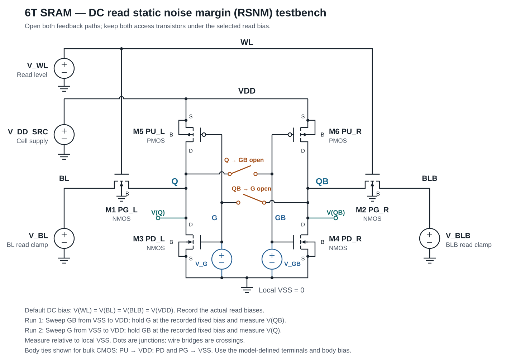
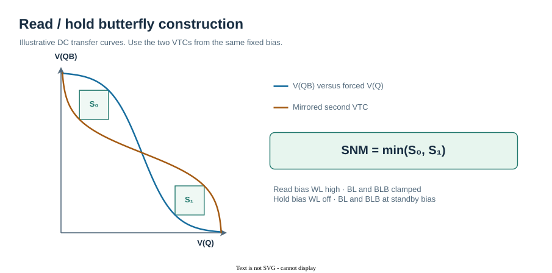
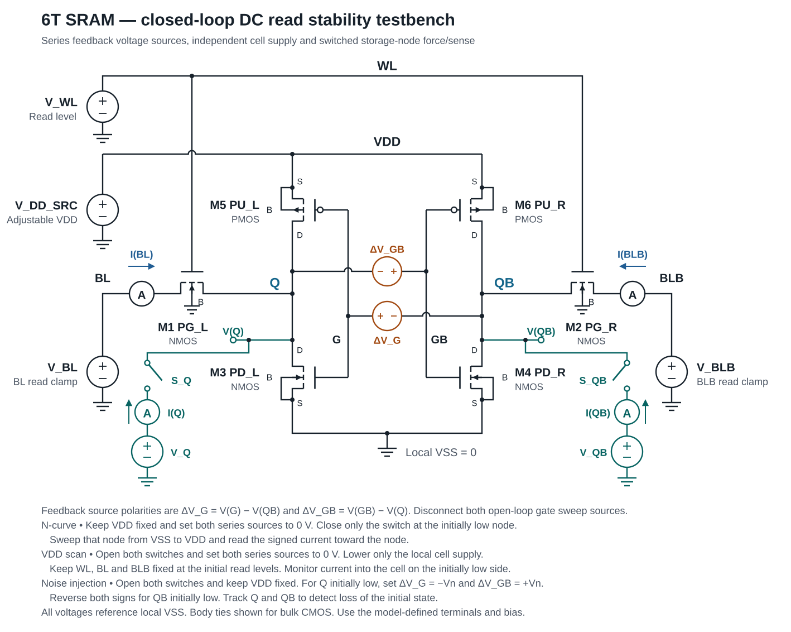

# RSNM

## 定义与适用范围

**读静态噪声容限（Read Static Noise Margin，RSNM）**是 6T SRAM 位单元（Bitcell）在规定直流（DC）读偏置下，维持两种存储状态所能承受的最坏方向等幅反极性静态电压扰动，单位为 V。扰动串在交叉反馈的两条信号线上。由同一单元两侧的电压传输特性（Voltage Transfer Characteristic，VTC）构成蝴蝶图，在每个叶瓣内分别求边与原坐标轴平行的最大内接正方形。$S_0$ 对应存“0”（Q 低、QB 高），$S_1$ 对应存“1”（Q 高、QB 低），两者均为正方形**边长**，单元取 $\mathrm{RSNM}=\min(S_0,S_1)$。若一个存储态消失，须另记该方向的静态失效。[1, Sec. II–IV, Figs. 3, 5] [2, Measurement Methodology, Fig. 4] [24, Sec. II-A, Fig. 1(b)]

常规基准为字线（Wordline，WL）选通，位线（Bitline，BL）与互补位线（BLB）均钳位在读预充电位，且 $V_{\mathrm{WL}}=V_{\mathrm{BL}}=V_{\mathrm{BLB}}=V_{\mathrm{DD}}$；各端口电压均以单元局部 VSS 为参考。使用独立单元供电、体偏置（Body Bias）或读辅助（Read Assist）时，须记录实际局部端口电压。

| 表征量 | 激励与判据 | 输出 |
| --- | --- | --- |
| **蝴蝶法 RSNM** | 固定读偏置，评价两条反馈线等幅反极性电压扰动下的稳态双稳性 | 两个叶瓣的正方形边长及其最小值（V） |
| **N 曲线静态电压噪声容限（Static Voltage Noise Margin，SVNM）与静态电流噪声容限（Static Current Noise Margin，SINM）** | 保持反馈闭合，在相同读偏置下扫描原存“0”的单个节点；同一条带符号注入电流曲线上，低电位稳态零点与相邻亚稳态零点之间提取间距及正峰值 | 同一存储极性的 SVNM（V）与 SINM（A）；反向数据换到另一存储节点重测。电流夹具见 [WTV](WTV.md) |
| **动态读扰动** | 用有限 WL 脉冲读访问，可按实际时序释放位线；检查 WL 关断并恢复后是否翻转 | 临界脉宽、读扰翻转位数或条件失效率 |

SVNM、SINM 与 RSNM 的激励口径不同，须分别报告；动态读扰须按实际波形验证。[13, Sec. II-A, Figs. 1–5] [3, Sec. II-B, Figs. 3–5]

## 物理机制与器件变异

常规 6T 读访问时，存“0”侧形成位线 → 访问管（Pass-Gate，PG）→ 低存储节点 → 下拉管（Pull-Down，PD）→ VSS 的放电通路。若位线保持在高预充电位，PG 从位线向低节点注入电流，PD 将电流导向 VSS；两者在直流平衡时确定低节点的抬升电压。低节点抬升使对侧反相器的输出降低；当原稳态和相邻亚稳态合并时，交叉反馈使原存储状态失稳。[1, Secs. II–III] [24, Sec. II-A, Fig. 1]

在常规读偏置下，增强 PD 相对 PG 的驱动通常可减小低节点抬升。平面 CMOS 的单元比（Cell Ratio，$\beta$）按 $(W/L)_{\mathrm{PD}}/(W/L)_{\mathrm{PG}}$ 定义；使用驱动强度比、鳍数比或纳米片数量比时，须注明实际定义。PG／PD 的局部阈值与几何失配会改变低节点电位；上拉管（Pull-Up，PU）及 PD 的失配还会移动反相器翻转区。两侧受影响程度可以不同，须保留同一单元的 $S_0$、$S_1$ 及较弱方向。[7, Fig. 6] [8, Secs. IV–VI] [10, Figs. 1–3] [13, Secs. II–III]

## 本征读稳定性与阵列环境

| 表征环境 | 实际边界与观测量 | 工程用途 |
| --- | --- | --- |
| **孤立位单元，固定 DC 偏置** | 在单元端钳位 WL、BL、BLB、VDD 与 VSS；按声明范围纳入单元内部寄生；提取 $S_0$、$S_1$、RSNM | 比较单元拓扑、管比、局部失配与端口偏置敏感度 |
| **阵列局部静态工作点** | 保持指定阵列背景和外围静态边界，记录选中单元端电压；可将该组电压施加于位单元，得到该条件下的 RSNM，或用供电扫描测阵列代理量 | 定位静态压降、位置与数据背景效应；标明是否保留外围耦合及路径阻抗 |
| **阵列动态读访问** | 保留局部 WL 幅度、边沿、脉宽、位线预充与释放时序、分布 RC、未选单元漏电及供电波动；记录 Q/QB 与 BL/BLB 波形 | 在规定数据背景及读序列下分别判断存储翻转与感测判决 |

阵列 WL 压降可能减弱 PG 导通，局部供电下陷则改变锁存器的保持能力，两者须按实际端压分别评估。读访问中位线电位随放电和泄漏变化，短 WL 脉冲、重复读间隔和波形耦合均影响最终存储状态。以阵列某一时刻的端电压计算所得的 RSNM 只表征该组固定偏置；动态判据须覆盖位线释放、远近端位置、数据背景及连续读，必要时还须测试同字线未选列的半选扰动。[3, Secs. II-B, IV-D] [11, Figs. 3–4] [24, Figs. 21–23] [39, Sec. II, Figs. 3–5]

## 测量与提取方法

### 仿真：双 VTC 蝴蝶法

**【前置条件】** 沿用 [6T 测试端口](Read_Current.md#测量与提取方法) 的器件连接，使用已标定的 PG／PD／PU 模型。逐个工艺、电压和温度（Process, Voltage and Temperature，PVT）条件固定实际局部 VDD、VSS、WL、BL、BLB 与体偏置；记录网表、寄生抽取范围和目标提取分辨率。

图中 G、GB 分别驱动 Q 侧和 QB 侧反相器的 PU／PD 栅端。开环测试断开 QB 至 G、Q 至 GB 两条反馈线，保留 BL–PG–Q 与 BLB–PG–QB 连接；体端按工艺设计套件（Process Design Kit，PDK）与测试偏置配置。

**【步骤／方法】**

1. **扫描两侧输入**：在同一个器件样本上分两次执行 DC 扫描。分别将 GB、G 从 $V_{\mathrm{SS}}$ 扫至 $V_{\mathrm{DD}}$，依次记录 QB、Q 的稳态响应；每次将未扫输入固定在已记录的静态电位。
2. **叠合蝴蝶曲线**：使用横轴 $V(Q)$、纵轴 $V(\mathrm{QB})$，将两组曲线分别以 $(V_{\mathrm{GB}},V(\mathrm{QB}))$ 和 $(V(Q),V_{\mathrm{G}})$ 叠合，后者交换了输入、输出坐标。保留三个交点及对应叶瓣的存储极性。[2, Fig. 4]
3. **提取叶瓣边长**：以插值后的闭合叶瓣为边界，搜索各瓣完全容纳的最大轴对齐正方形。对单调 VTC，可将原坐标 $(x,y)$ 换为 $u=(x-y)/\sqrt{2}$、$v=(x+y)/\sqrt{2}$，在每瓣的 $u$ 区间内取同一 $u$ 上的最大两曲线间距 $\lvert\Delta v\rvert$，再除以 $\sqrt{2}$ 得边长。逐级缩小 DC 电压步长与数值搜索间距，直至 $S_0$、$S_1$ 的变化均低于目标电压分辨率。[1, Sec. II–IV, Figs. 3, 5]

**注意事项**：禁止同时强制两个存储节点电压（会改变待测 VTC 或闭环状态）；两条 VTC 须来自同一个样本和同一组读偏置（避免失配或偏置拼接产生虚假叶瓣）。

**【结果处理和验证】** 输出两条原始 VTC、$S_0$、$S_1$、RSNM 和较弱方向，并单列求解失败与未分辨样本。若出现少于三个可分辨交点、叶瓣近于闭合或异常多交点，先细化扫描、核对端电压和求解收敛。撤去 G、GB 的开环激励，恢复反馈，分别写入互补初态，释放写入并验证其在固定读偏置下能否从小扰动恢复。确认某状态不能维持时，将该方向记为静态失效。对于不能独立表示为两条单输入 VTC 的耦合网表，可在闭环的两条反馈线上串入等幅反极性 DC 电压源，跟踪各原稳态随扰动增大而消失的阈值。验证存“0”时使 G 低于 QB、GB 高于 Q，验证存“1”时反转两源极性。[1, Secs. II–III]

闭环图以 $\Delta V_{\mathrm{G}}=V(\mathrm{G})-V(\mathrm{QB})$、$\Delta V_{\mathrm{GB}}=V(\mathrm{GB})-V(Q)$ 定义反馈噪声源极性。验证静态扰动时断开两侧内部节点扫压源，固定局部供电；测 N 曲线时两反馈源置零，只接入原存“0”侧的扫压源；测供电扫描代理量时两反馈源置零，断开两侧内部节点扫压源，独立扫描位单元供电。

### 仿真：N 曲线补充提取

**【前置条件】** 保持原 6T 交叉反馈闭合，沿用已记录的 DC 读偏置，先写入指定状态。

**【步骤／方法】** 释放写入后，将电压源接到初始存“0”的节点，从 $V_{\mathrm{SS}}$ 扫至 $V_{\mathrm{DD}}$，记录扫描电压和注入电流，正方向为从电压源进入存储节点。若 SPICE 电压源 `VFORCE` 的正端接扫描节点、负端接 VSS，则注入电流为 `-I(VFORCE)`。反向写入后切换到另一节点重测。[13, Sec. II-A, Figs. 3–5]

**注意事项**：禁止将不同扫描方向或不同存储节点的零点与峰值拼接（每对 SVNM 和 SINM 必须来自同一存储极性的同一条曲线）。

**【结果处理和验证】** 由低电位稳态零点 A 到相邻亚稳态零点 B 的电压差取 SVNM，由 A、B 之间正注入电流的最大值取 SINM。记录节点、极性和三零点；零点合并或缺失时细化扫描并核对闭环稳定性，单列确认失效和未分辨样本。[13, Sec. II-A, Figs. 4–5]

### 硅测量：直接 VTC、外部电压代理与功能读回

**【前置条件】** 直接法须使用内部节点可接出的表征单元、可切换反馈的测试结构或等效片上电路。供电扫描代理法须有独立可扫的单元供电及位线电流监测通道；仅有数字端口时采用功能读回。测试前校正探针、模拟开关和列复用器（Column Multiplexer）引入的串联压降与漏电；具备端点时可用四端开尔文连接，并记录校准范围与测量分辨率。

**【步骤／方法】**

| 测试结构 | 操作 | 记录与判据 |
| --- | --- | --- |
| **内部节点可访问** | 在固定读偏置下单侧强制反相器输入、读取对侧稳态输出，然后交换端口；测试结构若只能访问 Q/QB，可在反馈保持闭合时强制一个存储节点并测对侧，按双 VTC 步骤求两瓣 | 记录实测 VTC 及由其提取的 $S_0$、$S_1$、RSNM；等待每步稳定，重复测量以检查通路偏差 |
| **阵列模拟端口** | 写入指定数据；将 WL 和两条位线维持在规定端压，独立降低局部单元供电，监测存“0”侧从位线流入单元的电流；每次翻转后重写，换数据并交换监测侧 | 记录电流突降的临界供电压差及起始供电与临界供电之差；注明体端是否随供电变化，以及报告的电压口径 |
| **阵列数字端口** | 写入两种互补初态，分别施加规定读脉冲或重复读序列，在已验证的稳健读回条件下检查最终数据 | 记录脉宽、重复次数与间隔、数据背景、地址和翻转位数；按单元统计功能读扰失效率 |

**注意事项**：禁止把供电扫描的电流拐点、离散半单元近似量或数字读扰阈值直接标为 RSNM（与双 VTC 法的激励及失效判据不同）。[4, Figs. 3–5] [27, Figs. 3–7] [68, Figs. 2–5]

**【结果处理和验证】** 须分别归档直接曲线及提取值、供电扫描电流与阈值、瞬态或数字读回结果。闭环强制 Q/QB 时须核对强制节点实测电压和共享端口的偏置；若存在显著跨侧耦合，须验证与开环提取的一致性。[24, Sec. II-A, Fig. 1(b)] 电流突降须在重复扫描中可复现，并用独立读回或内部节点确认翻转；扫描范围内未翻转时报告界限。使用代理排序前，须在相同工艺、偏置及极性下和直接测量对照，分别报告分布一致性及可获得的配对相关性。

**硅测案例**：Guo 等在 45 nm、768 kb 测试芯片的内部节点可接出小宏测量蝴蝶 RSNM；在功能阵列保持 WL 和 BL／BLB 为标称读电平，降低单元供电并测量存“0”侧电流突降。[2, Fig. 1(d)] 图 7(a) 对照两种指标的硅测分布，图 7(b) 用蒙特卡洛仿真检验相关性。[2, Figs. 2–4, 7] 后续同工艺论文用可接出节点的小宏在 0.8 V 与 0.5 V 直接比较字线读保持电压代理量与 RSNM，适用范围以对应的偏置和测试结构为准。[24, Sec. VI-A, Fig. 15(a)]

## 数据可视化与评估

### 数据分析与评价方法

| 建议图表 | 必须标明的条件 | 判读与动作 |
| --- | --- | --- |
| **标称和弱样本蝴蝶图；$S_0$–$S_1$ 配对散点图** | 电压轴、偏置、样本 ID、三交点、叶瓣极性与较小值 | 确认取方和数据极性；若只有一侧变弱，核对配对器件与布局方向 |
| **RSNM 经验累积分布（Empirical Cumulative Distribution Function，ECDF）及低尾分位曲线** | PVT、局部偏置、样本量、规格门槛、置信区间；分别标明静态失效和未分辨样本 | 若两瓣同时收窄，检查供电与读偏置；若标称值通过而低尾欠裕量，检查局部失配与全局角 |
| **阵列位置热图及读扰失效率曲线** | 芯片、行列、方向、脉宽、数据背景、代理校准条件；按读出错误与存储翻转分列 | 定位远端 WL/BL、供电或感测放大器（Sense Amplifier，SA）的限制；用波形或复测验证原因 |

**统计口径**：在各 PVT 全局角内做蒙特卡洛（Monte Carlo，MC）仿真，保留 PU、PD、PG 局部变异相关性；阵列瞬态评估另按需加入 RC 和时序变异。同一单元的两个方向须配对取最小值，任一方向静态失效或 RSNM 低于规定下限时按一个失效单元计数。按目标尾部精度选择样本数，报告分位数置信区间；共享芯片、SA 或列的样本按簇建模或重采样。[8, Secs. IV–VI] [33, Secs. II–V]

对独立二项样本，若 $n$ 个单元中未观察到失效，单元失效率的一侧 95% 上界由 $(1-p_U)^n=0.05$ 得 $p_U=1-0.05^{1/n}$。要以零失效验证上界不超过目标 $p_*$，取 $n\ge\lceil\ln(0.05)/\ln(1-p_*)\rceil$；观察到失效时报告二项置信区间。对直接 MC 覆盖不到的尾部，可采用混合重要性采样（Mixture Importance Sampling），保留原始密度 $f(x)$ 与抽样密度 $q(x)$ 的比值 $f(x)/q(x)$ 作为权重，覆盖两种极性的失效区域。在可测概率范围内与直接 MC 对照，并报告权重波动与重复估计区间。[6, pp. 69–72] [35, Secs. III–V-A]

**数据对比规范**：在同一局部 WL、BL／BLB、VDD／VSS、体偏置与温度下比较 RSNM，分别标记硅实测、SPICE 仿真和模型投影。Karner 等在室温下用器件仿真（Technology Computer-Aided Design，TCAD）校准的 SPICE 紧凑模型预测带寄生的 1:1:1 型 N3 FinFET／纳米片 6T 单元分布，其中图 9 的 FinFET 蝴蝶曲线在 0.8 V 下比较。[5, Sec. V-B, Figs. 9–11] Toh 等的 45 nm 硅测则表明，有限 WL 脉宽、重复读次数和间隔可改变读扰动结果；静态代理量与动态失败位数的关系须按实际读序列校验。[3, Sec. II-B, IV-D, Figs. 16–18]

## 应用场景与指标关系

- **选取管比与读辅助**：按 RSNM 的较弱方向和低尾分位筛选 PD／PG 配比、字线降压（Wordline Underdrive）、位线预充降压（Bitline Precharge Lowering）或读期间的单元供电配置。在同一偏置下结合[位单元读电流](Read_Current.md)和[读建差时间](../Subarray/Read_Develop_Time.md)，验证降低读扰后的速度，并用[写静态噪声容限](WSNM.md)和[写时间](../Subarray/Write_Time.md)核查写入边界。[13, Sec. III] [34, Sec. IV]
- **定位裕量不足**：在相同单元供电下比较 [HSNM](HSNM.md) 与 RSNM。若保持态也偏弱，先核对反相器的配比、失配和供电；若仅读态偏弱，先核对位线预充、访问管强度与局部 WL 偏置。荆郁然报告的 6T 单元仿真示例在 1.2 V、25 ℃ 下分别得到 375 mV 的 HSNM 和 210 mV 的 RSNM。[61, Sec. 3.2.3, Fig. 3.10]
- **制定宏级读约束**：将 RSNM 用作设计与工艺协同优化（Design-Technology Co-Optimization，DTCO）的静态筛选量；宏级最低读工作电压 $V_{\min}$ 须结合动态读扰、完整读判决及阵列统计确定。[3, Secs. II-B, IV-D] [5, Sec. V-B]

## 参考文献

检索范围为 Zotero `02-SRAM-DTCO/SRAM-Metrics` 及其全部子集合，按 `RSNM` 同名标签筛选，检索日期为 2026-11-13，共命中 64 篇；复用原有编号 2 篇，新增 62 篇，保留并补充原有 6 条参考文献后共 68 条。新增条目按年份、第一作者、题名排列，年份未核实者置后。摘要区分读偏置蝴蝶 RSNM、保持 SNM、外部电压代理量与动态读失效；间接相关文献明确标注适用范围。页码注明“PDF”时指归档文件的物理页；提前出版版及作者稿的页码可能与正式题录不同。

2026-11-17 在 Zotero 的 Bitcell 子集合复核精确标签 `RSNM`：按 DOI 或题名去重后为 64 条，共核验 19 篇与本页相关的可读归档全文，其中 18 篇也可从 Zotero 本机附件打开。

[1] E. Seevinck, F. J. List, and J. Lohstroh, “Static-noise margin analysis of MOS SRAM cells,” IEEE Journal of Solid-State Circuits, vol. 22, no. 5, pp. 748-754, 1987. [DOI 10.1109/JSSC.1987.1052809](https://doi.org/10.1109/JSSC.1987.1052809) · [Zotero](https://www.zotero.org/users/7333024/items/2HME7GPM) · [公开文献](https://doi.org/10.1109/JSSC.1987.1052809)

**相关摘要：** 论文在读访问、位线预充至电源电压这一易受扰条件下分析电阻负载与全 CMOS SRAM，通过向交叉耦合反相器串入相反极性的直流噪声源，建立蝴蝶曲线内接正方形的 SNM 几何定义。解析式揭示阈值、电源及器件强度比决定稳定性，单纯按相同比例增大各管驱动并不必然提高电压裕量；增大下拉／访问比有利于读稳定性，但受面积和写入要求约束。文中还给出旋转坐标后求曲线差值的数值提取方法。解析结果基于当时器件近似，现代短沟道器件仍需仿真校验。

**原文定位：** PDF 第 1–4 页，正文第 748–751 页，图 1–5及解析式讨论。

[2] Z. Guo et al., “Large-scale read/write margin measurement in 45nm CMOS SRAM arrays,” in Proc. IEEE Symp. VLSI Circuits, 2008. [DOI 10.1109/VLSIC.2008.4585944](https://doi.org/10.1109/VLSIC.2008.4585944). [公开文献](https://doi.org/10.1109/VLSIC.2008.4585944)；Zotero：本次标签集合未匹配记录。

**相关摘要：** 论文在 45 nm、768 kb SRAM 测试芯片中通过位线电流与单元供电扫描表征阵列读稳定性，并在接出内部节点的小宏单元中测量传统读蝴蝶 RSNM 作为对照。供电扫描读裕量与 RSNM 的分布和相关性在该测试中吻合，说明可用外部端口提高统计覆盖；但二者仍有不同的激励定义。阵列数据还用于区分左右存储方向、位置与布局方向的差异，避免把孤立单元结果视作阵列全部行为。文章侧重测量方法和统计相关性，不意味着供电扫描所得伏特值可在任意器件或偏置下直接替代 RSNM。

**原文定位：** PDF 第 1–2 页，“Results”、图 4、图 7、图 9–10。

[3] S. O. Toh, Z. Guo, T.-J. K. Liu, and B. Nikolić, “Characterization of dynamic SRAM stability in 45 nm CMOS,” IEEE J. Solid-State Circuits, vol. 46, no. 11, pp. 2702–2712, 2011. [DOI 10.1109/JSSC.2011.2164300](https://doi.org/10.1109/JSSC.2011.2164300). [公开文献](https://doi.org/10.1109/JSSC.2011.2164300)；Zotero：本次标签集合未匹配记录。

**相关摘要：** （间接相关）论文在 45 nm CMOS 测试芯片中比较静态和有限字线脉冲下的读稳定性，大阵列静态测试采用供电读保持电压 SRRV，而不是逐单元接出内部节点的蝴蝶 RSNM。实测发现静态读判据可高估失败数量约 10–100 倍，原因是轻微直流失稳的单元在有限读窗口内未必完成翻转；重复读取和恢复时间还会改变结果。该结论说明 RSNM 相关静态指标的使用边界，但该倍数属于文中 SRRV 与动态读测试的比较，不能表述为 RSNM 电压提高或所有电路均有同等保守程度。

**原文定位：** PDF 第 1–3 页，§II-B；第 7 页图 16–17。

[4] W. K. Loh and D. J. Redwine, “SRAM static noise margin test structure suitable for on chip parametric measurements,” U.S. Patent 7 385 864 B2, 2008. [公开文献](https://patents.google.com/patent/US7385864B2/en)；Zotero：本次标签集合未匹配记录。

**相关摘要：** 该专利以两类半单元测试结构快速估计静态噪声裕量：一类取得左右保持状态的反相器临界点，另一类取得与 cell ratio 相关的读扰动点，再取交叉差值中的较小者作为 SNM 相关量。方法通过固定连接和少数离散电压测量减少完整蝴蝶扫描及探针电容充放电的成本，适于芯片内或划片道参数监控。它提供的是与 SNM 关联的近似评估，不是逐点直接测出完整读蝴蝶；专利对正方形对角线的表述也与常用边长约定不同，绝对电压比较时必须统一换算。

**原文定位：** PDF 第 16–17、22–23 页，图 3A–3E、图 5及对应说明。

[5] M. Karner et al., “Variability-aware DTCO flow: projections to N3 FinFET and nanosheet 6T SRAM,” in 2021 International Conference on Simulation of Semiconductor Processes and Devices (SISPAD), 2021, pp. 15-18. [DOI 10.1109/SISPAD54002.2021.9592527](https://doi.org/10.1109/SISPAD54002.2021.9592527) · [Zotero](https://www.zotero.org/users/7333024/items/2NIBZCPG) · [公开文献](https://doi.org/10.1109/SISPAD54002.2021.9592527)

**相关摘要：** 论文将 TCAD 变异仿真校准为 BSIM-CMG 模型，并结合提取寄生的 1:1:1 型 6T SRAM，预测 N3 FinFET 和纳米片单元的读 SNM 分布。标称蝴蝶曲线先与完整 TCAD 结果比较，再用高通量 SPICE 考察金属栅晶粒、随机掺杂和几何变化。室温模拟显示金属栅晶粒是主要变异源，增大晶粒尺寸会显著拓宽读裕量分布，且两种器件对晶粒变化的响应不同。该结果是基于 N3 工艺假设的预测，不是量产硅测量；比较平均 RSNM 时还需同时保留其离散程度与供电条件。

**原文定位：** PDF 第 3–4 页，§V-B、图 9–11及结论。

[6] R. Kanj, R. Joshi, and S. Nassif, “Mixture importance sampling and its application to the analysis of SRAM designs in the presence of rare failure events,” in Proc. ACM/IEEE DAC, 2006, pp. 69–72. [公开文献](https://www.cs.york.ac.uk/rts/docs/DAC-1964-2006/PAPERS/2006/DAC06/PDFFILES/P0069.PDF)；Zotero：本次标签集合未匹配记录。

**相关摘要：** （间接相关）论文提出混合重要性采样，用偏移高斯与补充采样分布提高 SRAM 极低失败概率估计效率，并将六只晶体管的阈值涨落视为独立高斯输入。SRAM 实例包含单元、位线负载和外围电路，实际评价的是动态读破坏及写失败指示函数，而不是完整蝴蝶 RSNM 的概率分布。其与本页的联系在于统计验证方法可用于稳定性稀有事件分析；文中理论函数的加速倍数不能直接写成读 SNM 测量加速或静态裕量改善，也不能忽略失效判据、采样权重与置信区间。

**原文定位：** PDF 第 3–4 页，§4.2、式 (12)、图 2、表 4。

[7] A. J. Bhavnagarwala, Xinghai Tang, and J. D. Meindl, “The impact of intrinsic device fluctuations on CMOS SRAM cell stability,” IEEE Journal of Solid-State Circuits, vol. 36, no. 4, pp. 658-665, 2001. [DOI 10.1109/4.913744](https://doi.org/10.1109/4.913744) · [Zotero](https://www.zotero.org/users/7333024/items/KSDEC6NR) · [公开文献](https://doi.org/10.1109/4.913744)

**相关摘要：** 文章建立器件本征阈值涨落到 SRAM 静态噪声裕量的物理与统计模型，以六只晶体管的独立阈值变化刻画单元失配。两侧蝴蝶曲线的单边裕量会随失配反向移动，整体 SNM 取较小者，因此其分布不能简单用单个对称高斯量代替。模型以 0.18 μm 电路仿真比较，并讨论器件继续缩小时稳定性尾部的恶化。对读稳定性设计的主要启示是同时控制裕量均值和失配散布；文中的缩放预测受当时均匀掺杂器件与统计假设约束，不能作为现代节点的直接实测数据。

**原文定位：** PDF 第 4 页式 (13)–(14)、图 6；第 6 页统计分析。

[8] R. Heald and P. Wang, “Variability in sub-100nm SRAM designs,” in Proc. IEEE/ACM International Conference on Computer-Aided Design (ICCAD), 2004, pp. 347–352. [DOI 10.1109/ICCAD.2004.1382599](https://doi.org/10.1109/ICCAD.2004.1382599) · [Zotero](https://www.zotero.org/users/7333024/items/7GAQXDTN) · [公开文献](https://doi.org/10.1109/ICCAD.2004.1382599)

**相关摘要：** 文章讨论亚 100 nm SRAM 中全局工艺变化与局部失配对读 SNM 的不同影响，指出失配会使蝴蝶曲线两瓣不等，必须采用较小一侧而非平均值。过去仅规定下拉／访问尺寸比的设计方式不足以覆盖缩小后的统计变异，需要用含工艺及失配的蒙特卡洛模型评估均值、离散和阵列容量目标。作者同时将写翻转点、读电流及感放失配纳入讨论，说明合格 SNM 不能单独保证阵列速度和功能。文中的高斯外推算例是设计说明，适用前提是对应分布在所用范围近似高斯。

**原文定位：** PDF 第 1–4 页，图 2–4、§IV–VI。

[9] S. Mukhopadhyay, H. Mahmoodi, and K. Roy, “Modeling of failure probability and statistical design of SRAM array for yield enhancement in nanoscaled CMOS,” IEEE Transactions on Computer-Aided Design of Integrated Circuits and Systems, vol. 24, no. 12, pp. 1859-1880, 2005. [DOI 10.1109/TCAD.2005.852295](https://doi.org/10.1109/TCAD.2005.852295) · [Zotero](https://www.zotero.org/users/7333024/items/P33WUEER) · [公开文献](https://doi.org/10.1109/TCAD.2005.852295)

**相关摘要：** 论文从读取时访问管和下拉管形成分压、低节点电压超过另一反相器翻转点的机理建立读失效概率模型，并与写入、保持及访问时间失效共同估算阵列良率。随机局部阈值失配可同时抬高读节点和降低翻转阈值，因此相关参数与联合失效不能忽略；只最大化 SNM 会增强保持能力，却可能使写入更困难。该工作采用解析概率模型、器件尺寸和阵列冗余联合优化，适合作为静态稳定性到良率的桥梁。但其读失效判据并非逐样本完整蝴蝶提取，数值应用需保留模型和相关性假设。

**原文定位：** PDF 第 3–5 页，§II-A、§III；第 10、14 页相关性及 SNM 讨论。

[10] Y. Tsukamoto et al., “Worst-case analysis to obtain stable read/write DC margin of high density 6T-SRAM-array with local vth variability,” in ICCAD-2005. IEEE/ACM International Conference on Computer-aided Design, 2005., 2005, pp. 398-405. [DOI 10.1109/ICCAD.2005.1560101](https://doi.org/10.1109/ICCAD.2005.1560101) · [Zotero](https://www.zotero.org/users/7333024/items/CWQJG9R2) · [公开文献](https://doi.org/10.1109/ICCAD.2005.1560101)

**相关摘要：** 文章针对 65 nm SRAM 的局部阈值变化构建读写直流稳定区域，指出全局变化可能同时移动两瓣 SNM，而局部失配会造成明显不对称，使较小一瓣更快趋近失效。传统灵敏度法依赖近似线性的 SNM—阈值关系，远离标称点时其误差会影响高密度阵列的尾部判断；作者因此搜索给定变异条件下最不利的参数向量和读写边界。该方法强调稳定区域必须同时满足读与写约束，不能只依据标称 RSNM 或简单管比判断大阵列良率。

**原文定位：** PDF 第 1–4 页，图 1–3、§2.3、§3。

[11] M. Yamaoka et al., “Low-power embedded SRAM modules with expanded margins for writing,” in ISSCC. 2005 IEEE International Digest of Technical Papers. Solid-state Circuits Conference, 2005., 2005, pp. 480-482. [DOI 10.1109/ISSCC.2005.1494078](https://doi.org/10.1109/ISSCC.2005.1494078) · [Zotero](https://www.zotero.org/users/7333024/items/2IXCRYWB) · [公开文献](https://doi.org/10.1109/ISSCC.2005.1494078)

**相关摘要：** 本文提出扩大写入窗口的低功耗嵌入式 SRAM 模块，并将读 SNM 限制与写入限制同时画在工作区域中，说明提高写能力不能破坏同字线上未选列的读稳定性。设计结合局部供电控制与读写复制时序，选中列执行写入，而未选列仍受到类似读取的位线与字线偏置；延长字线有利于写入却增加位线放电功耗。该会议短文主要报告电路与模块策略，没有给出可完整重建的读蝴蝶分布，因此可用于说明读写窗口及半选约束，不能把模块功耗收益直接解释为 RSNM 改善。

**原文定位：** PDF 第 1–2 页，图 26.4.1–26.4.4。

[12] Qikai Chen, S. Mukhopadhyay, A. Bansal, and K. Roy, “Circuit-aware Device Design Methodology for Nanometer Technologies: A Case Study for Low Power SRAM Design,” in Proceedings of the Design Automation & Test in Europe Conference, 2006, pp. 1-6. [DOI 10.1109/DATE.2006.243868](https://doi.org/10.1109/DATE.2006.243868) · [Zotero](https://www.zotero.org/users/7333024/items/NJAJZIR3) · [公开文献](https://doi.org/10.1109/DATE.2006.243868)

**相关摘要：** 文章提出面向电路目标的器件设计方法：单管导通／关断电流比最优并不必然使 SRAM 的漏电、访问速度和稳定性同时最优。作者比较采用优化器件的传统 6T、源偏置及反向体偏置 SRAM，在读模式下绘制蝴蝶曲线，确认所选设计仍保持合理读 SNM。进一步指出 SNM 可以进入综合品质因子，也可以作为器件掺杂优化的约束，因此漏电和延迟收益不能脱离读稳定性审查。文中图示主要支持方法可行性，没有为所有方案给出可通用引用的同一 RSNM 改善百分比。

**原文定位：** PDF 第 6 页，§5、图 14。

[13] E. Grossar, M. Stucchi, K. Maex, and W. Dehaene, “Read stability and write-ability analysis of SRAM cells for nanometer technologies,” IEEE Journal of Solid-State Circuits, vol. 41, no. 11, pp. 2577-2588, 2006. [DOI 10.1109/JSSC.2006.883344](https://doi.org/10.1109/JSSC.2006.883344) · [Zotero](https://www.zotero.org/users/7333024/items/EEADHYR8) · [公开文献](https://doi.org/10.1109/JSSC.2006.883344)

**相关摘要：** 论文把传统读 SNM 与 N 曲线 SVNM、SINM 对照：两位线固定 VDD、字线选通时，蝴蝶法以两个反向直流噪声源表征可容忍噪声；N 曲线则扫描单个内部节点并保留电流信息。保持各管比例而整体增大尺寸的例子中，SNM 与 SVNM 可以相同，SINM 却增加，说明单一电压裕量不足以描述所有抗扰能力差异。作者推导并校验与器件工作区相关的模型，讨论供电、cell ratio 和 pull-up ratio 的权衡；读电流稳定性改善也可能增加写入所需电流。

**原文定位：** PDF 第 1–4 页，§II-A、图 1–7、表 I；第 6 页 §III-B。

[14] 蔡斌君, “静态随机存储器位单元与测试结构设计优化,” 硕士学位论文, 上海交通大学, 上海, 2007. [Zotero](https://www.zotero.org/users/7333024/items/Q2T3EHCM) · [公开文献](https://kns.cnki.net/kcms2/article/abstract?v=3uoqIhG8C475KOm_zrgu4lQARvep2SAkAYAgqaTO4OyKkcOJ4w_0uBMMDBd31Rzz6lvqN7floCYwOJ74euUL69fh0K1aE59J&uniplatform=NZKPT)；DOI：Zotero未收录或尚未核实。

**相关摘要：** （间接相关）论文针对90 nm六管嵌入式SRAM比较单元配比和版图结构，用HSPICE蝴蝶曲线筛选面积与静态噪声容限的折衷，并设计可测内部节点的专用测试结构验证。硅片中0.99 μm²单元给出210 mV的SNM，1.15及1.27 μm²方案为250 mV；左右叶瓣差异体现器件失配，不能只记录较大的单瓣值。该研究支持在相同夹具和供电下联合比较密度、稳定性及漏电；这些几何方案的SNM不能泛化为整个90 nm工艺的通用规格，使用时仍需确认读/保持偏置是否对应。

**原文定位：** Sec. 2.3、3.2、4.3，正文pp. 28–32、34、46–47，Figs. 16、27、38。

[15] D. Khalil, M. Khellah, N. S. Kim, Y. Ismail, T. Karnik, and V. De, “SRAM dynamic stability estimation using MPFP,” in 2007 Internatonal Conference on Microelectronics, 2007, pp. 167-170. [DOI 10.1109/ICM.2007.4497685](https://doi.org/10.1109/ICM.2007.4497685) · [Zotero](https://www.zotero.org/users/7333024/items/I23VWJ8I) · [公开文献](https://doi.org/10.1109/ICM.2007.4497685)

**相关摘要：** 论文提出最可能失效点搜索，以真实读周期结束后的节点状态及感放采样条件区分读破坏与访问失败。作者指出直接拟合静态 SNM 分布并外推极端尾部，既可能受分布假设误差影响，也不能覆盖有限字线脉宽及动态回写辅助。动态回写能够在原始状态被破坏后恢复数据，而常规 RSNM 无法反映这种操作。因此本文主要用于说明静态读裕量与动态失败概率的差别；所报加速和稳定性提升属于指定时序、阵列及算法的结果，不等价于 RSNM 数值增加。

**原文定位：** PDF 第 1–4 页，§II–V、图 3及动态回写示例。

[16] M. Khellah, D. Khalil, D. Somasekhar, Y. Ismail, T. Karnik, and V. De, “Effect of power supply noise on SRAM dynamic stability,” in 2007 IEEE Symposium on VLSI Circuits, 2007, pp. 76-77. [DOI 10.1109/VLSIC.2007.4342772](https://doi.org/10.1109/VLSIC.2007.4342772) · [Zotero](https://www.zotero.org/users/7333024/items/MC7UPYEF) · [公开文献](https://doi.org/10.1109/VLSIC.2007.4342772)

**相关摘要：** 论文用仿真和测试芯片研究供电噪声对 SRAM 动态稳定性的影响，指出仅按直流电源下陷幅度评估读噪声裕量会遗漏噪声相位、频率与字线窗口的关系。仿真例在 0.8 V、电源噪声幅度 80 mV、字线脉宽 400 ps 下改变噪声相位及周期，读失败率可出现显著差异。该变化反映操作时序与瞬态轨迹，而不是同一静态 RSNM 的变化。文献适合支持实际供电噪声需要时域评估的结论，不能将最坏直流降压等同于所有波形条件下的阵列风险。

**原文定位：** PDF 第 1–2 页，图 4–6。

[17] A. E. Carlson, “Device and Circuit Techniques for Reducing Variation in Nanoscale SRAM,” Ph.D. dissertation, University of California, Berkeley, 2008. [Zotero](https://www.zotero.org/users/7333024/items/8IJZ6UEH) · [公开文献](https://www2.eecs.berkeley.edu/Pubs/TechRpts/2008/EECS-2008-51.html)；DOI：Zotero未收录或尚未核实。

**相关摘要：** 论文以读偏置蝴蝶曲线解释静态噪声裕量，随后从器件、反馈电路和偏置方案降低纳米 SRAM 的变异影响。访问管反馈通过降低读取时低节点的稳态电压增大裕量，调节上拉支路则可改善反相器翻转点，两种作用可互补；不过在相同 RSNM 下仍须比较读电流，避免把稳定性提高视为无代价收益。作者还强调标称 SNM、统计读良率和阵列功能不是同一个量，最低工作电压可受写能力或读速度限制。文中结果来自具体结构及模型，不能以单个 SNM 比例作为所有单元的合格标准。

**原文定位：** PDF 第 20–21 页；第 153–157 页图 4.26及图 4.31–4.32；第 166 页。

[18] L. Dolecek, M. Qazi, D. Shah, and A. Chandrakasan, “Breaking the simulation barrier: SRAM evaluation through norm minimization,” in 2008 IEEE/ACM International Conference on Computer-Aided Design, 2008, pp. 322-329. [DOI 10.1109/ICCAD.2008.4681593](https://doi.org/10.1109/ICCAD.2008.4681593) · [Zotero](https://www.zotero.org/users/7333024/items/BW8B4ULZ) · [公开文献](https://doi.org/10.1109/ICCAD.2008.4681593)

**相关摘要：** 本文用标准化阈值变异空间中的最小范数失效点构造重要性采样分布，减少直接蒙特卡洛估计稀有SRAM失败的成本。第一算例以保持模式蝴蝶图塌陷为失效，后续算例才联合读0、读1、写0和写1四种失效模式，并分别寻找对应的均值偏移。该方法强调器件变异的联合方向比任一单管最坏值更重要，可用于读稳定性尾部估计；但保持SNM案例的加速比与失效率不能直接宣称为读RSNM结果，也不能仅由等效sigma忽略宏容量带来的良率敏感性。

**原文定位：** Sec. IV-A及多失效模式算例，PDF pp. 5–8，Figs. 4–5，Tables I、III。

[19] W. Dong, P. Li, and G. M. Huang, “SRAM dynamic stability: theory, variability and analysis,” in 2008 IEEE/ACM International Conference on Computer-aided Design, 2008, pp. 378-385. [DOI 10.1109/ICCAD.2008.4681601](https://doi.org/10.1109/ICCAD.2008.4681601) · [Zotero](https://www.zotero.org/users/7333024/items/GPS3KS3V) · [公开文献](https://doi.org/10.1109/ICCAD.2008.4681601)

**相关摘要：** 论文利用非线性系统的稳定吸引域和分界线定义动态读噪声裕量，读裕量取读状态轨迹到达保持模式分界线的时间与实际读脉宽之差。传统 RSNM 则只描述读访问管纳入传输曲线后的最大直流扰动，隐含无限作用时间，无法直接表示这项时间余量。器件失配会移动分界线并改变轨迹，因此作者进一步提出参数化动态良率分析。该文对本页的意义是明确静态和动态判据之间的物理边界；动态裕量的时间单位、算法加速或良率收益不能写成 RSNM 电压值的提升。

**原文定位：** PDF 第 1–5 页，图 1、图 3–4、式 (4)及动态良率讨论。

[20] T. S. Doorn, E. J. W. Ter Maten, J. A. Croon, A. Di Bucchianico, and O. Wittich, “Importance sampling monte carlo simulations for accurate estimation of SRAM yield,” in ESSCIRC 2008 - 34th European Solid-State Circuits Conference, 2008, pp. 230-233. [DOI 10.1109/ESSCIRC.2008.4681834](https://doi.org/10.1109/ESSCIRC.2008.4681834) · [Zotero](https://www.zotero.org/users/7333024/items/SLU75CBK) · [公开文献](https://doi.org/10.1109/ESSCIRC.2008.4681834)

**相关摘要：** 本文在65 nm SRAM的低供电算例中比较普通蒙特卡洛与重要性采样。读SNM取蝴蝶图两瓣裕量的较小值，即使单瓣近似高斯，取最小值后的整体分布也不再高斯；直接把整体均值和标准差外推至远尾会高估裕量。作者以较宽的阈值抽样分布增加失效样本，再用概率权重修正，并讨论单瓣尾概率到双瓣失效概率的换算。该方法的单瓣近似及对称条件必须检验，仿真尾部结果不能替代硅片验证，也不能无条件把同一cell的两瓣当作独立样本。

**原文定位：** Sec. III-A，PDF pp. 2–3，Figs. 3–4，Eqs. (3)–(5)。

[21] D. Khalil, M. Khellah, N. S. Kim, Y. Ismail, T. Karnik, and V. K. De, “Accurate estimation of SRAM dynamic stability,” IEEE Transactions on Very Large Scale Integration (VLSI) Systems, vol. 16, no. 12, pp. 1639-1647, 2008. [DOI 10.1109/TVLSI.2008.2001941](https://doi.org/10.1109/TVLSI.2008.2001941) · [Zotero](https://www.zotero.org/users/7333024/items/Z3X5QBUS) · [公开文献](https://doi.org/10.1109/TVLSI.2008.2001941)

**相关摘要：** 论文明确给出读 SNM 的双瓣蝴蝶定义，再分析用静态判据和假定分布估算纳米 SRAM 失败率的局限。作者以节点状态和操作时序构造动态判据，搜索六管阈值变异空间中的最可能失效点，并在带实际阵列负载的仿真中比较读、写及访问失败。读脉冲限制和动态回写可改变最终结果，静态 SNM 不能表达这些时间效应。该文不是否定蝴蝶量本身，而是要求在面向实际良率时同时检查动态条件及统计尾部，避免把算法结果误称为静态 RSNM 的改善。

**原文定位：** PDF 第 1–5 页，图 5、§IV–VI。

[22] A. Pavlov, and M. Sachdev, “CMOS SRAM Circuit Design and Parametric Test in Nano-Scaled Technologies: Process-Aware SRAM Design and Test,” Springer Publishing Company, Incorporated, 2008. [Zotero](https://www.zotero.org/users/7333024/items/TWKBDGFL) · [公开文献](https://doi.org/10.1007/978-1-4020-8363-1)；DOI：Zotero未收录或尚未核实。

**相关摘要：** 本书系统解释 6T SRAM 读扰动、蝴蝶曲线与测试方法：位线预充后选通字线，访问管和下拉管的分压使低存储节点上升，因此下拉管与访问管强度之比直接影响读 SNM。0.13 μm、1.2 V 示例展示增大 cell ratio 可同时改善读电流和读稳定性，但代价是面积增加；上拉、下拉和访问管的比值还受可靠写入约束。后续推导将噪声源插入读访问单元，并讨论供电、阈值及参数变异影响，适合作为本页定义与尺寸权衡的基础来源，而非跨节点通用数值规则。

**原文定位：** PDF 第 33–35 页图 2.5；第 60–66 页图 3.7、§3 的 SNM 推导。

[23] B. Alorda, G. Torrens, S. Bota, and J. Segura, “Static-Noise Margin Analysis during Read Operation of 6T SRAM Cells,” in Proc. XXIV Conference on Design of Circuits and Integrated Systems (DCIS), 2009, 6 pp. [Zotero](https://www.zotero.org/users/7333024/items/LPHGB7GL) · ；DOI：Zotero未收录或尚未核实。

**相关摘要：** 本文对商业65 nm CMOS 6T单元比较读与保持蝴蝶图，研究管宽配比、字线欠驱、位线预充电压及供电对读SNM的影响。降低读字线可减小访问管引起的存储节点抬升，适度降低位线预充也有帮助，但将预充降得过低会使收益消失；单独降低单元供电则减小读裕量。作者组合尺寸和端口电压调制，在给出SNM改善的同时报告读时间、漏电及面积代价。结论依赖读偏置与工艺角，不能用保持SNM排序代替读稳定性排序，也不意味着提高RSNM必然提高访问速度。

**原文定位：** Secs. 3.1–3.5，PDF pp. 2–5，Figs. 4–11，Tables 3–4。

[24] Z. Guo, A. Carlson, L. T. Pang, K. T. Duong, T. J. K. Liu, and B. Nikolic, “Large-scale SRAM variability characterization in 45 nm CMOS,” IEEE Journal of Solid-State Circuits, vol. 44, no. 11, pp. 3174-3192, 2009. [DOI 10.1109/JSSC.2009.2032698](https://doi.org/10.1109/JSSC.2009.2032698) · [Zotero](https://www.zotero.org/users/7333024/items/5RBES89L) · [公开文献](https://doi.org/10.1109/JSSC.2009.2032698)

**相关摘要：** 文章在 45 nm CMOS 测试芯片上比较传统内部节点读 SNM 与可在完整阵列测量的供电、字线读保持电压。传统 RSNM 在字线及两位线置高时由读传输曲线提取；阵列方法仅访问外部端口，支持更大样本并保留实际版图环境。实测表明不同指标在接近失效时与最低工作电压具有较好相关性，但这种相关性不能保证整个裕量范围内数值等价。作者还发现阵列位置、单元方向和存储极性对应的系统差异，说明读裕量统计必须区分两侧并结合真实布局，而非只测孤立标称单元。

**原文定位：** PDF 第 2–4 页，§II-A、§III-A；第 14 页图 21–23。

[25] Z. Guo, “Large-scale variability characterization and robust design techniques for nanoscale SRAM,” Doctoral dissertation, EECS Department, University of California, Berkeley, 2009. [Zotero](https://www.zotero.org/users/7333024/items/A56QIF3W) · [公开文献](https://www2.eecs.berkeley.edu/Pubs/TechRpts/2009/EECS-2009-190.html)；DOI：Zotero未收录或尚未核实。

**相关摘要：** 论文系统比较读蝴蝶 SNM、N 曲线电压／电流裕量及外部读保持电压，并以 45 nm 仿真和测试芯片验证其相关性。RSNM 来自读偏置两条 VTC 的较小内接正方形；左右侧失配使整体裕量成为两个单边量的最小值，需要相应的统计处理。实测表明多个指标在低电源、临近失败时关联较强，而较高电压下尤其电流指标与 RSNM 的相关性可能明显变弱。该结果支持保留明确激励和双侧定义，不应把所有“读稳定性”量统一换算为 RSNM，也不能仅凭标称关联推断阵列尾部良率。

**原文定位：** PDF 第 45–54 页，正文第 20–29 页；第 115 页图 4.1；第 139、213 页。

[26] D. D. Lu et al., “Design of FinFET SRAM cells using a statistical compact model,” in 2009 International Conference on Simulation of Semiconductor Processes and Devices, 2009, pp. 1-4. [DOI 10.1109/SISPAD.2009.5290234](https://doi.org/10.1109/SISPAD.2009.5290234) · [Zotero](https://www.zotero.org/users/7333024/items/UAIFGKYQ) · [公开文献](https://doi.org/10.1109/SISPAD.2009.5290234)

**相关摘要：** 论文用实测 FinFET 单元读蝴蝶曲线校准统计紧凑模型，同时考虑版图相关的有效栅长修正及器件几何变化，再以蒙特卡洛优化鳍数和栅长。作者特别指出左右两侧单边 SNM 可近似高斯，但整体读 SNM 是两者最小值，不能直接套用单个高斯量的裕量判据。增加下拉管鳍数可改善读稳定性，却略损害字线写裕量并增加面积；调整访问管栅长可进一步协调两者。其结果说明模型需要由单元层面的分布而非仅单管曲线校准，读良率设计还应保留双侧失效的统计关系。

**原文定位：** PDF 第 2–4 页，图 5–9、§III-D、§IV。

[27] X. Deng, T. W. Houston, A. Duong, and W. K. Loh, “A universal structure for SRAM cell characterization,” in 2010 International Conference on Microelectronic Test Structures (ICMTS), 2010, pp. 216-219. [DOI 10.1109/ICMTS.2010.5466815](https://doi.org/10.1109/ICMTS.2010.5466815) · [Zotero](https://www.zotero.org/users/7333024/items/UFY8SIZT) · [公开文献](https://doi.org/10.1109/ICMTS.2010.5466815)

**相关摘要：** 论文提出可在同一个 SRAM 位单元上测量晶体管特性、半单元传输曲线及完整单元性能的通用测试结构。通过独立控制字线和相关端口，分别取得 active（字线高）与 standby（字线低）SNM，前者对应读偏置，后者对应保持偏置。与传统结构的同片比较及多批次结果显示其可用于分析读 SNM、驱动管／访问管电流比及读扰动最低电压之间的相关性。优势是避免把不同单元的数据拼接成伪相关；但未接端口需浮置或适当偏置以切断潜在漏电路径，测试条件仍须明确。

**原文定位：** PDF 第 2–4 页，图 3–7。

[28] V. Gupta, and M. Anis, “Statistical design of the 6T SRAM bit cell,” IEEE Transactions on Circuits and Systems I: Regular Papers, vol. 57, no. 1, pp. 93-104, 2010. [DOI 10.1109/TCSI.2009.2016633](https://doi.org/10.1109/TCSI.2009.2016633) · [Zotero](https://www.zotero.org/users/7333024/items/CJL8HZFZ) · [公开文献](https://doi.org/10.1109/TCSI.2009.2016633)

**相关摘要：** 论文把读 SNM 作为 6T 单元的直流约束：字线选通后，访问管与下拉管的分压抬高低电位存储节点，蝴蝶曲线允许的噪声范围因而缩小。作者以器件参数对性能的局部灵敏度近似均值与方差，将 SNM、读电流、写翻转电压、漏电及面积纳入统计尺寸优化。45 nm 例子还指出高电源电压和高温下的漏电可能损害高电位节点，SNM 对电源不一定始终单调改善；这些结论来自给定模型和工作区间，不能把局部高斯近似直接外推至任意极端失效尾部。

**原文定位：** PDF 第 2–4 页，§II-A、§III。

[29] V. Huard et al., “Managing SRAM reliability from bitcell to library level,” in 2010 IEEE International Reliability Physics Symposium, 2010, pp. 655-664. [DOI 10.1109/IRPS.2010.5488755](https://doi.org/10.1109/IRPS.2010.5488755) · [Zotero](https://www.zotero.org/users/7333024/items/FDQNGLFY) · [公开文献](https://doi.org/10.1109/IRPS.2010.5488755)

**相关摘要：** 论文建立从单管老化到 SRAM 单元及宏单元的统计可靠性流程，用 45 nm 高密度单元的实测 SNM 分布、供电依赖与仿真比较，并分析上拉管 NBTI 对读取稳定性的影响。关键结论是不仅平均阈值或平均 SNM 会变化，老化引入的离散也会加宽尾部，因此只用平均退化可能低估失败单元数。文中将读失效判据与写入判据分别处理，再与阵列测试关联；相关结果依赖应力、工作占空比和电源，不能把保持状态的单管阈值漂移直接作为固定的 RSNM 损失。

**原文定位：** PDF 第 4–6 页，图 9–15、§III-B。

[30] D. D. Lu, C. H. Lin, A. M. Niknejad, and C. Hu, “Compact modeling of variation in FinFET SRAM cells,” IEEE Design and Test of Computers, vol. 27, no. 2, pp. 44-50, 2010. [DOI 10.1109/MDT.2010.39](https://doi.org/10.1109/MDT.2010.39) · [Zotero](https://www.zotero.org/users/7333024/items/9AQAT6AY) · [公开文献](https://doi.org/10.1109/MDT.2010.39)

**相关摘要：** 论文以物理紧凑模型描述 FinFET 几何变化对 SRAM 稳定性的影响，把栅长、鳍厚等局部及全局变异带入蒙特卡洛，并使用实测读裕量和下拉管阈值分布校准。RSNM 明确定义为字线与位线均置 VDD 时左右蝴蝶瓣最大内接正方形边长的较小值。设计流程联合检查读裕量、字线写裕量、访问时间和功耗，在满足统计约束后选择面积较小的鳍数与栅长组合。其意义是把变异考虑前移到设计阶段；任何均值减若干标准差的判据都依赖容量目标和所采用分布，不能替代定义核验。

**原文定位：** PDF 第 1–5 页，图 1、统计设计流程及校准讨论。

[31] M. Wieckowski et al., “A black box method for stability analysis of arbitrary SRAM cell structures,” in 2010 Design, Automation & Test in Europe Conference & Exhibition (DATE 2010), 2010, pp. 795-800. [DOI 10.1109/DATE.2010.5456943](https://doi.org/10.1109/DATE.2010.5456943) · [Zotero](https://www.zotero.org/users/7333024/items/WPLXJ7BH) · [公开文献](https://doi.org/10.1109/DATE.2010.5456943)

**相关摘要：** 文章以整个单元的状态空间向量场建立适用于任意双稳 SRAM 拓扑的分析方法，既提取传统蝴蝶噪声裕量，也追踪吸引域分界线，避免某些非标准单元难以断开反馈的问题。45 nm 6T 示例通过重要性采样比较读失效概率，发现单纯标称 SNM 对改变尺寸后的失败风险并非充分描述，联合考虑到分界线的动态路径可改善相关性。该结果可补充本页的静态读裕量用途，但新提出的分界线相关指标与 RSNM 具有不同定义，不能把其计算速度或预测效果表述为 RSNM 本身增大。

**原文定位：** PDF 第 1–5 页，§II–IV、图 4及图 8。

[32] S. O. Toh, “Nanoscale SRAM variability and optimization,” dissertation, UC Berkeley, 2011. [Zotero](https://www.zotero.org/users/7333024/items/LYDRHR6E) · [公开文献](https://www2.eecs.berkeley.edu/Pubs/TechRpts/2011/EECS-2011-144.html)；DOI：Zotero未收录或尚未核实。

**相关摘要：** 论文明确在字线及两位线均为 VDD 时扫描内部节点，读 SNM 取蝴蝶曲线两侧内接正方形边长的较小者。统计分析显示，各管阈值对 RSNM 的灵敏度会随参数位置改变，在标称点得到的线性近似未必适合最可能失效点附近。作者据此迭代更新局部梯度，以最可能失效点指导重要性采样；仅把不完全收敛的失效点距离当作最终良率则不可靠。该工作强调静态读裕量可辅助统计建模，但大规模阵列测量和动态读稳定性还需要各自的外部端口及时间判据。

**原文定位：** PDF 第 22 页图 1.3；第 91–94 页，正文第 72–75 页，§4.2、图 4.2–4.4。

[33] J. Wang, and B. H. Calhoun, “Minimum supply voltage and yield estimation for large SRAMs under parametric variations,” IEEE Transactions on Very Large Scale Integration (VLSI) Systems, vol. 19, no. 11, pp. 2120-2125, 2011. [DOI 10.1109/TVLSI.2010.2071890](https://doi.org/10.1109/TVLSI.2010.2071890) · [Zotero](https://www.zotero.org/users/7333024/items/MESZRU7A) · [公开文献](https://doi.org/10.1109/TVLSI.2010.2071890)

**相关摘要：** 论文利用单边静态噪声裕量随电源缩放时的统计规律，估算大阵列的最低工作电压与良率，避免对每个稀有失效样本反复进行电源搜索。RSNM0、RSNM1 分别来自两瓣蝴蝶曲线，整体取最小值；作者拟合单边均值和标准差随电压的变化，并扩展到不对称单元。与直接蒙特卡洛及重要性采样比较说明该方式能降低仿真成本，但极端尾部结果仍依赖拟合、电源区间和相关性近似。它是从 RSNM 推断静态读 Vmin 的方法，不包含读速度限制或任意动态访问波形。

**原文定位：** PDF 第 1–4 页，§II–V、图 3–8、式 (3)。

[34] H. Jeong, Y. Yang, J. Lee, J. Kim, and S.-O. Jung, “Static read stability and write ability metrics in FinFET based SRAM considering read and write-assist circuits,” in Proc. 19th IEEE International Conference on Electronics, Circuits, and Systems (ICECS), 2012, pp. 833–836. [DOI 10.1109/ICECS.2012.6463530](https://doi.org/10.1109/ICECS.2012.6463530) · [Zotero](https://www.zotero.org/users/7333024/items/4L58JN4T) · [公开文献](https://doi.org/10.1109/icecs.2012.6463530)

**相关摘要：** 论文在 FinFET SRAM 中比较无辅助、降低字线及提高单元供电等读辅助条件，检查稳定性指标是否适合统计良率估计。外部读保持电压可能因部分单元不翻转而难以提取，N 曲线 SVNM 又受访问管工作状态切换影响而偏离高斯；RSNM 和 SINM 在所研究条件下相对稳健。作者仍用 30 万次蒙特卡洛发现较低尾部轻微非高斯，说明其结论是相对适用性而非严格正态保证。应用时应记录辅助偏置，并将两侧裕量及极端器件工作区变化纳入尾部验证。

**原文定位：** PDF 第 1–3 页，表 I、§IV、图 3–5。

[35] S. Sun, Y. Feng, C. Dong, and X. Li, “Efficient SRAM failure rate prediction via gibbs sampling,” IEEE Transactions on Computer-Aided Design of Integrated Circuits and Systems, vol. 31, no. 12, pp. 1831-1844, 2012. [DOI 10.1109/TCAD.2012.2209884](https://doi.org/10.1109/TCAD.2012.2209884) · [Zotero](https://www.zotero.org/users/7333024/items/7YKPM9NV) · [公开文献](https://doi.org/10.1109/TCAD.2012.2209884)

**相关摘要：** 本文在90 nm 6T SRAM仿真中，把读噪声裕量RNM作为独立性能判据，并用Gibbs采样拟合重要性分布的均值和协方差，再进行带权失效概率估计。低裕量可在读0或读1时产生不同失效区域，采样初始化和坐标系选择因此影响收敛。图6–11对比RNM失效率及置信区间，展示结果对所用抽样分布和样本数的依赖。该研究重点是统计估计效率，而不是新型单元提高RSNM；其RNM失败概率需保留模型、阈值变异及判据，不能直接套用于不同供电或硅阵列。

**原文定位：** Secs. III–V-A，pp. 1836、1839–1841，Figs. 5–11。

[36] M. H. Abu-Rahma, and M. Anis, “Nanometer variation-tolerant SRAM: circuits and statistical design for yield,” New York, NY, Springer New York, 2013. [DOI 10.1007/978-1-4614-1749-1](https://doi.org/10.1007/978-1-4614-1749-1) · [Zotero](https://www.zotero.org/users/7333024/items/RA2TPQV2) · [公开文献](https://doi.org/10.1007/978-1-4614-1749-1)

**相关摘要：** 本书把静态读裕量与动态读稳定性分别处理，并讨论低压工作和读辅助设计。读取时降低位线预充电压可先减弱访问管对存储节点的扰动，使 SNM 上升，但继续降低又可能形成类似虚假写入的偏置而使裕量下降，因此不能将低位线电压无限推广为稳定性收益。书中同时强调失配使两侧裕量不同，阵列设计应按较弱方向和容量目标评估。RSNM 易于用直流仿真或曲线测量提取，但未覆盖真实字线脉宽、位线放电和瞬态耦合，动态验证仍需单独进行。

**原文定位：** PDF 第 63–64 页，正文第 54–55 页，§3.2.3；第 74–75 页，图 3.22。

[37] J. Singh, S. P. Mohanty, and D. K. Pradhan, Robust SRAM Designs and Analysis. New York, NY: Springer, 2013. [DOI 10.1007/978-1-4614-0818-5](https://doi.org/10.1007/978-1-4614-0818-5) · [Zotero](https://www.zotero.org/users/7333024/items/JG3ZTL9Y) · [公开文献](https://doi.org/10.1007/978-1-4614-0818-5)

**相关摘要：** 本书从 6T 单元的访问管、下拉管与上拉管强度关系解释读写冲突：为避免读取时低节点被位线拉高，需要下拉管相对访问管更强；增大访问管有利于写入，却会缩小读蝴蝶裕量。书中区分内部节点蝴蝶曲线、N 曲线以及从位线、字线和供电端口测量的阵列级静态指标，并讨论变异和老化造成的裕量退化。其适合作为读 SNM 定义、管比和统计设计的基础参考；N 曲线电压区间及外部读保持电压具有不同激励方式，不能仅因均以伏特表示就当作同一 RSNM。

**原文定位：** PDF 第 48–54 页，正文第 36–42 页，§2.1.3–2.2.2。

[38] H. Park, and C. K. K. Yang, “Stability estimation of a 6T-SRAM cell using a nonlinear regression,” IEEE Transactions on Very Large Scale Integration (VLSI) Systems, vol. 22, no. 1, pp. 27-38, 2014. [DOI 10.1109/TVLSI.2012.2236113](https://doi.org/10.1109/TVLSI.2012.2236113) · [Zotero](https://www.zotero.org/users/7333024/items/C8QYM2KY) · [公开文献](https://doi.org/10.1109/TVLSI.2012.2236113)

**相关摘要：** 论文利用多种外围偏置下测得的单元电流，通过非线性回归估计读稳定性，避免逐单元接出内部节点。作者在 45 nm 蒙特卡洛结果中比较 RSNM 与供电读保持电压 SRRV，指出较稳定单元的访问支路可能改变降低电源时的节点运动，削弱两指标的相关性；修正偏置后相关性有所改善。该方法主要预测外部可测的保持电压，并以 RSNM 解释其物理关联。静态与动态读指标在接近失效的弱单元处相关较好，但不能据此认为所有单元及任意字线脉宽下两者完全等价。

**原文定位：** PDF 第 1–4 页，§II、图 3及图 6。

[39] A. Teman, “Dynamic stability and noise margins of SRAM arrays in nanoscaled technologies,” in 2014 IEEE Faible Tension Faible Consommation, 2014, pp. 1-5. [DOI 10.1109/FTFC.2014.6828617](https://doi.org/10.1109/FTFC.2014.6828617) · [Zotero](https://www.zotero.org/users/7333024/items/LGCD8PBV) · [公开文献](https://doi.org/10.1109/FTFC.2014.6828617)

**相关摘要：** 本文综述静态噪声裕量的局限，指出传统 RSNM 将字线无限期选通、位线固定电源，遗漏真实读取中的字线上下沿耦合、电荷注入、位线部分放电及有限访问时间。某些单元虽然在直流条件下失稳，有限脉冲结束前仍可恢复，使 RSNM 预测偏保守；反之，边沿耦合也可能造成静态测试未捕获的失败。因此本文支持将 RSNM 用作明确偏置下的静态筛选量，再用状态轨迹、分界线和访问结束后的最终状态评估动态稳定性，而非为静态裕量给出通用修正系数。

**原文定位：** PDF 第 2–4 页，§II、图 3–5。

[40] J. Yao, Z. Ye, and Y. Wang, “Importance boundary sampling for SRAM yield analysis with multiple failure regions,” IEEE Transactions on Computer-Aided Design of Integrated Circuits and Systems, vol. 33, no. 3, pp. 384-396, 2014. [DOI 10.1109/TCAD.2013.2292504](https://doi.org/10.1109/TCAD.2013.2292504) · [Zotero](https://www.zotero.org/users/7333024/items/NU7TIDFY) · [公开文献](https://doi.org/10.1109/TCAD.2013.2292504)

**相关摘要：** 本文用重要性边界采样处理SRAM多个失效区域，先通过访问管、下拉管阈值变化展示读噪声裕量RNM与读电流可对应不同失败区域，再学习边界以提高尾部抽样效率。实验还扩展到每管多种过程变量和多个性能条件，说明只优化一种指标可能漏掉另一种主导失效。该工作支持将RSNM与其他读写约束共同统计，而不是把一个指标的通过率当作整单元良率；其结果来自SPICE模型及设定门槛，不能把训练准确率或采样加速比例解释为噪声容限提升。

**原文定位：** Secs. II、VI，pp. 385、392–394，Fig. 1，Tables I、V。

[41] N. Damrongplasit, “Study of Variability in Advanced Transistor Technologies,” Ph.D. dissertation, University of California, Berkeley, Tech. Rep. UCB/EECS-2015-37, 2015. [Zotero](https://www.zotero.org/users/7333024/items/SAWJ4TG7) · [公开文献](https://www2.eecs.berkeley.edu/Pubs/TechRpts/2015/EECS-2015-37.html)；DOI：Zotero未收录或尚未核实。

**相关摘要：** 论文在28 nm器件模型中用读SNM和写可写电流联合评价6T单元，模型由三维器件仿真的线性区与饱和区I–V校准。读失效定义为SNM低于零，变异空间同时包含六管的宽度、长度及随机掺杂导致的阈值变化，以到失效边界的最短标准化距离表示cell sigma。固定单元布局约束下，增大下拉管有助读稳定性，增大访问管则改善写入而牺牲读裕量；不同掺杂方案的最佳尺寸因此不同。文中强调用读写联合良率确定最低电压，不能仅以名义SNM最大化代替统计设计。

**原文定位：** Sec. 2.4，正文pp. 29–31，Figs. 2.7–2.9。

[42] A. K. Gundu, M. S. Hashmi, R. Sharma, and N. Ansari, “Statistical analysis and parametric yield estimation of standard 6T SRAM cell for different capacities,” in 2015 28th IEEE International System-on-Chip Conference (SOCC), 2015, pp. 316-321. [DOI 10.1109/SOCC.2015.7406974](https://doi.org/10.1109/SOCC.2015.7406974) · [Zotero](https://www.zotero.org/users/7333024/items/2ZRPVRRJ) · [公开文献](https://doi.org/10.1109/SOCC.2015.7406974)

**相关摘要：** 论文针对 32 nm 标准 6T 单元的读取失效建立统计成功／失败边界，再由单元失效概率估算不同容量阵列的良率。作者用蒙特卡洛样本分析六管阈值变化与 SNM 的关系，并重点考察访问管和下拉管引起的低节点扰动；各器件变化采用独立假设。实验表明简单线性回归不足以完整描述边界，因而采用高阶多项式拟合减少稀有事件仿真成本。该工作用于说明 RSNM 的变异与阵列容量耦合，其估计仍受边界模型、样本和独立性假设限制，不能将小样本拟合自动等同于直接观测十亿分之一失效。

**原文定位：** PDF 第 1–3 页，§II–III、图 2–3；第 6 页结论。

[43] P. Royer Del Barrio, “Design and simulation of deep nanometer SRAM cells under energy, mismatch, and radiation constraints,” PhD Thesis, Universidad Politécnica de Madrid, 2015. [DOI 10.20868/UPM.thesis.37474](https://doi.org/10.20868/UPM.thesis.37474) · [Zotero](https://www.zotero.org/users/7333024/items/KZTI5AN6) · [公开文献](https://doi.org/10.20868/UPM.thesis.37474)

**相关摘要：** 论文先以两条反相器传输曲线中可容纳的最大正方形定义静态噪声裕量，并区分保持模式与读模式：读访问管导通造成低节点抬升，使读 SNM 通常小于保持 SNM。后续将读写稳定性联合分布纳入失配约束，展示仅保证读裕量为正仍可能无法正常写入的情形，因而需要同时考虑写辅助和半选单元的保持约束。文献还以均值与标准差之比比较不同拓扑的稳定性；这些统计判据依赖具体电路与模型，不能把保持或辐射结果一概称为读 SNM。

**原文定位：** PDF 第 44–46 页 §2；第 54 页图 2.17；第 105–107 页图 4.7。

[44] A. Teman, and R. Visotsky, “A fast modular method for true variation-aware separatrix tracing in nanoscaled SRAMs,” IEEE Transactions on Very Large Scale Integration (VLSI) Systems, vol. 23, no. 10, pp. 2034-2042, 2015. [DOI 10.1109/TVLSI.2014.2358699](https://doi.org/10.1109/TVLSI.2014.2358699) · [Zotero](https://www.zotero.org/users/7333024/items/SEEQWPLJ) · [公开文献](https://doi.org/10.1109/TVLSI.2014.2358699)

**相关摘要：** 论文提出快速追踪 SRAM 吸引域分界线的模块化算法，并用变异蒙特卡洛展示分界线本身的统计分布。其背景例对 40 nm、1 V、25 ℃ 的 6T 单元运行一万个全局及局部变异样本，分别绘制保持、读和写静态裕量，强调不能将三种状态混用。随后指出静态 RSNM 没有包含真实字线边沿、访问时间和状态轨迹，因此需要动态分析补足。算法加速使统计动态研究可行，但所报加速倍数属于分界线计算，不能解释为读 SNM 或阵列稳定性获得同等倍数改善。

**原文定位：** PDF 第 1–3 页，§II、图 1–2；后续分界线算法。

[45] S. K. Vishvakarma, B. S. Reniwal, V. Sharma, C. B. Khuswah, and D. Dwivedi, “Nanoscale memory design for efficient computation: trends, challenges and opportunity,” in 2015 IEEE International Symposium on Nanoelectronic and Information Systems, 2015, pp. 29-34. [DOI 10.1109/iNIS.2015.58](https://doi.org/10.1109/iNIS.2015.58) · [Zotero](https://www.zotero.org/users/7333024/items/I97XCLC9) · [公开文献](https://doi.org/10.1109/iNIS.2015.58)

**相关摘要：** 这篇综述将读扰归因于读位线与存储节点的直接耦合，讨论读端口解耦、反馈切断及多管单元如何减弱6T单元中读写强度配比的矛盾。文中引用的8T结构在350 mV下具有74 mV读静态噪声容限，对照6T为18 mV；该数值是综述转引的具体结构结果，不是本文独立流片实测。其SE-DFC比较还同时列出不同供电和工艺角下的裕量均值与离散，说明名义RSNM改善并不足以替代变异与感测分析。使用这些例子时应保留拓扑、读隔离方式和原始研究来源。

**原文定位：** Sec. II，PDF pp. 1–4，Table III。

[46] C. Shin, “Variation-aware advanced CMOS devices and SRAM,” Dordrecht, Springer Netherlands, 2016. [DOI 10.1007/978-94-017-7597-7](https://doi.org/10.1007/978-94-017-7597-7) · [Zotero](https://www.zotero.org/users/7333024/items/B3KJJL54) · [公开文献](https://doi.org/10.1007/978-94-017-7597-7)

**相关摘要：** 本书第8章用读偏置下两条反相器VTC构造蝴蝶曲线，以其中可嵌入正方形的边长定义RSNM，并说明45°坐标变换可简化图形提取。位线预充到VDD后扫描内部节点，读扰引起曲线变化；N曲线的静态电压和电流裕量则提供不同维度的信息，不能与蝴蝶图数值互换。书中进一步介绍可从外部端口取得的供电与字线读保持指标，便于大规模阵列测试，但它们是相关代理。该章节提供定义与测量框架，不应把外部临界电压直接标为内部节点RSNM。

**原文定位：** Sec. 8.3.1–8.3.2，PDF pp. 168–174，Figs. 8.8–8.13。

[47] T. H. Choi, H. Jeong, Y. Yang, J. Park, and S. O. Jung, “SRAM operational mismatch corner model for efficient circuit design and yield analysis,” IEEE Transactions on Circuits and Systems I: Regular Papers, vol. 64, no. 8, pp. 2063-2072, 2017. [DOI 10.1109/TCSI.2017.2685634](https://doi.org/10.1109/TCSI.2017.2685634) · [Zotero](https://www.zotero.org/users/7333024/items/SNHG8TMW) · [公开文献](https://doi.org/10.1109/TCSI.2017.2685634)

**相关摘要：** 论文提出 SRAM operational mismatch（SOMM）角模型，以单元性能对各管阈值的灵敏度寻找给定失配概率下的不利参数方向，从而避免每轮设计都运行大量蒙特卡洛样本。RSNM 作为最大可容忍直流节点噪声参与读稳定性分析；模型采用分段线性近似和可调失配尺度，并与蒙特卡洛结果比较。14 nm BSIM-CMG 示例说明可用面向工作状态的角落提高统计设计效率，但角落及灵敏度必须随指标和工作点更新。原文也指出静态裕量不能完整代表有限脉宽下的动态失效。

**原文定位：** PDF 第 2 页；第 4–6 页 SOMM 构建与验证。

[48] M. Wang, C. Yan, X. Li, D. Zhou, and X. Zeng, “High-dimensional and multiple-failure-region importance sampling for SRAM yield analysis,” IEEE Transactions on Very Large Scale Integration (VLSI) Systems, vol. 25, no. 3, pp. 806-819, 2017. [DOI 10.1109/TVLSI.2016.2601606](https://doi.org/10.1109/TVLSI.2016.2601606) · [Zotero](https://www.zotero.org/users/7333024/items/9WPTVQV8) · [公开文献](https://doi.org/10.1109/TVLSI.2016.2601606)

**相关摘要：** 论文针对高维及多失效区域提出重要性采样方法。第一组45 nm单元案例采用隔离bitcell的静态/DC分析，同时考察SNM、读RNM和读电流，六管局部阈值视为独立高斯变量；随后扩展到含64个单元的列时，改用瞬态读电流与存储节点电压判据。该区别说明静态RSNM的尾部统计不能直接代表完整读路径功能良率。方法比较验证的是在给定模型与性能门槛下的概率估计效率，不是硅片读裕量提升；应用时须保留失效模式的联合关系和所覆盖的外围边界。

**原文定位：** Sec. IV-A–B，提前出版版PDF pp. 9–10，Figs. 10–11，Tables I–II。

[49] X. Fan, R. Wang, and T. Gemmeke, “Physical modeling of bitcell stability in subthreshold SRAMs for leakage-area optimization under PVT variations,” in Proceedings of the International Conference on Computer-Aided Design, 2018, pp. 1-8. [DOI 10.1145/3240765.3240836](https://doi.org/10.1145/3240765.3240836) · [Zotero](https://www.zotero.org/users/7333024/items/XMZID3FK) · [公开文献](https://doi.org/10.1145/3240765.3240836)

**相关摘要：** 本文针对带独立读端口的亚阈值 SRAM 建立稳定性物理统计模型。在读端口与存储节点隔离、相关访问支路漏电可忽略的假设下，读模式与保持模式均可由交叉耦合反相器分析，不能直接套用于位线加载的传统 6T 读 SNM。作者把阈值涨落及器件亚阈值特性映射为折叠正态和非中心卡方分布，并以蒙特卡洛比较检验深尾部预测，再用于稳定性约束下的漏电与面积优化。其意义是展示读隔离后如何进行统计设计，而不是证明所有 SRAM 的读裕量都等于保持裕量。

**原文定位：** PDF 第 2 页 §2.2；第 5 页统计分布；第 8 页结论。

[50] P. Sharma, and M. Sharma, “A comprehensive study of various parameters pertaining to stability and leakage in 8T and 9T deep submicron SRAM bitcells,” in 2018 Conference on Emerging Devices and Smart Systems (ICEDSS), 2018, pp. 82-87. [DOI 10.1109/ICEDSS.2018.8544342](https://doi.org/10.1109/ICEDSS.2018.8544342) · [Zotero](https://www.zotero.org/users/7333024/items/DIMPP3FJ) · [公开文献](https://doi.org/10.1109/ICEDSS.2018.8544342)

**相关摘要：** 文章以 45、65、90 nm CMOS 模型比较两种 8T 和两种 9T SRAM，采用蝴蝶曲线提取读 SNM，并同时考察读电流、漏电、写翻转点及保持电压。不同拓扑的读路径隔离和反馈方式改变存储节点受到位线扰动的程度，因而读稳定性不能只按晶体管数量判断。该组仿真中 9T SE-DF 的读 SNM 较高，且多种单元随节点缩小出现裕量降低；这属于文中指定模型与配置的比较。写部分采用另一种位线扫描定义，不能将其与读蝴蝶裕量合并解释为统一的静态噪声性能。

**原文定位：** PDF 第 3–5 页，§III–IV、读 SNM 表、图 8及图 11。

[51] K. Mehra, and T. Sharma, “Analysis of SRAM cell design: a better perspective for reducing the chip area and power consumption by increasing the stability of SRAM cell,” in Proceedings of the Third International Conference on Advanced Informatics for Computing Research, 2019, pp. 1-7. [DOI 10.1145/3339311.3339338](https://doi.org/10.1145/3339311.3339338) · [Zotero](https://www.zotero.org/users/7333024/items/YTAP24PL) · [公开文献](https://doi.org/10.1145/3339311.3339338)

**相关摘要：** （间接相关）这是一篇汇总不同 SRAM 拓扑、工艺和功耗研究的综述，以蝴蝶曲线内接正方形解释静态噪声裕量，并讨论晶体管尺寸、单元结构和电源电压对稳定性的影响。其对读稳定性的参考价值主要在于说明读取会扰动存储节点，以及读隔离结构和器件强度配比可改变读裕量。文中跨论文表格混合了不同工艺节点、偏置及单元结构，不能把这些数值当作统一仿真条件下的优劣排名；引用具体 RSNM 数据时还应回溯被综述的原论文，确认读模式和测量定义。

**原文定位：** PDF 第 3–4 页稳定性讨论；第 6 页比较表。

[52] M. Noltsis, E. Maragkoudaki, D. Rodopoulos, F. Catthoor, and D. Soudris, “Failure probability of a FinFET-based SRAM cell utilizing the most probable failure point,” Integration, vol. 69, pp. 111-119, 2019. [DOI 10.1016/j.vlsi.2018.03.016](https://doi.org/10.1016/j.vlsi.2018.03.016) · [Zotero](https://www.zotero.org/users/7333024/items/TSHT4HQD) · [公开文献](https://doi.org/10.1016/j.vlsi.2018.03.016)

**相关摘要：** （间接相关）本文研究FinFET六管单元在工艺变化和BTI老化后的最可能失效点，重点验证SNM参数空间的凹性、对称性及失效单调性，并与蒙特卡洛概率估计比较。其正文明确分析的是保持状态蝴蝶图SNM，失效条件为该裕量低于指定门槛，而不是读位线和字线激活时的RSNM。坐标上升与梯度下降利用空间结构降低搜索成本，可为读裕量统计算法提供思路；但保持模式验证不能自动推广到含读扰、助读或外围电路的读失效边界，三年BTI案例也不是RSNM实测结果。

**原文定位：** Secs. 3–6，PDF pp. 5、16–18，Figs. 12–13。

[53] 郭春成, “28纳米工艺低功耗SRAM设计与实现,” 硕士学位论文, 天津大学, 天津, 2020. [Zotero](https://www.zotero.org/users/7333024/items/6VKSQVK7) · ；DOI：Zotero未收录或尚未核实。

**相关摘要：** 论文通过在交叉耦合反相器反馈路径加入反向直流噪声源测读静态噪声容限，指出读时预充位线经访问管抬升低存储节点，使RSNM低于保持裕量。28 nm设计结合地线抬升、位线电荷回收及两步字线控制：写初期过驱提升写能力，随后欠驱减小半选读扰。图4-11报告半选RSNM损失由字线持续过驱时的近15%缩小至约4%；组合方案相对传统结构的半选RSNM提高近6%。这些是具体辅助时序下的仿真比较，评价时须区分全选写单元与半选读扰单元。

**原文定位：** Sec. 2.3.2、4.4，正文pp. 14–15、52–54，Figs. 2-10、4-11–4-13。

[54] 张捷, “28纳米SRAM测试芯片自适应读写辅助技术研究,” 硕士学位论文, 浙江大学, 杭州, 2020. [Zotero](https://www.zotero.org/users/7333024/items/MWLZIAJJ) · ；DOI：Zotero未收录或尚未核实。

**相关摘要：** 论文以28 nm 6T SRAM测试芯片为对象，利用内部低电平存储节点的抬升侦测读翻转风险，自适应调整字线欠驱档位。蝴蝶曲线用于量化静态读稳定性，减小字线电压可减弱访问管对低节点的扰动，但同时影响读速度。图4.24和表4.5在多档电源电压下比较无辅助、传统固定字线欠驱和自适应辅助；正文报告自适应方法相对传统方案的RSNM改善为1.7%–2.4%。这些裕量比较来自仿真，不能与测试芯片的功能良率测量混为同一种证据，也不能将内部节点侦测门槛直接称为RSNM。

**原文定位：** Sec. 2.2、4.3，PDF pp. 27、74–76、89–90，Fig. 4.24，Table 4.5。

[55] M. Anees, K. Rahul, and S. Yachareni, “Study of bitcell qualification using current and voltage based metric’s in 7nm FinFet technology,” in 2020 International Conference on Smart Technologies in Computing, Electrical and Electronics (ICSTCEE), 2020, pp. 101-105. [DOI 10.1109/ICSTCEE49637.2020.9276815](https://doi.org/10.1109/ICSTCEE49637.2020.9276815) · [Zotero](https://www.zotero.org/users/7333024/items/5SLLQI7A) · [公开文献](https://doi.org/10.1109/ICSTCEE49637.2020.9276815)

**相关摘要：** 文章比较 7 nm FinFET 单元的传统双节点噪声蝴蝶测试与单节点 N 曲线，指出仅有电压裕量无法反映改变整体器件尺度后抵抗电流扰动的能力。两类测试的激励不同：前者向两侧施加相反噪声，后者固定其他偏置并扫描一个节点，因此 N 曲线 SVNM 与传统 RSNM 数值不能直接视为相同定义下的优劣。作者的尺寸加倍例子中，电压特征基本不变而电流裕量增加，说明评估读稳定性时应同时保留电流信息。其关于传统方法较保守的结论限于文中测试条件。

**原文定位：** PDF 第 2–3 页，§II–III、图 4–6、表 1–2。

[56] M. Anees, K. Rahul, S. Yachareni, and S. A. Swarnkar, “Study on impact of process on bitcell design in FinFets,” in 2020 IEEE 14th Dallas Circuits and Systems Conference (DCAS), 2020, pp. 1-5. [DOI 10.1109/DCAS51144.2020.9330648](https://doi.org/10.1109/DCAS51144.2020.9330648) · [Zotero](https://www.zotero.org/users/7333024/items/X9GIA2ZB) · [公开文献](https://doi.org/10.1109/DCAS51144.2020.9330648)

**相关摘要：** 文章在 7 nm 与 16 nm FinFET 单元中比较工艺变化引起的稳定性分布。读模式将字线及两条位线置于电源电压，通过两侧反相器传输特性的蝴蝶曲线提取读 SNM；对蒙特卡洛样本进一步统计均值、离散度、偏度和峰度。其用途是说明只比较标称 SNM 不足以判断工艺方案的读稳定性，还须检验分布形状和尾部。结果受所用器件模型、尺寸和偏置限制，文中的统计形状讨论不应自动转化为大容量阵列已经达到某个失效率的硅验证结论。

**原文定位：** PDF 第 2–4 页，图 1–2及统计分布讨论。

[57] W. T. K. Chien, and F. Hao, “An extended building-In reliability methodology on evaluating SRAM reliability by wafer-level reliability systems,” IEEE Transactions on Device and Materials Reliability, vol. 20, no. 1, pp. 106-118, 2020. [DOI 10.1109/TDMR.2020.2964999](https://doi.org/10.1109/TDMR.2020.2964999) · [Zotero](https://www.zotero.org/users/7333024/items/KIUC7NK4) · [公开文献](https://doi.org/10.1109/TDMR.2020.2964999)

**相关摘要：** 论文将晶圆级可靠性平台扩展到 SRAM，使用可接出内部节点的划片道单元，采集两侧反相器传输曲线并分析应力后的 SNM 缩减。对称与非对称老化可分别揭示整体器件退化和左右失配，测试与老化均在 125 ℃ 实施；作者把单元变化与大容量封装级测试关联。文中读取状态的 SNM 约 0.105 V 被用作该设计的失效预算，而非通用规格。其结果强调阈值失配和应力占空比共同决定读抗扰能力，不能只依据单管驱动电流退化估计裕量寿命。

**原文定位：** PDF 第 4–5 页，图 3(d)；第 9 页 §IV-E。

[58] M. Devi, C. Madhu, and N. Garg, “Design and analysis of CMOS based 6T SRAM cell at different technology nodes,” Materials Today: Proceedings, vol. 28, pp. 1695-1700, 2020. [DOI 10.1016/j.matpr.2020.05.130](https://doi.org/10.1016/j.matpr.2020.05.130) · [Zotero](https://www.zotero.org/users/7333024/items/8JC23IGQ) · [公开文献](https://doi.org/10.1016/j.matpr.2020.05.130)

**相关摘要：** 文章使用 HSPICE 与 PTM／BSIM3 模型比较 180、90、65 和 45 nm 的 6T 单元，以蝴蝶曲线分析读取时的静态裕量；读取先预充两位线，再选通字线，低节点的电压抬升是读扰动来源。正文 RSNM 图注明 0.9 V，表格同时列出作者结果和其他文献结果，不能混成同一组仿真。摘要声称缩放改善 RSNM，但本篇表中作者读裕量随节点缩小而降低，存在表述不一致。因此该文可支持提取方法及节点比较案例，不宜直接引用其“改善百分比”作为稳定的缩放规律。

**原文定位：** PDF 第 1–4 页，表 2、§2.2、§3.2、图 5。

[59] H. Kwon, D. Kim, Y. H. Kim, and S. Kang, “Variation-aware SRAM cell optimization using deep neural network-based sensitivity analysis,” IEEE Transactions on Circuits and Systems I: Regular Papers, vol. 68, no. 4, pp. 1567-1577, 2021. [DOI 10.1109/TCSI.2021.3052985](https://doi.org/10.1109/TCSI.2021.3052985) · [Zotero](https://www.zotero.org/users/7333024/items/GSQ32SKE) · [公开文献](https://doi.org/10.1109/TCSI.2021.3052985)

**相关摘要：** 论文将 RSNM 作为受工艺、电压和温度影响的随机量，用多种结构的深度神经网络集成预测其均值与方差，再以灵敏度分析选出最重要的尺寸参数进行优化。训练数据考虑沟道长宽、阈值、字线电压、电源和温度变化，利用低差异采样降低获取统计目标的成本。优化目标同时提高平均读裕量并压低离散程度，而不是只最大化标称值；其物理意义是增加超过用户指定最低裕量的概率。模型适用性受训练空间与仿真数据约束，均值方差预测精度也不自动证明极端尾部失效率准确。

**原文定位：** PDF 第 1–4 页，§II–III、图 1–5。

[60] M. U. Mohammed, A. Nizam, L. Ali, and M. H. Chowdhury, “FinFET based SRAMs in Sub-10nm domain,” Microelectronics Journal, vol. 114, pp. 105116, 2021. [DOI 10.1016/j.mejo.2021.105116](https://doi.org/10.1016/j.mejo.2021.105116) · [Zotero](https://www.zotero.org/users/7333024/items/6WSN399K) · [公开文献](https://doi.org/10.1016/j.mejo.2021.105116)

**相关摘要：** 本文综述亚 10 nm FinFET SRAM，并在 7 nm HSPICE 模型中比较欠重叠器件与设计技术协同优化器件。文中区分蝴蝶曲线 RSNM 和 N 曲线 SVNM，讨论独立读端口减轻存储节点扰动，以及鳍数离散化对访问管、下拉管和上拉管配比的限制。500 mV 示例比较不同管比，显示读稳定性、漏电、速度和面积必须联合权衡。表格部分沿用既有研究数据，引用时应保留其来源和配置；尤其不能将 N 曲线统计尾部的改善倍数改写成同倍数的蝴蝶 RSNM 改善。

**原文定位：** PDF 第 3–5 页拓扑综述；第 9–11 页 §6–7、表 7–8、图 25–26。

[61] 荆郁然, “高速大容量SRAM关键电路的研究与设计,” Master thesis, 西安电子科技大学, 西安, 2023. [Zotero](https://www.zotero.org/users/7333024/items/PBCF329U) · ；DOI：Zotero未收录或尚未核实。

**相关摘要：** 论文在高速大容量 SRAM 单元尺寸设计后，用蝴蝶曲线分别核验保持与读静态噪声容限。读测试把访问管栅极和两条位线接至 VDD，模拟字线刚开启时较不利的读扰动，再在交叉耦合支路插入直流噪声源扫描。作者在 1.2 V、25 ℃ 条件下得到保持 SNM 375 mV、读 SNM 210 mV，清楚展示访问管导通后裕量下降；这些是所设计六管单元的仿真结果。文中同时介绍电流扰动方法，但本组数值来自蝴蝶法，不能将两种测试量混为一体。

**原文定位：** PDF 第 44–45 页，正文第 30–31 页，§3.2.3、图 3.8–3.10。

[62] H. H. Liu et al., “CFET SRAM DTCO, interconnect guideline, and benchmark for CMOS scaling,” IEEE Transactions on Electron Devices, vol. 70, no. 3, pp. 883-890, 2023. [DOI 10.1109/TED.2023.3235701](https://doi.org/10.1109/TED.2023.3235701) · [Zotero](https://www.zotero.org/users/7333024/items/W99KL789) · [公开文献](https://doi.org/10.1109/TED.2023.3235701)

**相关摘要：** 本文比较A5、A3节点顺序与单片CFET SRAM布局，并把器件应力和互连电阻纳入电路评估。该单元的读通路采用PMOS访问管及上拉管，因而不能直接套用常规NMOS访问6T单元的配比结论。图11显示增大PMOS应力略恶化RSNM，较大的局部VDD电阻也会减小读裕量；Fin-on-Fin方案较长的供电连接带来更大的电阻，读裕量低于对应NS-on-NS方案。结果支持结合实际读路径和供电寄生做稳定性评估，属于布局与模型投影，不是先进节点硅实测。

**原文定位：** Sec. III-C–E，PDF pp. 5–6，Figs. 11、15。

[63] B. S. Reniwal, P. Singh, A. P. Shah, and S. K. Vishvakarma, “Energy efficient and reliable embedded nanoscale SRAM design,” Boca Raton, CRC Press, 2023. [DOI 10.1201/9781003213451](https://doi.org/10.1201/9781003213451) · [Zotero](https://www.zotero.org/users/7333024/items/Q47DS2TG) · [公开文献](https://doi.org/10.1201/9781003213451)

**相关摘要：** 本书将 RSNM 定义为读取时存储节点可以承受而不翻转的最大直流噪声，并以两条传输曲线形成的蝴蝶图内接正方形求值。读字线选通、位线预充后，访问管与下拉管的分压抬升低节点，降低稳定性；增强下拉管虽能减小读扰动，也会改变反相器翻转点，必须协调管比。作者另述供电及字线读保持电压，明确它们是从外部端口测量的替代指标。有限字线脉宽、浮置位线和耦合电容影响动态读取，因而静态 RSNM 不应直接等同于实际时序条件下的失效概率。

**原文定位：** PDF 第 75–80 页，正文第 60–65 页，§2.2.2、§2.2.6。

[64] A. S. Gaadhe, V. N. Patil, Y. V. Parkale, and U. R. Shirode, “Static noise margin evaluation of planar CMOS and FinFET based static random access memory for nanoscaled technology,” in 2024 5th International Conference on Recent Trends in Computer Science and Technology (ICRTCST), 2024, pp. 497-502. [DOI 10.1109/ICRTCST61793.2024.10578549](https://doi.org/10.1109/ICRTCST61793.2024.10578549) · [Zotero](https://www.zotero.org/users/7333024/items/SIUTQ6UK) · [公开文献](https://doi.org/10.1109/ICRTCST61793.2024.10578549)

**相关摘要：** 文章在 16 nm 模型下用 HSPICE 比较平面 CMOS 与 FinFET 6T SRAM，分别讨论保持、读和写条件。读测试将字线置高、两位线预充，通过直流传输特性构造蝴蝶曲线，以可嵌入正方形边长衡量 RSNM；访问管与下拉管的相对强度决定低节点受扰程度。作者把器件静电控制改善与单元稳定性联系起来，并强调读写管比冲突。该比较属于所用模型及单元配置的电路仿真，不能把某个示例的裕量差推广为所有同节点 FinFET 对平面 CMOS 的固定优势，也应避免把保持裕量误列为读裕量。

**原文定位：** PDF 第 1、3–4 页，§III、图 4–5。

[65] H. H. Liu, and F. Catthoor, “Circuit-technology Co-optimization of SRAM design in advanced CMOS nodes,” Cham, Springer Nature Switzerland, 2025. [DOI 10.1007/978-3-031-76109-6](https://doi.org/10.1007/978-3-031-76109-6) · [Zotero](https://www.zotero.org/users/7333024/items/CHVFC3IE) · [公开文献](https://doi.org/10.1007/978-3-031-76109-6)

**相关摘要：** 本书将 RSNM 纳入先进 CMOS 的电路技术协同优化，明确规定读静态测试为字线与两位线均置 VDD，并由蝴蝶曲线求内接正方形。书中讨论电源降低、器件强度和寄生对稳定性与功耗的共同约束，同时比较 N 曲线电压／电流信息及读辅助策略。其方法提醒读裕量只能描述给定直流偏置下的抗扰能力，有限字线脉宽和真实阵列时序需要动态分析补充；对纳米片与其他结构的比较，也应同时考虑电源、器件配置及外围开销，不能只按标称 RSNM 排序。

**原文定位：** PDF 第 49 页 §2.3.1；第 64 页指标定义表；第 150 页 §6.3。

[66] S. Shen et al., “OpenYield: An Open-Source SRAM Yield Analysis and Optimization Benchmark Suite,” arXiv:2508.04106v2, 2025. [DOI 10.48550/arXiv.2508.04106](https://doi.org/10.48550/arXiv.2508.04106) · [Zotero](https://www.zotero.org/users/7333024/items/Z4REBP9X) · [公开文献](https://doi.org/10.48550/arXiv.2508.04106)

**相关摘要：** OpenYield 将 SRAM 单元与外围电路自动生成、Xyce 仿真和统计优化结合，提供读静态噪声裕量等可复现基准。文中通过旋转蝴蝶曲线、计算曲线间距离提取静态裕量，并允许用户指定失效阈值；示例的 RSNM 下限 50 mV 是实验设置，并非通用设计规范。实验使用 FreePDK45、1.0 V 电源，并对阈值、迁移率及偏移参数加入变化。其价值在于联合考虑读写、面积和良率，但完整阵列时序仿真结果应与该直流 RSNM 指标分别解读。

**原文定位：** PDF 第 3 页指标定义；第 5 页 §IV、图 3；第 8 页表 III。

[67] X. Cheng et al., “A novel design for SRAM bitcell with 3-complementary-FETs,” Microelectronics Journal, vol. 173, Art. no. 107180, 2026. [DOI 10.1016/j.mejo.2026.107180](https://doi.org/10.1016/j.mejo.2026.107180) · [Zotero](https://www.zotero.org/users/7333024/items/QJ3K3I2Z) · [公开文献](https://doi.org/10.1016/j.mejo.2026.107180)

**相关摘要：** 本文采用混合模式TCAD与电路仿真评估3-CFET单元，在BL、BLB和WL均为0.7 V时扫描Q、QB的传输曲线。上下纳米片数改变访问管与下拉管的强度配比：4B4T配置的RSNM为118.30 mV，4B1T仅20.70 mV。随后对六个晶体管分别施加独立、标准差20 mV的阈值扰动，进行1000次蒙特卡洛，发现上下对称配置可抑制读裕量离散。这里是器件及电路模型投影，不能视为量产硅片分布；所链接附件为2026年期刊版，与Zotero的2025年预印本题录不同。

**原文定位：** Sec. 4.1、4.4，PDF pp. 7、10–11，Figs. 10、14。

[68] M. Yao, M. F. Cabanas-Holmen, and E. H. Cannon, “Direct Measurement Structure of SRAM SNM,” pp. 273–276, publication venue and year unverified. [Zotero](https://www.zotero.org/users/7333024/items/E39I427H) · ；DOI：Zotero未收录或尚未核实。

**相关摘要：** 论文提出通过传输门及测试通道直接访问 SRAM 内部节点，以获取读、写和保持传输曲线，改善传统探针方法难以覆盖大量单元的问题。读 SNM 的误差主要来自传输门、金属与 I/O 路径上的压降，因此作者设计校准结构并以含提取寄生的 14 nm 电路仿真检验。测试覆盖多个工艺、电压和温度条件，所报告约 4% 的最大误差来自这些仿真，不是完成芯片后的实测精度；文末说明测试芯片仍在设计中。该方法适合可靠性和辐照前后同一单元的裕量比较，但须控制访问通道引入的扰动。

**原文定位：** PDF 第 1–4 页，图 2–5、表 I、§III–IV。
