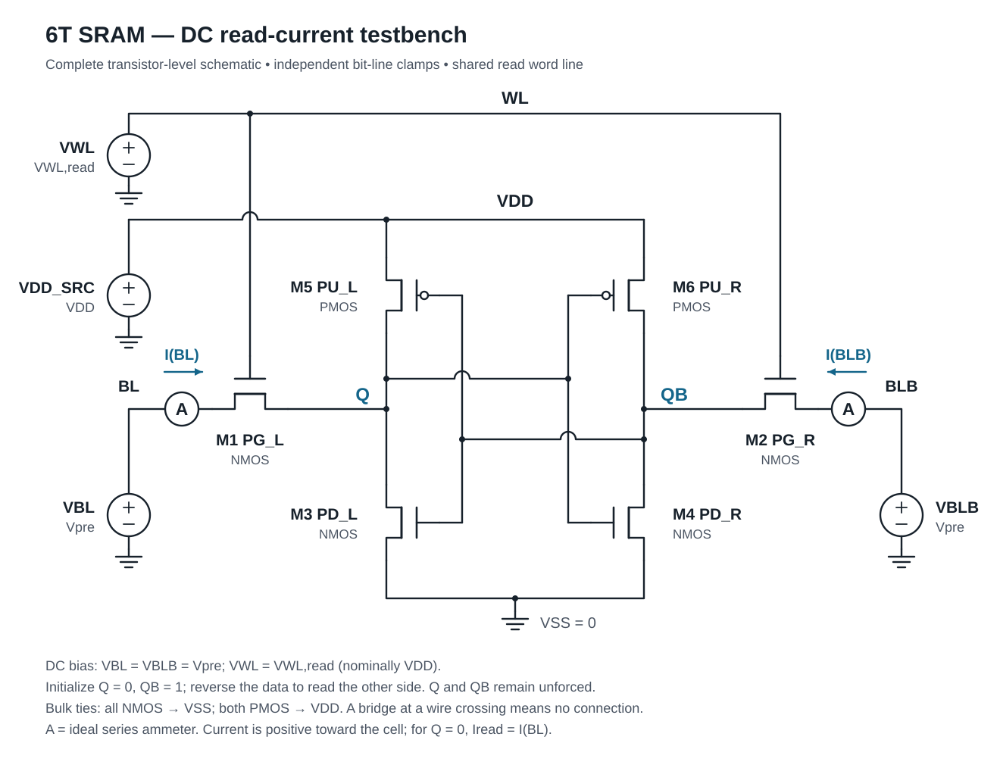

# Bitcell Read Current

## 定义与适用范围

**位单元读电流**（Bitcell Read Current，记为 $I_{\mathrm{read}}$ 或 $I_{\mathrm{cell}}$）指 SRAM 单元在指定读偏置下从位线（Bitline, BL）吸取的放电电流，单位为 A/cell（工程常用 μA/cell）。

以差分 6T SRAM 为例：预充完成后，两条位线初始均处于高电位；字线（Wordline, WL）使能后，存“0”节点侧位线经由访问管（Pass-Gate, PG）和下拉管（Pull-Down, PD）向 $V_{\mathrm{SS}}$ 放电。电路约定**从位线流入单元的电流为正方向**，其中“存 0 侧”由单元内部逻辑状态决定。[1, Sec. II-A, Fig. 2] [4, Sec. 2, Fig. 2]

### DC、瞬态与平均电流

报告读取电流时，须同时注明测试偏置、观察端口及以下三种测量口径：

| 口径 | 定义与条件 | 主要工程用途 |
|---|---|---|
| **DC 读电流** $I_{\mathrm{read,DC}}$ | 在固定电源、字线（WL）、位线（BL/BLB）电压及体偏置下，内部节点保持原数据并建立稳态读工作点时的存“0”侧位线电流 | 评估单元驱动能力、器件失配（Mismatch）及偏置敏感度 |
| **瞬态读电流** $I_{\mathrm{read}}(t)$ | 在指定初始状态、预充条件、激励波形与采样时刻下测得的位线实时电流 | 分析 WL 开启、位线放电过程及读扰动（Read Disturb） |
| **窗口平均读电流** $\overline{I}_{\mathrm{read}}$ | 指定时间窗口内瞬态读电流的积分平均值 | 评估对应窗口内的电荷转移量与位线建差信号（Sense Signal） |

$$
\overline{I}_{\mathrm{read}}[t_1,t_2] = \frac{1}{t_2-t_1}\int_{t_1}^{t_2} I_{\mathrm{read}}(t)\,\mathrm{d}t
$$

常规 DC 基线取 $V_{\mathrm{SS}}=0$、$V_{\mathrm{WL}}=V_{\mathrm{BL}}=V_{\mathrm{BLB}}=V_{\mathrm{DD}}$，内部节点 Q/QB 由交叉耦合反馈自行建立工作点。若使用非标准预充电位、字线助推（WL Assist）或独立单元供电，须记录实际单元端电压；动态测量还须记录位线预充释放时刻、WL 激励波形及感测采样窗口。[1, Sec. V-B, Fig. 14] [16, Fig. 3(e)] [25, Sec. V-B, Fig. 5]

### 存储状态与两侧读电流

在相同偏置条件下，分别测定 Bitcell 在两种逻辑状态下的放电电流，用于表征左右读通路的不对称性：
* **存“0”状态**（$Q=0, \overline{Q}=1$）：放电侧为位线 BL，测得电流记为 $I_{\mathrm{cell0}}$。
* **存“1”状态**（$Q=1, \overline{Q}=0$）：反向写入后，放电侧切换至互补位线 BLB（$\overline{\mathrm{BL}}$），测得电流记为 $I_{\mathrm{cell1}}$。

定义两侧读取电流差为：
$$
\Delta I_{\mathrm{cell}} = I_{\mathrm{cell0}} - I_{\mathrm{cell1}}
$$

**分析规范与注意事项**：
1. **失配提取**：$\Delta I_{\mathrm{cell}}$ 主要用于评估晶体管局部失配（Mismatch）。提取前须先校准测量通路与偏置误差，并剔除版图系统性偏移；因同一单元两侧电流存在相关性，须按单元进行**成对（Pairwise）采样**计算差值分布。[4, Sec. 3.4, Fig. 7] [12, Sec. III-A]
2. **注意事项**：切勿混淆观测量——“**不同状态下的两侧放电电流差**（$\Delta I_{\mathrm{cell}}$）”与“**单次读操作瞬间两条位线的实时电流差**（$I_{\mathrm{BL}} - I_{\mathrm{BLB}}$）”代表完全不同的物理含义与测量条件。

## 物理机制与器件变异

### PG–PD 放电通路与工作区

6T SRAM 单元的核心读放电通路为：

$$
\mathrm{BL} \rightarrow \mathrm{PG} \rightarrow Q \rightarrow \mathrm{PD} \rightarrow V_{\mathrm{SS}}
$$

| 器件类型 | 工程缩写／别名 | 读取操作中的物理作用 |
|---|---|---|
| **访问管／传输管** | Pass-Gate，PG，$N_A$ | 栅端由 WL 控制，连接位线与内部存储节点 |
| **下拉管** | Pull-Down，PD，$N_D$ | 将低存储节点连接至 $V_{\mathrm{SS}}$，构成串联放电通路 |
| **上拉管** | Pull-Up，PU | 参与交叉耦合反馈与数据保持，位于主放电串联通路之外 |

在常规读偏置下（位线接近预充高电位、低存储节点仅小幅抬升），常用 **PG 饱和区（Saturation）、PD 线性区（Linear/Triode）** 模型分析读电流。

**注意事项**：在低供电电压、大位线摆幅或开启读辅助（Read Assist）条件下，晶体管工作区可能发生转移，须按实际端电压与 SPICE 工作点重新核对。[4, Sec. 2] [29, Sec. II, Fig. 1]

### 内部节点抬升与负反馈

读操作期间，存“0”低节点从接近 $V_{\mathrm{SS}}$ 抬升至读工作点 $V_{\mathrm{read}}$：
* **负反馈机制**：低节点电位抬升会减小 PG 的栅源过驱动电压（$V_{\mathrm{GS,PG}}$），形成串联放电通路的动态负反馈。稳态时 PG 与 PD 电流保持平衡；瞬态阶段两者之差则用于内部节点电荷的充放电。
* **变异性抑制**：$V_{\mathrm{read}}$ 的负反馈能有效减弱 PG/PD 阈值电压（$V_{\mathrm{TH}}$）波动向读电流的传递。在相同栅过驱动条件下，放电通路的归一化读电流波动低于单个独立 PG 晶体管的固有波动。

**数据对比规范**：比较不同配置时须统一偏置条件，并同时报告绝对标准差 $\sigma_I$ 与变异系数 $\sigma_I/\mu_I$。[29, Sec. II, Table 1, Fig. 2]

### 器件敏感度与尺寸比

读电流受 PG 与 PD 的尺寸、阈值电压及迁移率等参数及其相关性共同调制。常规尺寸配置下，PG 的 $V_{\mathrm{TH}}$ 波动通常贡献较大；但主导敏感度排序须结合尺寸比、工作电压及实际工作区重新计算。

**Cell Ratio（$\beta$）与联合优化**：
* **定义**：以 Cell Ratio $\beta$ 表示 PD 相对 PG 的驱动强度或尺寸比。在相同器件类型与等沟道长度下，平面 CMOS 可简化表示为 $W_{\mathrm{PD}}/W_{\mathrm{PG}}$；使用 FinFET 鳍数比或 Nanosheet 宽度比时，须单独注明具体定义。
* **设计折中**：增大 Cell Ratio $\beta$ 可提高读取电流，但会改变低节点抬升幅度与读稳定性。因此，必须将读电流与静态读噪声裕量 [RSNM](RSNM.md) 进行联合评估优化。[6, Secs. III–IV] [29, Sec. IV] [30, Figs. 7–8]

## 本征读电流与阵列环境

### 区分测试环境与观测电流

**本征读电流**（Intrinsic Read Current）指孤立 Bitcell 在指定局部端口偏置下的放电电流，排除了外部列连线寄生、未选单元漏电及外围测量路径的影响。报告本征读电流时，须注明 PVT 条件、体偏置（Body Bias）、器件模型及内部寄生（PEX）抽取范围。

| 观测量口径 | 包含的电路因素 | 主要工程用途 |
|---|---|---|
| **孤立单元读电流** | 单元本身器件参数、内部负反馈及指定端口偏置 | 评估与比较 Bitcell 自身的本征读驱动能力 |
| **阵列内选中单元支路电流** | 孤立单元因素 + 实际局部 WL/BL 压降、供电网络及版图布局环境 | 评估 Bitcell 集成到阵列环境后的物理特性变化 |
| **列净放电电流／差分有效电流** | 选中支路电流 + 未选单元漏电 + 外围路径阻抗及两侧电流非对称性 | 计算指定列负载与感测窗口（Sensing Window）内的有效建差能力 |

**测试与测量规范**：
* **维度分离**：“测试环境（孤立/阵列）”与“测量方式（DC/瞬态）”为独立维度。孤立单元与阵列环境均可进行静态 DC 夹持测量或动态瞬态放电测量；对比数据前须统一电流口径。
* **感测放大器判决**：电压型差分感测放大器（Sense Amplifier, SA）直接判决的是两条位线建立的电压差（$\Delta V_{\mathrm{BL}}$），读电流通过对位线电容放电来驱动该电位差的建立。[12, Sec. III-A] [16, Fig. 3(e)] [32, Sec. 5.1, Fig. 2]

### 阵列环境的主要影响因素

1. **未选单元与外围漏电（Bitline Leakage）**
   在 64、128、256 等高列高 Subarray 中，同一位线上所有未选中待机 Cell 的 PG 亚阈值漏电、栅漏电及外围开关路径均会影响位线。
   * **作用方向**：向正在下降的位线补充电荷，或拉低另一侧保持高电位的位线，均会削弱正确建差。
   * **有效电流换算**：在指定最坏数据背景下，有效放电电流可表示为：
     $$I_{\mathrm{eff}} \approx I_{\mathrm{read}} - \sum I_{\mathrm{leak,opp}}$$
     **注意事项**：切勿无条件相减所有漏电流，式中 $I_{\mathrm{leak,opp}}$ 仅计入方向上削弱正确差分的反向漏电流贡献。[24, Sec. IV] [40, Sec. III, Eq. (14)]

2. **字线（WL）波形与供电网络压降（IR Drop）**
   * **分布 RC 效应**：字线连线电阻与分布式电容引起 WL 信号传播延迟及上升沿变慢（Slew rate 降低）。
   * **网格压降**：预充阵列的待机漏电会导致 WL 译码器供电网络发生压降，导致远端字线高电平不足，使读电流沿字线/列方向呈现出系统性的空间电流梯度。[12, Sec. IV-A, Figs. 10–12]

3. **物理位置与布局边界效应（Boundary vs. Interior Effects）**
   井抽头（Well-pickup）、WL 绑扎带（Strap）、Dummy 结构及阵列边缘图形密度变化均会改变局部工艺与器件特性。
   * **分布特征**：位于 Subarray 边缘（Boundary）的 Bitcell，其平均读取电流通常低于阵列内部（Interior）单元，且标准差（$\sigma$）更大。在良率与失配评估中须按位置进行分组统计。[4, Secs. 3.3–3.4, Tables 1–5]

4. **位线 RC、列选开关与感测窗口（Parasitistics & MUX Resistance）**
   分布位线电容（$C_{\mathrm{BL}}$）、连线电阻及列复用器（Column MUX）导通电阻共同决定局部位线电压与 SA 端的动态建差过程。
   * **静态 vs. 动态**：在理想 DC 稳态测量中位线电容开路，而在动态放电轨迹中电容直接决定放电斜率；串联电阻则同时改变 DC 工作点偏置与瞬态响应。[24, Sec. VII, Figs. 18–19]

## 测量与提取方法

### 共同条件与测试端口

#### （1）电路拓扑与器件连接

6T SRAM 单元由两组交叉耦合 CMOS 反相器及两个访问管组成，各晶体管连接关系如下：

| 器件类型 | 符号／别名 | 源漏端连接 | 栅端连接 |
|---|---|---|---|
| **上拉 PMOS** | M5 / M6 | 源端接 $V_{\mathrm{DD}}$，漏端接本侧存储节点（Q 或 QB） | 对侧存储节点（QB 或 Q） |
| **下拉 NMOS** | M3 / M4 | 源端接 $V_{\mathrm{SS}}$，漏端接本侧存储节点（Q 或 QB） | 对侧存储节点（QB 或 Q） |
| **访问 NMOS** | M1 / M2 | 源/漏端分别连接本侧位线（BL/BLB）与存储节点（Q/QB） | 共用字线（WL） |

**衬底与偏置说明**：在无独立体偏置的常规体硅 CMOS 配置中，NMOS 体端接 $V_{\mathrm{SS}}$，PMOS 体端接 $V_{\mathrm{DD}}$；端子命名遵守项目[术语规范](../../GLOSSARY.md)。（原理图中跨线桥表示不相连，实心结点表示连接）。

#### （2）测试偏置与控制条件

* **电源与激励配置**：$V_{\mathrm{DD}}$ 与 $V_{\mathrm{WL}}$ 由独立电压源提供；DC 测量时，位线电压源 $V_{\mathrm{BL}}/V_{\mathrm{BLB}}$ 将位线钳位在预充电位 $V_{\mathrm{pre}}$（动态测量按流程在预充后释放位线）。
* **内部节点观测**：存储节点 Q/QB **仅作为电压观察节点，禁止接理想电压源硬钳位**，允许存“0”侧低节点在读偏置下自发抬升并建立稳态工作点。
* **测量极性与切换**：存“0”状态（`Q=0, QB=1`）下测量从 BL 流入单元的电流；反向写入（`Q=1, QB=0`）后测量从 BLB 流入单元的电流。
* **SPICE 电流提取换算**：若 SPICE 位线电压源正端接位线、负端接 $V_{\mathrm{SS}}$，则从位线流入单元的读取电流提取公式为 `-I(VBL)` 或 `-I(VBLB)`。

#### （3）测试数据记录规范

每组读取电流测试结果须完整记录以下三类字段：

| 类别 | 必填记录项 |
|---|---|
| **器件与环境** | 工艺及模型版本、器件几何尺寸/鳍数、PVT 条件、单元供电与体偏置、寄生抽取（PEX）范围；硅片测试另须记录芯片 ID、行列坐标及 Subarray 边界/内部位置 |
| **状态与偏置** | 存储状态（Q/QB）、同列背景数据模式、实际局部 $V_{\mathrm{WL}}$ 与 $V_{\mathrm{BL}}/V_{\mathrm{BLB}}$ 电压；动态测试另记预充/均衡时刻、WL 脉宽及边沿、SA 使能时刻与采样窗口 |
| **电流与判据** | 观察端口、电流正方向定义、背景漏电扣除方式、测量口径（DC/瞬态/平均）及数据状态是否保持（未发生读翻转） |

### 仿真：孤立单元 DC 读电流

**【前置条件】**
* **电路与模型**：使用完整 6T Bitcell 拓扑与 PDK 模型，明确是否包含单元内部寄生（PEX）抽取；测试电路排除外部位线寄生、未选单元及 Column MUX。
* **偏置配置**：设置单元电源为 $V_{\mathrm{DD}}$，基准偏置取 $V_{\mathrm{SS}} = 0$，初始状态设为 $V_{\mathrm{WL}} = V_{\mathrm{BL}} = V_{\mathrm{BLB}} = V_{\mathrm{pre}} = V_{\mathrm{DD}}$，两侧访问管（PG）共用字线 WL。

**【步骤/方法】**
1. **数据初始化（`.ic`）**：将 Q、QB 节点的电压初始猜值分别设为 $0$ 与 $V_{\mathrm{DD}}$（对应逻辑状态 `Q=0, QB=1`），利用求解器初值提示辅助收敛。
2. **直流工作点提取（`.op`）**：运行 `.op` 分析，记录稳态 Q/QB 节点电压与读取电流 $I_{\mathrm{read}} = -I(V_{\mathrm{BL}})$。其中位线直流电压源 $V_{\mathrm{BL}}$ 正端接 BL、负端接 $V_{\mathrm{SS}}$，约定电流从位线流入单元为正方向（亦可使用 0V DC 探针测量）。
3. **位线偏置扫描（`.dc`）**：运行 `.dc` 分析，将 $V_{\mathrm{BL}}$ 从预充电位 $V_{\mathrm{pre}}$ 扫描至 $V_{\mathrm{pre}} - \Delta V_{\mathrm{BL,target}}$，位线 BLB 保持在 $V_{\mathrm{pre}}$；记录目标位线摆幅与扫描步长。
4. **互补侧测量与条件覆盖**：交换 Q/QB 初始猜值（`Q=1, QB=0`），改测互补侧读取电流 $I_{\mathrm{read}} = -I(V_{\mathrm{BLB}})$，扫描 BLB 时将 BL 固定在 $V_{\mathrm{pre}}$；重复涵盖不同供电电压 $V_{\mathrm{DD}}$、WL/位线偏置、PVT 条件及晶体管失配（Mismatch）样本。

**注意事项**：仿真中**禁止使用理想电压源硬钳位 Q/QB 节点**（会破坏单元内部负反馈机制并导致读电流提取错误）。

**【结果处理和验证】**
* **工作点有效性验证**：确认求解收敛、原数据状态保持未变且工作点稳定；临界偏置点须通过固定偏置下的瞬态（Transient）小脉冲扰动验证工作点恢复能力。
* **异常数据处理与数据清洗**：对于不收敛、求解跳支或不稳定解须单列分析，通过调整初始猜值或减小 `.dc` 步长复核；若确认当前偏置下原稳定工作点消失，标记为**静态读稳定性失效（Static Read Stability Failure）**，不得混入有效读取电流统计。
* **数据记录规范**：完整保存读取电流 $I_{\mathrm{read}}$、存储节点抬升电压 $V_{\mathrm{read}}$、测试偏置、PVT 条件及失配样本编号。
* **动态时序验证**：按实际字线脉宽（WL Pulse Width）与读时序另做瞬态仿真，确认是否发生动态读扰动（Dynamic Read Disturb）。

### 仿真：阵列 DC 测量与静态漏电校准（Static Leakage Calibration）

**【前置条件】**
* **电路与阵列规模**：建立包含被测单元（CUT）、同列未选单元、位线预充电路及 Column MUX 的代表性列网表；若需评估字线共享负载、电源耦合或阵列位置效应，扩展至 $M\times N$ 子阵列（如 $128\times64$ 或 $256\times16$），保留选中行其余单元对共享网络的负载。
* **寄生与网络阻抗**：网表须显式包含位线分布 RC、MUX 及测试开关导通电阻、字线驱动器及供电网格阻抗；版图边界效应通过模型参数或物理位置分组表示。
* **测量路径物理还原**：复现硅片测试（Silicon Test）时引入实际 Force/Sense 端及电压监测通路；预测芯片正常读性能时保留真实读通路及其寄生压降（IR Drop）。

**【步骤/方法】**
1. **待机数据配置与偏置**：在未选单元中配置全 0、全 1、棋盘格模式，并将反向数据作为不利静态漏电候选，按最坏失效判据确定数据模式；将位线 BL/BLB 钳位在指定电压，关闭正常动态预充与感测放大器（SA）通路。[32, Sec. 5.1]
2. **测量静态漏电（待机阶段）**：关闭所有字线（$V_{\mathrm{WL}}=0$），运行 `.op` 或 `.dc` 分析，记录测试端口流出的关态静态漏电流 $I_{\mathrm{off}}$、局部电压及开关状态。
3. **测量选中总电流（选中阶段）**：开启 CUT 所在字线（$V_{\mathrm{WL}} = V_{\mathrm{DD}}$），同列其余 $M-1$ 个单元字线保持关闭；在相同偏置下记录端口总电流 $I_{\mathrm{on}}$、局部电压及 CUT 支路电流。
4. **计算校准后增量电流**：在同一端口及同一电流正方向下，通过双阶段做差计算被测单元的纯粹读取电流：
   $$
   I_{\mathrm{read,cal}} = I_{\mathrm{on}} - I_{\mathrm{off}}
   $$

**注意事项**：在动态读放电仿真中**必须完整保留未选单元及其静态漏电**（静态漏电校准仅用于 DC 测试端口下分离单元本征贡献；在真实动态建差中，漏电作为实际负载参与位线放电）。

**【结果处理和验证】**
* **稳态工作点复核**：确认电流与内部节点稳定收敛；临界点须在固定位线偏置下使用长时间 `.tran` 分析复核工作点漂移。
* **残余误差与物理校验**：对比 $I_{\mathrm{read,cal}}$ 与 CUT 支路实际电流并记录残余误差；核查 $I_{\mathrm{off}}$ 中 CUT 关态漏电流以及开启 WL 后因路径压降导致的静态漏电动态变化。仅在待机静态漏电与局部偏置漂移可忽略时，方可将增量电流近似为单元本征读电流。[12, Sec. III-A] [27, Secs. II–III, Fig. 9]

### 仿真：动态读电流与电压反推

**【前置条件】**
* **电路与负载配置**：建立包含实际读通路、同列待机单元、位线寄生 RC 网络、Column MUX 及感测放大器（SA）负载电路的动态网表；显式设定字线（WL）脉冲波形、读辅助（Read Assist）控制、SA 使能时序与感测采样窗口（Sensing Window）。
* **参数扫描与标定**：WL 脉宽按设计规格进行扫描（100 ps～1 ns 仅作范围示例）；若需通过位线电压变化率（$\mathrm{d}V_{\mathrm{BL}}/\mathrm{d}t$）反推读取电流，须提前标定观察节点的有效等效电容（$C_{\mathrm{eff}}$）及待机静态漏电路径。

**【步骤/方法】**
1. **状态初始化与位线预充**：写入被测单元（CUT）初始存储数据及待机单元背景模式，完成位线 BL/BLB 的预充与均衡；随后断开预充与均衡控制开关。
2. **执行动态读仿真（`.tran`）**：运行 `.tran` 分析，施加 WL 激励波形与读辅助信号，并在预定时刻使能 SA。（若仅单独观察位线建差，可延后 SA 使能，但须保留 SA 输入端电容负载与关态连接）。
3. **动态波形与电流采样**：同步记录局部 $V_{\mathrm{WL}}$、$V_{\mathrm{BL}}/V_{\mathrm{BLB}}$、$V_{\mathrm{Q}}/V_{\mathrm{QB}}$、CUT 支路位线电流及 MUX 节点/SA 输入端的动态波形；按指定采样时刻提取瞬态读取电流 $I_{\mathrm{read}}(t)$，或在特定时间窗口内积分求得平均读电流 $\overline{I}_{\mathrm{read}}$。
4. **全条件覆盖与模式切换**：对两种逻辑存储状态（`Q=0` / `Q=1`）、PVT 条件、Subarray 位置及待机数据背景重复仿真，统一使用相同的读成功与翻转判据。

**注意事项**：
1. **禁止将远端位线电压斜率直接替代单元电流**：不可将远端单根位线电压变化率（$\mathrm{d}V_{\mathrm{BL}}/\mathrm{d}t$）直接等效为单元本征读电流或差分有效电流（该斜率反映的是观察端全路径的净充放电电流）。
2. **寄生与 RTN 时间波动处理**：当分布 RC、线路耦合或开关瞬态显著时，须通过全寄生（PEX）网表与支路电流进行精确求解；对比静态与动态结果时，须同时记录随机电报噪声（RTN）等时域波动影响。

**【结果处理和验证】**
* **失效分类与判据**：
  * **读访问失败（Read Access Failure）**：在规定感测窗口内未能建立足够的正确位线压差（$\Delta V_{\mathrm{BL}} < \Delta V_{\mathrm{req}}$），或 SA 判决输出错误。
  * **动态读扰动（Dynamic Read Disturb）**：字线使能后存“0”节点抬升过高，导致 Bitcell 内部逻辑状态发生翻转。
* **位线电压反推电流算式（受限观测条件）**：当仅位线电压可观测时，按以下规范进行算式换算与反推：
  * **单端净放电电流**：若观察点可简化为单端等效电容（约定放电为正方向）：
    $$
    I_{\mathrm{net}}(t) = -C_{\mathrm{eff}}(V_{\mathrm{BL}})\frac{\mathrm{d}V_{\mathrm{BL}}}{\mathrm{d}t}
    $$
    其中 $C_{\mathrm{eff}} = \frac{\mathrm{d}\mathcal{Q}_{\mathrm{BL}}}{\mathrm{d}V_{\mathrm{BL}}}$ 为局部微分电容（$\mathcal{Q}_{\mathrm{BL}}$ 表示位线电荷）。在电容近似恒定的时间窗口 $[t_1, t_2]$ 内，等效平均净电流为：
    $$
    \overline{I}_{\mathrm{net}} = \frac{\mathcal{Q}_{\mathrm{BL}}(t_1) - \mathcal{Q}_{\mathrm{BL}}(t_2)}{t_2 - t_1} \approx \frac{C_{\mathrm{eff}}[V_{\mathrm{BL}}(t_1) - V_{\mathrm{BL}}(t_2)]}{t_2 - t_1}
    $$
    提取 CUT 电流贡献时，须确认其他支路漏电可忽略，或通过匹配位线轨迹的待机静态漏电测量/模型扣除其贡献。
  * **差分有效电流**：存“0”读取时定义位线压差 $\Delta V_{\mathrm{BL}} = V_{\mathrm{BLB}} - V_{\mathrm{BL}}$；若两侧可简化为独立等值电容 $C$：
    $$
    C\frac{\mathrm{d}\Delta V_{\mathrm{BL}}}{\mathrm{d}t} = I_{\mathrm{net,BL}} - I_{\mathrm{net,BLB}}
    $$
* **数据与时序核对**：保存所有测量波形、感测窗口、有效电流计算结果及失配样本编号；将延后 SA 的建差结果与完整读操作对照，保留实际 SA 使能对波形的影响。[1, Secs. II-A, V-B, Fig. 14] [24, Sec. VII, Fig. 19]

### 硅测量：测试结构、静态漏电校准与动态代理

**【前置条件】**
* **测试结构与硬件通路选择**：按具体表征目标选择物理通路与测试仪器：

| 物理通路类型 | 配置方式与工程用途 |
|---|---|
| **全节点接入／UTS 宏** | 采用通用测试结构（Universal Test Structure, UTS）或专用 SRAM 测试宏，将单管参数、读电流与稳定性关联；使用 SMU／半导体参数分析仪重配端口偏置 |
| **阵列直接位线接入** | 经由位线开关与 Column MUX 将被选位线引出至独立 $V_{\mathrm{PP}}$、`MEAS_BL` 或 MDLB 端；利用移位寄存器、专用寻址逻辑或正常译码器选通单元 |
| **开尔文感测与电压监测** | 采用四端子开尔文感测（4-Terminal Kelvin Sensing）或在测量路径增设电压监测节点，校准引线与开关压降；开尔文控制边界受限于可访问的 Sense 节点 |
| **脉冲／模拟采样接口** | 配置片上脉冲发生器、字线/位线采样器或测试感放，测量 WL 脉宽、位线摆幅及读成功门限；仅有数字 DOUT/BIST 时输出功能性时序门限 |

* **UTS 端口与节点定义**：`SNT/SNB` 为内部存储节点，`WLT/WLB` 为字线，`BLT/BLB` 为位线，`VDDT/VDDB` 与 `VSST/VSSB` 为单元电源/地端，另显式引出衬底/阱节点。该结构保留阵列至 Metal 1 层的版图环境（其中 M1/M2 为 PG、M3/M4 为 PD、M5/M6 为 PU）。邻近单元引出节点（如 `SNTD`、`SNBU`、`WLTD`）按测试原理图配置偏置或切断连接，用以抑制潜漏电路径（Sneak Leakage Paths）。[16, Figs. 1, 3(e), “Circuit Structure”, “Test Methods”]
* **硬件实现与选型**：硬件接入可选独立 $V_{\mathrm{PP}}$ 位线供电、直接位线接入配合移位寄存器及 HP 4155 参数分析仪、以及带路径电压监测的 MDLB；测试开关网络中的厚氧化层传输门须按耐压、关态漏电与导通电阻综合选型。[4, Sec. 2, Fig. 3] [12, Secs. II–III] [24, Sec. VI, Fig. 15]

**【步骤/方法】**
1. **端口偏置与状态初始化**：使用 UTS 测量完整单元（Full-Cell）时，`VDDT/VDDB` 接同一单元电源，`VSST/VSSB` 接同一地端，`WLT/WLB` 接同一 WL；内部存储节点仅作电压监测，禁止外加固定电压源钳位，读偏置控制与孤立单元 DC 测试保持一致。
2. **静态直流电流测量（DC Measurement）**：写入目标逻辑状态，断开被测位线的正常预充与静态负载，将位线 BL/BLB 钳位在预定电压，保持字线 WL 为稳定读高电平，使用 SMU/参数分析仪测量电流；反向写入并切换位线，测量互补侧电流。
3. **静态漏电校准（Static Leakage Calibration）**：在相同列数据背景、局部位线偏置及温度下，分别测量字线关闭（$V_{\mathrm{WL}}=0$）与开启状态下的端口电流，按 $I_{\mathrm{read,cal}} = I_{\mathrm{on}} - I_{\mathrm{off}}$ 计算增量；记录开关导通电阻、钳位误差、仪器分辨率及片上电流转换电路的增益与偏移，进行按列校准并报告误差范围。[27, Sec. III, Figs. 9–10]
4. **动态门限与波形采样**：切换至预充后释放位线的正常读路径，利用片上可编程 WL 脉冲扫描读成功门限；具备模拟采样通路时，采样位线摆幅与 WL 脉宽，另行独立表征感测放大器（SA）失调电压，再与 DC 静态电流进行对照。[1, Secs. III–V, Figs. 8, 13–14] [24, Secs. III–V]

**注意事项**：
1. **禁止将脉冲控制能力等同于电流测量能力**：纳秒/皮秒级脉冲发生器配合数字 DOUT/BIST 仅能输出读成功或失败的时序门限（功能性动态代理量）；若未经过位线电容 $C_{\mathrm{BL}}$、静态漏电、MUX 通路阻抗及 SA 判定门槛的精确标定，严禁强行将其直接换算为本征读电流 $I_{\mathrm{read}}$。
2. **潜漏电抑制与版图约束**：邻近单元引出节点须严格按测试结构要求配置偏置或断开连接；全节点接入结构虽保留了 Metal 1 级的实际版图环境，但独立端口访问并不等于消除了版图邻近效应。

**【结果处理和验证】**
* **路径压降与物理校准**：核对单元端实际电压偏置、测量路径压降（开尔文感测控制范围以可访问 Sense 节点为界）及残余静态漏电；全节点接入表征结果须完整保留版图环境与邻单元端口状态说明。
* **多维度数据报告规范**：分别独立报告 SMU 直接测得的 DC 电流、模拟采样反推的电流以及数字 DOUT/BIST 时序门限；将动态门限反推换算为电流前，必须完成对位线电容 $C_{\mathrm{BL}}$、静态漏电、MUX 路径及 SA 门槛的完整校准。

### 孤立单元与阵列表征方法及数据口径对照

| 评估维度 | 孤立单元表征（Isolated Bitcell） | 阵列表征（Subarray / Array Level） |
|---|---|---|
| **电路规模与测试环境** | 完整 6T Bitcell；硅片测试可采用 UTS 或专用测试宏，但须明确说明其实际版图环境（Layout Context） | 代表性列网表或完整 Subarray，包含必要的未选待机单元、Column MUX 及共享网络阻抗 |
| **分析与仿真方式** | 采用 `.op` / `.dc` 提取稳态读工作点；使用 `.tran` 检查节点建立过程与动态读扰动（Dynamic Read Disturb） | 位线钳位下的 DC 静态测量；位线预充后释放的动态读放电操作 |
| **寄生与静态漏电** | 排除外部阵列负载，保留器件固有漏电，明确标注单元内部寄生（PEX）抽取范围 | 包含位线（BL）/字线（WL）分布 RC、供电网络 IR Drop、开关阻抗及未选单元；分离单元贡献时执行**静态漏电校准** |
| **偏置与接口配置** | 规定单元端口电压，内部存储节点（Q/QB）自发求解；硅片测试使用 Test Pads / SMU 测量 | 监测局部实际电压；按物理可观测性选择直接位线接入、四端子开尔文（Force/Sense）感测、片上模拟采样或数字 DOUT/BIST 接口 |
| **输出指标与工程用途** | 读取电流曲面、两侧读通路失配（Mismatch）、器件参数敏感度及 Cell Ratio（$\beta$）优化 | 单元本征电流、列净放电电流、位线动态建差（Sense Margin）、访问裕量以及版图位置与待机数据模式的影响 |

## 数据可视化与评估

### 按表征层次划分的五组建议图表

按**孤立单元**与**阵列表征**对图表进行分类，每张图表均须显式标注读取电流口径、测试偏置、负载环境、样本量及静态漏电校准状态。

#### （1）孤立单元表征图表（关注本征驱动、偏置敏感度与器件失配）

| 图表类型 | 坐标与分组特征 | 主要工程判决用途 |
|---|---|---|
| **偏置扫描曲线／曲面** | 横轴为 $V_{\mathrm{BL}}$、$V_{\mathrm{WL}}$ 或 $V_{\mathrm{DD}}$，纵轴为本征 $I_{\mathrm{read,DC}}$；按 PVT 条件、工艺角、左右极性及几何尺寸分组；按需并列低节点读抬升电压 $V_{\mathrm{read}}$ | 评估单元本征驱动能力、偏置敏感度及读辅助（Read Assist）收益，标定稳态工作点边界 |
| **两侧相关与差值分布图** | 散点图横轴为 $I_{\mathrm{cell0}}$、纵轴为 $I_{\mathrm{cell1}}$，同步绘制差值 $\Delta I_{\mathrm{cell}}$ 的直方图与经验累积分布函数（ECDF）；按 PVT 条件分组 | 识别 Bitcell 左右读通路物理非对称性、两侧电流相关性及测试路径偏差 |
| **器件级低尾 ECDF 图** | 横轴为本征 $I_{\mathrm{read}}$，纵轴为累积概率或正态分位；按 $V_{\mathrm{DD}}$、温度及晶体管尺寸分组 | 评估在无阵列负载下，纯晶体管失配（Mismatch）造成的低尾分布与本征弱位 |

#### （2）阵列表征图表（关注动态建差、空间效应与整宏良率）

| 图表类型 | 坐标与分组特征 | 主要工程判决用途 |
|---|---|---|
| **瞬态波形图** | 横轴为时间 $t$；对齐局部 $V_{\mathrm{WL}}$、$V_{\mathrm{BL}}/V_{\mathrm{BLB}}$、SA 输入压差 $\Delta V_{\mathrm{SA}}$、内部节点 $V_{\mathrm{Q}}/V_{\mathrm{QB}}$ 及瞬态电流 $I_{\mathrm{read}}(t)$；标出预充释放时刻、SA 使能时刻及感测采样窗口（Sensing Window） | 检查阵列寄生（BL RC、MUX 阻抗）影响下的位线动态建差，准确区分读访问失败（Read Access Failure）与动态读扰动（Dynamic Read Disturb） |
| **阵列位置热图** | 横轴为列号、纵轴为行号，色彩阶梯表示校准后读取电流或列净电流；标注 Subarray 边界、井抽头（Well-pickup）、字线绑扎带（Strap）及测量路径，按需对比原始数据与去趋势（Detrended）结果 | 定位物理空间梯度、边界效应、局部异常及供电网络 IR Drop 与版图效应 |
| **阵列级低尾 ECDF / 概率图** | 横轴为包含阵列环境的实际读取电流 $I_{\mathrm{read}}$，纵轴为累积概率或正态分位；按边界/内部位置、待机数据背景及 PVT 条件分组，标出有效样本支持范围与 Sign-off 规格门槛 | 综合考量空间梯度、静态漏电及线路压降后，评估大容量阵列的系统级弱位（Weak Bits）与外推安全边界 |

### 统计口径与比较原则（整合优化版）

#### （1）孤立单元表征统计规范（关注成对失配与本征变异）

* **统计量完整度与成对采样**：完整报告样本数 $N$、芯片/晶圆覆盖度、均值 $\mu_I$、标准差 $\sigma_I$、变异系数 $\sigma_I/\mu_I$ 及两侧相关系数。同一 Bitcell 两侧读取电流存在物理相关性，必须按单元进行**成对（Pairwise）采样**与差值分析，忽略相关性会导致差值分布计算偏差及联合失效率估计失真；对功能失效及低于仪器分辨率的异常样本须单列统计，严禁剔除以免导致分布偏乐观。
* **驱动能力比较基线**：比较 Bitcell 固有驱动能力与尺寸时，须统一局部电压偏置、器件模型、物理几何口径及静态稳定性门槛。
* **工艺固有失配提取**：剥离系统性空间趋势，仅利用去趋势（Detrended）数据提取晶体管阈值电压（$V_{\mathrm{TH}}$）等工艺固有随机失配（Mismatch）。

#### （2）阵列表征统计规范（关注动态建差、尾部外推与联合良率）

* **位线建差比较基线**：比较阵列表征下的位线动态建差（Sense Margin）时，除单元偏置外，还须统一列负载阻抗、SA 判定门槛及感测采样窗口（Sensing Window）。
* **空间梯度与系统效应保留**：评估阵列整体实际性能时，须完整保留字线驱动器及供电网格 IR Drop 引起的物理空间电流梯度（仅在提取器件固有失配时才使用去趋势数据）。[12, Sec. IV-A, Figs. 10–12]
* **尾部模型与外推安全边界**：低尾电流分布受偏置高度调制（高供电电压下接近正态分布，降压及低过驱动条件下低尾将逐步偏离正态）。须分别明确标注“样本最小值”、“指定概率低分位点”与“模型推算 $6\sigma$ 电流”，严禁相互替代；失效率与低分位推算结论须严格限定在实际样本或已验证物理模型支持的范围内，严禁基于少量样本的正态假设盲目外推大容量阵列的低尾良率。[14, Fig. 19] [23, Figs. 2–9] [34, Secs. II–III]
* **阵列联合良率综合评估**：阵列良率须联合考量同一单元两侧电流相关性、共享供电与 SA 负载、未选单元静态漏电、空间相关性及 PVT 条件；电流门槛仅作为特定测试条件下的性能判据，全宏最低工作电压（$V_{\min}$）须按完整功能性读操作评估。采用重要性采样（Importance Sampling）等高级统计方法时，须详细记录抽样权重、失效事件及统计不确定度（参见 [RSNM 的数据分析与评价](RSNM.md#数据分析与评价方法)）。[8, Sec. 4] [33, Secs. II, VI-C] [40, Secs. III–IV]

## 应用场景与指标关系

### 读建差时间与访问速度

在单侧位线小摆幅、互补侧电压变化可忽略，且等效电容与净放电电流在建差窗口内近似恒定的条件下，可按一阶模型估算位线动态建差时间（Read Develop Time）：

$$
t_{\mathrm{dev}} \approx \frac{C_{\mathrm{eff}} \cdot \Delta V_{\mathrm{req}}}{\overline{I}_{\mathrm{net}}}
$$

式中 $\Delta V_{\mathrm{req}}$ 为规定正确极性的目标位线建差门槛（Sense Margin Threshold），须综合感测放大器（SA）失调电压（Offset）、共模电压、线路噪声及系统访问时限共同确定。[1, Sec. II-A, Eq. (1)] [40, Secs. III–IV]

**注意事项**：$C\Delta V / I$ 一阶算式仅用于**位线动态建差时间**的快速估算；完整的 SRAM 阵列读访问延迟（Read Access Delay）还包含地址译码（Decoder）、字线（WL）驱动与传播延迟、SA 判决响应以及数据输出（DOUT）路径延迟，严禁将整个访问延迟简单认定为与单一 DC 读电流成反比。

### 设计优化与良率约束

* **器件与 Bitcell 级设计（Device & Bitcell Co-design）**：利用本征读取电流评估 PG/PD 晶体管尺寸、Cell Ratio（$\beta$）、阈值电压（$V_{\mathrm{TH}}$）选择及失配敏感度；须将读取电流与静态读噪声裕量 [RSNM](RSNM.md)、写入能力（Write Margin）及待机静态漏电 [Standby Leakage](Standby_Leakage.md) 进行多指标联合折中优化。增强 PG 驱动能力时，须同步核查低节点读抬升电压 $V_{\mathrm{read}}$ 与动态读扰动（Dynamic Read Disturb）风险。[6, Secs. III–IV]
* **列架构组织与读辅助技术（Column Architecture & Read Assist）**：结合位线寄生 [BL RC](../Subarray/BL_RC.md)、位线静态漏电 [BL Leakage](../Subarray/BL_Leakage.md)、字线边沿速率 [WL Slew](../Subarray/WL_Slew.md) 及感放判决门槛 [SA Decision Threshold](../Peripherial/SA_Decision_Threshold.md)，综合优化 Subarray 列高（Row Count）、MUX 复用比、位线预充电位及 WL 助推/降压（WL Boost/Under-drive）方案；须分别校验位线建差时间 [Read Develop Time](../Subarray/Read_Develop_Time.md) 与完整读延迟 [Read Delay](../Subarray/Read_Delay.md)。[24, Fig. 19] [30, Figs. 7–8] [40, Sec. IV]
* **弱位表征、低压极限与失效分析（Weak Bit Characterization & $V_{\min}$ Analysis）**：以分布低尾读取电流检查最慢单元（Worst-case Tail Bit）的位线建差能力；结合静态漏电、SA 失调、时序脉宽及数据保持能力评估芯片最低读取工作电压（Read $V_{\min}$）。分类统计读取驱动不足（Read Access Failure）、动态读扰动、保持失效与写入失效，并按实际 Subarray 物理架构评估联合良率。[3, Secs. VI–VIII] [33, Sec. VI-C] [40, Sec. IV]
* **版图分布、复制路径与 DTCO 协同优化（Layout, Replica Path & DTCO）**：按阵列边界/内部位置及行列坐标分组统计，校验专用测试结构与复制时序路径（Replica Path）对实际大容量阵列的物理代表性；在统一偏置与统计口径下，将低分位读取电流作为速度约束指标，同步考量稳定性低尾、物理面积与功耗。高级工艺（如 N3 FinFET/Nanosheet）的技术投影须显式标注器件模型及变异性假设，并与硅片实测数据分组对比。[4, Sec. 3.3] [2, Sec. V-B, Fig. 11]

## 参考文献

[1] S. O. Toh, Z. Guo, T.-J. K. Liu, and B. Nikolić, “Characterization of dynamic SRAM stability in 45 nm CMOS,” IEEE J. Solid-State Circuits, vol. 46, no. 11, pp. 2702–2712, 2011. [DOI 10.1109/JSSC.2011.2164300](https://doi.org/10.1109/JSSC.2011.2164300). [公开文献](https://doi.org/10.1109/JSSC.2011.2164300)

**读电流摘要：** 把静态读电流定义为位线流入选中 6T 单元存“0”一侧的电流。45 nm 测试芯片在固定位线电压下量测该电流，并用可编程字线脉宽获得动态读访问时间。按感放失调和估计的位线电容归一化后，两者相关；固定偏置与实际放电轨迹、未选单元漏电和分布 RC 等因素会影响换算（Sec. II-A、IV-B，式 (1)，图 8、14）。

[2] M. Karner et al., “Variability-aware DTCO flow: Projections to N3 FinFET and nanosheet 6T SRAM,” in Proc. SISPAD, 2021. [DOI 10.1109/SISPAD54002.2021.9592527](https://doi.org/10.1109/SISPAD54002.2021.9592527). [公开文献](https://doi.org/10.1109/SISPAD54002.2021.9592527)

**读电流摘要：** 将 TCAD 得到的器件失配映射到 BSIM-CMG 模型，结合 6T 单元寄生抽取做 SPICE，比较 N3 FinFET 和纳米片 111 拓扑读电流的均值及标准差。图 11 同时纳入随机掺杂、几何变异和金属栅功函数颗粒，并按 VDD 和变异假设对照；平均颗粒由 10 nm 增至 22 nm 时，电流波动增大。结果是投影，原文未单独报告读电流的 BL／WL 钳位条件，不能当作 N3 硅实测分布（图 9–11）。

[3] R. Heald and P. Wang, “Variability in sub-100nm SRAM designs,” in *Proc. IEEE/ACM Int. Conf. Comput.-Aided Design (ICCAD)*, 2004, pp. 347–352. [DOI 10.1109/ICCAD.2004.1382599](https://doi.org/10.1109/ICCAD.2004.1382599). [公开文献](https://doi.org/10.1109/ICCAD.2004.1382599)

**读电流摘要：** 以选中单元访问管和下拉管的串联通路定义读电流，并用阵列最低电流决定建差预算。文中的设计例假设电流均值 100 µA、标准差 6 µA，最低要求 70 µA 对应 5σ；再把所需位线差分与感放失调、复制时序一并分析。该数值依赖示例的电流模型和时序目标，文中未把它作为实测尾分布或通用规格（Sec. VI–VIII）。

[4] C.-H. Hsiao and D.-M. Kwai, “Measurement and characterization of 6T SRAM cell current,” in *Proc. IEEE Int. Workshop Memory Technol., Design Test (MTDT)*, 2005, pp. 140–145. [DOI 10.1109/MTDT.2005.28](https://doi.org/10.1109/MTDT.2005.28). [公开文献](https://doi.org/10.1109/MTDT.2005.28)

**读电流摘要：** 在 0.18 μm、2 Mbit 6T 样片中，断开正常预充与静态位线负载，用专用 VPP 经所选访问管和下拉管直接量测读电流。论文测量阵列边缘和内部位置、两种存储极性，并比较 1.8 V/25 °C、1.5 V/25 °C 与 1.8 V/85 °C 的分布；用经验幂律拟合平均电流，再用过驱和阈值波动解释相对散布及左右电流失配（Sec. 2、3.1–3.4，式 (1)–(4)，图 3–7）。

[5] Q. Chen, S. Mukhopadhyay, A. Bansal, and K. Roy, “Circuit-aware Device Design Methodology for Nanometer Technologies: A Case Study for Low Power SRAM Design,” in *Proc. Design, Autom. Test Eur. Conf. (DATE)*, 2006, pp. 1–6. [DOI 10.1109/DATE.2006.243868](https://doi.org/10.1109/DATE.2006.243868). [公开文献](https://doi.org/10.1109/DATE.2006.243868)

**读电流摘要：** 用 65 nm 常规 SRAM 算例的访问管饱和工作电流表征放电驱动；该电流由访问管与下拉管串联通路决定。式 (3) 的访问时间模型还考虑位线结电容和未选单元亚阈值漏电；虚地源偏置结构则要计入串联休眠管。论文用器件与电路仿真说明掺杂对速度和漏电的权衡，没有报告直接硅电流量测（Secs. 2–4，式 (3)，图 2(a)、2(c)）。

[6] E. Grossar, M. Stucchi, K. Maex, and W. Dehaene, “Read stability and write-ability analysis of SRAM cells for nanometer technologies,” *IEEE J. Solid-State Circuits*, vol. 41, no. 11, pp. 2577–2588, 2006. [DOI 10.1109/JSSC.2006.883344](https://doi.org/10.1109/JSSC.2006.883344). [公开文献](https://doi.org/10.1109/JSSC.2006.883344)

**读电流摘要：** 在 130 nm 和 65 nm 单元的统计尺寸优化中，位线电容占主导时，把最弱单元读电流作为读延时约束的一阶代理，同时约束 N 曲线的读稳定性与可写性。增大访问管可换取读电流，同时降低静态电流噪声裕量 SINM；后者是对存储节点注入扰动所得的峰值，不是选中位线放电电流（Sec. III–IV，图 14、18–19）。

[7] D.-M. Kwai et al., “SRAM cell current in low leakage design,” in *Proc. IEEE Int. Workshop Memory Technol., Design Test (MTDT)*, 2006, pp. 65–70. [DOI 10.1109/MTDT.2006.28](https://doi.org/10.1109/MTDT.2006.28). [公开文献](https://doi.org/10.1109/MTDT.2006.28)

**读电流摘要：** 用独立 VPP 量测 0.25 μm、1 Mbit 6T 测试芯片，比较是否增加单元阈值调整植入的工艺 split。作者从 1.5 V 到 2.75 V 扫供电，并以经验幂律拟合读电流分布随过驱和器件波动的变化。该实验说明低漏电的阈值选择需同时核算降低供电后的读电流和感测预算（Sec. 2–4，图 4、7–9）。

[8] R. Aitken and S. Idgunji, “Worst-case design and margin for embedded SRAM,” in *Proc. Design, Autom. Test Eur. Conf. Exhib. (DATE)*, 2007, pp. 1–6. [DOI 10.1109/DATE.2007.364475](https://doi.org/10.1109/DATE.2007.364475). [公开文献](https://doi.org/10.1109/DATE.2007.364475)

**读电流摘要：** 以 65 nm 单元的 5,000 次蒙特卡洛读电流样本说明中心区近似正态，再在独立同分布假设下对共享感放的单元取电流最小值，以极值分布近似并与感放失调合成读余量。共享单元数及感放组织改变最差余量。极端低尾依赖单元原始分布；图 2 的样本不能直接验证整宏失效率（Sec. 1、4.1–4.2，图 2–5）。

[9] T. Fischer et al., “A 1 mbit SRAM test structure to analyze local mismatch beyond 5 sigma variation,” in *Proc. IEEE Int. Conf. Microelectron. Test Struct. (ICMTS)*, 2007, pp. 63–66. [DOI 10.1109/ICMTS.2007.374456](https://doi.org/10.1109/ICMTS.2007.374456). [公开文献](https://doi.org/10.1109/ICMTS.2007.374456)

**读电流摘要：** 在 90 nm 和 65 nm CMOS 的约 1 Mbit 测试阵列中，用独立寻址的模拟位线与参数分析仪逐位读取两种存储极性的静态电流。原始分布受到字线驱动供电压降的空间梯度影响，校正后可分析超过 5σ 范围的局部波动。该流程适合先去除阵列位置造成的系统偏移，再用单元电流估计局部失配（pp. 63–66，图 2、4–7，表 III）。

[10] A. E. Carlson, “Device and circuit techniques for reducing variation in nanoscale SRAM,” Ph.D. dissertation, Univ. California, Berkeley, CA, USA, 2008. [UC Berkeley](https://www2.eecs.berkeley.edu/Pubs/TechRpts/2008/EECS-2008-51.html). [公开文献](https://www2.eecs.berkeley.edu/Pubs/TechRpts/2008/EECS-2008-51.html)

**读电流摘要：** 将 WL 和 BL 置高时存“0”侧访问管的电流定义为直流读电流。图 4.12 对 144 个引出内部节点的硅单元，将各器件的阈值及饱和电流线性拟合结果与同单元实测读电流比较；另用仿真对照在匹配读噪声裕量时的访问管反馈设计，说明提高稳定性可能降低电流。引出节点的测试单元和结构仿真不能直接代表密集列的动态访问（图 4.12、4.26，pp. 123–124、138–139）。

[11] T. S. Doorn, E. J. W. ter Maten, J. A. Croon, A. Di Bucchianico, and O. Wittich, “Importance sampling Monte Carlo simulations for accurate estimation of SRAM yield,” in *Proc. Eur. Solid-State Circuits Conf. (ESSCIRC)*, 2008, pp. 230–233. [DOI 10.1109/ESSCIRC.2008.4681834](https://doi.org/10.1109/ESSCIRC.2008.4681834). [公开文献](https://doi.org/10.1109/ESSCIRC.2008.4681834)

**读电流摘要：** 对 6T 单元一侧的读电流比较普通蒙特卡洛、正态外推和带权重要性采样。普通采样与重要性采样在可重叠的尾部吻合，远尾的正态外推在该案例中低估可用读电流；论文另把未选单元漏电总量与最差读电流相比。这些是失配模型仿真结果，不能将单侧或单元低尾直接解释为列的实测读失败率（“Read Current”小节，图 5；“Leakage”段）。

[12] T. Fischer et al., “Analysis of read current and write trip voltage variability from a 1-MB SRAM test structure,” *IEEE Trans. Semicond. Manuf.*, vol. 21, no. 4, pp. 534–541, 2008. [DOI 10.1109/TSM.2008.2004329](https://doi.org/10.1109/TSM.2008.2004329). [公开文献](https://doi.org/10.1109/TSM.2008.2004329)

**读电流摘要：** 用 90/65 nm 测试结构依次写入“0”和“1”，通过外接位线分别量测每个单元的 BL、BLB 读电流，共取得约百万对样本。90 nm 实例的字线驱动供电压降造成沿列的相关性和非正态外观，分段线性去趋势后电流及其两侧差值更符合正态模型。该结论对应所测工艺及偏置，需和低压尾部的研究对照（Sec. III-A、IV-A，图 7、10–12，表 I–II）。

[13] A. Pavlov and M. Sachdev, *CMOS SRAM Circuit Design and Parametric Test in Nano-Scaled Technologies: Process-Aware SRAM Design and Test*. Dordrecht, The Netherlands: Springer, 2008. [DOI 10.1007/978-1-4020-8363-1](https://doi.org/10.1007/978-1-4020-8363-1). [公开文献](https://doi.org/10.1007/978-1-4020-8363-1)

**读电流摘要：** 用位线电容、目标差分和电流推导建差时间，并令复制列到达自身门槛的时间等于有效列建差时间，以选定复制列总放电电流。另以编程 0／1 单元比例改变浮动位线电压，再读回被测单元筛选弱位；后者的判据是受扰后的状态，而非逐位电流读数。时序近似依赖电容匹配和放电电流近似恒定（Sec. 2.9.2、5.4.2.5，式 (2.6)–(2.9)，图 2.18、5.29）。

[14] Z. Guo, A. Carlson, L.-T. Pang, K. T. Duong, T.-J. K. Liu, and B. Nikolić, “Large-scale SRAM variability characterization in 45 nm CMOS,” *IEEE J. Solid-State Circuits*, vol. 44, no. 11, pp. 3174–3192, 2009. [DOI 10.1109/JSSC.2009.2032698](https://doi.org/10.1109/JSSC.2009.2032698). [公开文献](https://doi.org/10.1109/JSSC.2009.2032698)

**读电流摘要：** 在 45 nm 功能 SRAM 阵列量测位线电流，并在 1.1、0.7 与 0.5 V 下比较读电流正态概率图。1.1 V 数据在超过 ±4σ 的范围内仍近似正态，降压后访问管与下拉管工作区发生变化，低尾逐步偏离正态。工艺额定电压的拟合参数应在近阈值工作点重新校核（pp. 3185–3186，图 19）。

[15] Z. Guo, “Large-scale variability characterization and robust design techniques for nanoscale SRAM,” Ph.D. dissertation, Univ. California, Berkeley, CA, USA, Tech. Rep. UCB/EECS-2009-190, 2009. [UC Berkeley](https://www2.eecs.berkeley.edu/Pubs/TechRpts/2009/EECS-2009-190.html). [公开文献](https://www2.eecs.berkeley.edu/Pubs/TechRpts/2009/EECS-2009-190.html)

**读电流摘要：** 用直接位线访问量测 45 nm 各单元。在 1.1 V 比较四个 64 kb 子阵列和三种单元版图，并在 0.7 V 和 0.5 V 检查低压偏离正态的程度；还按 1 kb 分组取最小电流，检验其低尾的 Gumbel 近似。行列电流图显示版图边缘或位置效应需要单独考虑。分组结果对应该尺寸、偏置及样片，不能当作低压或有修复整宏的通用极值（Sec. 4.4–4.5，图 4.34–4.38）。

[16] X. Deng, T. W. Houston, A. Duong, and W. K. Loh, “A universal structure for SRAM cell characterization,” in *Proc. IEEE Int. Conf. Microelectron. Test Struct. (ICMTS)*, 2010, pp. 216–219. [DOI 10.1109/ICMTS.2010.5466815](https://doi.org/10.1109/ICMTS.2010.5466815). [公开文献](https://doi.org/10.1109/ICMTS.2010.5466815)

**读电流摘要：** 在 45 nm 测试芯片中，通用测试结构将单元两半的电源、字线及位线接到可独立配置的源测量单元，按完整单元读写偏置获取位线电流–电压曲线。作者以晶圆中位读电流对照同芯片的传统结构，结果支持用一套夹具联合测量访问管、下拉管、读电流和稳定性。比较图使用任意单位，不能从中读出绝对电流规格（pp. 217–219，图 3(e)、4(e)、5(f)）。

[17] V. Gupta and M. Anis, “Statistical design of the 6T SRAM bit-cell,” *IEEE Trans. Circuits Syst. I, Reg. Papers*, vol. 57, no. 1, pp. 93–104, 2010. [DOI 10.1109/TCSI.2009.2016633](https://doi.org/10.1109/TCSI.2009.2016633). [公开文献](https://doi.org/10.1109/TCSI.2009.2016633)

**读电流摘要：** 将访问管 M5 与下拉管 M1 串联支路的电流作为单元直流读电流，在文中低电压、高温的读性能角评估，并把最低电流与面积、漏电、SNM 和写入跳变电压共同纳入尺寸优化。图 10 展示提高最低电流要求对漏电和尺寸的代价；表 III 的 10 µA 是低漏电设计示例的下限，不能用作不同工艺或阵列的合格标准（图 1、10，表 I、III，“Read Current”与“Preparatory Work”小节）。

[18] V. Huard et al., “Managing SRAM reliability from bitcell to library level,” in *Proc. IEEE Int. Rel. Phys. Symp. (IRPS)*, 2010, pp. 655–664. [DOI 10.1109/IRPS.2010.5488755](https://doi.org/10.1109/IRPS.2010.5488755). [公开文献](https://doi.org/10.1109/IRPS.2010.5488755)

**读电流摘要：** 把被选单元从 BL 放出的电流作为 $I_{\mathrm{cell}}$。在 45 nm 高密度单元的电路仿真中，PMOS NBTI 情形下，作者将电流近似不变归因于放电主要由访问管及下拉 NMOS 决定；随老化变化的低压失效还需用读稳定性和写入裕量解释。这个结论不适用于所有老化机制，论文的老化阵列实验并非直接读电流量测（“SRAM Bitcell Reliability”，图 12–15，PDF pp. 4–5）。

[19] M. Qazi, M. Tikekar, L. Dolecek, D. Shah, and A. Chandrakasan, “Loop flattening & spherical sampling: Highly efficient model reduction techniques for SRAM yield analysis,” in *Proc. Design, Autom. Test Eur. Conf. Exhib. (DATE)*, 2010, pp. 801–806. [DOI 10.1109/DATE.2010.5456940](https://doi.org/10.1109/DATE.2010.5456940). [公开文献](https://doi.org/10.1109/DATE.2010.5456940)

**读电流摘要：** 用通用 45 nm 高 k 金属栅 PTM 在典型工艺角仿真含 6T 单元、位线、列选与感放的读路径，采样局部阈值变化，用感放输出是否正确作为通过条件。延后感放使能可给位线更多建差时间；球面重要性采样估计读失败随使能时刻的变化。实际观测量是位线差分波形和感放判决，未直接测量单元直流读电流分布（Sec. III，图 3、5–7）。

[20] S. O. Toh, Z. Guo, and B. Nikolić, “Dynamic SRAM stability characterization in 45nm CMOS,” in *Proc. IEEE Symp. VLSI Circuits*, 2010, pp. 35–36. [DOI 10.1109/VLSIC.2010.5560259](https://doi.org/10.1109/VLSIC.2010.5560259). [公开文献](https://doi.org/10.1109/VLSIC.2010.5560259)

**读电流摘要：** 在 45 nm 6T 试验阵列中，以固定偏置读出静态电流，并用可编程字线脉冲量测读成功所需的最小访问时间。以感放失调和位线电容对读访问时间归一化后，散点与静态读电流呈较好相关；脉宽量仍受动态建差及感放条件影响（pp. 35–36，图 1、6）。

[21] J. Tsai, S. O. Toh, Z. Guo, L.-T. Pang, T.-J. K. Liu, and B. Nikolić, “SRAM stability characterization using tunable ring oscillators in 45nm CMOS,” in *Proc. IEEE Int. Solid-State Circuits Conf. (ISSCC)*, 2010, pp. 354–355. [DOI 10.1109/ISSCC.2010.5433820](https://doi.org/10.1109/ISSCC.2010.5433820). [公开文献](https://doi.org/10.1109/ISSCC.2010.5433820)

**读电流摘要：** 在 45 nm 测试芯片上比较 WL 开启与关闭时的读环形振荡频率，以相对频差减轻位线本底负载差异，并与直接取得的单元读电流做相关校准。单元供电由 1.1 V 降至 0.7 V，相关性 $R^2$ 在实验中由 0.84 升至 0.98。频差仍是代理量，需要针对供电和负载校准；它也不能等同于 N 曲线的 SINM（图 19.7.3–19.7.4、19.7.6）。

[22] S. O. Toh, “Nanoscale SRAM variability and optimization,” Ph.D. dissertation, Univ. California, Berkeley, CA, USA, Tech. Rep. UCB/EECS-2011-144, 2011. [UC Berkeley](https://www2.eecs.berkeley.edu/Pubs/TechRpts/2011/EECS-2011-144.html). [公开文献](https://www2.eecs.berkeley.edu/Pubs/TechRpts/2011/EECS-2011-144.html)

**读电流摘要：** 论文从“0”侧放电路径定义静态读电流，并以电容、所需差分和电流解释理想建差时间。在 45 nm 原型用可编程字线和感放读取实际访问时间，校正感放失调及位线电容后与静态电流对照。残余散布反映固定偏置电流与动态位线放电及漏电之间的差异（§1.3.1–1.3.2、§2.3.2，式 (1.1)，图 2.10）。

[23] J. Wang et al., “Non-Gaussian distribution of SRAM read current and design impact to low power memory using voltage acceleration method,” in *Proc. Symp. VLSI Technol.*, 2011, pp. 220–221. [IEEE Xplore](https://ieeexplore.ieee.org/document/5984647). [公开文献](https://ieeexplore.ieee.org/document/5984647) · [会议摘要](https://archive.vlsisymposium.org/11web/technology/tec_pdf/11T_abstract.pdf)

**读电流摘要：** 用 1 Kbit 串行寻址测试结构量测多档供电下的读电流，展示 28 nm 低过驱条件的非正态尾部。电压加速法把低压下可测到的概率区段移回标称电压，图示在 0.95 V、−30 °C 的极端尾部是跨偏置重建结果。用正态外推会显著改变按 $C\Delta V/I_{\mathrm{read}}$ 估算的延时裕量（pp. 220–221，图 2–9）。

[24] Y.-H. Chen et al., “Compact measurement schemes for bit-line swing, sense amplifier offset voltage, and word-line pulse width to characterize sensing tolerance margin in a 40 nm fully functional embedded SRAM,” *IEEE J. Solid-State Circuits*, vol. 47, no. 4, pp. 969–980, 2012. [DOI 10.1109/JSSC.2012.2185180](https://doi.org/10.1109/JSSC.2012.2185180). [公开文献](https://doi.org/10.1109/JSSC.2012.2185180)

**读电流摘要：** 40 nm 低功耗 CMOS 的 32 kb 硅宏通过测试端 MDLB、列选开关和被选 6T 单元形成直流读通路，用附加测点检查路径压降；另用测试感放读取实际位线摆幅。电流较大的单元通常摆幅较大，但计入位线电容和列选电阻的仿真更贴合实测关系。因此弱位筛选的摆幅门槛不能直接换成一个脱离列负载的电流规格（Sec. VI–VII，图 15、18–19、23）。

[25] S. Sun, Y. Feng, C. Dong, and X. Li, “Efficient SRAM failure rate prediction via Gibbs sampling,” *IEEE Trans. Comput.-Aided Design Integr. Circuits Syst.*, vol. 31, no. 12, pp. 1831–1844, 2012. [DOI 10.1109/TCAD.2012.2209884](https://doi.org/10.1109/TCAD.2012.2209884). [公开文献](https://doi.org/10.1109/TCAD.2012.2209884)

**读电流摘要：** 在 6T SPICE 单元中将 WL、BL 和 BLB 都固定在 VDD，取图 5 中存“0”侧访问管 M3 的漏极电流；电流低于预设门槛即计为失败。算例只随机化主导该支路电流的 M1、M3 局部阈值，用 Gibbs 采样与其他重要性采样比较失效估计效率。未做硅量测，也没有包含全列漏电及位线瞬态负载（Sec. V-B，图 5、12–13，表 II）。

[26] M. H. Abu-Rahma and M. Anis, *Nanometer Variation-Tolerant SRAM: Circuits and Statistical Design for Yield*. New York, NY, USA: Springer, 2013. [DOI 10.1007/978-1-4614-1749-1](https://doi.org/10.1007/978-1-4614-1749-1). [公开文献](https://doi.org/10.1007/978-1-4614-1749-1)

**读电流摘要：** 以 45 nm 的 1 Mb SRAM 为例，用 100,000 次直流 SPICE 蒙特卡洛估计单元读电流分布，再用瞬态仿真获得包含列选电阻的感测线放电斜率，将电流波动、感放失调、感测窗口和未选漏电一起带入良率模型。低供电、低温时该算例的相对电流散布可达约 20%；这是仿真表征结果，正态近似也要在新 PVT 的目标尾部另行验证（Sec. 5.4.1、5.6，图 5.7–5.10、5.22–5.23）。

[27] H. Park and C.-K. K. Yang, “In situ SRAM static stability estimation in 65-nm CMOS,” *IEEE J. Solid-State Circuits*, vol. 48, no. 10, pp. 2541–2549, 2013. [DOI 10.1109/JSSC.2013.2275653](https://doi.org/10.1109/JSSC.2013.2275653). [公开文献](https://doi.org/10.1109/JSSC.2013.2275653)

**读电流摘要：** 在 65 nm 32 kb 测试阵列上把存“0”一侧位线保持在标称预充电位，对单元电源扫描并逐列扣除 WL 关闭时的校准电流，以 VCO 型 ADC 读取下拉电流。图 11 的四点为 1、0.85、0.7、0.55 V，用这些电流配合上拉电流回归静态读保持电压 SRRV；可用少量偏置点预测稳定性，但同一回归需针对测量链和样片重新校准（Sec. II–IV，图 3、7–11）。

[28] J. Singh, S. P. Mohanty, and D. K. Pradhan, *Robust SRAM Designs and Analysis*. New York, NY, USA: Springer, 2013. [DOI 10.1007/978-1-4614-0818-5](https://doi.org/10.1007/978-1-4614-0818-5). [公开文献](https://doi.org/10.1007/978-1-4614-0818-5)

**读电流摘要：** 对重构读端口的双端口 6T 结构，在每条 RBL 有 256 个单元、其余 255 个未选的条件下，进行瞬态蒙特卡洛。从 RBL 由 VDD 降至 0.5 VDD 的时间区分 Q 为 0 或 1；此算例两类放电时间的边界间隔超过 1 ns。观测量是负载及泄漏共同决定的 RBL 放电时间，不能解释为孤立单元的直流读电流实测（Sec. 4.4，图 4.10、4.12）。

[29] S. Venugopalan et al., “SRAM read current variability and its dependence on transistor statistics,” in *Proc. IEEE Custom Integr. Circuits Conf. (CICC)*, 2013, pp. 1–4. [DOI 10.1109/CICC.2013.6658430](https://doi.org/10.1109/CICC.2013.6658430). [公开文献](https://doi.org/10.1109/CICC.2013.6658430)

**读电流摘要：** 从 6T 读路径的访问管和下拉管建立电流方差模型，用储存节点的负反馈将两管阈值波动折算为等效堆叠阈值波动。将电流波动与阈值波动各自归一化后，32 nm 和 28 nm 硅数据的读电流点与访问管饱和电流点落在近似同斜率直线上；另用模型估计电压加速法需要的降压量，以估计 6σ 低尾。绝对电流仍依赖器件尺寸和供电（Sec. II–V，图 1、5、7）。

[30] D. Burnett, S. Parihar, H. Ramamurthy, and S. Balasubramanian, “FinFET SRAM design challenges,” in *Proc. IEEE Int. Conf. IC Design Technol. (ICICDT)*, 2014, pp. 1–4. [DOI 10.1109/ICICDT.2014.6838606](https://doi.org/10.1109/ICICDT.2014.6838606). [公开文献](https://doi.org/10.1109/ICICDT.2014.6838606)

**读电流摘要：** 比较 FinFET 单元鳍数配置，较高性能的 1:2:2 单元通过增加访问管和下拉管鳍数提高读电流。对高密度 1:1:1 单元的典型仿真显示，降低读字线电压提高访问扰动裕量，同时降低归一化读电流；作者提示低尾电流会更敏感。该图适合在同一单元和供电下评估助读权衡（PDF 第 1、3 页，图 7–8）。

[31] H. Park and C.-K. K. Yang, “Stability estimation of a 6T-SRAM cell using a nonlinear regression,” *IEEE Trans. Very Large Scale Integr. (VLSI) Syst.*, vol. 22, no. 1, pp. 27–38, 2014. [DOI 10.1109/TVLSI.2012.2236113](https://doi.org/10.1109/TVLSI.2012.2236113). [公开文献](https://doi.org/10.1109/TVLSI.2012.2236113)

**读电流摘要：** 在 45 nm CMOS 单元的蒙特卡洛仿真中关断感放，选中单元，分别取存“0”侧访问管／下拉管电流和写方向上拉电流；扫描单元供电，拟合这些电流到静态读保持电压 SRRV。列模型含 63 个按指定极性编程的未选单元，以研究漏电误差；主分析用理想 ADC。该文验证的是仿真回归，硅验证另见 Park 和 Yang 的 65 nm 论文（Sec. III-A–B、IV，图 10–11）。

[32] S. Sun and X. Li, “Fast statistical analysis of rare circuit failure events via subset simulation in high-dimensional variation space,” in *Proc. IEEE/ACM Int. Conf. Comput.-Aided Design (ICCAD)*, 2014, pp. 324–331. [DOI 10.1109/ICCAD.2014.7001370](https://doi.org/10.1109/ICCAD.2014.7001370). [公开文献](https://doi.org/10.1109/ICCAD.2014.7001370)

**读电流摘要：** 在 45 nm 的 64 单元列中，选中单元存“0”、其余存“1”，以加重未选单元漏电的影响。读电流定义为两条位线电流之差，不高于预设规格计失败；384 个晶体管局部阈值视为独立随机变量，用子集模拟估计低尾及置信区间。这个差分列电流包含背景漏电，不能与孤立 6T 单元的单侧电流直接比较（Sec. 5.1，图 2）。

[33] J. Yao, Z. Ye, and Y. Wang, “Importance boundary sampling for SRAM yield analysis with multiple failure regions,” *IEEE Trans. Comput.-Aided Design Integr. Circuits Syst.*, vol. 33, no. 3, pp. 384–396, 2014. [DOI 10.1109/TCAD.2013.2292504](https://doi.org/10.1109/TCAD.2013.2292504). [公开文献](https://doi.org/10.1109/TCAD.2013.2292504)

**读电流摘要：** 把读电流、写入跳变电压和读噪声裕量分别作为失效条件；双阈值变量示例显示，在论文选定规格下，低读电流与低读裕量都可能成为不同失效域的主因。后续 SPICE 案例用重要性边界采样估计联合失效。结果取决于选定阈值与模型，不能用单一读电流筛选替代全部稳定性或写入验证（Sec. II、VI-C，图 1、18–19，表 I）。

[34] B. Yu et al., “Modeling MOSFET drain current non-Gaussian distribution with power-normal probability density function,” *IEEE Electron Device Lett.*, vol. 35, no. 2, pp. 154–156, 2014. [DOI 10.1109/LED.2013.2292297](https://doi.org/10.1109/LED.2013.2292297). [公开文献](https://doi.org/10.1109/LED.2013.2292297)

**读电流摘要：** 用 28 nm、1 kbit SRAM 硅数据比较不同 VDD 下的归一化读电流；供电降低时分布展宽且低尾偏离正态。论文用二次幂高斯分布拟合，并用低供电下的电压加速数据重建 0.95 V 的更远尾部。超出额定电压直接采样范围的分位是重建值，应用前应校验电压映射和器件模型（Sec. II–III，图 1–4）。

[35] P. Royer del Barrio, “Design and simulation of deep nanometer SRAM cells under energy, mismatch, and radiation constraints,” Ph.D. dissertation, Univ. Politécnica de Madrid, Madrid, Spain, 2015. [DOI 10.20868/UPM.thesis.37474](https://doi.org/10.20868/UPM.thesis.37474). [公开文献](https://doi.org/10.20868/UPM.thesis.37474)

**读电流摘要：** 在 14 nm FinFET 预测模型算例中，先以总漏源电压等于 VDD 的访问管／下拉管串联转移曲线，把仿真的位线下拉电流变换为等效栅压；在栅压近似正态的假设下取目标低分位，再经同一转移曲线映射回电流。这样在近阈值可避免对原始电流做正态外推而得到负电流。该方法是仿真尾部估计，适用性依赖转移曲线及变换后分布在目标偏置下的验证（Sec. 4.2.3–4.2.4，图 4.4）。

[36] S. Sun, “Fast statistical analysis of rare failure events for SRAM circuits in high-dimensional variation space,” Ph.D. dissertation, Carnegie Mellon Univ., Pittsburgh, PA, USA, 2015. [CMU 论文原文](https://users.ece.cmu.edu/~xinli/theses/2015_Shupeng_Sun.pdf). [公开文献](https://users.ece.cmu.edu/~xinli/theses/2015_Shupeng_Sun.pdf)

**读电流摘要：** 在 45 nm、64 单元的列算例中，选中单元存“0”、其余存“1”，用 BL 与 BLB 的电流差和预设阈值定义单次读失败。以各器件的独立正态局部阈值失配做子集模拟，并用各单元失败事件的并集上界将单次风险联系到列风险。结论来自模型，且上界不要求不同被选行的事件彼此独立（Sec. 3.5，图 3-3，式 (3.76)–(3.78)）。

[37] M. Wang, C. Yan, X. Li, D. Zhou, and X. Zeng, “High-dimensional and multiple-failure-region importance sampling for SRAM yield analysis,” *IEEE Trans. Very Large Scale Integr. (VLSI) Syst.*, vol. 25, no. 3, pp. 806–819, 2017. [DOI 10.1109/TVLSI.2016.2601606](https://doi.org/10.1109/TVLSI.2016.2601606). [公开文献](https://doi.org/10.1109/TVLSI.2016.2601606)

**读电流摘要：** 45 nm 仿真先以孤立单元的静态指标作低维示例，再对含 64 个单元的列取首单元动态读电流和读节点电压。首单元存“0”、其余存反值，384 个局部阈值失配变量设为独立正态；电流不足与读节点电压异常是两种失效条件。文中的低尾是电路仿真估计，不是实测单元直流电流（Sec. IV-A–B，图 10–11，表 II）。

[38] P. Sharma and M. Sharma, “A comprehensive study of various parameters pertaining to stability and leakage in 8T and 9T deep submicron SRAM bitcells,” in *Proc. Conf. Emerg. Devices Smart Syst. (ICEDSS)*, 2018, pp. 82–87. [DOI 10.1109/ICEDSS.2018.8544342](https://doi.org/10.1109/ICEDSS.2018.8544342). [公开文献](https://doi.org/10.1109/ICEDSS.2018.8544342)

**读电流摘要：** 用 45／65／90 nm 模型在各自 0.9／1.0／1.1 V 下仿真非对称 8T、9T 单元，分别提取初始 Q 为 0 或 1 的单端读端口电流。Q=0 时读通路导通，Q=1 时通路关闭且电流小得多；不同结构的电流次序随极性改变。导通电流和关闭端泄漏应分开比较，不能视为差分 6T 两侧的同类导通电流（Sec. III-B、IV-B，图 7，表 I、IV）。

[39] W.-T. K. Chien and F. Hao, “An extended building-in reliability methodology on evaluating SRAM reliability by wafer-level reliability systems,” *IEEE Trans. Device Mater. Rel.*, vol. 20, no. 1, pp. 106–118, 2020. [DOI 10.1109/TDMR.2020.2964999](https://doi.org/10.1109/TDMR.2020.2964999). [公开文献](https://doi.org/10.1109/TDMR.2020.2964999)

**读电流摘要：** 晶圆级夹具把存储节点置为相反状态、两条位线预充后打开字线，量测流经访问管及下拉管的读电流，作为无比较器试验结构的可读性监控。作者在 125 °C 下量测，分析对称应力下电流随应力时间下降与 PG、PD 阈值退化的关系，并以相对读电流下降 10% 作为本实验的失效规格（Sec. III–V，图 3(a)、4）。

[40] S. Gupta and B. H. Calhoun, “Dynamic read VMIN and yield estimation for nanoscale SRAMs,” *IEEE Trans. Circuits Syst. I, Reg. Papers*, vol. 68, no. 3, pp. 1171–1182, 2021. [DOI 10.1109/TCSI.2020.3044836](https://doi.org/10.1109/TCSI.2020.3044836). [公开文献](https://doi.org/10.1109/TCSI.2020.3044836)

**读电流摘要：** 在小差分感测区用式 (14) 从选中单元读电流扣除未选访问管漏电之和，再结合位线电容、WL 上升、感放使能和失调统计估计读访问失败。商业 65 nm 体硅仿真用于检查模型并扫描阵列组织；有效放电电流和访问良率均为模型量，不是独立的硅读电流测值。超出小信号范围或数据模式变化时需重新检查（Sec. III–IV，式 (14)、(29)–(30)）。

[41] T. Pompl, T. Khan Bashir, M. Voelker, F. Last, and M. Ostermayr, “Predicting failure distributions of SRAM arrays by using extreme value statistic, bit cell simulation, and machine learning,” *IEEE Trans. Device Mater. Rel.*, vol. 23, no. 3, pp. 363–369, 2023. [DOI 10.1109/TDMR.2023.3277137](https://doi.org/10.1109/TDMR.2023.3277137). [公开文献](https://doi.org/10.1109/TDMR.2023.3277137)

**读电流摘要：** 以物理器件模型仿真的单 6T 单元读电流、待机电流、SNM 和器件强度比等作为特征，训练模型预测阵列硅实测主动 Vmin 的读／稳定性与写入分布。被测量的是阵列失效电压；读电流是仿真输入特征，原文未报告其端口偏置，也不能从回归结果单独推断电流对 Vmin 的因果贡献（Sec. III-B、IV、VI–VII，图 1）。

[42] B. S. Reniwal, P. Singh, A. P. Shah, and S. K. Vishvakarma, *Energy Efficient and Reliable Embedded Nanoscale SRAM Design*. Boca Raton, FL, USA: CRC Press, 2023. [DOI 10.1201/9781003213451](https://doi.org/10.1201/9781003213451). [公开文献](https://doi.org/10.1201/9781003213451)

**读电流摘要：** 从两侧位线等压预充开始，关预充并开启 WL，存“0”侧经访问管和下拉管放电。用存储节点抬升后的栅过驱与访问管饱和区平方律近似读电流，再由位线电容和目标差分估算建差时间。该节给出模型而无对应的直接硅电流数据；先进短沟道、近阈值和变化的位线负载需用实际紧凑模型及瞬态仿真核对（Sec. 2.1.1，pp. 47–50，式 (2.1)–(2.4)，图 2.3–2.7）。

[43] J. Bouhlila, F. Last, R. Buchty, M. Berekovic, and S. Mulhem, “Machine learning for SRAM stability analysis,” in *Proc. IEEE Int. Symp. Circuits Syst. (ISCAS)*, 2024, pp. 1–5. [DOI 10.1109/ISCAS58744.2024.10558564](https://doi.org/10.1109/ISCAS58744.2024.10558564). [公开文献](https://doi.org/10.1109/ISCAS58744.2024.10558564)

**读电流摘要：** 在无读写辅助的 SPICE 基线下扫描工艺角、0.81–1.1 V 与 −30／25／110 °C。把单元读电流作为输入特征、统计仿真产生的最小读电流作为预测目标，分别对高密度和低压单元做交叉验证，并评估辅助和 PVT 变化下的误差。原文未报告电流测试端钳位及用于最小值的尾部分位，结果不能作为可移植的硅测试规格（Sec. II-A、III-A、IV–V，图 2，表 I–II、IV）。

[44] J. Bouhlila, R. Buchty, and M. Berekovic, “Cross technology prediction for SRAM stability analysis,” in *Proc. IEEE Int. Symp. Circuits Syst. (ISCAS)*, 2025, pp. 1–5. [DOI 10.1109/ISCAS56072.2025.11043822](https://doi.org/10.1109/ISCAS56072.2025.11043822). [公开文献](https://doi.org/10.1109/ISCAS56072.2025.11043822)

**读电流摘要：** 对匿名连续 CMOS 节点 A、B、C，用 SPICE 和高西格玛仿真生成位线放电最小电流等指标，用树模型完成 A→B 与 B→C 的外推。表 I 表明特征筛选改善两种迁移的结果，图 1–2 示例为慢角、−40 °C、无字线降压及负位线辅助。标签是仿真结果，工艺代际、读电流端口偏置和最小值对应分位未披露，不能直接与硅分位对比（Sec. II、IV-A，图 1–2，表 I）。
