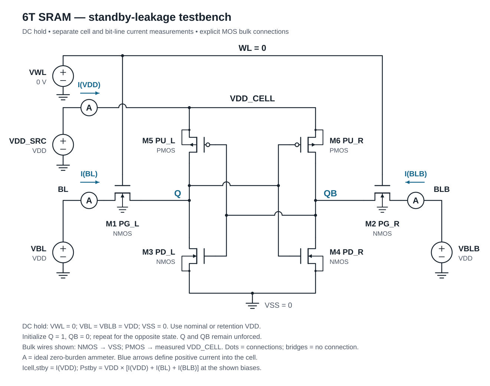

# Bitcell Standby Leakage

## 定义与适用范围

**位单元待机漏电流**（Bitcell Standby Leakage Current）是单元停止读写、保持原数据时，在规定偏置下流动的静态电流。本文定义 $I_{\mathrm{cell,stby}}$ 为从单元 VDD 电源网流入的电流，单位 A/cell；位线／互补位线（Bitline，BL／BLB）和独立体偏置端口的电流须分别报告。比较 $I_{\mathrm{stdby}}$、$I_{\mathrm{leak}}$ 等结果时，须先统一测量边界。[2, Sec. 4.2] [13, Sec. 2.2] [23, Sec. 2.2.2]

静态随机存取存储器（Static Random-Access Memory，SRAM）无需周期性刷新，保留数据仍需供电。本文以保留数据的 6T SRAM 位单元（Bitcell）为基线，待机功耗计入位单元、阵列容量、外围电路及待机偏置的影响；8T／10T 等结构须另列读端口和电源域。[1, Sec. 2.5] [12, Sec. 6.5] [23, Sec. 2.2]

### DC、瞬态与平均电流

端口电流统一以**从偏置源流入被测电路为正**。报告结果时，须区分直流（Direct Current，DC）、瞬态及窗口平均三种口径，并记录观察端口、偏置及提取窗口。

| 口径 | 定义与条件 | 主要工程用途 |
| --- | --- | --- |
| **DC 待机漏电流** | 固定电源、位线、字线及体偏置，内部节点保持原数据并建立稳定工作点时的端口电流；单元 VDD 端口记为 $I_{\mathrm{cell,stby}}$ | 比较器件尺寸、阈值、保持偏置及静态功耗 |
| **瞬态端口电流** $I_k(t)$ | 在保持过程中，按采样时刻记录第 $k$ 个外部端口的电流，同时记录端口电压及存储节点状态 | 检查工作点建立、浮置位线漂移及保持过程 |
| **窗口平均端口电流** $\overline I_k$ | 在规定时间窗口内对同一端口电流积分平均 | 报告稳定测量窗口或指定保持时间内的平均电流 |

$$
\overline I_k[t_1,t_2]=\frac{1}{t_2-t_1}\int_{t_1}^{t_2}I_k(t)\,\mathrm{d}t.
$$

式中 $t_1$、$t_2$ 为采样窗口的起止时刻（s），且 $t_2>t_1$；$I_k(t)$ 与 $\overline I_k$ 的单位均为 A。提取待机漏电时须避开切换瞬态；浮置位线仍在漂移时，须按瞬态结果报告，并注明采样时刻和对应位线电压。

### 存储状态与保持偏置

本文基准偏置以 VSS 为参考节点，取 $V_{\mathrm{SS}}=0$，字线（Wordline，WL）电位为 $V_{\mathrm{WL}}=V_{\mathrm{SS}}$，且 $V_{\mathrm{BL}}=V_{\mathrm{BLB}}=V_{\mathrm{DD}}$。存储节点／互补存储节点 Q／QB 由交叉耦合反馈维持状态，两种逻辑状态须在相同偏置下分别测量。

| 存储状态 | Q／QB 逻辑值 | 单元 VDD 端电流 | BL／BLB 端电流 |
| --- | --- | --- | --- |
| 存“0” | `Q=0, QB=1` | $I_{\mathrm{cell,Q0}}$ | $I_{\mathrm{BL,Q0}}$、$I_{\mathrm{BLB,Q0}}$ |
| 存“1” | `Q=1, QB=0` | $I_{\mathrm{cell,Q1}}$ | $I_{\mathrm{BL,Q1}}$、$I_{\mathrm{BLB,Q1}}$ |

两种状态下的单元 VDD 端电流均按 $I_{\mathrm{cell,stby}}$ 的边界提取，定义其差值为：

$$
\Delta I_{\mathrm{stby}}=I_{\mathrm{cell,Q0}}-I_{\mathrm{cell,Q1}}.
$$

$\Delta I_{\mathrm{stby}}$ 的单位为 A/cell，正值表示存“0”时的 VDD 端漏电更大。该量用于表征存储状态引起的电源端漏电差异；总待机功耗仍须汇总全部外部端口。

**成对测量规范**：须在同一单元、相同端口偏置和温度下测量两种状态，校准通路误差及温度漂移，并保留单元编号、Q／QB 电压和其他偏置端口电流。

理想对称单元的两种状态可具有相同漏电；失配或非对称阈值分配会改变两侧结果。非对称设计须按实际数据分布计算平均收益。[12, Sec. 1.5.3]

实际宏须记录预充关闭、位线降压或浮置等配置；数据保持（Retention）模式可采用单元供电降压或虚拟地抬升，并记录局部低电位电源相对参考节点的电位及实际供电压差。完全断电且不保留数据的睡眠（Sleep）模式与保留数据的保持（Hold）模式须分组报告。

### 电流与功耗的计数边界

按同一电路边界汇总各外部端口的静态功耗：

$$
P_{\mathrm{stby}}=\sum_k V_k I_k.
$$

$k$ 遍历单元电源、位线、体偏置及控制偏置端口，也包括 VSS 回流端；$V_k$ 为端口相对同一参考节点的电压，单位 V，$I_k$ 为流入端口的电流，单位 A，$P_{\mathrm{stby}}$ 的单位为 W。所有高电平端由同一个电源供电、其电压为 $V_{\mathrm{DD}}$，且其他端均为 0 V 时，可取该电源总输出电流计算 $P_{\mathrm{stby}}=V_{\mathrm{DD}}I_{\mathrm{supply,total}}$。使用独立位线源时，单元 VDD 电流与位线源电流须分别计量。[13, Sec. 2.2]

**注意事项**：禁止将总电源电流与下游支路电流再次相加，或累加所有晶体管端口电流的绝对值（会重复计算同一路径中的电流）。

## 物理机制与器件变异

### 保持通路与器件工作区

以基准偏置下 $V_Q\approx V_{\mathrm{DD}}$、$V_{\mathrm{QB}}\approx0$ 的保持状态为例，各器件的作用如下。Q 侧与 QB 侧分别连接 BL 与 BLB。

| 器件 | 保持偏置下的状态 | 电路作用与漏电关注项 |
| --- | --- | --- |
| **上拉管**（Pull-up，PU，PMOS） | Q 侧导通，QB 侧关断 | Q 侧维持高节点；QB 侧限制 VDD 向低节点的沟道电流，其关断漏电流入 QB |
| **下拉管**（Pull-down，PD，NMOS） | Q 侧关断，QB 侧导通 | QB 侧维持低节点；Q 侧限制高节点向 VSS 放电，其关断沟道漏电由 Q 流向 VSS |
| **访问管**（Pass-gate，PG，NMOS） | 两侧均由 WL 关闭 | 隔离读写通路；关断沟道仍可在位线与存储节点间传导漏电，方向取决于两端电位 |

WL 关闭后，锁存管仍维持状态；导通管和关断管的栅漏电、结相关漏电均须计入。极低保持电压下，名义导通管也可能进入亚阈值区。[2, Sec. 2] [5, Sec. 2]

按上述状态追踪**源漏沟道漏电通路**。VDD_CELL 为测试电路电流表之后的单元电源网，箭头表示常规电流方向。

| 通路 | 电流路径 | 条件与计量端口 |
| --- | --- | --- |
| **关断上拉管通路** | VDD_CELL → QB 侧 PU（关断）→ QB → QB 侧 PD（导通）→ VSS | 基准偏置下，由单元 VDD 端供给 |
| **关断下拉管通路** | VDD_CELL → Q 侧 PU（导通）→ Q → Q 侧 PD（关断）→ VSS | 基准偏置下，由单元 VDD 端供给 |
| **低节点侧访问管通路** | BLB → QB 侧 PG（关断）→ QB → QB 侧 PD（导通）→ VSS | 基准偏置下，由 BLB 端供给 |
| **高节点侧访问管通路** | VDD_CELL → Q 侧 PU（导通）→ Q → Q 侧 PG（关断）→ BL | 位线降压至 $V_{\mathrm{BL}}<V_Q$ 时，电流可由单元流向 BL；该通路对 BL 端电流的贡献为负 |

反向存储时，交换 Q／QB 及 BL／BLB 对应关系。栅漏电与结相关漏电分别经栅端和体端连接的网络闭合，须结合器件端口电流计入相应外部供电端。[5, Sec. 2, Fig. 2(a)]

### 三类主要漏电机制

固定偏置和计数边界后，按路径归并漏电机制：

$$
I_{\mathrm{leak}}\approx I_{\mathrm{sub}}+I_{\mathrm{gate}}+I_{\mathrm{jn}}.
$$

式中 $I_{\mathrm{sub}}$、$I_{\mathrm{gate}}$、$I_{\mathrm{jn}}$ 分别表示亚阈值、栅隧穿及结相关漏电分量，单位均为 A。实际提取以端口电流为准；机制分解须使用同一测量边界。本文将结漏电与栅诱导漏极漏电（Gate-Induced Drain Leakage，GIDL）归入第三类讨论；模型分别输出这些分量时，须按输出定义去重计入。[4, Sec. II-D] [5, Sec. 2] [23, Sec. 2.2.2]

**亚阈值漏电（Subthreshold Leakage）**：以 NMOS 为例，$V_{\mathrm{GS}}<V_{\mathrm{th}}$ 时，弱反型沟道仍存在扩散电流，其偏置依赖近似为：

$$
I_{\mathrm{sub}}\propto
\exp\!\left(\frac{V_{\mathrm{GS}}-V_{\mathrm{th,eff}}}{nU_T}\right)
\left[1-\exp\!\left(-\frac{V_{\mathrm{DS}}}{U_T}\right)\right],
\qquad U_T=\frac{kT}{q}.
$$

$V_{\mathrm{GS}}=V_G-V_S$、$V_{\mathrm{DS}}=V_D-V_S$，分别为栅源电压和漏源电压；源漏定义须与所用器件模型一致。$V_{\mathrm{th}}$ 为阈值电压，$V_{\mathrm{th,eff}}$ 为计入体偏置和漏致势垒降低（Drain-Induced Barrier Lowering，DIBL）影响的有效阈值电压；上述电压的单位均为 V。$n$ 为无量纲亚阈值因子，$U_T$ 为热电压（V），$k$ 为玻尔兹曼常数（J/K），$T$ 为绝对温度（K），$q$ 为元电荷（C）。采用单位 V/dec 的亚阈值斜率 $S=nU_T\ln10$ 时，固定其余条件可写为 $I_{\mathrm{sub}}\propto10^{-V_{\mathrm{th,eff}}/S}$。阈值降低、DIBL 增强通常增加关断电流；公式用于判断趋势，定量值由适用的器件模型提取。[2, Sec. 2] [13, Sec. 3.4.3]

**栅隧穿漏电（Gate Tunneling Leakage）**：载流子穿过栅介质，在栅端与沟道、源区或漏区之间形成电流；大小取决于介质材料、厚度和各端电场。保持态中的导通管和关断管均须计入栅漏电。[5] 的 65 nm 模型中，导通态（ON）栅漏电比关断态（OFF）高约一个数量级；不同栅堆栈、鳍式场效应晶体管（Fin Field-Effect Transistor，FinFET）／纳米片（Nanosheet）器件和待机偏置须分别按对应模型提取。[5, Sec. 2]

**反偏结漏电（Reverse-Biased Junction Leakage）与 GIDL**：源区、漏区与体区之间的反偏结漏电包含产生–复合、扩散和带间隧穿（Band-to-Band Tunneling，BTBT）；GIDL 来自漏区附近的栅端与漏区间的强电场，须与穿过栅介质的栅隧穿分别统计。反向体偏置（Reverse Body Bias，RBB）可提高阈值、降低亚阈值漏电，同时增大结反偏和 BTBT；净收益须按总漏电确认。[5, Secs. 2, 4.4] [16, Sec. 3.1.2]

### 器件敏感度与 PVT 变化

须覆盖工艺、电压、温度（Process, Voltage, Temperature，PVT）变化、局部失配及两种存储状态。

- **工艺与局部失配**：扫描沟道长度、阈值、亚阈值斜率和 DIBL。体硅器件的随机掺杂涨落（Random Dopant Fluctuation，RDF）是来源之一；先进器件还须覆盖金属栅功函数和几何变化。[3, Secs. III–V] [13, Sec. 3.4.3]
- **温度与电压**：升温通常显著增加亚阈值和部分结漏电，栅隧穿等分量须按各自温度特性评估。降低保持供电通常降低功耗，须同时检查内部节点、各管偏置及保持裕量。[1, Sec. 2.5] [5, Sec. 2] [14, Sec. 4.3]

## 本征漏电与阵列环境

### 区分测试环境与观测电流

**本征漏电**（Intrinsic Leakage）在隔离外部阵列负载的完整位单元上表征，保留各端口漏电路径。须按下表注明电路层次，并记录端口边界、局部偏置和寄生范围。

| 观测层次 | 测量边界与单位 | 工程用途 |
| --- | --- | --- |
| 孤立位单元 | 单元 VDD 电流，A/cell；BL／BLB 等端口另列 | 比较尺寸、阈值、拓扑及保持偏置；全部供电功耗按各外部端口汇总 |
| 位单元阵列 | 同一电源轨上所有单元电流之和，A/array | 评估容量与数据模式；各单元采用实际局部偏置 |
| 列位线 | BL、BLB 两侧分别测量，A/column | 评估累积漏电及读出干扰；扣除或注明列端外围贡献 |
| 完整宏 | 边界内阵列、预充、译码、灵敏放大器（Sense Amplifier，SA）及偏置电路的供电，A/macro 或 W/macro | 用于系统预算；总电流除以 bit 数标记为宏级归一化值 |

**数据对比规范**：孤立单元与阵列是测试环境，DC 钳位与瞬态测量是测量方式，须分别记录；比较结果前，须统一端口电流、外围静态漏电扣除范围及实际局部偏置。

### 阵列环境的主要影响

**列漏电与数据模式**：共享位线汇总同列各单元和列端外围的电流；同列 $N$ 个单元在全部 WL 关闭时，位线保持电流为：

$$
I_{\mathrm{BL,hold}}=
\sum_{i=1}^{N}I_{\mathrm{BL},i}
+I_{\mathrm{BL,periphery}},
$$

$I_{\mathrm{BL},i}$ 为 BL 流入第 $i$ 个单元的电流，$I_{\mathrm{BL,periphery}}$ 为 BL 流入列端外围的电流，各电流单位均为 A。各项须采用相同方向和边界，BLB 侧单独计算。预充位线高于内部低节点时，关断 PG 仍可向低节点漏电，因此列电流随存储模式变化。读操作选中一个单元后，未选单元的漏电按其余 $N-1$ 个单元计算。[9, Sec. III-D]

- **局部偏置与待机功耗**：阵列包含共享位线、局部电源压降及外围电路，须按实际局部偏置计算各单元电流，再汇总全部外部电源的静态功耗。
- **共享变化与空间分组**：共享工艺、供电和温度变化须保留阵列内相关性；按芯片、行列坐标及空间分组记录，局部失配另按器件模型抽样。
- **读出漏电干扰**：检查未选单元在读窗口内对 BL／BLB 共模和差分的影响，联合选中单元的[读电流（Read Current）](Read_Current.md)、位线电容及灵敏放大器判决阈值判断。
- **半选状态**：按具体访问操作单独设置偏置；全局保持态采用全部 WL 关闭的条件。

列级测量与分析见 [BL Leakage](../Subarray/BL_Leakage.md)。

## 测量与提取方法

### 共同条件与测试端口

#### 6T 待机漏电测试电路

图中两组互补金属氧化物半导体（Complementary Metal-Oxide-Semiconductor，CMOS）反相器交叉耦合，六只 MOS 的连接如下。

| 器件 | 源漏连接 | 栅端连接 |
| --- | --- | --- |
| M5／M6：上拉 PMOS | 源端接电流表之后的 VDD_CELL，漏端接本侧 Q 或 QB | 对侧存储节点 |
| M3／M4：下拉 NMOS | 源端接 VSS，漏端接本侧 Q 或 QB | 对侧存储节点 |
| M1／M2：访问 NMOS | 源漏两端连接本侧位线与存储节点 | 共用 WL |

六只 MOS 的体端均已连出：无独立体偏置的常规体硅 CMOS 配置中，NMOS 体端接 VSS，PMOS 体端接 VDD_CELL。PMOS 源端和体端均位于电流表之后，其体端电流计入单元供电测量；端子用语遵守项目[术语规范](../../GLOSSARY.md)。实心点表示连接，跨线桥表示不连接，所有接地符号属于同一 VSS 节点。

#### 测试偏置与电流方向

- **电源与位线偏置**：电压源 `VWL` 将 WL 保持在 0 V，`VBL`／`VBLB` 将两根位线钳位在 $V_{\mathrm{DD}}$，$V_{\mathrm{SS}}=0$；浮置测试时按对应流程断开位线 DC 钳位通路。
- **端口电流测量**：三只 A 为理想零压降电流表，蓝色箭头规定从电源流入单元为正；VDD_SRC 支路测得 $I_{\mathrm{cell,stby}}=I(\mathrm{VDD})$，另两支路分别测 $I(\mathrm{BL})$、$I(\mathrm{BLB})$。
- **仿真电流换算**：图中电流按蓝色箭头定义；仿真器将电压源电流定义为流入其正端时，偏置源正端接被测节点、负端接 VSS，可用 `-I(源名)` 换算为流入被测电路的电流。

图示偏置下，单元总待机功耗为：

$$
P_{\mathrm{stby}}=V_{\mathrm{DD}}[I(\mathrm{VDD})+I(\mathrm{BL})+I(\mathrm{BLB})].
$$

流经 `VWL` 电压源的访问管栅端漏电流须另行记录；因其电压为 0 V，该支路功耗为零。采用 RBB 或浮置位线时，须修改对应体端或位线连接，按实际供电边界重新计量。

#### 测试数据记录规范

以下字段为四套测试流程的共同记录要求。须在测试前确定稳定判据；各流程另列专用操作和验证项。

| 类别 | 必须明确的条件 |
| --- | --- |
| 器件与环境 | 工艺／模型版本、单元拓扑、尺寸或鳍数、工艺角、温度、失配模型、样本数及样本编号 |
| 偏置与状态 | VDD、VSS、WL、BL／BLB 各网相对同一参考节点的电压及体偏置；钳位／浮置状态；两种存储状态、Q／QB 电压及阵列数据模式 |
| 电路边界 | 单元／列／阵列／宏；包含的寄生、外围、偏置电路及被测供电端 |
| 提取窗口 | DC 工作点或瞬态窗口、稳定判据、保持时间、读回结果；浮置测试另记预充与均衡关闭时刻及采样窗口 |
| 电流、校准与统计 | 各端口原始电流、校准扣除量及残差、电流正方向、测试结构与外围静态漏电扣除范围、仪器分辨率与不确定度；芯片、行列坐标及空间分组 |

### 仿真：孤立单元 DC 待机漏电

**【前置条件】**

- **电路与模型**：按[6T 待机测试电路](#6t-待机漏电测试电路)建立完整闭环单元，加载器件模型，隔离外部阵列负载并明确单元内部寄生范围。
- **偏置**：取 $V_{\mathrm{WL}}=V_{\mathrm{SS}}=0$、$V_{\mathrm{BL}}=V_{\mathrm{BLB}}=V_{\mathrm{DD}}$；8T／10T 单元关闭全部读写访问端口，另列读位线偏置。[23, Sec. 2.2.2]

**【步骤/方法】**

1. **初始化存储状态**：写入逻辑状态 `Q=1, QB=0`，或用电压初始猜值辅助求解；测量前须释放初始化约束。
2. **提取端口电流**：运行 `.op`，或在 `.tran` 稳定窗口提取各端口电流，按共同字段保存工作点。
3. **扫描保持偏置**：用 `.dc` 扫描保持供电、位线及体偏置。
4. **测量相反存储状态**：改为 `Q=0, QB=1`，重复相同扫描，成对提取 $I_{\mathrm{cell,Q0}}$、$I_{\mathrm{cell,Q1}}$ 并计算 $\Delta I_{\mathrm{stby}}$。

**注意事项**：禁止持续钳位 Q／QB（外加电源会改变保持工作点和漏电路径）。

**【结果处理和验证】**

- **工作点与保持验证**：确认求解收敛、工作点及瞬态窗口满足预设稳定判据且保持原数据；失稳或读回失败的样本须按[数据保持电压（Data Retention Voltage，DRV）](DRV.md)判据单列。
- **机制与端口核对**：按模型支持的工作点输出检查漏端、栅端及体端总电流；模型支持机制分解时，另列亚阈值、栅隧穿和结漏电等分量。

### 仿真：阵列 DC 漏电与外围静态漏电校准

**【前置条件】**

- **电路与测量边界**：建立代表性列或子阵列，包含实际预充、多路选择器（Multiplexer，MUX）、外围关断状态及必要寄生网络；明确单元电源与 BL／BLB 供电边界。
- **变异模型**：共享工艺、供电和温度按共同变量施加，局部失配按器件模型抽样。
- **校准结构**：分离位单元贡献时，准备相同偏置下的空列或外围参考结构，用于测量外围静态漏电。

**【步骤/方法】**

1. **配置保持偏置与数据模式**：分别写入全 0、全 1、棋盘格及应用相关模式，关闭全部 WL；读出与半选测试须使用各自的独立偏置配置。
2. **测量 DC 钳位电流**：将 BL／BLB 钳位在指定电压，运行 `.op` 或 `.dc`，分别记录两侧供电电流、单元 VDD 电流和局部端口电压。
3. **校准外围静态漏电**：在相同偏置下测量空列或外围参考结构；提取位单元贡献时扣除外围静态漏电，保留原始端口总电流及扣除范围。
4. **扫描阵列与器件条件**：对列高、PVT 和局部失配重复测量。

**注意事项**：施加共享工艺、电源和温度变化时，须保留阵列内相关性（逐单元独立重抽会破坏该相关性）。

**【结果处理和验证】**

- **保持与偏置验证**：确认全部 WL 关闭、内部节点保持原数据且电流稳定；核对校准结构与阵列的局部偏置。
- **分量与总量报告**：分别报告单元 VDD 电流、BL／BLB 列电流、外围静态漏电及扣除后的位单元贡献；宏总功耗须按外部供电边界汇总并计入外围电路。

### 仿真：浮置位线电压与漏电反推

**【前置条件】**

- **电路与状态**：沿用阵列 DC 测试的列或子阵列、数据模式与变异模型，保留预充、MUX、感测端及必要寄生，保持全部 WL 关闭。
- **电容与路径标定**：须标定观察端的等效电容，并识别预充开关、MUX 及感测端的残余充放电路径。

**【步骤/方法】**

1. **预充并释放位线**：断开 BL／BLB 的 DC 钳位通路，完成预充后关闭预充与均衡，保持全部 WL 关闭。
2. **采样位线与内部节点**：运行 `.tran`，避开切换瞬态，记录 BL／BLB 电压随时间的变化及 Q／QB 状态；注明采样窗口。
3. **提取净电流与单元贡献**：按下式反推净电流；提取位单元贡献时，按相同位线电压匹配并扣除预充开关、MUX 和感测端的静态漏电。
4. **覆盖条件**：按阵列 DC 流程覆盖列高、PVT、局部失配和数据模式。

**注意事项**：禁止将位线净电流直接标为本征单元漏电（位线净电流包含同列单元及外围的残余充放电路径）。

**【结果处理和验证】**

等效电容已知且耦合可忽略时，取从位线流出的净电流为正：

$$
I_{\mathrm{BL,net}}(t)\approx
-C_{\mathrm{BL,eff}}\frac{\mathrm{d}V_{\mathrm{BL}}}{\mathrm{d}t}.
$$

$C_{\mathrm{BL,eff}}$ 为观察端的等效位线电容（F），$V_{\mathrm{BL}}$ 为 BL 相对固定参考节点的电压（V），$t$ 为时间（s），$I_{\mathrm{BL,net}}$ 的单位为 A。

- **反推模型检查**：电容随偏置变化时须使用局部微分电容，BL／BLB 耦合显著时须使用电容矩阵。
- **结果报告**：交付直接测得的位线电压波形、反推净电流及窗口平均值，注明采样时刻和对应位线电压；提取方向和条件见 [BL Leakage](../Subarray/BL_Leakage.md#测量与提取方法)。
- **状态与有效性验证**：检查 Q／QB 是否保持原数据；位线漂移期间的数据按瞬态结果归档，保持失败样本须单列。

### 硅测量：供电电流、静态漏电校准与数据保持

**【前置条件】**

记录保持模式及仪器检测限，其余条件沿用共同字段；按可访问接口选择测量方式。

| 测试方式 | 可提取结果 | 校准项 |
| --- | --- | --- |
| 独立阵列电源轨 | 该供电轨的阵列静态电流 | 位线／外围供电另测，校准焊盘（Pad）、开关及偏置电路的静态漏电 |
| 单元／位线模拟引出 | 端口 DC 电流或列位线电压下降 | 测试 MUX 的漏电、串联电阻与负载；厚栅开关同样须按实测静态漏电确认单元级精度 |
| 宏级 $I_{\mathrm{DDSTBY}}$ | 指定模式下的宏待机电流 | 记录全部供电与控制状态；除以 bit 数仅作宏级归一化 |
| 片上采样或模数转换器（Analog-to-Digital Converter，ADC） | 位线电压随时间的变化 | 采样负载、时间基准、有效电容；按净电流反推口径处理 |

**【步骤/方法】**

1. **写入数据并进入保持状态**：写入指定数据，停用无关时钟与输入／输出（Input/Output，I/O）；等待供电和温度达到预设稳定判据。
2. **测量与校准**：用低电流源测量单元（Source Measure Unit，SMU，亦称源表）测量各供电端电流，并在同温、同偏置下测量空白开关／外围参考结构；具备模拟引出或片上 ADC 时，可按浮置位线流程采样并反推电流。
3. **验证数据保持**：完成保持窗口后恢复正常偏置并读回，记录失效位；对相反数据及其他目标模式重复测量。
4. **拟合平均单元电流**：每单元偏置及外围静态漏电保持不变时，改变启用单元数 $N$，拟合 $I(N)=I_{\mathrm{background}}+N\overline I_{\mathrm{cell}}$，以斜率估算平均单元电流。$I_{\mathrm{background}}$ 表示测量边界内与 $N$ 无关的测试结构及外围静态漏电，$\overline I_{\mathrm{cell}}$ 为平均单元电流；前者单位为 A，后者单位为 A/cell。

**注意事项**：禁止将低于检测限的值置零后取对数（零值无法进行对数变换，会使分布分析失真）。

**注意事项**：禁止将负静态漏电扣除残差解释为负漏电（扣除结果包含测量与校准误差）。

**【结果处理和验证】**

- **结果分类**：分别报告直接端口电流、位线反推净电流、总功耗及 $I(N)$ 斜率估算的平均单元电流；按读回结果标记保持失败样本。
- **检测限与校准残差**：低于检测限的数据须报告为上界或左删失观测；负静态漏电扣除残差须保留用于校准与不确定度分析。
- **均值提取检查**：使用 $I(N)$ 斜率法前，须核查各单元偏置与外围静态漏电随 $N$ 的变化，确认满足上述拟合条件。

**测量实例**：0.13 μm、4 KB SRAM 在测得的最大 DRV 上增加 100 mV 裕量，以 350 mV 待机供电实现漏电流降低超过 80%、漏电功耗降低超过 90%；数值限定于该阵列及测试条件，其他设计须按自身 DRV 和保持良率确定电压。[2, Sec. 4.2, Fig. 9]

### 孤立单元与阵列表征方法及数据口径对照

| 评估维度 | 孤立单元表征 | 阵列／宏表征 |
| --- | --- | --- |
| **电路与边界** | 完整闭环位单元，隔离外部阵列负载；注明内部寄生范围 | 代表性列、子阵列或完整宏，包含共享网络、外围及必要寄生 |
| **偏置与状态** | 指定单元端口电压，分别测量两种存储状态 | 记录实际局部偏置、全部 WL 关闭状态及阵列数据模式 |
| **测量方式** | `.op`／`.dc` 提取稳态电流，`.tran` 检查工作点与保持过程；硅测量使用可访问端口 | DC 测量阵列及列电流；浮置位线电压反推净电流；独立供电轨测量宏待机电流 |
| **静态漏电校准** | 保留完整位单元各端口漏电路径，校准外部测试通路 | 提取单元贡献时扣除测试结构及外围静态漏电；宏预算计入外围供电 |
| **结果与用途** | 端口电流、功耗、两种状态差异及偏置敏感度 | 阵列总量、列漏电、空间分布和保持结果；按单元数拟合的斜率为平均单元电流估计 |

## 数据可视化与评估

### 按表征层次划分的建议图表

按本次表征任务选择图表：

- **基础交付**：先完成对应层次的偏置／数据模式对比及端口功耗核算；采用浮置测量时，须交付位线波形。
- **按需分析**：用于状态非对称性、失配、设计优化、空间定位或预算良率；相关结论须附对应图表及模型验证。

每张图表须标注电流或功耗的测量边界、端口、单位、偏置、数据状态、样本数及静态漏电校准范围；瞬态结果另注明采样时刻与窗口。

#### 孤立单元表征图表

| 优先级 | 图表类型 | 坐标与分组 | 工程用途 |
| --- | --- | --- | --- |
| **基础** | 半对数偏置／温度曲线 | 横轴为 $V_{\mathrm{DD}}$（V）或温度（°C），纵轴为端口漏电流（A/cell）；按状态、尺寸和工艺角分组 | 提取偏置与温度敏感度，标出保持失败点及有效低压范围 |
| **基础** | 端口电流／功耗分解图 | 按单元电源、BL／BLB 和体偏置端口分组，纵轴为电流（A）或功耗（W）；模型支持时可按需增加机制分量 | 核对总功耗、各端口贡献及主导漏电路径 |
| **按需：状态差异** | 状态相关与差值图 | 横轴为 $I_{\mathrm{cell,Q0}}$、纵轴为 $I_{\mathrm{cell,Q1}}$；另绘 $\Delta I_{\mathrm{stby}}$ 的线性直方图，单位 A/cell | 检查同一单元两种状态的相关性及漏电非对称性 |
| **按需：失配／尾部** | 对数电流分布与概率图 | 对数电流直方图、经验累积分布函数（Cumulative Distribution Function，CDF）／超越概率图、对数电流分位数–分位数（Quantile–Quantile，Q–Q）图；按状态、偏置和工艺分组 | 检查右偏分布、尾部拟合及状态对高尾的影响 |
| **按需：设计优化** | 漏电与稳定性／性能散点图 | 横轴为漏电流（A/cell），纵轴分别为保持静态噪声裕量（Hold Static Noise Margin，HSNM，单位 V）、读电流（A/cell）或写裕量（V） | 检查保持、读取及写入约束 |

#### 阵列与宏表征图表

| 优先级 | 图表类型 | 坐标与分组 | 工程用途 |
| --- | --- | --- | --- |
| **基础** | 容量与数据模式曲线 | 比较各数据模式下的阵列／列电流（A）或宏功耗（W），分别标注单元、位线和外围贡献；扫描容量时，以单元数或列高为横轴 | 检查数据模式影响、外围开销、容量缩放及平均单元电流提取条件 |
| **基础：浮置测试** | 浮置位线波形图 | 横轴为时间（s），绘制 BL／BLB 电压（V）与反推净电流（A）；标出预充释放时刻、采样窗口及保持失败点 | 检查位线漂移和电容反推模型的有效范围 |
| **按需：空间定位** | 位置分布与热图 | 按芯片分组，横轴为列号、纵轴为行号，色阶为端口电流（A）；注明校准范围 | 分离全局工艺偏移、空间相关性和局部高漏电单元 |
| **按需：预算良率** | 阵列总量与高尾概率图 | 横轴为阵列电流（A），纵轴为经验 CDF 或超越概率；标出预算上限及样本支持范围 | 评估待机预算良率，核对尾部外推范围 |

### 统计口径与比较原则

须报告均值、中位数、标准差、目标高分位数及其置信区间，列明样本数、检测限和失效样本处理方式，并按相同数据保持、温度和唤醒约束比较待机功耗。

#### 孤立单元：状态分组与对数正态近似

分别统计 $I_{\mathrm{cell,Q0}}$、$I_{\mathrm{cell,Q1}}$，按单元配对计算 $\Delta I_{\mathrm{stby}}$。比较设计方案时须统一端口边界、模型、温度及保持判据；检测限与失败样本按测量流程处理。

在亚阈值漏电占优、主要波动参数近似高斯且其余偏置固定时，可采用对数正态作为候选模型 [4][11]：指数关系使 $\ln I$ 近似正态，电流呈右偏长尾。此处 $I$ 表示按统一电流单位取值的正电流数值，拟合时须记录所用单位。多条漏电路径之和、不同状态或工艺群体的混合须单独检验分布。[4, Sec. II-D] [11, Sec. II-A4]

须对 $\ln I$ 检查分布与尾部。若拟合 $\ln I\sim\mathcal N(\mu_\ell,\sigma_\ell^2)$，其中 $\mu_\ell$、$\sigma_\ell$ 分别为对数电流的均值和标准差，则原电流数值的中位数为 $e^{\mu_\ell}$，算术均值为 $e^{\mu_\ell+\sigma_\ell^2/2}$；两者均沿用拟合时的电流单位。阵列平均功耗预算须使用算术均值。

**注意事项**：对数正态模型须通过分布与尾部检验（仅切换对数坐标不足以确认模型）。

#### 阵列：总电流、相关性与预算良率

对同一供电边界内的 $N$ 个单元，计算总电流、均值和方差：

$$
I_{\mathrm{array}}=\sum_{i=1}^{N}I_i,\qquad
\mu_{\mathrm{array}}=\sum_{i=1}^{N}\mu_i,
$$

$$
\sigma_{\mathrm{array}}^2=
\sum_{i=1}^{N}\sigma_i^2+
2\sum_{i<j}\operatorname{Cov}(I_i,I_j).
$$

$I_i$ 为第 $i$ 个单元的电流，$\mu_i$ 和 $\sigma_i$ 分别为其均值和标准差，单位均为 A；$\operatorname{Cov}(I_i,I_j)$ 为单元电流间的协方差，单位为 A²。

独立同分布时，使用 $\mu_{\mathrm{array}}=N\mu_{\mathrm{cell}}$、$\sigma_{\mathrm{array}}=\sqrt N\sigma_{\mathrm{cell}}$，其中 $\mu_{\mathrm{cell}}$、$\sigma_{\mathrm{cell}}$ 为单元电流的共同均值和标准差。在此条件下，方差有限时可用中心极限定理（Central Limit Theorem，CLT）建立标准化总和的正态近似；强偏态、有限阵列规模下须验证近似精度。实际阵列须将共享工艺、电源和温度引起的相关性计入协方差；局部独立失配可部分平均，芯片共同偏移保留为全局分量。[4, Sec. VI-B, Eqs. (33)–(36)] [9, Sec. III-D] [11, Sec. III-A]

在目标概率区间验证正态近似后，按下式估算漏电预算良率：

$$
P(I_{\mathrm{array}}\le I_{\mathrm{limit}})
\approx\Phi\!\left(
\frac{I_{\mathrm{limit}}-\mu_{\mathrm{array}}}{\sigma_{\mathrm{array}}}
\right)
$$

$I_{\mathrm{limit}}$ 为该供电边界的漏电流预算上限（A），$\Phi$ 为标准正态分布函数；宏级预算须另计外围及其他电源网的贡献。

**注意事项**：须在目标失效概率区间单独验证尾部精度（分布中心拟合不能验证极低概率尾部）。

#### 阵列：极值、读失效与尾部验证

普通蒙特卡洛（Monte Carlo）仿真用于分布与常见分位数；极低概率读失效或漏电超限须采用经验证的重要性抽样等方法，并报告置信区间。[9, Secs. II–III]

| 预测对象 | 分析量与条件 |
| --- | --- |
| 最大单元漏电 $I_{\max}$ | 独立同分布时，$P(I_{\max}\le x)=F_I(x)^N$ |
| 整宏待机预算 | 按实际供电边界分析电流之和及功耗 |
| 读失效 | 联合分析列累积漏电、最弱读电流、数据模式和感测时间 |

$F_I(x)$ 为单元电流的 CDF，$x$ 为单元电流阈值（A），$N$ 为单元数；须按预测对象分别建模。[9, Sec. III-D]

采用耿贝尔（Gumbel）／广义极值（Generalized Extreme Value）分布拟合时，须验证适用尾部、样本分组及相关性，并报告外推不确定度。文献 [21] 的预测对象为阵列最低工作电压 $V_{\min}$，待机电流是其中一个输入特征；该案例仅用于阵列失效预测，不作为漏电极值外推的验证。[21, Secs. IV–V]

**注意事项**：6σ／6.4σ 结论须有对应尾部验证（小样本拟合本身不足以验证该失效率）。

## 应用场景与指标关系

### 待机功耗与降漏电方法

| 方法 | 作用与适用场景 | 必须同时检查的代价 |
| --- | --- | --- |
| 保持电压缩放 | 降低保持电源网电压，减少保持态静态功耗 | 工作点高于目标良率对应的 [DRV](DRV.md)，保留噪声、电源波动和唤醒裕量 [1][2] |
| 虚拟电源／虚拟地及电源门控 | 降低单元有效供电，利用源偏置或堆叠效应抑制漏电 | 检查保持型门控稳定性、睡眠管压降与恢复时间；完全断电按数据丢失处理 [10][20] |
| 反向体偏置／源偏置 | 按两种机制分别评估阈值和端子电压变化 | 检查工艺支持范围、结 BTBT、偏置发生器功耗及模型允许范围 [5] |
| 高阈值与尺寸优化 | 降低关键关断路径漏电 | 联合优化单元读电流、失配、面积及写入能力；单管导通电流与关断电流之比 `Ion/Ioff` 作器件参考 [5][6][7][11] |
| 双阈值／非对称单元 | 利用已知数据倾向降低常见状态漏电 | 两种状态分别表征漏电和性能，收益按实际数据分布加权 [12] |
| 阵列分段、位线待机偏置与读写隔离 | 按方案控制列漏电积累或降低读端扰动 | 核算分段外围开销，以及 8T／10T 的读位线漏电、漏电路径和面积 [9][12][20] |

### 设计优化与良率约束

须联合检查功耗、性能与面积（Power, Performance, Area，PPA），并满足以下稳定性和访问约束。

- **保持稳定性**：降低有效供电通常压缩 [HSNM](HSNM.md)；须依据目标失效率与实际保持时间选择保持电压，唤醒后在访问偏置下检查[读静态噪声裕量（Read Static Noise Margin，RSNM）](RSNM.md)。保持态 HSNM 与读态 RSNM 须按各自偏置分别报告。[1][2]
- **读电流与延时**：提高阈值或减小器件尺寸可同时降低漏电和 [Read Current](Read_Current.md)；须结合 [BL Leakage](../Subarray/BL_Leakage.md)、共模、差分及读建差时间评估感测窗口。[6][9]
- **写入能力**：提高 PG 阈值或缩小 PG 可能削弱写入；减弱 PU 可能改善写入，同时改变保持与读稳定性。漏电与写裕量的变化方向须通过联合扫参确认，并按[字线写入裕量（Wordline Write Margin，WM）](WM.md)、[写静态噪声容限（Write Static Noise Margin，WSNM）](WSNM.md)和[写入翻转电压（Write Trip Voltage，WTV）／位线写入翻转电压（Bitline Write Trip Voltage，BWTV）](WTV.md)的测试定义及改善方向判读。[7]
- **功耗、性能、面积与良率**：在相同容量和良率目标下比较睡眠管、偏置发生器、分段及额外读端口方案，须核算实际面积、外围静态功耗、唤醒能量和时序开销；联合优化尺寸与保持电压，分别确定最低保持点和最低漏电点。[14, Sec. 4.3] [20, Sec. 3.4]

**注意事项**：保持电压须按目标良率选取（典型单元 DRV 不能覆盖阵列失配）。

**注意事项**：读感测须检查读电流与列漏电的分布及建差窗口（均值大小关系不足以判定读成功）。

设计与工艺协同优化（Design-Technology Co-Optimization，DTCO）以保持良率、读写能力、面积和唤醒时间为约束，优化明确供电边界下的待机功耗。须区分器件级[关断电流 Ioff](../Device/Ioff.md)、单元电源漏电、位线漏电与[灵敏放大器待机电流（SA Standby Current）](../Peripherial/SA_Standby_Current.md)的观测层次，按不重叠的供电边界核算宏级预算。

## 参考文献

检索范围为 Zotero `02-SRAM-DTCO/SRAM-Metrics` 及其全部 5 个子集合，按 `Standby Leakage` 标签筛选，检索日期为 2026-11-12；跨集合条目及重复附件去重后共 21 篇，对应下列 [4]–[24]，按出版年份排列。[1]–[3] 保留原有正文引用编号，并补充摘要。20 篇命中文献的 PDF 来自 Zotero，其中 13 篇与项目既有归档逐字节一致、7 篇新增复制；[19] 的 Zotero 条目没有附件，另从期刊官方档案补齐。所有 PDF 沿用项目的 `References` 目录。摘要中的电流、功耗、单元与阵列口径分别注明；页码以所链接版本为准。

[1] H. Qin, “Deep sub-micron SRAM design for ultra-low leakage standby operation,” Ph.D. dissertation, Univ. California, Berkeley, Tech. Rep. UCB/EECS-2007-74, 2007. [公开文献](https://www2.eecs.berkeley.edu/Pubs/TechRpts/2007/EECS-2007-74.html)

**相关摘要**：论文以数据保持电压（DRV）为待机降压边界，结合晶体管尺寸、体偏置及纠错码降低保持功耗。130 nm、32 Kbit 样片在含 100 mV 裕量的 490 mV 待机供电下，相对 1 V 的漏电功耗降低约 85%；90 nm 优化 4 Kbit 阵列在 270 mV 下达到约 97% 的降低。降压同时减少漏电流及其供电电压，须保留保持稳定性和工艺变异裕量。论文结合纠错码获得的约 50 倍漏电功耗降低仅适用于含冗余位的存储器方案。（Sec. 2.5、3.1.3、4.2.2、5.2.2；Figs. 3.7、4.8、5.6。）

[2] H. Qin, Y. Cao, D. Marković, A. Vladimirescu, and J. M. Rabaey, “SRAM leakage suppression by minimizing standby supply voltage,” in Proc. ISQED, 2004. [公开文献](https://www2.eecs.berkeley.edu/bears/2004/STARS/final/qin.pdf)

**相关摘要**：本文建立 6T SRAM 的 DRV 与亚阈值保持漏电模型，并以 0.13 μm、4 KB 测试芯片验证待机降压。50 个被测单元的 DRV 为 80–250 mV、均值为 170 mV；在最大测得 DRV 上增加 100 mV 裕量，采用 350 mV 待机供电后，阵列漏电流降低超过 80%，漏电功耗降低超过 90%。上述降幅分别对应阵列漏电流和漏电功耗；低于 300 mV 的保持结果与含裕量的 350 mV 待机工作点须分开记录。可降压范围受器件失配、温度和保持噪声裕量共同限制。（Sec. 2、3.1.1、4.1–4.2、5.1；Figs. 8–10。）

[3] M. Karner et al., “Variability-aware DTCO flow: Projections to N3 FinFET and nanosheet 6T SRAM,” in Proc. SISPAD, 2021. [DOI 10.1109/SISPAD54002.2021.9592527](https://doi.org/10.1109/SISPAD54002.2021.9592527). [公开文献](https://doi.org/10.1109/SISPAD54002.2021.9592527)

**相关摘要（间接相关）**：本文通过工艺计算机辅助设计（Technology Computer-Aided Design，TCAD）到集成电路仿真程序（Simulation Program with Integrated Circuit Emphasis，SPICE）的统计设计流程分析 N3 FinFET 与纳米片 6T SRAM。室温仿真表明，金属栅晶粒引起的功函数波动是主要局部变异来源，影响阈值电压、亚阈值斜率及单元稳定性，可为漏电的工艺变异建模提供参考。文中直接报告的单元指标是读静态噪声裕量、写翻转点及读电流，未给出保持偏置下的单元漏电或漏电改善结果；Sec. V-B、Fig. 11 不能直接作为待机漏电高尾或温度规律的证据。（Sec. III–V；Figs. 7–11。）

[4] S. Mukhopadhyay, H. Mahmoodi, and K. Roy, “Modeling of failure probability and statistical design of SRAM array for yield enhancement in nanoscaled CMOS,” IEEE Trans. Comput.-Aided Design Integr. Circuits Syst., vol. 24, no. 12, pp. 1859–1880, 2005. [DOI](https://doi.org/10.1109/TCAD.2005.852295) · [Zotero](https://www.zotero.org/users/7333024/items/P33WUEER) · [公开文献](https://doi.org/10.1109/TCAD.2005.852295)

**相关摘要**：本文针对栅长 50 nm、有效沟道长 25 nm 的体硅 SRAM 建立漏电与失效概率模型，并用 MEDICI 验证。单元总漏电包含访问管及锁存器中的亚阈值、栅和结带间隧穿电流；阈值波动使其近似呈对数正态分布，在单元独立同分布假设下，阵列漏电之和近似正态，可据此设置漏电良率约束。降低保持电压可减少漏电；下拉管漏电可能拉低高电平存储节点，引起保持失效；增大下拉管或缩短上拉管也可能增加漏电。尺寸与良率优化须同时检查漏电和保持裕量。（Sec. II-D、VI-B、VI-E；Eqs. (33)–(36)，Fig. 21。）

[5] Q. Chen, S. Mukhopadhyay, A. Bansal, and K. Roy, “Circuit-aware device design methodology for nanometer technologies: A case study for low power SRAM design,” in Proc. DATE, 2006, pp. 1–6. [DOI](https://doi.org/10.1109/DATE.2006.243868) · [Zotero](https://www.zotero.org/users/7333024/items/NJAJZIR3) · [公开文献](https://doi.org/10.1109/DATE.2006.243868)

**相关摘要**：本文以 65 nm 器件与电路级 MEDICI 仿真，在不同电路拓扑及给定待机偏置下优化晕环掺杂（Halo Doping），说明最大化单管 `Ion/Ioff` 不等于最小化单元总漏电。源偏置降低访问管及下拉管的有效偏压，并抑制部分栅漏电；反向体偏置降低亚阈值漏电，同时会增加结带间隧穿。相对同类电路采用最大 `Ion/Ioff` 器件的基线，器件优化使普通 6T 单元漏电降低 10.7%，采用 0.3 V 源偏置的单元降低 44%，采用 −0.25 V 反向体偏置的单元降低 43.2%。上述降幅均为各偏置方案内部相对于同类电路基线的器件优化收益。（Sec. 2、4.1–4.4；Eq. (2)，Figs. 10、12–13。）

[6] D.-M. Kwai et al., “SRAM cell current in low leakage design,” in Proc. IEEE Int. Workshop Memory Technology, Design, and Testing (MTDT), 2006, pp. 65–70. [DOI](https://doi.org/10.1109/MTDT.2006.28) · [Zotero](https://www.zotero.org/users/7333024/items/RNB3WGBW) · [公开文献](https://doi.org/10.1109/MTDT.2006.28)

**相关摘要**：本文在 0.25 μm、2.5 V 工艺的 6T SRAM 中，通过额外阈值调整注入降低待机漏电。两组晶圆的平均阈值由 0.47 V 提高到 0.64 V，阈值标准差由 18 mV 增至 22 mV；1 Mb 测试芯片在 2.5 V 下的待机电流中位数由 6.5 μA 降至 1 μA。上述待机电流为整片 SRAM 实测值。高阈值同时降低读电流，并使低压读电流分布与感测裕量成为限制，因此漏电优化须同时检查最慢单元和低压访问能力。（Sec. 1–3；Figs. 1、3。）

[7] E. Grossar, M. Stucchi, K. Maex, and W. Dehaene, “Read stability and write-ability analysis of SRAM cells for nanometer technologies,” IEEE J. Solid-State Circuits, vol. 41, no. 11, pp. 2577–2588, 2006. [DOI](https://doi.org/10.1109/JSSC.2006.883344) · [Zotero](https://www.zotero.org/users/7333024/items/EEADHYR8) · [公开文献](https://doi.org/10.1109/JSSC.2006.883344)

**相关摘要**：本文以 N 曲线读稳定性、写入能力和读电流为约束，利用阈值失配统计与灵敏度优化 130 nm、65 nm 6T SRAM 的待机漏电。单元总漏电含亚阈值、栅及带间隧穿分量，本文优化仅计亚阈值分量。65 nm 案例采用 1 V 供电和 100 mV 静态电压噪声裕量目标，展示统计尺寸优化在满足稳定性时减少漏电及面积的作用。文中的约 25%／40% 表示最坏情况设计对读稳定性的过度设计比例。（Sec. IV-A–C，pp. 2584–2587；Figs. 18–19。）

[8] 蔡斌君，《静态随机存储器位单元与测试结构设计优化》，硕士学位论文，上海交通大学，上海，2007。 [Zotero](https://www.zotero.org/users/7333024/items/Q2T3EHCM) · [公开文献](https://kns.cnki.net/kcms2/article/abstract?v=3uoqIhG8C475KOm_zrgu4lQARvep2SAkAYAgqaTO4OyKkcOJ4w_0uBMMDBd31Rzz6lvqN7floCYwOJ74euUL69fh0K1aE59J&uniplatform=NZKPT)

**相关摘要**：论文为 90 nm CMOS 6T SRAM 设计单管及晶体管矩阵测试结构，后者测量无外加操作信号时从电源到地的漏电，并分别分析关断、栅和结漏电。表 6 的硅片阵列漏电按比特归一化，偏置为 `Ioff@1.32 V`：面积 0.99–1.27 μm² 的四种单元在两个晶圆样本上的结果为 6.11–15.29 pA/bit；0.99 μm² 分离字线单元为 7.20 和 6.11 pA/bit，其静态噪声裕量（Static Noise Margin，SNM）为 210 mV。阵列归一化漏电采用 pA/bit，单管漏电采用 pA/μm，两者须分别报告；表内未注明测试温度。（Sec. 3.2、4.2–4.3，pp. 34、44–46；表 6。）

[9] T. S. Doorn, E. J. W. ter Maten, J. A. Croon, A. Di Bucchianico, and O. Wittich, “Importance sampling Monte Carlo simulations for accurate estimation of SRAM yield,” in Proc. ESSCIRC, 2008, pp. 230–233. [DOI](https://doi.org/10.1109/ESSCIRC.2008.4681834) · [Zotero](https://www.zotero.org/users/7333024/items/SLU75CBK) · [公开文献](https://doi.org/10.1109/ESSCIRC.2008.4681834)

**相关摘要**：本文以 65 nm、0.9 V 单元的统计仿真区分待机总漏电与读出时的列位线漏电。作者用平均单元总漏电乘单元数估算存储器待机电流，并认为大量单元可使其相对波动减小；列上少数高漏电访问管对最坏读出电流的影响须单独评估。访问管漏电随阈值呈指数变化，其对数近似正态，列漏电必须结合高尾事件和最小读电流检查。该工作提供平均待机预算与列读失效分开处理的方法，未报告单元降漏电结构；平均值缩放也不等于验证共享工艺偏差下的阵列高尾分布。（Sec. III-D；Fig. 8。）

[10] Z. Guo, “Large-scale variability characterization and robust design techniques for nanoscale SRAM,” Ph.D. dissertation, Univ. California, Berkeley, Tech. Rep. UCB/EECS-2009-190, 2009. [Zotero](https://www.zotero.org/users/7333024/items/A56QIF3W) · [公开文献](https://www2.eecs.berkeley.edu/Pubs/TechRpts/2009/EECS-2009-190.html)

**相关摘要**：论文通过 FinFET 混合模式仿真分析单元漏电与稳定性，提高体硅器件阈值所带来的降漏电收益可能被带间隧穿抵消；4T 单元还依赖访问管保持电流，因而存在漏电下限。对独立栅、动态传输管反馈（IG PGFB）4T 单元，待机时抬升虚拟 VSS 的方案使单元漏电由 5.9 nA 降至 0.076 nA，同时 HSNM 由 270 mV 降至 230 mV。上述结果来自所建模型的单元仿真，反映保持型电源门控与保持裕量的取舍。（Sec. 5.3.1、5.4–5.5；Fig. 5.17，Tables 5.4–5.5，pp. 180–183。）

[11] V. Gupta and M. Anis, “Statistical design of the 6T SRAM bit-cell,” IEEE Trans. Circuits Syst. I, Reg. Papers, vol. 57, no. 1, pp. 93–104, 2010. [DOI](https://doi.org/10.1109/TCSI.2009.2016633) · [Zotero](https://www.zotero.org/users/7333024/items/CJL8HZFZ) · [公开文献](https://doi.org/10.1109/TCSI.2009.2016633)

**相关摘要**：本文在 45 nm 预测模型、标称 1 V 下，将亚阈值、栅及带间隧穿分量组成的单元漏电纳入统计尺寸优化，并在高温、高供电的漏电最坏条件下施加约束。单元漏电近似对数正态，作者利用 16 个单元漏电之和的近似正态分布建立统计约束。低漏电设计以 25 nA 为单元漏电上限、10 μA 为读电流下限，得到标称漏电 15 nA、读电流 22.021 μA；25 nA 是设计约束而非实测结果。缩小下拉管可降低漏电，却会增大失配及 SNM 波动，须配合上拉管尺寸优化。（Sec. II-A4、III-A、IV-B；Tables III–IV，归档提前出版版 PDF pp. 3、5、9–10。）

[12] J. Singh, S. P. Mohanty, and D. K. Pradhan, Robust SRAM Designs and Analysis. New York, NY, USA: Springer, 2013. [DOI](https://doi.org/10.1007/978-1-4614-0818-5) · [Zotero](https://www.zotero.org/users/7333024/items/JG3ZTL9Y) · [公开文献](https://doi.org/10.1007/978-1-4614-0818-5)

**相关摘要**：本书从存储数据、阈值分配和工艺变化解释待机漏电。其综述的 130 nm 非对称双阈值 6T 仿真示例，针对存“0”的关断路径采用高阈值管，可将漏电降至常规单元约 1/70，但存“1”时收益消失，读访问也会变慢；这是书中引用的既有设计结果。第 6 章展示 32／45 nm、125°C 下漏电的对数正态分布，并指出独立读端口增加漏电路径。降低保持供电须保留 HSNM，完全断电则丢失数据并增加恢复开销；单元待机漏电与列漏电造成的读错误须分别评价。出版年份按 PDF 版权页修正为 2013。（Sec. 1.5.3、6.5、6.7.2；pp. 27–29、146–147、154。）

[13] P. Royer del Barrio, “Design and simulation of deep nanometer SRAM cells under energy, mismatch, and radiation constraints,” Ph.D. dissertation, Universidad Politécnica de Madrid, Madrid, Spain, 2015. [DOI](https://doi.org/10.20868/UPM.thesis.37474) · [Zotero](https://www.zotero.org/users/7333024/items/KZTI5AN6) · [公开文献](https://doi.org/10.20868/UPM.thesis.37474)

**相关摘要**：论文区分交叉耦合反相器供电支路漏电和 WL 接地时访问管的位线漏电，并在静态能耗模型中计入两者。20–7 nm FinFET 预测模型的 Monte Carlo 分析表明，忽略 DIBL 及亚阈值斜率失配会低估平均单元漏电 15.0%–69.5%；补充这些波动后，漏电分布展宽、均值增加。14 nm 负位线写辅助案例中，较低阈值使 256 Kbit 阵列静态功耗从 6.9 μW 升至 7.3 μW，即使供电降低也未节省待机功耗；文中的 19% 改善是 1 GHz、1% 活动率下的总功耗下降。（Sec. 2.2、3.4.3、4.2–4.3；Tables 3.8、4.2。）

[14] X. Fan, R. Wang, and T. Gemmeke, “Physical modeling of bitcell stability in subthreshold SRAMs for leakage-area optimization under PVT variations,” in Proc. ICCAD, 2018, pp. 1–8. [DOI](https://doi.org/10.1145/3240765.3240836) · [Zotero](https://www.zotero.org/users/7333024/items/XMZID3FK) · [公开文献](https://doi.org/10.1145/3240765.3240836)

**相关摘要**：本文为亚阈值 SRAM 交叉耦合反相器建立含阈值失配、亚阈值斜率及 DIBL 的 SNM 模型，联合优化管长、管宽、漏电和面积。28 nm、0.3 V、27°C 且 3σ-SNM 为 50 mV 时，相比最小管长设计，可分别获得约 12 倍漏电降低或 3 倍面积缩减，两者属于不同优化取舍。在 3σ-SNM≥30 mV 的约束下，最低可用电压约 0.20 V，但约 0.25 V 能取得更低漏电，因为它放宽了稳定性所需的尺寸要求。因此重新优化尺寸时，最低保持电压未必对应最低漏电；结果针对存储核心，未包含完整阵列及外围。（Sec. 2.2、4.2–4.3；Figs. 7–9。）

[15] P. Sharma and M. Sharma, “A comprehensive study of various parameters pertaining to stability and leakage in 8T and 9T deep submicron SRAM bitcells,” in Proc. ICEDSS, 2018, pp. 82–87. [DOI](https://doi.org/10.1109/ICEDSS.2018.8544342) · [Zotero](https://www.zotero.org/users/7333024/items/DIMPP3FJ) · [公开文献](https://doi.org/10.1109/ICEDSS.2018.8544342)

**相关摘要**：本文以保持态电流定义待机漏电，用 Symica 仿真比较四种 8T／9T 单元；45、65、90 nm 分别采用 0.9、1.0、1.1 V，因而跨节点结果并非等电压比较。65 nm 时，8T SE-DFC、WRE8T、9TSF、9T SE-DF 的待机漏电依次为 7.36、8.77、9.41、6.27 nA；9T SE-DF 在三个节点均为所比较结构中最低。论文同时强调降压减少漏电功耗，却降低噪声裕量，须用 DRV 检查保持能力。上述为特定拓扑及供电下的仿真比较，不能据此概括工艺缩小必然降低单元漏电。（Sec. III-C、III-E、IV-C；Tables I、V，Figs. 9、13。）

[16] 郭春成，《28纳米工艺低功耗SRAM设计与实现》，硕士学位论文，天津大学，天津，2020。 [Zotero](https://www.zotero.org/users/7333024/items/6VKSQVK7) · 

**相关摘要**：论文将保持态单元漏电分为栅隧穿、GIDL 和亚阈值分量，采用 28 nm 高介电常数金属栅工艺及读写辅助支持降压运行。125°C 后仿真以时钟低电平定义不工作状态，将本设计的 0.5 V 工作点与传统结构的 0.65 V 工作点比较，FF 角静态功耗降低约 46%，图中各工艺角降幅约 37%–46%。上述结果为不同供电下的 SRAM 整体归一化静态功耗，未分离每比特漏电及外围贡献；位线漏电电荷回收须按读写辅助单独评价。（Sec. 3.1.2、4.5.2；图 3-2、4-17，pp. 23–26、56–57。）

[17] M. U. Mohammed, A. Nizam, L. Ali, and M. H. Chowdhury, “FinFET based SRAMs in sub-10nm domain,” Microelectronics Journal, vol. 114, Art. no. 105116, 2021. [DOI](https://doi.org/10.1016/j.mejo.2021.105116) · [Zotero](https://www.zotero.org/users/7333024/items/6WSN399K) · [公开文献](https://doi.org/10.1016/j.mejo.2021.105116)

**相关摘要**：本文综述 7 nm FinFET SRAM，说明关断特性及 PU:PD:PG 配比共同影响漏电、速度和稳定性。表 8 引用的基准在 500 mV、配比 1:5:2 时，欠叠 FinFET 6T 单元的待机漏电功耗为 2.719 nW，DTCO FinFET 单元为 27.5 pW，读延迟同时由 0.161 ns 增至 1.97 ns，呈现漏电与速度的取舍。上述为汇总的单元仿真基准，未给出完整待机端口偏置及温度；表 5 的 4 MB 缓存总漏电按宏级指标单独报告。（Sec. 5–7，pp. 8–11；Tables 5–8。）

[18] H. Kwon, D. Kim, Y. H. Kim, and S. Kang, “Variation-aware SRAM cell optimization using deep neural network-based sensitivity analysis,” IEEE Trans. Circuits Syst. I, Reg. Papers, vol. 68, no. 4, pp. 1567–1577, 2021. [DOI](https://doi.org/10.1109/TCSI.2021.3052985) · [Zotero](https://www.zotero.org/users/7333024/items/GSQ32SKE) · [公开文献](https://doi.org/10.1109/TCSI.2021.3052985)

**相关摘要**：本文用深度神经网络（Deep Neural Network，DNN）灵敏度分析改善 6T SRAM 读稳定性的均值和方差，把漏电功耗及面积作为优化约束；漏电由 HSPICE 计算，并非 DNN 的直接预测目标。预测技术模型（Predictive Technology Model，PTM）的 16 nm 案例优化共同管长及各管宽度、阈值电压，搜索范围为初始值的 ±30%，漏电和面积上限均为初始值的 1.3 倍。该方法说明稳定性优化应显式限制漏电开销，但不构成待机漏电降低的证明；论文未提供可复用的单元待机漏电绝对值、专门的 WL／BL 保持偏置或漏电分量分析。（Sec. III-C、IV，pp. 1571–1572；Algorithm 1，Table I。）

[19] P. Vemula and R. S. Dhar, “Design of 8T SRAM using 14nm FINFET technology,” Przegląd Elektrotechniczny, vol. 98, no. 10, pp. 40–43, 2022. [DOI](https://doi.org/10.15199/48.2022.10.07) · [Zotero](https://www.zotero.org/users/7333024/items/CEXCM5TV) · [公开文献](https://doi.org/10.15199/48.2022.10.07) · [期刊原文](https://archiwum.pe.org.pl/articles/2022/10/7.pdf)

**相关摘要**：本文在 Cadence Virtuoso 中设计 14 nm FinFET 8T 单元，将低漏电的器件基础归因于多栅对沟道的控制及对 DIBL、亚阈值漏电的抑制。表 1 报告其漏电功耗为 1.036 μW，低于所引用 180 nm、45 nm CMOS 单元的 27.26 μW、67 μW。但全文未明确该数值对应的待机 WL／BL 偏置、供电电压、温度及工艺角，跨节点对照也非统一条件实验，不能作为可复现的单元待机漏电基准。此条 Zotero 无 PDF，已从期刊官方档案补齐；作者及页码按原文修正为两位作者、40–43 页。（pp. 40–42，Table 1。）

[20] B. S. Reniwal, P. Singh, A. P. Shah, and S. K. Vishvakarma, Energy Efficient and Reliable Embedded Nanoscale SRAM Design. Boca Raton, FL, USA: CRC Press, 2023. [DOI](https://doi.org/10.1201/9781003213451) · [Zotero](https://www.zotero.org/users/7333024/items/Q47DS2TG) · [公开文献](https://doi.org/10.1201/9781003213451)

**相关摘要**：本书区分保持态的亚阈值、栅隧穿和结漏电。PT10T 通过共享电源门控管及堆叠效应降低虚拟电源电压，减少漏电，但同时降低保持噪声裕量。UMC 65 nm、0.3 V 仿真得到单元漏电功耗 10.5 pW，约为对照 6T 的 0.012 倍，单元版图面积则为 6T 的 1.35 倍；8 kb 阵列的漏电功耗另为 84 nW。书中还指出，读隔离及抗软错误增强电路可能增加栅漏电路径，增加晶体管时须联合评估漏电、稳定性、速度及面积。（Sec. 2.6、3.4.1–3.4.7、6.4；Tables 3.7–3.8，pp. 100、103。）

[21] T. Pompl, T. K. Bashir, M. Voelker, F. Last, and M. Ostermayr, “Predicting failure distributions of SRAM arrays by using extreme value statistic, bit cell simulation, and machine learning,” IEEE Trans. Device Mater. Rel., vol. 23, no. 3, pp. 363–369, 2023. [DOI](https://doi.org/10.1109/TDMR.2023.3277137) · [Zotero](https://www.zotero.org/users/7333024/items/KKZEUUCA) · [公开文献](https://doi.org/10.1109/TDMR.2023.3277137)

**相关摘要（间接相关）**：本文将单管各端关断电流、DIBL、阈值等器件特征与位单元读电流、待机电流 `Istdby`、SNM 等特征结合，用机器学习预测阵列最低工作电压分布。`Istdby` 是单元仿真产生的输入特征之一，预测目标是 `Vmin` 分布；特征筛选中的冗余不能作为忽略器件漏电机制的依据。该工作支持在工艺与可靠性评估中同时记录单元待机电流，但没有报告专门的待机降漏电方法或可直接引用的 A/cell 数值。（Sec. IV、V-B，pp. 364–365。）

[22] J. Bouhlila, F. Last, R. Buchty, M. Berekovic, and S. Mulhem, “Machine learning for SRAM stability analysis,” in Proc. IEEE ISCAS, 2024, pp. 1–5. [DOI](https://doi.org/10.1109/ISCAS58744.2024.10558564) · [Zotero](https://www.zotero.org/users/7333024/items/Q8BGGRBZ) · [公开文献](https://doi.org/10.1109/ISCAS58744.2024.10558564)

**相关摘要（间接相关）**：本文在 −30、25、110°C，0.81–1.1 V 及 Slow／Nominal／Fast 工艺条件下生成 SPICE 数据，器件特征包括各端关断电流，单元特征包括待机电流 `Istdby`。最终 103 个输入特征用于预测读扰动裕量、写裕量和最小读电流；待机漏电并非预测目标，论文也未给出其绝对值、分布或降低比例。该工作可作为同时采集器件漏电与位单元待机电流的数据组织示例；模型准确率仅对应上述稳定性与读电流预测目标。（Sec. III-A，PDF pp. 2–3。）

[23] H.-H. Liu and F. Catthoor, Circuit-Technology Co-Optimization of SRAM Design in Advanced CMOS Nodes. Cham, Switzerland: Springer, 2025. [DOI](https://doi.org/10.1007/978-3-031-76109-6) · [Zotero](https://www.zotero.org/users/7333024/items/CHVFC3IE) · [公开文献](https://doi.org/10.1007/978-3-031-76109-6)

**相关摘要**：本书将 6T 待机漏电分为亚阈值、栅及结漏电，并给出 DC 提取条件：关闭 WL，BL／BLB 预充到 VDD，以静态电流乘供电电压求待机功耗。其 A14 模型示例在 0.7 V 下得到 2.121 μA、1.4847 μW，该数值仅适用于所用 A14 模型。降漏电可采用高阈值位单元，或按书中引用的 Qin 等研究将保持供电降低至 DRV 附近，须通过 HSNM 检查保持可靠性。书中写辅助下的访问管漏电须按对应工作状态单独报告。（Sec. 2.2.1–2.2.3，pp. 31–33；Figs. 2.4–2.5。）

[24] J. Bouhlila, R. Buchty, and M. Berekovic, “Cross technology prediction for SRAM stability analysis,” in Proc. IEEE ISCAS, 2025, pp. 1–5. [DOI](https://doi.org/10.1109/ISCAS56072.2025.11043822) · [Zotero](https://www.zotero.org/users/7333024/items/WBHTL8LS) · [公开文献](https://doi.org/10.1109/ISCAS56072.2025.11043822)

**相关摘要（间接相关）**：本文在连续三代、以 A／B／C 标识的 CMOS 节点间开展 SRAM 稳定性预测，106 个输入特征中包含位单元待机电流 `Istdby`、读电流及 SNM，并覆盖 PVT 和节点相关的读写辅助条件。预测目标仍是读扰动裕量、写裕量及最小读电流，未给出待机漏电跨节点预测误差、单元漏电数据或节能比例。因此其相关性在于将待机电流纳入跨工艺特征集合，不能据此推断先进节点的漏电水平或漏电缩放规律。（Sec. II–III，PDF pp. 2–3。）
