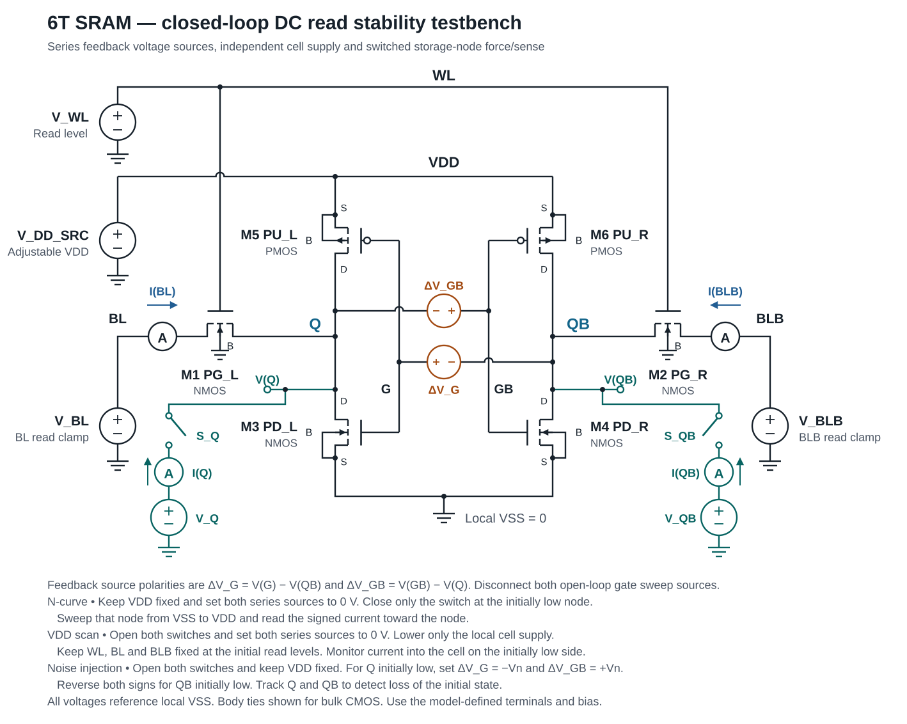

# WM (Write Margin)

## 定义与适用范围

**字线写入裕量（Word-Line Write Margin，WM）**是差分 6T 静态随机存取存储器（Static Random-Access Memory，SRAM）位单元在固定局部供电、互补位线写电平和指定写入方向下，字线（Wordline，WL）参考高电平相对临界写入电压的余量，单位 V。位线（Bitline，BL／BLB）分别接至存储节点 Q／QB。以局部 VSS 为参考，取 $V_{\mathrm{SS}}=0$；未使用写辅助时，基线为写低侧 VSS、写高侧 VDD，WL 参考高电平为 $V_{\mathrm{DD}}$：

$$
\mathrm{WM}=V_{\mathrm{DD}}-V_{\mathrm{WL,trip}}.
$$

$V_{\mathrm{WL,trip}}$ 为两侧访问管共用 WL 时，能完成指定写入的最低局部 WL 电压。WM 越大，允许的 WL 降压越大；WM 为零表示临界值等于参考高电平，负值须由高于参考电平的有效试验支持。使用字线助推（WL Overdrive／Boost）时，须同时报告临界电压和 $V_{\mathrm{WL,H}}-V_{\mathrm{WL,trip}}$，其中 $V_{\mathrm{WL,H}}$ 是单元处实际写入高电平；并注明同时使用的其他写辅助（Write Assist）及偏置。[1, Fig. 1, Measurement Methodology] [6, Sec. III-B2, Fig. 8] [13, Sec. IV-C–D]

| 文献口径 | 扫描与判据 | 对照本页 |
| --- | --- | --- |
| 字线写裕量 WLWM、双侧字线裕量 CWLM、Guo 等的 WWTV | 固定互补写位线，共用 WL 准静态上扫，以节点翻转或位线电流突变定位 | 部分文字以 WWTV 指临界 WL；Guo 等的测量公式用 $V_{\mathrm{DD}}-V_{\mathrm{WL,trip}}$，引用须注明报告量。[1, Fig. 1, Measurement Methodology] [6, Sec. III-B2, Fig. 8] [14, Sec. 2, Fig. 2] |
| 字线电压裕量（Word-Line Voltage Margin，WLVM） | 在规定写周期内逐级改变末级字线驱动电源，写入后恢复额定读条件并读回 | 校准局部幅值后报告有限脉宽裕量 $\mathrm{WM}(t_p)$；若调幅同时改变上／下沿，须附实际波形和读回条件。[2, Sec. IV–V, Figs. 7–8] |
| 位线写裕量 BLWM／位线写入翻转电压（Bitline Write Trip Voltage，BWTV） | WL 和写高侧位线固定，下扫写低侧位线至翻转 | 报告仍可完成写入的最高写低侧位线电压；扫压端口与 WM 不同。[1, Fig. 1] [6, Sec. III-B1, Fig. 6] |

## 物理机制与器件变异

以写 `Q=0, QB=1` 为例，初态为 `Q=1, QB=0`。固定 BL 为低、BLB 为高，升高 WL 会同时增强两侧访问管（Pass-Gate，PG）的导通。Q 侧 PG 经 BL 抽取放电电流并与 Q 侧上拉管（Pull-Up，PU）竞争，QB 侧 PG 从 BLB 注入电流并与 QB 侧下拉管（Pull-Down，PD）竞争。Q 下降及 QB 上升使交叉耦合反相器进入再生过程，旧态失去稳定性，最终由 Q 侧 PD 和 QB 侧 PU 建立新态。固定幅值的短脉冲可能在充分再生前结束；在失配单元中，两节点短暂相等或交叉仍可能回到旧态。[1, Fig. 1] [5, Secs. 2–3, Figs. 5, 7–9]

- **器件强度与尺寸**：改变 PG 的阈值与驱动能力、原高侧 PU 的维持电流、对侧 PD 和反相器翻转点，均可能改变 $V_{\mathrm{WL,trip}}$。Alorda 等在 65 nm 样片中观察到，上拉比（Pull-up Ratio，$\alpha$）降低有利于 WLVM；仅按上拉比无法预测绝对值，相同上拉比和单元比的两类单元仍呈现不同均值。[2, Sec. V-B, Fig. 14, Table III] [4, Sec. 4.3, Figs. 4.12–4.13]
- **局部失配**：须保留同一位单元的两个写入方向。两个方向中，与 PG 竞争的 PU／PD 互换，失配可能使较差方向与额定仿真的对称假设不同。改变尺寸、鳍数或纳米片数量时，须比较分布及尾部。Lu 等的 FinFET WLWM 来自校准模型仿真；Cheng 等的互补场效应晶体管（Complementary Field-Effect Transistor，CFET）差异来自给定变异模型，均须按各自工艺与模型适用范围使用。[2, Fig. 12] [8, Sec. IV-A–B, Figs. 7–9] [9, Figs. 1(c), 5] [19, Sec. 4, Figs. 11, 14]
- **单侧口径**：Takeda 等扫单侧 WL，以对侧反相器翻转阈值判定，另一侧保持指定偏置。共用 WL 扫描同时改变两侧 PG 导通；引用单侧结果时须记录固定侧偏置，不与双侧 WM 合并统计。[3, Figs. 34.5.1–34.5.5] [5, Sec. 2, Figs. 3, 5] [14, Sec. 2, Fig. 2]

## 本征字线裕量与阵列环境

孤立单元基线用理想源在单元端施加固定 BL／BLB、VDD 与 VSS，按共同 WL 的实际端压报告本征 WM。须区分原理图与版图寄生抽取网表，并记录寄生范围。阵列功能 WM 包含驱动器与列复用路径、字线与位线分布电阻及电容（Resistance and Capacitance，RC）、局部电源压降、写辅助波形、相邻数据及并发写入负载。驱动器供电 $V_{\mathrm{DD,WL}}$ 是控制量，须与目标地址处 WL 高电平和脉宽分别记录。[2, Sec. IV, Fig. 7] [6, Sec. III-B2, Fig. 8] [18, Secs. II, IV-D]

| 测试边界 | 观测量 | 可以据此判定 |
| --- | --- | --- |
| 孤立闭环单元仿真 | 局部 WL、Q／QB、两条位线支路电流 | 指定模型、偏置、寄生和方向下的准静态翻转及有限脉宽响应 |
| 有直接模拟列端的表征阵列 | 校准后的 WL 与选中位线电流，必要时独立读回 | 准静态等效阈值；低供电时从 WL 关断开始扫描，可避免 BWTV 起扫时两位线均高且 WL 已选通所施加的读扰动。[6, Sec. III-B, Figs. 6–8] [13, Sec. IV-C] |
| 使用正常读口的功能阵列 | 驱动器供电、校准的局部 WL 波形及按地址读回 | 规定写周期、数据图形和读回间隔下的端到端写入成功；未校准时只报告驱动器供电阈值。[2, Sec. IV–V, Figs. 7–8, 10–14] |

## 测量与提取方法

### 仿真：闭环准静态字线扫描

**【前置条件】** 采用 [6T 夹具](Read_Current.md#测量与提取方法) 的器件连接。记录网表、工艺设计套件（Process Design Kit，PDK）模型、尺寸／鳍数、工艺／电压／温度（Process, Voltage and Temperature，PVT）、体偏置、寄生与写辅助。按图保留闭环：两条反馈串入源设为 0 V，`S_Q`、`S_QB` 保持断开，Q／QB 只观测。将图中的 `V_WL` 改作扫压源，`V_BL`、`V_BLB` 改作互补写电平钳位源；图中的读电平标注与其他测试模式不用于本流程。三源均参考局部 VSS，步进范围须符合 PDK 允许偏置。

**【步骤／方法】**

1. **写入并验证初态**：用额定写条件写入 `Q=1, QB=0`，先关断 WL，再配置测试 BL 低、BLB 高及测试供电。确认 WL 关断时旧态仍保持，撤去所有存储节点强制源。
2. **跟踪旧态支路**：对 `V_WL` 从关断值逐步上扫，直流（Direct Current，DC）求解以上一步工作点为初值。逐点保存局部 WL、Q／QB、BL／BLB 与两侧支路电流；本文统一以位线源流向单元为正，写低侧抽取放电电流时为负。准静态逐步扫压须在每个电压点等待位线电压和电流稳定。2008 年 Guo 等的 WLWM 观察原存“1”侧、即写低侧负电流突升；2009 年方法观察原存“0”侧、即写高侧正电流突降。两种曲线在翻转时的电流幅值均下降，须以节点落态确认翻转。[1, Fig. 1] [6, Sec. III-B2, Fig. 8] [7, Sec. 2.3, Fig. 2.34]
3. **复测临界区间**：缩小旧态可保持与确认翻转之间的区间。对候选点分别重写初态，以慢斜坡或充分建立的逐步电压到达该点；先关断 WL，再解除写位线驱动并恢复保持条件，核对最终稳态。缩小步长或放慢斜坡复核；交换初态及 BL／BLB 电平，重复另一写入方向。[5, Sec. 2, Fig. 5]

- **注意事项**：禁止将 DC 求解跳解、收敛失败或瞬态位线充放电尖峰直接判为翻转（须以支路变化及释放后的落态验证）。
- **注意事项**：禁止用已翻转状态直接测试下一候选电压（翻转后的保持不等于从旧态写入成功）。

**【结果处理和验证】** 保存两方向的扫压曲线、最高已验证失败电压 $V_{\mathrm{fail}}$ 和最低已验证成功电压 $V_{\mathrm{pass}}$。在同一条件下成功与幅值单调对应时，报告 $V_{\mathrm{fail}}<V_{\mathrm{WL,trip}}\leq V_{\mathrm{pass}}$。基线 WM 区间为 $V_{\mathrm{DD}}-V_{\mathrm{pass}}\leq\mathrm{WM}<V_{\mathrm{DD}}-V_{\mathrm{fail}}$。扫至上限仍未翻转时报告临界电压高于上限；首个有效候选点已通过时报告临界电压不高于该点。起扫前旧态失稳、求解未确认、扫描受限及非单调结果分别标记。[1, Fig. 1] [2, Fig. 8]

### 仿真：有限脉宽字线调幅

**【前置条件】** 沿用闭环及初态，选定目标写周期，固定 BL／BLB 的建立时间、负载、写辅助时序、WL 上／下沿及读回间隔。以单元端 WL 上升和下降各越过半幅电平 $V_{\mathrm{WL,L}}+(V_{\mathrm{WL,peak}}-V_{\mathrm{WL,L}})/2$ 的时间差定义 $t_p$。记录局部 WL 低电平 $V_{\mathrm{WL,L}}$、峰值 $V_{\mathrm{WL,peak}}$、实际边沿和采样点；无高电平平台时须记录完整波形。[5, Sec. 3, Figs. 7–9] [11, Secs. 2.1.1, 2.3.1, Figs. 2.2, 2.9]

**【步骤／方法】** 每个候选幅值前用额定条件重置并验证旧态，待写位线建立后发出候选 WL 脉冲。脉冲结束时先关断 WL，再撤去位线写偏置并按实际时序恢复写辅助和供电。记录撤去写偏置后的 Q／QB 落态，再按规定间隔恢复正常读条件确认新态。对每个 $t_p$ 独立扫幅，并分别测试写 0、写 1。[5, Sec. 3, Figs. 7–9]

**注意事项**：禁止把 Q／QB 瞬时交叉作为成功判据（关断后可能返回旧态，过早读回也可能改变结果）。

**【结果处理和验证】** 保存成功、失败或未确认的数据点、实际波形及读回间隔。在单调测试区间内对每个 $t_p$ 估计阈值区间并报告 $\mathrm{WM}(t_p)$。固定幅值、扫描脉宽得到的是临界写脉宽 $t_{\mathrm{crit}}$，单位为 s；如要求写后立即读，则另报告相应读回间隔下的临界值。[5, Sec. 3, Figs. 8–10]

### 硅测：模拟列端与功能读回

**【前置条件】** 准静态测试须有独立的 WL 扫压源或可校准的字线驱动；校准模拟列选择开关、电流测量路径、未选路径静态漏电及局部位线电压，设定扫点稳定判据。功能读回测试须能调节写 WL 驱动电平，先用已知数据校验正常读条件和读回间隔。两种方法均须记录地址、温度、并发访问及局部供电，并测量或校准各行局部 WL 电平及压降；脉冲测试还须校准局部脉宽。[1, Fig. 1] [2, Sec. V, Figs. 7–8, 10–14] [11, Sec. 2.3.1, Fig. 2.9]

**【步骤／方法】**

1. **模拟列端检测**：按准静态仿真流程重写初态、固定互补写位线并慢扫局部 WL，待信号稳定后采集约定侧电流。对每个临界候选点重写旧态并复测；禁止只反扫已翻转的支路。关断 WL 后恢复位线预充，用正常读口或独立状态检测复核。[1, Fig. 1] [6, Sec. III-B2, Fig. 8]
2. **正常读口检测**：从额定 WL 驱动电源向低限粗扫，每步先以额定条件恢复初态，再施加一次候选幅值的反向写入，并在规定保持间隔后以额定条件读回。确认单调后夹逼阈值；重复两方向。Alorda 等在 65 nm 样片控制末级行译码器供电，按字节顺序写入与读回，相邻访问间保留至少一个时钟周期。[2, Fig. 8] [2, Sec. V, Figs. 7–8, 10–14]

- **注意事项**：禁止将驱动器供电和目标单元 WL 电平混报（行位置、驱动负载及压降会改变局部波形）。
- **注意事项**：接近目标脉宽下限时须校准边沿和抖动（设置步长不等于可生成的最短脉宽）。例如，Toh 的 45 nm 表征结构受 WL 驱动边沿限制，最短可生成脉宽为 50 ps，逐字线校准的脉宽测量分辨率为 10 ps，均为该结构的结果。[11, Secs. 2.1.1, 2.3.1, Figs. 2.2, 2.9]

**【结果处理和验证】** 交付地址表、两方向电压区间、可达的局部幅值与脉宽范围、偏置及波形校准记录、重复次数和异常分类。静态电流突变与读回不一致时，复查初态、局部偏置、路径漏电、信号建立和读扰后重测。有限脉宽下在同一幅值既有成功又有失败时，报告成功比例与重复次数；按预先设定的成功率判据提取功能阈值，禁止合并为单次确定性翻转。

## 数据可视化与评估

| 图表 | 必须标明的量和条件 | 判读 |
| --- | --- | --- |
| 准静态扫描曲线 | 局部 WL 电压（V）、Q／QB 电压（V）、所测位线电流（A）、方向、极性及临界夹逼区间 | 对照节点落态与电流突变，识别起扫前失稳、分辨率不足和电流路径异常 |
| 写成功比例与脉宽图 | 横轴局部 WL 幅值（V）或 $t_p$（s），纵轴成功比例或 $\mathrm{WM}(t_p)$（V），注明样本数、读回间隔、边沿、偏置与辅助 | 固定一项扫描另一项，分开报告准静态阈值与有限脉宽合格区 |
| 两方向配对散点、累积分布和地址图 | 写 0／写 1 的 WM（V），样本数、地址、分辨率及越界数 | 筛查方向偏差、弱写尾部及行／列共享路径；按裸片、阵列、行列分组 |

对每个单元保留成对结果，可取两方向中较小 WM 作为单元筛选值。若测试只返回整字或块是否写入成功，单调条件下其阈值由组内最弱成员限制，须另报分组粒度。尾部抽样、越界计数及置信区间见 [RSNM](RSNM.md#数据分析与评价方法)。禁止仅以均值／标准差比外推故障率；先检查尾形、地址相关性、偏置一致性及动态离群点。[1, Results, Fig. 5] [2, Figs. 6, 11–14] [4, Ch. 2, Fig. 2.16] [14, Secs. 2–5] [16, Sec. III, Figs. 5–6]

**证据边界**：Guo 等在其 45 nm、768 kb 样片中观察到 WLWM 较 BLWM 分布更窄，均值／标准差比在所比较的四种指标中最高。Alorda 等的 65 nm 最小尺寸单元中，两方向 WLVM 相关系数为 0.2826，需成对测量；其 Fig. 6 的跨指标相关性来自仿真。上述相关性与分布趋势适用于各自测试样片或仿真条件。[1, Results, Fig. 5] [2, Figs. 6, 11–14]

## 应用场景与指标关系

- **驱动与写辅助设计**：用准静态 WM 分配 WL 驱动电压预算，并用 $\mathrm{WM}(t_p)$ 验证实际波形与最远端地址。若增加 WL 高电平，须同时在相应操作偏置下核对半选扰动与读扰动，尤其在共享驱动级配置时。[6, Secs. III-B2, VI-A] [13, Sec. IV-C–D] [18, Sec. IV]
- **定位写入限制**：在同一方向和等效局部偏置下用 [BWTV](WTV.md) 检查写低侧位线电平，用写静态噪声容限（Write Static Noise Margin，[WSNM](WSNM.md)）检查互补写偏置下蝴蝶曲线的交点与方形裕量。读偏置 N 曲线的写入翻转电压（Write Trip Voltage，WTV）取高电位稳态点 C 与亚稳态点 B 的电压差；写入翻转电流（Write Trip Current，WTI）取 B–C 区间的电流极值。各口径的扫参端口、固定偏置和判据须分别记录。[5, Sec. 2, Figs. 1–5] [12, Sec. II, Fig. 3(c)] [16, Sec. II-D]
- **最低写工作电压与弱写筛选**：将 WM 作为设计与工艺协同优化（Design-Technology Co-Optimization，DTCO）的静态约束；用 [Write Time](../Subarray/Write_Time.md) 与实际阵列功能测试检查目标脉宽。静态裕量正常的单元也可能因对侧 PU 恢复慢而需要更长的 WL 脉冲；最低写工作电压与失效率须以目标时序和地址样本验证。[5, Sec. 4, Fig. 11] [11, Secs. 1.5.2, 2.3.3] [12, Secs. IV–V] [18, Sec. IV]

## 参考文献

2026-11-17 复核 Zotero `Bitcell`（`YHY2NKEE`）的精确 `WM (Write Margin)` 标签：17 条，均有可读的归档 PDF；其中 10 篇独立题录的期刊／会议论文实际使用共同 WL 扫描并已逐篇核对正文定位：[5] [6] [8] [9] [12] [13] [14] [16] [18] [19]。另有一篇以 WWTV 作对照 [10]，其余 6 条支持单侧提取、测试机理或适用边界 [3] [4] [7] [11] [15] [17]。页内保留已有的 [1] [2]，共 19 份归档；本次未补检导入，Zotero 任务 ID 无。各标签条目的 key 见条目链接。

[1] Z. Guo et al., “Large-scale read/write margin measurement in 45nm CMOS SRAM arrays,” in Proc. IEEE Symp. VLSI Circuits, 2008. [DOI 10.1109/VLSIC.2008.4585944](https://doi.org/10.1109/VLSIC.2008.4585944). [公开文献](https://doi.org/10.1109/VLSIC.2008.4585944) （本次 Zotero 标签检索未命中，保留原有来源。）

**相关摘要：** 本文在45 nm、768 Kb SRAM 测试芯片上，通过扫描字线电压并监测位线电流突变提取 WLWM，定义为仍能完成写入时允许的最大 VDD−VWL。大阵列测量与内部节点可访问的小阵列作对照，比较字线、位线、写电流及蝴蝶曲线等多种写能力指标。字线扫描同时改变两侧访问管强度，因此获得的分布及均值/标准差比与其他指标不同，不能把不同写裕量定义直接互换。该方法可在无需逐单元内部节点引出的条件下进行统计表征，适合作为本页字线写裕量的实验依据。

**原文定位：** Measurement Methodology及Results，Figs. 1(c)、5，pp.42–43。

[2] B. Alorda, C. Carmona, G. Torrens, and S. Bota, “An affordable experimental technique for SRAM write margin characterization for nanometer CMOS technologies,” Microelectron. Reliab., vol. 65, pp. 280–288, 2016, author manuscript. [DOI 10.1016/j.microrel.2016.07.154](https://doi.org/10.1016/j.microrel.2016.07.154). [公开文献](https://doi.org/10.1016/j.microrel.2016.07.154) （本次 Zotero 标签检索未命中，保留原有来源。）

**相关摘要：** 本文把 WLVM 定义为单元供电和位线驱动保持额定值时，仍能成功写入所允许的最大字线电压下降。实验仅需调制末级行译码器供电，逐步降低字线电压进行写入，再恢复额定条件读回判断；两种数据翻转方向均测试，并取较小值作为单元裕量。65 nm原型的测量显示不同单元及两种写方向存在明显分散，也分析上拉比对分布的影响。该方法测量的是规定时序下的字线写入容忍度，按单元、字或块统计会得到不同分布，不能将其混作位线写翻转电压或静态写 SNM。

**原文定位：** Secs. IV–V，Figs. 8、11–14，作者稿PDF 第9–15页。

[3] K. Takeda, H. Ikeda, Y. Hagihara, M. Nomura, and H. Kobatake, “Redefinition of write margin for next-generation SRAM and write-margin monitoring circuit,” in 2006 IEEE International Solid State Circuits Conference - Digest of Technical Papers, 2006, pp. 2602-2611. [公开文献](https://doi.org/10.1109/ISSCC.2006.1696326) · [DOI 10.1109/ISSCC.2006.1696326](https://doi.org/10.1109/ISSCC.2006.1696326) · [Zotero](https://www.zotero.org/users/7333024/items/TR6UNGVX)

**相关摘要：** 本文提出用VDD减去触发写入所需字线电压定义WM，以改善传统蝶形写SNM对访问管阈值变化不敏感的问题。所用方法对单侧半单元构造直流传输特性，并以另一侧反相器的翻转阈值决定临界WL；这与双侧同时扫描字线的CWLM仍需区分。90 nm测试芯片测量2432个单元，并实现运放反馈的WM监测电路，验证供电及单元供电辅助对裕量的影响。结果适于说明字线电压余量及监测方法，静态WM不直接包含写脉宽和字线分布式RC。

**原文定位：** Figs. 34.5.1–34.5.5，PDF pp. 1–2。

[4] A. E. Carlson, “Device and Circuit Techniques for Reducing Variation in Nanoscale SRAM,” Ph.D. dissertation, University of California, Berkeley, 2008. [公开文献](https://www2.eecs.berkeley.edu/Pubs/TechRpts/2008/EECS-2008-51.html) · [原文](https://www.semanticscholar.org/paper/Device-and-circuit-techniques-for-reducing-in-SRAM-Carlson/68ca92891093c2c6f9f1c15a32a5a00832ea7a05) · [Zotero](https://www.zotero.org/users/7333024/items/8IJZ6UEH)；DOI：Zotero未收录或尚未核实。

**相关摘要：** 论文在早期45 nm工艺的144个单元上比较字线写裕量WLWM与写电流IW，发现高供电时两者平均值／标准差及相关性并不一致，而接近零写入能力的失效边界时趋于一致。因此仅从标称分布的μ/σ估计良率可能受指标选择影响，应直接检查失效边界。第4章再利用同一单元各管的阈值和饱和电流，以灵敏度加权预测WLWM并与实测比较。其价值在于连接器件变化和字线裕量，不能将IW或位线写指标的数值直接替代WLWM。

**原文定位：** Ch. 2、Sec. 4.3；Figs. 2.16、4.12–4.13，正文pp. 43、124–125。

[5] J. Wang, S. Nalam, and B. H. Calhoun, “Analyzing static and dynamic write margin for nanometer SRAMs,” in Proc. International Symposium on Low Power Electronics and Design (ISLPED), 2008, pp. 129–134. [公开文献](https://doi.org/10.1145/1393921.1393954) · [DOI 10.1145/1393921.1393954](https://doi.org/10.1145/1393921.1393954) · [Zotero](https://www.zotero.org/users/7333024/items/IK7GE8ZW)

**相关摘要：** 本文在45 nm体硅工艺中比较蝶形WSNM、位线扫描、单侧WLR扫描、双侧WL扫描及N曲线指标。双侧WL扫描把VDD与节点翻转时WL电压之差作为裕量，最贴近本页口径；单侧扫描须另外注明固定的半单元偏置。作者以完成翻转的最小WL脉宽TCRIT作为动态对照，指出静态电压指标忽略持续时间，且“两个节点电压相等”在失配单元中不总能证明写入成功。因而WM应与规定脉宽下的动态成功率配合，不能把N曲线WTV或TCRIT直接换名为字线WM。

**原文定位：** Secs. 2–4；Figs. 3、5–6，PDF pp. 2–5。

[6] Z. Guo, A. Carlson, L. T. Pang, K. T. Duong, T. J. K. Liu, and B. Nikolic, “Large-scale SRAM variability characterization in 45 nm CMOS,” IEEE Journal of Solid-State Circuits, vol. 44, no. 11, pp. 3174-3192, 2009. [公开文献](https://doi.org/10.1109/JSSC.2009.2032698) · [DOI 10.1109/JSSC.2009.2032698](https://doi.org/10.1109/JSSC.2009.2032698) · [Zotero](https://www.zotero.org/users/7333024/items/5RBES89L)

**相关摘要：** 本文在45 nm功能SRAM阵列中用直接位线访问测量WWTV：位线设置为写入数据，WL从0上升，监测电流突降并以VDD−临界WL表示字线电压余量。与BWTV相比，该方法测量起点不施加读扰动，且扫参时访问管的漏源偏置变化较小，使其更便于比较低供电和阈值变化。大样本测量同时揭示空间分布及与写Vmin的关系，强调必须用同一单元、相同偏置比较。它是静态字线裕量测量，不能替代有限脉宽下的动态写可靠性。

**原文定位：** Sec. III-B2、VI-A；Figs. 8、14–18，pp. 3179、3183–3185。

[7] Z. Guo, “Large-scale variability characterization and robust design techniques for nanoscale SRAM,” Doctoral dissertation, EECS Department, University of California, Berkeley, 2009. [公开文献](https://www2.eecs.berkeley.edu/Pubs/TechRpts/2009/EECS-2009-190.html) · [原文](http://www2.eecs.berkeley.edu/Pubs/TechRpts/2009/EECS-2009-190.html) · [Zotero](https://www.zotero.org/users/7333024/items/A56QIF3W)；DOI：Zotero未收录或尚未核实。

**相关摘要：** 论文在功能SRAM阵列中通过直接位线接入提取WWTV：先初始化数据，设置互补写位线，再升高WL并监测存0侧位线电流突降，以VDD减去临界WL得到裕量。由于开始时WL为0，该方法避免位线扫描法在测量初期施加读扰动，适合更低供电。论文结合45 nm大样本测量分析分布、空间变化及与写Vmin的关系；这些联系仍需相同偏置及辅助条件。该口径直接对应本页WM，不能把文中“最低可翻转WL”本身与余量数值混为一谈。

**原文定位：** Sec. 2.3、Ch. 4；Figs. 2.34–2.37，正文pp. 60–64。

[8] D. D. Lu et al., “Design of FinFET SRAM cells using a statistical compact model,” in 2009 International Conference on Simulation of Semiconductor Processes and Devices, 2009, pp. 1-4. [公开文献](https://doi.org/10.1109/SISPAD.2009.5290234) · [DOI 10.1109/SISPAD.2009.5290234](https://doi.org/10.1109/SISPAD.2009.5290234) · [Zotero](https://www.zotero.org/users/7333024/items/UAIFGKYQ)

**相关摘要：** 本文利用校准到实测读SNM分布的统计FinFET紧凑模型优化单元，并将字线扫描写裕量WLWM作为写入约束。作者在近似高斯假设下要求平均WLWM减5.5倍标准差仍为正，同时通过改变访问管长度和下拉fin数寻找读写兼容的尺寸。图8–9显示器件几何和各管变异对WLWM分布的影响，强调应比较低尾而非仅标称值。文中的实测用于模型校准，优化后的WLWM分布来自电路Monte Carlo；其统计目标不应误写为新芯片已达到的量产良率。

**原文定位：** Sec. IV-A–B，Figs. 7–9、Table II，PDF 第3–4页。

[9] D. D. Lu, C. H. Lin, A. M. Niknejad, and C. Hu, “Compact modeling of variation in FinFET SRAM cells,” IEEE Design and Test of Computers, vol. 27, no. 2, pp. 44-50, 2010. [公开文献](https://doi.org/10.1109/MDT.2010.39) · [DOI 10.1109/MDT.2010.39](https://doi.org/10.1109/MDT.2010.39) · [Zotero](https://www.zotero.org/users/7333024/items/9AQAT6AY)

**相关摘要：** 本文以FinFET统计紧凑模型同时描述器件及SRAM变异，并给出WLWM的明确提取：BL置0、BLB置1.0 V，WL由0扫到1.0 V，单元在WL=VDD−WLWM时翻转。作者利用实测RSNM分布校准模型，再分析上拉管长度改变时的WLWM分布，说明器件尺寸优化需同时考虑分布宽度和读写权衡。这里直接对应本页字线电压裕量，而非位线WTV或蝶形写SNM；WLWM结果属于校准模型预测，没有将每个优化点都作为独立硅测结果报告。

**原文定位：** Fig. 1(c)、Fig. 5；PDF pp. 2、5。

[10] J. Tsai, S. O. Toh, Z. Guo, L. T. Pang, T. J. K. Liu, and B. Nikolic, “SRAM stability characterization using tunable ring oscillators in 45nm CMOS,” in 2010 IEEE International Solid-state Circuits Conference - (ISSCC), 2010, pp. 354-355. [公开文献](https://doi.org/10.1109/ISSCC.2010.5433820) · [DOI 10.1109/ISSCC.2010.5433820](https://doi.org/10.1109/ISSCC.2010.5433820) · [Zotero](https://www.zotero.org/users/7333024/items/IR8ZMCIH)

**相关摘要：** 本文在45 nm SRAM中以可调环形振荡器快速表征写入动态特性，并与无需访问内部节点的字线写翻转裕量WWTV比较。写RO频率与WWTV在VCELL为1.1、0.9和0.7 V时的相关系数平方分别为0.55、0.65和0.63，明显不是可直接一一替换的测量。调节RO上拉强度可使单元对频率的影响更突出，但RO更偏向电流及动态写能力。该结果支持保留WM自身的字线扫描定义，不能从振荡频率未经标定反推字线裕量，也不能将动态测量的高相关性移用到所有静态指标。

**原文定位：** Figs. 19.7.1–2、19.7.5，正文 p. 354（该段误引为 Fig. 19.6.6；Fig. 19.7.6 属读取结果）。

[11] S. O. Toh, “Nanoscale SRAM variability and optimization,” dissertation, UC Berkeley, 2011. [公开文献](https://www2.eecs.berkeley.edu/Pubs/TechRpts/2011/EECS-2011-144.html) · [原文](https://escholarship.org/uc/item/6c77c95k) · [Zotero](https://www.zotero.org/users/7333024/items/LYDRHR6E)；DOI：Zotero未收录或尚未核实。

**相关摘要：** 论文比较静态写裕量与临界写脉宽，指出靠降低字线或单元供电筛选静态弱单元不能发现全部动态写失败。实测中部分单元因对侧上拉PMOS串联电阻较大而恢复高电平缓慢，其静态写裕量并未同步恶化，形成临界写时间的离群点。该结果直接说明WM不能替代有限脉宽测试；但文中多处使用N曲线电流或位线指标，且局部BWTV命名与描述存在不一致，不宜统一视为本页的VDD−WL翻转电压。引用重点是静态指标的动态局限，而非新增字线WM数值。

**原文定位：** 动态写入及离群点见 Secs. 1.5.2、2.3.3，Figs. 1.9–1.10、2.11，正文 pp. 8–9、20；可生成脉宽与逐字线校准见 Secs. 2.1.1、2.3.1，Figs. 2.2、2.9，正文 pp. 12–14、18。

[12] J. Wang, and B. H. Calhoun, “Minimum supply voltage and yield estimation for large SRAMs under parametric variations,” IEEE Transactions on Very Large Scale Integration (VLSI) Systems, vol. 19, no. 11, pp. 2120-2125, 2011. [公开文献](https://doi.org/10.1109/TVLSI.2010.2071890) · [DOI 10.1109/TVLSI.2010.2071890](https://doi.org/10.1109/TVLSI.2010.2071890) · [Zotero](https://www.zotero.org/users/7333024/items/MESZRU7A)

**相关摘要：** 本文虽然将写入指标记作WSNM，但实际采用WL扫描，定义为VDD与存储节点翻转时字线电压之差，因此与本项目的字线写裕量口径直接相关。作者对存0和存1分别建模，利用裕量分布随供电的变化预测写入Vmin和失效率，并在45 nm典型角、室温版图前仿真中比较Monte Carlo与重要性抽样。该静态指标没有包含有限脉冲宽度，作者亦承认动态噪声裕量更接近脉冲写入。引用时需保留WL扫描定义，不能误读为蝶形曲线写SNM。

**原文定位：** Secs. II、IV–V；Fig. 3(c)、Fig. 5，PDF pp. 2–4。

[13] H. Jeong, Y. Yang, J. Lee, J. Kim, and S.-O. Jung, “Static read stability and write ability metrics in FinFET based SRAM considering read and write-assist circuits,” in Proc. 19th IEEE International Conference on Electronics, Circuits, and Systems (ICECS), 2012, pp. 833–836. [公开文献](https://doi.org/10.1109/icecs.2012.6463530) · [DOI 10.1109/icecs.2012.6463530](https://doi.org/10.1109/ICECS.2012.6463530) · [Zotero](https://www.zotero.org/users/7333024/items/4L58JN4T)

**相关摘要：** 本文比较FinFET SRAM在供电下降及写辅助条件下的多种静态指标，指出位线写翻转法可能在开始扫描前已发生节点翻转，从而无法获得完整分布；字线写翻转WWTV因WL初始为0，能避免这一问题。作者比较无辅助、降低单元供电及提升WL等条件下的WWTV分布，认为其适于写入能力和良率评价。该结论直接涉及本页字线扫描口径，但仍属于静态仿真，不包含规定WL脉宽下的动态失败；不能把论文其他WNM或IW分布与WWTV混用。

**原文定位：** Sec. IV-C–D；Fig. 10，PDF p. 4。

[14] H. Makino et al., “Utilising the normal distribution of the write noise margin to easily predict the SRAM write yield,” IET Circuits, Devices and Systems, vol. 6, no. 4, pp. 260-270, 2012. [公开文献](https://doi.org/10.1049/iet-cds.2012.0090) · [DOI 10.1049/iet-cds.2012.0090](https://doi.org/10.1049/iet-cds.2012.0090) · [Zotero](https://www.zotero.org/users/7333024/items/SF5WKPSA)

**相关摘要：** 本文明确区分单侧字线方法WLM与双侧共同扫描的CWLM：后者在BL=0、BLB=VDD时扫描两侧WL，取VDD与翻转电压之差。通过访问管阈值敏感度及Monte Carlo分析，作者认为CWLM在所比较偏置下具有较好的线性和近似正态分布，适于由少量样本推估写入良率。该结论不意味着所有静态写指标均正态，也不保证极端工艺尾部可无条件外推。对本页WM，应优先引用CWLM定义，并明确写0/写1、供电和辅助条件，保留静态裕量与动态脉宽的区别。

**原文定位：** Secs. 2–5；Fig. 2、Tables 1–2、Fig. 9，pp. 261–269。

[15] M. H. Abu-Rahma, and M. Anis, “Nanometer variation-tolerant SRAM: circuits and statistical design for yield,” New York, NY, Springer New York, 2013. [公开文献](https://doi.org/10.1007/978-1-4614-1749-1) · [DOI 10.1007/978-1-4614-1749-1](https://doi.org/10.1007/978-1-4614-1749-1) · [Zotero](https://www.zotero.org/users/7333024/items/RA2TPQV2)

**相关摘要：** 本书区分位线写裕量、字线临界电压和动态写时间。其WVWL是WL由0升到VDD过程中使节点翻转的最低电压，数值越低越容易写；转换到本页WM需使用VDD−WVWL，不能直接沿用相同好坏方向。书中要求分别测试两种写入方向并取较差结果，同时指出静态方法等价于无限长写脉冲，可能漏掉上拉过弱引起的高电平恢复慢等动态问题。该内容为方法综述，适于定义及比较，不构成新的字线裕量实测数据。

**原文定位：** Secs. 3.2.1–3.2.2；Figs. 3.3–3.7，pp. 50–53。

[16] H. Qiu et al., “Statistical write stability characterization in SRAM cells at low supply voltage,” IEEE Transactions on Electron Devices, vol. 63, no. 11, pp. 4302-4308, 2016. [公开文献](https://doi.org/10.1109/TED.2016.2612678) · [DOI 10.1109/TED.2016.2612678](https://doi.org/10.1109/TED.2016.2612678) · [Zotero](https://www.zotero.org/users/7333024/items/Z8PWPPFG)

**相关摘要：** 本文利用65 nm SOTB工艺、4 Kbit可直接访问端点的单元阵列，比较低供电下多种写入稳定性指标。CWLM通过将WL从0扫到VDD、监测存储节点翻转，取VDD与翻转WL之差，并对写0/写1取较差值，直接对应字线裕量。0.8、0.6及0.4 V测量表明，位线和字线方法的分布较适合正态近似；蝶形WSNM和写N曲线则可能出现不同操作模式。结论受SOTB器件及体偏置条件约束，不能把WSNM的双模态或电流指标直接当作CWLM。

**原文定位：** Sec. II-D、III；Figs. 5–6，PDF pp. 3–6。

[17] C. Shin, “Variation-aware advanced CMOS devices and SRAM,” Dordrecht, Springer Netherlands, 2016. [公开文献](https://doi.org/10.1007/978-94-017-7597-7) · [DOI 10.1007/978-94-017-7597-7](https://doi.org/10.1007/978-94-017-7597-7) · [Zotero](https://www.zotero.org/users/7333024/items/B3KJJL54)

**相关摘要：** 本书将可扩展阵列测试的写指标分为位线BWTV与字线WWTV，后者在设置写入位线偏置后把WL从0扫至VDD，正裕量表示字线可以低于标称值而仍成功写入。图8.15给出偏置及电流转移曲线，随后以器件统计模型讨论失配引起的良率变化。该部分是指标与模型方法的系统整理，不能把书中转述的测试或仿真认作本书新制造芯片的测量。字线裕量、位线翻转电压及读字线保持电压具有不同扫参和失效方向，引用时应保留各自定义。

**原文定位：** Sec. 8.3.2–8.4；Figs. 8.14–8.15，归档PDF pp. 174–175。

[18] T. H. Choi, H. Jeong, Y. Yang, J. Park, and S. O. Jung, “SRAM operational mismatch corner model for efficient circuit design and yield analysis,” IEEE Transactions on Circuits and Systems I: Regular Papers, vol. 64, no. 8, pp. 2063-2072, 2017. [公开文献](https://doi.org/10.1109/TCSI.2017.2685634) · [DOI 10.1109/TCSI.2017.2685634](https://doi.org/10.1109/TCSI.2017.2685634) · [Zotero](https://www.zotero.org/users/7333024/items/SNHG8TMW)

**相关摘要：** 本文以字线写翻转裕量WWTV作为静态写稳定性指标，定义为标称WL与能够翻转单元的最低WL之差；通过敏感度求最不利器件失配组合，构建SRAM操作失配角模型。该模型用于更高效的良率估算及带辅助偏置的设计比较。作者明确说明，仅对静态WWTV做高斯拟合不能覆盖位线电容和有限WL脉宽，尾部也可能偏离高斯，因此还需在失配角进行动态仿真。该方法提供快速检查路径，不能把单一角点的标称裕量当作完整统计分布或保证所有辅助方案有效。

**原文定位：** Secs. II–IV，Fig. 3，PDF p. 2（定义与静态评估边界）；Fig. 17，PDF p. 8（写裕量与负位线辅助）；Figs. 14–15，PDF p. 7（读稳定性对照）。

[19] X. Cheng et al., “A novel design for SRAM bitcell with 3-complementary-FETs,” Microelectronics Journal, vol. 173, Art. no. 107180, 2026. [公开文献](https://doi.org/10.1016/j.mejo.2026.107180) · [DOI 10.1016/j.mejo.2026.107180](https://doi.org/10.1016/j.mejo.2026.107180) · [Zotero](https://www.zotero.org/users/7333024/items/QJ3K3I2Z)

**相关摘要：** 本文对3-CFET 6T单元进行WL直流扫描提取WM，并另外用脉冲仿真计算写延迟，二者分别报告。改变上下nanosheet数量会改变访问管、上拉及下拉的相对驱动，标称裕量最优不一定具有最小统计波动。在独立高斯阈值扰动、标准差20 mV的1000次Monte Carlo中，2B2T结构的WM标准差为20.37 mV，而1B2T为46.99 mV。该差异属于作者给定紧凑模型和变异假设的单元预测；未包含量产统计证明，且出版年份按PDF首页2026年修正。

**原文定位：** Sec. 4；Figs. 11、14，PDF pp. 8、10–11。
