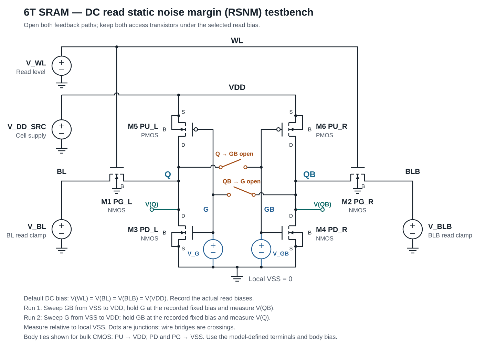
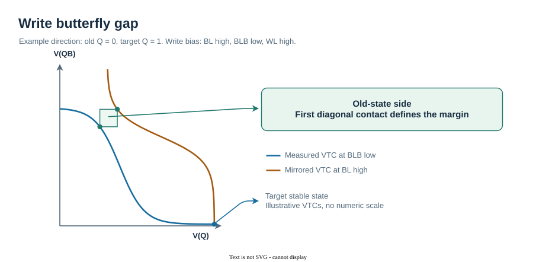
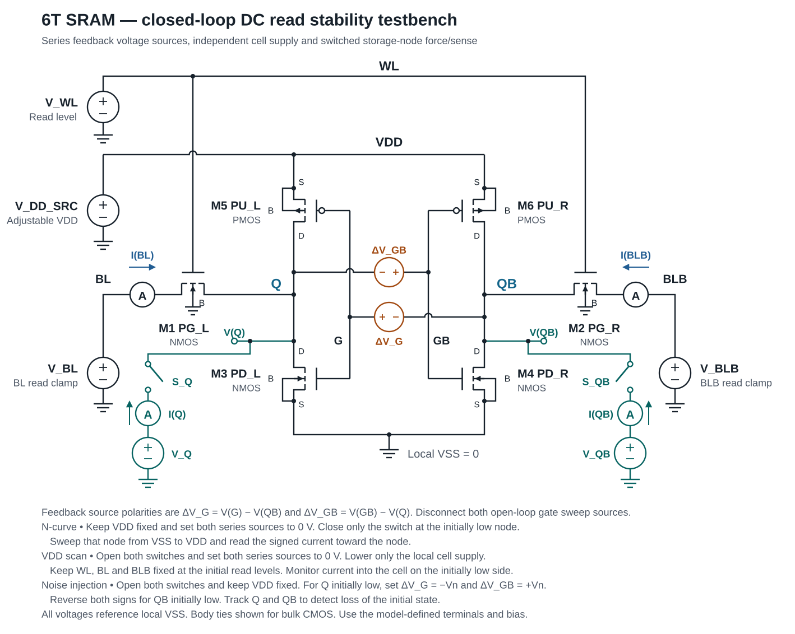

# WSNM (Write Static Noise Margin)

## 定义与适用范围

**写静态噪声容限（Write Static Noise Margin，WSNM；文献也称 WNM）**表征差分 6T 静态随机存取存储器（Static Random-Access Memory，SRAM）位单元在固定写偏置下抵抗反向直流（Direct Current，DC）扰动的能力，单位 V。本文采用写蝴蝶图口径：正 WSNM 取旧态侧两条电压传输特性（Voltage Transfer Characteristic，VTC）之间最小临界正方形的边长，正方形的边平行于电压坐标轴。等效扰动为在两条反相器反馈支路串入等幅、反极性的电压，抵消写入偏置对旧态稳定性的影响。[1, Sec. II, Fig. 3] [8, Sec. 2, Fig. 1]

字线（Wordline，WL）选通时，位线（Bitline，BL）连接 Q，互补位线 BLB 连接互补存储节点 QB。无写辅助的基线取局部 $V_{\mathrm{SS}}=0$、$V_{\mathrm{WL}}=V_{\mathrm{DD}}$；写高侧位线接 $V_{\mathrm{DD}}$，写低侧位线接 $V_{\mathrm{SS}}$。以下逻辑 0／1 表示数据状态，实际节点电压以局部 VSS 为参考。

| 固定写偏置下的曲线状态 | 本文记录 | 判定 |
| --- | --- | --- |
| 仅保留目标稳定交点，旧态侧两曲线有可分辨的间隙 | 正 WSNM：旧态侧临界正方形边长 | 通过静态判据；裕量越大，越能抵抗同模型的反向扰动 |
| 旧稳态与相邻不稳定平衡点在旧态侧合并，两曲线相切 | WSNM 为零，标记为临界 | 无正裕量；按规格归为临界不通过 |
| 旧稳态和相邻不稳定平衡点仍可分辨，两曲线保留旧态叶瓣 | 静态写失败 | 旧态叶瓣内最大方形表征残余旧态稳定性；采用有符号口径时，仅将指定反馈扰动的过零阈值记为负值 |
| 扫描或数值分辨率不足以判定上述状态 | 未分辨 | 细化扫描并复核闭环状态 |

相同写偏置下，**旧态叶瓣消失**可能表示正 WSNM，也可能对应零值相切；须辨别是否仍有接触点及目标稳定交点。文献可能将残余旧态叶瓣的裕量记为零或负值；合并数据前须统一符号、临界点和失败编码。[8, Sec. 2] [9, Sec. II-B, Fig. 1(d)]

## 物理机制与器件变异

以写 `Q=1` 为例，旧态为 `Q=0, QB=1`。WL 选通后，低位线 BLB 经 QB 侧访问管（Pass-Gate，PG）从 QB 吸取电流，与该侧上拉管（Pull-Up，PU）提供的电流竞争。QB 下降使 Q 侧反相器的上拉增强、下拉管（Pull-Down，PD）减弱；Q 随之升高，使 QB 侧 PU 减弱、PD 增强。高位线 BL 同时经对应 PG 支持 Q 上升。当写偏置足以消除旧稳态时，交叉耦合反馈把节点推向目标状态。[1, Sec. II, Fig. 2] [9, Sec. II-B, Fig. 1(a), (d)]

**尺寸与失配**：在同一写偏置下，增强写低侧 PG 或减弱旧高节点的 PU 通常有利于覆写；高侧 PG／PD 的对抗也会影响反馈建立。阈值与驱动强度失配会改变两个写方向的裕量，须针对同一单元成对评估。低压时，PU／PG 强弱关系变化可能改变 VTC 形状，使限制写入的取方位置切换。评估平面 CMOS 的上拉比（Pull-up Ratio，$\alpha$）或多栅器件鳍数时，应报告实际尺寸和工艺模型，避免把几何比直接当成驱动强度比。[13, Sec. V-A, Figs. 6–7] [21, Sec. III-B, Figs. 8–11] [23, Secs. II–IV, Figs. 4–6]

## 本征写稳定性与阵列环境

孤立位单元的 WSNM 在固定**单元端** WL、BL／BLB、供电及体偏置下提取。阵列写驱动、列复用路径、分布电阻电容（Resistance and Capacitance，RC）、远端 WL 波形和局部电源压降会改变这些端口实际经历的电平与时间。选用写辅助（Write Assist）时，须记录字线助推（WL Overdrive／Boost）、负位线辅助（Negative Bitline，NBL）或单元电源降压辅助（Cell VDD Lowering／Collapse）的局部电平及生效窗口。可在稳定电平下比较其静态收益；脉冲作用须结合全选写入及半选单元扰动另行验证。[3, Secs. I, III–IV, Figs. 8, 14] [13, Sec. V-A] [26, Sec. 4.4, Fig. 4-13]

**动态边界**：即使固定写偏置只有目标稳定工作点，WL、位线和写辅助恢复到保持条件时，存储节点也须位于目标状态的吸引域，才能收敛至目标数据。验证阵列时须使用实际写入波形、规定保持时间及已校验的读回条件确认目标数据；单次 $V(Q)=V(\mathrm{QB})$ 交叉或写窗口内的暂时翻转不足以判定成功。[7, Secs. V–VI, Figs. 8–9] [8, Sec. 3, Figs. 6–9] [11, Secs. II–III, Figs. 1–2]

## 测量与提取方法

### 仿真：双 VTC 写蝴蝶法

**【前置条件】** 使用已标定的 6T 器件模型。记录工艺、电压和温度（Process, Voltage and Temperature，PVT）、网表、器件尺寸、失配样本、局部电源、体偏置、寄生抽取范围和目标分辨率。沿用 [RSNM 的 VTC 夹具](RSNM.md#测量与提取方法) 的器件连接，断开 QB 至 G、Q 至 GB 两条反馈线，保留各 PG 与 BL／BLB、Q／QB 的连接。G 驱动 Q 侧反相器，GB 驱动 QB 侧反相器。

两张夹具图中的读电平标注用下表的**写偏置**覆盖；WL 在两种方向均固定于规定的写高电平，其他局部端电压和体偏置保持所记录的测试配置。

| 写入方向 | 旧态 Q／QB | 无辅助时 BL／BLB | 闭环反馈源：阻止写入时的极性 |
| --- | --- | --- | --- |
| 写 `Q=1` | 0／1 | $V_{\mathrm{DD}}$／$V_{\mathrm{SS}}$ | $\Delta V_{\mathrm G}=+\eta$，$\Delta V_{\mathrm{GB}}=-\eta$ |
| 写 `Q=0` | 1／0 | $V_{\mathrm{SS}}$／$V_{\mathrm{DD}}$ | $\Delta V_{\mathrm G}=-\eta$，$\Delta V_{\mathrm{GB}}=+\eta$ |

**【步骤／方法】**

1. **扫描两侧反相器输入**：在同一单元样本、同一组写偏置下，分别 DC 扫描 GB 并记录自由输出 QB、扫描 G 并记录自由输出 Q。每次将未扫的反相器输入固定在已记录电位。先扫局部 $V_{\mathrm{SS}}$ 至 $V_{\mathrm{DD}}$；若临界点或反馈源推移后的输入超出扫程，在模型有效范围内延伸。记录局部实际端电压，保留高、低两侧不同的位线偏置。
2. **叠合传输曲线**：以 $x=V(Q)$、$y=V(\mathrm{QB})$ 为坐标，叠合曲线 A：$(V_{\mathrm{GB}},V(\mathrm{QB}))$ 与曲线 B：$(V(Q),V_{\mathrm G})$；B 交换了原输入、输出坐标。写 `Q=1` 时，旧态侧位于 Q 低、QB 高的区域；写 `Q=0` 时，旧态侧位于 Q 高、QB 低的区域。部分文献交换横纵轴，须按旧态节点极性定位取方区域。[1, Fig. 3] [2, Fig. 4(b)] [8, Sec. 2, Fig. 1]
3. **提取旧态侧最小间隙**：两接触点分别位于两条曲线上，横、纵电压差幅值均等于方形边长。对单调 VTC，可用 $u=(x-y)/\sqrt{2}$、$v=(x+y)/\sqrt{2}$ 在相同 $u$ 上比较两条曲线的 $v$ 坐标 $v_{\mathrm A}$、$v_{\mathrm B}$。写 `Q=1` 时取 $(v_{\mathrm B}-v_{\mathrm A})/\sqrt{2}$，写 `Q=0` 时取 $(v_{\mathrm A}-v_{\mathrm B})/\sqrt{2}$。仅有目标稳定交点时，在旧态区域取最小的正值局部极小点，并用闭环续扫确认该点对应旧分支重新出现。禁止将目标交点或扫程端点作为旧态临界点。[9, Sec. II-B, Fig. 1(d)] [10, Sec. 2.2.2, Figs. 2.19–2.20]
4. **交换写入方向并复扫**：按表交换 BL／BLB；执行两条 VTC 扫描，细化旧态候选区域的扫压及插值间距，直到提取值变化小于目标分辨率。记录两个方向的原始曲线、取方位置及状态标签。

图为写 `Q=1` 的形状示意。横轴为 Q 电压、纵轴为 QB 电压，单位 V；无定量刻度。旧态侧的接触方形用于写裕量，目标态稳定交点用于静态状态校验。

**注意事项**：禁止强制输出节点、拼接不同样本的 VTC 或在两条位线均为高电平时提取写蝴蝶（将改变待测反相器传输特性或消除写偏置）。

**【结果处理和验证】** 用下节的闭环方法验证临界点及目标稳定交点。零间隙、异常多交点、扫程不足或求解不一致时，须检查端压、求解收敛和扫压分辨率；将确认的静态失败、零值临界和无法分辨分别归档。

### 仿真：闭环等幅反馈电压复核

**【前置条件】** 恢复交叉耦合，关断图中 `S_Q`、`S_QB` 两个存储节点扫压开关并断开开环输入源。沿用闭环图中的串联反馈源拓扑，按上表覆写读测试的端压和扰动极性；固定局部供电。令 $\Delta V_{\mathrm G}=V(\mathrm G)-V(\mathrm{QB})$、$\Delta V_{\mathrm{GB}}=V(\mathrm{GB})-V(Q)$。写 `Q=1` 时，G 抬高使 Q 下降，GB 降低使 QB 上升，故表中极性抵消写入。

图中读测试的噪声极性、N 曲线和 VDD 扫描说明不用于本步骤；测试须使用上表的写偏置和反馈源极性。

**【步骤／方法】**

1. **验证零扰动工作点**：两源置零。初始化为与目标相反的数据，撤去初始化激励后施加固定写偏置；记录收敛后的 Q／QB。根据双 VTC 交点，用两种初态或邻近各交点的初态分别试验；对出现的状态施加小扰动，核对目标态稳定性以及旧态能否维持。
2. **续扫旧态支路**：按表施加等幅反向扰动 $\eta$。可从能维持旧态的正 $\eta$ 出发，沿旧稳态减小 $\eta$，夹逼其与相邻不稳定平衡点合并的位置；可在各候选点用分支续扫、环路斜率或释放节点后的瞬态小扰动确认。若旧态在零扰动时仍稳定，仅在需要有符号结果时反转两源，继续向负 $\eta$ 扫描并报告临界值。两方向均以正 $\eta$ 表示阻碍对应写入的扰动。
3. **确认目标状态**：恢复实际写偏置，即令两源置零。检查目标稳定分支存在且从旧态启动的写入能在足够长的恒定写偏置下到达目标；再撤销写偏置至保持条件，核对目标数据能够保持。该校验的波形和持续时间须与动态规格试验分开记录。

**注意事项**：禁止仅从目标稳态向上扫 $\eta$ 并以一次仿真跳变判定阈值（双稳区可能继续停在目标分支，遗漏旧稳态重新出现的位置）。

**【结果处理和验证】** 报告旧态消失阈值的夹逼区间、节点电压、扫向、支路分类和收敛分辨率。由图形法与闭环法得到的正 WSNM 应在目标精度内一致。两法不一致时，核查实际端压、强制节点与分支，并确认原网表两侧 VTC 能否独立表示；存在显著的共同节点或跨侧耦合时，保留原网表，采用闭环法并注明扰动定义。未能在有效扫程内夹逼时只报告界限或未分辨状态。

### 硅测：直接 VTC 与外部端口筛查

**【前置条件】** 直接提取须使用可断开反馈并独立驱动反相器输入的模拟开关，或带 Q／QB 模拟接出的表征单元。校准探针、开关和列通路的串联压降与漏电；具备端点时用远端感测，记录实际单元端压、分辨率、限流与稳定判据。普通功能宏须具备相应模拟字线／位线控制能力或数字写入读回接口。

**【步骤／方法】**

| 可用端口 | 操作 | 记录量 |
| --- | --- | --- |
| **双反相器输入可独立访问** | 按互补写偏置分别扫描 G、GB，等待每步进入稳态，记录高阻观测的对应输出并按仿真方法取方 | 两条 VTC、两个方向的 WSNM 和状态标签 |
| **仅可接触 Q／QB** | 保持反馈直连。用一台源测量单元（Source Measure Unit，SMU）强制 Q、高阻测 QB，再强制 QB、高阻测 Q；核对共享端口偏置未受扫压电流影响。[21, Sec. II-A, Fig. 2] | 实测的强制电压、对侧响应及提取值；记录串联压降、限流和校准残差 |
| **阵列外部端口** | 按字线写入裕量（Word-Line Write Margin，[WM](WM.md)）或位线写入翻转电压（Bitline Write Trip Voltage，[BWTV](WTV.md)）方法扫描共同 WL 或写低侧位线；每次恢复旧态，以内部观测或独立读回确认翻转。仅有数字端口时，在指定时序和数据背景下做写入读回 | 扫描端口、临界局部电压及写失败率；有限脉宽时记录脉宽和读回时序 |

**注意事项**：禁止将限流或未稳定的测试点用于提取 VTC（强制电压和输出响应尚不能代表稳态）。

**【结果处理和验证】** 对直接 VTC 重复扫压并交换方向，核对两侧测量通路误差及端压稳定性。将直接 WSNM、外部阈值和功能失败率按测量口径分别归档；使用代理量筛查前，须在相同工艺及写偏置的表征单元上核对配对相关性。Guo 等在内部节点可访问的 45 nm 小宏提取写蝴蝶裕量（原文标识 BFC WNM），并与写电流和外部电压裕量比较。[2, Figs. 4–5] [1, Sec. III-A] [9, Secs. II-B, III-B] 其可写性较强的单元中，BFC WNM 与其他写指标的相关性较弱。[2, Results, Fig. 5]

## 数据可视化与评估

### 数据分析与评价方法

| 图表 | 必须标明的条件 | 判读与动作 |
| --- | --- | --- |
| **两方向写蝴蝶及闭环分支图** | 蝴蝶图用 Q／QB 电压为轴，分支图用扰动与节点电压为轴（V）；标注 PVT、局部偏置、样本、目标交点及方形或阈值夹逼区间 | 检查取方对应的旧态支路；临界或负值时核对交点和扫描极性 |
| **配对散点图、直方图或经验累积分布（Empirical Cumulative Distribution Function，ECDF）** | 写 0／1 极性、同一单元配对关系、样本数、单位、规格线和统计范围 | 两方向均可分辨且为正的单元取较小 WSNM；分别标注零值、失败和未分辨数量，检查弱方向、低尾及双峰 |
| **阵列位置热图与脉宽–电压写失败图** | 行列位置、写方向、数据背景、实际 WL／BL 波形、保持与读回条件 | 用远端波形复核供电或位线压降、WL 脉冲和辅助时序，区分静态欠裕量与动态失败 |

**统计口径**：分 PVT 进行蒙特卡洛（Monte Carlo，MC）仿真或硅测。同一单元的两种写方向须配对，保留 PU／PD／PG 的局部失配相关性及版图方向。任一方向为零、静态失败或低于规定下限时按一个不通过单元计数。报告总样本量、通过数、不通过数和未分辨数；若重测后仍有未分辨样本，以其全通过、全不通过分别给出全体不通过比例的下界与上界。正裕量分位数须注明用于计算的样本数；按 [RSNM](RSNM.md#数据分析与评价方法) 的统计步骤估计尾部概率和置信区间时，须覆盖两个写方向的失效区域。[6, Sec. IV, Table III] [15, Sec. V-A, Figs. 5–11]

**数据对比规范**：统一端压、体偏置、辅助阶段、方向和有符号约定，分别标记仿真与硅测。Qiu 等在 4 kb 薄埋氧层绝缘体上硅（Silicon-on-Thin-BOX，SOTB）SRAM 中，以 0.4 V 供电、衬底偏置 `Vbsn = −1 V`、`Vbsp = +1 V` 测得写 0 的 WSNM 双峰，并通过体偏置对照说明不同 PU／PG 相对强度对应不同 VTC 形状。应检查低尾和分支归属，避免仅用均值和标准差外推失效率。[21, Sec. III-B, Figs. 6–7, 10–11] [14, Secs. 2–3, Figs. 2–3]

## 应用场景与指标关系

- **筛选器件和写辅助**：按两个写方向的较小 WSNM 及低尾比较 PG／PU 尺寸、器件选项、写电平和辅助偏置，同时用 [RSNM](RSNM.md) 检查读稳定性，用代表性半选波形核对扰动。可将 WSNM 作为设计与工艺协同优化（Design-Technology Co-Optimization，DTCO）的早期静态约束。[13, Sec. V-A] [23, Secs. III–IV]
- **定位受限端口**：WM 改变两侧共用 WL；BWTV 改变写低侧位线；N 曲线写入翻转电压（Write Trip Voltage，[WTV](WTV.md)）和写入翻转电流（Write Trip Current，WTI）直接强制一个存储节点，以读偏置下的电压间隔和电流峰值刻画翻转条件；WSNM 扰动两条反馈支路。比较数值前须核对激励位置与判据。写偏置下提取的可写电流须与读偏置 N 曲线的 WTI 分开记录。[8, Sec. 2, Figs. 2–5] [9, Sec. II-B, Fig. 1(e)]
- **验证阵列写入规格**：结合 [Write Time](../Subarray/Write_Time.md) 以及近、远端单元和半选单元的功能测试，确定写脉冲及电源窗口，并由宏级读回与统计确定写入限制的最低工作电压 $V_{\min}$。Liu 等的电阻主导工艺仿真以最远单元在指定时间内翻转且被拉低节点完成全摆幅的 90% 为动态判据；该写驱动端口裕量独立于位单元 WSNM 记录。[3, Secs. II–IV, Figs. 3, 8, 14] [11, Sec. III]

## 参考文献

检索范围为 Zotero `02-SRAM-DTCO/SRAM-Metrics` 及其全部子集合，按 `WSNM` 同名标签筛选，检索日期为 2026-11-13，共命中 28 篇；复用原有编号 0 篇，新增 28 篇，保留并补充原有 3 条参考文献后共 31 条。新增条目按年份、第一作者、题名排列，年份未核实者置后。本页 WSNM 指互补位线写偏置下旧状态对应的蝴蝶曲线间隙；位线/字线翻转电压及动态写指标均与其区分。页码注明“PDF”时指归档文件的物理页；提前出版版及作者稿的页码可能与正式题录不同。

2026-11-17 在 Zotero 的 Bitcell 子集合复核精确标签 `WSNM`：按 DOI 或题名去重后为 28 条，均有可读的仓库归档，27 条有可打开的本机 PDF 附件。核验了 13 篇与定义、提取、统计或测试边界直接相关的归档全文。

[1] B. Alorda, C. Carmona, G. Torrens, and S. Bota, “An affordable experimental technique for SRAM write margin characterization for nanometer CMOS technologies,” Microelectron. Reliab., vol. 65, pp. 280–288, 2016, author manuscript. [DOI 10.1016/j.microrel.2016.07.154](https://doi.org/10.1016/j.microrel.2016.07.154). [公开文献](https://doi.org/10.1016/j.microrel.2016.07.154)；Zotero：本次标签集合未匹配记录。

**相关摘要：** 论文先以互补位线写偏置的两条 VTC 间最小正方形定义传统 WNM，非正值表示无法覆写旧状态；随后提出可在实际阵列中通过写入并读回测量的字线电压裕量 WLVM。65 nm 原型的主要实验数据属于 WLVM，作者以仿真检验它与传统写蝴蝶及其他写指标的相关性，并讨论访问／上拉管比和面积代价。该文能支持本页的 WSNM 定义及与外部测量的联系，但不能把其报告的 WLVM 提高比例当作同等幅度的 WSNM 改善，也不能忽略有限写入时序。

**原文定位：** 归档作者稿 PDF 第 4–5 页图 3；第 14–16 页图 14、表 III及结论。

[2] Z. Guo et al., “Large-scale read/write margin measurement in 45nm CMOS SRAM arrays,” in Proc. IEEE Symp. VLSI Circuits, 2008. [DOI 10.1109/VLSIC.2008.4585944](https://doi.org/10.1109/VLSIC.2008.4585944). [公开文献](https://doi.org/10.1109/VLSIC.2008.4585944)；Zotero：本次标签集合未匹配记录。

**相关摘要：** 论文用接出内部节点的 45 nm 小宏单元测量 butterfly-curve 写裕量，并与写电流及外部位线、字线扫描指标比较，再将外部方法扩展到大阵列。不同指标的分布宽度和均值／标准差之比并不相同，字线扫描同时调节两侧访问管，所得统计结果不能简单看作写蝴蝶裕量的缩放。文中还发现小宏单元的隔离结构边缘应变可能改变写电流散布，说明测试结构本身会影响比较。其直接价值是提供 WSNM 与其他写代理量的实测关联，引用时应明确 BFC 定义和阵列环境。

**原文定位：** PDF 第 1–2 页，“Write/Read Margin Metric Comparison”、图 4–6。

[3] H.-H. Liu et al., “Extended methodology to determine SRAM write margin in resistance-dominated technology node,” IEEE Trans. Electron Devices, 2022, author manuscript. [DOI 10.1109/TED.2022.3165738](https://doi.org/10.1109/TED.2022.3165738). [公开文献](https://doi.org/10.1109/TED.2022.3165738)；Zotero：本次标签集合未匹配记录。

**相关摘要：** （间接相关）本文针对电阻主导先进节点扩展子阵列写裕量测量，包含位线电阻、电容、未选访问管漏电、写驱动及负位线辅助的时间关系。其写裕量定义为最远单元在目标时间内翻转且低节点达到完整摆幅 90% 时允许的最高写驱动电压，属于动态子阵列指标。作者指出孤立单元与无限时间方法会遗漏位线放电和寄生效应，从而高估可写性。本文并未提取本页写蝴蝶旧态间隙，适合作为 WSNM 不能独自代表阵列写成功的补充依据，文中良率或电压退化也不应改写为 WSNM 变化。

**原文定位：** 归档作者稿 PDF 第 1–4 页，§II–III、图 3–11。旧版标注 [3, Sec. I, IV–V, Figs. 8, 14] 中不存在 §V；图 8、14 及其说明见 §III，结论见 §IV。

[4] K. Takeda, H. Ikeda, Y. Hagihara, M. Nomura, and H. Kobatake, “Redefinition of write margin for next-generation SRAM and write-margin monitoring circuit,” in 2006 IEEE International Solid State Circuits Conference - Digest of Technical Papers, 2006, pp. 2602-2611. [DOI 10.1109/ISSCC.2006.1696326](https://doi.org/10.1109/ISSCC.2006.1696326) · [Zotero](https://www.zotero.org/users/7333024/items/TR6UNGVX) · [公开文献](https://doi.org/10.1109/ISSCC.2006.1696326)

**相关摘要：** 论文指出传统写蝴蝶裕量在裕量较大时可能对访问管阈值变化不敏感，因此未必适合通过少量样本外推写失效。作者提出以字线电压调节访问管、取 VDD 与临界字线电压之差的新 WM，并在 90 nm 测试芯片中验证其对阈值与单元供电的响应。新监测电路的测量结果属于字线写裕量，不能当作传统 WSNM；它与保持闭环的字线扫描方法也需区分。该文适合解释为何仅报告写蝴蝶标称间隙不足以评价变异，以及辅助供电的静态收益仍可能受写速度约束。

**原文定位：** PDF 第 1–2 页，图 34.5.1–34.5.6。

[5] M. Khellah, D. Khalil, D. Somasekhar, Y. Ismail, T. Karnik, and V. De, “Effect of power supply noise on SRAM dynamic stability,” in 2007 IEEE Symposium on VLSI Circuits, 2007, pp. 76-77. [DOI 10.1109/VLSIC.2007.4342772](https://doi.org/10.1109/VLSIC.2007.4342772) · [Zotero](https://www.zotero.org/users/7333024/items/MC7UPYEF) · [公开文献](https://doi.org/10.1109/VLSIC.2007.4342772)

**相关摘要：** （间接相关）本文重点考察电源下陷的幅度、周期和相位如何改变动态读写失败率，采用操作结束后的状态判断及失配搜索，并与仅依赖静态 SNM／WNM 的方法比较。写入依赖供电波形与字线、位线时序的重合，因此相同下陷幅度可以产生不同的写失败结果；静态电压裕量无法完整捕获这种差异。原文没有针对写蝴蝶旧态间隙给出独立 WSNM 提取或改进数值，故应作为动态供电噪声背景文献。其失败率和测试芯片结果不能直接标为 WSNM 或写电压裕量增减。

**原文定位：** PDF 第 1–2 页，图 1–2、图 4及读写噪声周期比较。

[6] L. Dolecek, M. Qazi, D. Shah, and A. Chandrakasan, “Breaking the simulation barrier: SRAM evaluation through norm minimization,” in 2008 IEEE/ACM International Conference on Computer-Aided Design, 2008, pp. 322-329. [DOI 10.1109/ICCAD.2008.4681593](https://doi.org/10.1109/ICCAD.2008.4681593) · [Zotero](https://www.zotero.org/users/7333024/items/BW8B4ULZ) · [公开文献](https://doi.org/10.1109/ICCAD.2008.4681593)

**相关摘要：** （间接相关）本文将最小范数重要性采样从保持失效推广到读写四种方向，通过寻找各失效边界附近的阈值偏移提高低概率事件采样效率。其第二算例分别统计写0与写1失败，表III列出对应的变异方向及临界SNM数值，说明写良率需要考虑不止一个失效区域。然而主要贡献是失效概率估计，文章没有建立可直接复用的写蝴蝶WSNM提取流程；图4具体展示的还是保持偏置蝴蝶图。应把它用于写失败统计方法的背景，而非把保持SNM或联合读写失败率当成WSNM的实测分布。

**原文定位：** Sec. IV，PDF pp. 5、7–8，Fig. 4，Table III。

[7] D. Khalil, M. Khellah, N. S. Kim, Y. Ismail, T. Karnik, and V. K. De, “Accurate estimation of SRAM dynamic stability,” IEEE Transactions on Very Large Scale Integration (VLSI) Systems, vol. 16, no. 12, pp. 1639-1647, 2008. [DOI 10.1109/TVLSI.2008.2001941](https://doi.org/10.1109/TVLSI.2008.2001941) · [Zotero](https://www.zotero.org/users/7333024/items/Z3X5QBUS) · [公开文献](https://doi.org/10.1109/TVLSI.2008.2001941)

**相关摘要：** （间接相关）本文把传统写静态裕量与动态写判据比较，指出有限字线脉宽结束时节点尚未越过真正的状态分界，可能导致仅看瞬时交叉或直流曲线遗漏写失败。原文静态 WNM 的文字和图形包含位线电压及 VTC 两种描述，定量核心则是动态最可能失效点与失败概率，并未单独建立本页写蝴蝶间隙模型。因此可用于说明 WSNM 无法保证高速写入的限制，但不宜把其静态比较项或动态失败概率直接作为同一定义的 WSNM 数据。

**原文定位：** PDF 第 4–5 页，图 6、图 8–9、§V–VI。

[8] J. Wang, S. Nalam, and B. H. Calhoun, “Analyzing static and dynamic write margin for nanometer SRAMs,” in Proc. International Symposium on Low Power Electronics and Design (ISLPED), 2008, pp. 129–134. [DOI 10.1145/1393921.1393954](https://doi.org/10.1145/1393921.1393954) · [Zotero](https://www.zotero.org/users/7333024/items/IK7GE8ZW) · [公开文献](https://doi.org/10.1145/1393921.1393954)

**相关摘要：** 文章在互补位线写偏置下提取两侧 VTC，以旧状态对应区域内最小正方形边长定义 WSNM；成功写入的静态条件是只保留目标状态一个交点。随后将写入看作作用于保持单元的瞬态电流激励，以轨迹越过分界线的临界脉宽刻画动态可写性，并进一步考虑写后立即读的要求。该分析说明正 WSNM 只保证无限时间的直流可写条件，不能给出最短写脉宽；失配改变轨迹和分界线，也会改变静态与动态指标的相关性。

**原文定位：** PDF 第 2 页 §2、图 1；第 3–5 页 §3、图 6–9。

[9] Z. Guo, A. Carlson, L. T. Pang, K. T. Duong, T. J. K. Liu, and B. Nikolic, “Large-scale SRAM variability characterization in 45 nm CMOS,” IEEE Journal of Solid-State Circuits, vol. 44, no. 11, pp. 3174-3192, 2009. [DOI 10.1109/JSSC.2009.2032698](https://doi.org/10.1109/JSSC.2009.2032698) · [Zotero](https://www.zotero.org/users/7333024/items/5RBES89L) · [公开文献](https://doi.org/10.1109/JSSC.2009.2032698)

**相关摘要：** 文中以读传输曲线和互补位线写传输曲线组合定义 WNM：在待写旧状态附近取两曲线间的最小正方形边长，写裕量为零或负值表示曲线仍相交、写入可能失败。该定义与本页写静态噪声裕量相符，并与真实写偏置下的 N 曲线电流谷进行关联。45 nm 测试芯片同时提供接出内部节点的小阵列及完整大阵列的外围测量，用于验证外部写裕量代理量。引用其统计结果时须区分 WNM、写电流、位线阈值和字线阈值，且接近失效的相关性不意味着任意偏置下各指标等价。

**原文定位：** PDF 第 2–3 页，§II-B、图 1(d)–(e)；第 5–6 页 §III-B。

[10] Z. Guo, “Large-scale variability characterization and robust design techniques for nanoscale SRAM,” Doctoral dissertation, EECS Department, University of California, Berkeley, 2009. [Zotero](https://www.zotero.org/users/7333024/items/A56QIF3W) · [公开文献](https://www2.eecs.berkeley.edu/Pubs/TechRpts/2009/EECS-2009-190.html)；DOI：Zotero未收录或尚未核实。

**相关摘要：** 论文详细说明写蝴蝶裕量应在旧状态对应的曲线区域提取：将写 VTC 与另一侧读 VTC 组合、旋转 45°，寻找相应间隙的较小谷值，而不是在最终新稳态附近任意取最大正方形。正裕量表示旧稳态已被消除；当写偏置 N 曲线电流谷不再为正时，两条 VTC 相交，WNM 为零或负值。作者进一步分析两个写入方向和失配统计，并以 45 nm 测量比较外部代理量。该文有助于避免把写 SNM 当成保持 SNM，或将位线电压阈值直接代替曲线几何量。

**原文定位：** PDF 第 66–69 页，正文第 41–44 页，图 2.19–2.22；第 115 页图 4.1。

[11] S. Nalam, V. Chandra, R. C. Aitken, and B. H. Calhoun, “Dynamic write limited minimum operating voltage for nanoscale SRAMs,” in 2011 Design, Automation & Test in Europe, 2011, pp. 1-6. [DOI 10.1109/DATE.2011.5763081](https://doi.org/10.1109/DATE.2011.5763081) · [Zotero](https://www.zotero.org/users/7333024/items/K8NTP2WA) · [公开文献](https://doi.org/10.1109/DATE.2011.5763081)

**相关摘要：** 文章把静态写限制与动态写限制分开：若写蝴蝶裕量为零或负值，即使无限字线脉宽也无法完成写入；若静态可写，仍可能因实际脉宽小于临界翻转时间而失败。作者考察阵列容量、字线脉宽随电源的缩放、内部节点寄生电容及写后首次读取时间，说明这些因素会改变写限制最低电压。尤其节点间电容影响动态轨迹，却不一定改变直流 WSNM。该文支持把 WSNM 作为必要的静态边界，再单独验证动态写窗口，而非以正裕量直接保证阵列最低工作电压。

**原文定位：** PDF 第 2–5 页，图 1–2、§III及寄生电容讨论。

[12] S. O. Toh, “Nanoscale SRAM variability and optimization,” dissertation, UC Berkeley, 2011. [Zotero](https://www.zotero.org/users/7333024/items/LYDRHR6E) · [公开文献](https://www2.eecs.berkeley.edu/Pubs/TechRpts/2011/EECS-2011-144.html)；DOI：Zotero未收录或尚未核实。

**相关摘要：** （间接相关）论文讨论静态与动态 SRAM 稳定性及其统计估计，指出访问管必须既能克服保持反馈实现写入，又不能在读取时破坏原数据。第 4 章虽以“写静态噪声裕量分析”标注电路图，具体灵敏度图和最可能失效点实例采用的是位线写裕量 BLWM，而非本页写蝴蝶旧态间隙。它能支持写能力对阈值失配的敏感性、局部线性模型和重要性采样的论述，但没有提供可直接照搬的 WSNM 数值。引用时需保留原测量量，并将静态电压判据与有限写脉冲的动态结果区分。

**原文定位：** PDF 第 22 页；第 91–94 页 §4.2、图 4.1、图 4.3。

[13] H. Jeong, Y. Yang, J. Lee, J. Kim, and S.-O. Jung, “Static read stability and write ability metrics in FinFET based SRAM considering read and write-assist circuits,” in Proc. 19th IEEE International Conference on Electronics, Circuits, and Systems (ICECS), 2012, pp. 833–836. [DOI 10.1109/ICECS.2012.6463530](https://doi.org/10.1109/ICECS.2012.6463530) · [Zotero](https://www.zotero.org/users/7333024/items/4L58JN4T) · [公开文献](https://doi.org/10.1109/icecs.2012.6463530)

**相关摘要：** 论文直接检验写蝴蝶 WNM 的统计形状，发现上拉管与访问管相对强度变化可使最小正方形所在区域由一侧跳到另一侧，造成裕量对阈值的非线性关系，并明显偏离高斯。降低单元电源或提高字线的写辅助使上拉相对较弱，可减少这种曲线形状突变；但分布因此高度依赖辅助偏置，不能假定固定正态形式。该结果针对本页曲线型 WSNM 很有价值：不仅要检查均值和标准差，还应核验提取区域及尾部，并分别比较不同写入方向和辅助状态。

**原文定位：** PDF 第 3 页，§V-A、图 6–7。

[14] H. Makino et al., “Utilising the normal distribution of the write noise margin to easily predict the SRAM write yield,” IET Circuits, Devices and Systems, vol. 6, no. 4, pp. 260-270, 2012. [DOI 10.1049/iet-cds.2012.0090](https://doi.org/10.1049/iet-cds.2012.0090) · [Zotero](https://www.zotero.org/users/7333024/items/SF5WKPSA) · [公开文献](https://doi.org/10.1049/iet-cds.2012.0090)

**相关摘要：** 论文严格限定写蝴蝶最小正方形的测量区域为旧状态所在半平面，并分析其对阈值变化的非线性。在 45 nm、1.0 V 仿真中，WSNM 对主要访问管的阈值在标称附近可能不敏感，较大偏移后斜率才改变，导致较小裕量侧长尾；用少量标称样本拟合高斯会高估可容忍失配。作者据此更推荐闭环字线裕量用于其统计预测。该结论不改变 WSNM 的几何定义，而是提醒不能只根据均值、标准差或标称值推断极端写良率，辅助电压变化后尤需重新检查分布。

**原文定位：** PDF 第 2–3 页，§2–3、图 2–3。

[15] S. Sun, Y. Feng, C. Dong, and X. Li, “Efficient SRAM failure rate prediction via gibbs sampling,” IEEE Transactions on Computer-Aided Design of Integrated Circuits and Systems, vol. 31, no. 12, pp. 1831-1844, 2012. [DOI 10.1109/TCAD.2012.2209884](https://doi.org/10.1109/TCAD.2012.2209884) · [Zotero](https://www.zotero.org/users/7333024/items/7YKPM9NV) · [公开文献](https://doi.org/10.1109/TCAD.2012.2209884)

**相关摘要：** 本文在90 nm六管单元中同时考察读噪声裕量RNM和写噪声裕量WNM，以Gibbs生成的失效附近样本拟合重要性抽样分布。写案例通过访问管与上拉管阈值变化观察可写性边界，比较不同抽样方法的失效率收敛和置信区间，而非提出提升写裕量的新电路。其统计框架可用于既定WSNM判据的低尾估计，但文中结果依赖特定WNM实现及变异模型；未给出能够替代写蝴蝶偏置、方向和扰动定义的通用数值规格，不能把采样误差改善说成单元写裕量改善。

**原文定位：** Sec. V-A，pp. 1839–1841，Figs. 5–11，Table I。

[16] M. H. Abu-Rahma, and M. Anis, “Nanometer variation-tolerant SRAM: circuits and statistical design for yield,” New York, NY, Springer New York, 2013. [DOI 10.1007/978-1-4614-1749-1](https://doi.org/10.1007/978-1-4614-1749-1) · [Zotero](https://www.zotero.org/users/7333024/items/RA2TPQV2) · [公开文献](https://doi.org/10.1007/978-1-4614-1749-1)

**相关摘要：** 本书在互补位线写偏置下取得两侧 VTC，指出成功写入时应仅剩目标状态一个交点；旧状态附近两曲线间最小正方形的边长就是 WSNM。间隙减小意味着可写性恶化，降至零时重新出现亚稳或双稳条件，因此不能沿用读／保持蝴蝶最大瓣的解释。器件失配会使写零和写一的裕量不同，应取较弱方向。作者又将位线、字线电压法分别列出，并说明所有直流写裕量均假设无限写时间，正 WSNM 并不足以保证给定短字线脉冲一定成功写入。

**原文定位：** PDF 第 59–61 页，正文第 50–52 页，§3.2.1–3.2.2、图 3.3。

[17] J. Singh, S. P. Mohanty, and D. K. Pradhan, Robust SRAM Designs and Analysis. New York, NY: Springer, 2013. [DOI 10.1007/978-1-4614-0818-5](https://doi.org/10.1007/978-1-4614-0818-5) · [Zotero](https://www.zotero.org/users/7333024/items/JG3ZTL9Y) · [公开文献](https://doi.org/10.1007/978-1-4614-0818-5)

**相关摘要：** 本书通过读传输特性与写传输特性组合提取 WSNM：写侧位线采用互补高低偏置，曲线间最小正方形的边长表示写静态噪声裕量；两曲线相交、裕量变为负值意味着旧状态仍可维持而难以写入。增强访问管或减弱上拉管有助于写入，却可能损害读取，因此需要协调单元尺寸。需要注意同节随后又把基于位线扫描的写翻转点称为写噪声裕量；本页应引用图 2.6–2.7 的曲线定义，避免与图 2.8 的外部位线电压混用，也不将静态结果当作动态写成功保证。

**原文定位：** PDF 第 48–50 页，正文第 36–38 页，§2.1.3–2.1.4、图 2.6–2.8。

[18] A. Teman, “Dynamic stability and noise margins of SRAM arrays in nanoscaled technologies,” in 2014 IEEE Faible Tension Faible Consommation, 2014, pp. 1-5. [DOI 10.1109/FTFC.2014.6828617](https://doi.org/10.1109/FTFC.2014.6828617) · [Zotero](https://www.zotero.org/users/7333024/items/LGCD8PBV) · [公开文献](https://doi.org/10.1109/FTFC.2014.6828617)

**相关摘要：** 综述指出写静态噪声裕量假设写偏置持续足够久，只能说明目标状态在直流上可达；实际写入还必须在有限字线脉冲内跨越保持状态的吸引域分界线。即使静态曲线已经单稳，脉冲结束过早仍可能回到旧状态，因此正 WSNM 可能高估动态可写性。文章用成功与失败写轨迹说明这一点，并综述相平面及动态噪声裕量方法。它没有提出可将某个 WSNM 数值直接换算为最低写脉宽的普适公式，适合作为本页静态判据适用范围的补充。

**原文定位：** PDF 第 3–4 页，“Write SNM Limitations”、图 4–5。

[19] P. Royer Del Barrio, “Design and simulation of deep nanometer SRAM cells under energy, mismatch, and radiation constraints,” PhD Thesis, Universidad Politécnica de Madrid, 2015. [DOI 10.20868/UPM.thesis.37474](https://doi.org/10.20868/UPM.thesis.37474) · [Zotero](https://www.zotero.org/users/7333024/items/KZTI5AN6) · [公开文献](https://doi.org/10.20868/UPM.thesis.37474)

**相关摘要：** 论文用写零与写一时的反相器传输特性展示写静态噪声裕量，强调它与读 SNM 及位线写翻转点分别对应不同的稳定性问题。失配会改变两侧曲线并形成读写裕量的相关分布，因此评价单元时需同时检查两个存储方向及联合失效，而不能仅依靠标称写裕量。后文比较多个 6T 和 8T 拓扑时，以读、写 SNM 的均值相对标准差衡量统计稳健性；这属于所用模型和偏置下的静态判据，不包含写脉冲持续时间及动态翻转路径的影响。

**原文定位：** PDF 第 45 页图 2.11；第 54 页图 2.17；第 124 页 §5.4.1。

[20] S. K. Vishvakarma, B. S. Reniwal, V. Sharma, C. B. Khuswah, and D. Dwivedi, “Nanoscale memory design for efficient computation: trends, challenges and opportunity,” in 2015 IEEE International Symposium on Nanoelectronic and Information Systems, 2015, pp. 29-34. [DOI 10.1109/iNIS.2015.58](https://doi.org/10.1109/iNIS.2015.58) · [Zotero](https://www.zotero.org/users/7333024/items/I97XCLC9) · [公开文献](https://doi.org/10.1109/iNIS.2015.58)

**相关摘要：** 本文综述多种增强读写稳定性的8T、9T存储单元，强调通过附加控制和动态反馈切断解除传统6T读写配比冲突。文中转引的8T案例在350 mV下给出92 mV写静态噪声容限，对照6T为27 mV，并列出SE-DFC单元在不同电压和最差写工艺角下的WSNM均值及标准差。上述是既有结构的比较证据，附加控制信号、面积与功耗代价需一起考虑；这些静态写裕量不能直接代替动态写时间，也不能把综述中不同拓扑的数据拼成统一工艺下的本篇实验。

**原文定位：** Sec. II，PDF pp. 2–4，Table III。

[21] H. Qiu et al., “Statistical write stability characterization in SRAM cells at low supply voltage,” IEEE Transactions on Electron Devices, vol. 63, no. 11, pp. 4302-4308, 2016. [DOI 10.1109/TED.2016.2612678](https://doi.org/10.1109/TED.2016.2612678) · [Zotero](https://www.zotero.org/users/7333024/items/Z8PWPPFG) · [公开文献](https://doi.org/10.1109/TED.2016.2612678)

**相关摘要：** 论文以 4 kb SOTB SRAM 实测比较不同写指标，在 0.8、0.6、0.4 V 电源及指定衬底偏置下取得写蝴蝶曲线，并分别检查写零、写一及两者较小值。0.4 V 时 WSNM 出现双峰分布，作者通过器件分流和体偏置实验将其关联到上拉与访问管强弱关系改变及写 VTC 新模式。该证据说明低压 WSNM 不能简单按单一高斯分布外推阵列尾部；较高电压下的近似正态也不是全范围保证。相应位线、字线裕量表现不同，因此统计模型应逐指标、逐偏置验证。

**原文定位：** PDF 第 2–6 页，图 2、图 6–7、图 10–11及§III。

[22] C. Shin, “Variation-aware advanced CMOS devices and SRAM,” Dordrecht, Springer Netherlands, 2016. [DOI 10.1007/978-94-017-7597-7](https://doi.org/10.1007/978-94-017-7597-7) · [Zotero](https://www.zotero.org/users/7333024/items/B3KJJL54) · [公开文献](https://doi.org/10.1007/978-94-017-7597-7)

**相关摘要：** 本书将写噪声裕量WNM定义为读侧与写侧VTC之间能够嵌入的最小正方形：写侧位线采用实际高低写偏置，另一侧保留读型条件。两曲线相交、裕量降至零表示无法可靠写入。该图形量与写N曲线得到的可写电流不同，后者具有电流单位及专门的偏置；大规模测试还可采用BWTV和WWTV等外部端口临界电压。因此本书支持将写蝴蝶、注入电流和外部端口裕量分开记录，并明确测试方向、偏置与判定方法，而不是统称一种写裕量。

**原文定位：** Sec. 8.3.1–8.3.2，PDF pp. 171–174，Figs. 8.10–8.15。

[23] Ruchi, and S. Dasgupta, “Compact analytical model to extract write static noise margin (WSNM) for SRAM cell at 45-nm and 65-nm nodes,” IEEE Transactions on Semiconductor Manufacturing, vol. 31, no. 1, pp. 136-143, 2018. [DOI 10.1109/TSM.2017.2772341](https://doi.org/10.1109/TSM.2017.2772341) · [Zotero](https://www.zotero.org/users/7333024/items/U6YTAB9B) · [公开文献](https://doi.org/10.1109/TSM.2017.2772341)

**相关摘要：** 本文专门针对亚阈值 6T SRAM 的写蝴蝶裕量建立半解析模型，由晶体管亚阈值电流方程得到读、写传输特性，并以旧态区域最小正方形对应的曲线位置计算 WSNM。作者在 300、350 mV 下采用 GPDK 45 nm 与 UMC 65 nm 模型比较不同 cell ratio、pull-up ratio，并进一步检查工艺角和其他拓扑。增强上拉或下拉相对访问管的强度可能压缩写裕量，须与读稳定性协调。提取仍需确定曲线接触点，属于半解析而非完全免仿真公式，其有效范围限于模型假设与验证条件。

**原文定位：** PDF 第 2–6 页，§II–IV、图 2、图 4–6、图 9。

[24] P. Sharma, and M. Sharma, “A comprehensive study of various parameters pertaining to stability and leakage in 8T and 9T deep submicron SRAM bitcells,” in 2018 Conference on Emerging Devices and Smart Systems (ICEDSS), 2018, pp. 82-87. [DOI 10.1109/ICEDSS.2018.8544342](https://doi.org/10.1109/ICEDSS.2018.8544342) · [Zotero](https://www.zotero.org/users/7333024/items/DIMPP3FJ) · [公开文献](https://doi.org/10.1109/ICEDSS.2018.8544342)

**相关摘要：** （间接相关）文章表中使用“Write SNM／WNM”名称，但正文说明它由位线扫描获得：先求最高可写位线电压 WTP，再取 VDD 与 WTP 的差。因而该量属于外部位线写裕量，并非本页写蝴蝶曲线旧状态附近的最小正方形。作者在 45、65、90 nm 下比较四种 8T／9T 单元，观察到不同拓扑及缩放条件下写能力与读稳定性、漏电存在取舍。引用时可以说明写测量术语的不统一，但不能把其表中的“Write SNM”数值直接并入本页 WSNM 数据集，也不应由名称推定两者等价。

**原文定位：** PDF 第 3 页 §III-D；第 4–5 页写裕量表及位线扫描讨论。

[25] K. Mehra, and T. Sharma, “Analysis of SRAM cell design: a better perspective for reducing the chip area and power consumption by increasing the stability of SRAM cell,” in Proceedings of the Third International Conference on Advanced Informatics for Computing Research, 2019, pp. 1-7. [DOI 10.1145/3339311.3339338](https://doi.org/10.1145/3339311.3339338) · [Zotero](https://www.zotero.org/users/7333024/items/YTAP24PL) · [公开文献](https://doi.org/10.1145/3339311.3339338)

**相关摘要：** （间接相关）本文综述 SRAM 稳定性、功耗和面积，但写裕量部分同时使用写噪声裕量与位线电压测量的描述，未形成可直接对应本页写蝴蝶曲线间隙的统一提取约定。文章可以作为了解访问管与上拉管竞争、写能力与读稳定性及面积权衡的背景资料，其汇总数据则来自工艺节点和电路条件各异的既有研究。因而不能直接把表中的写指标全部标为同一定义的 WSNM，也不能将跨论文差异解释为作者自己的等条件实验结论；需要具体定量值时应核对原始来源。

**原文定位：** PDF 第 4 页 §3.2；第 6 页比较表。

[26] 郭春成, “28纳米工艺低功耗SRAM设计与实现,” 硕士学位论文, 天津大学, 天津, 2020. [Zotero](https://www.zotero.org/users/7333024/items/6VKSQVK7) · ；DOI：Zotero未收录或尚未核实。

**相关摘要：** 本文虽称其写指标为“写阈值”，实际定义是WL为高、两位线分别为高和低时，写蝴蝶曲线旧态一侧可嵌入的最小正方形宽度，因而对应写静态噪声容限，不能因名称而当作位线翻转电压。28 nm设计利用地线抬升和两步字线过驱/欠驱改善全选单元写入，同时抑制半选单元读扰；图4-13报告该写裕量相对传统结构提高近33%。结论来自指定电源与辅助方案的仿真，需将其与实际写脉宽、半选稳定性和最低工作电压共同使用。

**原文定位：** Sec. 2.3.4、4.4，正文pp. 18、52–54，Figs. 2-13、4-13。

[27] M. Devi, C. Madhu, and N. Garg, “Design and analysis of CMOS based 6T SRAM cell at different technology nodes,” Materials Today: Proceedings, vol. 28, pp. 1695-1700, 2020. [DOI 10.1016/j.matpr.2020.05.130](https://doi.org/10.1016/j.matpr.2020.05.130) · [Zotero](https://www.zotero.org/users/7333024/items/8JC23IGQ) · [公开文献](https://doi.org/10.1016/j.matpr.2020.05.130)

**相关摘要：** （间接相关）论文比较不同 CMOS 节点的 6T 单元，讨论互补位线和字线选通后的写入过程，并用静态噪声裕量图评估写能力。文中将作者仿真与既有文献列入同一比较表，但这些数据的偏置、器件尺寸及提取约定未能构成明确统一的跨论文基准；表中所谓写 SNM 的尺度也应与本页旧稳态间隙定义进一步核对。摘要的缩放改善结论与表格趋势并不完全一致，故不宜直接照抄百分比或据此断言先进节点必然具有更大 WSNM。该文主要提供仿真案例与术语背景。

**原文定位：** PDF 第 1–3 页，表 3、§2.3；后续写裕量图与讨论。

[28] M. U. Mohammed, A. Nizam, L. Ali, and M. H. Chowdhury, “FinFET based SRAMs in Sub-10nm domain,” Microelectronics Journal, vol. 114, pp. 105116, 2021. [DOI 10.1016/j.mejo.2021.105116](https://doi.org/10.1016/j.mejo.2021.105116) · [Zotero](https://www.zotero.org/users/7333024/items/6WSN399K) · [公开文献](https://doi.org/10.1016/j.mejo.2021.105116)

**相关摘要：** 本文将保持、读、写三种静态噪声裕量分别列出，讨论读隔离、反馈控制及器件强度配置对写入能力的影响。7 nm、500 mV 的比较涉及不同 PU:PD:PG 比例，显示写裕量与读裕量、漏电及延迟并不总是同步改善；增强访问支路也需要考虑读取与面积代价。需要注意该文是综述与基准分析的组合，部分表格数据引自既有工作，且正文对 WSNM 的几何提取细节不如 N 曲线定义充分。因此引用其写裕量数值前应回溯对应来源和偏置，避免把 WTV 或 SVNM 当作写蝴蝶间隙。

**原文定位：** PDF 第 4–5 页拓扑讨论；第 10–11 页，表 7–8、§7。

[29] B. S. Reniwal, P. Singh, A. P. Shah, and S. K. Vishvakarma, “Energy efficient and reliable embedded nanoscale SRAM design,” Boca Raton, CRC Press, 2023. [DOI 10.1201/9781003213451](https://doi.org/10.1201/9781003213451) · [Zotero](https://www.zotero.org/users/7333024/items/Q47DS2TG) · [公开文献](https://doi.org/10.1201/9781003213451)

**相关摘要：** 本书给出写静态裕量的图形提取法：先取得读传输曲线，再将两条位线分别接电源和地取得写传输曲线，以两曲线之间可拟合的最小正方形边长定义 WSNM。较大 WSNM 表示写入对静态扰动更有容忍度；增强访问管、减弱上拉管或提高字线电压通常能改善写能力，但需要兼顾读取稳定性与管比。书中把这一曲线方法与字线、位线翻转电压分别介绍，提供统一术语的依据；引用时应保留写入方向及读写传输曲线偏置，不能把外部端口的电压阈值替代为蝴蝶间隙。

**原文定位：** PDF 第 78–80 页，正文第 63–65 页，§2.2.3–2.2.5、图 2.25。

[30] S. Shen et al., “OpenYield: An Open-Source SRAM Yield Analysis and Optimization Benchmark Suite,” arXiv:2508.04106v2, 2025. [DOI 10.48550/arXiv.2508.04106](https://doi.org/10.48550/arXiv.2508.04106) · [Zotero](https://www.zotero.org/users/7333024/items/Z4REBP9X) · [公开文献](https://doi.org/10.48550/arXiv.2508.04106)

**相关摘要：** OpenYield 把写静态裕量与读裕量、保持裕量、面积和时序共同用于 SRAM 良率优化，基准采用 FreePDK45、1.0 V 电源及器件参数变异。文中从旋转后的蝴蝶曲线距离提取写指标，并指出写驱动造成曲线不对称。需要注意其报告的写裕量数值和距离约定，不能未经核对就等同于本页旧稳态两曲线间隙的最小正方形定义；示例写裕量下限也只是可配置的优化约束。该文适合引用为自动化统计评估流程，比较绝对 WSNM 前必须统一几何换算、偏置与失效判据。

**原文定位：** PDF 第 3 页；第 5 页 §IV、图 3；第 8 页表 III。

[31] M. Yao, M. F. Cabanas-Holmen, and E. H. Cannon, “Direct Measurement Structure of SRAM SNM,” pp. 273–276, publication venue and year unverified. [Zotero](https://www.zotero.org/users/7333024/items/E39I427H) · ；DOI：Zotero未收录或尚未核实。

**相关摘要：** 本文通过可选择的传输门网络访问单元两存储节点，独立设置字线和位线偏置，支持直接采集写静态噪声裕量，而不只用位线或字线翻转阈值间接推断。主要误差来源是测试通道压降，作者采用专用校准单元及含寄生的 14 nm 仿真，比较测试结构和裸单元的读、写、保持裕量。结果支持该结构用于批量单元及可靠性应力研究，但所报误差仍属于模拟验证；当时测试芯片尚在设计。引用其 WSNM 时应保留互补位线写偏置，并区别直接曲线测量与外部端口的写能力代理量。

**原文定位：** PDF 第 2–4 页，图 3–5、表 I及结论。
