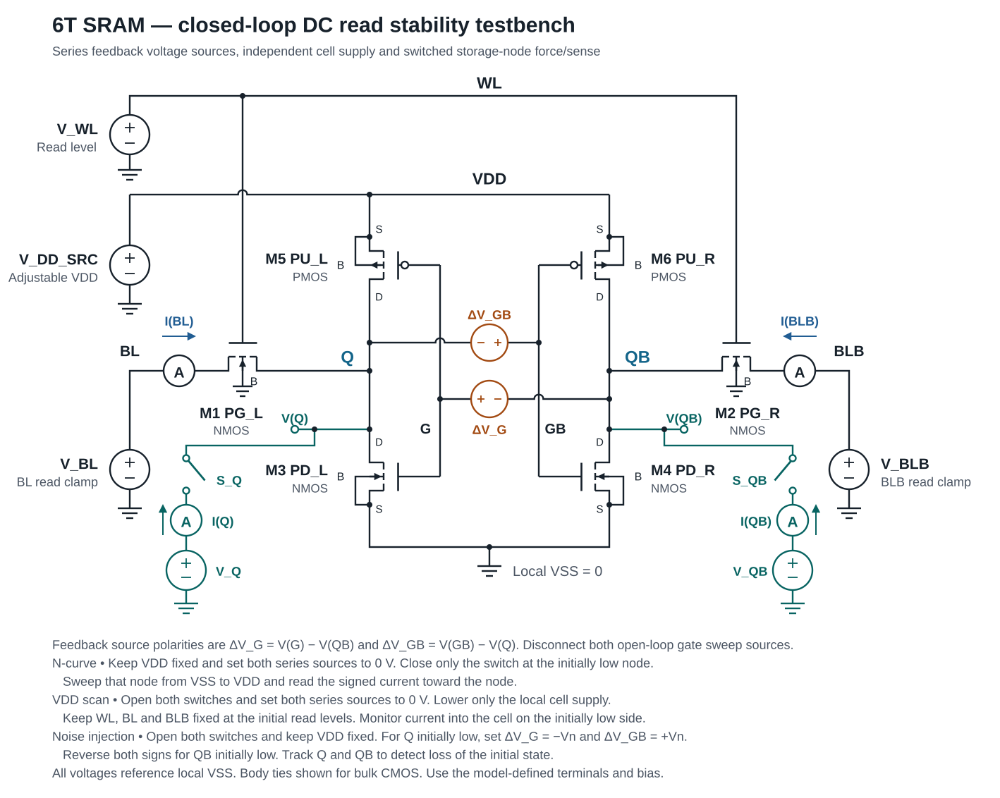
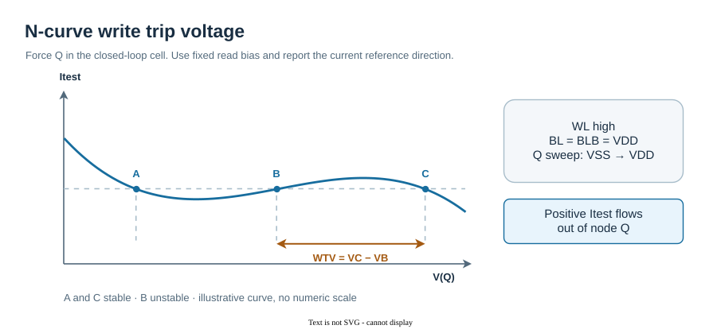

# WTV

## 定义与适用范围

**写入翻转电压（Write Trip Voltage，WTV）**指在固定读偏置下，差分 6T 静态随机存取存储器（Static Random-Access Memory，SRAM）位单元的被测存储节点从高电位稳态 C 降至不稳定平衡点 B 所需的静态电压降。读偏置下两稳态仍可分辨时，N 曲线有三个零电流点，按被测节点电位由低到高记为 A、B、C。A、C 为稳定工作点，B 为亚稳态工作点。WTV 取 $V_C-V_B$，单位为 V；$V_C$ 和 $V_B$ 均为被测节点相对 VSS 的电压。同一偏置下，WTV 越小，跨过 B 所需的节点电压降越小。[1, Sec. II-A–B, Figs. 3–4, 8–9] [8, Sec. 2, Fig. 4]

基线设 $V_{\mathrm{SS}}=0$，字线（Wordline，WL）选通，位线（Bitline，BL／BLB）均钳位于 $V_{\mathrm{DD}}$，即 $V_{\mathrm{WL}}=V_{\mathrm{BL}}=V_{\mathrm{BLB}}=V_{\mathrm{DD}}$。位线写入翻转电压（Bitline Write Trip Voltage，BWTV）则是在 WL 和写高侧位线固定时，下扫写低侧位线得到的最高可写局部位线电压。实际写低电平固定时，BWTV 越高，位线驱动余量越大。比较文献中的 *write trip voltage* 须先核对扫描的是存储节点还是外部位线。[2, Fig. 1] [7, Sec. III-B] [9, Sec. III-B.1]

## 物理机制与器件变异

在固定偏置和被测节点电压下，施加的直流电流与单元在该节点的净电流平衡。电流为零且撤去激励后能抵抗小扰动的两点分别构成稳态 A、C。从 C 降低被测节点电压时，锁存反馈在 B–C 区间产生将被测节点拉回 C 的净电流，测试源须从节点抽取电流；越过 B 后撤去激励，正反馈使节点向 A 恢复。读偏置下这一翻转属于破坏性读取。同一曲线的 A–B 区间用于分析低节点被抬升时的读稳定性，见 [RSNM](RSNM.md#数据分析与评价方法)。[1, Sec. II-A–B, Figs. 3–5, 9]

**写入翻转电流（Write Trip Current，WTI）**为 B、C 间的电流极值，单位为 A。按 Grossar 的注入电流正方向记为负峰值；本文曲线以从存储节点流向测试源为正，记为 $I_{\mathrm{test}}=-I_{\mathrm{inj}}$，同一峰值记为 $\lvert\mathrm{WTI}\rvert=\max_{V_B\le V\le V_C} I_{\mathrm{test}}(V)$。反转纵轴只改变电流符号，三个零点及 WTV 不变。[1, Sec. II-B, Figs. 4, 9]

**尺寸与失配**：访问管（Pass-Gate，PG）、下拉管（Pull-Down，PD）和上拉管（Pull-Up，PU）的相对强度及局部阈值失配会改变稳态和亚稳态工作点。Grossar 的 130 nm 仿真中，在所考察的尺寸范围内，增大单元比（Cell Ratio，$\beta$）改善读稳定性并提高 WTV；同比例加宽管子可保持 WTV 而增大 WTI 幅值。Anees 等的 7 nm FinFET 仿真中，两种尺寸的 WTV 均为 319 mV，尺寸加倍使 WTI 幅值由 1.14 μA 升至 2.27 μA。比较尺寸方案时须同时记录 WTV 与 WTI 幅值，并核对实际管比、器件模型及偏置。[1, Secs. II-B, III-B, Table II, Fig. 14] [30, Fig. 10, Table 3]

## 本征写入翻转电压与阵列环境

孤立单元 WTV 表征指定局部偏置下的闭环翻转条件。正常互补位线写入时，PG 的端电压、体偏置及漏端诱导势垒降低（Drain-Induced Barrier Lowering，DIBL）条件与双位线置高时不同；在写低侧位线接 VSS 时提取的写偏置电流 $I_{\mathrm W}$ 也须与 WTI 区分。阵列中还须计入位线与字线的分布电阻电容（Resistance and Capacitance，RC）、列复用路径、局部电源压降、写驱动强度及写辅助时序。普通密集阵列通常不引出 Q／QB，量产筛选宜采用可访问的外部端口与读回；若用其排序 WTV，须先在同工艺、同方向的可访问单元上验证配对相关性。[9, Secs. II, III-B] [10, Fig. 2.22] [24, Sec. II-D] [27, Sec. II-B, Fig. 3] [36, Secs. 3.1–3.2, Fig. 3.1]

## 测量与提取方法

### 仿真：闭环 N 曲线

**【前置条件】** 沿用 [6T 节点图](Read_Current.md#测量与提取方法) 的器件连接。记录网表、工艺模型、器件尺寸或鳍数、工艺／电压／温度（Process, Voltage and Temperature，PVT）、体偏置及寄生抽取范围。按下图保留交叉耦合闭环，两条反馈支路的串入电压源均置 0 V；固定局部 VDD、WL 和两条位线电压，偏置变体单列。根据目标电压分辨率设置扫压步长与求解容差。

**【步骤／方法】**

1. **初始化并接入单侧扫压**：断开 `S_Q` 和 `S_QB`，先写入 `Q=0, QB=1` 并撤去写偏置。施加固定读偏置，确认原状态仍保持。仅闭合 `S_Q`，以相对 VSS 的电压源 `V_Q` 驱动 Q；QB 保留反馈连接，仅作高阻电压观测。
2. **获取带符号曲线**：DC（Direct Current）扫描 `V_Q` 从 $V_{\mathrm{SS}}$ 至 $V_{\mathrm{DD}}$，逐点记录 $V(Q)$、$V(\mathrm{QB})$ 和 $I_{\mathrm{test}}$。电路图的箭头为流入节点的 $I_{\mathrm{inj}}$，曲线图采用相反方向。如果 SPICE 电压源 `V_Q` 的正端接 Q、负端接 VSS，且软件按正端流入电源为正报告电流，则 `I(V_Q)` 为 $I_{\mathrm{test}}$。从记录的高端状态反扫，核对同一分支。该扫压从低到高取得整条曲线；WTV 的物理翻转方向为 C 向 B。[1, Figs. 3–4]
3. **提取两侧零点与峰值**：按电位排序，在电流变号区间内夹逼或插值求 $V_A$、$V_B$、$V_C$，端点零值也须核对电流容差。细化 B、C 附近步长，直至 WTV 及 WTI 幅值达到预定分辨率；初始选 Q 低的曲线报告 Q 从高态向低态的 WTV。断开两侧扫压开关、反向写入 `Q=1, QB=0` 并恢复读偏置后，仅闭合 `S_QB`，从 QB 低态起扫并按相同规则报告 QB 从高态向低态的 WTV。

图为闭环读偏置示意，横轴为被测存储节点电压（V），纵轴为抽出电流（A）。B–C 的峰值为 WTI 幅值。

- **注意事项**：禁止同时接入两侧扫压源（避免改变未扫节点的自洽工作点）。
- **注意事项**：禁止拼接跨节点、跨偏置或跨求解分支的零点（避免形成虚假 WTV）。

**【结果处理和验证】** 对 A、C 分别在撤去扫压后加小扰动，验证能回到原态；验证翻转时，从 C 初始化，在 B 的两侧分别钳位至略低、略高的电压，待 QB 建立对应工作点后撤去扫压，确认低侧回 A、高侧回 C，每次试验均重写初态。可另从 C 扫抽取电流，确认在 WTI 峰值附近丧失高态。[1, Figs. 4, 9] 归档两侧原始曲线、零点夹逼区间、WTV、WTI 幅值、扫压方向及释放后的落态。零点合并、超扫压范围或正反扫分支不一致时，先缩小步长并核对实际偏置、收敛与状态；将确认单稳态的样本记为对应读偏置失稳，将越界和未分辨样本分别报告。

### 硅测：直接 N 曲线

**【前置条件】** 使用可接出内部节点且能保留交叉反馈的表征单元。测试前校准源测量单元（Source Measure Unit，SMU）、探针及模拟开关的串联压降与漏电；用等效空白结构（Dummy）扣除能够独立确认的测量路径漏电，有端点时使用独立远端感测。记录实际局部偏置、扫描范围、分辨率、限流和稳定判据。

**【步骤／方法】** 初始化后按闭环 N 曲线方案单侧接入 SMU 扫压，另一节点保持高阻观测；逐点等待电压、电流稳定再采样，记录正反扫与互补节点两组曲线。若通路有串联电阻，使用实际节点电压；只能读到源端时，须注明校准修正及残差。

**注意事项**：禁止将限流、未稳定或仅有源端设定值且压降不可校准的扫点用于提取零点（无法确认节点电位及零电流条件）。

**【结果处理和验证】** 按仿真步骤提取零点、WTV 和 WTI 幅值，并以重复扫描和独立状态确认验证；记录器件地址、保持时间、校准误差及异常分类。Guo 的博士论文展示由测得的 N 曲线定义 WTV／WTI；所核验资料未确认用相同内部节点夹具完成密集功能阵列的大规模 WTV 实测。[10, Fig. 2.22]

### 硅测：外部位线 BWTV

**【前置条件】** 使用可调位线偏置的 6T 表征单元或阵列，基线固定局部 VDD 及写高侧位线和 WL 高电平；校准列复用器与连线带来的压降和未选单元漏电，记录最低可用写低侧位线电位。使用上图仿真时保持两反馈串入源为 0 V、`S_Q` 和 `S_QB` 均断开，将原高侧位线电源改为扫描源。

**【步骤／方法】** 先写入 `Q=1, QB=0`，将 BL、BLB 预充至高电平后选通 WL。在原状态保持时，下扫连接原高节点的 BL，保持 BLB 为高，监测从 BLB 流入单元的电流突降。保持位线电平直至 WL 关断，再释放位线并重新预充，在已验证无读扰的条件下读回确认 `Q=0`。缩小翻转前后的位线电压区间，每次复测前重写初态，再交换初态及位线执行另一方向。若无模拟电流观测通道，可在固定写脉宽下逐级试写并读回，结果标为该脉宽下的位线阈值。[2, Fig. 1, Measurement Methodology] [9, Sec. III-B.1, Figs. 6–7] [17, Sec. II-B, Fig. 4(c)]

**注意事项**：若下扫前读偏置已使初态翻转，须标为读扰导致的不可提取（起始高侧数据已改变）。Guo 等在 45 nm 样片的 0.4 V 条件下观察到此情形。[9, Sec. III-B.1, Fig. 7]

**【结果处理和验证】** 在局部位线电压与写成功单调对应时，报告最高已验证可写的电压与相邻不可写的电压、区间宽度及最低可用电压。扫至最低电位仍未翻转时报告阈值低于扫描下限；若电流突变与读回不一致，检查漏电、读扰及位线实际端压后复测。Guo 等用该位线口径表征 45 nm、768 kb 测试芯片，Fischer 等以两侧位线电流拐变测量 90／65 nm 结构；两者均报告外部阈值。[2, Figs. 1, 8] [7, Sec. III-B, Figs. 8–9]

## 数据可视化与评估

| 图表 | 必须标明的条件 | 判读与动作 |
| --- | --- | --- |
| 两侧带符号 N 曲线 | 电压／电流单位、扫压方向、A／B／C、正方向、PVT 及局部端压 | 比较零点与峰值；WTV 接近时用 WTI 幅值区分所需抽取电流 |
| 两方向配对散点、分布与尾部分位 | 同一单元的两侧结果、样本量、分辨率及无三零点的样本分类 | 按 VDD、温度、工艺角及版图位置分组；以较大 WTV 筛选静态翻转电压需求较高的方向，并保留另一侧原值 |
| WTV、BWTV 与动态 [Write Time](../Subarray/Write_Time.md) 配对散点 | 测量方法、同一单元及方向、偏置、写脉宽和写驱动 | 检查相关性和尾部离群，按实际写时序验证；禁止用跨偏置的单点值换算 |

**统计口径**：按 PVT 进行局部失配蒙特卡洛（Monte Carlo，MC）或硅测统计，保留同一单元两个方向的配对关系；分别报告有效提取、确认失稳、截尾和未分辨的计数。尾部可信度、置信区间与共享阵列路径的分组方法见 [RSNM](RSNM.md#数据分析与评价方法)。位线阈值的重要性抽样或字线裕量的分布结论须按原测量口径使用。[6, Sec. III-C, Figs. 6–7] [19, Sec. 2] [27, Sec. III]

**证据边界**：Wang 等在同一 6T 仿真示例中分别得到 BWTV 0.287 V、WTV 0.511 V 和 WTI 幅值 5.86 μA，在其 0.6 V 仿真样本中 WTV 与临界写脉宽的相关性弱。[8, Secs. 2, 4, Figs. 2, 4, 11] Fischer 等的 65 nm 硅测中，单片 2500 个单元在 1.2–0.6 V 扫描期间 BWTV 均值随供电降低而下降，绝对标准差近似不变；该趋势仅适用于位线指标。[7, Sec. IV-B, Figs. 15–18] Toh 等分别比较了静态 BWTV 和临界写脉宽的仿真结果及硅测结果。[3, Sec. II-C, Fig. 7] 在 45 nm 硅测中，静态 BWTV 处于常见范围的离群单元，其临界写脉宽仍可比静态阈值相近的其他样本长逾 10 倍。[3, Sec. IV-C, Fig. 15]

## 应用场景与指标关系

- **诊断单元反馈**：在相同读偏置下比较两侧 WTV、WTI 与 RSNM，筛查反馈强度和器件失配。若 WTV 基本相同而 WTI 幅值增加，优先核对器件驱动能力和尺寸变化。[1, Sec. III-B, Fig. 14]
- **定位静态写入瓶颈**：用 BWTV 选择位线驱动、负位线辅助（Negative Bitline，NBL）及列末端电压。用字线写入裕量 [WM](WM.md) 检查 WL 电压预算，用写静态噪声容限 [WSNM](WSNM.md) 检查实际写偏置下的旧态分支。若只能访问外围位线，可用已校准的外部电流或读回辅助筛查；启用写辅助时须重新检查 BWTV 是否可提取。[9, Sec. III-B] [18, Sec. V-C] [22, Sec. V-B]
- **验证宏级写入**：在实际写驱动、局部寄生、辅助波形及脉宽下检查目标态能否保持，再按 [WD](../Subarray/Write_Delay.md) 验证写入时序；宏级最低写工作电压及失败率须由动态操作和阵列统计确定。[3, Sec. IV-C] [36, Secs. 3.1–3.2]

## 参考文献

检索范围为 Zotero `02-SRAM-DTCO/SRAM-Metrics` 及其全部子集合，按 `WTV` 同名标签筛选，检索日期为 2026-11-13，共命中 34 篇；复用原有编号 1 篇，新增 33 篇，保留并补充原有 3 条参考文献后共 36 条。新增条目按年份、第一作者、题名排列，年份未核实者置后。本页 WTV 指读偏置 N 曲线的 VC−VB；位线/字线翻转电压、写蝴蝶裕量及临界脉宽均保留原名，不能直接混用。页码注明“PDF”时指归档文件的物理页；提前出版版及作者稿的页码可能与正式题录不同。

2026-11-17 复核 Zotero `Bitcell`（`YHY2NKEE`）的精确 `WTV` 标签：34 条，均有可提取正文的归档 PDF。核对其中 15 篇对本页相关测量或适用边界的全文段落：直接定义、曲线或试验见 [1] [8] [10] [30] [33]；位线阈值、统计及阵列写入边界见 [6] [7] [9] [11] [17] [18] [19] [22] [27] [36]。本次复用既有归档，未补检导入。

[1] E. Grossar, M. Stucchi, K. Maex, and W. Dehaene, “Read stability and write-ability analysis of SRAM cells for nanometer technologies,” IEEE Journal of Solid-State Circuits, vol. 41, no. 11, pp. 2577-2588, 2006. [DOI 10.1109/JSSC.2006.883344](https://doi.org/10.1109/JSSC.2006.883344) · [Zotero](https://www.zotero.org/users/7333024/items/EEADHYR8) · [公开文献](https://doi.org/10.1109/JSSC.2006.883344)

**相关摘要：** 本文是 N 曲线 WTV 定义的直接来源：在两位线固定 VDD、字线选通时，从高电位稳态 C 向亚稳态 B 考察，VC−VB 是使原高节点翻转所需的电压下降；负电流峰值另定义为 WTI。作者将它们与外部位线写翻转点比较，并用电流扫描验证翻转条件。整体加宽晶体管时，电压指标可以不变而写电流需求增加，因而应联合 WTV 与 WTI 判断写能力。文中亦指出这种偏置下的翻转属于破坏性读取，指标既体现可写性也涉及读稳定性，不能忽略测量偏置直接替代真实互补位线写入。

**原文定位：** PDF 第 3–4 页，§II-B、图 8–10、表 II；第 6 页 §III-B。

[2] Z. Guo et al., “Large-scale read/write margin measurement in 45nm CMOS SRAM arrays,” in Proc. IEEE Symp. VLSI Circuits, 2008. [DOI 10.1109/VLSIC.2008.4585944](https://doi.org/10.1109/VLSIC.2008.4585944). [公开文献](https://doi.org/10.1109/VLSIC.2008.4585944)；Zotero：本次标签集合未匹配记录。

**相关摘要：** （间接相关）论文在 45 nm、768 kb 测试芯片中比较写蝴蝶裕量、写偏置电流、字线扫描及位线扫描四类写指标。位线或字线电压逐步变化时，以位线电流突变判断翻转，从而在完整阵列中获得大样本分布；内部节点接出的小宏单元则用于建立相关性。文中称为 BLWM、WLWM 的电压均来自外部端口，写电流也采用相应写偏置，不能等同于本页内部节点 N 曲线 VC−VB。该文主要支持不同写测量量的统计比较及布局效应分析，引用时需保留原指标名称与两侧方向。

**原文定位：** PDF 第 1–2 页，图 1、图 4–6、图 8。

[3] S. O. Toh, Z. Guo, T.-J. K. Liu, and B. Nikolić, “Characterization of dynamic SRAM stability in 45 nm CMOS,” IEEE J. Solid-State Circuits, vol. 46, no. 11, pp. 2702–2712, 2011. [DOI 10.1109/JSSC.2011.2164300](https://doi.org/10.1109/JSSC.2011.2164300). [公开文献](https://doi.org/10.1109/JSSC.2011.2164300)；Zotero：本次标签集合未匹配记录。

**相关摘要：** （间接相关）本文把静态位线写翻转电压 BWTV 与动态临界写脉宽比较，通过 45 nm CMOS 阵列及逐字线脉冲采样分析失配、随机电报噪声和 NBTI 的影响。静态 BWTV 不能预测全部动态离群单元，临界脉宽对左右不对称和器件变化可能更敏感，因此静态写电压不足以保证目标频率下的成功写入。原文所选电压指标明确是外围位线阈值，并非本页 N 曲线 VC−VB；将其列在本页可用于说明写能力测量的时间边界，不能直接引用为 WTV 的分布或老化漂移。

**原文定位：** PDF 第 3–4 页，§II-C、图 7、表 I；第 7 页图 15。

[4] R. Heald and P. Wang, “Variability in sub-100nm SRAM designs,” in Proc. IEEE/ACM International Conference on Computer-Aided Design (ICCAD), 2004, pp. 347–352. [DOI 10.1109/ICCAD.2004.1382599](https://doi.org/10.1109/ICCAD.2004.1382599) · [Zotero](https://www.zotero.org/users/7333024/items/7GAQXDTN) · [公开文献](https://doi.org/10.1109/ICCAD.2004.1382599)

**相关摘要：** （间接相关）文中 write trip point 由写入时被拉低的位线电压定义，主要受该侧访问管阈值及单元器件失配影响。作者要求它与电源端点保留足够距离，以免噪声和偏差造成写失败或读时误写，并建议联合蒙特卡洛评估 SNM、写翻转点及读电流。这里没有内部节点 N 曲线 VC−VB 的定义和测量，因此只能作为外部位线写能力与统计设计背景。引用其典型翻转点位置或写电压分布时应标为 BWTV／位线阈值，避免与本页所需电压下降的含义及优劣方向混淆。

**原文定位：** PDF 第 3–4 页，§VI、图 5。

[5] D. Khalil, M. Khellah, N. S. Kim, Y. Ismail, T. Karnik, and V. De, “SRAM dynamic stability estimation using MPFP,” in 2007 Internatonal Conference on Microelectronics, 2007, pp. 167-170. [DOI 10.1109/ICM.2007.4497685](https://doi.org/10.1109/ICM.2007.4497685) · [Zotero](https://www.zotero.org/users/7333024/items/I23VWJ8I) · [公开文献](https://doi.org/10.1109/ICM.2007.4497685)

**相关摘要：** （间接相关）本文以最可能失效点搜索估计动态读写失败，写判据检查有限访问结束后单元是否进入目标状态，而传统比较项中的 WNM 定义为写入所需的位线直流电压变化。全文重点在失配空间的搜索、动态时序与失败概率，不是内部节点 N 曲线写翻转电压的提取。它能说明用任一静态电压裕量独自推断高速写成功存在局限，但没有提供本页 VC−VB 的数值或直接模型。引用时应把动态写失败、位线 WNM 和 N 曲线 WTV 分别标注。

**原文定位：** PDF 第 2–4 页，动态判据、表 1及§V。

[6] T. S. Doorn, E. J. W. Ter Maten, J. A. Croon, A. Di Bucchianico, and O. Wittich, “Importance sampling monte carlo simulations for accurate estimation of SRAM yield,” in ESSCIRC 2008 - 34th European Solid-State Circuits Conference, 2008, pp. 230-233. [DOI 10.1109/ESSCIRC.2008.4681834](https://doi.org/10.1109/ESSCIRC.2008.4681834) · [Zotero](https://www.zotero.org/users/7333024/items/SLU75CBK) · [公开文献](https://doi.org/10.1109/ESSCIRC.2008.4681834)

**相关摘要：** （间接相关）本文的写裕量由外部位线扫描得到：WL和另一位线保持VDD，将写低侧位线下拉，记录仍能引起存储状态翻转的最高位线电压。作者比较普通蒙特卡洛、高斯外推及重要性采样得到的该指标分布，并以概率加权补偿增强尾部抽样。此处的WM实际属于位线写翻转门槛BWTV，测试扰动作用于外部位线，不是N曲线在读型偏置下的内部节点电压差VC−VB。因此其抽样思想可借鉴，图6–7的电压值及失效门槛不能直接作为本页WTV基准。

**原文定位：** Sec. III-C，PDF p. 3，Figs. 6–7。

[7] T. Fischer et al., “Analysis of read current and write trip voltage variability from a 1-MB SRAM test structure,” IEEE Transactions on Semiconductor Manufacturing, vol. 21, no. 4, pp. 534-541, 2008. [DOI 10.1109/TSM.2008.2004329](https://doi.org/10.1109/TSM.2008.2004329) · [Zotero](https://www.zotero.org/users/7333024/items/MV24K24B) · [公开文献](https://doi.org/10.1109/TSM.2008.2004329)

**相关摘要：** （间接相关）论文设计可直接访问位线的百万单元测试结构，在 90 nm 和 65 nm 晶圆上测量读电流及写翻转电压。写测试下扫原高存储节点一侧位线，以两侧电流突变定位翻转，因此标题中的电压是 BWTV，不是 N 曲线 VC−VB。65 nm 电源扫描中，位线阈值均值随电源降低而减小，标准差近似保持，使相对离散增大；大样本还用于检查高斯分布和系统空间趋势。文献提供了位线写电压统计的重要硅证据，但这些分布结论不能直接转用于内部节点 N 曲线 WTV。

**原文定位：** PDF 第 3 页 §III-B；第 6–7 页图 15–18及结论。

[8] J. Wang, S. Nalam, and B. H. Calhoun, “Analyzing static and dynamic write margin for nanometer SRAMs,” in Proc. International Symposium on Low Power Electronics and Design (ISLPED), 2008, pp. 129–134. [DOI 10.1145/1393921.1393954](https://doi.org/10.1145/1393921.1393954) · [Zotero](https://www.zotero.org/users/7333024/items/IK7GE8ZW) · [公开文献](https://doi.org/10.1145/1393921.1393954)

**相关摘要：** 本文把写蝴蝶、位线、字线和 N 曲线静态指标逐一定义，其中 WTV 明确为两位线固定 VDD 时 N 曲线 C、B 两零电流点之差，WTI 为其间负电流峰值。作者再以跨越保持状态分界线所需的临界字线脉宽分析动态写入，指出静态量没有包含脉宽和后续读访问的时间要求。其贡献是提供同一电路中多种写指标的并列定义及比较，而非证明它们数值相同。使用 WTV 时应保留读式偏置，且不能仅凭其大小断言短脉冲下的写入一定成功。

**原文定位：** PDF 第 2–5 页，§2–3、图 4及图 7–9。

[9] Z. Guo, A. Carlson, L. T. Pang, K. T. Duong, T. J. K. Liu, and B. Nikolic, “Large-scale SRAM variability characterization in 45 nm CMOS,” IEEE Journal of Solid-State Circuits, vol. 44, no. 11, pp. 3174-3192, 2009. [DOI 10.1109/JSSC.2009.2032698](https://doi.org/10.1109/JSSC.2009.2032698) · [Zotero](https://www.zotero.org/users/7333024/items/5RBES89L) · [公开文献](https://doi.org/10.1109/JSSC.2009.2032698)

**相关摘要：** （间接相关）本文为密集阵列定义位线写翻转电压 BWTV：保持正常写相关偏置，下扫连接原高节点的位线，通过另一位线电流突变确认翻转。低电压测试可能先触发读扰动，因此作者讨论如何选择仍可表征的单元方向，并另用字线写翻转电压进行大规模测量。这里的主要实测写电压是外部位线或字线裕量，不能等同于内部节点 N 曲线 VC−VB。文章对 N 曲线另用写偏置电流指标作比较，适合解释不同写表征方法的关联及量测限制，而非提供可直接混用的 WTV 数值。

**原文定位：** PDF 第 2–3 页写能力定义；第 5–6 页，§III-B、图 6–8。

[10] Z. Guo, “Large-scale variability characterization and robust design techniques for nanoscale SRAM,” Doctoral dissertation, EECS Department, University of California, Berkeley, 2009. [Zotero](https://www.zotero.org/users/7333024/items/A56QIF3W) · [公开文献](https://www2.eecs.berkeley.edu/Pubs/TechRpts/2009/EECS-2009-190.html)；DOI：Zotero未收录或尚未核实。

**相关摘要：** 论文明确把 WTV 定义为读偏置 N 曲线最后两个零电流交点的电压差，但同时分析它作为写能力指标的限制：两位线均置 VDD 时，访问管的体偏置和漏源电压不同于实际互补位线写入，导致体效应与 DIBL 条件改变。作者因此提出在真正写偏置下提取电流谷 IW，更直接反映访问管克服上拉管的能力。该文既提供 VC−VB 的定义和图示，也解释为什么 WTV 不应脱离偏置视为实际写周期的唯一判据；IW 与 WTI 的名称及符号亦应分别保留。

**原文定位：** PDF 第 67–69 页，正文第 42–44 页，图 2.21–2.22。

[11] X. Deng, T. W. Houston, A. Duong, and W. K. Loh, “A universal structure for SRAM cell characterization,” in 2010 International Conference on Microelectronic Test Structures (ICMTS), 2010, pp. 216-219. [DOI 10.1109/ICMTS.2010.5466815](https://doi.org/10.1109/ICMTS.2010.5466815) · [Zotero](https://www.zotero.org/users/7333024/items/UFY8SIZT) · [公开文献](https://doi.org/10.1109/ICMTS.2010.5466815)

**相关摘要：** （间接相关）该通用测试结构能够在同一位单元上测量单管参数、读电流和 write trip voltage，从而直接研究器件失配与单元性能的相关性。原文通过完整单元的位线电流—位线电压曲线获得 Vtrip，并将它与写最低工作电压关联；它属于外部位线扫描的写翻转阈值。虽然结构也能接出内部节点，文章并未将报告的 Vtrip 定义为 N 曲线 VC−VB。该文适合作为批量测试和同单元相关分析的参考，引用数值时应标明位线指标，避免与本页的内部节点电压下降混淆。

**原文定位：** PDF 第 2–4 页，图 3(e)、图 4(e)、图 5(e)、图 6。

[12] V. Gupta, and M. Anis, “Statistical design of the 6T SRAM bit cell,” IEEE Transactions on Circuits and Systems I: Regular Papers, vol. 57, no. 1, pp. 93-104, 2010. [DOI 10.1109/TCSI.2009.2016633](https://doi.org/10.1109/TCSI.2009.2016633) · [Zotero](https://www.zotero.org/users/7333024/items/CJL8HZFZ) · [公开文献](https://doi.org/10.1109/TCSI.2009.2016633)

**相关摘要：** （间接相关）本文在统计尺寸优化中使用 write trip voltage，但定义是直流扫描被拉低位线，记录单元刚翻转时所允许的最高位线电压；它属于位线写翻转电压 BWTV。该指标反映访问管克服上拉管的能力，作者通过参数灵敏度近似其均值、方差，并与读 SNM、读电流、漏电和面积联合优化。原文能够支持写能力随尺寸和工艺变异变化的分析，但没有以内部节点 N 曲线的两个零电流交点之差提取本页 WTV，故其数值和优化方向不能未经定义换算直接并列。

**原文定位：** PDF 第 2 页 §II-A2；第 3–4 页。

[13] V. Huard et al., “Managing SRAM reliability from bitcell to library level,” in 2010 IEEE International Reliability Physics Symposium, 2010, pp. 655-664. [DOI 10.1109/IRPS.2010.5488755](https://doi.org/10.1109/IRPS.2010.5488755) · [Zotero](https://www.zotero.org/users/7333024/items/FDQNGLFY) · [公开文献](https://doi.org/10.1109/IRPS.2010.5488755)

**相关摘要：** （间接相关）文中以写位线扫描触发单元翻转的电压定义 write margin，并用它与读 SNM 一起分析 NBTI 等老化后的分布变化。平均写裕量可能随上拉管弱化而改善，但同时增大的离散会使极端尾部仍然恶化，所以平均趋势不能替代写良率判断。这里的写电压来自外部位线测试，不是内部节点 N 曲线 VC−VB；文章也未给出两种量之间可通用换算的关系。该文可用于解释老化下写能力均值与方差的竞争，引用图表时应保留原 WM 定义及应力、供电条件。

**原文定位：** PDF 第 4–6 页，图 9–15。

[14] S. O. Toh, Z. Guo, and B. Nikolic, “Dynamic SRAM stability characterization in 45nm CMOS,” in 2010 Symposium on VLSI Circuits, 2010, pp. 35-36. [DOI 10.1109/VLSIC.2010.5560259](https://doi.org/10.1109/VLSIC.2010.5560259) · [Zotero](https://www.zotero.org/users/7333024/items/5YV9U9A5) · [公开文献](https://doi.org/10.1109/VLSIC.2010.5560259)

**相关摘要：** （间接相关）论文在 45 nm CMOS 中用可编程字线脉冲直接表征动态 SRAM 稳定性，并将所需写脉宽与静态写裕量比较。实测发现静态指标不能预测所有动态写入离群单元，低电源时不同存储方向及器件失配更明显地影响写时间，NBTI 对动态写能力的影响也可能大于静态指标所示。该文的动态量以时间表示，静态对照亦不是专门提取本页 N 曲线 VC−VB。因此它适合用于说明 WTV 对高速操作的解释边界，不能把动态写时间、失效倍率或静态位线裕量直接标作 WTV。

**原文定位：** PDF 第 1–2 页，图 8–10、表 I。

[15] M. Wieckowski et al., “A black box method for stability analysis of arbitrary SRAM cell structures,” in 2010 Design, Automation & Test in Europe Conference & Exhibition (DATE 2010), 2010, pp. 795-800. [DOI 10.1109/DATE.2010.5456943](https://doi.org/10.1109/DATE.2010.5456943) · [Zotero](https://www.zotero.org/users/7333024/items/WPLXJ7BH) · [公开文献](https://doi.org/10.1109/DATE.2010.5456943)

**相关摘要：** （间接相关）本文主要建立 SRAM 状态空间向量场与分界线的黑箱提取方法，适用于包含特殊反馈器件及不对称结构的单元。文中将 N 曲线零电流特征列为传统静态稳定性背景，但实质验证聚焦读扰动、蝴蝶裕量以及状态到分界线的动态关系，没有单独定义和报告本页写电压 VC−VB。它可以提示复杂拓扑的反馈与动态路径可能超出单一静态量的表达范围，不能作为 WTV 改善数值的直接证据；引用时需保留该文实际分析对象与失效判据。

**原文定位：** PDF 第 1–3 页，§II；第 4–5 页 §IV。

[16] S. O. Toh, “Nanoscale SRAM variability and optimization,” dissertation, UC Berkeley, 2011. [Zotero](https://www.zotero.org/users/7333024/items/LYDRHR6E) · [公开文献](https://www2.eecs.berkeley.edu/Pubs/TechRpts/2011/EECS-2011-144.html)；DOI：Zotero未收录或尚未核实。

**相关摘要：** （间接相关）论文使用内部节点 N 曲线研究静态写电流及随机电报噪声，电流由相关晶体管共同决定，因此单管噪声不一定能直接换算为单元写能力波动。不同温度下的快速扫描显示陷阱时间常数相对测量时间的变化会改变曲线形状；正常高速写入可能对应陷阱状态在一次操作中近似固定的情形。该文主要提取 Iwrite 和位线写裕量，并非系统报告本页 VC−VB 电压差。引用时可用于说明 N 曲线测量及噪声时间尺度限制，不能把电流峰值、BLWM 或动态写脉宽当作 WTV。

**原文定位：** PDF 第 71–73 页图 3.31–3.35；第 76–78 页图 3.42；第 93 页图 4.3。

[17] Yi-Wei Lin et al., “An all-digital read stability and write margin characterization scheme for CMOS 6T SRAM array,” in Proceedings of Technical Program of 2012 VLSI Design, Automation and Test, 2012, pp. 1-4. [DOI 10.1109/VLSI-DAT.2012.6212589](https://doi.org/10.1109/VLSI-DAT.2012.6212589) · [Zotero](https://www.zotero.org/users/7333024/items/YNV2D8NY) · [公开文献](https://doi.org/10.1109/VLSI-DAT.2012.6212589)

**相关摘要：** （间接相关）论文提出全数字读稳定性与写裕量测试方案：读侧利用修改单元和振荡器／计数器取得读扰动电压及反相器翻转点，写侧则用电阻分压逐级改变位线电压，再执行写入、读回与恢复序列判断是否成功。55 nm 测试宏中的写扫描采用有限离散电压级，所得 WM 属于外部位线可写阈值，而读侧 Vtrip 是反相器翻转点。两者都不是本页 N 曲线 VC−VB。该文可支持阵列环境下的统计采样和数字读出方法，但不能仅凭“trip”名称把读反相器阈值当作写翻转电压。

**原文定位：** PDF 第 1–4 页，§II-B、图 4(c)及测试宏说明。

[18] H. Jeong, Y. Yang, J. Lee, J. Kim, and S.-O. Jung, “Static read stability and write ability metrics in FinFET based SRAM considering read and write-assist circuits,” in Proc. 19th IEEE International Conference on Electronics, Circuits, and Systems (ICECS), 2012, pp. 833–836. [DOI 10.1109/ICECS.2012.6463530](https://doi.org/10.1109/ICECS.2012.6463530) · [Zotero](https://www.zotero.org/users/7333024/items/4L58JN4T) · [公开文献](https://doi.org/10.1109/icecs.2012.6463530)

**相关摘要：** （间接相关）文章分析 FinFET SRAM 使用降低单元供电或提高字线等写辅助后，不同写指标的可提取性及分布形状。原文比较的是写蝴蝶 WNM、真实写偏置电流 IW、位线 BWTV 和字线 WWTV；在部分辅助条件下，电流曲线无所需谷点，位线翻转也可能无法正常取得。作者在其仿真范围内认为 WWTV 更适于良率估计。它没有把这些外部阈值定义为本页 N 曲线 VC−VB，因此可作为指标选择和辅助电路适用边界的参考，不应将 WWTV 的正态性结论直接推广给 WTV。

**原文定位：** PDF 第 3–4 页，§V、图 6–10。

[19] H. Makino et al., “Utilising the normal distribution of the write noise margin to easily predict the SRAM write yield,” IET Circuits, Devices and Systems, vol. 6, no. 4, pp. 260-270, 2012. [DOI 10.1049/iet-cds.2012.0090](https://doi.org/10.1049/iet-cds.2012.0090) · [Zotero](https://www.zotero.org/users/7333024/items/SF5WKPSA) · [公开文献](https://doi.org/10.1049/iet-cds.2012.0090)

**相关摘要：** （间接相关）本文比较写蝴蝶 WSNM、两类字线裕量 WLM／CWLM 和位线裕量 BLM，利用晶体管工作区分析它们对阈值变化的线性程度。作者明确将 N 曲线指标排除出主要研究，理由是所引研究中其分布与动态写指标的关联较差；主要正态性与小样本良率预测结论针对保持闭环的 CWLM。因而该文可作为 WTV 统计使用时的反例背景，不能把标题中的 write noise margin 或 CWLM 的高斯外推精度直接解释为本页 VC−VB 的性质。相关优劣还受模型、电源和辅助偏置限制。

**原文定位：** PDF 第 2–3 页，§2–3；第 1 页摘要。

[20] S. C. Wang et al., “Design and implementation of dynamic word-line pulse write margin monitor for SRAM,” in 2012 IEEE Asia Pacific Conference on Circuits and Systems, 2012, pp. 116-119. [DOI 10.1109/APCCAS.2012.6418985](https://doi.org/10.1109/APCCAS.2012.6418985) · [Zotero](https://www.zotero.org/users/7333024/items/JJZP7KWC) · [公开文献](https://doi.org/10.1109/APCCAS.2012.6418985)

**相关摘要：** （间接相关）本文实现带可调字线脉冲的数字写裕量监测器，在固定脉宽下逐级降低写位线电压，并读回确认是否成功，研究写阈值对时间窗口的依赖。55 nm、256 kb 测试芯片使用环振与分频生成脉冲，以改进 Skitter 结构测量实际字线宽度；测量显示降低字线电压后，延长脉宽可以改善部分单元，但在某些偏置下失败率最终饱和。这里的结果是动态位线写裕量及写失败率，不是静态 N 曲线 VC−VB。文献可说明写电压必须连同脉宽报告，不能以时间分辨率代替 WTV 测量分辨率。

**原文定位：** PDF 第 1–4 页，图 2–6、图 10–11及§V。

[21] M. H. Abu-Rahma, and M. Anis, “Nanometer variation-tolerant SRAM: circuits and statistical design for yield,” New York, NY, Springer New York, 2013. [DOI 10.1007/978-1-4614-1749-1](https://doi.org/10.1007/978-1-4614-1749-1) · [Zotero](https://www.zotero.org/users/7333024/items/RA2TPQV2) · [公开文献](https://doi.org/10.1007/978-1-4614-1749-1)

**相关摘要：** （间接相关）本书系统区分写蝴蝶裕量、位线写裕量 WVBL、字线写电压 WVWL 及 N 曲线电流法。位线指标采用一侧接电源、另一侧由高到低扫描的最高可写电压；字线指标则扫描使单元刚能翻转的最低字线电压，两者的数值方向不同。该章提及 N 曲线但主要用电流信息说明写能力，并未把上述外部电压定义为本页 VC−VB。文献适合用于建立测量术语与设计权衡，引用时应保留各自的偏置和失效条件；有限脉宽下的写成功还受动态翻转时间约束。

**原文定位：** PDF 第 59–61 页，正文第 50–52 页，§3.2.1–3.2.2、图 3.3。

[22] H. Park, and C. K. K. Yang, “In situ SRAM static stability estimation in 65-nm CMOS,” IEEE Journal of Solid-State Circuits, vol. 48, no. 10, pp. 2541-2549, 2013. [DOI 10.1109/JSSC.2013.2275653](https://doi.org/10.1109/JSSC.2013.2275653) · [Zotero](https://www.zotero.org/users/7333024/items/CU8YSNR7) · [公开文献](https://doi.org/10.1109/JSSC.2013.2275653)

**相关摘要：** （间接相关）文章在 65 nm 测试芯片上，通过多个供电点的读写位线电流和非线性回归快速估计阵列单元稳定性，不改动单元布局。写能力目标明确为 BWTV，即位线扫描的可写电压；少量单元的直接裕量测量用于训练，再预测其他单元，并需校正测量电路的偏置与增益误差。所报写估计误差约 1.3% 针对该 BWTV 及芯片数据，不是 N 曲线 WTV 的提取精度。此文可用作量测成本与统计覆盖的实例，但不能将外围电流回归结果直接当成内部节点 VC−VB。

**原文定位：** PDF 第 1–3 页，§II；第 7 页 §V-B。

[23] J. Singh, S. P. Mohanty, and D. K. Pradhan, Robust SRAM Designs and Analysis. New York, NY: Springer, 2013. [DOI 10.1007/978-1-4614-0818-5](https://doi.org/10.1007/978-1-4614-0818-5) · [Zotero](https://www.zotero.org/users/7333024/items/JG3ZTL9Y) · [公开文献](https://doi.org/10.1007/978-1-4614-0818-5)

**相关摘要：** 本书明确给出与本页一致的 N 曲线 WTV：字线和两位线置高，在内部低节点施加电压扫描并测量电流，零电流交点 A、C 为稳态，B 为亚稳态。由高电位状态向低电位方向考察时，VC−VB 是使单元改变状态所需的最小直流电压下降，B、C 之间的负电流峰值则为 WTI。两者分别提供电压和电流维度的写能力信息，仍需内部节点访问，因此不适合直接在所有密集阵列单元上测量。书中另有位线写翻转点，引用时必须保持两种定义分离。

**原文定位：** PDF 第 51–54 页，正文第 39–42 页，§2.2.1–2.2.2、图 2.10–2.11。

[24] H. Park, and C. K. K. Yang, “Stability estimation of a 6T-SRAM cell using a nonlinear regression,” IEEE Transactions on Very Large Scale Integration (VLSI) Systems, vol. 22, no. 1, pp. 27-38, 2014. [DOI 10.1109/TVLSI.2012.2236113](https://doi.org/10.1109/TVLSI.2012.2236113) · [Zotero](https://www.zotero.org/users/7333024/items/C8QYM2KY) · [公开文献](https://doi.org/10.1109/TVLSI.2012.2236113)

**相关摘要：** （间接相关）本文明确排除需要访问内部节点的 N 曲线 WTV，选择可由外围测量的位线写翻转电压 BWTV 作为写能力指标。其定义为正常写操作下低侧位线允许的最高电压，再以多种偏置下的位线电流和非线性回归估计该阈值。有限写脉宽会使动态 BWTV 低于静态极限，随脉宽增加才逐渐接近。该方法适用于密集阵列的写能力表征，但并没有测得本页 VC−VB；引用模型精度或动态相关性时必须标为 BWTV，不能因标题使用 write trip voltage 而视作 N 曲线指标。

**原文定位：** PDF 第 2–4 页，§II-D、§II-F；第 8 页 §V。

[25] J. Yao, Z. Ye, and Y. Wang, “Importance boundary sampling for SRAM yield analysis with multiple failure regions,” IEEE Transactions on Computer-Aided Design of Integrated Circuits and Systems, vol. 33, no. 3, pp. 384-396, 2014. [DOI 10.1109/TCAD.2013.2292504](https://doi.org/10.1109/TCAD.2013.2292504) · [Zotero](https://www.zotero.org/users/7333024/items/NU7TIDFY) · [公开文献](https://doi.org/10.1109/TCAD.2013.2292504)

**相关摘要：** （间接相关）论文把写切换电压Vtrip与读噪声裕量、读电流和漏电一起用于多性能SRAM良率分析，主要关注不同性能形成的多个局部失效区域。其算法为每个相关区域学习失效边界，再进行带权抽样，避免仅围绕单一最可能失效点而漏算风险。但该文没有在所讨论段落建立本页读型N曲线VC−VB的提取定义，Vtrip也不能仅凭“写翻转电压”名称与之视为同一量。因此它适合作为多指标统计方法来源，引用具体电压或失效率前须回溯其写切换判据及偏置。

**原文定位：** Secs. II、VI-C，pp. 385、394，Table I。

[26] P. Royer Del Barrio, “Design and simulation of deep nanometer SRAM cells under energy, mismatch, and radiation constraints,” PhD Thesis, Universidad Politécnica de Madrid, 2015. [DOI 10.20868/UPM.thesis.37474](https://doi.org/10.20868/UPM.thesis.37474) · [Zotero](https://www.zotero.org/users/7333024/items/KZTI5AN6) · [公开文献](https://doi.org/10.20868/UPM.thesis.37474)

**相关摘要：** （间接相关）论文讨论写能力时使用 write trip point：正常写偏置下逐渐降低写零位线，记录可以改变存储状态的位线阈值，并将其与写蝴蝶曲线裕量区分。后续失配分析显示，读裕量已经满足目标时，写翻转点的统计尾部仍可能要求负位线辅助；辅助电压又受半选单元保持稳定性的限制。该讨论揭示读写设计窗口的耦合，但此处 WTP 是外部位线阈值，并非 N 曲线 VC−VB。引用其辅助策略或统计趋势时应保留原定义，不宜直接作为本页 WTV 的测量值。

**原文定位：** PDF 第 45–46 页；第 105–107 页图 4.7。

[27] H. Qiu et al., “Statistical write stability characterization in SRAM cells at low supply voltage,” IEEE Transactions on Electron Devices, vol. 63, no. 11, pp. 4302-4308, 2016. [DOI 10.1109/TED.2016.2612678](https://doi.org/10.1109/TED.2016.2612678) · [Zotero](https://www.zotero.org/users/7333024/items/Z8PWPPFG) · [公开文献](https://doi.org/10.1109/TED.2016.2612678)

**相关摘要：** （间接相关）文章在可直接访问内部节点的 4 kb SOTB SRAM 中比较写蝴蝶裕量、真实写偏置 N 曲线电流、位线和字线裕量。作者特别指出，两位线均置 VDD 的读 N 曲线中，亚稳点不等于真实互补位线写操作的翻转点，因此把写侧位线置零来分析 IW。低电压时器件进入亚阈值区，曲线形状与统计分布可能出现新模式。该文对本页 WTV 的贡献是明确其偏置局限，没有报告可替代 VC−VB 的统一写电压；BLM、CWLM 的正态性亦不应直接推广给 WTV。

**原文定位：** PDF 第 2–3 页，§II-B、§III-A；第 5–6 页结论。

[28] C. Shin, “Variation-aware advanced CMOS devices and SRAM,” Dordrecht, Springer Netherlands, 2016. [DOI 10.1007/978-94-017-7597-7](https://doi.org/10.1007/978-94-017-7597-7) · [Zotero](https://www.zotero.org/users/7333024/items/B3KJJL54) · [公开文献](https://doi.org/10.1007/978-94-017-7597-7)

**相关摘要：** （间接相关）本书与写翻转电压相关的主要内容是用于大规模测试的位线BWTV和字线WWTV。BWTV在访问管导通后扫描写低侧位线，并用电流突变识别翻转；WWTV则改变字线电压，两者的控制端口不同。书中也介绍内部节点N曲线，但该部分重点解释读SVNM、SINM及写可写电流，不能据此将BWTV或WWTV数值当成本页N曲线的VC−VB。其价值在于明确内部节点测试与外部阵列测试的区别，说明需要建立同偏置、同单元下的相关关系才能互作代理。

**原文定位：** Sec. 8.3，PDF pp. 170–174，Figs. 8.9、8.11、8.14–8.15。

[29] P. Sharma, and M. Sharma, “A comprehensive study of various parameters pertaining to stability and leakage in 8T and 9T deep submicron SRAM bitcells,” in 2018 Conference on Emerging Devices and Smart Systems (ICEDSS), 2018, pp. 82-87. [DOI 10.1109/ICEDSS.2018.8544342](https://doi.org/10.1109/ICEDSS.2018.8544342) · [Zotero](https://www.zotero.org/users/7333024/items/DIMPP3FJ) · [公开文献](https://doi.org/10.1109/ICEDSS.2018.8544342)

**相关摘要：** （间接相关）文中 write trip point 定义为写入时足以使单元翻转的最高写位线电压，采用位线下扫求取，主要反映访问管与上拉管强度比。作者比较 45、65、90 nm 的多种 8T／9T 拓扑，并同时由 VDD 与该位线阈值之差报告写噪声裕量。虽然标签为 WTV，其实际扫描对象是外部位线，没有提取内部节点 N 曲线的 VC−VB。该文可用于了解拓扑和尺寸对位线写能力的影响，但必须保留 WTP／BWTV 定义，不能将其表格电压或评价方向直接迁移到本页 WTV。

**原文定位：** PDF 第 3 页 §III-D；第 5 页 §IV-D、表 VI。

[30] M. Anees, K. Rahul, and S. Yachareni, “Study of bitcell qualification using current and voltage based metric’s in 7nm FinFet technology,” in 2020 International Conference on Smart Technologies in Computing, Electrical and Electronics (ICSTCEE), 2020, pp. 101-105. [DOI 10.1109/ICSTCEE49637.2020.9276815](https://doi.org/10.1109/ICSTCEE49637.2020.9276815) · [Zotero](https://www.zotero.org/users/7333024/items/5SLLQI7A) · [公开文献](https://doi.org/10.1109/ICSTCEE49637.2020.9276815)

**相关摘要：** 文章用 7 nm FinFET SRAM 的 N 曲线说明写电压和写电流指标的互补性：由高电位状态向亚稳点移动所需的电压下降构成 WTV，负电流峰值构成 WTI。在整体尺寸加倍的比较中，电压曲线与 WTV 基本不变，但移除节点电荷所需的电流显著增大，因此仅看 WTV 会遗漏写入驱动需求的变化。文中同时讨论位线写翻转点，它与内部节点 N 曲线不是同一种扫描。该实验支持以 WTV 联合 WTI 评估写能力，而不能把静态电压下降单独解释为完整的写能量或脉宽指标。

**原文定位：** PDF 第 3–4 页，§III-B、图 7–10、表 3。

[31] M. Anees, K. Rahul, S. Yachareni, and S. A. Swarnkar, “Study on impact of process on bitcell design in FinFets,” in 2020 IEEE 14th Dallas Circuits and Systems Conference (DCAS), 2020, pp. 1-5. [DOI 10.1109/DCAS51144.2020.9330648](https://doi.org/10.1109/DCAS51144.2020.9330648) · [Zotero](https://www.zotero.org/users/7333024/items/X9GIA2ZB) · [公开文献](https://doi.org/10.1109/DCAS51144.2020.9330648)

**相关摘要：** （间接相关）文中的写稳定性测试固定正常写入控制条件，将原高电位一侧位线由电源电压逐渐下扫，另一位线保持电源电压，内部串联噪声源设为零，并观察单元何时翻转。其 write trip voltage 因而是外部位线阈值，用于比较 7 nm、16 nm FinFET 工艺下的变异分布和写入能力。虽然与访问管及上拉管竞争直接相关，该测量没有使用内部节点 N 曲线的 VC−VB；因此只能作为写能力和工艺统计的相关文献，不能把其位线扫描结果当成本页 WTV。

**原文定位：** PDF 第 4 页，§II-B。

[32] W. T. K. Chien, and F. Hao, “An extended building-In reliability methodology on evaluating SRAM reliability by wafer-level reliability systems,” IEEE Transactions on Device and Materials Reliability, vol. 20, no. 1, pp. 106-118, 2020. [DOI 10.1109/TDMR.2020.2964999](https://doi.org/10.1109/TDMR.2020.2964999) · [Zotero](https://www.zotero.org/users/7333024/items/KIUC7NK4) · [公开文献](https://doi.org/10.1109/TDMR.2020.2964999)

**相关摘要：** （间接相关）文章以晶圆级单元监测写能力老化：初始化两个内部节点后，将两位线置高并开启字线，再下扫原高节点对应的位线，记录两存储节点电压相等时的 flip voltage，并交换存储方向以分辨不同晶体管影响。这是位线扫描下的翻转表征，原文还记录内部节点交叉电压；它没有采用 N 曲线末两个零电流交点之差。该方法适合研究写入对称性和可靠性漂移，但本页只能将其列为相关测量文献，不能把 Vflip 直接当作 VC−VB 或统一的 BWTV 而忽略原始记录量。

**原文定位：** PDF 第 5 页，写裕量测试说明及图 3(c)。

[33] M. U. Mohammed, A. Nizam, L. Ali, and M. H. Chowdhury, “FinFET based SRAMs in Sub-10nm domain,” Microelectronics Journal, vol. 114, pp. 105116, 2021. [DOI 10.1016/j.mejo.2021.105116](https://doi.org/10.1016/j.mejo.2021.105116) · [Zotero](https://www.zotero.org/users/7333024/items/6WSN399K) · [公开文献](https://doi.org/10.1016/j.mejo.2021.105116)

**相关摘要：** 文中在两条位线固定于电源电压时扫描内部节点，以 N 曲线零电流交点 C、B 的电压差定义 WTV，负电流峰值定义 WTI；定义与本页一致。作者在 500 mV 下比较 6T、8T 欠重叠 FinFET SRAM，并用 2000 个样本考察阈值变化，同时比较不同管比的 7 nm 器件方案。结果说明电压与电流写指标可能给出不同的权衡，不能仅依赖某一个极端样本判断整体可写性。该文兼具综述和基准比较，表中部分数值有既有文献出处，不能全部视为独立硅测量。

**原文定位：** PDF 第 9–11 页，§6–7、图 18、图 21–22、表 7–8。

[34] H. H. Liu et al., “CFET SRAM DTCO, interconnect guideline, and benchmark for CMOS scaling,” IEEE Transactions on Electron Devices, vol. 70, no. 3, pp. 883-890, 2023. [DOI 10.1109/TED.2023.3235701](https://doi.org/10.1109/TED.2023.3235701) · [Zotero](https://www.zotero.org/users/7333024/items/W99KL789) · [公开文献](https://doi.org/10.1109/TED.2023.3235701)

**相关摘要：** （间接相关）本文研究CFET SRAM的可写性，但所用写裕量不是N曲线高态零点C与亚稳点B之间的电压差。作者在位线上施加从零上升的人工写驱动电压VWD，以VDD减去确认数据翻转所需的最小VWD定义裕量，并用这一驱动条件进行后续写延迟和能量仿真。图12讨论位线电阻、VSS电阻以及器件应力对该指标的影响：较低位线电阻和较大VSS电阻可改善其写裕量。因此该结果可说明互连对写翻转条件的影响，不能作为本页N曲线WTV的数值或统计证据。

**原文定位：** Sec. III-B–C，PDF p. 5，Fig. 12。

[35] B. S. Reniwal, P. Singh, A. P. Shah, and S. K. Vishvakarma, “Energy efficient and reliable embedded nanoscale SRAM design,” Boca Raton, CRC Press, 2023. [DOI 10.1201/9781003213451](https://doi.org/10.1201/9781003213451) · [Zotero](https://www.zotero.org/users/7333024/items/Q47DS2TG) · [公开文献](https://doi.org/10.1201/9781003213451)

**相关摘要：** 本书在两位线预充至电源、字线选通的条件下扫描内部存储节点，测量注入电流构成 N 曲线。三个零电流交点 A、B、C 分别对应两个稳定状态和中间亚稳态；写翻转电压定义为 B、C 间的电压差，表示使原高电位状态翻转所需的直流电压下降。作者同时以负电流峰值定义 WTI，使电压与电流信息互补。后续章节另列字线与位线写翻转电压，说明这些外部偏置裕量不能和 N 曲线 WTV 混用；该扫描也是静态测量，本身并不包含写脉冲宽度。

**原文定位：** PDF 第 74–75 页，正文第 59–60 页，§2.2.1.2、图 2.19–2.20；第 79–80 页。

[36] H. H. Liu, and F. Catthoor, “Circuit-technology Co-optimization of SRAM design in advanced CMOS nodes,” Cham, Springer Nature Switzerland, 2025. [DOI 10.1007/978-3-031-76109-6](https://doi.org/10.1007/978-3-031-76109-6) · [Zotero](https://www.zotero.org/users/7333024/items/CHVFC3IE) · [公开文献](https://doi.org/10.1007/978-3-031-76109-6)

**相关摘要：** （间接相关）本书列举 VTC、位线／字线扫描和 N 曲线等静态写能力方法，但重点建立电阻主导节点的子阵列写裕量评估。其指出无限字线脉宽和孤立单元模型会遗漏位线 RC、写驱动及负位线辅助时序的交互，可能高估写成功范围；随后用带完整寄生和外设的时域仿真评估需要的写驱动电压。该量是子阵列动态写裕量，不能替代本页静态 N 曲线 VC−VB。文献适合用于说明 WTV 的适用边界，以及为什么先进节点的阵列写验证还必须加入真实波形和寄生。

**原文定位：** PDF 第 71–74 页，正文第 58–61 页，§3.1–3.2、图 3.1。
