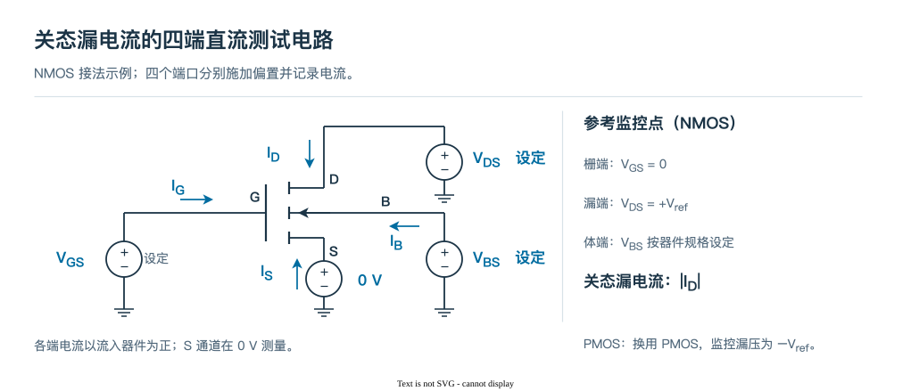

# Ioff

## 定义与适用范围

**关态漏电流**（Off-State Drain Current，$I_{\mathrm{off}}$）是金属氧化物半导体场效应晶体管（Metal-Oxide-Semiconductor Field-Effect Transistor，MOSFET）在规定关断端压和温度下的**单管直流漏端电流幅值**，单位为 A/器件。以流入器件为各端电流的正方向，定义 $V_{\mathrm{GS}}=V_{\mathrm G}-V_{\mathrm S}$、$V_{\mathrm{DS}}=V_{\mathrm D}-V_{\mathrm S}$、$V_{\mathrm{BS}}=V_{\mathrm B}-V_{\mathrm S}$。原始数据保留有符号的端压与电流；按有效宽度、鳍数或片数归一时，须保留单管原值、归一基准和漏结偏置。[1, Table 1, Figs. 5, 8]

| 口径 | 偏置与适用范围 |
|---|---|
| **参考偏置关态漏电流** $I_{\mathrm{off,ref}}$ | 固定 $V_{\mathrm{GS}}=0$；以源端为参考，NMOS 施加 $V_{\mathrm{DS}}=+V_{\mathrm{ref}}$，PMOS 施加 $V_{\mathrm{DS}}=-V_{\mathrm{ref}}$，其中 $V_{\mathrm{ref}}>0$ 由工艺或项目指定，常取参考供电压差。体偏置采用该器件规定的默认值，并记录 $V_{\mathrm{BS}}$ 和温度。用于工艺监控与器件选项比较。 |
| **SRAM 工作点关态漏电流** $I_{\mathrm{off,op}}$ | 对在目标状态下关断的器件，施加实际 $V_{\mathrm{GS}}$、$V_{\mathrm{DS}}$、$V_{\mathrm{BS}}$，读取 $\lvert I_{\mathrm D}\rvert$。用于分析保持、待机预充和半选条件；需保存数据极性和实际端子映射。 |

Jan 等实测 22 nm Tri-Gate 器件的饱和驱动与关态漏电流。其低功耗（Low Power，LP）器件在 0.75 V 条件下报告 $I_{\mathrm{off}}=30\ \mathrm{pA}/\mu\mathrm{m}$、NMOS／PMOS 饱和电流分别为 0.41／0.37 $\mathrm{mA}/\mu\mathrm{m}$；同表不同器件族的栅长、关态目标和额定电压有别。图 5 分别采用 +0.75 V 和 −0.75 V 的漏源偏置，图 8 将关态漏电流与漏结漏电流作为不同观测量比较。[1, Figs. 3–5, 8]

## 物理机制与器件变异

| 机制 | 偏置敏感性及识别方法 |
|---|---|
| **亚阈值漏电**（Subthreshold Leakage） | 关态仍有源漏沟道电流。在弱反型且端压和温度固定时，阈值电压幅值下降使亚阈值分量近似指数增加；提高 $\lvert V_{\mathrm{DS}}\rvert$ 可经漏致势垒降低（Drain-Induced Barrier Lowering，DIBL）增强该分量。在相同栅源电压下比较低、高漏压的转移曲线，结合源端电流和独立提取的阈值判断。串联关断器件改变内部节点电位，须重新求取各管端压。[2, Secs. II–III, Figs. 1–4] [3, Secs. II–IV] [9, Secs. 4.1–4.2] [12, Ch. 2, Secs. 2.2–2.3] |
| **漏结漏电及栅诱导漏极漏电**（Gate-Induced Drain Leakage，GIDL） | 反偏漏结的漏电随结偏置、结面积和温度变化；栅漏端压差增大时，漏端边缘高场可增强带间隧穿（Band-to-Band Tunneling，BTBT）并形成 GIDL。结合 $I_{\mathrm B}$ 和栅漏偏置扫描定位；对照独立漏结结构或模型分量，核对 GIDL 与漏结分量的定义，避免重复计入。[1, Fig. 8] [4, Secs. 2–3, Figs. 1, 5–6] |
| **栅隧穿漏电**（Gate Tunneling Leakage） | 栅端与漏端、源端、沟道或体端间可存在隧穿电流；其中流经漏端的分量进入 $I_{\mathrm D}$。同步记录 $I_{\mathrm G}$，再通过偏置扫描或模型分量判断路径。[4, Secs. 2–3, Figs. 1, 5–6] |

分端电流约束路径判断。稳态四端器件在无其他电气端口时，应满足 $I_{\mathrm D}+I_{\mathrm S}+I_{\mathrm G}+I_{\mathrm B}\simeq 0$；每个端口都可能叠加多个机制，须结合偏置扫描、独立测试结构或已校准的紧凑模型辨识。对先进器件，还须按工艺记录独立背栅或衬底端口、鳍／片几何及隔离结构。[4, Sec. 3] [9, Secs. 4.1–4.2] [15, Sec. III-A, Figs. 2–3]

沟道长度、功函数、沟道掺杂和邻近版图环境可改变阈值、沟道势垒或高场漏电。须区分批次、晶圆和芯片间的共同漂移与局部失配。Kwai 等在 0.25 μm 工艺的两个分批样本中测量最小尺寸 NMOS，平均阈值由 0.47 V 提高至 0.64 V 后，图 1 的宽度归一关态漏电降低；同文 1 Mb 样片在 2.5 V 下的待机电流另行统计，图 1 未明列单管测量的全部端压和温度。[2, Sec. II] [5, Secs. I–II, Figs. 1, 3] [7, Secs. 2–4] [8, Figs. 3, 7–8] [10, Secs. 2.3.1–2.3.2]

## 单管表征与 SRAM 网络漏电

| 对象 | 提取或观测口径 | 工程用途 |
|---|---|---|
| **单管或可独立访问的测试结构** | 直接测量 $I_{\mathrm D}$ 及可访问的 $I_{\mathrm G}$、$I_{\mathrm S}$、$I_{\mathrm B}$。若用模型回放电路导出的端压，标记结果为工作点仿真。 | 建立标准监控点、辨识漏电路径、对照器件选项。[1, Figs. 3–5] [11, Ch. 4] [13, Sec. 3.2, Table 3.1] |
| **位单元** | 在明确存储状态、字线和位线边界后，从电源、位线和可访问的体端支路读取有符号电流。 | 按实际端口计入关断管的亚阈值及结漏电，还须核算导通管的栅漏电等路径。[4, Sec. 2, Eq. (2)] [6, Secs. IV–V, Fig. 8] [14, Sec. 2.2.2] |
| **列或阵列** | 在指定预充和非选中状态下，观察位线或阵列供电端口净电流；按测量边界列明预充、外围和其他接入支路。 | 检查待机功耗与读建差；固定偏置单管 $I_{\mathrm{off,ref}}$ 只提供器件侧输入。[4, Sec. 2, Eq. (3)] |

以常规 6T 位单元为例，保持时字线（Wordline，WL）关断，位线（Bitline，BL）及互补位线（BLB）可预充、夹持或浮置，以目标时序为准。若两侧位线均保持高电位，与低存储节点相连的关断访问管（Access Transistor／Pass-Gate，PG）可承受接近供电压差的源漏端压；另一侧的 PG 端压不同。对上拉管（Pull-Up，PU）、下拉管（Pull-Down，PD）也须分别由存储节点、供电和体端取得实际端压。半选时须核对字线与位线的选通组合；已导通的器件电流应另行记录。按同一电路边界和正方向汇总接入各网的端口电流。例如读建差期间，未选位单元的漏电可使本应保持高电位的一侧位线下降，减小有效差分。[4, Sec. 2, Fig. 2, Eq. (3)]

## 测量与提取方法

**【前置条件】** 选择工艺设计套件（Process Design Kit，PDK）的目标器件模型，或与目标器件几何及版图环境匹配的测试结构。规定工艺、电压和温度（Process, Voltage and Temperature，PVT）、端子映射、体偏置、电压范围和限流、稳态窗口、复测容差及有效测量下限；准备公共参考偏置表和各 SRAM 状态的目标端压表。仿真须核对模型包含的栅漏电、漏结漏电和 GIDL 等机制及其开关；硅测使用带屏蔽和驱动保护（Driven Guard）的源测量单元（Source Measure Unit，SMU）。

D、G、B 通道分别施加相对源端的电压，S 通道在 0 V 测量电流。图示为隔离 NMOS 测试，四个回路共用参考节点。若器件或测试结构有额外衬底、独立背栅或绝对电位约束，回放时须以同一参考节点保留实际端电位，或先验证整体电位平移后等效。只测漏端时，可在参考监控点将 G 与 S 短接；分端诊断时使用独立通道。图中省略驱动保护接线、测试开关、线阻及接触。端子接法另见 [Vth](Vth.md#测量与提取方法)。

**【步骤／方法】**

1. **核对基线及端压**：仿真检查源、漏、栅、体的电位和读取符号；电压源正端接器件端口时，若仿真器定义流入该源正端为正，取反得到流入器件的端口电流。硅测先按仪器规范校准零点，再用开路、空结构检查接线和测试通路的寄生漏电，并验证探针接触。先在低 $\lvert V_{\mathrm{DS}}\rvert$ 核对低电流读数，再以目标量程、偏置及稳定时间核对漏电基线。可寻址结构须验证未选开关隔离及目标端压。[11, Ch. 4] [13, Sec. 3.2.1]
2. **获取参考监控点与诊断曲线**：温度稳定后，固定 $V_{\mathrm{GS}}=0$ 和规定的 $V_{\mathrm{BS}}$，从 $V_{\mathrm{DS}}=0$ 逐步扫至参考漏偏，在稳态窗口记录实际端压和有符号四端电流。按温度分别提取 $I_{\mathrm{off,ref}}$；另在选定低、高漏偏下扫描栅压覆盖关态附近，必要时补充体偏置扫描和独立漏结测试。接近测量下限时，用合适量程重复测量，等待充电暂态与切换扰动消失。[1, Figs. 5, 8] [4, Figs. 5–6] [13, Table 3.1]
3. **回放 SRAM 关态工作点**：在各目标 PVT 下，分别求解目标 6T 单元或阵列的保持、预充夹持及半选状态。先写入并验证两种存储状态；直流解须保留目标状态，浮置位线则从规定预充电位释放，在指定时刻提取实际端压。按 PG、PU、PD 和实例记录端压和连接，对仍关断的器件逐点测量或用同器件模型回放，记录 $I_{\mathrm{off,op}}$。瞬态回放仅给出该端压的准静态单管结果；网络瞬态端口电流随原波形另行记录。[4, Sec. 2, Figs. 1–2] [14, Sec. 2.2.2]

**可寻址结构示例**：许志雄和杨璐丹的偏置表以漏端施加高电位测 NMOS。实际寻址漏电模式为减小未选开关的寄生漏电，改由源端施加高电位、漏端保持低电位并感测。杨璐丹的方案以器件源漏掺杂对称为前提，并用零端压读数估计选中开关的残余漏电。使用反接方案时，须分别验证源漏互换、接入支路偏置及校正误差对目标漏电指标的影响。[11, Ch. 4, Table 4-1, Fig. 4.5] [13, Secs. 3.2.3, 5.2.1, Figs. 3.7, 5.2]

**注意事项**：禁止把低漏偏零点直接用作高漏偏寄生校正值（测试开关和探针支路漏电随偏置变化）。

**注意事项**：禁止分别取端口电流绝对值后求和（同一路径的流入与流出会重复计入，且丢失净电流方向）。

**【结果处理和验证】** 核对设定与实际端压、温度、量程、限流和稳定窗口；超过预定漂移或重复性容差时复测。硅测若使用空结构校正，须保留原始值、同偏置校正值及残余误差；低于有效测量下限按限值报告。四端可测时，以同一稳态窗口核对电流和的残差是否在数值或测量不确定度内；超限时检查端口映射、未计支路、未稳定的位移电流及测试通路。交付分端 I–V、参考及实际工作点偏置表、温度、实例／样本坐标、归一基准、模型或结构版本及越限状态。

## 数据可视化与评估

### 数据分析与评价方法

| 图表 | 记录与判读 |
|---|---|
| **半对数 I–V 及温度曲线** | 横轴分别取 $V_{\mathrm{GS}}$、$\lvert V_{\mathrm{DS}}\rvert$（V）和温度（K 或 °C）；纵轴为 $\lvert I_{\mathrm D}\rvert$（A/器件或指定归一单位）。按固定端压及温度分组，标出监控点、实际工作点和有效测量下限，另保留各端的有符号曲线。单一激活能只在同一主导机制、固定端压且拟合有据的温区内使用。[1, Figs. 5, 8] [4, Sec. 3, Figs. 4–6] |
| **上尾分布及空间图** | 对 $I_{\mathrm{off,ref}}$ 与 $I_{\mathrm{off,op}}$ 分别绘制经验累积分布（Empirical Cumulative Distribution Function，ECDF）或超限概率，按器件极性、角色、温度及版图环境分组。提供中位值、目标高分位数、置信区间、有效样本数、低于测量下限数及无效状态数。晶圆图按芯片坐标呈现空间漂移和局部聚集。[3, Secs. II–IV] [7, Secs. 2–4] |
| **联合分布** | 对同一器件配对 $I_{\mathrm{off}}$、阈值电压、亚阈值摆幅和导通电流，注明各自偏置。以相同漏电预算比较驱动，或以相同驱动／时序目标比较漏电。模型校准同时核对相关性和高尾。[5, Fig. 1] [8, Figs. 7–8] [12, Ch. 2, Figs. 2.6–2.7] |

低于测量下限的有效读数按样本各自下限标为**左删失**，保留样本在分母内；限流、开路等无效样本单列。分位数若位于无法分辨的区间，报告可判定的界限。硅测与统计仿真均按 [Vth](Vth.md#数据分析与评价方法) 区分批次、晶圆、芯片和局部失配；工艺角用于验证边界条件，实际分位数须由硅样本或已校准的统计模型估计。Qian 等在 45 nm 硅样片上对关态漏电先取对数，再用参考版图的对数电流归一，用于研究版图和空间变化；该归一结果无电流量纲。Cheng 等用物理仿真样本比较 BSIM4 与 PSP 的统计建模，保留参数协方差有助于重现阈值、关态漏电流和亚阈值摆幅的相关性；仍须单独核对极端尾部的模型误差。[3, Secs. II–IV] [7, Secs. 2–4, Table 1] [8, Figs. 7–8]

## 应用场景与指标关系

- **器件选型与模型校准**：结合 [Vth](Vth.md) 和 [Ion](Ion.md)，用相同参考条件比较阈值选项；以分端 I–V 校准关态主导机制。设计技术协同优化（Design-Technology Co-Optimization，DTCO）可规定相同驱动或时序目标下的漏电预算，另用实际工作点验证目标状态。[1, Table 1] [4, Secs. 2–4] [8, Figs. 7–8] [9, Secs. 4.1–4.2] [14, Sec. 2.1.1] [16, Sec. 3, Figs. 6–8]
- **位线漏电与读建差**：以从位线流入 PG 为正，按实际连接汇总各 PG 的有符号端口电流，作为 [BL Leakage](../Subarray/BL_Leakage.md) 的器件侧输入。按列的存储图样、端压、未选单元数量及相关性统计，用实际负载和电压波形验证 BL／BLB 的净差分电流。[3, Secs. II–IV] [4, Sec. 2, Eq. (3)]
- **待机与保持验证**：名义电流用于初步预算；[Standby Leakage](../Bitcell/Standby_Leakage.md) 在指定供电、预充及外围状态下按网核算漏电及其分布。降低保持电压或修改体偏置时，按目标状态验证 [DRV](../Bitcell/DRV.md)；Ioff 用于定位漏电贡献，保持通过判据仍由位单元状态和电路验证确定。[4, Secs. 2–4] [5, Figs. 2–3] [6, Secs. IV–V] [10, Secs. 4.2–4.3] [14, Sec. 2.2.2]

## 参考文献

2026-11-17 核对 Zotero 集合 `02-SRAM-DTCO/SRAM-Metrics/Device`（`PQ7MQ9Z9`）的精确标签 `Ioff`：[2]–[16] 共 15 条，均有本地可读全文与项目归档。其中 [2]–[5]、[7]–[8]、[11]–[13]、[15]–[16] 共 11 篇论文，直接支持关态电流、分量、测试提取或器件统计；另有 2 篇电路或器件设计背景论文 [6]、[9] 及 2 本专著 [10]、[14]。[16] 采用出版版，与 Zotero 预印本合计为同一篇工作。[1] 为标签范围外已归档的工艺实测论文。

[1] C.-H. Jan et al., “A 22nm SoC platform technology featuring 3-D tri-gate and high-k/metal gate, optimized for ultra low power, high performance and high density SoC applications,” in IEEE IEDM Tech. Dig., pp. 3.1.1–3.1.4, 2012. [DOI 10.1109/IEDM.2012.6478969](https://doi.org/10.1109/IEDM.2012.6478969). [公开文献](https://doi.org/10.1109/IEDM.2012.6478969)；Zotero：本次检索范围内未匹配记录。

**相关摘要：** 论文展示 22 nm Tri-Gate 多种器件选项在统一供电下的 Ion–Ioff 权衡及亚阈值特性，说明更强栅控和较低沟道掺杂可在抑制亚阈值漏电的同时保持驱动。低功耗器件还通过全耗尽鳍与源漏结工程降低寄生结漏电，超低功耗选项采用更长沟道，图中另将关断与 GIDL／结漏电的权衡单独展示。用于本页应明确器件族、栅漏端压、极性及宽度归一，不能把图中的不同漏电分量视作同一测量端口。文中 SRAM 每单元待机电流和宏运行性能是电路结果，需与单管 Ioff 分栏记录。

**原文定位：** Low Power Logic Transistor，PDF第1–2页／pp.3.1.1–3.1.2，表I、图3–5、8。

[2] J. Pineda de Gyvez and R. Rodríguez-Montañés, “Threshold voltage mismatch (ΔVT) fault modeling,” in Proceedings of the 21st IEEE VLSI Test Symposium, 2003, pp. 145–150. [公开文献](https://doi.org/10.1109/VTEST.2003.1197645)；[DOI](https://doi.org/10.1109/VTEST.2003.1197645)；[Zotero](https://www.zotero.org/users/7333024/items/CVZPAGNG)

**相关摘要：** 论文以阈值失配建立故障模型，区分芯片间变化与局部器件失配，并通过两只串联晶体管的不同输入组合说明关态电流对失配和逻辑状态的依赖。相同器件尺寸下，两管同时关闭与仅一管关闭会产生不同漏电趋势；随后电路测量显示静态电流也随输入向量改变。该文并非 SRAM 专用 Ioff 基准，但支持本页审核堆叠、源节点抬升和局部失配的要求。单管标准关断点、串联网络漏电及电路静态电流必须分开标记，不能只根据某一逻辑状态的总电流推断所有器件的关断能力。

**原文定位：** §II–III，PDF第3–4页／pp.146–147，图1–4。

[3] R. Rao, A. Srivastava, D. Blaauw, and D. Sylvester, “Statistical analysis of subthreshold leakage current for VLSI circuits,” IEEE Transactions on Very Large Scale Integration (VLSI) Systems, vol. 12, no. 2, pp. 131-139, 2004. [公开文献](https://doi.org/10.1109/TVLSI.2003.821549)；[DOI](https://doi.org/10.1109/TVLSI.2003.821549)；[Zotero](https://www.zotero.org/users/7333024/items/ZHYVFPKE)

**相关摘要：** 论文分析栅长变化引起的亚阈值漏电统计，将芯片间与芯片内变异及相关性纳入电路级估计，并考虑多输入门的状态和堆叠效应。由于漏电对器件长度的依赖高度非线性，采用名义器件的电流简单乘以数量会遗漏均值偏移和分布差异。该方法针对亚阈值分量，不能自动代表栅隧穿、结漏电或所有端口的总漏电。用于 SRAM 单管 Ioff 时，应记录长度分布、偏置和归一方式，核对所用函数及统计假设；推广到未选单元列或宏时，还须单独处理状态、器件相关性和阵列连接关系。

**原文定位：** §II–IV，PDF第2–6页／pp.132–136。

[4] Qikai Chen, S. Mukhopadhyay, A. Bansal, and K. Roy, “Circuit-aware Device Design Methodology for Nanometer Technologies: A Case Study for Low Power SRAM Design,” in Proceedings of the Design Automation & Test in Europe Conference, 2006, pp. 1-6. [公开文献](https://doi.org/10.1109/DATE.2006.243868)；[DOI](https://doi.org/10.1109/DATE.2006.243868)；[Zotero](https://www.zotero.org/users/7333024/items/NJAJZIR3)

**相关摘要：** 论文把 SRAM 漏电分解为亚阈值、栅直接隧穿和结相关分量，并考察沟道掺杂、漏压摆幅与体偏置的影响。降低掺杂可改善驱动和减小结电容，也可能增加关断沟道漏电；偏置优化同时改变活动态电流，需与访问时间共同权衡。在式 (3) 的最坏数据图样下，未选访问管的漏电累积并使对侧位线放电，削弱读差分。用于本页须明确观测端口和待机或半选偏置，并在列级核对未选单元数量与数据状态。

**原文定位：** §2–4，PDF第2–5页，图3–6。

[5] Ding-Ming Kwai et al., “SRAM cell current in low leakage design,” in 2006 IEEE International Workshop on Memory Technology, Design, and Testing (MTDT'06), 2006, pp. 65-70. [公开文献](https://doi.org/10.1109/MTDT.2006.28)；[DOI](https://doi.org/10.1109/MTDT.2006.28)；[Zotero](https://www.zotero.org/users/7333024/items/RNB3WGBW)

**相关摘要：** 论文研究低漏电 SRAM 中阈值植入对单元电流的影响。图 1 给出最小尺寸 NMOS 的宽度归一关断电流与阈值实测；图 3 另给出 1 Mb 测试芯片的待机电流，在 2.5 V 下中位值由 6.5 μA 降至 1 μA。文中另测量单元读电流分布及其最弱单元，用于评估提高阈值后的漏电收益和驱动低尾。跨器件定量对照须取得同一植入条件与端压下的单管 I–V，记录归一方式和对象边界。

**原文定位：** §II–IV，PDF第2–5页，待机电流及单元读电流分布实验。

**单管数据定位：** §I，PDF第1页／p.65，图1。

[6] D. D. Lu et al., “Design of FinFET SRAM cells using a statistical compact model,” in 2009 International Conference on Simulation of Semiconductor Processes and Devices, 2009, pp. 1-4. [公开文献](https://doi.org/10.1109/SISPAD.2009.5290234)；[DOI](https://doi.org/10.1109/SISPAD.2009.5290234)；[Zotero](https://www.zotero.org/users/7333024/items/UAIFGKYQ)

**相关摘要：** 论文利用统计紧凑模型优化 FinFET SRAM 鳍数和栅长，将读稳定性、写裕量、面积与漏电一并考虑。访问管、上拉管和下拉管的局部失配分别加入蒙特卡洛仿真，用于区分各管对裕量和漏电散布的贡献。其漏电图给出的是每单元静态功率，且待机电压不同于读写裕量评估电压，不能直接视作同偏置单管 Ioff。本文可用于说明器件几何与失配对关断行为的电路后果；若需提取本页指标，仍须回到模型的单管关断端压及电流，另列单元状态、总功率与分位数口径。

**原文定位：** §IV–V，PDF第3–4页，图8–9、表II。

[7] K. Qian, B. Nikolić, and C. J. Spanos, “Hierarchical modeling of spatial variability with a 45nm example,” in SPIE Advanced Lithography, 2009, pp. 727505. [公开文献](https://doi.org/10.1117/12.814226)；[DOI](https://doi.org/10.1117/12.814226)；[Zotero](https://www.zotero.org/users/7333024/items/LKD5T852)

**相关摘要：** 论文用 45 nm 测试芯片研究空间变异，每个测试单元配置多种版图环境的 NMOS、PMOS 关断漏电测试器件及环振。分析先对漏电做对数变换，再按参考图形归一，逐层区分晶圆、芯片、局部测试块和版图图形的贡献；不同晶圆的栅长处理也作为系统变化考察。其结果适用于本页的抽样和统计方法，但归一化漏电及对数域方差不能直接当作安培量纲的 Ioff。用于 SRAM 时还需匹配单元附近版图环境、器件角色和端压，并说明空间相关性；环振速度仅是互补观测量，不是关断电流的替代测量。

**原文定位：** §2–4，PDF第2–5页，测试芯片结构及漏电数据预处理。

[8] B. Cheng et al., “Statistical-variability compact-modeling strategies for BSIM4 and PSP,” IEEE Design and Test of Computers, vol. 27, no. 2, pp. 26-35, 2010. [公开文献](https://doi.org/10.1109/MDT.2010.53)；[DOI](https://doi.org/10.1109/MDT.2010.53)；[Zotero](https://www.zotero.org/users/7333024/items/BE5F2X9L)

**相关摘要：** 论文比较物理统计器件样本与 BSIM4、PSP 紧凑模型的变异表示，在参数提取中同时重视导通电流和关断电流，并检查阈值、Ioff、亚阈值摆幅之间的相关性。只独立生成高斯参数可能破坏这些联合关系，主成分方法虽能较好保留协方差，参数正态化仍使尾部出现误差。该结论直接影响 SRAM 低漏电筛选：模型应在关态 I–V 区间校准，并验证漏电分布和它与驱动的关联，而非仅匹配典型阈值或导通曲线。文中器件统计基准不能直接等同于阵列总漏电，还需电路状态和空间相关性映射。

**原文定位：** Direct Extraction、Analytical Approaches，PDF第4–8页／pp.29–33，图3、7–8。

[9] R. Joshi, K. Kim, and R. Kanj, “FinFET SRAM Design,” in 2010 23rd International Conference on VLSI Design, 2010, pp. 440-445. [公开文献](https://doi.org/10.1109/VLSI.Design.2010.88)；[DOI](https://doi.org/10.1109/VLSI.Design.2010.88)；[Zotero](https://www.zotero.org/users/7333024/items/FDPWTIAC)

**相关摘要：** 论文指出 FinFET 较强栅控改善亚阈值摆幅和 DIBL，使低阈值驱动与较低关断电流能够兼顾；同时，阈值、氧化层厚度和鳍几何仍需与 SRAM 稳定性共同优化。提高阈值可抑制源漏漏电，增厚氧化层有助于栅漏电但可能损害稳定性，两类漏电不能混为同一端口电流。独立背栅方案进一步在待机与读写状态切换有效阈值。提取本页 Ioff 应完整记录前后栅偏置、鳍数和温度，并把单管关断点与文章中的整单元待机收益分开；活动态偏置带来的性能收益不能直接套用到静态漏电比较。

**原文定位：** §4.1–4.2、§5，PDF第2–4页／pp.441–443。

[10] M. H. Abu-Rahma, and M. Anis, “Nanometer variation-tolerant SRAM: circuits and statistical design for yield,” New York, NY, Springer New York, 2013. [公开文献](https://doi.org/10.1007/978-1-4614-1749-1)；[DOI](https://doi.org/10.1007/978-1-4614-1749-1)；[Zotero](https://www.zotero.org/users/7333024/items/RA2TPQV2)

**相关摘要：** 本书说明随机掺杂、线边粗糙和短沟道效应会改变阈值，其中沟道长度变化的影响又依赖漏源、体源偏置。对关断器件，阈值扰动会通过亚阈值电流的强非线性影响漏电，因此需要在一致端压下记录分布及相关性，不能只比较典型阈值。书中电路功耗表达式另把阵列和外围的总漏电与两类开关功耗分开，属于宏级统计边界。用于本页可借鉴其变异分析，但应保留单管 Ioff、单元漏电和宏级漏电功率的层级区别；读电流低压尾部的讨论也不能直接当作关断电流分布的实测证据。

**原文定位：** §2.3.1–2.3.2、§4.2–4.3，书内pp.8–12、99–103，式(4.1)。

[11] 许志雄, “专用于SRAM失配特性研究的可寻址测试芯片的研究与实现,” 硕士, 浙江大学, 2015. [公开文献](https://kns.cnki.net/kcms2/article/abstract?v=3uoqIhG8C475KOm_zrgu4lQARvep2SAkVNKPvpjdBoadmPoNwLRuZ3gV98idMjKCIp7cq7fOGJOuQMQSBHMHguwfSIdXRrsY&uniplatform=NZKPT)；[原文]( <https://kns.cnki.net/kcms2/article/abstract?v=3uoqIhG8C475KOm_zrgu4lQARvep2SAkVNKPvpjdBoadmPoNwLRuZ3gV98idMjKCIp7cq7fOGJOuQMQSBHMHguwfSIdXRrsY&uniplatform=NZKPT>)；[Zotero](https://www.zotero.org/users/7333024/items/JNICCICS)；DOI：Zotero未收录或尚未核实。

**相关摘要：** 论文面向 SRAM 失配设计可寻址测试芯片，分别测量单元内 PG、PD、PU 的阈值、导通电流及亚阈值漏电。小电流测量用漏电阻断和节点等电位控制减小未选开关及其他器件支路的寄生电流；大电流测量另做开关压降补偿。表 4-1 列出标准关断偏置；图 4.5 所示实际漏电模式则由源端力线施加高电位，在选中器件的漏端感测线测量。使用此结构的单管数据时须记录实际接法、选中开关状态及测试网络的残余漏电。

**原文定位：** 第4章，PDF第47–53页，测试条件表、漏电测量与漏电阻断电路。

[12] N. Damrongplasit, “Study of Variability in Advanced Transistor Technologies,” Ph.D. dissertation, University of California, Berkeley, Tech. Rep. UCB/EECS-2015-37, 2015. [公开文献](https://www2.eecs.berkeley.edu/Pubs/TechRpts/2015/EECS-2015-37.html)；[Zotero](https://www.zotero.org/users/7333024/items/SAWJ4TG7)；DOI：Zotero未收录或尚未核实。

**相关摘要：** 论文在平面 MOSFET 设计中比较均匀掺杂与超陡逆向掺杂，并以固定关断电流上限优化饱和驱动；部分对照还加入 DIBL 约束，因而不能把所有方案视为完全相同的优化条件。随机掺杂使驱动与漏电产生相关散布，作者进一步用校准 I–V 模型评价 SRAM 良率。该研究中仿真的栅漏电相对关断漏电较小，故在良率估计中忽略，属于限定条件而非普遍结论。提取 Ioff 应保留器件宽度归一、供电及掺杂结构，并区分单管关断约束、随机样本分布与完整单元的漏电和稳定性结果。

**原文定位：** 第2章§2.2–2.3，书内pp.24–29／PDF第36–41页，图2.1、2.6–2.7。

[13] 杨璐丹, “面向标准单元库的MOS器件大型可寻址测试芯片的研究、设计与实现,” 硕士, 浙江大学, 2018. [公开文献](https://kns.cnki.net/kcms2/article/abstract?v=3uoqIhG8C475KOm_zrgu4lQARvep2SAk-6BvX81hrs37AaEFpExs0FaKacXeomGbz0CqyNfC21Dzd7N-75HnWZC9K9VXT2CP&uniplatform=NZKPT)；[原文]( <https://kns.cnki.net/kcms2/article/abstract?v=3uoqIhG8C475KOm_zrgu4lQARvep2SAk-6BvX81hrs37AaEFpExs0FaKacXeomGbz0CqyNfC21Dzd7N-75HnWZC9K9VXT2CP&uniplatform=NZKPT>)；[Zotero](https://www.zotero.org/users/7333024/items/I9M9L4AR)；DOI：Zotero未收录或尚未核实。

**相关摘要：** 论文研究大型可寻址 MOS 测试阵列，测试条件表明确区分 NMOS 与 PMOS 的关断偏置，并把漏端关断电流列为器件指标。设计讨论分别列出亚阈值、栅隧穿和带间隧穿等寄生漏电来源，说明大量未选开关会污染微小电流测量；采用较厚栅氧、较长沟道等测试开关选择可降低背景，但也影响开关压降与面积。用于 SRAM 器件提取时，可复用其偏置和隔离思路，需核对源端参考、电流符号及未选路径状态。该文主要是测量结构设计，不能把开关网络总漏电或标准单元库器件数据直接视作 SRAM 单管 Ioff。

**原文定位：** §3.2–3.2.1，书内pp.21–23／PDF第34–36页，表3.1。

[14] H. H. Liu, and F. Catthoor, “Circuit-technology Co-optimization of SRAM design in advanced CMOS nodes,” Cham, Springer Nature Switzerland, 2025. [公开文献](https://doi.org/10.1007/978-3-031-76109-6)；[DOI](https://doi.org/10.1007/978-3-031-76109-6)；[Zotero](https://www.zotero.org/users/7333024/items/CHVFC3IE)

**相关摘要：** 本书在不同先进节点紧凑模型间采用一致的有效关断电流目标，分别设置高、标准和低阈值选项，并以高阈值器件构成 SRAM 单元、标准阈值器件构成外围。这是控制比较条件的建模假设，作者明确说明实际工艺阈值缺乏公开硅数据，研究重点并非漏电优化。书中另将单元待机漏电分为亚阈值、栅和结路径，以关闭 WL、预充位线进行 DC 仿真。用于本页时，应将模型规定的单管 Ioff 与该整单元端口电流分开保存；跨节点比较还须注明阈值类别、器件配置和归一方式，不能据此宣称实测漏电相同。

**原文定位：** §2.1.1、§2.2.2，PDF第39、45–46页，图2.4。

[15] A. Lu, R. Arghavani, and H. Y. Wong, “Prediction of alpha-particle-immune gate-all-around field-effect transistors (GAA-FET) based SRAM design,” 2025. [公开文献](https://doi.org/10.48550/arXiv.2507.15860)；[DOI](https://doi.org/10.48550/arXiv.2507.15860)；[Zotero](https://www.zotero.org/users/7333024/items/34ADTYM4)

**相关摘要：** 论文用三维 TCAD 比较具有局部底部介质隔离与无该隔离的 GAA SRAM；后者采用抑制衬底穿通的植入，以控制额外漏电路径。两类器件获得相近的 Ion、Ioff，电路保持、读写静态噪声裕量也相近，但辐射下的电荷收集和翻转行为仍不同，说明关断电流不能单独预测抗单粒子能力。用于本页时，应明确隔离结构、穿通抑制设计和 TCAD 模型，并将静态关断电流与粒子激发的瞬态电流分开。文中的结构比较可作为控制 Ioff 后评价其他指标的案例，不应解读为相同 Ioff 即具有相同 SRAM 可靠性。

**原文定位：** §III-A–III-C，PDF第2–3页，图3–7。

[16] X. Cheng et al., “A novel design for SRAM bitcell with 3-complementary-FETs,” Microelectronics Journal, vol. 173, Art. no. 107180, 2026. [公开文献](https://doi.org/10.1016/j.mejo.2026.107180)；[DOI](https://doi.org/10.1016/j.mejo.2026.107180)；[Zotero](https://www.zotero.org/users/7333024/items/QJ3K3I2Z)

**相关摘要：** 论文比较混合 JAM/IM 结构的器件 I–V，并在固定栅功函数条件下优化上下层 JAM 掺杂。上层 JAM 的导通电流可高于对照 IM，而关断电流接近；这一结果支持以同一关断约束评价结构驱动收益，但仅适用于图中相应片数、层位和端压。掺杂改变耗尽能力和栅控，需同时观察关态与导通态，不能只凭单元速度判断漏电。用于本页应提取单管关断点的漏端电流及归一方式；论文后续 SRAM 读写和功耗分析属于电路层，不能把其总功耗或整单元静态电流直接登记为器件 Ioff。

**原文定位：** §3，PDF第4–6页，图6–8。
