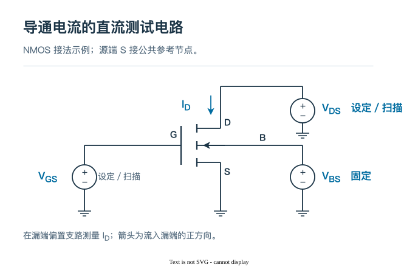

# Ion

## 定义与适用范围

**导通电流**（On-State Drain Current，$I_{\mathrm{on}}$）是金属氧化物半导体场效应晶体管（Metal-Oxide-Semiconductor Field-Effect Transistor，MOSFET）在规定导通偏置和温度下的**单管直流漏端电流幅值**，单位 A/器件。以流入漏端为 $I_{\mathrm D}$ 的正方向，定义 $V_{\mathrm{GS}}=V_{\mathrm G}-V_{\mathrm S}$、$V_{\mathrm{DS}}=V_{\mathrm D}-V_{\mathrm S}$、$V_{\mathrm{BS}}=V_{\mathrm B}-V_{\mathrm S}$，偏置记作 $\mathbf b=(V_{\mathrm{GS}},V_{\mathrm{DS}},V_{\mathrm{BS}})$。保留有符号的原始端压与电流，报告 $|I_{\mathrm D}|$；按有效宽度、鳍数或片数归一时，须注明基准并保留每管原值。

| 口径 | 偏置与用途 |
|---|---|
| **参考偏置导通电流** $I_{\mathrm{on,ref}}$ | 在指定温度 $T$ 和固定参考偏置 $\mathbf b_{\mathrm{ref}}$ 下取 $\lvert I_{\mathrm D}\rvert$，用于器件横向比较。文献常以 $\lvert V_{\mathrm{GS}}\rvert=\lvert V_{\mathrm{DS}}\rvert=V_{\mathrm{DD}}-V_{\mathrm{SS}}$ 报告 Ion；该点若与项目 [Isat](Isat.md) 的工艺监控条件一致，同一器件的电流相同。Jan 等对 22 nm Tri-Gate 薄栅器件报告 0.75 V 的 Idsat–Ioff 数据；厚栅 I/O 器件使用表 I 的另列电压。[1, Table 1, Figs. 3–5] |
| **SRAM 工作点导通电流** $I_{\mathrm{on,op}}$ | 将指定读写事件的实际单管偏置 $\mathbf b_{\mathrm{op}}$ 施加到隔离器件，取得 $I_{\mathrm{on,op}}=\lvert I_{\mathrm D}(\mathbf b_{\mathrm{op}},T)\rvert$。该值用于解释器件在该事件的准静态驱动，可来自直接偏置测量或同条件下经校准的模型。[2, Sec. III, Figs. 4–5] |

## 物理机制与器件变异

- **偏置与工作区**：栅端电压改变反型电荷。给定导通栅压和体偏置，小 $|V_{\mathrm{DS}}|$ 下电流近似随漏压增加；速度饱和限制高场驱动能力，沟道长度调制和漏端诱导势垒降低（Drain-Induced Barrier Lowering，DIBL）使进入饱和区后的电流仍随漏压变化。反向体偏置通常提高平面体硅器件的阈值幅值，降低同栅漏偏置下的驱动。接近阈值时，栅源电压或阈值的小幅变动可引起较大的相对电流变化，须核对低压工作区的模型误差。[3, Sec. II] [7, Secs. 3–5] [10, Sec. III, Eqs. (6)–(8)]
- **几何与串联电阻**：沟道长度、有效宽度、迁移率和源漏串联电阻影响工作点电流。串联电阻增加时，沟道实际端压下降；高栅压、低漏压特别适合检验其贡献。鳍式场效应晶体管（Fin Field-Effect Transistor，FinFET）及纳米片器件须按实际鳍数、片数、接触配置及有效宽度比较。[3, Sec. II] [7, Secs. 3–5] [9, Ch. II, Eqs. (II.11)–(II.18)]
- **变异与模型验证**：分别考查批次、晶圆、芯片的共同漂移与同片局部失配；功函数、掺杂、线宽及串联电阻可能共同改变 $V_{\mathrm{th}}$ 与 $I_{\mathrm{on}}$。Karner 等的室温 N3 投影中，图 4 用于线性区与饱和区的名义 I–V 拟合（高漏压曲线标注 $V_{\mathrm D}=0.8\ \mathrm{V}$），图 5 对照 FinFET 的 NMOS 阈值及 PMOS 导通电流分布，图 8 展示所设变异源对其他器件参数离散的影响。Cheng 等的 BSIM4／PSP 建模实验证明，在其物理仿真样本中，保留参数协方差改善了 Ion 分布的重现；单独拟合阈值分布不足以验证导通电流。[2, Sec. III–V, Figs. 4–5, 8] [5, Figs. 5–8]

## 单管表征与阵列应用边界

| 环境 | 可取得的数据 | 结果适用范围 |
|---|---|---|
| **隔离器件或可独立访问的密度匹配测试结构** | 设定栅、漏、源、体端电位，从目标器件的漏端偏置支路直接测 $I_{\mathrm D}$。保留目标版图环境，并核对测试通路的残余压降、漏电和感测基准。 | 建立 I–V、配对失配及工艺分布。Deng 等的通用测试结构可取得三类晶体管各自的输出曲线，并与同一位单元的特性配对。[6, Test Methods and Applications, Figs. 3–8] |
| **孤立位单元或含寄生的阵列仿真** | 按读写事件保存各目标管的实际端压、器件实例与方向，再回放到单管直流测试。 | 分析实际工作点；阵列互连寄生、字线波形和电源压降通过端压进入。比较固有驱动时，对各样本施加同一预定偏置表。 |
| **普通功能阵列硅测** | 宏端口提供位线或电源电流、位线电压、延时、通过／失效等电路响应。 | 用密度匹配测试结构或已校准模型推断单管 Ion，并标注为推断值；位线电流和延时归于各自电路指标。[4, Sec. 2] [6, Figs. 4–6] [10, Sec. III] |

以常规 6T 位单元读取低存储节点为例，访问管（Access Transistor／Pass-Gate，PG）与下拉管（Pull-Down，PD）构成串联放电通路。字线选通且位线放电不大时，PG 通常工作在饱和区，PD 通常工作在线性区；在给定字线和位线电位下，低存储节点抬升使 PG 的 $V_{\mathrm{GS}}$ 和 $V_{\mathrm{DS}}$ 减小，PD 的 $V_{\mathrm{DS}}$ 增加。上拉管（Pull-Up，PU）在写低过程中可能与 PG 竞争。各角色的参考电流用于诊断器件；评价目标事件须按对应端压求解单管电流，并在完整通路中验证读写结果，位线负载及未选位单元漏电另行计入阵列建差。[4, Sec. 2, Eq. (3)] [7, Secs. 3–5] [8, Sec. 2.6.1] [10, Sec. III, Figs. 2–3] [13, Sec. VI-B, Fig. 19]

## 测量与提取方法

**【前置条件】** 选择与目标 PG、PD、PU 一致的工艺设计套件（Process Design Kit，PDK）模型或工艺控制监测（Process Control Monitor，PCM）／密度匹配测试结构。规定工艺、电压和温度（Process, Voltage and Temperature，PVT）、器件选项、几何、朝向、体偏置、测试偏置范围和允许误差。仿真准备单管网表；提取工作点时同时准备目标位单元或阵列网表，记录寄生、供电、字线（Wordline，WL）、位线（Bitline，BL）及互补位线（BLB）配置。硅测使用源测量单元（Source Measure Unit，SMU）并规定限流、稳定窗口及温控条件。

各通道以源端 S 为参考，设定栅端和漏端偏置，体端保持规定偏置；直接在漏端偏置支路读电流。仿真若以流入漏端电压源正端为支路电流正方向，须取反得到器件 $I_{\mathrm D}$。PMOS 改用相应器件，在常规导通方向施加负的 $V_{\mathrm{GS}}$ 与 $V_{\mathrm{DS}}$；体端按实际阱连接配置。无独立体端时按 PDK 的端子或衬底定义处理。图中省略测试开关、线阻和端电压感测布线。共用端口约定见 [Vth](Vth.md#测量与提取方法)。

**【步骤／方法】**

1. **核对端压和仪器基线**：检查端子映射及偏置源的符号。硅测记录零点、噪声底、量程及探针和开关的压降；在低漏压或通路压降不可忽略时，使用结构提供的开尔文感测（Kelvin Sensing）端子确认实际源漏电压；保留器件端口边界内的接触和串联电阻。[13, Sec. IV-A, Fig. 10]
2. **采集转移与输出曲线**：固定 $V_{\mathrm{DS}}$、$V_{\mathrm{BS}}$ 扫 $V_{\mathrm{GS}}$，再固定 $V_{\mathrm{GS}}$、$V_{\mathrm{BS}}$ 扫 $V_{\mathrm{DS}}$。按器件允许范围覆盖关态、目标导通区与参考点，并在每点稳定后保存实际端压及有符号 $I_{\mathrm D}$。高电流处可用受控脉宽、占空比及采样时刻的脉冲测量与稳态结果对照，检查自热；分开报告两种条件。[1, Figs. 3–5] [2, Fig. 4] [6, Fig. 4]
3. **定义并导出读写事件**：在有目标负载的仿真中记录数据极性、字线偏置、供电和事件门限。示例：读取时，在 WL 已达到指定选通电压后，取目标 BL 首次下降到规定电平时 PG、PD 的端压；写入时，在 WL 选通后取被写低的存储节点首次下降到规定电平时 PG、PU 的端压；若以放电侧 BL 达到规定电平为事件，须确认该事件位于写入选通窗口。逐实例保存实际源漏映射、端压、事件时刻及温度条件；若事件未发生，单列该状态。
4. **回放偏置并提取电流**：对相同实例和器件条件施加事件端压，直接求直流工作点或从覆盖目标端压的 I–V 网格内插值，读取 $I_{\mathrm{on,op}}$。单独保留在公共参考点取得的 $I_{\mathrm{on,ref}}$。各样本用自身端压回放可解释电路反馈；用冻结的参考或事件端压表比较器件驱动。比较两种结果时须标明各自偏置集及事件。

**注意事项**：禁止以宏电源电压替换器件实际端压（会忽略位线降压、存储节点反馈及供电压降）。

**注意事项**：禁止对量程溢出、触发限流或偏置网格以外的样本填入估计值（电流或端压未得到有效验证）。

**【结果处理和验证】** 核对端压、温度、仪器状态及稳定窗口；使用重复采样估计重复性，插值点可通过加密扫描或单点直流测量核对。若仿真的漏端瞬态电流与工作点回放值超出预设误差，先检查端子定义、位移电流和热状态，再分别报告瞬态端口电流与直流工作点值。交付原始 I–V、偏置及事件表、目标电流和量纲、样本位置、温度、器件几何、模型或测试结构标识、测量方式及异常状态。

## 数据可视化与评估

### 数据分析与评价方法

| 图表 | 绘图口径 | 判读 |
|---|---|---|
| **转移与输出曲线** | 横轴分别为 $\lvert V_{\mathrm{GS}}\rvert$、$\lvert V_{\mathrm{DS}}\rvert$（V），纵轴为 $\lvert I_{\mathrm D}\rvert$（A/器件或指定归一化单位），按角色、温度和固定偏置分组；标出参考点及工作点。 | 确认工作区、偏置覆盖和拟合；重点检查目标点附近斜率以及高栅压、低漏压区的串联电阻影响。[3, Sec. II] [9, Ch. II] |
| **分布及晶圆图** | 横轴为电流、纵轴为经验累积概率；晶圆图用芯片坐标及电流色标。对 $I_{\mathrm{on,ref}}$ 与 $I_{\mathrm{on,op}}$ 分别绘制，按 PVT、角色及版图几何分层。 | 记录中位数、低尾分位数、置信区间、样本数及无效状态；区分片内离散、空间漂移与片间差异。Guo 等在四侧邻接宽浅沟槽隔离（Shallow Trench Isolation，STI）的 45 nm 可测宏中发现，PG／PD 的平均饱和电流从边缘至中心约下降 10%；PU 未呈现相同趋势。[2, Figs. 5–6] [6, Figs. 6–7] [13, Sec. VI-C, Fig. 20] |
| **联合散点图** | 同一器件的 $I_{\mathrm{on}}$ 与 $V_{\mathrm{th}}$ 或 $I_{\mathrm{off}}$ 配对，注明各自的测试端压；仅在相同漏电或阈值目标及规格容差下比较驱动。 | 识别阈值、漏电和驱动权衡，检查紧凑模型是否重现相关性。[1, Figs. 3–5] [5, Figs. 7–8] |

工艺角用于边界检查，低尾和置信区间使用硅样本或已校准的统计模型。按相同条件比较固定参考点及各自工作点；样本条件、样本层级和区间要求见 [Vth](Vth.md#数据分析与评价方法)。外推近阈值电流低尾前，须以相同偏置下的样本验证分布拟合。Guo 等的 45 nm 阵列在 0.7 V 和 0.5 V 下测得单元读电流低尾偏离正态；该结果的观测对象为单元读通路。[10, Secs. III–IV] [13, Sec. VI-B, Fig. 19] 读写事件缺失和测量越限须分别统计占比；目标分位数落入无法测量的范围时，报告可判定的界限。

## 应用场景与指标关系

- **器件筛选与模型校准**：用 $I_{\mathrm{on,ref}}$ 比较相同阈值选项与几何的工艺驱动，结合 [Ioff](Ioff.md)、[Vth](Vth.md) 及线性区和饱和区 I–V 检查模型。含体偏置、独立背栅、应力或离散鳍／片数的方案须记录实际端口和结构，采用各自的测试规范。[1, Table 1] [2, Figs. 4–6] [7, Secs. 3–5] [11, Secs. 2.1.1, 6.4–6.5] [12, Sec. 2.4, Figs. 6–7]
- **读写性能与裕量**：用角色对应的 $I_{\mathrm{on,op}}$ 分析 [Read Current](../Bitcell/Read_Current.md) 和[写裕量](../Bitcell/WM.md)。固定电容和目标摆幅时，提高位线有效放电电流可缩短建差时间；增强 PG 也可能抬高读低节点，须同时检查[读静态噪声裕量](../Bitcell/RSNM.md)。改变 WL 波形时同时检查 [WL Slew](../Subarray/WL_Slew.md) 及目标事件偏置；改变尺寸时须重估互连及端口负载。[4, Sec. 2] [7, Secs. 3–5] [10, Sec. III] [11, Secs. 6.4–6.5]
- **良率诊断**：在设计技术协同优化（Design-Technology Co-Optimization，DTCO）中，以角色对应的低尾 Ion 定位驱动不足，并用同一器件或同一统计样本关联读写响应。通过判据采用目标位单元或阵列的速度、稳定性和漏电规格。[2, Sec. V-B, Figs. 9–11] [6, Figs. 6–7]

## 参考文献

已核对 Zotero 集合 `02-SRAM-DTCO/SRAM-Metrics/Device` 的精确标签 `Ion`：初始 11 条与 [2]–[12] 一一对应。[8]、[11] 为专著；本次将符合指标的论文 [13] 纳入该标签并复用其既有 Zotero 附件和项目归档。当前共 12 条可读全文，包括 10 篇论文（含博士论文 [9]；[12] 使用出版版）和 2 本专著；另保留该标签以外的工艺实测论文 [1]。

[1] C.-H. Jan et al., “A 22nm SoC platform technology featuring 3-D tri-gate and high-k/metal gate, optimized for ultra low power, high performance and high density SoC applications,” in IEEE IEDM Tech. Dig., pp. 3.1.1–3.1.4, 2012. [DOI 10.1109/IEDM.2012.6478969](https://doi.org/10.1109/IEDM.2012.6478969). [公开文献](https://doi.org/10.1109/IEDM.2012.6478969)；Zotero：本次检索范围内未匹配记录。

**相关摘要：** 论文给出 22 nm Tri-Gate 平台多种阈值和氧化层选项的导通／关断电流权衡，并以统一供电下的 I–V 和 Ion–Ioff 图比较高性能、标准及低功耗器件。三栅结构增强短沟道控制，使低漏电目标下仍能维持驱动；不同选项的栅长与结工程并不完全相同。图中的 Ion 属于工艺饱和监控点，不能直接代替 SRAM 读写瞬间 PG、PD 或 PU 的实际工作电流。应用时应保留器件族、NMOS／PMOS、端压和宽度归一方式，再从输出或转移曲线提取目标偏置电流，并与文章的单元待机及宏运行结果分开。

**原文定位：** Logic Transistor、Low Power Logic Transistor，PDF第1–2页／pp.3.1.1–3.1.2，表I、图3–5。

[2] M. Karner et al., “Variability-aware DTCO flow: Projections to N3 FinFET and nanosheet 6T SRAM,” in Proc. SISPAD, pp. 15–18, 2021. [DOI 10.1109/SISPAD54002.2021.9592527](https://doi.org/10.1109/SISPAD54002.2021.9592527). [公开文献](https://doi.org/10.1109/SISPAD54002.2021.9592527)；[Zotero](https://www.zotero.org/users/7333024/items/2NIBZCPG)

**相关摘要：** 论文建立从器件 TCAD、统计紧凑模型到含三维寄生 SRAM 的可变性 DTCO 流程。在室温 N3 FinFET 与纳米片投影中，作者比较线性区和饱和区 I–V，并核对 TCAD 与 SPICE 产生的阈值和导通电流分布，随后将器件变异传入单元分析。栅功函数、掺杂和几何扰动及片间相关性会影响分布，因而只对齐名义 Ion 不足以验证统计模型。用于实际 SRAM 工作电流时，还须从已校准曲线读取 PG、PD、PU 在对应工作点的电流；文中的饱和监控点与完整单元读写结果应分别保存。

**原文定位：** §III–V，PDF第2–3页／pp.16–17，图3–6、8。

[3] P. G. Drennan and C. C. McAndrew, “Understanding MOSFET mismatch for analog design,” IEEE Journal of Solid-State Circuits, vol. 38, no. 3, pp. 450–456, Mar. 2003. [公开文献](https://doi.org/10.1109/JSSC.2002.808305)；[DOI](https://doi.org/10.1109/JSSC.2002.808305)；[Zotero](https://www.zotero.org/users/7333024/items/MWABY32G)

**相关摘要：** 论文针对模拟器件提出以实际电流为核心的失配建模方法，指出简单阈值失配和面积反比规律无法覆盖所有尺寸及偏置。模型通过电流对多个 SPICE 参数的敏感度传播方差，并要求用不同栅漏偏置与几何的测量辨识参数；高栅压、短沟道线性区等条件可暴露串联电阻贡献。该文不是 SRAM 专门实验，但可用于审核 SRAM 单管 Ion 的统计提取：必须说明所处反型与工作区、实际端压和几何，并验证模型在目标电流工作点的误差，不能仅凭阈值方差推断导通电流尾部。

**原文定位：** §II，PDF第2–5页／pp.450–453。

[4] Qikai Chen, S. Mukhopadhyay, A. Bansal, and K. Roy, “Circuit-aware Device Design Methodology for Nanometer Technologies: A Case Study for Low Power SRAM Design,” in Proceedings of the Design Automation & Test in Europe Conference, 2006, pp. 1-6. [公开文献](https://doi.org/10.1109/DATE.2006.243868)；[DOI](https://doi.org/10.1109/DATE.2006.243868)；[Zotero](https://www.zotero.org/users/7333024/items/NJAJZIR3)

**相关摘要：** 论文以低功耗 SRAM 为例把器件掺杂、几何和端口偏置优化连接到访问时间与漏电目标。读路径的有效充放电能力由访问管电流、未选单元漏电及位线电容共同决定，较大的导通电流并不必然带来最佳访问时间。降低沟道掺杂可增强驱动并减小结电容，但过低掺杂会使漏电代价增加；源偏置与体偏置也改变导通能力。论文式 (3) 所称的访问管饱和电流是 PG／PD 串联放电通路中的电流；比较时须分开保存该通路电流与单管参考电流。

**原文定位：** §2–4，PDF第2–5页，式(3)、图3–6。

[5] B. Cheng et al., “Statistical-variability compact-modeling strategies for BSIM4 and PSP,” IEEE Design and Test of Computers, vol. 27, no. 2, pp. 26-35, 2010. [公开文献](https://doi.org/10.1109/MDT.2010.53)；[DOI](https://doi.org/10.1109/MDT.2010.53)；[Zotero](https://www.zotero.org/users/7333024/items/BE5F2X9L)

**相关摘要：** 论文从含随机掺杂、线边粗糙和多晶硅晶粒变异的物理器件样本提取 BSIM4、PSP 统计模型，比较独立参数采样与保留协方差的主成分方法。结果显示，仅重现阈值分布并不保证重现导通电流分布；忽略参数相关性会给 Ion 带来明显分布误差，而主成分方法较好保留其变化趋势。两种方法仍受参数正态化假设影响，尾部存在偏差。用于 SRAM 器件筛选时，应核对 Ion 与阈值、Ioff 等指标的联合统计及低尾，不宜把单参数高斯扰动或名义 I–V 拟合视为导通电流良率验证。

**原文定位：** Direct Extraction、Analytical Approaches，PDF第4–7页／pp.29–32，图3、5–8。

[6] X. Deng, T. W. Houston, A. Duong, and W. K. Loh, “A universal structure for SRAM cell characterization,” in 2010 International Conference on Microelectronic Test Structures (ICMTS), 2010, pp. 216-219. [公开文献](https://doi.org/10.1109/ICMTS.2010.5466815)；[DOI](https://doi.org/10.1109/ICMTS.2010.5466815)；[Zotero](https://www.zotero.org/users/7333024/items/UFY8SIZT)

**相关摘要：** 论文提出 SRAM 通用测试结构，将同一物理单元内 PG、驱动管和负载管的端口引出，使各管 I–V、阈值与单元读电流能够在同一位置测量。测试方法分别指定栅、漏、源、体端的仪器连接，实测图给出三类晶体管的输出曲线，并用于获取单元内部 Ion 失配及器件参数与稳定性的相关性。其价值在于可按目标端压从曲线提取导通电流，而不必用单元读电流代替单管电流。不同测试接法的源节点电位仍需核验；作者另用该结构检查直接位访问阈值测量中的源电位，说明实际端压是结果可比性的组成部分。

**原文定位：** Test Methods、Applications，PDF第2–4页／pp.217–219，图3–8。

[7] R. Joshi, K. Kim, and R. Kanj, “FinFET SRAM Design,” in 2010 23rd International Conference on VLSI Design, 2010, pp. 440-445. [公开文献](https://doi.org/10.1109/VLSI.Design.2010.88)；[DOI](https://doi.org/10.1109/VLSI.Design.2010.88)；[Zotero](https://www.zotero.org/users/7333024/items/FDPWTIAC)

**相关摘要：** 论文讨论 FinFET 的栅控、宽度量化和独立背栅偏置如何改变 SRAM 的驱动与稳定性。较好的亚阈值摆幅允许在漏电受限条件下选用较低阈值，鳍数则离散地决定 PU、PD、PG 的相对强度，无法总与平面器件宽度精确对应。读和写的竞争关系不同，因此导通能力提高可能改善读访问，却因上拉增强而恶化某种写入转换。文中还利用背栅改变活动与待机时的有效阈值。提取本页 Ion 必须记录前背栅偏置、鳍数及器件角色；文中的感放读延时和单元写延时只能作为这些驱动选择的电路后果。

**原文定位：** §3–5，PDF第2–4页／pp.441–443，表1、图4–6。

[8] M. H. Abu-Rahma, and M. Anis, “Nanometer variation-tolerant SRAM: circuits and statistical design for yield,” New York, NY, Springer New York, 2013. [公开文献](https://doi.org/10.1007/978-1-4614-1749-1)；[DOI](https://doi.org/10.1007/978-1-4614-1749-1)；[Zotero](https://www.zotero.org/users/7333024/items/RA2TPQV2)

**相关摘要：** 本书说明随机掺杂、线边粗糙及沟道长度变化会通过阈值和短沟道效应改变器件驱动，且其影响依赖漏源和体源偏置。进入 SRAM 后，读电流由 PG/PD 串联及节点反馈共同确定，电流分布又影响位线建立时间与读良率。书中说明低压下器件进入较弱反型区时对阈值变动更敏感，并分析单元读电流、位线负载与感测时间的关系。用于本页时，应保留单管 I–V 与失配参数的联合信息，再在实际工作偏置提取 Ion；不能将整单元 Iread 分布直接登记为某一晶体管的导通电流分布。

**原文定位：** §2.3.1–2.3.2、§2.6.1、§4.3、§5.4.1，书内 pp. 8–12、24–25、101–103、134–141。

[9] L. Rahhal, “Analysis and modeling of mismatch phenomena for advanced MOSFET‟s,” Doctoral dissertation, Université de Grenoble, 2014. [公开文献](https://theses.hal.science/tel-01305050)；[原文]( <https://theses.hal.science/tel-01305050>)；[Zotero](https://www.zotero.org/users/7333024/items/6QDYMT57)；DOI：Zotero未收录或尚未核实。

**相关摘要：** 论文研究先进 MOSFET 的电流失配，提出基于 Y 函数的阈值和电流增益失配提取，并把源漏串联电阻变异加入漏电流方差模型。作者指出强反型、线性区的电流会随串联电阻增大而降低，单独采用阈值和增益失配不足以覆盖短沟道器件。新模型通过电流对阈值、增益及电阻的偏导构建，在相应推导中忽略三者的交叉相关项。用于 SRAM Ion 评估时应先核对适用的偏置区间和这种相关性假设，特别关注低漏压工作点及接入电阻；文中模型不能直接替代含 PG/PD 反馈的单元读电流模型。

**原文定位：** 第II章§II.1–II.3，书内pp.57–65，式(II.11)–(II.18)。

[10] S. Shen, P. Cao, M. Ling, and L. Shi, “A timing yield model for SRAM cells at sub/near-threshold voltages based on a compact drain current model,” IEEE Transactions on Computer-Aided Design of Integrated Circuits and Systems, vol. 42, no. 4, pp. 1223-1234, 2023. [公开文献](https://doi.org/10.1109/TCAD.2022.3194812)；[DOI](https://doi.org/10.1109/TCAD.2022.3194812)；[Zotero](https://www.zotero.org/users/7333024/items/MIQDANJL)

**相关摘要：** 论文为亚阈值和近阈值 SRAM 构建漏电流紧凑模型，再由访问管电流推导位线差分建立和时序良率。模型显式加入 DIBL 的漏压相关项、线性区至饱和区过渡项及栅压依赖，指出位线放电使访问管漏源电压变化，因此其电流并非常数。推导还在指定读状态下近似忽略访问管的体偏置，需要随工作点检查。用于本页时，可把模型作为实际端压到导通电流的映射，但应保留电压、温度、工艺角及模型适用范围；论文最终得到的差分电压和时序分布不是固定饱和偏置下 Ion 的直接测量。

**原文定位：** §III，PDF第4–6页，式(6)–(8)、图2–3。

[11] H. H. Liu, and F. Catthoor, “Circuit-technology Co-optimization of SRAM design in advanced CMOS nodes,” Cham, Springer Nature Switzerland, 2025. [公开文献](https://doi.org/10.1007/978-3-031-76109-6)；[DOI](https://doi.org/10.1007/978-3-031-76109-6)；[Zotero](https://www.zotero.org/users/7333024/items/CHVFC3IE)

**相关摘要：** 本书以校准紧凑模型和版图寄生贯通器件、单元及阵列分析，强调驱动增强必须连同电容和读写竞争一起评价。沟道应力会改变 NMOS、PMOS 驱动及存储节点切换，增大鳍高或纳米片数虽可提升晶体管能力，也增加负载并改变稳定性；更宽纳米片还可能扩大单元。各节点采用一致关断电流目标以形成比较基准，不能把该假设当作实测工艺性能。提取 Ion 时应注明应力、几何和阈值选项，并从相同端压的 I–V 取值；书中阵列延时、裕量和电流竞争是下游结果，不是单管导通电流定义。

**原文定位：** §2.1.1、§6.4–6.5，PDF 第 39、152–156 页。

[12] X. Cheng et al., “A novel design for SRAM bitcell with 3-complementary-FETs,” Microelectronics Journal, vol. 173, Art. no. 107180, 2026. [公开文献](https://doi.org/10.1016/j.mejo.2026.107180)；[DOI](https://doi.org/10.1016/j.mejo.2026.107180)；[Zotero](https://www.zotero.org/users/7333024/items/QJ3K3I2Z)

**相关摘要：** 论文以混合 JAM/IM 器件构成 3-CFET 单元，并通过掺杂优化提高上层 JAM 晶体管的导通能力。器件 I–V 比较显示，上层 JAM 可因较弱表面散射取得较大的导通电流，同时维持接近对照器件的关断电流；优化中固定栅功函数，避免把阈值重设误认为结构收益。文中的晶体管导通电流与后续单元读电流属于不同观测量。用于本页时应从相同层位、片数和端压下的 I–V 曲线取值，再检查 PG、PD 与 PU 的竞争关系，不能直接把单管电流增幅换算成 SRAM 读写延时增幅。

**原文定位：** §2.4、§3，PDF 第 4–6 页，图 6–8。

[13] Z. Guo, A. Carlson, L. T. Pang, K. T. Duong, T. J. K. Liu, and B. Nikolić, “Large-scale SRAM variability characterization in 45 nm CMOS,” IEEE Journal of Solid-State Circuits, vol. 44, no. 11, pp. 3174–3192, 2009. [公开文献](https://doi.org/10.1109/JSSC.2009.2032698)；[DOI](https://doi.org/10.1109/JSSC.2009.2032698)；[Zotero](https://www.zotero.org/users/7333024/items/5RBES89L)

**相关摘要：** 论文以端子可访问宏实测单管饱和电流与线性区阈值。在四侧邻接宽 STI 的 20 行 × 40 列测试宏上，PG／PD 的平均饱和电流从边缘至中心约下降 10%，PU 电流和两种极性的线性阈值未随边距出现相同变化。功能阵列的单元读电流另行测量；其低尾在 0.7 V 和 0.5 V 下偏离正态。应用时，以前者检查密度结构的器件驱动空间偏移，以后者说明阵列低压读通路的统计边界。

**原文定位：** §IV-A、§VI-B–C，PDF 第 8、12–13 页／pp. 3181, 3185–3186，图 10、19–20。
