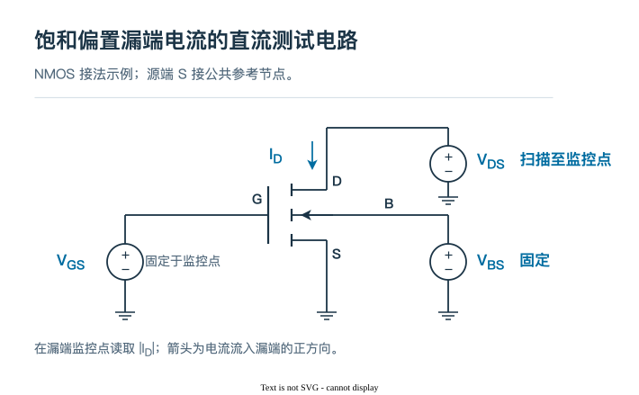

# Isat

## 定义与适用范围

**饱和偏置漏端电流**（Saturation-Bias Drain Current，$I_{\mathrm{sat}}$ 或 $I_{\mathrm{dsat}}$）是规定饱和监控偏置下，单个晶体管漏端稳态电流的幅值。以源端为参考，规定 $V_{\mathrm{GS}}=V_{\mathrm G}-V_{\mathrm S}$、$V_{\mathrm{DS}}=V_{\mathrm D}-V_{\mathrm S}$、$V_{\mathrm{BS}}=V_{\mathrm B}-V_{\mathrm S}$，电压单位为 V。流入漏端为正；原始 $I_{\mathrm D}$ 保留符号，正常导通时 NMOS 为正、PMOS 为负。监控值按以下口径提取：

$$
I_{\mathrm{sat}}=\left|I_{\mathrm D}\right|_{(V_{\mathrm{GS,mon}},\,V_{\mathrm{DS,mon}},\,V_{\mathrm{BS,mon}})}.
$$

优先采用器件族规定的偏置。无专用条件时，在模型或工艺的有效范围内规定 $V_{\mathrm{ref}}>0$，取 $|V_{\mathrm{GS,mon}}|=|V_{\mathrm{DS,mon}}|=V_{\mathrm{ref}}$，体端采用工艺默认偏置；NMOS 的栅、漏端对源端加正压，PMOS 加负压。在已验证该点处于饱和区后报告 Isat；若采用规格固定点但工作区未经验证，则注明“监控偏置电流，饱和区未确认”。须保存 A/器件原始量及其几何；另报 A/μm、A/鳍或 A/片时须给出宽度算法或计数口径。不同结构与布局的每鳍／每片电流须实测或建模核对后比较。[1, Table 1, Figs. 3–4] [5, Sec. III, Fig. 3]

| 同类量 | 定义与比较边界 |
|---|---|
| **饱和区起始漏源电压** $V_{\mathrm{DS,sat}}$ | 给定栅源、体源偏置和温度下的工作区边界，单位为 V；监控电流的取样漏压 $V_{\mathrm{DS,mon}}$ 由规格另行规定。采用输出曲线切线交点提取时，记录拟合区间及交点电压、电流，单列该口径。[16, Sec. 2] |
| **导通电流** [Ion](Ion.md) | 参考 Ion 的端压、温度及归一方式与 Isat 一致时，两者可对应；工作点 Ion 由实际器件端压决定，可位于线性区或饱和区。[5, Fig. 3] [6, Sec. 2, Fig. 2] |

## 物理机制与器件变异

强反型下，固定栅源及体源偏置，从低漏压开始，沟道电流幅值随漏源电压幅值增大。对长沟道器件，可用 $|V_{\mathrm{DS,sat}}|\approx |V_{\mathrm{GS}}|-|V_{\mathrm{th}}|$ 估算沟道漏端夹断的起始点；$V_{\mathrm{th}}$ 取相应体偏置下的阈值。夹断后，沟道长度调制使有效沟道缩短，输出仍可有正斜率。短沟道高场下，载流子速度趋于饱和，拐点可早于上述估算值；漏端诱导势垒降低（Drain-Induced Barrier Lowering，DIBL）还会减小有效阈值的幅值，使饱和区电流幅值随漏偏幅值上升。用适用的紧凑模型判据及输出曲线确认工作区，低斜率仅作曲线核对。[5, Secs. II–III] [6, Sec. 2] [8, Ch. I, Eq. (I.4)] [16, Sec. 2]

- **栅控与输运**：阈值电压幅值提高时，固定栅偏的过驱动减小；沟道迁移率下降及源漏串联电阻增大也可削弱驱动。高过驱动下，电流可对迁移率、速度饱和及串联电阻更敏感；低供电下，阈值离散相对过驱动的比例增大。用低、高漏偏下的转移曲线和输出曲线区分机制。[7, Eq. (1), Table 1] [8, Ch. II] [11, Sec. 2.3, Table 2.1]
- **系统变化与局部失配**：有效沟长、鳍／片几何、功函数、沟道掺杂和邻近图形可改变器件驱动。分别记录批次／晶圆／芯片的共同偏移、版图位置依赖及同几何配对失配；建统计模型时用实测核对电流与阈值的联合分布和低尾。[2, Secs. II–IV] [3, Sec. VI-C, Fig. 20] [13, Figs. 3–7] [15, Secs. III–V]

## 单管表征与阵列应用边界

| 表征对象 | 观测量与边界 |
|---|---|
| **独立器件或工艺监控结构** | 在目标偏置直接读取漏端电流，用于同类器件和工艺批次比较。保留测试结构几何、触点和邻近图形；工艺监控结构与 SRAM 密度结构须分别标识。[1, Table 1] [5, Sec. III] |
| **可访问端子的位单元测试结构** | 对访问管（Access Transistor／Pass-Gate，PG）、下拉管（Pull-Down，PD）或上拉管（Pull-Up，PU）分别施加四端偏置并隔离其他通路；记录寻址开关、取样位置和补偿后端压。该观测量仍为单管电流。[3, Sec. IV, Fig. 10(b)] [10, Ch. 4] |
| **功能位单元、列或阵列** | 记录字线（Wordline，WL）、位线（Bitline，BL）及互补位线（BLB）、存储状态、供电与选通时序，在规定端口测电流或建差。端口结果包含由连接关系产生的串联、反馈和并联电流，阵列还受互连负载及未选单元影响。若以模型回放单管端压，结果标为工作点 Ion。[3, Secs. IV–V] [7, Figs. 1–4] |

以常规 6T 读操作为例，PG 和 PD 串联放电。当 WL 已选通且电位近似不变、读低节点端按模型定义为 PG 的源端时，读低存储节点抬升会减小 PG 的栅源电压，并可改变体偏置；PD 的漏源电压是低存储节点相对本地源端的电压。两管的实际工作区须分别核对，见 [Read Current](../Bitcell/Read_Current.md)。若用外部电压源将读低节点钳在单元本地 $V_{\mathrm{SS}}$，并验证 PD 及其余支路对该节点净电流的贡献可忽略，且 PG 端压符合监控条件，则钳位电流幅值可作为该 PG 的 Isat 代理量。取消钳位后，应重新求解实际读电流。[7, Figs. 1–5] [14, Sec. III-A, Figs. 4–5]

## 测量与提取方法

**【前置条件】** 选用工艺设计套件（Process Design Kit，PDK）的目标模型，或对应的工艺控制监测（Process Control Monitor，PCM）结构与 SRAM 密度测试结构。规定工艺、电压和温度（Process, Voltage and Temperature，PVT）、器件角色、阈值选项、端子映射、几何、监控偏置、允许范围、限流、端压和电流容差及有效测量窗口。仿真须核对模型版本、布局相关效应、自热开关及器件端口定义；硅测使用源测量单元（Source Measure Unit，SMU），温度稳定后确认探针接触和测量通路。

图为隔离 NMOS 的接法：D、G、B 各自施加相对源端的电压，S 接公共参考节点，在漏端偏置支路读电流。PMOS 相对源端反向施加栅、漏偏置，体端及额外的衬底或背栅按 PDK／测试结构规定设置；有绝对电位约束时须保留实际端电位。图中省略探针、接触、Kelvin 感测线及寻址开关。四端接入还可参考 [Vth](Vth.md#测量与提取方法)。

**【步骤／方法】**

1. **仿真：扫描输出曲线**。固定 $V_{\mathrm{GS,mon}}$、$V_{\mathrm{BS,mon}}$，从 $V_{\mathrm{DS}}=0$ 按目标极性扫描至 $V_{\mathrm{DS,mon}}$。使监控偏置成为实际采样点，读取稳态漏端有符号电流及模型可用的工作区参数；若使用 `vdsat` 等模型参数判区，须与同属内禀或外部口径的漏源电压比较。目标点靠近拐点时加密步长，并在允许范围内检查拐点两侧。另取若干栅压的输出曲线 [16, Sec. 2]，以及低、高漏偏的转移曲线 [5, Sec. III, Fig. 3] [15, Secs. III–IV, Fig. 4]，联合检查 DIBL、串联电阻和高场效应。若仿真器返回流入所接电压源正端的电流，则在该源正端直连器件漏端时取反得到 $I_{\mathrm D}$。
2. **硅测：核对实际端压并采样**。在低应力偏置下检查开路读数、接触和未选支路；以源端实测电位为参考维持 $V_{\mathrm{GS,mon}}$ 和 $V_{\mathrm{BS,mon}}$，从低漏压逐点扫至规定漏压，在无量程溢出、无触发限流且读数进入稳定窗口时记录器件实际端压和 $I_{\mathrm D}$。对高电流或可寻址结构，优先采用源、漏端四线感测（Force/Sense），或使用已验证的压降补偿；源端偏移须反馈修正，或按端压容差判为无效。若感测支路止于焊盘，须另核对焊盘到器件的接入压降；感测到器件外部端子时，读数仍包含器件内建源漏串联电阻的影响。对有温升或历史依赖疑虑的结构，按相同端压复扫、反向扫或测短脉冲；脉冲测量须记录脉宽、占空比、取样延迟及热边界，取样应在电气暂态稳定后。[10, Secs. 4.2–4.3.1] [12, Secs. 3.2, 5.2.2]

**注意事项**：禁止以仪器强制电压代替器件端压（寻址开关、互连与接触可产生电流相关压降）。

**注意事项**：扫描和切换偏置时须保持体源结、体漏结处于工艺允许的偏置范围（避免结正向导通改变漏端读数）。

**注意事项**：直流与脉冲结果须分别标注（自热和测量窗口可改变监控点电流）。

**【结果处理和验证】** 核对端子极性、实际偏置、温度、限流状态、重复性及选中通路。在监控点核对模型工作区及输出曲线的拐点与局部斜率；仅有硅测曲线时，按事先约定的曲线判据核对，无法判定时单列工作区状态。记录全部电气端口时，在同一稳态窗口核对有符号电流和的残差是否在测量不确定度内。偏置越限、探针接触异常、触发限流及读数未稳定的样本须标记并复测，未恢复时单列。交付原始 I–V、提取值、实际偏置、器件角色和几何、样本位置、温度、模型或测试结构版本、测量方式、归一化规则及异常状态。

**文献实例**：Jan 等在 22 nm Tri-Gate 平台的表 I 中按器件族配对报告 Idsat 和 Ioff。低功耗薄栅 NMOS／PMOS 在 0.75 V 的报告值分别为 0.41／0.37 mA/μm，Ioff 约为 30 pA/μm；厚栅 I/O 的表列条件为 1.8 V 或 3.3 V。配对比较须沿用各指标自身的栅偏及对应漏电规格。[1, Table 1, Figs. 3–5, 9–10]

## 数据可视化与评估

| 图表 | 绘图口径与判读 |
|---|---|
| **输出与转移曲线** | 横轴分别为 $\lvert V_{\mathrm{DS}}\rvert$、$\lvert V_{\mathrm{GS}}\rvert$（V），纵轴为 $\lvert I_{\mathrm D}\rvert$（A/器件或指定归一化单位）。用曲线组区分固定偏置、温度和测试方式；在输出曲线上标记实取监控点和提取的拐点，保存局部斜率和重复性。[16, Sec. 2] 在转移曲线上比较低、高漏偏下的驱动与阈值变化。[5, Fig. 3] [15, Fig. 4] |
| **联合散点** | 同一器件配对 Isat–Ioff、Isat–Vth，标注各自测量偏置。对照相同漏电规格、偏置与几何筛选驱动，对曲线残差和相关性检查模型。[1, Figs. 3–5] [2, Figs. 5–7] |
| **经验分布与晶圆图** | 经验累积分布以电流为横轴、累积概率为纵轴。按器件角色、几何、版图位置和 PVT 分层报告中位数、均值、标准差或相对标准差、目标低尾分位数、置信区间、有效样本数及无效状态。晶圆图使用芯片坐标与电流色标；芯片内可另按行列或距边缘位置绘图，再评价匹配对的差值。[3, Sec. VI-C, Fig. 20] [9, Sec. III, Fig. 4] |

数据比较须统一偏置、温度、热边界、测量窗口、几何、归一基准和样本层级。工艺角用于覆盖边界，分位数从硅样本或经校准的统计仿真估计，置信区间须反映批次、晶圆或芯片的聚类结构，详见 [Vth](Vth.md#数据分析与评价方法)。低尾样本不足时报告可判定的区间；高斯尾部外推须用同偏置下的实测或已校准模型验证。Yu 等给出的单管 Isat 非高斯尾部为 Monte Carlo 仿真结果，实测证据对应单元读电流。[2, Sec. IV] [9, Sec. III, Fig. 4]

**空间偏移实例**：Guo 等在四侧邻接宽浅沟槽隔离（Shallow Trench Isolation，STI）的 45 nm 可测宏中发现，PG／PD 平均 Isat 从边缘至中心约下降 10%，PU 电流及两种极性的线性阈值未观察到相应空间趋势；该位置依赖须在独立跟踪的版图组中评价。[3, Sec. VI-C, Fig. 20] [4, Sec. 4.5.1, Fig. 4.37]

## 应用场景与指标关系

- **工艺监控和模型校准**：在统一偏置、温度和器件几何下监控不同批次的 Isat，用 [Ioff](Ioff.md) 和 [Vth](Vth.md) 辨别驱动、漏电和阈值的共同漂移。校准紧凑模型时同时核对线性与饱和 I–V、阈值选项、布局相关效应及统计相关性。[1, Table 1] [2, Sec. IV] [5, Sec. III] [13, Figs. 3–7]
- **位单元选择和读写诊断**：用 PG／PD／PU 的 Isat 分布定位单管驱动差异。在实际负载、供电和时序下用 Ion 及串联读通路评估读建差；改变 PG、PD 或 PU 强度时，同时核对[读静态噪声裕量](../Bitcell/RSNM.md)与[写裕量](../Bitcell/WM.md)。若评估 Isat 作为性能代理的有效性，须对同批、可配对的器件和单元记录偏置、相关性和预测误差及其置信区间，并按实际单元指标判定是否通过。[3, Secs. IV–VI] [7, Figs. 4–5] [11, Secs. 2.3–2.4]

## 参考文献

已核对 Zotero 集合 `02-SRAM-DTCO/SRAM-Metrics/Device` 的精确标签 `Isat`：16 条对应 [2]–[17]，归档全文均可读。计入 13 篇有独立用途的研究论文（含学位论文）：[2]、[3]、[5]–[7]、[9]–[16]；[4] 的饱和电流实测与 [3] 重叠，[8] 的失配验证主要在线性区，[17] 为预印本，均保留作补充；[1] 为标签之外的工艺实测。页码对应所链接的归档版本。

[1] C.-H. Jan et al., “A 22nm SoC platform technology featuring 3-D tri-gate and high-k/metal gate, optimized for ultra low power, high performance and high density SoC applications,” in IEEE IEDM Tech. Dig., pp. 3.1.1–3.1.4, 2012. [DOI 10.1109/IEDM.2012.6478969](https://doi.org/10.1109/IEDM.2012.6478969). [公开文献](https://doi.org/10.1109/IEDM.2012.6478969)；Zotero：本次标签集合未匹配记录。

**相关摘要：** 22 nm Tri-Gate SoC平台实测同时报告不同器件选项的Idsat与Ioff，在0.75 V下低功耗NMOS/PMOS分别为0.41/0.37 mA/µm，对应关断电流约30 pA/µm；这些是按宽度归一化的器件驱动指标。平台进一步展示低待机SRAM，但不能把器件饱和电流当成单元串联读电流，也不能把单位µm归一化直接改写为每fin或每cell。比较应固定晶体管选项、电压及漏电约束，SRAM宏频率属于另一层级结果。

**原文定位：** 表I、图3–5；pp.3.1.1–3.1.2（PDF pp.1–2）。

[2] K. Singhal and V. Visvanathan, “Statistical device models from worst case files and electrical test data,” IEEE Transactions on Semiconductor Manufacturing, vol. 12, no. 4, pp. 470-484, 1999. [DOI](https://doi.org/10.1109/66.806125). [Zotero](https://www.zotero.org/users/7333024/items/42KSBKLB). [公开文献](https://doi.org/10.1109/66.806125)

**相关摘要：** 论文将工艺角文件转换为主成分统计模型，再使用产线电测验证指定偏置下的饱和区电流与阈值的联合范围。文中Ion是特定偏置的饱和电流，因此对Isat有模型生成方法上的直接参考，但不能仅凭名称把任意Ion测试与本页偏置等同。其关键结论是最坏角文件不构成随机样本，统计分散需电测校准。该工作未提供SRAM局部配对电流分布，应用到bitcell还需叠加局部失配及布局相关项。

**原文定位：** §II–IV，图1、5–7；pp.470–478。

[3] Z. Guo, A. Carlson, L. T. Pang, K. T. Duong, T. J. K. Liu and B. Nikolic, “Large-scale SRAM variability characterization in 45 nm CMOS,” IEEE Journal of Solid-State Circuits, vol. 44, no. 11, pp. 3174-3192, 2009. [DOI](https://doi.org/10.1109/JSSC.2009.2032698). [Zotero](https://www.zotero.org/users/7333024/items/5RBES89L). [公开文献](https://doi.org/10.1109/JSSC.2009.2032698)

**相关摘要：** 45 nm硅片实验从可访问内部节点的20×40小阵列提取PG、PD和PU的Idsat，比较从STI边缘到中心的位置变化。NMOS驱动电流由边缘向中心约下降10%，PMOS变化较小，而线性阈值并无对应趋势，支持以应力/迁移率解释布局依赖。此为单管电流测量，但测试宏周围有宽STI，其结果不能直接套入自然布局的功能阵列。比较Isat时应固定偏置与器件类型，且不能把相对位置变化称为随机失配σ。

**原文定位：** §IV、§VI-C，图 10(b)、20；pp. 3181–3182、3186（PDF 第 8–9、13 页）。

[4] Z. Guo, “Large-scale variability characterization and robust design techniques for nanoscale SRAM,” Doctoral dissertation, EECS Department, University of California, Berkeley, 2009. [Zotero](https://www.zotero.org/users/7333024/items/A56QIF3W). [公开文献](https://www2.eecs.berkeley.edu/Pubs/TechRpts/2009/EECS-2009-190.html)；DOI：Zotero未收录或尚未核实。

**相关摘要：** 论文讨论PMOS与NMOS驱动增强不平衡对6T写入竞争的影响，并在45 nm测试宏实测各类单管饱和电流的布局位置依赖。外围STI引起的NMOS驱动变化未伴随同样的线性阈值变化，说明Isat应与阈值、迁移率和版图环境联合解释。它给出器件能力如何传递到PG/PU、PD/PG比值的证据，但单管Isat不能替代读堆栈电流或整宏性能。与作者同年的期刊论文数据有重叠，引用两者不表示两组独立验证。

**原文定位：** §1.2.2、§4.5.1，图4.37；正文第 10、135–137 页。

[5] D. D. Lu et al., “Design of FinFET SRAM cells using a statistical compact model,” in 2009 International Conference on Simulation of Semiconductor Processes and Devices, 2009, pp. 1-4. [DOI](https://doi.org/10.1109/SISPAD.2009.5290234). [Zotero](https://www.zotero.org/users/7333024/items/UAIFGKYQ). [公开文献](https://doi.org/10.1109/SISPAD.2009.5290234)

**相关摘要：** 研究以SOI FinFET的线性及饱和I–V实测提取BSIM-MG，先覆盖不同栅长的独立器件，再根据SRAM布局对等效栅长作校正并引入统计几何参数。饱和曲线是校准驱动能力的直接证据，但独立20-fin测试管与单元内单/双fin器件存在邻近图形差异，不能仅按fin数线性换算。后续SRAM读写与泄漏优化属于基于校准模型的Monte Carlo；用于Isat应保留漏压、栅压与有效宽度，并区分器件校准和单元结果。

**原文定位：** §III.A–D，图3、表I；PDF pp.1–2。

[6] R. Joshi, K. Kim and R. Kanj, “FinFET SRAM Design,” in 2010 23rd International Conference on VLSI Design, 2010, pp. 440-445. [DOI](https://doi.org/10.1109/VLSI.Design.2010.88). [Zotero](https://www.zotero.org/users/7333024/items/FDPWTIAC). [公开文献](https://doi.org/10.1109/VLSI.Design.2010.88)

**相关摘要：** 文章用25 nm器件模拟在VGS=VDS=1 V的近似相同驱动条件下比较双栅与体硅结构，再讨论FinFET轻掺杂、短沟道控制和离散fin数对SRAM设计的影响。另一组单元比较匹配了器件Ion/Ioff等基线后评估读延迟，说明饱和驱动只是电路性能的一部分。文中包含多个技术示例，不能把它们合成单一工艺实测值；用于Isat应保留匹配条件、fin数和归一化宽度，避免把读延迟改进等同于驱动电流同比提升。

**原文定位：** §2及§4.1–4.3，图2、表2；pp.440–442。

[7] S. Venugopalan et al., “SRAM read current variability and its dependence on transistor statistics,” in Proceedings of the IEEE 2013 Custom Integrated Circuits Conference, 2013, pp. 1-4. [DOI](https://doi.org/10.1109/CICC.2013.6658430). [Zotero](https://www.zotero.org/users/7333024/items/9PULN46E). [公开文献](https://doi.org/10.1109/CICC.2013.6658430)

**相关摘要：** 文章将访问管单独饱和电流的相对标准差与SRAM读堆栈电流作统一归一化，采用PG实际栅过驱动及不同的有效阈值离散解释两者。32 nm单管/单元实测和28 nm单元实测、Monte Carlo共同支持该关系，但内部节点抬升和PD反馈会减小读电流的相对离散。对Isat的直接价值是给出指定偏置下的器件统计参照；不能将独立管与堆栈的均值、σ或测量源端电压混为同一口径。

**原文定位：** 表1、图4–5；PDF pp.2–3。

[8] L. Rahhal, “Analysis and modeling of mismatch phenomena for advanced MOSFET‟s,” Doctoral dissertation, Université de Grenoble, 2014. [Zotero](https://www.zotero.org/users/7333024/items/6QDYMT57). [公开文献](https://theses.hal.science/tel-01305050)；DOI：Zotero未收录或尚未核实。

**相关摘要：** 论文把漏电流失配拆成阈值、电流增益因子及源漏电阻的贡献，说明高过驱动下仅保留阈值项不足以解释驱动离散。28 nm器件的主要验证采用25°C、VD=50 mV，属于线性区；其Y函数提取和电阻修正可为Isat统计建模提供间接方法参考，但不能把文中线性区电流或拟合系数直接填为饱和电流结果。用于SRAM需要另外取得目标VG/VD下的饱和曲线并重新验证高场及速度饱和效应。

**原文定位：** 第II章§II.3–II.4，式II.18–II.20；PDF pp.64–68。

[9] B. Yu et al., “Modeling MOSFET drain current non-gaussian distribution with power-normal probability density function,” IEEE Electron Device Letters, vol. 35, no. 2, pp. 154-156, 2014. [DOI](https://doi.org/10.1109/LED.2013.2292297). [Zotero](https://www.zotero.org/users/7333024/items/MITCJRHW). [公开文献](https://doi.org/10.1109/LED.2013.2292297)

**相关摘要：** 文章提出二阶power-normal分布描述漏电流非高斯尾部，并将28 nm SRAM读电流实测与单管Idsat的SPICE Monte Carlo分开验证。图4以0.9 V下中位值归一化饱和电流，展示低电压放大变异的分布可用于检查高σ尾部；普通高斯拟合可能漏掉偏斜。对本指标可借鉴分布建模和尾部验证方法，但单管Idsat部分是仿真，读电流部分才有对应硅片数据，二者不能合并成同一饱和电流实测分布。

**原文定位：** §III，图4；pp.155–156。

[10] 许志雄, “专用于SRAM失配特性研究的可寻址测试芯片的研究与实现,” 硕士, 浙江大学, 2015. [Zotero](https://www.zotero.org/users/7333024/items/JNICCICS). [公开文献](https://kns.cnki.net/kcms2/article/abstract?v=3uoqIhG8C475KOm_zrgu4lQARvep2SAkVNKPvpjdBoadmPoNwLRuZ3gV98idMjKCIp7cq7fOGJOuQMQSBHMHguwfSIdXRrsY&uniplatform=NZKPT)；DOI：Zotero未收录或尚未核实。

**相关摘要：** 论文为SRAM晶体管对配置可寻址测试网络，测量饱和电流时采用低导通电阻通路并监测源漏端压降，使待测管实际端电压达到指定供电与参考电平。低漏电测量则切换另一通路，避免用同一开关折衷覆盖不同电流量级。流片验证主要展示阈值统计和测试精度，Isat部分提供可执行测量结构与偏置方法；不应把片外强制电压直接等同于器件端电压，也不能据此虚构每类SRAM晶体管的饱和电流数值。

**原文定位：** 第4章§4.2、§4.3.1，图4章测量电路；PDF pp.47–53。

[11] N. Damrongplasit, “Study of Variability in Advanced Transistor Technologies,” Ph.D. dissertation, University of California, Berkeley, Tech. Rep. UCB/EECS-2015-37, 2015. [Zotero](https://www.zotero.org/users/7333024/items/SAWJ4TG7). [公开文献](https://www2.eecs.berkeley.edu/Pubs/TechRpts/2015/EECS-2015-37.html)；DOI：Zotero未收录或尚未核实。

**相关摘要：** 论文在1 V供电、关断电流小于1 nA/µm的约束下，用Sentaurus比较均匀掺杂与超陡反向掺杂器件的饱和驱动能力及统计分布。后者可改善短沟道控制和变异，但串联电阻、有效沟长及体效应可能降低名义Idsat，随后才评估6T单元良率。因此峰值电流和低压可用性并非同向变化。结果属于器件/单元仿真；引用Isat应同时列出Ioff约束及宽度归一化，不能用更低Vmin反推更高饱和电流。

**原文定位：** 第2章§2.2–2.4，表2.1、图2.6；PDF pp.36–41。

[12] 杨璐丹, “面向标准单元库的MOS器件大型可寻址测试芯片的研究、设计与实现,” 硕士, 浙江大学, 2018. [Zotero](https://www.zotero.org/users/7333024/items/I9M9L4AR). [公开文献](https://kns.cnki.net/kcms2/article/abstract?v=3uoqIhG8C475KOm_zrgu4lQARvep2SAk-6BvX81hrs37AaEFpExs0FaKacXeomGbz0CqyNfC21Dzd7N-75HnWZC9K9VXT2CP&uniplatform=NZKPT)；DOI：Zotero未收录或尚未核实。

**相关摘要：** 16 nm FinFET可寻址测试芯片针对饱和电流采用force/sense分离及压降补偿，解决大阵列串联开关和长互连导致的端电压误差，同时设计低漏电模式。论文比较标准单元测试器件的实测与模型，说明高电流测量还受通路电阻和可施加电压范围限制。与SRAM为测试方法的间接关联，应在bitcell布局下重做偏置及归一化校验；此文标准单元的不同阈值选项结果不能直接作为SRAM PG/PD/PU的Isat。

**原文定位：** 第3章与§5.2.2，§5.3；PDF pp.38–41、65–72。

[13] Y. Z. Gu, H. S. Lu, X. Q. Zhang, M. Lin, X. w. Zou and W. Wong, “A study of LDE on stdcell device performance in advance FinFET technology,” in 2018 14th IEEE International Conference on Solid-state and Integrated Circuit Technology (ICSICT), 2018, pp. 1-3. [DOI](https://doi.org/10.1109/ICSICT.2018.8565667). [Zotero](https://www.zotero.org/users/7333024/items/8LQRFE32). [公开文献](https://doi.org/10.1109/ICSICT.2018.8565667)

**相关摘要：** 文章在先进FinFET标准单元的三千余器件上，分别移除/恢复网表中的布局效应参数，比较Isat仿真变化并与硅片数据关联。结果显示PMOS对布局更敏感，部分扩散长度及相邻有源区模型解释了仿真与实测偏差。该研究提供区分名义驱动差异、版图项和模型误差的方法，和SRAM为间接关联；器件来自标准单元且节点部分匿名，不能把其最大相对变化直接作为bitcell Isat容差或失配分布。

**原文定位：** Simulation Method及§1.B–C，图3–7、表1；PDF pp.1–3。

[14] M. Anees, K. Rahul and S. Yachareni, “Study of bitcell qualification using current and voltage based metric’s in 7nm FinFet technology,” in 2020 International Conference on Smart Technologies in Computing, Electrical and Electronics (ICSTCEE), 2020, pp. 101-105. [DOI](https://doi.org/10.1109/ICSTCEE49637.2020.9276815). [Zotero](https://www.zotero.org/users/7333024/items/5SLLQI7A). [公开文献](https://doi.org/10.1109/ICSTCEE49637.2020.9276815)

**相关摘要：** 7 nm FinFET单元分析中，将低存储节点用理想电压源钳在0 V、WL及位线保持高电平，N曲线起点的电流被明确称为访问NMOS的Idsat；离开此钳位点后电流开始分流到下拉管。它可解释单管饱和能力与单元注入电流曲线的关系，但N曲线峰值SINM和负峰WTI分别是稳定性及写入指标，不能冒充Isat。文中为电路分析/仿真，尺寸倍增对SINM的影响也不应直接转写成器件饱和电流实测结果。

**原文定位：** §III.A，图4–6、表1–2；p.103。

[15] M. Karner et al., “Variability-aware DTCO flow: projections to N3 FinFET and nanosheet 6T SRAM,” in 2021 International Conference on Simulation of Semiconductor Processes and Devices (SISPAD), 2021, pp. 15-18. [DOI](https://doi.org/10.1109/SISPAD54002.2021.9592527). [Zotero](https://www.zotero.org/users/7333024/items/2NIBZCPG). [公开文献](https://doi.org/10.1109/SISPAD54002.2021.9592527)

**相关摘要：** N3 FinFET/nanosheet比较首先用TCAD提取线性与饱和区I–V，再拟合BSIM-CMG，并把阈值、迁移率和短沟道参数相关性保留到随机模型。饱和漏压示例为0.8 V，电流变异随金属栅晶粒和几何变化而改变，可支撑驱动能力及统计模型的联合校准。文中主要命名为Ion，未给出适用于所有偏置的统一Isat定义；对本页属于饱和区曲线依据，应按实际VG、VD取值，不可把后续单元Iread直接作为单管Isat。

**原文定位：** §III–V.A，图4、5、8；PDF pp.2–3。

[16] Z. Wang, L. Chen and M. Yin, “Analysis and characterization of layout dependent effect for advance FinFET circuit design,” Microelectronics Journal, vol. 125, pp. 105449, 2022. [DOI](https://doi.org/10.1016/j.mejo.2022.105449). [Zotero](https://www.zotero.org/users/7333024/items/P37TIVNN). [公开文献](https://doi.org/10.1016/j.mejo.2022.105449)

**相关摘要：** 研究用14 nm BSIM-CMG/HSPICE测试结构扫描扩散长度、栅端及邻近图形，按输出曲线两段切线交点提取文中所称饱和电流，分析布局引起的系统驱动变化。这一提取方法与固定VG=VD=VDD的常用Idsat口径不必相同，因此只能在复现偏置与提取方法后作数值比较。论文为仿真分析，不能将最大布局偏移视作硅片随机σ；对SRAM可用于识别版图敏感项，不能直接替代单元读写电流测量。

**原文定位：** §2–6，图1–8；PDF pp.2–6。

[17] A. Lu, R. Arghavani and H. Y. Wong, “Prediction of alpha-particle-immune gate-all-around field-effect transistors (GAA-FET) based SRAM design,” 2025. [DOI](https://doi.org/10.48550/arXiv.2507.15860). [Zotero](https://www.zotero.org/users/7333024/items/34ADTYM4). [公开文献](https://doi.org/10.48550/arXiv.2507.15860)

**相关摘要：** 三维TCAD研究在有无源漏底部介质隔离的GAA结构中比较饱和区|VD|=0.7 V与线性区50 mV的I–V，显示名义导通电流近似后才评估辐射响应。该条件可用于建立器件驱动能力的公平比较基线，而抗单粒子翻转是随后完整SRAM瞬态结果。对Isat仅有曲线和名义结构依据，未给出随机分布或硅片测量；不能把辐射产生的瞬态漏电流峰值、收集电荷或恢复时间当作静态饱和电流。

**原文定位：** §III.A，图4；PDF p.2。
