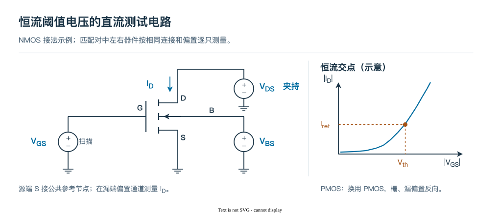

# Vth & Vth mismatch

## 定义与适用范围

**阈值电压**（Threshold Voltage，$V_{\mathrm{th}}$）是金属氧化物半导体场效应晶体管（Metal-Oxide-Semiconductor Field-Effect Transistor，MOSFET）表征沟道导通的器件级参数，单位 V。本文采用**恒流法**（Constant Current，CC）：固定 $V_{\mathrm{DS}}=V_{\mathrm D}-V_{\mathrm S}$、$V_{\mathrm{BS}}=V_{\mathrm B}-V_{\mathrm S}$ 和温度，扫描 $V_{\mathrm{GS}}=V_{\mathrm G}-V_{\mathrm S}$，取 $|I_{\mathrm D}|$ 达到规定参考电流 $I_{\mathrm{ref}}$ 时的 $|V_{\mathrm{GS}}|$。漏端流入器件的电流为 $I_{\mathrm D}$ 正方向。NMOS 报告正向 $V_{\mathrm{GS}}$，PMOS 报告 $V_{\mathrm{SG}}=-V_{\mathrm{GS}}$ 的幅值；若工艺数据采用带符号的 PMOS 阈值，比较前须统一极性。该阈值取决于参考电流、端电压、温度及器件几何。[1, Sec. I–II]

**阈值电压失配**（Threshold-Voltage Mismatch，$\Delta V_{\mathrm{th}}$）指同型、同阈值选项、同几何和同测试偏置的一对器件的有符号差。按固定版图顺序编号为 1、2，定义 $\Delta V_{\mathrm{th}}=V_{\mathrm{th},1}-V_{\mathrm{th},2}$，工程报告使用 mV，保留均值和配对标准差 $\sigma_{\Delta V_{\mathrm{th}}}$。两管方差与协方差满足：

$$
\sigma_{\Delta V_{\mathrm{th}}}^{2}
=\sigma_1^{2}+\sigma_2^{2}
-2\operatorname{Cov}(V_{\mathrm{th},1},V_{\mathrm{th},2})
$$

在同一全局工艺条件下，两管**局部项等方差且相互独立**时，单管局部标准差才可按 $\sigma_{\Delta V_{\mathrm{th}}}/\sqrt{2}$ 换算。片间平均阈值漂移、配对差和同一器件随时间的阈值漂移须分别记录。[2, pp. 1434–1436, Eq. (8), Fig. 2] [10, Secs. II–IV, Figs. 2–7]

## 物理机制与器件变异

- **偏置依赖**：源端与沟道之间的势垒随体端和漏端偏置改变。漏端诱导势垒降低（Drain-Induced Barrier Lowering，DIBL）使较高 $|V_{\mathrm{DS}}|$ 下所需的栅驱动减小。常规恒流法还受参考电流和不同漏压下电流传输的影响；须分别报告低、高漏压阈值。[1, Secs. I–II] [22, Sec. 3.2.4, Table 3.1]
- **全局漂移及版图系统偏移**：按批次、晶圆和芯片追踪共同阈值漂移；按器件朝向、镜像位置、间距及邻近结构检查有符号差的均值。工艺角用于边界检查；须用硅实测或已校准的统计模型估计标准差。45 nm SRAM 测试阵列中，靠近宽浅沟槽隔离（Shallow Trench Isolation，STI）的器件出现电流空间趋势，但线性区阈值没有同等趋势。[4, Secs. II–IV] [11, Sec. VI-C, Fig. 20]
- **局部随机离散**：Pelgrom 模型以同型平面管的配对参数差为对象，将方差分为随栅面积 $WL$ 缩放的局部项和随间距 $D$ 变化的长程项。拟合 $\sigma_{\Delta V_{\mathrm{th}}}^{2}\approx A_{V_{\mathrm{th}}}^{2}/(WL)+S_{V_{\mathrm{th}}}^{2}D^{2}$ 时，$W$、$L$ 和 $D$ 须使用同一长度单位；$A_{V_{\mathrm{th}}}$、$S_{V_{\mathrm{th}}}$ 分别是电压乘以长度及电压除以长度，对应当前工艺和提取口径。[2, Eqs. (5), (8)] 鳍式场效应晶体管（Fin Field-Effect Transistor，FinFET）与环绕栅场效应晶体管（Gate-All-Around Field-Effect Transistor，GAA FET）须按离散鳍数或片数、栅金属功函数及几何相关性重新拟合。Karner 等的室温 N3 投影中，金属栅晶粒是所设变异源中阈值离散的主要贡献；图 7、8 的样本为技术计算机辅助设计（Technology Computer-Aided Design，TCAD）与紧凑模型生成的统计样本。[2, Eq. (8)] [3, Sec. III–V, Figs. 4–8]
- **时间变化**：随机电报噪声（Random Telegraph Noise，RTN）可表现为同一管电流在观测窗口内跳变；负偏置温度不稳定性（Negative Bias Temperature Instability，NBTI）会产生应力相关的阈值漂移。评估老化失配时须保留初始配对差、应力后配对差和单管应力前后差，并记录温度、应力偏置、持续时间及恢复窗口。[10, Figs. 2–7] [17, Sec. 3.5, Fig. 3.55]

## 器件阈值与阵列测量边界

| 测试对象 | 实际观测与边界 | 用途 |
|---|---|---|
| **隔离单管／同型匹配对** | 测器件漏端电流和实际端电压，依同一恒流口径逐管提取。版图版型及器件模型决定结果能代表的邻近环境。 | 工艺监控、估计配对差、标定统计模型。 |
| **SRAM 密度器件阵列或引出端子的位单元** | 保留位单元目标版图环境，使用专用开关、端子及感测通路选通单管。须核对开关压降、未选支路漏电和源端残余电压。 | 区分邻近结构效应与测量通路误差；关联同一位单元的单管阈值和读写表现。[11, Secs. VI-C–D] [14, Figs. 5, 7–8] |
| **功能 SRAM 阵列** | 普通读写接口给出单元功能响应。专用阵列访问法须配置偏置、扣除未选支路漏电，并验证目标管的端电压与电流分离。 | 评估成品阵列的空间和尾部变异；用配对数据验证间接阈值提取条件。[9, pp. 44–45, Figs. 4–5] [26, 第 3–5 章] |

Deng 等以直接位单元晶体管访问法（Direct Bit Transistor Access，DBTA）在 $|V_{\mathrm{DS}}|=0.1\ \mathrm{V}$、$|I_{\mathrm D}|\approx1\ \mathrm{\mu A}$ 附近对照同一器件的纳米探针结果；较大电流下，其他单元晶体管会影响测得的转移曲线。另一通用测试结构模拟 DBTA 接法时，在 $|I_{\mathrm D}|=1\ \mathrm{\mu A}$ 处实测访问管源端电位约 5 mV，须按器件真实端电压处理。两项均为各自结构与偏置下的结果。[9, Figs. 4–5] [14, Fig. 8]

在常规 6T 位单元读初期，访问管（Access Transistor／Pass-Gate，PG）通常处于饱和区，下拉管（Pull-Down，PD）通常处于线性区；上拉管（Pull-Up，PU）是交叉耦合反相器的 PMOS。读通路中低存储节点的电压反馈改变 PG 与 PD 的工作点，读电流拟合得到的等效阈值属于电路代理量。使用单管数据解释单元行为时，须按实际源漏方向、偏置及器件角色取值。[19, Sec. II, Figs. 1–2, Table 1] [22, Secs. 3.2–3.4]

## 测量与提取方法

**【前置条件】** 分别选取与 PG、PD、PU 角色对应的工艺设计套件（Process Design Kit，PDK）器件模型或测试结构。规定工艺、电压和温度（Process, Voltage and Temperature，PVT）、阈值选项、几何、朝向、阱连接、体偏置、低及高 $|V_{\mathrm{DS}}|$、扫描范围和步长。若器件无独立体端，按 PDK 使用实际阱、衬底或模型端子配置。测试结构可用工艺控制监测（Process Control Monitor，PCM）或保留 SRAM 布局密度的可寻址器件阵列；硅测使用源测量单元（Source Measure Unit，SMU）供给偏置和测量电流。

图中各电压源以源端 S 为参考，栅端扫压、漏端夹持并测流、体端保持规定偏置。仿真从漏端电压源支路取电流；若支路以流入电压源正端为正，则漏端电压源支路电流取反得到器件 $I_{\mathrm D}$。PMOS 换用相应器件，栅源和漏源偏置反向，体端按其阱连接和偏置规格配置。匹配对逐管使用同一连接。图右为恒流交点示意，电流、电压分别以 A、V 记录。

**【步骤／方法】**

1. **设置并核对偏置**：仿真对目标器件施加直流（Direct Current，DC）偏置并记录实际端电压。硅测先测开路偏置、漏电及噪声底；接触或开关压降超出误差预算时，在有感测端子的结构上采用开尔文连接（Kelvin Connection），并记录校准范围。
2. **扫描转移曲线**：保持漏源和体偏置，将 $|V_{\mathrm{GS}}|$ 从关态扫至 PDK 允许的最大测试电压，在每点按预设等待时间或电流稳定判据采样，记录 $V_{\mathrm{GS}}$、$V_{\mathrm{DS}}$、$V_{\mathrm{BS}}$ 及有符号 $I_{\mathrm D}$。对同一全局样本的成对器件，使用同一温度、扫描方向、采样窗口和测量次序规则。仿真分别保存固定工艺条件下的局部配对结果，以及启用全局工艺离散的结果；同一匹配对共享同一全局样本。
3. **提取恒流阈值**：按 PDK 或预定口径选择 $I_{\mathrm{ref}}$，在交点附近细扫，以包围 $I_{\mathrm{ref}}$ 的两点对 $\log(|I_{\mathrm D}|/I_{\mathrm{ref}})$ 插值求零点。记录每管参考电流及归一化基准；FinFET 和 GAA FET 优先保留每管电流（A）及鳍数或片数，换算为单位有效宽度电流时注明 PDK 的宽度定义。
4. **计算失配和漏压敏感度**：按固定编号形成同型配对差。低、高漏压两次测量使用相同 $I_{\mathrm{ref}}$、温度、方向及体偏置；报告恒流阈值差 $\Delta V_{\mathrm{th,D}}=V_{\mathrm{th,low}}-V_{\mathrm{th,high}}$（mV）。如报告归一化 DIBL，再除以 $|V_{\mathrm{DS,high}}|-|V_{\mathrm{DS,low}}|$（V），以 mV/V 表示并注明恒流提取口径。[22, Sec. 3.2.4, Table 3.1]

**注意事项**：禁止用不同提取法、参考电流、温度、偏置或归一化基准下的阈值计算配对失配（差值会同时包含测量口径的变化）。

**注意事项**：禁止将仪器底限以下的电流或超出扫描范围的交点代入插值（会把仪器或扫描边界写入阈值分布）。

**【结果处理和验证】** 检查实际端电压、稳态电流、仪器量程或限流状态及交点附近单调性。有净漏电校准的阵列须验证扣除后的电流底限。将交点落在扫描范围外的样本标为相应方向的截尾，将测量底限、量程或多交点导致无法判读的样本单列。重复测量同一器件估计测量标准差；若该标准差与配对离散接近，须改善分辨率或报告测量不确定度。交付原始曲线、提取值、有效及无效状态、匹配对编号、测量次序、批次／晶圆／芯片和坐标，以及器件间距、朝向与实际端电压。Pelgrom 等使用多种间距和方向的线性区测试，并重复探测同一芯片评估重复性。[2, Sec. IV, Fig. 2]

### 替代提取方法

低 $|V_{\mathrm{DS}}|$ 时，可在 $|I_{\mathrm D}|$–$|V_{\mathrm{GS}}|$ 曲线上，于跨导（Transconductance，$g_{\mathrm m}=\mathrm{d}|I_{\mathrm D}|/\mathrm{d}|V_{\mathrm{GS}}|$）峰值附近作切线，取 $|I_{\mathrm D}|=0$ 处的栅压截距。忽略迁移率退化及串联电阻的长沟道线性区近似下，从截距减去 $|V_{\mathrm{DS}}|/2$。须记录导数平滑、拟合区间及线性区条件。[2, p. 1435, Eq. (7)]

Bucher 等的广义恒流法（Generalized Constant Current，GCC）以归一化反型电流和电荷模型推得夹断电压，再按夹断电压等于源端电压的条件确定阈值；原文方法聚焦饱和区，优先适用于弱至中等反型。STI 边缘导通产生亚阈值凸起时，须区分边缘和主体导电。跨节点批量比较宜统一可复现的普通恒流口径；更换提取法时须对同一批原始曲线重新提取。[1, Sec. II–III, Fig. 2]

## 数据可视化与评估

### 数据分析与评价方法

| 图表 | 绘图和分组 | 判读 |
|---|---|---|
| **转移曲线与恒流线** | 横轴 $\lvert V_{\mathrm{GS}}\rvert$（V），纵轴 $\lvert I_{\mathrm D}\rvert$（A），分别画线性及半对数图；叠加 $I_{\mathrm{ref}}$、电流底限和低／高漏压曲线。按器件角色、温度及偏置分组。 | 核验交点、底限、异常曲线及漏压敏感度。 |
| **晶圆分布图** | 晶圆图以芯片坐标为轴，色标分别为单管或每芯片均值 $V_{\mathrm{th}}$（V）、配对差 $\Delta V_{\mathrm{th}}$（mV）；各图统一同口径色标。 | 识别片间漂移、片内空间梯度和方向相关的系统偏移。 |
| **配对差分布** | 横轴 $\Delta V_{\mathrm{th}}$（mV），纵轴经验累积分布函数（Empirical Cumulative Distribution Function，ECDF）或尾部概率；按器件角色、方向、几何、间距和偏置拆分。 | 检查有符号均值、标准差、尾部分位数与截尾比例；按面积与间距拟合平面管失配趋势。[2, Eqs. (5), (8)] |
| **联合散点图** | 横轴 $V_{\mathrm{th}}$（V），纵轴为同一管的 $I_{\mathrm{on}}$ 或 $I_{\mathrm{off}}$（A），注明相应电流测试偏置。 | 检查同一器件的阈值与电流联动；结合独立偏置数据或校准模型区分迁移率、尺寸及串联电阻的影响。[6, pp. 65–70] [13, Figs. 3–8] |

**统计规范**：分别分析配对差、片内空间趋势和片间全局漂移。用两管阈值均可判读的完整配对计算均值、标准差与 ECDF，注明样本范围，单列不完整配对与各截尾方向。估计均值的双侧 95% 置信区间时，可用试测标准差 $s$ 和目标半宽 $h$ 估算独立样本数 $n\approx(1.96s/h)^2$，适用于正态近似与足够样本数。若同片或同晶圆样本相关，按芯片或晶圆级重采样，并注明层级、样本数和重复性。尾部评估须单列有效样本量、截尾比例、目标分位数和置信区间；截尾覆盖目标分位数时，须扩大有效扫描范围或只报告可判定的界限。尾部良率的样本依据参见 [RSNM](../Bitcell/RSNM.md#数据分析与评价方法)。

## 应用场景与指标关系

- **工艺与模型校准**：按器件角色比较绝对阈值、偏置敏感度和初始配对差，定位全局或局部偏移。结合 [Ion](Ion.md) 与 [Ioff](Ioff.md) 的速度和漏电预算选择阈值目标；保留多指标的联合分布，核验目标阈值下的电流和离散。[6, pp. 65–70] [13, Figs. 3–8]
- **位单元读写与良率**：用 PG、PD、PU 的同批统计模型保留全局相关性和器件局部离散；输入 [RSNM](../Bitcell/RSNM.md)、[WSNM](../Bitcell/WSNM.md) 和[读电流](../Bitcell/Read_Current.md) 检查数据极性相关的弱侧及尾部。器件失配是设计技术协同优化（Design-Technology Co-Optimization，DTCO）的归因指标；最终判据来自单元良率、速度和功耗。[3, Sec. V-B, Figs. 9–10] [11, Sec. VI-D] [19, Secs. II–IV]
- **感测偏移**：在 [SA Offset](../Peripherial/SA_Offset.md) 仿真中，使用感测放大器自身的差分器件尺寸、布局及相关性建模。若评估整宏，须同时保留位单元读路径与感测放大器各自的统计量。

## 参考文献

已核对 Zotero 集合「02-SRAM-DTCO／SRAM-Metrics／Device」中的精确标签 `Vth & Vth mismatch`：26 篇与下列 [2]–[27] 一一对应，另保留已归档的方法文献 [1]。页码对应所链接的实际 PDF 版本；间接相关内容在摘要中注明。

[1] M. Bucher, N. Makris, and L. Chevas, “Generalized constant current method for determining MOSFET threshold voltage,” IEEE Trans. Electron Devices, 2020, author manuscript v2. [DOI 10.1109/TED.2020.3019019](https://doi.org/10.1109/TED.2020.3019019). [公开文献](https://doi.org/10.1109/TED.2020.3019019)；Zotero：本次标签集合未匹配记录。

**相关摘要：** 作者将恒流阈值法推广到按反型系数定义的电流条件，用电荷模型校正栅压与夹断电压的偏移，避免任意参考电流导致不同阈值口径。180 nm示例包含TCAD及实测边缘导电分析，弱至中等反型有利于减轻串联电阻和速度饱和影响；浅沟槽隔离的亚阈值凸起则需区分边缘与主体晶体管。为 SRAM 提供阈值提取方法依据，未给出位单元失配结果；应用时必须同时报告参考电流、尺寸、漏端及体偏置。

**原文定位：** §II–III、图1–4；作者稿正文pp.1–4（PDF pp.2–5）。

[2] M. J. M. Pelgrom, A. C. J. Duinmaijer, and A. P. G. Welbers, “Matching properties of MOS transistors,” IEEE J. Solid-State Circuits, vol. 24, no. 5, pp. 1433–1439, 1989. [DOI 10.1109/JSSC.1989.572629](https://doi.org/10.1109/JSSC.1989.572629). [公开文献](https://doi.org/10.1109/JSSC.1989.572629) [Zotero](https://www.zotero.org/users/7333024/items/Z7ZHNQTD)

**相关摘要：** 经典实验和空间统计模型将晶体管对的参数差值方差分解为与面积成反比的局部项及与间距有关的长程项。作者在线性区测量I–V并提取阈值、电流因子和体效应参数，用多种尺寸与方向验证匹配规律。它是SRAM配对失配面积缩放的基础，但实验来自较早的微米级5 V CMOS，不能直接套用其系数到FinFET/GAA。应用时需注明参数是两只管之差，并与单管独立标准差区分，同时保留系统性版图项。

**原文定位：** §II–IV，式(5)、(8)、图2；pp.1434–1435（已核验PDF页面）。

[3] M. Karner et al., “Variability-aware DTCO flow: Projections to N3 FinFET and nanosheet 6T SRAM,” in Proc. SISPAD, 2021. [DOI 10.1109/SISPAD54002.2021.9592527](https://doi.org/10.1109/SISPAD54002.2021.9592527). [公开文献](https://doi.org/10.1109/SISPAD54002.2021.9592527) [Zotero](https://www.zotero.org/users/7333024/items/2NIBZCPG)

**相关摘要：** 采用TCAD、BSIM-CMG统计提取和完整单元寄生网络串联的流程，对N3 FinFET与四层nanosheet SRAM进行室温仿真。对阈值、亚阈值斜率及导通电流联合标定并保留模型参数相关性，随后分别施加掺杂、金属栅晶粒和几何离散。结果显示该组工艺假设下金属栅晶粒是主要阈值离散来源，片层几何相关性也会放大波动。属于前瞻工艺仿真；其标准差不能作为其他晶粒尺寸或量产工艺的通用实测失配常数。

**原文定位：** §III–V，图4–8；PDF pp.2–3。

[4] K. Singhal and V. Visvanathan, “Statistical device models from worst case files and electrical test data,” IEEE Transactions on Semiconductor Manufacturing, vol. 12, no. 4, pp. 470-484, 1999. [DOI](https://doi.org/10.1109/66.806125). [Zotero](https://www.zotero.org/users/7333024/items/42KSBKLB). [公开文献](https://doi.org/10.1109/66.806125)

**相关摘要：** 文章把最坏角模型文件与产线电测数据结合，利用主成分及统计校准构建设备随机模型，并以不同尺寸NMOS/PMOS的阈值和指定偏置电流检查联合覆盖。作者强调最坏角文件不是随机样本，直接把它们的跨度作为统计σ没有依据。该方法为SRAM工艺分布建模提供间接参考，主要描述工艺层面的统计而非相邻器件局部失配；使用时需额外定义局部项、器件间相关性及阈值提取口径。

**原文定位：** §II–IV，图1、5–7；pp.470–478。

[5] J. Pineda de Gyvez and R. Rodríguez-Montañés, “Threshold voltage mismatch (ΔVT) fault modeling,” in Proceedings of the 21st IEEE VLSI Test Symposium, 2003, pp. 145–150. [DOI](https://doi.org/10.1109/VTEST.2003.1197645). [Zotero](https://www.zotero.org/users/7333024/items/CVZPAGNG). [公开文献](https://doi.org/10.1109/VTEST.2003.1197645)

**相关摘要：** 文章以0.18 µm CMOS的仿真和实验讨论阈值失配故障模型，明确区分芯片间共同阈值偏移与芯片内晶体管对的差值分布，并分析其对漏电和时序的影响。对称分配一对晶体管的阈值扰动时，必须同时保持均值及差值定义，不能把配对标准差直接当作每只管的独立σ。它提供局部失配建模方法，和SRAM应用为间接关联；文中的逻辑电路漏电或延迟结果不属于SRAM 位单元实测指标。

**原文定位：** §2–4，图1–3；PDF pp.2–5。

[6] Ding-Ming Kwai et al., “SRAM cell current in low leakage design,” in 2006 IEEE International Workshop on Memory Technology, Design and Testing (MTDT'06), 2006, pp. 65-70. [DOI](https://doi.org/10.1109/MTDT.2006.28). [Zotero](https://www.zotero.org/users/7333024/items/RNB3WGBW). [公开文献](https://doi.org/10.1109/MTDT.2006.28)

**相关摘要：** 0.25 µm、2.5 V工艺的1 Mb测试芯片比较有无额外阈值调整注入的低漏电SRAM，以单管关断电流和单元读电流分布观察工艺权衡。提高阈值显著降低待机消耗，但在低供电下读电流的相对分散增大，说明阈值均值优化不能替代失配尾部评估。文中的面积律估计和电流统计是不同层次证据，读电流还受串联管与内部节点影响；引用时应注明供电与注入分支，不能把相对电流偏差直接标成Vth失配。

**原文定位：** pp.65–70，图1及实验分析。

[7] N. Drego, A. Chandrakasan and D. Boning, “A test-structure to efficiently study threshold-voltage variation in large MOSFET arrays,” in 8th International Symposium on Quality Electronic Design (ISQED'07), 2007, pp. 281-286. [DOI](https://doi.org/10.1109/ISQED.2007.24). [Zotero](https://www.zotero.org/users/7333024/items/TIS2LP34). [公开文献](https://doi.org/10.1109/ISQED.2007.24)

**相关摘要：** 文章提出含双斜率积分ADC、自动归零及泄漏抵消DAC的大规模器件阵列，在亚阈值区通过电流比的对数估计阈值差。该偏置使电流对Vth的敏感性高于沟长，从而减少混合参数测量的歧义；未选器件泄漏和读出偏置则需主动消除。证据重点是架构与SPICE敏感性验证，不能把设计容量或仿真分辨率当作已完成大规模硅片统计。对SRAM可借鉴失配测量原理，但仍依赖相同亚阈值斜率等假设。

**原文定位：** §2–4，图1–5；pp.281–286。

[8] V. Wang and K. L. Shepard, “On-chip transistor characterisation arrays for variability analysis,” Electronics Letters, vol. 43, no. 15, pp. 806-808, 2007. [DOI](https://doi.org/10.1049/el:20070017). [Zotero](https://www.zotero.org/users/7333024/items/MYSUYHVN). [公开文献](https://doi.org/10.1049/el:20070017)

**相关摘要：** 在0.25 µm、2.5 V CMOS中，作者用片上电流测量电路和可寻址器件阵列采集I–V，再拟合EKV参数，分析阈值和电流因子的尺寸及布局依赖。亚阈值与强反型采用不同稳定化测量支路，说明精度与测量电路自身工作区有关。该工作为大规模Vth统计提供实验方法，和SRAM仅间接相关；提取阈值属于模型拟合口径，并且统计分析忽略了Vth与电流因子的潜在相关性，不宜直接作为位单元恒流阈值的配对σ。

**原文定位：** System design及Experimental results；PDF pp.1–2，图1、3、4。

[9] Xiaowei Deng et al., “Characterization of bit transistors in a functional SRAM,” in 2008 IEEE Symposium on VLSI Circuits, 2008, pp. 44-45. [DOI](https://doi.org/10.1109/VLSIC.2008.4585945). [Zotero](https://www.zotero.org/users/7333024/items/Z7HVLEZE). [公开文献](https://doi.org/10.1109/VLSIC.2008.4585945)

**相关摘要：** 在65/45 nm的8 Mb功能SRAM中采用DBTA，经位线多路复用及独立电源控制访问单管，扣除未选位线泄漏并抑制路径IR压降。约1 µA低电流区的恒流阈值与同一器件纳米探针结果吻合，支持大规模配对失配、NBTI与软失效定位。作者明确指出较大电流处曲线仍受单元其他晶体管影响；因此可用其低电流阈值证据，而不能假定整个I–V曲线都是孤立单管特性。

**原文定位：** pp.44–45，图4–8。

[10] T. Fischer, E. Amirante, K. Hofmann, M. Ostermayr, P. Huber and D. Schmitt-Landsiedel, “A 65nm test structure for the analysis of NBTI induced statistical variation in SRAM transistors,” in ESSDERC 2008 - 38th European Solid-state Device Research Conference, 2008, pp. 51-54. [DOI](https://doi.org/10.1109/ESSDERC.2008.4681696). [Zotero](https://www.zotero.org/users/7333024/items/FX6ZGXWL). [公开文献](https://doi.org/10.1109/ESSDERC.2008.4681696)

**相关摘要：** 研究用保持SRAM密集布局环境的65 nm、1 Mbit器件测试阵列，对PMOS施加NBTI应力并测量应力前后阈值和电流。初始与老化后的阈值总体分布可近似高斯，但同一器件的增量ΔVth并非高斯，其分散不能用统一均值平移替代。随后把附加离散传播至6T噪声裕量，说明失配会随应力历史演化。该结果依赖应力电压、温度、持续时间和恢复窗口，应与新鲜配对失配分开归档，不能无条件沿用到其他节点。

**原文定位：** §II–IV，图2–7；pp.51–54。

[11] Z. Guo, A. Carlson, L. T. Pang, K. T. Duong, T. J. K. Liu and B. Nikolic, “Large-scale SRAM variability characterization in 45 nm CMOS,” IEEE Journal of Solid-State Circuits, vol. 44, no. 11, pp. 3174-3192, 2009. [DOI](https://doi.org/10.1109/JSSC.2009.2032698). [Zotero](https://www.zotero.org/users/7333024/items/5RBES89L). [公开文献](https://doi.org/10.1109/JSSC.2009.2032698)

**相关摘要：** 45 nm硅片实验比较内部节点可访问的小阵列和完整64 kb功能阵列，测量单管阈值、电流及单元稳定性。外围宽STI结构中的NMOS电流随位置变化，而线性阈值无明显对应位置趋势，说明不能把所有驱动变化归因于Vth；完整阵列的空间行为也不同。进一步比较镜像单元和两种数据极性，揭示系统性左右不对称。失配表征应保留布局环境、器件方向及测量电源，分开随机分散与系统偏移。

**原文定位：** §VI.C–D，图20–22；pp.3186–3188。

[12] Z. Guo, “Large-scale variability characterization and robust design techniques for nanoscale SRAM,” Doctoral dissertation, EECS Department, University of California, Berkeley, 2009. [Zotero](https://www.zotero.org/users/7333024/items/A56QIF3W). [公开文献](https://www2.eecs.berkeley.edu/Pubs/TechRpts/2009/EECS-2009-190.html)；DOI：Zotero未收录或尚未核实。

**相关摘要：** 学位论文系统整理45 nm SRAM大规模实测，利用内部节点访问获得单管阈值，再将其与功能阵列读写指标和位置关联。图4.37显示隔离测试阵列的驱动电流有STI边缘趋势，但线性阈值并未出现相同变化；镜像方向与数据极性还会引入系统不对称。对Vth mismatch的启示是配对对象、布局邻域和提取偏置必须一致，不能从电流或噪声裕量离散直接反推出唯一阈值标准差。该学位论文与同作者2009年期刊研究存在内容重叠，不能计作独立重复实验。

**原文定位：** 第4章，图4.37–4.39，正文pp.136–140。

[13] B. Cheng et al., “Statistical-variability compact-modeling strategies for BSIM4 and PSP,” IEEE Design and Test of Computers, vol. 27, no. 2, pp. 26-35, 2010. [DOI](https://doi.org/10.1109/MDT.2010.53). [Zotero](https://www.zotero.org/users/7333024/items/BE5F2X9L). [公开文献](https://doi.org/10.1109/MDT.2010.53)

**相关摘要：** 文章以数值器件统计为基准比较BSIM4与PSP参数提取，并同时拟合低/高漏压下的Vth、Ion、Ioff、DIBL和亚阈值斜率及其相关性。仅用阈值与迁移率两个随机参数会丢失电流分散信息；同一阈值下仍可能存在明显的导通电流差异，尾部还受非高斯模型参数影响。它支持SRAM失配模型的联合标定，而非单一σVth万能模型。结果为器件仿真及紧凑模型比较，跨工艺使用须重建偏置、分布及相关矩阵。

**原文定位：** §Direct statistical-parameter-extraction；图3–8；pp.28–33。

[14] X. Deng, T. W. Houston, A. Duong and W. K. Loh, “A universal structure for SRAM cell characterization,” in 2010 International Conference on Microelectronic Test Structures (ICMTS), 2010, pp. 216-219. [DOI](https://doi.org/10.1109/ICMTS.2010.5466815). [Zotero](https://www.zotero.org/users/7333024/items/UFY8SIZT). [公开文献](https://doi.org/10.1109/ICMTS.2010.5466815)

**相关摘要：** 文章提出将6T单元左右电源、地、存储节点和体端分别引出的UTS，并在65、45、28 nm工艺实现。利用SMU重新配置可在同一物理单元提取PG、PD、PU的线性/饱和阈值及配对失配，再直接关联保持电压和稳定性；多批次实测与传统结构相符。文中以1 µA恒流测量检查访问管内部源端约5 mV的残余电压，强调真实端电压校验。其优势在同单元关联，不能将不同单元的工艺均值差当成配对失配。

**原文定位：** pp.216–219，图1、3、5、7、8。

[15] V. Huard et al., “Managing SRAM reliability from bitcell to library level,” in 2010 IEEE International Reliability Physics Symposium, 2010, pp. 655-664. [DOI](https://doi.org/10.1109/IRPS.2010.5488755). [Zotero](https://www.zotero.org/users/7333024/items/FDQNGLFY). [公开文献](https://doi.org/10.1109/IRPS.2010.5488755)

**相关摘要：** 文章把NBTI引起的阈值变化分解为可恢复与永久成分，结合HCI和统计可靠性模型，将单管老化传递到SRAM单元及库级失效。45 nm高密度单元实例显示仅移动平均阈值不足以描述老化后的分布与稳定性尾部，须同时处理随机退化和数据/占空比历史。用于本指标时应把初始Vth mismatch与应力后的ΔVth分别报告，注明应力电压、温度和恢复时间；文中跨层级模型验证不等同于所有库单元都完成相同条件的直接实测。

**原文定位：** §II–III，图1–3、12–13；PDF pp.1–5。

[16] R. Joshi, K. Kim and R. Kanj, “FinFET SRAM Design,” in 2010 23rd International Conference on VLSI Design, 2010, pp. 440-445. [DOI](https://doi.org/10.1109/VLSI.Design.2010.88). [Zotero](https://www.zotero.org/users/7333024/items/FDPWTIAC). [公开文献](https://doi.org/10.1109/VLSI.Design.2010.88)

**相关摘要：** 文章以MEDICI器件模拟和SRAM电路分析讨论FinFET的电静控制、轻掺杂与阈值工程。双栅结构在相近驱动条件下减小DIBL与亚阈值斜率，轻掺杂又降低随机掺杂带来的阈值离散；独立背栅可通过偏置调节阈值。其多个示例涉及不同器件与工艺尺度，不能合并为一组统一实测数据。用于Vth mismatch时提供机制解释和建模边界，尤其需区分线性/饱和阈值、主动体偏移及随机局部失配。

**原文定位：** §2–4，图2、表2；pp.440–442。

[17] S. O. Toh, “Nanoscale SRAM variability and optimization,” dissertation, UC Berkeley, 2011. [Zotero](https://www.zotero.org/users/7333024/items/LYDRHR6E). [公开文献](https://www2.eecs.berkeley.edu/Pubs/TechRpts/2011/EECS-2011-144.html)；DOI：Zotero未收录或尚未核实。

**相关摘要：** 论文以45 nm SRAM小尺寸晶体管实测研究随机电报噪声及NBTI，并把电流跳变量除以跨导换算为等效阈值扰动。RTS幅度采用长尾分布而非统一高斯偏移，随后与制造离散共同输入SRAM失效估算；这说明静态配对失配、老化漂移和时间波动应分开统计。文中也明确，简化为与偏置无关的Vth移动会影响较高偏置下的准确性，因此这些数据不能直接替代规定VDS、温度和采样时长的初始失配测量。

**原文定位：** §3.5附近图3.55；第4章图4.15；PDF pp.87、106、119。

[18] M. H. Abu-Rahma and M. Anis, “Nanometer variation-tolerant SRAM: circuits and statistical design for yield,” New York, NY, Springer New York, 2013. [DOI](https://doi.org/10.1007/978-1-4614-1749-1). [Zotero](https://www.zotero.org/users/7333024/items/RA2TPQV2). [公开文献](https://doi.org/10.1007/978-1-4614-1749-1)

**相关摘要：** 专著将SRAM阈值离散分为随机掺杂、线边粗糙和时间相关陷阱/老化等来源，并说明沟长变化会通过短沟道效应和DIBL产生依赖漏端及体偏置的阈值移动。书中把随机项合成为统计模型，再讨论器件面积和低压稳定性约束，适合作为配对失配及工艺离散的定义依据。相关结果汇集不同文献和节点，并非同一工艺下统一测量；使用时需区别单管σ、配对差值σ和系统偏移，避免直接跨节点移植参数。

**原文定位：** 第2章§2.3，图2.6–2.15；PDF pp.19–26。

[19] S. Venugopalan et al., “SRAM read current variability and its dependence on transistor statistics,” in Proceedings of the IEEE 2013 Custom Integrated Circuits Conference, 2013, pp. 1-4. [DOI](https://doi.org/10.1109/CICC.2013.6658430). [Zotero](https://www.zotero.org/users/7333024/items/9PULN46E). [公开文献](https://doi.org/10.1109/CICC.2013.6658430)

**相关摘要：** 文章用32/28 nm单元实测与28 nm Monte Carlo推导读电流离散：访问管通常工作在饱和区、下拉管在线性区，因此分别使用两者相应偏置下的阈值统计。内部低节点电压变化产生反馈，使读堆栈的等效阈值离散不同于任一单管，且权重随供电和尺寸比变化。对本指标应分别保存PG饱和阈值与PD线性阈值的分布，不能把拟合出的等效堆栈阈值当作真实器件参数，也不能直接用单管σ替代单元读电流尾部。

**原文定位：** 表1、图3–5；PDF pp.1–3。

[20] L. Rahhal, “Analysis and modeling of mismatch phenomena for advanced MOSFET‟s,” Doctoral dissertation, Université de Grenoble, 2014. [Zotero](https://www.zotero.org/users/7333024/items/6QDYMT57). [公开文献](https://theses.hal.science/tel-01305050)；DOI：Zotero未收录或尚未核实。

**相关摘要：** 论文以Y函数的配对离散直接提取阈值和电流增益因子失配，降低源漏串联电阻对参数分离的干扰。28 nm体硅与FD-SOI器件实验采用25°C、VD=50 mV和VG扫描，说明常规电流失配拟合会混入迁移率及电阻效应；新方法与逐管Y函数提取的结果对照。其主要验证处于线性区且有栅压适用范围，不能直接当成饱和区恒流阈值。对SRAM为器件级方法支撑，仍需在真实单元布局及配对方式下重新标定。

**原文定位：** 第II章§II.2–II.4，图II.4–II.8；PDF pp.60–68。

[21] 许志雄, “专用于SRAM失配特性研究的可寻址测试芯片的研究与实现,” 硕士, 浙江大学, 2015. [Zotero](https://www.zotero.org/users/7333024/items/JNICCICS). [公开文献](https://kns.cnki.net/kcms2/article/abstract?v=3uoqIhG8C475KOm_zrgu4lQARvep2SAkVNKPvpjdBoadmPoNwLRuZ3gV98idMjKCIp7cq7fOGJOuQMQSBHMHguwfSIdXRrsY&uniplatform=NZKPT)；DOI：Zotero未收录或尚未核实。

**相关摘要：** 论文设计专用于SRAM失配研究的可寻址测试结构，将单元内配对器件分离测量，并为大电流、低漏电和阈值扫描选择不同开关通路。阈值采用规定电流下的栅压，分别设置线性区及饱和区漏端偏置，同时感测并校正路径压降。流片测试显示各类器件阈值及配对差值可作统计分析，并与传统结构比较验证精度。引用时应保留提取电流、源漏偏置和布局扰动；不能把改造结构的单管统计直接当作完整功能阵列读写裕量。

**原文定位：** 第4章§4.2–4.4；PDF pp.47–58。

[22] N. Damrongplasit, “Study of Variability in Advanced Transistor Technologies,” Ph.D. dissertation, University of California, Berkeley, Tech. Rep. UCB/EECS-2015-37, 2015. [Zotero](https://www.zotero.org/users/7333024/items/SAWJ4TG7). [公开文献](https://www2.eecs.berkeley.edu/Pubs/TechRpts/2015/EECS-2015-37.html)；DOI：Zotero未收录或尚未核实。

**相关摘要：** 论文在32 nm HKMG PDSOI的SRAM与模拟器件配对结构上，分别测量正反向、线性区与饱和区阈值，分离芯片均值、对称局部项、源漏不对称项和有效沟长项。实测结合统计模型表明，源漏不对称是饱和区阈值失配与DIBL离散的重要来源；访问管在读写中交换电流方向，因此只用一个固定阈值偏移不能覆盖两种操作。用于本指标时应保留VDS、方向和器件配对关系，不能把芯片间偏移算作局部失配。

**原文定位：** 第3章§3.2–3.4，正文pp.35–53；PDF pp.47–65。

[23] 杨璐丹, “面向标准单元库的MOS器件大型可寻址测试芯片的研究、设计与实现,” 硕士, 浙江大学, 2018. [Zotero](https://www.zotero.org/users/7333024/items/I9M9L4AR). [公开文献](https://kns.cnki.net/kcms2/article/abstract?v=3uoqIhG8C475KOm_zrgu4lQARvep2SAk-6BvX81hrs37AaEFpExs0FaKacXeomGbz0CqyNfC21Dzd7N-75HnWZC9K9VXT2CP&uniplatform=NZKPT)；DOI：Zotero未收录或尚未核实。

**相关摘要：** 学位论文为16 nm FinFET标准单元建立大型可寻址MOS测试芯片，采用独立force/sense路径和开关配置测量线性/饱和阈值，并比较不同阈值选项及尺寸的硅片数据和模型。阈值通过栅压扫描达到目标电流提取，路径电压校正可避免互连压降被误判为器件差异。与SRAM属于测试方法的间接关联：标准单元环境、器件尺寸及邻近结构不同，所得分布不能直接用作位单元配对失配，应重新固定VDS和参考电流。

**原文定位：** 第5章§5.2.4–5.3；PDF pp.66–72。

[24] W. T. K. Chien and F. Hao, “An extended building-In reliability methodology on evaluating SRAM reliability by wafer-level reliability systems,” IEEE Transactions on Device and Materials Reliability, vol. 20, no. 1, pp. 106-118, 2020. [DOI](https://doi.org/10.1109/TDMR.2020.2964999). [Zotero](https://www.zotero.org/users/7333024/items/KIUC7NK4). [公开文献](https://doi.org/10.1109/TDMR.2020.2964999)

**相关摘要：** 论文采用可独立访问器件端子的单比特SRAM晶圆级结构，测量器件阈值和电流退化，再关联读电流、写入、保持与SNM的寿命。阈值漂移用于量化PG/PD/PU老化，但对称应力造成的两侧移动可能相互抵消，非对称应力更易破坏平衡。文中指出测试中的访问管占空比高于实际使用，寿命预测偏保守。因此本指标需同时记录应力方式、器件位置和初始失配，不能将加速应力所得阈值差直接视为新鲜器件的制造失配。

**原文定位：** §II–III，图2、4、8；PDF pp.3–8。

[25] Z. Wang, L. Chen and M. Yin, “Analysis and characterization of layout dependent effect for advance FinFET circuit design,” Microelectronics Journal, vol. 125, pp. 105449, 2022. [DOI](https://doi.org/10.1016/j.mejo.2022.105449). [Zotero](https://www.zotero.org/users/7333024/items/P37TIVNN). [公开文献](https://doi.org/10.1016/j.mejo.2022.105449)

**相关摘要：** 作者对14 nm体硅HKMG FinFET建立不同扩散区长度、栅端、栅间距和邻近扩散区的测试布局，用BSIM-CMG/HSPICE提取I–V。阈值采用转移曲线线性外推，结果显示布局可系统性改变阈值及驱动能力，且二者对不同几何项的敏感性并不相同。该文是LDE仿真研究而非随机配对失配实测；对SRAM应将其作为版图相关均值偏移的依据，不能把外推阈值与恒流阈值混用，或将最大布局偏差直接解释为σVth。

**原文定位：** §2–6，图1–8；PDF pp.2–6。

[26] 刘蕊, “SRAM存储单元阵列阈值电压偏差检测,” 硕士学位论文, 浙江大学, 杭州, 2024. [DOI](https://doi.org/10.27461/d.cnki.gzjdx.2024.000924). [Zotero](https://www.zotero.org/users/7333024/items/L3E3LX3U). [公开文献](https://doi.org/10.27461/d.cnki.gzjdx.2024.000924)

**相关摘要：** 论文通过位线间接控制存储节点，使用电流比较和片上判定电路提取阵列全部PG、PD、PU阈值，同时用四点采样补偿压降并抵消位线泄漏。65 nm物理实现后的Monte Carlo仿真与直接法对照，阈值分布均值与标准差差异分别小于10 mV和3 mV，报告精度优于2 mV。证据属于后仿真验证，不能写成硅片实测精度；比较时还需固定参考电流与偏置。引用年份按附件封面提交日期2024年记录。

**原文定位：** 第3–5章；摘要PDF p.3，封面PDF p.1。

[27] A. Lu, R. Arghavani and H. Y. Wong, “Prediction of alpha-particle-immune gate-all-around field-effect transistors (GAA-FET) based SRAM design,” 2025. [DOI](https://doi.org/10.48550/arXiv.2507.15860). [Zotero](https://www.zotero.org/users/7333024/items/34ADTYM4). [公开文献](https://doi.org/10.48550/arXiv.2507.15860)

**相关摘要：** 该预印本用三维TCAD比较有无底部介质隔离的三层GAA器件，以线性区|VD|=50 mV和饱和区|VD|=0.7 V的转移曲线验证两类结构具有相近阈值和导通能力，再进行完整6T单元辐射瞬态研究。阈值在这里用于建立公平器件基线，未给出随机配对失配分布。对本指标仅间接相关，不能从抗粒子翻转能力推出更低σVth，也不能把名义曲线相近解读为制造变异相同。

**原文定位：** §III.A，图2–4；PDF p.2。
