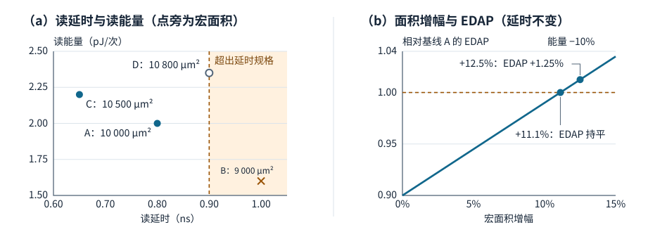

# EDAP (Energy Delay Area Product)

## 定义与适用范围

**能量延时面积积**（Energy-Delay-Area Product，EDAP）为一次有效宏访问的能量、访问延时与完整宏占地面积的乘积。读、写分别报告，并沿用 [EDP](EDP.md) 的同操作、同电气边界口径：

$$
\mathrm{EDAP}_{\mathrm{op},i}
=E_{\mathrm{op},i}\,D_{\mathrm{op},i}\,A_{\mathrm{macro}},
\qquad \mathrm{op}\in\{\mathrm{R},\mathrm{W}\}.
$$

$E_{\mathrm{op},i}$（J）为第 $i$ 次访问的宏能量，$D_{\mathrm{op},i}$（s）为同次访问的宏延时，$A_{\mathrm{macro}}$ 为该版次可放置宏的平面面积。工程单位为 J·s·μm²；$1\,\mathrm{pJ}\cdot\mathrm{ns}\cdot\mu\mathrm{m}^{2}=10^{-21}\,\mathrm{J}\cdot\mathrm{s}\cdot\mu\mathrm{m}^{2}=10^{-33}\,\mathrm{J}\cdot\mathrm{s}\cdot\mathrm{m}^{2}$。Liu 和 Catthoor 用宏级读能量、读延时和宏面积计算 EDAP，比较端口位置、树形互连、容量及子阵列组织。[4, Secs. 7.1–7.5] [5, Figs. 16–18]

| 量 | 定义 | 比较口径 |
| --- | --- | --- |
| EDAP | $E D A_{\mathrm{macro}}$ | 每次访问或明确声明的工作负载统计量，以 J·s·μm² 表示 |
| EDP | $E D$ | 同版宏的面积固定时，EDP 与 EDAP 排序相同 |
| 功率延时面积积（Power-Delay-Area Product，PDAP；文献 [1] 记为 PAD） | $\overline P D A_{\mathrm{macro}}$ | 单位为 W·s·μm²；先核对功率、延时、面积以及活动范围，再判断能否转换 |

若 $\overline P$ 为同一操作序列在窗口 $T$ 内的平均功率，窗口内完成 $N$ 次同口径访问，则访问率 $r_{\mathrm{access}}=N/T$，每次访问平均能量 $\overline E=\overline P/r_{\mathrm{access}}$。若功率包含待机、并发、失败或重试，换算结果包含相应能量。按成功次数归一化时，含失败与重试开销的每次成功交付能量须单列；成功样本的平均能量只用对应的访问窗口。只报告读或写时须用隔离序列或明确分摊方法。对变动延时，该换算只得到平均能量，无法恢复逐次能量与延时的配对关系。[1, Sec. I, IV] [2, Sec. 3] [8, Sec. V-C] [10, Sec. III]

## 物理机制与变异

**面积与通路耦合**：增大子阵列可减少子阵列数量、重复外围和全局分支，但会增大局部字线（Wordline，WL）及位线（Bitline，BL）的分布寄生，可能增加访问延时并降低写裕量。分段、缓冲和辅助电路可改变延时或写入可行性，同时占用面积并消耗能量。分存储体（Bank）、改变宏引脚位置或重配全局树，须分别检查本地和全局通路；位单元缩小的收益取决于上述代价。[4, Secs. 6.2, 7.2–7.5] [5, Figs. 1–3, 16–18] [6, Secs. III–IV, Figs. 16–18] [12, Figs. 6–7]

**工作点与相关性**：供电、温度、负载、数据翻转、地址和失配共同改变 $E,D$；低电压下恢复时间、待机能量及失效比例可改变最优工作点。同一版次宏面积为固定值，变异分析按原地址、操作序列和样片／失配样本保持 $E,D$ 配对，按工艺、电压和温度（Process, Voltage and Temperature，PVT）分组，不跨组取最小值拼接。[7, Sec. V, Figs. 19–20] [8, Sec. V, Figs. 20–22] [11, Secs. II, V]

## 宏边界与提取口径

| 对象 | 纳入范围与观测口径 | 需单列的变化 |
| --- | --- | --- |
| $E$ | 从宏的各供电端对同一访问积分，电流流入被测宏为正；含内部译码、子阵列、局部与全局数据通路、内部时钟／控制和辅助电路，积分覆盖所需恢复至下一次同类操作的状态 | 记录参考节点、各电源轨及积分起止点；配置相同的输出负载，声明测试外围、片外负载供电、待机扣除和并发访问的处理 |
| $D$ | 从宏接受命令的规定触发点量到结果有效；读采用宏输出数据有效，写采用接口定义的完成／提交点，并以读回验证 | 有流水线时记录跨越周期数及输入／输出门限。无写完成端时声明内部测点或写后读可用的功能代理；须单列最小时钟周期及持续访问率 |
| $A_{\mathrm{macro}}$ | 对完整可放置宏计面积，包含子阵列、外围、辅助／冗余资源及边界内布线；使用与电气数据配套的物理版次 | 若计入外部放置留白（Placement Halo）或外置辅助资源，说明边界和尺寸。实际宏面积、芯片总面积、位单元面积及互连导体面积分别报告 |

[1, Secs. II–III] [2, Secs. 3–5] [4, Secs. 2.3.2, 2.4.2, 7.1–7.5] [5, Figs. 16–17] [9, Sec. IV] [10, Sec. III, Fig. 17]

面积与 [Cell Area](../Bitcell/Cell_Area.md)、[互连导体面积](Interconnect_Length_Area.md) 的边界不同。比较须统一有效容量 $N_{\mathrm{bit}}$（用户可用数据位数）、端口与并发规则、每次访问的有效位宽、掩码、错误校验与修复配置，并注明测试频率、负载及 PVT。跨容量可并列报告 $A_{\mathrm{macro}}/N_{\mathrm{bit}}$ 和原始容量；按一次访问的有效位数归一化能量时须列出位数及原始能量，绝对 EDAP 仍用整宏面积和每次访问能量。若用密度回算面积，须确认密度分母为该试件的完整宏面积、分子与该宏的有效位数一致。[2, Secs. 3, 5] [3, Abstract, Figs. 15.2.1, 15.2.6] [5, Fig. 17]

## 测量与提取方法

### 【前置条件】

锁定宏标识和版次、容量与端口、后仿真寄生提取（Parasitic Extraction，PEX）网表或硅样片、宏物理边界、PVT、负载及功能通过标准。归档地址与数据序列、读写比例、有效位宽、掩码、初始状态、辅助设置及并发冲突规则。从复位或初始化进入该序列的稳定访问状态，单列唤醒、一次性初始化和空闲周期的处理。[2, Secs. 3–5] [4, Secs. 2.3.2, 2.4.2] [7, Sec. V]

### 【步骤／方法】

1. **提取宏面积**：从版图数据（GDSII）的实际放置边界或版图交换格式（Library Exchange Format，LEF）的宏放置尺寸取值。矩形以宽乘高；有明确非矩形放置边界时计算实际边界多边形面积。若 LEF 以矩形保留放置空间，须以该占地用于放置口径，并单列实际多边形面积。记录来源文件、宏名、版次、所用边界层或 LEF 字段、单位和尺寸。只有硅图时，用标定尺度量宏边界，注明像素分辨率、误差及测试外围和切割道是否纳入。[2, Secs. 3, 5] [3, Fig. 15.2.7] [7, Fig. 18] [8, Fig. 19]
2. **提取配对能量和延时**：仿真或硅实测沿用 [EDP](EDP.md#测量与提取方法) 的宏级输入、输出和电源边界；使用 [读能量 RE](../Subarray/Read_Energy.md#测量与提取方法)、[写能量 WE](../Subarray/Write_Energy.md#测量与提取方法)、[读延时 RD](../Subarray/Read_Delay.md#测量与提取方法) 及 [写延时 WD](../Subarray/Write_Delay.md#测量与提取方法) 的电路原理图、测点定义和验证操作。将其中的局部激励改接实际宏控制，纳入宏内全局路由和实际输出接口。按同一宏、同一工作点及同一事务标识配对 $E,D$。使用批量功耗仪表时，同一激励窗口只能获得批次均值；记录访问计数、测量分辨率和延时统计量，单列均值乘积口径，不将其作为逐次乘积均值。[2, Sec. 4.4] [4, Secs. 2.3.2, 2.4.2] [8, Fig. 22] [10, Figs. 16–17]
3. **计算并保存**：对每一条有效访问计算 $\mathrm{EDAP}_{\mathrm{op},i}$。交付宏标识、面积来源、样本／事务标识、地址、数据模式、PVT、频率、实际吞吐、$E,D,A_{\mathrm{macro}}$ 和通过标记。若并发操作作为一组一次计能，另建并发访问组的记录，定义组完成事件并报告组能量及组延时。

**注意事项**：共用供电轨的流水或并发访问须采用隔离序列、明确的能量分摊方法，或以互不重叠的批次积分（逐条积分重叠窗口会重复计能）。

**注意事项**：频率上限、最小时钟周期和接口访问延时须分别记录（流水线、预充恢复和端口资源约束可使周期与单次访问延时不同）。[7, Figs. 18–20] [10, Fig. 17]

**注意事项**：禁止把硅图总面积、不同容量的密度、单次操作延时及另一工作点的功率拼接成 EDAP（无法对应到实际宏配置和访问）。[3, Figs. 15.2.2–15.2.7] [4, Sec. 7.1]

### 【结果处理和验证】

- **有效性**：核对宏边界与仿真网表版次，验证读数据和写回读结果，检查恢复及紧邻访问。面积按统一单位与 GDSII／LEF 或标定硅图交叉核对；核查所有供电轨和测量区间。记录无效样本的数量和原因。
- **通过条件**：按项目规格先筛功能及良率，再筛面积、延时上限和工作频率／吞吐下限。单列成功访问统计和试验总数、失效率或置信区间。失效点不得用零或估算的 EDAP 代入排名。[5, Figs. 1–2, 17–18] [11, Secs. II, V]
- **实测定位示例**：Trivedi 等的 2 nm 双端口 xBIT 报告 $21.04\,\mathrm{Mb/mm^2}$ 宏位密度和 0.35 V、0.1 GHz 工作点。其版图组织与差分 6T 基线不同；功耗对照所用基线为常规 8T。最低工作电压、访问延时与能量须按各自测试条件读取。仅凭位密度和工作频率无法推出该点的 EDAP。[3, Abstract, Figs. 15.2.1, 15.2.6] [3, Figs. 15.2.2–15.2.7]

## 数据可视化与评估

同一版次在同一操作与 PVT 分组内，用 $n$ 次有效且可配对的访问计算：

$$
\overline{\mathrm{EDAP}}
=A_{\mathrm{macro}}\,\frac{1}{n}\sum_{i=1}^{n}E_iD_i
=A_{\mathrm{macro}}\left(\overline E\,\overline D+\frac{1}{n}\sum_{i=1}^{n}(E_i-\overline E)(D_i-\overline D)\right).
$$

横线表示样本算术均值。只有样本协方差项为零时，乘积均值才等于均值乘积。若工作负载按已知访问比例分层，应按原权重合并各组的乘积均值。报告样本数、失败率、分位数及置信区间；按相互独立的样片或访问批次成组重采样，保留组内 $E,D$ 配对。禁止用两个边际分位数相乘替代乘积分位数（无法保留联合分布）。按相同容量、接口和工作负载分别画出能量、延时及面积，注明测量区间与未通过规格的候选。[6, Figs. 16–18] [11, Sec. V] [13, Figs. 5, 7, 9]

**示例假设：** 四种 32 Kib、32 bit、单端口宏使用相同 PVT、负载、有效读操作及测试频率；假定均通过功能、良率和频率要求。规格为 $D_{\mathrm{R}}\le 0.90\,\mathrm{ns}$、$A_{\mathrm{macro}}\le 11\,000\,\mu\mathrm{m}^{2}$。表中 $E,D$ 均来自对应方案的同一有效访问，数值仅用于计算演示。

| 方案 | $E_{\mathrm{R}}$（pJ/次） | $D_{\mathrm{R}}$（ns） | $A_{\mathrm{macro}}$（μm²） | EDAP（pJ·ns·μm²） | 判断 |
| --- | ---: | ---: | ---: | ---: | --- |
| A | 2.00 | 0.80 | 10 000 | 16 000 | 通过；基线 |
| B | 1.60 | 1.00 | 9 000 | 14 400 | 延时超限 |
| C | 2.20 | 0.65 | 10 500 | 15 015 | 通过；合格方案中最小 |
| D | 2.35 | 0.90 | 10 800 | 22 842 | 通过；在三项上均劣于 A |

**图 1｜规格筛选与面积权衡（示例假设）。** 左图显示延时和能量，点旁标出宏面积。通过规格后在 $(E,D,A_{\mathrm{macro}})$ 中判定 Pareto 前沿：A 与 C 保留，D 受 A 支配；B 虽然乘积最低，仍须排除。右图以 A 为基线，在延时不变、能量下降 10% 时，面积增幅的等值边界为 $1/0.90-1\approx 11.1%$。变更后面积若增加 12.5%，乘积比为 $0.90\times1.125=1.0125$，EDAP 增加 1.25%。一般用各因子的实际比值相乘作判断。[6, Figs. 16–18]

## 应用场景与指标关系

在设计与工艺协同优化（Design-Technology Co-Optimization，DTCO）中，用 EDAP 比较分存储体、子阵列组织、读摆幅、写辅助、互连、供电点和位单元布局。先确定数据宏、缓存标签阵列或系统级边界，再在合格点内结合 [EDP](EDP.md)、[Cell Height & Width](../Bitcell/Cell_Height_Width.md) 和 [Tree Delay/Energy %](Tree_Delay_Energy_Percent.md) 定位主要代价。[4, Secs. 7.1–7.5] [5, Figs. 16–18] [6, Figs. 16–18] [12, Figs. 6–10] [13, Secs. II–III]

**文献示例（模型结果）**：Liu 等在 A14、TT、27°C、16 MB、中心引脚 H 树条件下，将标准子阵列从 $128\mathrm{C}\times128\mathrm{R}$ 增到 $1024\mathrm{C}\times512\mathrm{R}$，模型中的宏 EDAP 降低 56%；此基准未计潜在写失效，不能据此判定大子阵列符合写入规格。Pei 等的 E 树工作另计标签阵列并改变地址访问权重，适用于末级缓存系统边界，须与数据宏单列。[5, Figs. 1, 16–18] [13, Secs. II–III, Figs. 1, 5]

## 参考文献

检索范围：Zotero 集合 `02-SRAM-DTCO/SRAM-Metrics/Macro`（`J7MHPUK7`），标签 `EDAP (Energy Delay Area Product)`。补检前精确命中 1 条，补检后 13 条均有可读全文，其中 12 篇为独立期刊或会议研究；专著 [4] 单列。以下将 EDAP 原文数据、相邻指标与提取方法分别标明。

[1] G. Pasandi et al., “Hybrid cell assignment and sizing for power, area, delay product optimization of SRAM arrays,” IEEE Trans. Circuits Syst. II, 2019, author manuscript. [DOI 10.1109/TCSII.2019.2896794](https://doi.org/10.1109/TCSII.2019.2896794). [公开文献](https://doi.org/10.1109/TCSII.2019.2896794)；[Zotero](https://www.zotero.org/users/7333024/items/V7D4Z7N4)。

**相关摘要：** 论文通过多尺寸和双阈值单元的混合分配，改善阵列功率、面积与延迟之间的折衷。远近位置的线负载不同，采用统一单元可能不是最佳方案；作者据位置和器件尺寸建立成本函数并优化。其明确目标是功率乘面积乘延迟，属于PAD／PDAP，不是用每次访问能量构成的EDAP，二者量纲和运行条件不同。因此它仅作为相近综合优化方法保留，不能把原文PAD降低百分比改称EDAP改善。要转换必须知道功率对应的操作窗口和活动率，并以同一设计的访问能量、延迟及完整宏面积重新计算。

**原文定位：** §II–III，作者稿PDF第2–4页，式(4)–(5)。

[2] M. R. Guthaus et al., “OpenRAM: An open-source memory compiler,” in Proc. IEEE/ACM ICCAD, 2016. [DOI 10.1145/2966986.2980098](https://doi.org/10.1145/2966986.2980098). [公开文献](https://doi.org/10.1145/2966986.2980098)；[Zotero](https://www.zotero.org/users/7333024/items/DYJK5C4I)。

**相关摘要：** OpenRAM论文展示可生成电路、版图、功能模型及时序功耗表的开源编译器，强调不能只比较单行或单列而遗漏外围。完整实例包含单元阵列、译码、预充电、感放、写驱动与控制，不同容量及组织改变密度和访问表现。该流程为统一口径比较提供基础，但原文的功率和面积曲线并不自动构成每次访问能量乘积。完整宏生成与表征可提供面积和延迟，而能量需从明确操作窗口的功率得到。原文没有统一EDAP结果，不能把最小单元面积、另一配置的最快延迟和功率曲线拼接相乘；外围面积应包含在宏范围。

**原文定位：** §3–5，PDF第2–5页。

[3] M. Trivedi et al., “A 350mV single-rail SRAM using a custom-logic-bitcell in 2nm-CMOS-nanosheet technology for mobile and edge-AI applications,” in IEEE ISSCC Dig. Tech. Papers, paper 15.2, 2026. [DOI 10.1109/ISSCC49663.2026.11409350](https://doi.org/10.1109/ISSCC49663.2026.11409350). [公开文献](https://doi.org/10.1109/ISSCC49663.2026.11409350)；[Zotero](https://www.zotero.org/users/7333024/items/2DMRRST6)

**相关摘要：** 论文展示2 nm纳米片逻辑位单元SRAM，通过局部／全局读写通路与控制优化降低功耗，写端采用银行级时钟混合减少无效切换。宏布局、字节门控及位单元选择共同影响性能和能量，比较还依赖电源和容量条件。该文提供特定芯片架构证据，不能把单元、局部通路和整个宏的测量范围互相替换。该芯片提供宏密度、速度与能量的比较素材，但没有在本页统一边界下直接给出EDAP。计算必须选择同一电压、容量及操作的三项，并以完整宏面积而非位单元面积相乘，不能跨工作点择优组合。

**原文定位：** ISSCC paper 15.2，PDF第1–3页，图15.2.2–15.2.7。

[4] H. H. Liu, and F. Catthoor, “Circuit-technology Co-optimization of SRAM design in advanced CMOS nodes,” Cham, Springer Nature Switzerland, 2025. [公开文献](https://doi.org/10.1007/978-3-031-76109-6)；[DOI](https://doi.org/10.1007/978-3-031-76109-6)；[Zotero](https://www.zotero.org/users/7333024/items/CHVFC3IE)

**相关摘要：** 本书贯通单元、子阵列和宏级仿真。局部指标由含寄生和外围的电路得到，宏模型再加入树形互连、控制驱动及核心至数据通路；两级统计边界不可混用。先进节点的单元缩小未必等比例改善访问性能，线阻、电容和写辅助代价可能抵消收益。宏级比较采用明确容量、树形结构、引脚位置及工艺条件，并讨论写入可行性的约束。第7章以宏级读能量、延迟和总面积形成EDAP，比较引脚位置、树形互连、容量和子阵列组织。结果不等于单元面积乘局部延迟；某些比较未充分实现写辅助，其额外能量与面积可能改变最终排序。

**原文定位：** §2.3.2、§2.4.2、§6.2、§7.1–7.5，书内pp.36、42、137–139、174–181。

[5] H.-H. Liu et al., “Future Design Direction for SRAM Data Array: Hierarchical Subarray With Active Interconnect,” *IEEE Transactions on Circuits and Systems I: Regular Papers*, vol. 71, no. 12, pp. 6495–6506, 2024. [DOI 10.1109/TCSI.2024.3410518](https://doi.org/10.1109/TCSI.2024.3410518)；[KU Leuven 作者稿](https://lirias.kuleuven.be/retrieve/913275b5-a108-48a9-b523-7f949cafecb4)；[公开文献](https://doi.org/10.1109/TCSI.2024.3410518)；[Zotero](https://www.zotero.org/users/7333024/items/FKMH67JE)。

**相关摘要与定位：** 仿真和宏级模型分解局部与子阵列间通路的读能量、延时和面积。原文直接报告宏 EDAP，并分别标记忽略及考虑写失败风险的比较。见图 1–3、16–18，尤其是图 17 的面积和 EDAP。

[6] B. S. Amrutur and M. A. Horowitz, “Speed and power scaling of SRAM's,” *IEEE Journal of Solid-State Circuits*, vol. 35, no. 2, pp. 175–185, 2000. [DOI 10.1109/4.823443](https://doi.org/10.1109/4.823443)；[公开文献](https://doi.org/10.1109/4.823443)；[Zotero](https://www.zotero.org/users/7333024/items/CH2EXX7I)。

**相关摘要与定位：** §III–IV 建模译码、局部与全局数据通路及面积。图 16–18 在 0.25 μm 工艺的 4 Mb SRAM 上比较不同组织的面积、延时和能量；用于分析三项权衡，原文未给出本页的逐访问 EDAP。

[7] M. E. Sinangil, N. Verma, and A. P. Chandrakasan, “A Reconfigurable 8T Ultra-Dynamic Voltage Scalable (U-DVS) SRAM in 65 nm CMOS,” *IEEE Journal of Solid-State Circuits*, vol. 44, no. 11, pp. 3163–3173, 2009. [DOI 10.1109/JSSC.2009.2032493](https://doi.org/10.1109/JSSC.2009.2032493)；[MIT 档案](https://hdl.handle.net/1721.1/53553)；[公开文献](https://doi.org/10.1109/JSSC.2009.2032493)；[Zotero](https://www.zotero.org/users/7333024/items/SFTQMUPB)。

**相关摘要与定位：** §V、图 18–20 报告 64 kbit 试件的芯片图、随电压变化的性能和每次访问能量。访问字宽为 128 bit，能量分为活动与漏电贡献。芯片外形和可放置宏面积须按各自边界处理；最低能量点不替代延时或频率约束。

[8] N. Verma and A. P. Chandrakasan, “A 256 kb 65 nm 8T Subthreshold SRAM Employing Sense-Amplifier Redundancy,” *IEEE Journal of Solid-State Circuits*, vol. 43, no. 1, pp. 141–149, 2008. [DOI 10.1109/JSSC.2007.908005](https://doi.org/10.1109/JSSC.2007.908005)；[作者组 PDF](https://www.princeton.edu/~nverma/VermaLabSite/Publications/2008/2008_verma_jssc_jan.pdf)；[公开文献](https://doi.org/10.1109/JSSC.2007.908005)；[Zotero](https://www.zotero.org/users/7333024/items/94NS3U8F)。

**相关摘要与定位：** §V、图 19–22 给出芯片图、读写性能、总功率与漏电随频率的变化。论文的相对面积对照来自位单元版图，不能与宏总功率及延时拼接成宏 EDAP。

[9] G. Pasandi and S. M. Fakhraie, “A 256-kb 9T Near-Threshold SRAM With 1k Cells per Bitline and Enhanced Write and Read Operations,” *IEEE Transactions on Very Large Scale Integration (VLSI) Systems*, vol. 23, no. 11, pp. 2438–2446, 2015. [DOI 10.1109/TVLSI.2014.2377518](https://doi.org/10.1109/TVLSI.2014.2377518)；[arXiv 作者稿](https://arxiv.org/abs/1812.10011v2)；[公开文献](https://doi.org/10.1109/TVLSI.2014.2377518)；[Zotero](https://www.zotero.org/users/7333024/items/2RID45U5)。

**相关摘要与定位：** §IV-E–F、图 17 和表 II–III 报告位单元版图，以及两种 256 kb 电路在各自最低可用电压的仿真功率与延时。可用于理解列高变化和观测点差异；表 II 的面积为单个单元，表 III 的写延时采用内部节点交叉判据，均须保留其边界。

[10] T.-H. Kim, J. Liu, J. Keane, and C. H. Kim, “A 0.2 V, 480 kb Subthreshold SRAM With 1 k Cells Per Bitline for Ultra-Low-Voltage Computing,” *IEEE Journal of Solid-State Circuits*, vol. 43, no. 2, pp. 518–529, 2008. [DOI 10.1109/JSSC.2007.914328](https://doi.org/10.1109/JSSC.2007.914328)；[NTU 档案](https://hdl.handle.net/10356/84782)；[公开文献](https://doi.org/10.1109/JSSC.2007.914328)；[Zotero](https://www.zotero.org/users/7333024/items/QRLTXRPI)。

**相关摘要与定位：** §III、图 16–18 和表 I 给出功率、不同象限的实测访问时间和最高频率以及试件版图。图 17 分别表征访问时间与最高频率，支持将两项作为不同的规格量记录。

[11] J. Boley, P. Beshay, and B. Calhoun, “Virtual Prototyper (ViPro): An SRAM Design Tool for Yield Constrained Optimization,” *IEEE Transactions on Very Large Scale Integration (VLSI) Systems*, vol. 23, no. 12, pp. 3109–3113, 2015. [DOI 10.1109/TVLSI.2014.2385832](https://doi.org/10.1109/TVLSI.2014.2385832)；[公开文献](https://doi.org/10.1109/TVLSI.2014.2385832)；[Zotero](https://www.zotero.org/users/7333024/items/68JPTI4S)。

**相关摘要与定位：** §II、V 和图 4–7 联合评估失配、功能良率与能量和延时，比较不同目标良率下的 Pareto 点。用于说明先按良率筛选再比较性能与能量；该模型的二维 Pareto 曲线不等同于本页的三维前沿。

[12] Z. Pei et al., “Graphene-Based Interconnect Exploration for Large SRAM Caches for Ultrascaled Technology Nodes,” *IEEE Transactions on Electron Devices*, vol. 70, no. 1, pp. 230–238, 2023. [DOI 10.1109/TED.2022.3225512](https://doi.org/10.1109/TED.2022.3225512)；[imec 作者稿](https://imec-publications.be/server/api/core/bitstreams/84f7b456-3a33-4809-aafc-463636314fe7/content)；[公开文献](https://doi.org/10.1109/TED.2022.3225512)；[Zotero](https://www.zotero.org/users/7333024/items/HAPE4X7F)。

**相关摘要与定位：** 作者稿图 5–7、9–10 用器件和互连模型比较大容量缓存的访问时间、每次读能量及面积。改变互连线宽会同时改变寄生与占地，原文直接报告缓存级 EDAP，结果对应模型及缓存组织。

[13] Z. Pei et al., “Ultra-Scaled E-Tree-Based SRAM Design and Optimization With Interconnect Focus,” *IEEE Transactions on Circuits and Systems I: Regular Papers*, 2024. [DOI 10.1109/TCSI.2024.3438164](https://doi.org/10.1109/TCSI.2024.3438164)；[NSF 公开全文](https://par.nsf.gov/servlets/purl/10599095)；[公开文献](https://doi.org/10.1109/TCSI.2024.3438164)；[Zotero](https://www.zotero.org/users/7333024/items/ADVGSHNB)。

**相关摘要与定位：** 作者稿 §II–III、图 1、5、7、9 以相同容量口径比较不同树形互连、引脚位置和地址访问分布。缓存系统包含标签阵列及对应数据通路；原文明确量化工作负载改变时的 EDAP，适合核对地址加权与宏、系统边界的区别。
