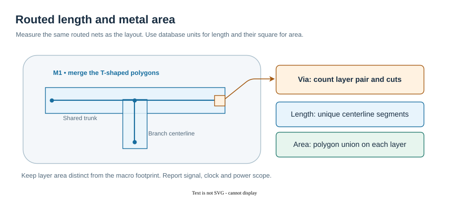

# Interconnect Length & Area

## 定义与适用范围

**宏级互连长度与布线面积**（Macro Interconnect Length and Routed Metal Area）用于统计已完成布线的静态随机存取存储器（Static Random-Access Memory，SRAM）宏内的导线几何。以宏边界内的信号网为主口径，分列全局访问树与局部互连；时钟网、电源网和通孔另报。报告须注明版图版本、计入的物理层及形状类别。[1, Region.area, Region.merged] [2, Sec. 5.1–5.2]

| 量 | 定义与单位 | 汇总规则 |
| --- | --- | --- |
| 实际布线中心线长度 $L_{n,\ell}$ | 网络 $n$ 在金属层 $\ell$ 内的唯一已布线路径长度，μm。正交段取轴向距离，斜段取实际欧氏长度 | 分割相交或重叠的中心线段；同网同层共线重叠部分只计一次。宏内分层总长为 $L_\ell=\sum_n L_{n,\ell}$；跨层重投影的线段仍分别计长 |
| 同层布线面积 $A_\ell$ | 所选导体在金属层 $\ell$ 上的俯视多边形并集面积，μm² | 先按层合并实际轮廓，再求面积。保留端帽、变宽、分支、通孔上下包围金属等已选导体；重叠区域只计一次 |
| 各层面积总和／平面覆盖面积 | $\sum_\ell A_\ell$ 表示各层面积累加；$A_{\mathrm{proj}}$ 为所有所选层投影到同一平面后的并集面积，均为 μm² | 前者重复计入不同层间的投影重叠；后者去除该重叠。两者均与按宏放置边界求得的宏占地 $A_{\mathrm{macro}}$ 分开报告 |
| 通孔（Via） | 分网络、物理层对、开孔层记录通孔实例数及开孔（Cut）个数；需要时附开孔面积，μm² | 多开孔阵列按实际开孔数计，叠层通孔按各物理层对分别计；只有布线对象或版图实例保留可靠分组时才报实例数。开孔面积与上下金属面积分列，垂直高度不计入 $L_\ell$ |

**距离口径**：以驱动端和负载端实际使用的引脚接入点为端点，沿同层已连通线段及通孔层对累计端到端路径长度；通孔转接的平面长度权重为零。有多个接入点或环路时，须记录实际选用的接入点与路径，或注明最短连通路径规则。跨中继级联时，逐级累计并注明中继端口。半周长线长（Half-Perimeter Wirelength，HPWL）取各引脚代表点外接矩形的宽与高之和，是布局阶段估算值；直角斯坦纳最小树（Rectilinear Steiner Minimal Tree，RSMT）给出考虑共享分支的估算，仍须经详细布线得到实际长度。[16, Sec. I] 实际网络树的共享干线在物理总长中只计一次，可同时出现在多个端到端结果中。若需把资源归属到各叶端，须单列分摊值及权重（例如按各干线的下游叶端数等分），并核对分摊值求和等于被分摊的物理总量。[4, Secs. 3–5] [5, Secs. 7.1–7.5]

## 物理机制与变异

**层、线宽与连接**：布线层的线宽、间距和允许方向决定可用轨道；引脚接入、阻挡和跨层规则可增加绕行及通孔。等长线路在不同层或线宽下具有不同的阻容；同层加宽会增加金属面积，可降低导线电阻，同时改变与相邻导体的耦合。引脚、端帽、拐角和包围金属使 $A_\ell$ 与简单的线宽乘中心线长度产生差异。[2, Sec. 5.1–5.2, Figs. 4–6] [6, Secs. III–IV] [9, Sec. II, Figs. 3–8] [17, Secs. II–IV] [18, Secs. 2–4]

**设计值与制造值**：布线数据库给出名义绘制尺寸。同一数据库、层映射和统计规则下，结果固定。制造后的关键尺寸（Critical Dimension，CD）、侧壁和端部轮廓受工艺及位置影响，需按样片与量测截面报告。比较布局种子时记录版图样本；比较制造偏差时记录晶圆、芯片、层、位置与量测不确定度。这两组离散性分别汇总。[8, Secs. II–IV] [9, Sec. II-E]

## 宏边界与网络归属

| 统计对象 | 计入范围与归属 |
| --- | --- |
| 宏内全局信号 | 宏内地址／控制分发、数据返回及分存储体间布线；树形互连按实际拓扑统计，共享主干在宏汇总中只计一次 |
| 宏内局部信号 | 按分存储体（Bank）、阵列块（Mat，沿用文献命名）、子阵列、外围分组，区分字线（Wordline，WL）、位线／互补位线（Bitline，BL／BLB）、局部数据及控制互连 |
| 供电、时钟、引脚与非布线形状 | VDD／VSS 电源轨、时钟、物理引脚金属分组标识；信号引脚与布线重叠部分在选定的信号面积并集中只计一次。文字标签、抽象引脚标记、未连接填充及禁布区不计入信号金属面积；需要时另报填充面积、禁布区及轨道占用 |
| 宏外与特殊互连 | 芯片顶层送达宏引脚的布线另报；先筛选归属宏的导体，再按声明的物理边界裁剪。埋入式导线、局部互连、背面电源轨及特殊层间连接按工艺设计套件（Process Design Kit，PDK）映射单列 |

层次化版图须把每个已放置实例变换到宏坐标系，再按实例路径和已解析的物理网络归属统计。周期阵列可在内部单元一致时复用提取结果，但须显式处理镜像拼接、边界单元、父层跨接和共享电源轨；仅有宏抽象视图时，内部网络与金属统计标为不可用。改变分割或阵列长宽比，会同时改变局部 WL／BL 行程、外围数量及全局干线布局。比较两种方案须统一容量、端口数、冗余、边界、引脚位置和实际层规则，或列出差异。[2, Secs. 5.5–5.6] [4, Secs. 3–5] [5, Secs. 7.1–7.5] [7, Secs. 3–5] [10, Secs. 2–4] [11, Secs. 2–3] [12, Secs. II–III] [13, Secs. II–IV] [14, Secs. 2–4] [15, Secs. 2–4]

## 测量与提取方法

*图 1．同网同层 T 形布线。实线示意唯一中心线；同层金属轮廓取并集；跨层连接按物理层对及实际开孔数记录。*

### 【前置条件】

准备同一版次的详细布线数据库或已布线设计交换格式（Design Exchange Format，DEF）及库交换格式（Library Exchange Format，LEF），以及最终输出的 GDSII／OASIS、源网表、层表和宏边界。记录数据库单位（Database Unit，DBU）、DEF 头部单位、版图工具和 PDK 版本、层号／数据类型映射、提取规则版本及文件校验值。对于宏单元内部布线，用有路由语义的原始布局数据库或可核对的路径记录补足 DEF 缺项。须备有版图与原理图一致性检查（Layout Versus Schematic，LVS）通过的报告及可回溯到版图形状的网络映射；寄生参数提取（Parasitic Extraction，PEX）可用于关联同一网的阻容数据。[3, Extract Parasitics] [7, Secs. 3–5]

### 【步骤／方法】

1. **校准坐标与层表**：将 DEF 与 GDSII／OASIS 统一为同一坐标原点和物理单位。核对已知线长、线宽及通孔的层对；应用实例的平移、旋转或镜像。用边界交叠案例核对裁剪，互斥窗口采用固定的半开边界；开孔计数按开孔中心归属，已知通孔实例按放置点归属，面积按轮廓与窗口的交集计算。
2. **提取唯一中心线**：按网络、金属层取已布线的路径点，按宏边界剪裁；将同一直线上的重叠区间合并，支路和非共线交叉各保留自身长度。正交路径可取各段坐标差绝对值之和，有斜段时取实际欧氏长度。GDSII／OASIS 只提供多边形且没有可靠路径记录时，中心线长度标为不可用；如需估算，单列骨架算法、端点规则及与已知路由的误差。
3. **提取金属并集与通孔**：按 LVS 映射归属实际导体；使用 PDK 定义的颜色合并、金属切割及层用途生成物理导体轮廓。按层裁剪并合并求面积，以 GDSII／OASIS 所用单个 DBU 对应的 μm 值的平方换算面积。引脚标记层不作为导体。对通孔阵列展开实际开孔并去重，按连接归属累计开孔数及各开孔层并集面积；扁平图形无法唯一恢复阵列分组时，实例数标为不可用。未建立网络映射时，可报按 PDK 规则得到的各层导体总面积；缺少规则时仅报明确层号与数据类型的绘制图形面积。两种情况下的信号网分项均标为不可用。[1, Region.area, Region.merged]
4. **硅样本复核（需实测时）**：对已知版图位置选择指定层，按获准的去层与量测流程，用已校准的扫描电子显微镜（Scanning Electron Microscope，SEM）记录轮廓、线宽及开孔位置。对两端可定位的线段按声明的端点和中心线规则量长度；跨视场须校准拼接。记录像素尺度、轮廓阈值、量测平面、样本量和不确定度；以截面核对侧壁或层归属。可见投影、局部样本和宏级绘制值分别报告。现有已核全文未给出同一实测宏逐网、逐层的几何总量。

**注意事项**：须按 LVS 连通结果和层用途判断网络归属（同层不同网的实际导体重叠、网络未映射及开短路会破坏按网统计；发现后须定位并重抽）。

**注意事项**：须使用详细布线和最终物理图形计算报告值（全局布线路径、SPEF 中的阻容以及宏外接矩形分别采用不同统计对象）。

### 【结果处理和验证】

| 校准用例（示例） | 应得到的结果 |
| --- | --- |
| 单直线：中心线 10 μm，轮廓为 $10\,\mu\mathrm{m}\times2\,\mu\mathrm{m}$ 的矩形 | 长度 10 μm，面积 20 μm²，开孔数 0；旋转或镜像后数值一致 |
| T 形：上述干线中点引出 4 μm 支路，支路矩形面积 8 μm²，与干线重叠 2 μm²；输入额外重复一份干线路径 | 唯一中心线长度 14 μm，同层面积 26 μm²。若以干线一端为源，至两个叶端的路径分别为 9、10 μm；两者共享 5 μm 干线 |
| 分层重叠：在该 T 形上增加另一层面积为 4 μm² 的金属，其投影完全落在 T 形内；用一个含两个开孔的通孔实例连接 | 各层面积总和 30 μm²，平面覆盖面积 26 μm²，层对记录 1 个通孔实例、2 个开孔，各层仍保留自身金属面积 |
| 跨界开孔：1 个通孔实例含 2 个开孔，实例放置点在左窗，两个开孔中心分属左右两窗；其中一个开孔轮廓跨界 | 实例仅在放置点所属窗口记 1 次；两侧各记 1 个开孔，开孔面积按实际轮廓切分，两侧之和等于未裁剪的开孔并集面积 |

校准用例须在工具网格及声明的数值容差内通过。真实宏须核对未映射形状数、未布线网、跨界裁剪结果、LVS 连通分量及抽样叠图；报告所有排除项与部分覆盖范围。交付至少包含版图版本、网络及实例路径、网络类别、金属层、中心线长度、同层面积、通孔层对／开孔层、实例数、开孔数和提取状态。另交付按层的跨网并集与跨层投影总量。纯几何提取无需电气测试电路；计算延迟或能量时另用同版寄生参数和相应测量边界。

## 数据可视化与评估

- **按层与网络类**：分别画中心线长度和同层面积堆叠柱状图，并以独立图标示通孔实例／开孔数。通过全局树、WL、BL、局部数据、时钟和电源的分项对照，定位互连改动集中在哪些层。
- **按访问路径**：在宏布局上标注宏引脚、中继、近端和远端子阵列；画实际源端至叶端的路径长度经验累积分布，报告最小值、中位数、第 95 百分位及最大值。注明近／远端分组规则、访问是否加权及样本数。需要评估最差路径时，同时查看走线层、通孔数量、负载和同版 PEX。[5, Secs. 7.1–7.5] [11, Secs. 2–3] [12, Secs. II–III]
- **按空间窗口**：用固定窗口叠图报告各层的金属占用率，分母取窗口与宏边界相交的面积；同一窗口的跨层平面覆盖率采用相同分母，以各层投影并集面积为分子。若比较可用布线资源，另报已占合法轨道长度与扣除禁布区后的可用合法轨道长度之比，按层和方向汇总，结合拥塞和引脚接入违规判断。比较前统一填充、包围金属和引脚统计规则。[6, Secs. III–IV]

**文献对照（模型结果）**：Pei 等分别画出侧边引脚和中心引脚条件下的线长频数与访问概率分布。其合成负载取子阵列访问概率与根引脚至子阵列路径长度成反比（$\alpha=1$）；在该条件下，中心引脚 E 树的访问加权平均线长最短。该平均值用于访问路径评估，物理网络总长仍按唯一中心线另算。[12, Secs. II-B, III-A, Fig. 4]

## 应用场景与指标关系

用同一口径对照子阵列分割、外围引脚位置及层分配，评估局部线缩短换来的全局布线、通孔和可用轨道开销。连同 [Tree Delay/Energy %](Tree_Delay_Energy_Percent.md) 定位全局路径瓶颈，用 [BL RC](../Subarray/BL_RC.md) 核对局部位线阻容；用宏占地解释 [EDAP](EDAP.md) 的面积项。设计与工艺协同优化（Design-Technology Co-Optimization，DTCO）比较须分别报告模型估算、已布线几何及硅样本；PDK 层栈、通孔构造、布线和密度规则不同的结果，须注明归类与可比范围。[5, Secs. 7.1–7.5] [8, Sec. III] [9, Sec. II-E] [12, Secs. II–III]

## 参考文献

2026-11-17，Zotero `02-SRAM-DTCO/SRAM-Metrics/Macro`（`J7MHPUK7`）内精确标签 `Interconnect Length & Area` 由 2 条增至 15 条。核验 13 篇期刊或会议原始研究，以及 2 份技术报告和 1 部专著。CACTI 6.0 报告单独归档，Zotero 附于 CACTI 5.0 题录。官方文档用于核对几何工具语义；架构模型、详细布线研究和硅样本数据按各自边界使用。

[1] KLayout, “Region,” KLayout API reference. [原文](https://www.klayout.de/doc-qt5/code/class_Region.html)；Zotero：本次检索范围内未匹配记录。

**相关摘要：** KLayout的Region表示多边形集合，支持合并、布尔运算与面积计算；默认合并语义下重叠区域只计一次，原始模式则可能保留重叠。坐标以数据库单位表示，跨单位域使用前需转换。该API可作为逐层金属几何统计的方法依据，但它本身不识别SRAM信号网络，也不会自动把多边形面积转换成导线中心线长度。本页金属面积可按层合并后求并集，需用数据库单位平方转换；跨层面积应声明累加规则。导线长度应另从唯一中心线或路由段提取，不能用多边形周长或宏外接矩形面积替代。

**原文定位：** 官方API“Region”详细说明及“area”“merged_semantics”。

[2] N. Muralimanohar, R. Balasubramonian, and N. P. Jouppi, “CACTI 6.0: A tool to model large caches,” HP Labs, Tech. Rep. HPL-2009-85, 2009. [公开文献](https://shiftleft.com/mirrors/www.hpl.hp.com/techreports/2009/HPL-2009-85.pdf)；Zotero 无独立同名题录，全文附于 [CACTI 5.0 题录](https://www.zotero.org/users/7333024/items/JYDVTQLK)。

**相关摘要：** CACTI 6.0将缓存划分为bank、mat与子阵列，估算译码、字线、位线、感放、复用、输出和跨bank互连。报告改进分布式字线与位线模型，并增加多种线路和网络结构；组织分割缩短局部线，却增加外围及路由开销。模型用于架构探索，必须保留容量、组织与互连假设，不能当作任意工艺版图的直接测量。报告由容量、分割和线路类型估算布局及网络成本，适合解释组织改变造成的互连趋势。模型面积包含路由空间或外围，不等同实际金属投影并集；中心线长度也应与平均访问距离分开统计。

**原文定位：** §1–3、§5.1–5.2、§5.5–5.6，图 4–6、图 9–10。

[3] The OpenROAD Project, “Parasitics extraction,” OpenROAD documentation. [原文](https://openroad.readthedocs.io/en/latest/main/src/rcx/README.html)；Zotero：本次检索范围内未匹配记录。

**相关摘要：** OpenROAD官方文档说明OpenRCX从已布线LEF／DEF及工艺规则提取导线电阻、对地电容和耦合电容，并把结果关联到导线与通孔对象。提取考虑邻线距离和上下层布线环境，可输出SPEF；耦合阈值会把较小耦合转为对地项。不同工艺角、上下文深度及通孔合并设置会改变结果，使用时应记录配置。该工具把寄生关联到已布线路段和通孔，可帮助界定需要统计的网络与层。它的SPEF电阻电容不是几何面积或长度本身，仍须从对应布局对象提取，并对重叠金属、共享段和通孔制定唯一计数规则。

**原文定位：** 官方网页“Parasitics Extraction”“Extract Parasitics”“Write SPEF”。

[4] S. Thoziyoor, N. Muralimanohar, and N. P. Jouppi, “CACTI 5.0,” Hewlett-Packard Laboratories, Tech. Rep. HPL-2007-167, Oct. 19, 2007. ；[Zotero](https://www.zotero.org/users/7333024/items/JYDVTQLK)；DOI：Zotero未收录或尚未核实。

**相关摘要：** 归档附件实际为2007年CACTI 5.0报告，作者为Thoziyoor、Muralimanohar和Jouppi，不能按Zotero的2008年四作者题录引用。报告将存储器分为bank、mat及子阵列，建模译码、位线、感放、复用和请求／回复树。地址与输入数据树可门控，输出树使用不同驱动结构；阵列组织搜索需同时考虑时延、功耗与布局开销。面积章节按bank与mat布局及路由轨道间距估算互连开销，所得为布局占用面积。它不同于逐金属层多边形并集面积，也不直接给出全部导线唯一中心线长度；几何统计应另从实际路由提取。

**原文定位：** §3–5，报告pp.8–27（PDF第9–28页）。

[5] H. H. Liu, and F. Catthoor, “Circuit-technology Co-optimization of SRAM design in advanced CMOS nodes,” Cham, Springer Nature Switzerland, 2025. [公开文献](https://doi.org/10.1007/978-3-031-76109-6)；[DOI](https://doi.org/10.1007/978-3-031-76109-6)；[Zotero](https://www.zotero.org/users/7333024/items/CHVFC3IE)

**相关摘要：** 本书贯通单元、子阵列和宏级仿真。局部指标由含寄生和外围的电路得到，宏模型再加入树形互连、控制驱动及核心至数据通路；两级统计边界不可混用。先进节点的单元缩小未必等比例改善访问性能，线阻、电容和写辅助代价可能抵消收益。宏级比较采用明确容量、树形结构、引脚位置及工艺条件，并讨论写入可行性的约束。第7章比较树路由及引脚位置对互连长度和面积开销的影响，最短访问距离与全部金属总长度不是同一量。书中归一化宏面积也不等于金属投影并集，本页采用其趋势时必须说明测量对象与层级。

**原文定位：** §2.3.2、§2.4.2、§6.2、§7.1–7.5，书内pp.36、42、137–139、174–181。

[6] A. B. Kahng, L. Wang, and B. Xu, “TritonRoute: The Open-Source Detailed Router,” *IEEE Trans. Comput.-Aided Des. Integr. Circuits Syst.*, vol. 40, no. 3, pp. 547–559, 2021. [DOI](https://doi.org/10.1109/TCAD.2020.3003234) · [UC San Diego 作者稿](https://vlsicad.ucsd.edu/Publications/Journals/j133.pdf) · [公开文献](https://doi.org/10.1109/TCAD.2020.3003234) · [Zotero](https://www.zotero.org/users/7333024/items/2EN6MEP8)。

**相关摘要与定位**：第 III–V 节给出详细布线数据库、引脚接入、轨道分配及详细布线过程；第 VI 节表 VII 分别报告详细布线长度和通孔数。研究基于 ISPD-2018 基准，适用于区分详细布线与全局导引的工程口径。

[7] M. R. Guthaus et al., “OpenRAM: An Open-Source Memory Compiler,” in *ICCAD*, 2016. [DOI](https://doi.org/10.1145/2966986.2980098) · [公开文献](https://doi.org/10.1145/2966986.2980098) · [Zotero](https://www.zotero.org/users/7333024/items/DYJK5C4I)。

**相关摘要与定位**：第 3–5 节及图 3–4 说明 SRAM 宏生成、分层布局及 GDSII、SPICE 网表和 LEF 等交付物。第 4.2 节以版图和网表执行分层 LVS；全宏几何汇总须针对实际实例与物理图形。

[8] R. Mathur et al., “Buried Interconnects for Sub-5 nm SRAM Design,” *IEEE Trans. Electron Devices*, vol. 69, no. 3, pp. 1041–1047, 2022. [DOI](https://doi.org/10.1109/TED.2022.3143078) · [公开文献](https://doi.org/10.1109/TED.2022.3143078) · [Zotero](https://www.zotero.org/users/7333024/items/H35G9VFR)。

**相关摘要与定位**：第 II–IV 节比较常规金属、埋入式电源轨及埋入式位线的层栈、布局和提取结果。几何归属随工艺选项变化，埋入式导线和特殊连接须按物理层映射纳入统计。

[9] H.-H. Liu et al., “CFET SRAM DTCO, Interconnect Guideline, and Benchmark for CMOS Scaling,” *IEEE Trans. Electron Devices*, vol. 70, no. 3, pp. 883–890, 2023. [DOI](https://doi.org/10.1109/TED.2023.3235701) · [公开文献](https://doi.org/10.1109/TED.2023.3235701) · [Zotero](https://www.zotero.org/users/7333024/items/W99KL789)。

**相关摘要与定位**：第 II 节和图 3–9 比较顺序和单片互补场效应晶体管（Complementary FET，CFET）位单元的图形和截面方案，说明切割、层间接线与供电轨如何限制局部路线；原文为布局设计与工艺仿真。

[10] A. J. Bhavnagarwala, S. V. Kosonocky, and J. D. Meindl, “Interconnect-Centric Array Architectures for Minimum SRAM Access Time,” in *ICCD*, pp. 400–405, 2001. [DOI](https://doi.org/10.1109/ICCD.2001.955058) · [公开文献](https://doi.org/10.1109/ICCD.2001.955058) · [Zotero](https://www.zotero.org/users/7333024/items/8V5VDILA)。

**相关摘要与定位**：第 2–4 节按阵列划分估算位线、字线和译码线的行程，将缩短局部线的收益和增加上层分发线路的代价一并比较。

[11] C. Kim, D. Burger, and S. W. Keckler, “An Adaptive, Non-Uniform Cache Structure for Wire-Delay Dominated On-Chip Caches,” in *ASPLOS*, pp. 211–222, 2002. [DOI](https://doi.org/10.1145/605432.605420) · [公开文献](https://doi.org/10.1145/605432.605420) · [Zotero](https://www.zotero.org/users/7333024/items/MH5DEJ6Q)。

**相关摘要与定位**：第 2–3 节和图 2 对照均匀及非均匀缓存组织，指出各存储体至控制端的物理距离及路径延迟不同，用于近、远端分组的系统模型依据。

[12] Z. Pei et al., “Ultra-Scaled E-Tree-Based SRAM Design and Optimization With Interconnect Focus,” *IEEE Trans. Circuits Syst. I, Reg. Papers*, vol. 71, no. 10, pp. 4597–4610, 2024. [DOI](https://doi.org/10.1109/TCSI.2024.3438164) · [公开文献](https://doi.org/10.1109/TCSI.2024.3438164) · [Zotero](https://www.zotero.org/users/7333024/items/ADVGSHNB)。

**相关摘要与定位**：第 II–III 节和图 1、3–4 分别比较中心与侧边引脚、H 树与 E 树的端到端路径长度和访问概率，表 III 列出模型线宽及间距。统计包含缓存数据与标签组织，复用时须保持宏边界。

[13] H.-H. Liu et al., “Future Design Direction for SRAM Data Array: Hierarchical Subarray With Active Interconnect,” *IEEE Trans. Circuits Syst. I, Reg. Papers*, vol. 71, no. 12, pp. 6495–6506, 2024. [DOI](https://doi.org/10.1109/TCSI.2024.3410518) · [公开文献](https://doi.org/10.1109/TCSI.2024.3410518) · [Zotero](https://www.zotero.org/users/7333024/items/FKMH67JE)。

**相关摘要与定位**：第 II–IV 节区分常规与有源互连分层子阵列，按局部线、全局线和外围的设计模型评估容量与占地折中，说明不能仅按位单元面积外推宏级资源。

[14] N. Muralimanohar, R. Balasubramonian, and N. P. Jouppi, “Optimizing NUCA Organizations and Wiring Alternatives for Large Caches With CACTI 6.0,” in *MICRO*, pp. 3–14, 2007. [DOI](https://doi.org/10.1109/MICRO.2007.33) · [公开文献](https://doi.org/10.1109/MICRO.2007.33) · [Zotero](https://www.zotero.org/users/7333024/items/NWLCGC6E)。

**相关摘要与定位**：第 2–4 节建立全局互连与缓存分割、拓扑、线材和中继配置的联合模型；模型开销不等同于详细布线版图的中心线总量或金属并集面积。

[15] N. Muralimanohar and R. Balasubramonian, “Interconnect Design Considerations for Large NUCA Caches,” in *ISCA*, pp. 369–380, 2007. [DOI](https://doi.org/10.1145/1250662.1250708) · [公开文献](https://doi.org/10.1145/1250662.1250708) · [Zotero](https://www.zotero.org/users/7333024/items/UJZN3QDQ)。

**相关摘要与定位**：第 2–4 节区分存储体组织和存储体间链路，比较不同导线选项的长度、延时和能量，说明比较全局网络须保留路径端口及层／线型假设。

[16] C. Chu and Y.-C. Wong, “FLUTE: Fast Lookup Table Based Rectilinear Steiner Minimal Tree Algorithm for VLSI Design,” *IEEE Trans. Comput.-Aided Des. Integr. Circuits Syst.*, vol. 27, no. 1, pp. 70–83, 2008. [DOI](https://doi.org/10.1109/TCAD.2007.907068) · [Iowa State 作者稿](https://class.ece.iastate.edu/vlsi2/docs/Papers%20Done/2008-1-TCAD-CC.pdf) · [公开文献](https://doi.org/10.1109/TCAD.2007.907068) · [Zotero](https://www.zotero.org/users/7333024/items/HDKI2F6X)。

**相关摘要与定位**：第 I–III 节用引脚位置经查表估计直角斯坦纳树，明确共享分支与总线长的拓扑关系；结果是布局估算，未计具体 PDK 的引脚接入和绕障。

[17] A. B. Kahng, L. Wang, and B. Xu, “The Tao of PAO: Anatomy of a Pin Access Oracle for Detailed Routing,” in *DAC*, 2020. [DOI](https://doi.org/10.1109/DAC18072.2020.9218532) · [UC San Diego 全文](https://vlsicad.ucsd.edu/Publications/Conferences/377/c377.pdf) · [公开文献](https://doi.org/10.1109/DAC18072.2020.9218532) · [Zotero](https://www.zotero.org/users/7333024/items/P2ZHX6P4)。

**相关摘要与定位**：第 II–IV 节对同层接入与通孔接入、轨道对齐及不同放置朝向建立检查和可行接入点规则。端到端几何提取应使用落在实际走线上的接入点。

[18] K. Han, A. B. Kahng, and H. Lee, “Evaluation of BEOL Design Rule Impacts Using an Optimal ILP-Based Detailed Router,” in *DAC*, 2015. [DOI](https://doi.org/10.1145/2744769.2744839) · [UC San Diego 全文](https://vlsicad.ucsd.edu/Publications/Conferences/328/c328.pdf) · [公开文献](https://doi.org/10.1145/2744769.2744839) · [Zotero](https://www.zotero.org/users/7333024/items/Q3HTKFAY)。

**相关摘要与定位**：第 2–4 节在先进节点详细布线局部片段上，对比层方向、开孔邻接及多重图形化规则对线长与通孔数的影响。结论适用于指定规则及局部试验边界。
