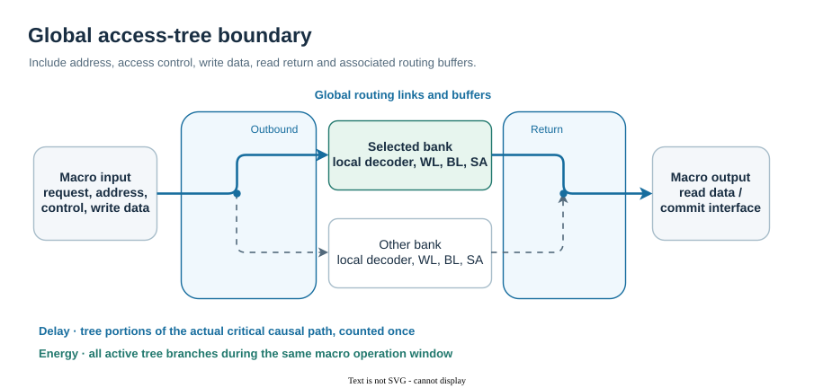
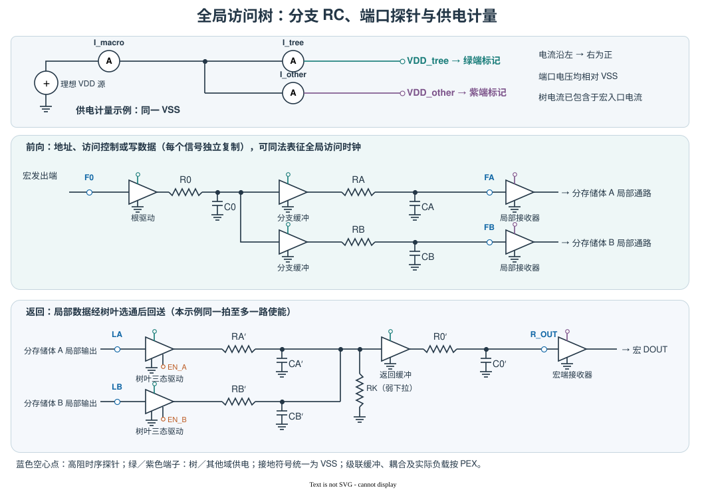

# Tree Delay/Energy %

## 定义与适用范围

**全局访问树延时与能量占比**（Global Access-Tree Delay and Energy Shares）是静态随机存取存储器（Static Random Access Memory，SRAM）宏同一次成功读或写访问的两个独立百分比。全局访问树包括跨分存储体（Bank）或子阵列的地址、访问控制、写数据分发和读数据返回网络，以及归属于这些网络的驱动器、分支选择和缓冲器。可用于 H 树、E 树或其他布线拓扑；宏级供电网、局部译码及局部阵列通路另列；树供电支路是计量边界。[1, Sec. 3, 5–6, Fig. 11] [3, Secs. 3.2, 4.5] [5, Secs. 7.1–7.5]

$$
S_D=100\frac{D_{\mathrm{tree}}}{D_{\mathrm{macro}}}\%,\qquad
S_E=100\frac{E_{\mathrm{tree}}}{E_{\mathrm{macro}}}\%.
$$

$D_{\mathrm{macro}}$（s）为请求接受至读输出有效或写完成的宏访问延时；$D_{\mathrm{tree}}$（s）为该宏访问的实际关键因果路径上、位于同一延时窗内的非重叠全局树时间。$E_{\mathrm{macro}}$ 与 $E_{\mathrm{tree}}$（J）分别为同次访问就绪至就绪窗内的宏总供电能量和按同一计量边界归属于全局树的供电能量；能量窗须包含恢复，通常长于延时窗。默认报告总能量占比，扣除等时窗待机能量的增量占比另报。[EDP](EDP.md) 定义宏接口延时及成功判据；[RE](../Subarray/Read_Energy.md) 定义供电端积分及待机校准。

## 物理机制与变异

**传播与分支**：线阻、线容、接收栅端负载、耦合和重复缓冲器决定全局路径传播时间。增设缓冲可降低长线传播时间，同时增加输入电容、切换能量、静态漏电和面积。增加分存储体数通常缩短局部字线（Wordline，WL）与位线（Bitline，BL），也会改变全局线长、分支和缓冲级数。地址与当前工作状态决定哪一条物理路径和哪一组沿参与访问；整宏跨工艺、电压和温度（Process, Voltage and Temperature，PVT）的关键分支可改变。[1, Secs. 5.1–5.3, 6] [3, Secs. 4–5] [5, Secs. 7.2–7.5] [10, Sec. III] [13, Secs. II–IV] [14, Secs. 2–3.3]

**门控与活动**：一条分支可早于完成条件到达而不占关键路径，也可能因广播、毛刺、充放电或复位而耗能。记录前一地址、数据翻转方向、掩码、分支使能、全局时钟和耦合邻线活动。子阵列入口的局部时钟混合可降低本地切换；只有实际改变全局分支活动时，才按全局树的电源边界核算。Trivedi 等的 2 nm 四分存储体宏用分存储体局部控制生成写时钟，图 15.2.3 给出全局 I/O、分存储体接口和写通路，图 15.2.4 给出读通路；该实例用于确定功能边界。[2, Fig. 15.2.3] [3, Secs. 3.2, 4.5]

## 全局网络与提取边界

| 网络 | 全局树起点 → 终点 | 宏内其他路径 |
| --- | --- | --- |
| 地址、访问控制、写数据 | 宏端或控制／输入锁存输出所驱动的首个全局驱动器输入 → 末级全局线相连的分存储体／子阵列接口接收器输入 | 宏端输入锁存、产生地址／控制的逻辑、接收器之后的局部译码、写驱动与字线／位线 |
| 全局访问时钟（纳入时单列） | 宏内时钟产生／缓冲之后的首个全局分发级输入 → 分存储体／子阵列的局部时钟接收器输入 | 片外时钟、与访问无关的独立树、局部门控、接收时钟之后的等待或锁存延时 |
| 读数据返回 | 局部选择／感测放大器（Sense Amplifier，SA）或局部数据锁存输出所驱动的首个全局返回级输入 → 最后一个全局线相连的宏端数据接收器输入 | 局部感测和复用、宏端接收器及输出锁存／驱动；独立核心至数据通路按实际划分单列 |
| 全局树内部 | 上述起止点间的全局金属线、驱动、重复缓冲及全局分支选择／合并单元 | 共享实例或电源网中不能独立归属的部分按所声明的分摊或残差处理 |

边界以版图和网表端口表为准。表中终点接收器的**输入负载充电**由全局驱动供电，计入该驱动的能量；接收器自身供电端积分计入其所属域。若纳入树根前的门控或电平转换器，起点移至该单元输入；若纳入末端接收器，终点移至该单元输出。记录实例归属与两个端点。单一物理实例／供电跨越边界仅登记一次；两级树跨分存储体及子阵列时，按接口拆段并保留共同主干 ID。[1, Secs. 5–6] [5, Secs. 7.1–7.5]

上图为层级边界示意。下图展示同一边界内两分支的代表性电路、前向缓冲及负载、读返回选通和供电计量。前向探针为 F0→FA／FB，返回为 LA／LB→R_OUT；返回总线在全关断时由示意弱下拉维持已知初态。实际电路以寄生参数提取（Parasitic Extraction，PEX）网表及其预充、钳位或保持条件替换。子阵列端的真实局部连接及成功判据见[读延时电路](../Subarray/Read_Delay.md#测量与提取方法)和[写延时电路](../Subarray/Write_Delay.md#测量与提取方法)。

**参考口径**：CACTI 5.0 对请求树和回复树分别建模，二者的驱动结构与活动分支不同。[3, Secs. 3.2, 4.5] CACTI 6.0 §6 先说明统一缓存访问（Uniform Cache Access，UCA）的地址和数据 H 树，再给出八分存储体差分低摆幅广播替代总线；图 11 描绘的是该替代总线。低摆幅线路校核见 §8。非统一缓存访问（Non-Uniform Cache Access，NUCA）模型的路由器与竞争等待另行标识，按缓存模型复算时须保留其原始延时与能量边界。[1, Sec. 3, 5–6, Fig. 11] [11, Secs. 2.1–2.4] [12, Secs. 2–3] [15, Secs. 4–5] 旧版定位 [1, Sec. 5.1–5.3, 6.2, Figs. 4–6, 11] 的 §6.2 应为 §6。

## 测量与提取方法

### 【前置条件】

锁定宏版次、端口、容量、树连接、供电轨及 VSS 参考、输出负载、输入边沿、PVT 和时钟。选定有效读／写判据、延时起止事件及就绪至就绪窗。用 PEX 网表或带树端口观测及分域计量的测试宏；布置宏 I/O、树根及叶端、选择器各输入、时钟／使能、关键缓冲级和各供电边界探针。记录样片或失配种子、分存储体地址、原有数据、前一地址和数据、目标写值、掩码、同时活动端口及门控状态。[2, Figs. 15.2.3, 15.2.6–7] [4, Secs. II-C–D, III-B]

### 【步骤／方法】

1. **执行并验证事务**：在采样窗前预置数据及电路状态，恢复至规定就绪状态；发出一次隔离访问。读需检查数据有效且正确，写需检查接口定义的提交或内部稳定事件并读回校验；同值写单列；读数据未改变时用协议的有效事件或经验证的内部捕获事件。缺少可观测的完成事件时不提取延时占比。保存自请求接受 $t_{\mathrm{acc}}$ 至完成 $t_{\mathrm{done}}$ 的全部相关波形；能量独立取访问前就绪 $t_0$ 至该次恢复完成 $t_1$，覆盖预充、去门控及电源去耦恢复。
2. **回溯关键因果路径**：按各端口有效门槛及极性标记到达事件；从完成事件回溯实际选中的数据输入和必需的时钟／使能等前置条件。对合流点，沿决定该输出有效时刻的约束回溯，必要时在保持地址、初态与其他输入不变的条件下做小幅边沿扰动确认。时钟或握手等待进入宏路径时间，分子只计实际传播弧。例如数据在 30 ps 到达门控级，使能在 80 ps 放行、90 ps 输出，则取使能至输出的 10 ps；在满足建立时间的同步捕获处，沿起决定作用的捕获沿回溯。并行的地址、控制、写数据、时钟和读返回各自记录，到达早且有余量的输入不计入关键路径；对关键路径内的树段区间裁剪到 $[t_{\mathrm{acc}},t_{\mathrm{done}}]$ 后求时间并集，公共段和时间重叠只计一次。同一终点存在等关键路径时，保存路径 ID 及并列占比范围。
3. **同步积分宏与树供电**：在实际供电边界取相对同一参考点的端口电压 $v_p$（V）和流入被测域为正的电流 $i_p$（A），按 $E_{\Omega}=\int_{t_0}^{t_1}\sum_{p\in\partial\Omega}v_p i_p\,\mathrm{d}t$ 计算域 $\Omega$ 的能量；单一共用 VSS 作参考时，各供电电压取相对该 VSS 的压差。保留回送电流符号。宏入口积分为分母；树域可独立量测时，积分互不重叠的树供电端口，或在 PEX 中用不改变原供电拓扑的电流探针统计互斥实例支路，树与宏入口之间的供电网损耗另列用于闭合。宏入口及内部树支路属于不同计量层，树支路积分禁止再加到宏入口积分。对同一电源路径，禁止在树驱动供电积分上另加树线的 $C(\Delta V)^2$ 估计（线充电已由驱动供电计入）。[1, Secs. 5.1–5.3, Figs. 4–6]
4. **处理共用供电并核算残差**：对共享电源和驱动先核实是否有可观测独立支路；不可隔离时，使用经独立表征校准的分摊或保留为未归属残差。分摊须声明对象、电气量、权重／条件和校准误差，并将同一支路的树部分和非树部分只分配一次。令 $R_E=E_{\mathrm{macro}}-E_{\mathrm{tree}}-E_{\mathrm{other}}$，其中 $E_{\mathrm{other}}$ 为已单独归属的非树能量。保留 $R_E$ 的符号，单列供电损耗、跨域耦合和未覆盖支路；禁止把残差直接计为树能量（只能得到剩余总量）。对增量口径，分子和分母各扣本域在同电压、温度、时钟、门控及等时窗的待机能量，按相同规则维护归属。
5. **校准硅采样和代理模型**：用同一触发同步测宏端和树入／出口，校准探针负载、通道时差、阈值、带宽、电流零点、增益及去耦恢复。仅有宏 I/O 时，只直接报告宏总量；近／远地址对照可能同时改变局部通路、门控和数据活动，复本路径（Replica Path）只代表复本。可在匹配负载、端口活动和 PVT 下用上述观测校准 PEX，给出树分子的模型估计和误差。无树与关分支差分单列为敏感度；理想全充放的 $C(\Delta V)^2$ 为驱动供电压差等于有效摆幅时的模型，低摆幅发送／接收及电平转换须分别按实际供电计量；出现负差保留符号并检查变化的局部活动、空闲和恢复，禁止将取绝对值或截零后的差当作树供电能量。

### 注意事项

- **注意事项**：禁止采用最大树路径延时除以另一地址的宏访问延时（分子和分母须来自同次事务和同一有效终点）。
- **注意事项**：禁止把循环频率上限、同步周期和宏访问延时互换（它们的起止事件不同）。
- **注意事项**：禁止把仍未恢复去耦电荷的能量窗与完整就绪窗混比（测得供电能量依赖窗边界）。

### 【结果处理和验证】

以 $D_{\mathrm{macro}}=t_{\mathrm{done}}-t_{\mathrm{acc}}>0$ 检查 $0\le D_{\mathrm{tree}}\le D_{\mathrm{macro}}$；确认关键链上归类后的树、局部及等待区间覆盖宏延时窗。未知区间若可能包含树传播，单列未归属时间，并将延时占比标为不可计算或给出经验证的估计区间。以仪器或仿真误差预算检查 $R_E$ 及未归属路径的能量上限；未达到预定闭合判据时，报告已归属能量和残差，完整树占比标为不可计算，或给出带分摊不确定度的估计。宏分母为零、负、与不确定度不可区分、边界错配、分子或分母缺失、事务失败时，相应占比记为不可计算；总量或增量占比若超出 0%–100%，保留原始有符号能量及差值，不解释为组成百分比。只有证据显示树未占关键路径／未消耗归属能量且分母有效时，才报告对应 0%。

## 数据可视化与评估

| 交付图／表 | 轴与分组 | 判读 |
| --- | --- | --- |
| 关键路径波形与时间分解 | 横轴为相对请求接受时间（ps 或 ns），标出树、局部、等待与未归属区间；按读／写、地址和 PVT 标注路径 ID | 核对路径切换及并行余量；独立绘出非关键分支到达时刻 |
| 能量分支图 | 横轴为分存储体／场景，纵轴为 J/次及占比，分列活动树、非树能量及有符号残差 | 区分选中分支、广播、未选分支切换和待机；标记供电边界、恢复窗及置信区间 |
| 分布与联合性能 | 按地址和布局距离、前态、翻转、掩码、使能、PVT 和工作负载绘制热图／分位数及读写散点；附宏容量、样本数和有效成功率 | 同时报告树和宏绝对值、P50／P95／最大值、关键路径类型和来源（硅直接／后仿真／校准模型／代理），注明地址覆盖率和异常处理 |

逐访问占比的统计与总和比须分列。后者对同一有效样本集使用 $100\sum_i w_i D_{\mathrm{tree},i}/\sum_i w_i D_{\mathrm{macro},i}$ 或同式更换两项能量，$w_i$ 为明确声明的样本或工作负载权重；前者先算每次占比再求指定统计量。近／远地址须用实际布线长度和拓扑标识；按容量比较时固定或声明端口、位宽、时钟、负载、布局、金属栈、权重和读写状态。若并发事务共用树段或供电，可报告已验证的批次总和比；未能独立分摊时不输出逐次能量占比。按缓存访问率或周期摊销的模型，须随数据交付原始归一口径。[9, Secs. II-A–D, III-A] [16, Secs. V–VI] [17, Sec. 4.1]

## 应用场景与指标关系

先按绝对树延时、树能量和关键分支定位可改动节点，再比较宏延时、宏能量、功耗、性能与面积（Power, Performance and Area，PPA）及功能良率。改变分存储体数、引脚、树拓扑、布线层、缓冲器或时钟门控时，联查 [Interconnect Length & Area](Interconnect_Length_Area.md)、[EDP](EDP.md) 和 [EDAP](EDAP.md)；分母增大也会使占比下降，因此仅以占比排序不能判断设计收益。比较时先筛除读写失败及不满足规格的配置，再核对最慢地址、访问加权均值、峰值电流和面积。

**文献对照**：早期 MICRO 论文的[原始模型图 1](https://doi.org/10.1109/MICRO.2007.33)以 CACTI 5.0 的 2–32 MB 缓存组织为基准，H 树延时占比随容量由约 16% 增至约 38%；另一条曲线的原始量为功率，须保留原始活动与分母。Udipi 等的图 2 则直接分解模型中分存储体的动态访问能量，两图的能量与功率口径应分别报告。[6, Sec. 1, Fig. 1] [7, Sec. 2, Fig. 2]

Liu 与 Catthoor 的宏模型分别给出子阵列、全局树、核心至数据通路和控制驱动的延时、能量分项；树比例随容量、引脚和阵列方案改变，复算须选同一柱条与对应总量；同类 A14 数据宏的实例如 Liu 等的图 16。[5, Secs. 7.1–7.5] [8, Sec. IV-B, Fig. 16] Trivedi 等的四分存储体硅测试给出宏级性能与能量，未按本页树边界直接测得两项百分比。[2, Figs. 15.2.3, 15.2.6–7] 本页的提取流程适用于设计技术协同优化（Design-Technology Co-Optimization，DTCO）；引用架构模型时须保留其对标签阵列、访问周期、排队及活动概率的定义。

## 参考文献

检索范围：Zotero `02-SRAM-DTCO/SRAM-Metrics/Macro`（`J7MHPUK7`），精确标签 `Tree Delay/Energy %`。标签由 3 条增至 17 条，16 条有归档全文；CACTI 6.0 技术报告另附在 CACTI 5.0 题录下，共 17 份全文。14 篇为独立期刊或会议原始研究，其中 [2] 与 [6]–[15] 用于树路径、寻址或网络比较，[4]、[16]、[17] 补充表征及能量归一方法。

[1] N. Muralimanohar, R. Balasubramonian, and N. P. Jouppi, “CACTI 6.0: A tool to model large caches,” HP Labs, Tech. Rep. HPL-2009-85, 2009. [公开文献](https://shiftleft.com/mirrors/www.hpl.hp.com/techreports/2009/HPL-2009-85.pdf)；[Zotero CACTI 5.0 母题录](https://www.zotero.org/users/7333024/items/JYDVTQLK) 下的 CACTI 6.0 独立 PDF 附件（无独立题录）。

**相关摘要：** CACTI 6.0将缓存划分为bank、mat与子阵列，估算译码、字线、位线、感放、复用、输出和跨bank互连。报告改进分布式字线与位线模型，并增加多种线路和网络结构；组织分割缩短局部线，却增加外围及路由开销。模型用于架构探索，必须保留容量、组织与互连假设，不能当作任意工艺版图的直接测量。报告区分bank间线路及局部访问，并对网络延迟和能量分别建模。计算树占比应选择实际访问关键路径及活动分支，用同一宏总量作分母；缓存网络可能包含路由器和竞争，不能全归入简单树线延迟。

**原文定位：** §§3–4、5.1–5.3、5.5–5.6、6、8；报告 pp. 4–18、20–22，图 4–6、9–11。

[2] M. Trivedi et al., “A 350mV single-rail SRAM using a custom-logic-bitcell in 2nm-CMOS-nanosheet technology for mobile and edge-AI applications,” in IEEE ISSCC Dig. Tech. Papers, paper 15.2, 2026. [DOI 10.1109/ISSCC49663.2026.11409350](https://doi.org/10.1109/ISSCC49663.2026.11409350). [公开文献](https://doi.org/10.1109/ISSCC49663.2026.11409350)；[Zotero](https://www.zotero.org/users/7333024/items/2DMRRST6)

**相关摘要：** 论文展示2 nm纳米片逻辑位单元SRAM，通过局部／全局读写通路与控制优化降低功耗，写端采用银行级时钟混合减少无效切换。宏布局、字节门控及位单元选择共同影响性能和能量，比较还依赖电源和容量条件。该文提供特定芯片架构证据，不能把单元、局部通路和整个宏的测量范围互相替换。宏中全局与局部读写控制、字节门控体现分布网络的能量开销，但原文未直接给出本页树延迟／能量占比。它仅作架构实例参考，不能把整体能量降幅或局部时钟收益直接解释为树占比降低。

**原文定位：** ISSCC paper 15.2，PDF第1–3页，图15.2.2–15.2.7。

[3] S. Thoziyoor, N. Muralimanohar, and N. P. Jouppi, “CACTI 5.0,” Hewlett-Packard Laboratories, Tech. Rep. HPL-2007-167, Oct. 19, 2007. ；[Zotero](https://www.zotero.org/users/7333024/items/JYDVTQLK)；DOI：Zotero未收录或尚未核实。

**相关摘要：** 归档附件实际为2007年CACTI 5.0报告，作者为Thoziyoor、Muralimanohar和Jouppi，不能按Zotero的2008年四作者题录引用。报告将存储器分为bank、mat及子阵列，建模译码、位线、感放、复用和请求／回复树。地址与输入数据树可门控，输出树使用不同驱动结构；阵列组织搜索需同时考虑时延、功耗与布局开销。请求和回复树具有不同方向及驱动结构，信号门控影响实际活动分支。计算树延迟占比应只沿被访问路径，能量则累加实际切换支路；报告给出建模方法而非可跨容量套用的固定树占比。

**原文定位：** §3–5，报告pp.8–27（PDF第9–28页）。

[4] J. Boley, P. Beshay, and B. Calhoun, “Virtual prototyper (ViPro): an SRAM design tool for yield constrained optimization,” IEEE Transactions on Very Large Scale Integration (VLSI) Systems, vol. 23, no. 12, pp. 3109-3113, 2015. [公开文献](https://doi.org/10.1109/TVLSI.2014.2385832)；[DOI](https://doi.org/10.1109/TVLSI.2014.2385832)；[Zotero](https://www.zotero.org/users/7333024/items/68JPTI4S)

**相关摘要：** ViPro连接单元、外围与存储器层级模型，搜索满足良率要求的设计。读约束由最弱单元电流、列电容、感放失调及共享关系决定；写入采用最小成功脉宽。局部电路通过表征或模型进入层次化能量、延迟及面积估算，避免只优化单元而忽略外围代价；结果仍取决于模板和工艺模型的适用范围。工具提供层次化能量延迟估算及模板表征，但未建立本页可直接通用的树百分比。可作为分解流程参考；实际树占比仍需声明路由、访问路径与活动分支，并用同一宏总量作分母，避免重复计入外围。

**原文定位：** §II-C–D、§III-B，PDF第2–3页，图3。

[5] H. H. Liu, and F. Catthoor, “Circuit-technology Co-optimization of SRAM design in advanced CMOS nodes,” Cham, Springer Nature Switzerland, 2025. [公开文献](https://doi.org/10.1007/978-3-031-76109-6)；[DOI](https://doi.org/10.1007/978-3-031-76109-6)；[Zotero](https://www.zotero.org/users/7333024/items/CHVFC3IE)

**相关摘要：** 本书贯通单元、子阵列和宏级仿真。局部指标由含寄生和外围的电路得到，宏模型再加入树形互连、控制驱动及核心至数据通路；两级统计边界不可混用。先进节点的单元缩小未必等比例改善访问性能，线阻、电容和写辅助代价可能抵消收益。宏级比较采用明确容量、树形结构、引脚位置及工艺条件，并讨论写入可行性的约束。第7章把宏分成子阵列、树、核心至数据、控制驱动四项，展示同一配置下的归一化延迟与能量。树占比随容量和引脚方案变化，延迟比例和能量比例必须分别记录，不能把某一基准比例当普适常数。

**原文定位：** §2.3.2、§2.4.2、§6.2、§7.1–7.5，书内pp.36、42、137–139、174–181。

[6] N. Muralimanohar, R. Balasubramonian, and N. P. Jouppi, “Optimizing NUCA organizations and wiring alternatives for large caches with CACTI 6.0,” in *MICRO*, pp. 3–14, 2007. [DOI](https://doi.org/10.1109/MICRO.2007.33) · [公开文献](https://doi.org/10.1109/MICRO.2007.33) · [Zotero](https://www.zotero.org/users/7333024/items/NWLCGC6E)。

**原文定位**：§1，图 1（作者稿第 2 页）；§§3–5。图 1 基于 CACTI 5.0，给出 2–32 MB 基准缓存的 H 树延时比例和功率比例；后续模型比较低摆幅和有缓冲器的互连，并将跨分存储体网络与阵列访问分开。该会议论文与 [1] 是同一 CACTI 6.0 工作的两个版本。

[7] A. N. Udipi, N. Muralimanohar, and R. Balasubramonian, “Non-uniform power access in large caches with low-swing wires,” in *HiPC*, pp. 59–68, 2009. [DOI](https://doi.org/10.1109/HiPC.2009.5433222) · [公开文献](https://doi.org/10.1109/HiPC.2009.5433222) · [Zotero](https://www.zotero.org/users/7333024/items/8VYI24WQ)。

**原文定位**：§2 图 2，§§3.2–3.5 图 3–4，§5。图 2 分解代表性分存储体的动态访问能量，并单列分存储体内 H 树；后续比较低摆幅发送器、接收器和线路。原文分母为该模型的动态访问能量，不能作为硅测总能量占比。

[8] H.-H. Liu et al., “Future design direction for SRAM data array: hierarchical subarray with active interconnect,” *IEEE Trans. Circuits Syst. I, Reg. Papers*, vol. 71, no. 12, pp. 6495–6506, 2024. [DOI](https://doi.org/10.1109/TCSI.2024.3410518) · [公开文献](https://doi.org/10.1109/TCSI.2024.3410518) · [Zotero](https://www.zotero.org/users/7333024/items/FKMH67JE)。

**原文定位**：§IV-B 图 16（作者稿第 8 页）。16 MB、典型角、27 °C 的 A14 数据宏以中心引脚和 H 树为基础，分别绘制子阵列、树、控制驱动和核心至数据通路的分项。按图选同一配置及同一指标的分项和总量；原文另标写入失败风险。

[9] Z. Pei et al., “Ultra-scaled E-tree-based SRAM design and optimization with interconnect focus,” *IEEE Trans. Circuits Syst. I, Reg. Papers*, vol. 71, no. 10, pp. 4597–4610, 2024. [DOI](https://doi.org/10.1109/TCSI.2024.3438164) · [公开文献](https://doi.org/10.1109/TCSI.2024.3438164) · [Zotero](https://www.zotero.org/users/7333024/items/ADVGSHNB)。

**原文定位**：§II-A–D、§III-A，图 3、5。以地址访问概率分析 E 树线长和访问代价；图 5 分列树、标签阵列和核心至缓存等分项，虚线为 H 树基准总量。该模型省略流水级开销，工作负载加权结果须与相同模型口径比较。

[10] Z. Pei et al., “Graphene-based interconnect exploration for large SRAM caches for ultrascaled technology nodes,” *IEEE Trans. Electron Devices*, vol. 70, no. 1, pp. 230–238, 2023. [DOI](https://doi.org/10.1109/TED.2022.3225512) · [公开文献](https://doi.org/10.1109/TED.2022.3225512) · [Zotero](https://www.zotero.org/users/7333024/items/HAPE4X7F)。

**原文定位**：§III，图 6–10（作者稿第 5–6 页）。模型区分局部字线／位线、跨子阵列 H 树及其他互连工程参数；按缓存容量和线路方案比较模型的读访问时间、读能量和面积。图中的 PDP 按原文为每次读访问能量指标。

[11] N. Muralimanohar and R. Balasubramonian, “Interconnect design considerations for large NUCA caches,” in *ISCA*, pp. 369–380, 2007. [DOI](https://doi.org/10.1145/1250662.1250708) · [公开文献](https://doi.org/10.1145/1250662.1250708) · [Zotero](https://www.zotero.org/users/7333024/items/UJZN3QDQ)。

**原文定位**：§§2.1–2.4，图 3、5–7，表 2。分别建模缓存网格线路、路由与访问；32 MB 缓存的平均访问时间与能量受网络和工作负载影响。用于标识哪部分开销属于互连、路由和竞争等待。

[12] C. Kim, D. Burger, and S. W. Keckler, “An adaptive, non-uniform cache structure for wire-delay dominated on-chip caches,” in *ASPLOS*, pp. 211–222, 2002. [DOI](https://doi.org/10.1145/605432.605420) · [公开文献](https://doi.org/10.1145/605432.605420) · [Zotero](https://www.zotero.org/users/7333024/items/MH5DEJ6Q)。

**原文定位**：§§2–3，表 2–4。按近／远分存储体和网络负载分别给出未加载最短、最长、平均延时及有负载延时。私有互连模型计重复缓冲器，未计流水锁存延时和面积；网格路径须另列路由与竞争。

[13] B. S. Amrutur and M. A. Horowitz, “Speed and power scaling of SRAM's,” *IEEE J. Solid-State Circuits*, vol. 35, no. 2, pp. 175–185, 2000. [DOI](https://doi.org/10.1109/4.823443) · [公开文献](https://doi.org/10.1109/4.823443) · [Zotero](https://www.zotero.org/users/7333024/items/CH2EXX7I)。

**原文定位**：§§II–IV，图 17–18。将全局译码和输出互连的延时与阵列本地通路分开，并说明划分开销、线长和缓冲对延时与能量的影响；图 18 比较同容量的阵列组织。

[14] A. J. Bhavnagarwala, S. V. Kosonocky, and J. D. Meindl, “Interconnect-centric array architectures for minimum SRAM access time,” in *ICCD*, pp. 400–405, 2001. [DOI](https://doi.org/10.1109/ICCD.2001.955058) · [公开文献](https://doi.org/10.1109/ICCD.2001.955058) · [Zotero](https://www.zotero.org/users/7333024/items/8V5VDILA)。

**原文定位**：§§2–3.3，图 4–7（作者稿）。分层切分减少局部字线和位线长度，但增加全局译码路径级数及负载。模型按级核算线长和扇出，用于阵列时序比较；未直接提供全局树能量百分比。

[15] A. Arora et al., “FP-NUCA: A fast NoC layer for implementing large NUCA caches,” *IEEE Trans. Parallel Distrib. Syst.*, vol. 26, no. 9, pp. 2465–2478, 2015. [DOI](https://doi.org/10.1109/TPDS.2014.2358231) · [公开文献](https://doi.org/10.1109/TPDS.2014.2358231) · [Zotero](https://www.zotero.org/users/7333024/items/N7RIFF5F)。

**原文定位**：§§4–5，图 8、14–15。区分片上网络门控功耗、网络延时和阵列时间，用作网络与局部访问边界的对照。

[16] D. P. Ravipati et al., “FN-CACTI: advanced CACTI for FinFET and NC-FinFET technologies,” *IEEE Trans. VLSI Syst.*, vol. 30, no. 3, pp. 339–352, 2022. [DOI](https://doi.org/10.1109/TVLSI.2021.3123112) · [公开文献](https://doi.org/10.1109/TVLSI.2021.3123112) · [Zotero](https://www.zotero.org/users/7333024/items/XJDUBD5N)。

**原文定位**：§§V–VI，表 I、图 10。缓存模型按容量、分存储体和电压比较，在动态能量外按实际访问率摊销漏电；可用于核对分母和活动口径，不直接提供树占比。

[17] A. Shafaei, S. Chen, Y. Wang, and M. Pedram, “A cross-layer framework for designing and optimizing deeply-scaled FinFET-based cache memories,” *J. Low Power Electron. Appl.*, vol. 5, no. 3, pp. 165–182, 2015. [DOI](https://doi.org/10.3390/jlpea5030165) · [公开文献](https://doi.org/10.3390/jlpea5030165) · [Zotero](https://www.zotero.org/users/7333024/items/4HZ6TIC2)。

**原文定位**：§4.1，式 (1)–(3)、图 10。按指定缓存活动假设计量每周期能量及 EDP；分母与本页同次宏事务的能量需分别标识。

**仅题录**：Z. Pei et al., “Emerging interconnect exploration for SRAM application using nonconventional H-tree and center-pin access,” in *ISQED*, 2023. [DOI](https://doi.org/10.1109/ISQED57927.2023.10129316) · [imec 题录](https://imec-publications.be/entities/publication/61b3e688-33de-490c-9c4a-f9bc4e40e1f3) · [Zotero](https://www.zotero.org/users/7333024/items/4KPUBIZJ)。未取得可读全文，不作为技术结论依据。
