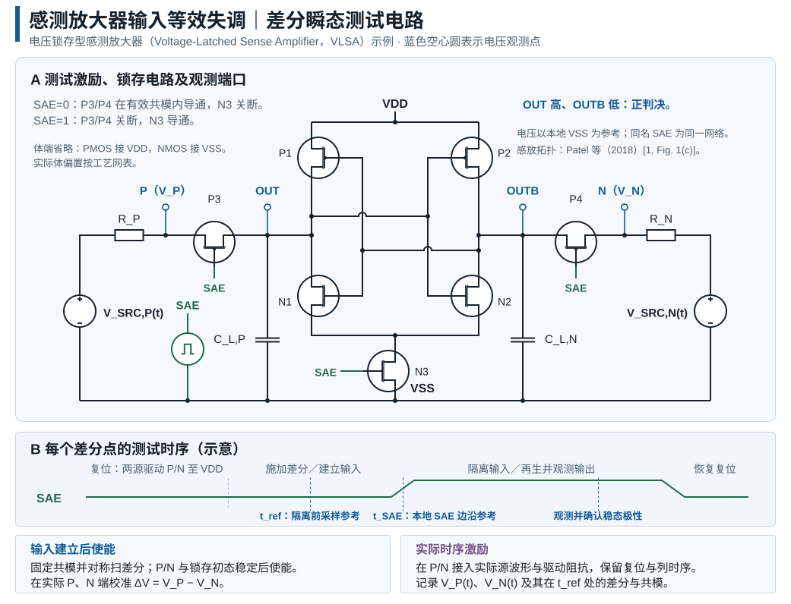

# SA Decision Threshold

## 定义与适用范围

**感测放大器判决门槛**（Sense-Amplifier Decision Threshold，$A_+$、$A_-$）是外围电路层中，在规定输入轨迹、使能、负载和输出时限下，感测放大器（Sense Amplifier，SA）对两种输入极性分别达到目标判决可靠性所需的最小输入差分幅度，单位 mV。取实际 SA 输入端 P、N 的电压（均以本地 VSS 为参考），定义差分 $\Delta V(t)=V_P(t)-V_N(t)$ 和共模 $V_{\mathrm{CM}}(t)=[V_P(t)+V_N(t)]/2$。在指定输入参考时刻 $t_{\mathrm{ref}}$，以 $s\in\{-1,+1\}$ 表示目标判决方向，以 $a=s\Delta V(t_{\mathrm{ref}})\ge 0$ 表示各测试点校准后的标称实际幅度。正、负判决与读 0／读 1 的映射须按实际网表确认。

以本地感测放大器使能信号（Sense Amplifier Enable，SAE）有效边沿的指定电平交点为 $t_{\mathrm{SAE}}$，以 $T_{\mathrm{dead}}$ 为允许判决时间，固定截止时刻 $t_{\mathrm{dead}}=t_{\mathrm{SAE}}+T_{\mathrm{dead}}$。在输出观察端施加接收器有效电平判据；**通过**要求正确电平在完整的 $[t_{\mathrm{dead}}-T_{\mathrm{hold}},\,t_{\mathrm{dead}}]$ 内连续有效，其中 $0<T_{\mathrm{hold}}\le T_{\mathrm{dead}}$ 为规定的连续有效时长。若接收器还要求截止后的保持时间，须按其采样孔径和保持要求追加观察；在要求的观察窗内反转为失效。令 $p_{\mathrm{fail},s}(a)$ 表示该条件下未通过的概率，则

$$
\mathcal{P}_s=\{a\ge 0:p_{\mathrm{fail},s}(a)\le p_{\mathrm{target}}\},\qquad
A_s=\inf \mathcal{P}_s.
$$

$p_{\mathrm{target}}$ 为目标失效率，$\mathcal{P}_s$ 为指定波形族及有效幅度范围内的合格集合。须注明概率针对同一实例的重复噪声、SA 失配总体，还是按实际层级抽样的联合总体。只有在所用范围内通过条件具有单一单调边界时，才可把 $A_s$ 当作任意更大幅度均合格的边界。文献报告的最小位线差分 $\Delta V_{\mathrm{BL,min}}$ 与读失败统计用于对照；本文另规定截止时间、稳定窗口和目标失效率。[1, Sec. II, IV–V, Figs. 2, 6–10]

## 物理机制与变异

采样或输入级将输入差分传递为锁存节点的初始不平衡，随后正反馈将其再生为逻辑电平。图示电压锁存型感测放大器（Voltage-Latched Sense Amplifier，VLSA）在 SAE 有效前建立初始差分；使能边沿触发隔离和再生，两者可有重叠。输入失调、两侧寄生和瞬态噪声会改变该不平衡的大小或符号；净不平衡接近零时，再生时间拉长。对于可近似为先采样、后再生的电路，小信号阶段可用下式判断方向：

$$
v_d(t)\approx v_d(t_0)\exp[(t-t_0)/\tau].
$$

$v_d$ 为内部锁存节点差分（V），$t_0$ 为有效再生起点，$\tau$ 为该工作点的再生时间常数（与 $t$、$t_0$ 同单位）。在近似工作点不变且进入饱和前，较小的正确初值或较大的 $\tau$ 会增加达到指定差分所需的时间；实际门槛须以带负载输出的有效电平和稳定窗口判定。[6, Secs. II–III, VIII–IX] [7, Figs. 17.7.2–4] [11, Sec. II, Figs. 3–6]

- **共模和源网络**：共模轨迹改变输入传递及锁存管工作状态；两侧源阻抗、偏置时序、边沿斜率及反冲（Kickback）改变实际输入和内部初值。相同 $\Delta V(t_{\mathrm{ref}})$ 可能给出不同判决时间和错误率；须同时记录 $V_P(t)$、$V_N(t)$ 及 SAE 轨迹。[3, Secs. II, VII] [6, Secs. III, IX] [7, Figs. 17.7.4–6] [11, Sec. II]
- **失配及噪声**：器件失配和固定寄生不对称可使两种极性的门槛不同；同一实例的噪声和使能抖动使分界变为概率曲线。局部供电降落、温度及输出负载也会改变再生条件。模型、工艺、电压和温度（Process, Voltage and Temperature，PVT）、体偏置、校准码及上次状态须按工作配置分别记录。[1, Secs. III–V] [4, Sec. III.A] [5, Sec. VII]

## 参考失调与阵列测试边界

| 观测层级 | 测试边界 | 交付量 |
| --- | --- | --- |
| **参考失调** | 按 [SA Offset](SA_Offset.md#测量与提取方法) 隔离列驱动，固定对称源阻抗和已建立的输入共模，在参考观察窗内找稳定判决翻转点。 | 有符号输入等效失调 $V_{\mathrm{OS}}$；用于诊断哪侧需更大输入，或比较校准前后。 |
| **SA 动态判决** | 在实际 P/N 端用等效源或实际列网络施加一族输入波形，保留采样／隔离、复位、局部 SAE、输出负载与接收器判据。 | 在指定 $t_{\mathrm{ref}}$、$T_{\mathrm{dead}}$ 和 $T_{\mathrm{hold}}$ 下的正、负合格区间和失效率。 |
| **阵列功能读出** | 保留位单元、位线／互补位线（Bitline，BL／BLB）、预充和均衡、列选择器（Column Multiplexer，Column Mux）、SA 和下游接收器；控制字线（Wordline，WL）、地址、数据背景、相邻活动和上次判决。 | 阵列功能通过率、可用输入轨迹和读时序边界；只有数字读出时，交付读时序代理。 |

在同一实例上先取得参考 $V_{\mathrm{OS}}$，再缩短时限或恢复实际驱动和负载，可区分参考翻转偏移与再生／接口限制。$V_{\mathrm{OS}}$ 是有符号参考分界，$A_+$、$A_-$ 是非负的动态可靠性幅度，禁止用 $\lvert V_{\mathrm{OS}}\rvert$ 代替动态门槛（该值未约束有效输出时限及失败概率）。阵列读失败还可来自读扰动、列选择、局部供电或下游采样；应以断开位单元后的直接注入复测及独立读回定位。[2, Secs. VII–VIII, Figs. 7–8] [3, Secs. II, VII] [10, Secs. 1.3.1–1.3.2, 2.3.1–2.3.2, Figs. 1.5, 2.9–2.10]

## 测量与提取方法

### 仿真：差分波形扫描与固定判决截止

图示 VLSA 沿用 Patel 等的拓扑：$V_{\mathrm{SRC},P}(t)$、$V_{\mathrm{SRC},N}(t)$ 经 $R_P$、$R_N$ 驱动实际 P、N；SAE 为低时，P3、P4 在有效共模内导通，尾管 N3 关断。两路源先同电位复位，再在采样开关导通期间建立差分；SAE 有效后隔离输入、开启再生。图中 OUT 不低于 $V_{\mathrm{IH}}$ 且 OUTB 不高于 $V_{\mathrm{IL}}$ 为有效正判决，反向为有效负判决，输出端加载 $C_{\mathrm{L},P}$、$C_{\mathrm{L},N}$。体端省略，按工艺网表连接。图 B 的观察窗在本测试中固定：从本地 SAE 边沿计时，在 $t_{\mathrm{dead}}-T_{\mathrm{hold}}$ 开始检查连续有效，在 $t_{\mathrm{dead}}$ 判定通过或失效；须在判决和诊断观察结束后再复位。其他 SA 拓扑须按其实际输入级、隔离时刻和输出映射替换。[1, Sec. II, Fig. 1(c)]

**【前置条件】** 选择晶体管级原理图或寄生参数提取（Parasitic Extraction，PEX）网表；声明局部电源、复位／均衡、初始状态、循环间隔、SAE 边沿、体偏置、校准状态和输出负载。给出输出接收器阈值 $V_{\mathrm{IH}}$、$V_{\mathrm{IL}}$、截止与稳定时长、输入允许范围、步进、目标失效率及置信水平。按拓扑确定 $t_{\mathrm{ref}}$：图示 VLSA 选在两支采样开关隔离前的已标定时刻；持续驱动型 SA 则固定相对本地 SAE 的参考相位，并保存整个有效输入窗口。

示例时序（仅用于说明判据）：以本地 SAE 边沿为 0 ps，在 −20 ps 读取实际 P/N 标称差分。若 $V_P=0.512$ V、$V_N=0.488$ V，则共模为 0.500 V、差分为 +24 mV；在 170–200 ps 检查有效正判决，200 ps 到期判定；在 200 ps 后继续观察仅用于识别迟判，或验证接收器另行要求的保持。

**【步骤／方法】**

1. **校准输入波形及极性**：在规定复位后，按源设定 $V_{\mathrm{SRC},P/N}(t)=V_{\mathrm{CM,cmd}}(t)\pm s\,a_{\mathrm{cmd}}f(t)/2$ 施加波形，上号为 P、下号为 N，$f(t)$ 为无量纲模板，规定 $f(t_{\mathrm{ref}})=1$；实际横轴为 $a=s[V_P(t_{\mathrm{ref}})-V_N(t_{\mathrm{ref}})]$，不以源命令幅度、远端位线差分或单次含噪波形事后重分组替代标定幅度。用正、负大信号分别核对输出映射。校准两侧输入实际共模、源阻抗、隔离相位和波形建立；动态读例须保留实测或 PEX 所得的斜率、预充和反冲。按同一模板缩放时斜率随幅度变化，须记录该关系；需比较固定斜率时另建波形族。
2. **记录输出类别**：每次刺激重新复位并运行瞬态仿真（`.tran`），保存局部 SAE、P/N、锁存节点和接收器输入波形。以连续有效段的起点和终点判断截止窗口。先判通过；其余按下列顺序分类：截止前达标但违反规定的截止后保持，记为保持失效；连续有效窗内为反向输出，记为错判；仅在诊断期内才达到完整的正确有效窗口，记为迟判；诊断结束仍未达到则记为未决。各类均计入总失效率。反转、振荡和短于 $T_{\mathrm{hold}}$ 的有效段须保留诊断标志。诊断延时不改变工作判定，并须保持规定使能和负载以免观察到下一周期。
3. **逐极性测量失效率**：各 PVT 条件下固定幅度从零粗扫至可用上限，每点分别测两种目标极性。固定 SA 实例并更换瞬态噪声种子可估计实例内失效率；跨实例采用失配蒙特卡洛（Monte Carlo，MC），每实例按规定噪声重复数执行。对每个候选幅度用规定置信水平的失效率上界判定合格；统一保存样本标识，以便在幅度或角落间配对。
4. **验证阵列边界**：在阵列 PEX 网表中，选近端和远端列位置、两种数据和不利邻列活动，保留位线分布寄生、列选择器和局部电源网络。扫描 WL 至 SAE 及 SAE 至下游采样的时序，记录实际 P/N 轨迹、SA 输出与功能读回。用同一地点和负载的输入重放对照直接仿真，校核源等效、反冲及比较口径；明显不一致时按实际阵列结果交付功能边界。[2, Secs. VII–VIII] [8, Secs. 2.2–4] [11, Sec. II]

**注意事项**：禁止用理想电压源直接钳住需保留反冲的输入端（会改变输入传递和再生初值）。

**注意事项**：禁止对尚未验证单调的扫描直接二分（可能跳过较小合格区间或遗漏失效回落）。

**【结果处理和验证】** 粗扫覆盖全有效范围后，在端口轨迹可比、通过条件单调且两侧已有明确合格／不合格界点的区间内加密或二分；报告门槛夹逼区间及幅度分辨率。若合格率在高幅度回落，交付各合格区间、各过渡区间和未测区间；最高幅度失败本身不构成右截尾。若覆盖物理允许范围并确认均不合格，报告规格域内无解；若扫描受量测范围限制且通过条件有单调依据，在上限 $a_{\max}$ 已确定不合格时，按 $a_{\max}$ 右截尾。置信区间跨越规格、数值不收敛或覆盖不足，须分别标记；用更细积分步长和更长诊断窗复核边界，保持工作截止不变。

### 硅测量：直接输入标定与功能代理

**【前置条件】** 优先选择可隔离正常列驱动的专用测试 SA 或嵌入式测试结构，采用外部双路模拟源或片上差分数模转换器（Digital-to-Analog Converter，DAC），使共模、差分、本地 SAE 与输出采样脉冲可独立设置。记录晶片、裸片、SA／列组、地址、供电、温度、负载及测试与正常读通路的差别。Patel 等通过可控差分、复位和两种测试序列观察 65 nm SA 的 $\Delta V_{\mathrm{BL,min}}$；其结论限于原测试序列，未给出任意时限与错误率目标的门槛。[1, Sec. IV, Figs. 5–9] [3, Sec. II, Figs. 4–6] [9, Secs. III–IV, Figs. 3–6]

**【步骤／方法】**

1. **去嵌入双路输入**：施加零差分和已知正、负参考步进，标定极性、幅度增益、零点、共模以及测试端到 SA 的源阻抗、幅频和相位关系。采用片上采样或已校准的测试通路评估探针、焊盘、列选择开关的压降及建立误差。互换激励通道核对随通道变号的误差；留在物理路径上的误差须独立标定。
2. **校准截止与稳定窗口**：测本地 SAE 和采样脉冲的传递延时、分辨率、孔径及抖动，固定截止并扫描幅度与共模。可观察模拟输出时按连续窗口判定；片上仅有时钟采样时，使用同一次试验的多点采样或波形监视器检查保持，并记录时间分辨率或最短可检测毛刺。每次试验仅有一个采样点时，只能估计各采样条件的数字通过率；跨次移动采样点无法确认同一次判决的连续有效。
3. **重复及功能对照**：对每一幅度复位、重新使能并记录两种极性在各截止下的结果，按裸片和 SA 实例保留样本。无独立差分输入时，固定读条件并扫描读控制或采样时刻，以阵列通过／失败曲线交付功能代理；若可测实际差分或由硅校准的 PEX 估计 P/N 波形，仅在误差随结果给出时才换算为幅度代理。[10, Secs. 2.3.1–2.3.2, Figs. 2.9–2.10]

**注意事项**：禁止把焊盘命令电压、远端 BL 摆幅或单次数字读成功当作已校准的 SA 动态门槛（实际 P/N 幅度或输出稳定窗口尚未验证）。

**【结果处理和验证】** 交付输入差分、共模、截止及保持窗口的标定不确定度，两种极性的通过／失败统计及可识别的失效类别。对同一地址改变读时序后，用独立的低扰动读回检查位单元是否翻转；异常时以直接注入测试、局部供电和输出波形隔离故障来源。

## 数据可视化与评估

| 图表 | 横轴、分层与判据 |
| --- | --- |
| **差分—截止二维图（Shmoo）** | 横轴为实际 $a$（mV），纵轴为 $T_{\mathrm{dead}}$（ps 或 ns）；按极性、共模／波形族、负载及 PVT 分面。标注稳定时长、目标失效率、置信水平、各合格区间和测量覆盖。 |
| **判决失败曲线** | 在固定截止与共模画总失效率及各类失效率，以该点有效试验数为分母；附单侧置信上界。保留幅度扫描步距、时间分辨率、不可分类样本数及输入校准误差。 |
| **样本分布与尾部** | 分别报告跨 SA 的 $A_+$、$A_-$ 或门槛区间、可识别分位数、超限率及截尾数量；按裸片和共享 SA 分组。必要时同步画同一实例的两种门槛以及 $V_{\mathrm{OS}}$，定位方向偏差。 |

幅度点只有在失效率置信上界 $\le p_{\mathrm{target}}$ 时才判合格；下界 $>p_{\mathrm{target}}$ 时可确认不合格；其余报告样本量不足以判定。以相互独立的二项试验为例，$n$ 次试验零失效仅给出单侧 95% 上界 $1-0.05^{1/n}$，仍须与目标比较，见 [RSNM 的二项上界](../Bitcell/RSNM.md#数据分析与评价方法)。同一 SA 的重复读用于估计实例内噪声，不能作为独立器件数。总体验证须保留裸片、SA 和重复条件的层级，按独立层级或适用的分组方法估计区间；若用同一批数据扫描并选门槛，应以独立验证批次或覆盖选点的同时置信方法报告结论。仪器丢样或计算失败须补测或复算；仍不能分类时另列，并给出按失效计入的保守结果。

规格之外的已证实截尾样本计作超限；观测区间跨规格时单列，并给出将未能分类者全部计为超限的保守结果。高斯拟合或重要性采样只能在核验所需尾部后用于估计，须与直接观测分列。无产品目标时交付失效率—幅度—截止的曲线和置信区间。[4, Sec. III.A, Eqs. (7)–(11)] [5, Sec. VII, Eq. (4), Figs. 24–30] [12, Secs. III–IV]

## 应用场景与指标关系

- **分配读时序和差分预算**：用 [Read Develop Time](../Subarray/Read_Develop_Time.md) 的本地实际 P/N 差分和共模轨迹确定候选 SAE；过早使能可能使输入建差不足，过晚使能会压缩到接收器截止的再生时间。按每个候选 SAE 到既定下游采样点的实际时间及输入波形复算两种极性的失败率；保留本地 SAE 与下游采样的相关抖动，再用 [Read Delay](../Subarray/Read_Delay.md) 验证完整时序路径。[2, Secs. VII–VIII] [8, Secs. 2.2–4] [11, Secs. I–II]
- **校准和版图迭代**：结合同一实例的 [SA Offset](SA_Offset.md) 和动态失败曲线，比较失调校准、器件尺寸、对称布线或输出负载调整前后的影响；分别记录两极性门槛、截止窗口、校准码与 PVT 漂移。[3, Sec. VII] [5, Sec. VII] [11, Secs. III–IV]
- **评估速度、能量与读良率**：在相同失效率、负载和截止约束下，较低门槛可减少必要的位线摆幅及建差时间；缩短可用再生时间通常要求更大输入，须按实际轨迹验证。工艺与设计协同优化（Design-Technology Co-Optimization，DTCO）按真实列组织、共享 SA 和联合变异比较面积、能量及速度；禁止对已含 SA 失配的动态门槛再叠加同一失调分布（重复计入失配）。[1, Secs. III, V] [4, Secs. III–IV] [12, Secs. III–IV]

## 参考文献

2026-11-17 核对 Zotero Peripheral 集合（`PRESTNIR`）的精确标签 `SA Decision Threshold`，由初检 4 条增至 12 条。核验 11 篇独立期刊／会议研究（10 份归档 PDF、1 篇可读在线全文）及 1 份阵列代理学位论文。保留原编号；页码对应链接所示全文版本。

[1] D. Patel, D. Wright, and M. Sachdev, “Sense amplifier offset characterisation and test implications for low-voltage SRAMs in 65 nm,” in Proc. IEEE European Test Symp., 2018, author manuscript. [DOI 10.1109/ETS.2018.8400696](https://doi.org/10.1109/ETS.2018.8400696). [公开文献](https://doi.org/10.1109/ETS.2018.8400696)；[Zotero](https://www.zotero.org/users/7333024/items/FHKBDBC9)（初检未命中，补检复用）。

**相关摘要：** 该65 nm感放测试以外部差分输入扫描输出翻转点，并分析电流锁存和电压锁存结构在不同供电、温度下所需的输入信号。文中指出有效位线差分必须克服感放输入失调，且实际感测还受噪声和工作条件影响；这是定义判决门槛的基础约束。结果来自10颗芯片的测试阵列，包含两种数据极性和测试序列比较。翻转点只表征指定激励下的边界，不等于在指定时间内达到目标误判率的动态最小输入；阵列设计仍应另加时序、噪声及统计尾部裕量。

**原文定位：** §II、§IV.C、图6–9，作者稿PDF pp.2、5–6。

[2] R. Heald and P. Wang, “Variability in sub-100nm SRAM designs,” in Proc. IEEE/ACM International Conference on Computer-Aided Design (ICCAD), 2004, pp. 347–352. [DOI](https://doi.org/10.1109/ICCAD.2004.1382599). [Zotero](https://www.zotero.org/users/7333024/items/7GAQXDTN). [公开文献](https://doi.org/10.1109/ICCAD.2004.1382599)

**相关摘要：** 文章把感放输入要求放在完整SRAM读访问中讨论：统计偏弱的单元先产生位线差分，感放必须在允许的访问时间内把差分再生到规定输出电平。其蒙特卡洛方法同时考虑器件失配、最小单元电流和使能时序，说明判决门槛并非单独一个静态失调值。证据来自亚100 nm设计分析与电路仿真；在供电、负载、输出判据或可用再生时间改变后，应重新提取最小可判决输入，不能把原条件下的读裕量照搬到另一阵列。

**原文定位：** §VII–VIII、图7–8，会议pp.350–351。

[3] Y. H. Chen et al., “Compact measurement schemes for bit-line swing, sense amplifier offset voltage, and word-line pulse width to characterize sensing tolerance margin in a 40 nm fully functional embedded SRAM,” IEEE Journal of Solid-State Circuits, vol. 47, no. 4, pp. 969-980, 2012. [DOI](https://doi.org/10.1109/JSSC.2012.2185180). [Zotero](https://www.zotero.org/users/7333024/items/RJ8M4HFH). [公开文献](https://doi.org/10.1109/JSSC.2012.2185180)

**相关摘要：** 该40 nm、32 kb功能SRAM样片通过隔离列选择电路，把外部可控差分电压施加到感放输入，重复使能并扫描输出翻转点，由此提取输入失调和感测容限。此方法为判决门槛提供可实测的电压基准，同时将实际位线摆幅与感放偏置分开观测。文中翻转点依赖输入共模、供电和测试时序，不能直接当作满足指定判决期限及极低误判率所需的最小输入；系统门槛还需结合有限再生时间、噪声与样本分布确定。

**原文定位：** §II、§VII及图4–6、图24，期刊pp.970–971、978。

[4] G. Baek, and H. Jeong, “High-density SRAM read access yield estimation methodology,” IEEE Access, vol. 9, pp. 128288-128301, 2021. [DOI](https://doi.org/10.1109/ACCESS.2021.3111762). [Zotero](https://www.zotero.org/users/7333024/items/ZVIBD7DV). [公开文献](https://doi.org/10.1109/ACCESS.2021.3111762)

**相关摘要：** 文章在ASAP7预测工艺、默认0.6 V的HSPICE仿真中，用两组固定输入差分及其蒙特卡洛误判率反推感放失调的均值和标准差。其判据是输入差分不足以克服输入失调；在高斯失调假设下，目标误判率对应的输入要求由分布分位点确定，因此不能仅用均值或一个σ充当通用判决门槛。该模型服务于阵列读良率估算，需与非高斯位线摆幅及WL到SAE时序分布组合；它不是硅片量测，也未独立给出所有再生期限下的动态门槛。

**原文定位：** §III.A、式(7)–(11)、图3，pp.128291–128292（PDF pp.4–5）。

[5] D. Patel, A. Neale, D. Wright, and M. Sachdev, “Body biased sense amplifier with auto-offset mitigation for low-voltage SRAMs,” IEEE Transactions on Circuits and Systems I: Regular Papers, vol. 68, no. 8, pp. 3265-3278, 2021. [DOI](https://doi.org/10.1109/TCSI.2021.3081917). [Zotero](https://www.zotero.org/users/7333024/items/JPBYPFCC). [公开文献](https://doi.org/10.1109/TCSI.2021.3081917)

**相关摘要：** 该65 nm测试芯片研究把最小输入差分定义为两种数据极性下使全部被测感放正确判决所需输入绝对值的较大者，而非输出概率为50%的翻转点。IC1的512个样本在0.4 V及0–75 °C下用于比较体偏置自校正感放与常规结构，式(4)明确区分有限样本最小输入与失调分布参数。结果属于有限样本、给定输入共模及测试时序下的实测；“全部正确”不代表总体误判概率为零，也不能把失调标准差的下降比例直接视为最小输入或访问延时的下降比例。

**原文定位：** §VII、式(4)、图24–30，期刊提前出版版 PDF pp.9–10。

[6] B. Wicht, T. Nirschl, and D. Schmitt-Landsiedel, “Yield and speed optimization of a latch-type voltage sense amplifier,” IEEE Journal of Solid-State Circuits, vol. 39, no. 7, pp. 1148–1158, 2004. [DOI](https://doi.org/10.1109/JSSC.2004.829399). [Zotero](https://www.zotero.org/users/7333024/items/NMC9GPHH). [作者公开全文](https://www.researchgate.net/publication/2982554_Yield_and_speed_optimization_of_a_latch-type_voltage_sense_amplifier)（未取得归档 PDF）。

**相关摘要：** 对 130 nm 独立锁存感测放大器，以使能至单端输出过 50% 摆幅定义实测延时，分别比较输入差分、共模与输出负载的影响；另以 45 个样本表征失调和良率。延时曲线和翻转分布支持分别控制共模、幅度和负载；原文没有将这两类数据合并为规定错误率及持续有效窗下的动态门槛。

**原文定位：** §II–III、§VIII–IX，图2–5、14、16–19；期刊 pp.1149–1151、1155–1157。

[7] D. Schinkel, E. Mensink, E. Klumperink, E. van Tuijl, and B. Nauta, “A double-tail latch-type voltage sense amplifier with 18ps setup+hold time,” in Proc. IEEE International Solid-State Circuits Conference (ISSCC), 2007, pp. 314–315, 605. [DOI](https://doi.org/10.1109/ISSCC.2007.373420). [Zotero](https://www.zotero.org/users/7333024/items/DY5MW8YC). [公开文献](https://doi.org/10.1109/ISSCC.2007.373420)。

**相关摘要：** 90 nm 双尾锁存比较器在不同共模及失调校正后的输入差分下测得相对判决延时，并以输出概率曲线和时钟偏移扫描表征输入等效噪声及误码率。输出驱动延时限制绝对延时提取，说明须校准观测路径。该样片用于高速比较器验证，论文的采样孔径和误码率不能直接套用到 SRAM 宏。

**原文定位：** 图17.7.2–17.7.6；会议 pp.314–315。

[8] M. H. Abu-Rahma, K. Chowdhury, J. Wang, Z. Q. Chen, S. S. Yoon, and M. Anis, “A methodology for statistical estimation of read access yield in SRAMs,” in Proc. Design Automation Conference (DAC), 2008, pp. 205–210. [DOI](https://doi.org/10.1145/1391469.1391522). [Zotero](https://www.zotero.org/users/7333024/items/2WRYLJJM). [公开文献](https://doi.org/10.1145/1391469.1391522)。

**相关摘要：** 按共享 SA 的列组织，将位线差分、输入失调及 WL 至 SAE 时序联合用于读访问良率估计，并以 45 nm、1 Mb SRAM 实测良率验证。该结果支持以列组和联合变异处理统计尾部；整体良率不是对单一 SA 再生期限的直接测量。

**原文定位：** §2.2–4，图2–3；会议 pp.207–210。

[9] M. H. Abu-Rahma et al., “Characterization of SRAM sense amplifier input offset for yield prediction in 28nm CMOS,” in Proc. IEEE Custom Integrated Circuits Conference (CICC), 2011, pp. 1–4. [DOI](https://doi.org/10.1109/CICC.2011.6055315). [Zotero](https://www.zotero.org/users/7333024/items/677N8XKR). [公开文献](https://doi.org/10.1109/cicc.2011.6055315)。

**相关摘要：** 28 nm 芯片用片上 DAC 给 SA 测试阵列注入差分，保留真实邻近布局；比较供电、温度与两类 SA，并以 512 Kb SRAM 的硅测良率检查预测。该结构支持对输入电压和实例变异的直接表征；原文取得的失调分布须与另有工作期限的动态门槛分开记录。

**原文定位：** §III–V，图3–9；PDF pp.2–4。

[10] S. O. Toh, “Nanoscale SRAM variability and optimization,” Ph.D. dissertation, UC Berkeley, 2011. [UC Berkeley 原文](https://www2.eecs.berkeley.edu/Pubs/TechRpts/2011/EECS-2011-144.html). [Zotero](https://www.zotero.org/users/7333024/items/LYDRHR6E). [公开文献](https://www2.eecs.berkeley.edu/Pubs/TechRpts/2011/EECS-2011-144.html)。

**相关摘要：** 45 nm 阵列通过校准的 WL 脉宽及读回提取成功读出所需最短脉宽，并结合各列独立测得的感测放大器失调解释读访问时间的列间分布。作者的读访问时间定义排除 WL 驱动和 SA 自身延时；此处用作阵列功能代理与输入校准的证据，不用作独立 SA 门槛。

**原文定位：** §1.3.1–1.3.2、§2.3.1–2.3.2，式(1.1)、图1.5、2.9–2.10；正文 pp.5–6、18–19（PDF pp.24–25、37–38）。

[11] R. Fragasse et al., “Analysis of SRAM enhancements through sense amplifier capacitive offset correction and replica self-timing,” IEEE Transactions on Circuits and Systems I: Regular Papers, vol. 66, no. 6, pp. 2037–2050, 2019. [DOI](https://doi.org/10.1109/TCSI.2019.2902102). [Zotero](https://www.zotero.org/users/7333024/items/65K4ZJAH). [公开文献](https://doi.org/10.1109/TCSI.2019.2902102)。

**相关摘要：** 解析模型及 130 nm SiGe BiCMOS SRAM 仿真把位线建差、输入传播与锁存再生分时处理，分析了输入斜率、电容不对称、反冲及负载对再生初值的影响。电容补偿与复制时序用于改善读路径；仿真中的总路径等效偏移还含阵列项，应与独立 SA 门槛分开。

**原文定位：** §I–IV，图2–6、式(9)–(11)；期刊 pp.2038–2046。

[12] S. Gupta and B. H. Calhoun, “Dynamic read VMIN and yield estimation for nanoscale SRAMs,” IEEE Transactions on Circuits and Systems I: Regular Papers, vol. 68, no. 3, pp. 1171–1182, 2021. [DOI](https://doi.org/10.1109/TCSI.2020.3044836). [Zotero](https://www.zotero.org/users/7333024/items/CJ93JPNL). [公开文献](https://doi.org/10.1109/TCSI.2020.3044836)。

**相关摘要：** 按净位线放电、列寄生、SA 输入失调与实际感测窗口联合估计动态读访问失效，并用统计仿真检查尾部。其失败判据比较使能时刻的有效位线差分和 SA 失调，未包含本文另行规定的稳定输出窗口，也没有测出独立 SA 的硅片门槛。

**原文定位：** §III–IV，图5–6；期刊 pp.1174–1178（PDF pp.4–8）。
