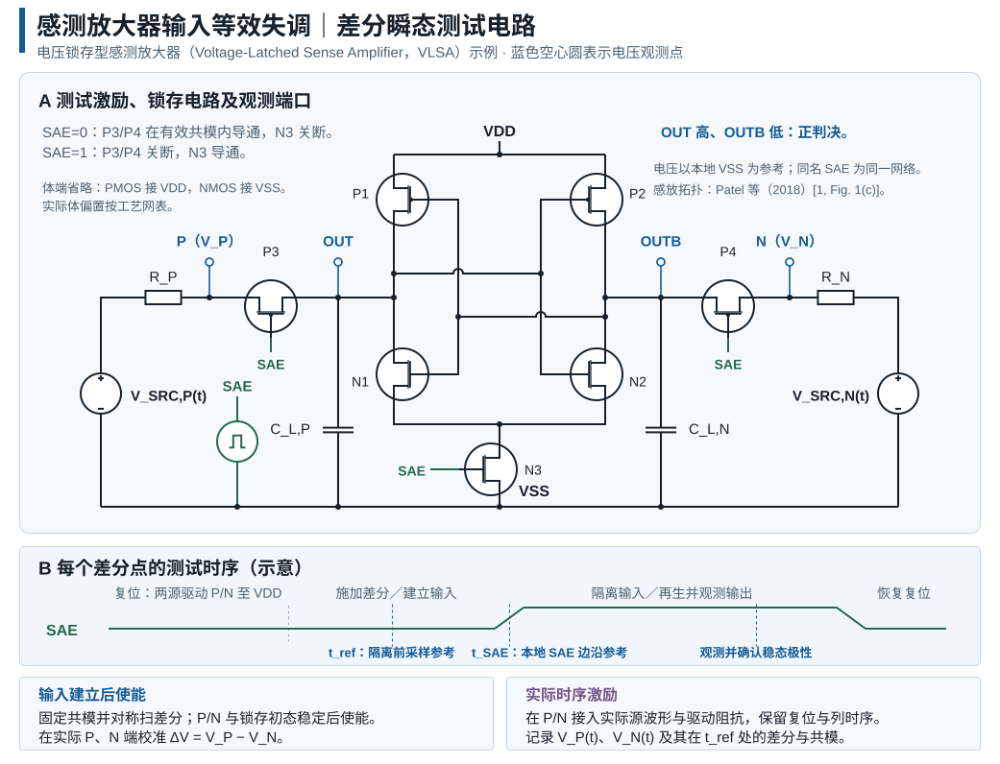

# SA Offset

## 定义与适用范围

**感测放大器输入等效失调电压**（Sense-Amplifier Input-Referred Offset Voltage，$V_{\mathrm{OS}}$）是外围电路层中，在固定输入共模、源阻抗、复位、使能和输出负载的参考条件下，使同一感测放大器（Sense Amplifier，SA）的稳定输出从负判决翻转至正判决的有符号输入差分，单位 mV。无瞬态噪声时，按两种判决的分界提取；有噪声时，在未决比例可忽略且结果对观察窗稳定的条件下，取正判决概率为 50% 的交点。该参考失调包含被测 SA 内的失配和不对称，须注明感测拓扑与参考工作点。[1, Sec. II, IV, Figs. 1–2, 5–8]

- **输入与符号**：$V_P,V_N$ 为被测 SA 输入节点相对本地 VSS 的电位；$\Delta V=V_P-V_N$，$V_{\mathrm{CM}}=(V_P+V_N)/2$。理想 SA 在 $\Delta V>0$ 时产生正判决。若 $V_{\mathrm{OS}}>0$，则需补加正差分才能抵消偏向负判决的失调。互换输入标签及正负判决标签后，报告值应变号；只交换标签时，各物理端口的阻抗、负载和波形不变。
- **输出与时间**：以图中 OUT 高、OUTB 低为正判决，以 OUT 低、OUTB 高为负判决。两个输出须达到接收器规格的有效高、低电平，并连续保持规定时间；在观察窗内未满足此条件时记为未决。在本地感测放大器使能（Sense Amplifier Enable，SAE）的有效沿首次跨越规定电平时计时，记为 $t_{\mathrm{SAE}}$；记录差分采样参考 $t_{\mathrm{ref}}$ 相对该边沿的位置。隔离采样结构取隔离前、输入尚未受切换影响的有效采样点；直接耦合结构取使能反冲（Kickback）影响输入前的最后有效参考点，并保存后续输入轨迹。
- **时限判决门槛**：[SA Decision Threshold](SA_Decision_Threshold.md) 的 $A_+,A_-$ 是在规定输入波形族、截止时间和目标成功率下，两种输入极性各自所需的最小差分幅度。错判、超时及有效期内反转计入该口径的失效。单实例的 50% 交点、实例间失调分布的标准差及有限样本全部正确所需的差分须分别报告。[1, Sec. IV, Figs. 6–9] [21, Sec. VII, Eq. (4)]

## 物理机制与变异

电压锁存型感测放大器（Voltage-Latched Sense Amplifier，VLSA）先将位线差分传到锁存节点，再隔离输入并启动正反馈；采样开关的导通阻抗、阈值失配和关断注入均可改变再生初值。电流锁存型感测放大器（Current-Latched Sense Amplifier，CLSA）先复位内部节点，使能后由输入差分调制两条支路的电流，再由锁存器再生。输入对及交叉耦合器件的阈值电压和驱动失配形成支路不对称；输出负载差、内部寄生和复位残差也可改变翻转点。器件随机失配用同角随机抽样分析；版图不对称用实际提取网表及对称对照定位。[1, Sec. II, Fig. 1(b)–(d)] [5, Secs. III–IV, Figs. 4, 8–9] [17, Sec. II-A–B, Figs. 2, 5–8] [21, Sec. IV, Figs. 9–11]

靠近翻转点时，可用再生初期的局部线性模型解释慢判决。设 $x$ 为输出差分 $V_{\mathrm{OUT}}-V_{\mathrm{OUTB}}$ 相对亚稳工作点的增量（V），$\tau$ 为近似再生时间常数（s）。输入已隔离，或输入的恒定驱动已计入工作点时，在共模和增益近似恒定的小信号区有 $\mathrm{d}x/\mathrm{d}t\approx x/\tau$、$x(0)=x_0$。以 $t_{\mathrm{ref}}$ 采得的差分近似表示有效初值 $x_0\approx k(\Delta V-V_{\mathrm{OS}})$，其中 $k>0$ 为无量纲等效传递系数。若 $0<\lvert x_0\rvert<x_{\mathrm{e}}$，解得离开该小信号区所需时间近似为

$$
t_{\mathrm{e}}\approx \tau\ln\!\left(\frac{x_{\mathrm{e}}}{\lvert x_0\rvert}\right).
$$

$x_{\mathrm{e}}$ 为小信号区出口的差分幅度（V）。接近翻转点时 $t_{\mathrm{e}}$ 增大。可用一致的小信号区间拟合 $\ln\lvert x(t)/x_{\mathrm{e}}\rvert$ 的斜率诊断再生速度；输出达到接收器电平的时间须从完整瞬态波形提取；CLSA 的分阶段模型另见 [17, Sec. II-A.3, Eq. (20), Fig. 6]。输入共模、SAE 边沿和输出负载会改变初值传递与再生速度。失调及判决门槛的变化方向须按拓扑验证；例如 28 nm 监测芯片上的 VLSA 与 CLSA 的失调标准差随供电变化的方向相反。[5, Sec. IV, Fig. 9]

## 本征失调与测试边界

| 口径 | 输入、控制与负载 | 交付量 |
| --- | --- | --- |
| **参考失调** | 断开正常列驱动，在实际采样开关或输入管外侧施加对称、已建立的差分，固定输入共模及两侧相同源阻抗。保留 SA 内部采样、复位、隔离、使能和本征寄生，外接输出负载采用指定对称值；区分 SA 版图引入的不对称与夹具误差。 | 每实例有符号 $V_{\mathrm{OS}}$、分界区间或不可提取状态；附参考工作点。 |
| **在用状态下的 SA 判决** | 重放本地 $V_P(t),V_N(t)$ 或用实际列网络驱动；保留共模轨迹、输入边沿斜率、差分建立相对 SAE 的相位、两侧阻抗和输出负载。复位时长、上次数据及访问间隔按在用条件设置。重放时须检查反冲，必要时保留实际分布网络。 | 在用条件下的翻转区间、判决时间及三类输出比例；按工作截止和可靠性目标提取 $A_+,A_-$。 |
| **整条读路径** | 保留位单元、位线和列选择网络、预充与均衡、SA 与输出级；记录近／远位置、未选数据和实际本地供电。 | 可用差分、输出延时和读成功率；若只有数字读出，交付阵列功能门槛及测试条件。 |

相同 $\Delta V(t_{\mathrm{ref}})$ 可对应不同的共模、斜率、历史及源阻抗。比较在用门槛时，须固定波形形状、负载及相位，再改变差分幅度；在多个条件间切换时分别标定。用对称条件获得参考失调，再逐项恢复不对称，比较翻转点和未决率。位线建差受列选择阻抗、两侧寄生和未选位单元漏电影响，须以 SA 输入端实际波形为准。[1, Secs. III–IV, Figs. 3, 5–6] [7, Sec. II, Figs. 4–6] [17, Sec. I, Fig. 2] [20, Sec. III]

## 测量与提取方法

### 仿真：参考翻转点与动态判决对照

图示 VLSA 采用 Patel 等的电路拓扑。SAE 为低时，尾管关闭；输入处于有效偏置范围时，PMOS 采样开关导通。复位时两路源驱动至同一复位电位，随后在开关导通期间建立试验差分。SAE 上升使采样开关关断、尾管开启，交叉耦合反相器启动再生；两种切换可重叠，须依据节点波形确认隔离及再生启动时刻。串联电阻 $R_P,R_N$ 给出两路源阻抗的集中模型，输出电容 $C_{\mathrm{L},P},C_{\mathrm{L},N}$ 标明加载边界。实际仿真须保留工艺规定的体端接法、实际复位或均衡电路、分布寄生与接收器；CLSA 须换用相应输入级、内部复位及实际源网络。[1, Sec. II, Fig. 1(b)–(c)]

**【前置条件】** 选择晶体管级原理图或寄生参数提取（Parasitic Extraction，PEX）网表，固定工艺、电压和温度（Process, Voltage and Temperature，PVT）、体偏置、复位与使能序列、判决输出的有效电平及稳定时间。给定参考 $V_{\mathrm{CM}}$、输入差分扫描范围、步长或停止容差、源阻抗及输出负载；确认全扫描中两路输入均处于允许电位及采样开关有效范围。先用对称标称网表核对接线、输出映射和参考时刻，再按对照目的开启实际寄生、器件失配或瞬态噪声。

**【步骤／方法】**

1. **复位并扫描局部差分**：每次瞬态分析（.tran）前重新复位至规定状态。将两路源设为 $V_{\mathrm{CM}}\pm\Delta V_{\mathrm{cmd}}/2$，建立输入后运行使能。以 SA 端实测差分 $\Delta V(t_{\mathrm{ref}})$ 标定扫描横轴。核对端口共模，并确认两个锁存节点在两种上次判决后都能恢复和建立；如有压降或建立误差，调节源设定或建立时间，再复测端口及锁存节点。用两端稳定异号判决及全范围粗扫检查分界唯一性与单调性；同步保存本地 SAE、输入及互补输出波形。
2. **夹逼单实例分界**：固定失配样本，关闭瞬态噪声，在通过单调检查的区间用二分法缩小最后稳定负判决点与最先稳定正判决点之间的区间。中点未决时，保留两端已确认的异号判决，按负判决／未决和未决／正判决两侧分别缩小边界。若工作阶段允许，可延长观察并检查分界是否移动。若仍有宽于目标容差的未决带、多个翻转、缺少稳定异号端点或数值失败，交付观测边界、状态及原始扫描。仅在单一分界被夹逼至规定容差时，报告中点及半区间宽度。例如两侧稳定点为 $+7.0$、$+8.0$ mV，则报告 $+7.5$ mV，扫描半宽 $0.5$ mV，另列校准误差。[10, Sec. 4.4]
3. **分离噪声、失配与全局变化**：开启瞬态噪声，在分界附近各差分点重新复位，用独立噪声种子重复测试，分别以有效试验总数计算正判决、负判决和未决比例。未决比例可忽略且交点唯一时，按分界附近的概率曲线插值或拟合 50% 交点，报告重复次数和置信区间；若未决显著、双向扫描有滞回或概率曲线非单调，记录三类比例及分界区间。对蒙特卡洛（Monte Carlo，MC）仿真，在每个 PVT 条件下更换实例失配种子逐个提取；跨 PVT 诊断漂移时保留可配对的样本标识。[3, Secs. 2.2–3] [19, Sec. III-A, Eqs. (7)–(11)]
4. **提取在用时限门槛**：以实际读通路或等效阻抗及波形族驱动，按同一相位参考缩放差分。声明概率针对同一 SA 的重复噪声、跨 SA 的失配总体或二者联合。对读 0／读 1 分别统计截至工作截止时刻的正确判决、错判及超时；正确输出须已连续保持规定时间并持续至该截止。按预定置信水平，仅在失效率上界不超过目标时判该幅度合格。粗扫发现成功率越过规格后又回落时，报告各合格区间，并复核最早合格点及回落区间。[17, Secs. II–III] [20, Sec. III]

**注意事项**：禁止把未决样本计作负判决或仅以已决样本为分母求 50% 交点（未决随输入幅度变化时会移动交点）。

**注意事项**：禁止对多翻转或存在不同历史分支的全局扫描直接二分（单一分界的前提不成立）。

**【结果处理和验证】** 对照正反向扫描、两种上次判决与短／长恢复间隔。仅在复位轨迹一致，且分界在延长观察窗及减小最大积分步长后保持稳定时，提交参考 $V_{\mathrm{OS}}$；否则按复位不足、窗口不足、非单调、扫描范围不足或数值失败分类。保留波形、离散步长、置信区间、参考电压和动态试验失败原因。

### 硅测量：直接输入与测试通路去嵌入

**【前置条件】** 优先使用可隔离正常列选择的双路模拟测试端或片上差分数模转换器（Digital-to-Analog Converter，DAC），访问同一 SA，独立控制 SAE 与输出采样。记录晶片和裸片编号、地址、局部供电、共模以及测试通路与正常读通路的区别。Chen 等以测试开关控制 DL/DLB、反复使能来扫描嵌入式 SA；Abu-Rahma 等以片上 DAC 扫描失调分布并保留真实邻近布局。[5, Secs. III–IV, Figs. 3–6] [7, Secs. II, VII, Figs. 4–6, 24]

**【步骤／方法】**

1. **校准端口与时钟**：使用同电位零差分及已知正负参考阶跃，分别校准两路增益、零差分误差、实际步进、带宽和共模；量测或估计探针、焊盘及导通开关压降、路径阻抗、RC 建立和两路时差。优先在被测端采用独立电压感测或片上采样。仅能在焊盘感测时，须标定焊盘至 SA 输入端的传递关系及误差。校准本地 SAE 的参考时刻、输出采样偏差及抖动。
2. **重复测翻转区间**：固定共模、输出负载和观察窗口，以稳定异号端点、双向扫描和重复复位逐实例测试。分别测上次正、负判决及不同恢复间隔。Patel 等对 65 nm 测试 IC 在 −100 至 +100 mV 间以 1 mV 步进扫差分，比较反极性预置与阶梯激励；图 7 绘制其中 −50 至 +50 mV。其两种序列均值差小于 1 mV 是该测试条件下的观测，原文 $\Delta V_{\mathrm{BL,min}}$ 须按其测试序列解释。[1, Sec. IV, Figs. 5–9]
3. **互换激励通道校验偏差**：保持 SA 的物理 P/N 和输出映射，互换激励通道，再重排控制码以保持标称差分的物理正方向均为 $V_P-V_N$。两次均校准增益及共模。在输入通路可近似为单位增益和固定加性误差的区间，令 $x_A,x_B$ 为两次命令翻转差分，$\delta_{\mathrm{ch}}$ 为随激励通道换接变号的差分误差，$\delta_{\mathrm{fix}}$ 为始终固定在物理路径上的差分误差，均以 P 减 N 为正：
   $$
   x_A=V_{\mathrm{OS}}-\delta_{\mathrm{fix}}-\delta_{\mathrm{ch}},\qquad
   x_B=V_{\mathrm{OS}}-\delta_{\mathrm{fix}}+\delta_{\mathrm{ch}}.
   $$
   以半差 $(x_B-x_A)/2$ 核对通道误差；用独立参考、匹配的测试通路或端口实测估计 $\delta_{\mathrm{fix}}$，再用半和加 $\delta_{\mathrm{fix}}$ 得到失调。例如 $x_A=+4$ mV、$x_B=+8$ mV、$\delta_{\mathrm{fix}}=+1$ mV，校正结果为 $+7$ mV。若换接改变源阻抗、共模、相位或恢复，须逐通路标定并重建本地差分和共模；无法校准时交付含夹具的翻转区间及误差范围。

**注意事项**：禁止仅凭交换通道后的半和报告本征失调（焊盘至 SA 固定通路的不对称仍保留在半和中）。

**【结果处理和验证】** 判决电平、稳定时间及未决分类须与仿真同口径。记录 DAC 或源步长、校准误差、观察时间、正反向分界、上次状态及每实例重复数。以已知差分复查换接前后符号及去嵌入误差。仅有数字输出和可调读时序时，用固定读条件下的读成功曲线交付功能代理；具备独立模拟标定时，可将其与输入失调或在用门槛关联。[6, Sec. 2.2, Fig. 2.10] [12, Sec. 4.2, Figs. 4.5–4.8]

## 数据可视化与评估

| 图表 | 数据与判据 |
| --- | --- |
| **同一实例的判决比例与波形** | 横轴为端口差分（mV）；分别绘正判决、负判决、未决比例，标分界、观察时间、每点试验次数及置信区间。波形标出本地 SAE、输入共模、采样参考及两个输出达标时刻。按扫描和上次数据分层识别滞回与恢复不足。 |
| **带符号经验累积分布（Empirical Cumulative Distribution Function，ECDF）及尾部** | 按 PVT、源阻抗、共模、负载与校准状态分层；报告均值、标准差、两侧分位数、规格超限率及置信区间。记录超出扫描范围的方向及观测界限，另列未决或无唯一分界的数量；只画可提取实例时标明为条件分布。 |
| **共模／供电与时限图** | 列出各条件 $V_{\mathrm{OS}}$ 的均值、标准差或分位带，在同一输入波形族下分别画正负极性的按时正确率和超时率，标明未覆盖区域。 |

同一 SA 的重复噪声试验用于估计该实例的概率曲线，跨实例失配结果用于估计总体分布。按裸片和共享同一 SA 的列组分层，报告裸片数、SA 数及每实例重复数。若截尾界限已超出规格，按确定超限计入；区间跨越规格且不能辨识时，单列并报告将其计为超限时的保守结果。某侧在 $n$ 个相互独立、可分类试验中零超限时，单侧 95% 二项置信上界为 $1-0.05^{1/n}$；排除不可分类样本后，该上界仅适用于可分类的实例。共用 SA 或同裸片的相关样本须按相应分组估计。分位数越过可观测边界时报告可辨识范围；高斯模型或重要性采样用于推算远尾时，须验证尾部模型并将推算与直接观测分列。统计方法参见 [RSNM](../Bitcell/RSNM.md#数据分析与评价方法)。[1, Sec. II, IV–V, Figs. 8–10] [5, Sec. IV] [18, Sec. 5.2] [19, Sec. III-A] [21, Sec. VII, Figs. 26–29]

## 应用场景与指标关系

- **尺寸与版图迭代**：先用有符号均值检查固定不对称和测试路径误差，再用同角失配分布比较两侧尾部。增大匹配器件可能减小失配，同时会增加位线或锁存节点的电容、面积和能耗；在同一输入轨迹和负载下量化代价。[5, Secs. II–III] [17, Secs. I–II]
- **失调校准**：采用阈值存储、电容失调校正或体偏置时，分别记录校准前后带符号分布、控制码、步进、可调范围、再校准条件和 PVT 漂移；用两极性时限判决核对净收益。[9, Secs. II, IV–V] [13, Secs. II–IV] [16, Secs. 2–4] [17, Secs. III–IV] [21, Secs. VI–VIII]
- **读裕量与时序分配**：将 [Read Develop Time](../Subarray/Read_Develop_Time.md) 产生的实际差分、共模和 SAE 时序与实测或仿真的 SA 判决曲线配对，再用 [RD](../Subarray/Read_Delay.md) 检查输出时限。按数据极性、共享 SA 与列组织联合估计读良率。若 $A_+,A_-$ 已按同一失调总体采样，禁止再叠加同一失调分布（重复计入失配）。设计与工艺协同优化（Design-Technology Co-Optimization，DTCO）以有符号分布诊断版图偏差，以实际读成功率验证裕量分配。[1, Secs. III, V] [2, Secs. VII–VIII] [3, Secs. 2.2–4] [15, Secs. 2–4] [20, Secs. III–IV] [26, Secs. II–IV]

## 参考文献

2026-11-17 核对 Zotero 外围电路集合 Peripheral（`PRESTNIR`）中精确标签 `SA Offset`：25 条匹配，其中 22 条有项目归档 PDF，14 篇独立期刊或会议研究支持本指标的电路、表征或统计方法；17 份归档与对应 Zotero 附件 SHA-256 一致。另有 1 条保留出版社全文入口，2 条仅保留题录。Patel 等 [1] 是精确标签之外的补充证据，既有 Zotero 附件与项目归档一致。页码对应所链接的版本。

[1] D. Patel, D. Wright, and M. Sachdev, “Sense amplifier offset characterisation and test implications for low-voltage SRAMs in 65 nm,” in Proc. IEEE European Test Symp., 2018, author manuscript. [DOI 10.1109/ETS.2018.8400696](https://doi.org/10.1109/ETS.2018.8400696). [公开文献](https://doi.org/10.1109/ETS.2018.8400696)；[Zotero](https://www.zotero.org/users/7333024/items/FHKBDBC9)（集合外补充）。

**相关摘要：** 作者在65 nm通用CMOS测试芯片上集成各512个电流锁存与电压锁存感放，并测量10颗芯片。测试通过外部位线输入在−100至100 mV间以1 mV步进扫描翻转点，同时比较反向预置与阶梯式激励，考察供电、温度和测试序列对失调分布的影响。实测揭示低压感测对输入失配更敏感；两种激励下均值差小于1 mV仅适用于本文条件。测试对使能频率和边沿的控制有限，不能据此认定感放普遍没有历史效应，也不能把样本最大失调等同总体统计上界。

**原文定位：** §II、§IV.B–C，图1–2、5–9；作者稿 PDF pp.1–2、4–6。

[2] R. Heald and P. Wang, “Variability in sub-100nm SRAM designs,” in Proc. IEEE/ACM International Conference on Computer-Aided Design (ICCAD), 2004, pp. 347–352. [DOI](https://doi.org/10.1109/ICCAD.2004.1382599). [Zotero](https://www.zotero.org/users/7333024/items/7GAQXDTN). [公开文献](https://doi.org/10.1109/ICCAD.2004.1382599)

**相关摘要：** 文章将SA输入失调放入存储阵列速度良率分析，建议把统计变化的感放与弱读电流单元共同仿真，并在规定输出和时间条件下判断失败。电压型与电流型感放对阈值、电流及版图不对称的敏感性不同，复制路径的变异也不能忽略。该文属于设计方法和统计仿真讨论，例示数值并非先进节点的通用实测规范。用于本指标时应记录拓扑、共模与时序边界，区分感放本征失调、可用位线压差和整条读路径裕量。

**原文定位：** §VII–VIII，图7–8；pp.350–351。

[3] M. H. Abu-Rahma, K. Chowdhury, J. Wang, Z. Q. Chen, S. S. Yoon, and M. Anis, “A methodology for statistical estimation of read access yield in SRAMs,” in Proceedings of the 45th Annual Design Automation Conference, 2008, pp. 205-210. [DOI](https://doi.org/10.1145/1391469.1391522). [Zotero](https://www.zotero.org/users/7333024/items/2WRYLJJM). [公开文献](https://doi.org/10.1145/1391469.1391522)

**相关摘要：** 论文以SA输入失调的统计分布替代固定最坏偏移，并与读电流、列泄漏和感测窗口共同估计读访问良率；用45 nm、1 Mb存储器的测量良率检查方法。其SA分布通过Monte Carlo瞬态分析取得，还强调非对称布局及器件尺寸会改变失调。实测验证对象是整体良率，不等于所有失调参数均直接硅测。用于本页应保留SA共享的列组织和数据极性，避免把最坏单元与最坏感放机械叠加或忽略列选择路径的RC。

**原文定位：** §2.2–4，图2–3；pp.207–210。

[4] M. Bhargava, M. P. McCartney, A. Hoefler, and K. Mai, “Low-overhead, digital offset compensated, SRAM sense amplifiers,” in 2009 IEEE Custom Integrated Circuits Conference, 2009, pp. 705-708. [DOI](https://doi.org/10.1109/CICC.2009.5280732). [Zotero](https://www.zotero.org/users/7333024/items/7TU7YDUR). **全文缺口：** 未取得全文，保留题录与访问入口。

**相关摘要：** **未核验全文。** 本条因精确标签命中而保留，项目归档与Zotero重复项未找到全文，论文获取回退返回的候选也未通过身份匹配。引用入口可用于后续获取，但当前不根据数字校准题名或会议简介推断补偿效果、工艺条件、面积开销与样本尾部。补齐后应核验补偿前后的输入失调定义、码字范围、校准激励和PVT条件，并区分σ降低、单颗最大失调及整个SRAM良率改进。

**原文定位：** 全文缺口：下载候选未通过题名/DOI匹配；未取得可核验PDF。

[5] M. H. Abu-Rahma et al., “Characterization of SRAM sense amplifier input offset for yield prediction in 28nm CMOS,” in 2011 IEEE Custom Integrated Circuits Conference (CICC), 2011, pp. 1-4. [DOI](https://doi.org/10.1109/cicc.2011.6055315). [Zotero](https://www.zotero.org/users/7333024/items/677N8XKR). [公开文献](https://doi.org/10.1109/cicc.2011.6055315)

**相关摘要：** 文章在28 nm低功耗CMOS实现全数字控制的SA失调监测阵列，使用DAC施加输入差分并扫描感放输出，保持真实邻近布局以纳入工艺及版图影响。跨电源和温度比较两类SA，再用测得的分布预测512 Kb SRAM良率并与硅片结果对照。它支持直接测量而非仅从孤立器件失配推算；文中16 Mb、97%良率下的压差敏感度是特定模型例子，不能作为所有容量下“每1 mV失调必需10 mV压差”的普适系数。

**原文定位：** §III–V，图3–8；PDF pp.2–4。

[6] S. O. Toh, “Nanoscale SRAM variability and optimization,” dissertation, UC Berkeley, 2011. [Zotero](https://www.zotero.org/users/7333024/items/LYDRHR6E). [公开文献](https://www2.eecs.berkeley.edu/Pubs/TechRpts/2011/EECS-2011-144.html)；DOI：Zotero未收录或尚未核实。

**相关摘要：** 论文在45 nm SRAM动态表征中观察到跨列读访问时间呈多峰分布，并通过位线开关和外部仪器独立测量各列SA失调后作归一化。结果表明跨列失调会显著影响读时间，不能把所有时间离散都归因于bitcell读电流；即使消除失调和估计电容的影响，静态电流与动态读出仍存在剩余差异。此为硅片实验，失调用于分离读路径因素，未提供可跨PVT直接套用的统一σ值，也不能把其读访问时间定义等同完整宏输出延迟。

**原文定位：** §1.3及§2.2，式1.1、图2.10；PDF pp.24–25、37–38。

[7] Y. H. Chen et al., “Compact measurement schemes for bit-line swing, sense amplifier offset voltage, and word-line pulse width to characterize sensing tolerance margin in a 40 nm fully functional embedded SRAM,” IEEE Journal of Solid-State Circuits, vol. 47, no. 4, pp. 969-980, 2012. [DOI](https://doi.org/10.1109/JSSC.2012.2185180). [Zotero](https://www.zotero.org/users/7333024/items/RJ8M4HFH). [公开文献](https://doi.org/10.1109/JSSC.2012.2185180)

**相关摘要：** 在40 nm、32 kb功能SRAM中，作者增加测试开关隔离列复用器，再用外部直流源给SA数据线施加差分并反复使能，扫至输出翻转以取得失调。随后把实测SA分布与实际位线摆幅分布比较，帮助选择字线脉宽，避免仅凭单元电流推算感测裕量。该文提供嵌入式SA直接硅测方法；测试路径、共模电平和使能波形必须保留，输出翻转点及其分布不能直接当作含全部噪声和有限判决时间余量的门槛。

**原文定位：** §II、VII，图4–6、24；pp.970–971、978。

[8] M. H. Abu-Rahma, and M. Anis, “Nanometer variation-tolerant SRAM: circuits and statistical design for yield,” New York, NY, Springer New York, 2013. [DOI](https://doi.org/10.1007/978-1-4614-1749-1). [Zotero](https://www.zotero.org/users/7333024/items/RA2TPQV2). [公开文献](https://doi.org/10.1007/978-1-4614-1749-1)

**相关摘要：** 专著把理想SA差分判别零点的偏移定义为输入失调，用Monte Carlo瞬态仿真提取分布，并讨论器件随机失配、非对称布局与面积约束。对读良率应将失调与单元信号、使能时间及列泄漏共同积分，避免把最坏SA与最坏单元简单叠加造成过度保守。高斯零均值是该模型的近似，不能预先排除实测系统均值偏移或非高斯尾部。书中是汇总及方法推导，不应把各章节不同节点的数据拼为统一SA测量结果。

**原文定位：** 第5章§5.3–5.4.2，图5.11–5.13；PDF pp.137–143。

[9] J. S. Shah, D. Nairn, and M. Sachdev, “An energy-efficient offset-cancelling sense amplifier,” IEEE Transactions on Circuits and Systems II: Express Briefs, vol. 60, no. 8, pp. 477-481, 2013. [DOI](https://doi.org/10.1109/TCSII.2013.2268312). [Zotero](https://www.zotero.org/users/7333024/items/U79HMR2D). [公开文献](https://doi.org/10.1109/TCSII.2013.2268312)

**相关摘要：** 该SAOC在预充/预放阶段保存输入器件阈值信息，使随后感测对输入对失配较不敏感，但并未消除所有锁存器件失配。180 nm测试芯片通过外部井偏置施加可控扰动，基准实测失调约4 mV，而对照约−67 mV；这些为特定样品和条件的有符号值，不能当成σ。文中将仿真与实测分别比较，并指出测量体偏置范围受限；因此可用其补偿机理与实验方法，不能把单点分辨能力外推为高σ阵列保证。

**原文定位：** §II、IV–V，图5–8；pp.478–481。

[10] 季金华, “SRAM内嵌灵敏放大器失调电压的影响因素研究,” 硕士学位论文, 苏州大学, 苏州, 2014. [Zotero](https://www.zotero.org/users/7333024/items/LLAXV35Q). ；DOI：Zotero未收录或尚未核实。

**相关摘要：** 论文比较扫描与二分法提取锁存SA输出翻转时的输入差分；28 nm、SS、0.81 V、−40°C例中，两种方法给出相近σ，但受步进与取值规则影响。随后用Monte Carlo失调分布和多个单元共享SA的条件概率计算读良率，区别单SA偏移与阵列所需位线摆幅。作者明确未流片，故为仿真及数值积分证据；文中满足良率的几十mV压差不能与约数mV的σ混用，还需固定初始化和使能脉冲。

**原文定位：** §4.4–4.5；正文pp.36–40（PDF pp.43–47）。

[11] Y. Sinangil and A. P. Chandrakasan, “A 128 kbit SRAM with an embedded energy monitoring circuit and sense-amplifier offset compensation using body biasing,” IEEE Journal of Solid-State Circuits, vol. 49, no. 11, pp. 2730–2739, 2014. [DOI](https://doi.org/10.1109/JSSC.2014.2347707). [Zotero](https://www.zotero.org/users/7333024/items/P3M8SX2X). **全文缺口：** 未取得全文，保留题录与访问入口。

**相关摘要：** **未核验全文。** 本条严格命中SA Offset标签，保留标准题录、DOI及Zotero入口。已检查项目归档和Zotero重复条目，并尝试开放获取及论文下载回退，仍未获得可核对版本。当前不据题名或其他论文的转述填写失调降幅、测试偏置、样本量或测量方法，也不把摘要中的最小工作电压作为SA失调结果。后续补入全文时需核对体偏置补偿方式、σ与最小可读压差的定义及实测/仿真边界。

**原文定位：** 全文缺口：本地项目、Zotero重复项及论文获取回退均未取得可核验PDF。

[12] A. Dosi, “6T-SRAM 1Mb Design with Test Structures and Post Silicon Validation,” M.S. thesis, Arizona State University, Aug. 2017. [Zotero](https://www.zotero.org/users/7333024/items/C5Y4VDC4). [公开文献](https://keep.lib.asu.edu/items/155708)；DOI：Zotero未收录或尚未核实。

**相关摘要：** 2017年学位论文在1 Mb 6T SRAM中设计感放直接访问测试模式，关闭字线与正常列通路，经外部模拟端口和DAT复用器给选定SA施加差分电压，供逐个扫描列组失调。对中间开关节点施加跟踪电压以减少泄漏和前次操作残留，仿真验证测试差分能传到感放输入。其价值在可测性设计与端口校准；所示100 mV是测试激励而非测得失调，不能依据测试结构或“post silicon”题名推断已取得某个σ或极端尾部。

**原文定位：** 第4章§4.2，图4.5–4.8；正文pp.39–44。

[13] B. Liu, J. Cai, J. Yuan, and Y. Hei, “A low-voltage SRAM sense amplifier with offset cancelling using digitized multiple body biasing,” IEEE Transactions on Circuits and Systems II: Express Briefs, vol. 64, no. 4, pp. 442-446, 2017. [DOI](https://doi.org/10.1109/TCSII.2016.2563660). [Zotero](https://www.zotero.org/users/7333024/items/VWDFQ2EI). [公开文献](https://doi.org/10.1109/TCSII.2016.2563660)

**相关摘要：** 文章通过数字计数器反复选择体偏置，对输入及锁存相关晶体管阈值不匹配进行校准，并锁定补偿状态。130 nm CMOS的512次Monte Carlo在VDD=1.0 V、参考0.55 V、4 bit校准条件下，σ由36.37 mV降至8.07 mV，改善取决于校准位数和参考电平。该数值为仿真，不能写作流片实测；归档为提前接受稿而正式期刊为2017年。实际应用还需检查体偏置范围、离散步长及校准后PVT漂移。

**原文定位：** §II–IV，图6–9；作者接受稿pp.2–5。

[14] B. S. Reniwal, P. Singh, V. Vijayvargiya, and S. K. Vishvakarma, “A new sense amplifier design with improved input referred offset characteristics for energy-efficient SRAM,” in 2017 30th International Conference on VLSI Design and 2017 16th International Conference on Embedded Systems (VLSID), 2017, pp. 335-340. [DOI](https://doi.org/10.1109/VLSID.2017.54). [Zotero](https://www.zotero.org/users/7333024/items/VXU93XR4). [公开文献](https://doi.org/10.1109/VLSID.2017.54)

**相关摘要：** 文章提出差分电流补偿感放DCC-SA，通过减弱两支路电流不匹配改善输入等效失调，在相同单元电流和位线负载下比较CLSA与已有SAOC。仿真中以体偏置引入可控阈值差，并考察失调容忍、统计分布和感测能耗之间的权衡。对本指标应使用输入端电压等效量和明确比较条件，不能将支路电流差直接当作电压σ；文中的BER指指定条件下SA失败比例，并非整宏存储错误率，且结果不属于硅片实测。

**原文定位：** §III–IV，图4–9；pp.337–339。

[15] D. Skurikhin, and A. Korshunov, “Read access optimization for enhancement of SRAM yield-reliability trade-off,” in 2017 IEEE East-west Design & Test Symposium (EWDTS), 2017, pp. 1-4. [DOI](https://doi.org/10.1109/EWDTS.2017.8110100). [Zotero](https://www.zotero.org/users/7333024/items/ANNVMSD6). [公开文献](https://doi.org/10.1109/EWDTS.2017.8110100)

**相关摘要：** 文章通过条件概率把同一SA服务的多个bitcell信号与SA失调联合，计算达到目标良率所需的最小位线压差，避免对两个分布各取最坏值再相加。90 nm HSPICE和Monte Carlo示例用于比较该方法与传统保守估计，所谓最小压差减少属于裕量分配改善，未证明SA本征失调随之下降。对本指标可借鉴分布与共享关系建模，但须保留容量、目标良率和分布假设，也不能将仿真“实验”称为硅片实测。

**原文定位：** §2–4，式8–10；PDF pp.2–4。

[16] C. Peng et al., “Offset voltage suppressed sense amplifier with self-adaptive distribution transformation technique,” IEICE Electronics Express, vol. 15, no. 10, Art. no. 20180332, 2018. [DOI](https://doi.org/10.1587/elex.15.20180332). [Zotero](https://www.zotero.org/users/7333024/items/CTFW5Z54). [公开文献](https://doi.org/10.1587/elex.15.20180332)

**相关摘要：** 文章以两阶段判断失调方向和补偿幅度，将校准结果锁存到外围电路，避免每次读操作重复校准。65 nm、1.2 V、TT条件下的2500次Monte Carlo比较VLSA、RLSA和新结构，得到更集中的失调分布；文中优化补偿档位时，未校准σ约13.6 mV，模型目标约5.85 mV。证据为仿真而非硅片测量，校准后的分布经过变换也不宜继续假定为原高斯形状；应同时记录参考电压、档位与PVT。

**原文定位：** §2–4，图3–10；PDF pp.4–9。

[17] R. Fragasse et al., “Analysis of SRAM enhancements through sense amplifier capacitive offset correction and replica self-timing,” IEEE Transactions on Circuits and Systems I: Regular Papers, vol. 66, no. 6, pp. 2037-2050, 2019. [DOI](https://doi.org/10.1109/TCSI.2019.2902102). [Zotero](https://www.zotero.org/users/7333024/items/65K4ZJAH). [公开文献](https://doi.org/10.1109/TCSI.2019.2902102)

**相关摘要：** 文章将读路径总输入等效偏移拆分为列信号发展误差和SA自身的静态/动态失调，再用电容存储再生反相器翻转点差，并配合复制时序决定SA使能。130 nm SiGe BiCMOS中的10 Kb SRAM在1.5 V、500 MHz条件下作解析与电路仿真比较，展示校正可缩短总感测过程。此为仿真证据，不能写成测得σ下降；尤其文中的总路径offset包含列负载和泄漏影响，不应直接填入本页独立SA失调统计。

**原文定位：** §II–IV，图2及补偿电路分析；pp.2038–2046。

[18] 柴一凡, “面向SRAM电路的快速良率评估方法研究,” 硕士学位论文, 东南大学, 南京, 2021. [DOI](https://doi.org/10.27014/d.cnki.gdnau.2021.001354). [Zotero](https://www.zotero.org/users/7333024/items/9L4TT63P). [公开文献](https://doi.org/10.27014/d.cnki.gdnau.2021.001354)

**相关摘要：** 论文用七管SA作为21维随机参数的快速良率评估实例，包含每只管的阈值、关断参数和迁移率波动，以输入失调超过28 mV定义该实验失败，再比较重要性采样和加权回归替代模型。0.8 V下采用HSPICE样本训练并核验模型，目标是减少稀有失效估计成本。28 mV是作者设定的失效界限，不是测得均值、σ或普适判决门槛；结果属于算法与电路仿真验证，不能改写为新SA拓扑的实测失调改善。

**原文定位：** §5.2，图5-3–5-6；正文pp.63–66。

[19] G. Baek, and H. Jeong, “High-density SRAM read access yield estimation methodology,” IEEE Access, vol. 9, pp. 128288-128301, 2021. [DOI](https://doi.org/10.1109/ACCESS.2021.3111762). [Zotero](https://www.zotero.org/users/7333024/items/ZVIBD7DV). [公开文献](https://doi.org/10.1109/ACCESS.2021.3111762)

**相关摘要：** 文章把读路径分成控制、单元阵列和SA三个部分，并用两个输入差分测试点的Monte Carlo失败概率反求SA失调分布的均值与σ。例示±10 mV测试后得到μ约11.6 mV、σ约18.1 mV，强调非零均值也需建模。它是快速统计仿真方法，依赖所假定的高斯形状及有限测试点，不能替代真实硅片尾部测量；后续读良率还需与位线信号和使能窗口联合，不能只凭该σ定义所有操作的判决门槛。

**原文定位：** §III.A，式7–11、图3；pp.128291–128292。

[20] S. Gupta, and B. H. Calhoun, “Dynamic read VMIN and yield estimation for nanoscale SRAMs,” IEEE Transactions on Circuits and Systems I: Regular Papers, vol. 68, no. 3, pp. 1171-1182, 2021. [DOI](https://doi.org/10.1109/TCSI.2020.3044836). [Zotero](https://www.zotero.org/users/7333024/items/CJ93JPNL). [公开文献](https://doi.org/10.1109/TCSI.2020.3044836)

**相关摘要：** 文章将SA失调与单元电流、未选单元泄漏、位线电容、字线波形和使能窗口一起纳入动态读Vmin/良率模型。它指出固定一个预设位线压差会遗漏感测端的实际失调分布与时序变化，读成功应由使能时刻可用压差相对SA判别需求确定。文中为解析模型与电路统计仿真对照，失调是模型输入而非新型SA的硅片标定结果。对本指标可借鉴联合分布建模，但不能把算法误差或阵列Vmin改善写成失调减少。

**原文定位：** §III–IV，读访问失效建模；PDF pp.4–8。

[21] D. Patel, A. Neale, D. Wright, and M. Sachdev, “Body biased sense amplifier with auto-offset mitigation for low-voltage SRAMs,” IEEE Transactions on Circuits and Systems I: Regular Papers, vol. 68, no. 8, pp. 3265-3278, 2021. [DOI](https://doi.org/10.1109/TCSI.2021.3081917). [Zotero](https://www.zotero.org/users/7333024/items/JPBYPFCC). [公开文献](https://doi.org/10.1109/TCSI.2021.3081917)

**相关摘要：** DIBBSA将位线差分同时施加到关键PMOS的源端与体端，以自动减轻输入失配。65 nm、10颗芯片每种拓扑共5120个SA，采用反向预置测试序列和1 mV步进，在0.4 V、25°C实测DIBBSA两模式σ约10.2 mV，VLSA与CLSA分别约11.3和18.0 mV。论文另有等栅面积归一化比较，其百分比不能与上述原始实测σ混用。均值偏移、样本范围及温度依赖需分别记录，不能把σ当作全阵列最小可读压差。

**原文定位：** §VI–VIII，图24–30；接受稿pp.8–11。

[22] 杨琳, “低电压时序推测SRAM的设计,” 硕士学位论文, 东南大学, 南京, 2022. [DOI](https://doi.org/10.27014/d.cnki.gdnau.2021.001279). [Zotero](https://www.zotero.org/users/7333024/items/7NZS389F). [公开文献](https://doi.org/10.27014/d.cnki.gdnau.2021.001279)

**相关摘要：** 论文将采样管与锁存管从串联改为并联，以降低低压时序推测SRAM的感测负担。28 nm、0.6 V例中用输入斜坡、周期SAE及1000次Monte Carlo提取翻转压差；表3.2报告所提结构11.961 mV、对照高阻结构15.3166 mV，但未清楚标明这组数值是均值还是σ，应保留原口径。该表延时行与正文降幅还存在矛盾，不能据此推广速度优势。全部为仿真证据，不能视为硅片尾部保证。

**原文定位：** §3.2.2、§3.3.1，图3-24–3-26、表3.2；正文pp.24–25、35–37。

[23] 庞亮, “低电压SRAM良率建模与快速分析研究,” 博士学位论文, 东南大学, 南京, 2023. [DOI](https://doi.org/10.27014/d.cnki.gdnau.2023.000217). [Zotero](https://www.zotero.org/users/7333024/items/HHJ9LZJ5). [公开文献](https://doi.org/10.27014/d.cnki.gdnau.2023.000217)

**相关摘要：** 论文把SA失调、列放电速率和WL到SAE时差分别建模，再结合阵列组织估计低压读良率与所需感测窗口。失调在方法中采用正态分布，而放电及控制时序使用更灵活分布，因此“压缩最坏情况余量”来源于联合统计计算，并非改变SA器件后降低失调。对本指标主要是模型使用证据，属于仿真/算法分析；不能将阵列读窗口缩短百分比当作σ改善，也应避免把全阵列目标σ与单感放分布σ混为一谈。

**原文定位：** 第5章，图5-3、5-7–5-8；正文pp.68–73。

[24] B. Ishdorj, D. Kim, S. Ahn, and T. Na, “Offset-canceling current-latched sense amplifier with slow rise time control and reference voltage biasing techniques,” IEEE Transactions on Circuits and Systems I: Regular Papers, vol. 70, no. 7, pp. 2689-2699, 2023. [DOI](https://doi.org/10.1109/TCSI.2023.3264693). [Zotero](https://www.zotero.org/users/7333024/items/PFKMHTS3). [出版社全文](https://xplorestaging.ieee.org/document/10102270)。**归档缺口：** 官方HTML全文已核验，尚未取得PDF。

**相关摘要：** 已核验出版社HTML全文，尚未归档PDF。文章结合SAE慢上升沿和参考电压偏置抑制电流锁存感放失调。28 nm后仿真中，0.6 ns上升沿使增尺寸FS-CLSA与OC-CLSA的σ分别下降17.7%和10.5%；测试芯片上参考偏置方案相对常规OC-CLSA降低σ约22%。仿真与实测基线不同，不能合成一个降幅；附加抵消阶段也带来时序代价，σ降低不等于任意期限下判决门槛同比降低。

**原文定位：** 出版社HTML全文§II–IV、图13、15及表I；期刊pp.2689–2699；未取得本地PDF。

[25] B. S. Reniwal, P. Singh, A. P. Shah, and S. K. Vishvakarma, “Energy efficient and reliable embedded nanoscale SRAM design,” Boca Raton, CRC Press, 2023. [DOI](https://doi.org/10.1201/9781003213451). [Zotero](https://www.zotero.org/users/7333024/items/Q47DS2TG). [公开文献](https://doi.org/10.1201/9781003213451)

**相关摘要：** 专著从锁存型感放晶体管失配与两支路电流不平衡解释输入等效失调，并讨论自校正、差分电流及混合感测拓扑。失调越大，通常需要更大的位线压差与更晚的使能时刻，因此必须联合比较感测延时、能耗和面积；单纯增大器件也会增加自负载。书中汇总不同工艺的模型与仿真案例，不能当作统一硅片测量。其“可靠可读最小压差”有时也称offset，本页引用时须与带符号翻转点及统计σ区别。

**原文定位：** 第4章§4.3–4.5及第5章§5.7–5.8；正文pp.130–149、163–170。

[26] T. Yoon, and H. Jeong, “Machine learning-based read access yield estimation and design optimization for high-density SRAM,” IEEE Transactions on Computer-Aided Design of Integrated Circuits and Systems, vol. 42, no. 8, pp. 2618-2630, 2023. [DOI](https://doi.org/10.1109/TCAD.2022.3225066). [Zotero](https://www.zotero.org/users/7333024/items/Y9LBTSB6). [公开文献](https://doi.org/10.1109/TCAD.2022.3225066)

**相关摘要：** 文章以可用位线压差小于SA输入偏移定义读访问失败，并将SA失调分布与给定WL–SAE时间下的位线条件分布联合积分，使用机器学习辅助估计和设计优化。其贡献是减少电路统计搜索成本、保留各模块变化对良率的影响，失调仍需由所研究SA模型提供。对本指标是方法性证据，不是新的直接失调测量；不能把代理模型的不确定性σ当作物理SA失调σ，也不能从读良率提升推断器件失配被消除。

**原文定位：** §II.A、III–IV，式1–4；pp.2619–2627。
