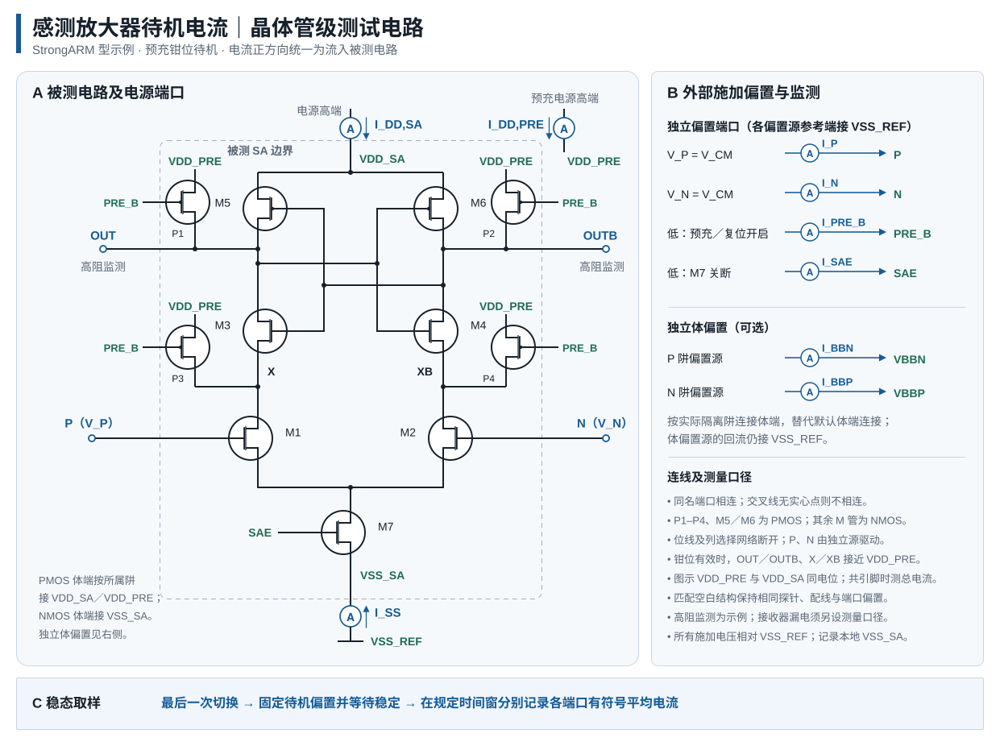

# SA Standby Current

## 定义与适用范围

**感测放大器待机电流**（Sense-Amplifier Standby Current，$I_{\mathrm{SA,stby}}$）指外围电路中，感测放大器（Sense Amplifier，SA）进入规定待机状态并稳定后，在指定供电端口测得的稳态电流。单路报告 A/SA，共享供电域保留原始 A/bank 或 A/macro。本文的单路边界包含 SA 输入级、锁存器和局部预充、均衡及复位器件；共享列预充、控制驱动、输出缓冲和位单元按各自供电边界记录。若采用电源门控（Power Gating），须标明探针在门控器件的外部电源侧还是内部虚拟电源侧。常见电流锁存型和电压锁存型 SA 的输入、使能及供电连接见 [1, Sec. II, Fig. 1]。

在端口 $k$ 约定**从外部流入被测电路为正**，因此 VSS 的常规回流读数为负。以待机稳定后的观察窗 $[t_1,t_2]$ 定义每轨读数；若只报一个 $I_{\mathrm{SA,stby}}$，须给出对应供电轨：

$$
I_{k,\mathrm{stby}} =
\frac{1}{t_2-t_1}\int_{t_1}^{t_2} I_k(t)\,\mathrm{d}t,\qquad
P_{\mathrm{SA,stby}} = \sum_{k\in\mathcal{B}}(V_k-V_{\mathrm{ref}}) I_{k,\mathrm{stby}}.
$$

$V_k$ 为稳态端口电位，$V_{\mathrm{ref}}$ 为共同参考，$\mathcal{B}$ 为计算所用的端口集合；上式功率项用于各轨电位恒定的待机窗。**SA 边界净输入功率**须覆盖承载净电流的全部边界端口，包括独立体偏置、输入、控制和带直流负载的输出；仅计供电引脚时，交付量标为该组电源轨提供的功率。回流用于核对电流守恒；禁止将 VDD 供电和 VSS 回流的绝对值相加（同一通路会重复计数）。持续偏置型须保留稳态偏置电流；周期性切换的待机模式须按完整周期报告平均电流和周期；端口电位也切换时，对 $\sum_{k\in\mathcal{B}}[V_k(t)-V_{\mathrm{ref}}]I_k(t)$ 作周期平均。单次复位或唤醒电流计入转换能量。[2, Figs. 15–19]

## 物理机制与变异

| 待机方式 | 控制与节点状态 | 须检查的漏电通路 |
| --- | --- | --- |
| **带电锁存保持** | 供电维持；仅在电路具备静态保持路径时使用。按网表设置感测放大器使能（Sense Amplifier Enable，SAE）、预充（PRE）、复位（RESET）与均衡；分别从两个已判决状态进入待机。 | 交叉耦合支路的关断管、保持器和输出接收器漏电；相反判决使不同器件承受漏源电压。 |
| **禁用并持续钳位** | 关断再生或尾管；维持规定的预充／复位／均衡控制，核对输出、内部节点与钳位的实际电位。 | 经关断尾管、输入隔离器件或复位管的亚阈值漏电；钳位轨可补流。若待机为同一复位状态，两个前态的稳态读数应在测量不确定度内一致。 |
| **电源门控** | 跨电源域隔离后关闭高侧或低侧睡眠管；记录虚拟 VDD/VSS、输入／输出钳位及仍上电的控制和体偏置。 | 睡眠管、体端及结漏电，以及仍上电的钳位、接口或保护器件绕过睡眠管的供电。 |

**器件机制**：关断管的亚阈值漏电随有效阈值电压、漏源电压及温度变化；漏致势垒降低（Drain-Induced Barrier Lowering，DIBL）可提高漏源电压较大时的关断电流。栅漏电、反偏结漏电及栅致漏端漏电（Gate-Induced Drain Leakage，GIDL）须按器件模型和各支路实际电场核查。串叠管的内部节点自偏置、睡眠管尺寸和体偏置会改变关断管的端电压及漏电分配。独立体端须注明 $V_{\mathrm{BS}}=V_B-V_S$ 的极性，遵守工艺阱隔离和允许偏置范围。[Device Ioff](../Device/Ioff.md#数据分析与评价方法)；[2, Figs. 15–16] [3, Secs. III, VI-B, Figs. 2, 12] [4, Secs. 4, 6, Tables 2–4]

**变异来源**：工艺、电压和温度（Process, Voltage and Temperature，PVT）、局部失配、输入共模和钳位电压会改变内部电位及支路漏电。先在每种合法待机方式下确认主导路径，再评估各工艺角和温度角的电流及分布上尾。Patel 等的静态功耗仿真中，在指定低压拓扑和 TT/25 °C 下，常规电压锁存型 SA 的较宽尾管是较高静态功耗的重要贡献项；比较须保留器件尺寸及偏置。[2, Figs. 15–16]

## 本征电流与共享供电测试边界

| 观测口径 | 测量端口与电路 | 可归属的结果 |
| --- | --- | --- |
| **单路 SA 供电电流** | 位线／互补位线（Bitline，BL／BLB）及列选择器与 SA 输入隔离，以独立源提供等效端口偏置；分别在 SA 锁存器、局部预充和体偏置供电轨串接探针。 | 每轨的有符号电流、实际端电位及边界功率；输入、控制、输出若可导通电流，须保留其独立读数。 |
| **共享 SA 供电域** | 多个同构 SA 共用电源；保留域内共享驱动、钳位、保护器件、睡眠管和负载在真实待机状态，并记录配置。 | 域实测总量；偏置不变且增量线性验证通过后，从复制数量斜率估计每路贡献。 |
| **外围或宏电源引脚** | 保留位单元、列预充、译码与驱动树、SA、输出接收器等实际接线。 | 芯片供电所见的合计值；用于宏级预算与比较，混合支路不能按 SA 数量直接归一。 |

纯栅端输入的 $I_P,I_N$ 用于记录输入漏电或夹具漏电；如果 BL／BLB 直接接内部器件的源漏端且为 SA 供电，则 $I_P,I_N$ 是该边界的电源贡献。列预充／钳位驱动器自身的待机电流须在驱动器电源端独立记录。计算宏总功率时对互不重叠的外部供电端求和；同一列预充电源经输入输送的功率在宏边界只计一次。[1, Fig. 1(b)–(c)] [2, Fig. 18]

## 测量与提取方法

图示为栅输入动态锁存式 SA 的预充钳位待机示例。实际列网络与 P、N 断开，输入由外部电压源建立；尾管由 SAE 控制，四只 PRE_B 控制的 PMOS 分别钳位 OUT、OUTB、X、XB。取 SAE = 0、PRE_B = 0 时，尾管关断、预充保持开启，双侧输出高电位；PRE_B 同时承担局部复位功能。VDD_SA 与 VDD_PRE 设定为等电位并分轨观察；若只有一个物理引脚，须保留合计读数。VSS_SA 的回流通过独立探针监测，以 VSS_REF 为共同参考。可单独访问的 PMOS、NMOS 体偏置分别测量；与本域电源同网的体端电流已计入相应轨。图中省略实际列驱动、上游控制驱动和下游供电，仿真须按真实设计保留各端口负载及相关寄生。

### 仿真：固定待机偏置与逐轨提取

**前置条件**：采用实际 SA 网表与工艺设计套件（Process Design Kit，PDK）的漏电模型，按目标工艺角使用含寄生参数提取（Parasitic Extraction，PEX）的网表复核。参照 [SA 夹具](SA_Offset.md#测量与提取方法) 建立输入并分离供电轨与信号源。记录本地 VDD/VSS、独立预充轨、虚拟电源、体偏置轨、输入 $V_P,V_N$、输入源阻抗及输出负载。定义 $V_{\mathrm{CM}}=(V_P+V_N)/2$、$\Delta V=V_P-V_N$，两端电压采用共同参考；静态中性基线可取 $\Delta V=0$，再覆盖真实前态及剩余位线差分。对于浮置输入，保留漏电通路、寄生和历史条件。

**步骤／方法**：

1. **建立前态**：分别完成一次读 0、读 1，再按产品时序进入待机。给出 SAE、PRE、RESET、均衡、列选、输出隔离和电源门控的有效极性、实际电压及先后关系。记录输出锁存状态或钳位电位、输入共模、差分以及数据背景；未连接位单元时记录输入所模拟的数据状态。
2. **采集端口**：在各电源、回流、独立体偏置及有电流的信号端口分别串接 0 V 探针。保留实际负载和控制，记录 $I_k(t)$、本地电源、关键内部节点、OUT/OUTB 和虚拟电源。仅当固定边界能唯一建立稳态、或求解收敛至已验证的指定保持状态时，才用直流（Direct Current，DC）工作点提取；其余用进入待机后的瞬态提取。
3. **确认稳定**：以最后一个进入待机的控制边沿为 $t_0$。按目标分辨率、仪器或仿真数值误差及电压容限预先规定每轨允许漂移 $\epsilon_{I,k}$ 和节点允许漂移 $\epsilon_V$。达到最小等待时间后，比较相邻等长窗口的均值差及窗内漂移；电流和电压变化均达标、逻辑状态与偏置有效后，取最后一窗的平均值。推迟观察窗或延长窗口复核结果。到最大等待时间仍未达标时，记录超时及电流轨迹；浮置节点持续漂移时，标明指定等待时间和窗口的电流。

**注意事项**：禁止用理想电压源硬钳住只用于观测的内部或输出节点（外部电源会改变被测电流通路）。

**结果处理和验证**：提交每轨原始电流、符号、测量边界、$t_0,t_1,t_2$、稳定判据、PVT、输入偏置、前态和负载。对全部端口的有符号电流求和，按模型和数值容差核对稳态电流闭合；通过收紧仿真容差、重复前态和追踪主要漏电支路验证低电流结果。若待机控制包含周期性刷新或重新校准，按完整多周期测量，在相同行为下比较平均电流。

### 硅测量：独立引出电源与静态漏电校准

**前置条件**：优先用独立供电测试结构（Test Key）或共享电源的同构 SA 组；配置匹配空白结构与复制数量。使用源测量单元（Source Measure Unit，SMU）分别驱动各轨并量测，低电流路径按量程配置屏蔽、守卫和热稳定等待；记录测试板、探针、电压测量点及温度。输出监测须保留产品等效负载并区分观测缓冲供电。

**步骤／方法**：

1. **测量两种前态**：建立规定输入、前态和控制；停止待机模式中不应存在的时钟活动。在相同偏置下交错测量空白和被测结构，按稳定判据采集各轨。空白须匹配焊盘、保护、开关、互连及仍上电的驱动负载；只测开路焊盘用于检查设备、探针及夹具偏置。
2. **执行静态漏电校准**（Static Leakage Calibration）：若空白保持同一电压、开关状态和负载，计算 $I_{\mathrm{DUT},k}-I_{\mathrm{blank},k}$。需要放大读数时，取多个不同复制数量 $N$ 的总电流，拟合 $I_k(N)=a_k+N b_k$。$a_k$ 为共享项，$b_k$ 为每增加一路的边际电流（A/SA）。更换 $N$ 时须保持每路的钳位、虚拟电源和输入负载不变，并检查未纳入测试的支路是否仍有漏电；若在同一供电域内数字切换参与数量，未选 SA 仍由同轨供电，则斜率表示两种状态的电流之差；须隔离未选支路或独立校准其电流后，才可交付绝对单路电流。
3. **核对量程与复现性**：检查 SMU 是否触发限流、输出是否误钳位、局部供电压降及温度稳定性，跨重复探测估计漂移和底噪。比较空白扣除结果、斜率、拟合残差及各轨电流闭合；改变 $N$ 后若共享电源、偏置或电流斜率明显变化，只交付已验证的域总量。

**注意事项**：禁止在供电或输入条件不同的结构之间直接扣除静态漏电（扣除会混入偏置变化造成的电流差）。

**结果处理和验证**：同时提交原始域总量、空白读数、核验过的单路估计、复制数、测量量程、采样窗口和不确定度。低于定量限的结果须以置信区间或定量限标识，保留扣除后的原始带符号结果。已核验的 65 nm SA 芯片论文提供失调测量和测试配置，未报告独立 SA 供电引脚的待机电流。[1, Sec. IV, Fig. 5]

## 数据可视化与评估

| 图表 | 坐标、分组与记录项 | 判读 |
| --- | --- | --- |
| **待机进入波形** | 横轴为自 $t_0$ 起的时间，纵轴为逐轨 A 及关键节点 V，标注相邻观察窗、量程和稳定判据。 | 检查复位浪涌、虚拟电源长尾、外部域反向供电及是否达到稳态。 |
| **偏置与温度扫描** | 横轴为温度、实际供电压差或 $V_{\mathrm{CM}}$，纵轴为逐轨电流；半对数图用电流绝对值并标电流方向，过零或低于定量限的数据另用线性坐标和限值标记。 | 比较不同待机方式、前态和 PVT 条件下的路径变化；按真实偏置判定最坏角。 |
| **分布及复制结构** | 以样片、晶圆、版图位置、SA 域和前态分组；绘制累计分布、上尾置信区间以及 $I_k(N)$ 的原始点和拟合残差。 | 报告样本数、定量限、中位数及高分位和置信区间；重复读数用于评估仪器噪声，按样片及物理位置分组评估器件变异。 |

**数据对比规范**：对每轨须先声明功耗相关的电流方向或幅值口径，再统计上尾。统一待机控制、前态、温度、实际供电、体偏置、测量边界和统计口径。对同一路 SA 的 0／1 前态采用配对结果；域总量含共享支路及相关变异，禁止用单路上尾分位数乘以 SA 数量作为域的同一分位数（各路相关性和共享项不同）。[3, Sec. VI-B, Fig. 12] [5, Sec. 5.2, Fig. 24]

**仿真对照**：Do 等在 65 nm CMOS、1 V、室温的禁用态 DC 仿真中，报告四种局部 SA 的漏电分别为 9、19、17、18 nA（所提出的结构、解耦锁存、α 锁存、高速结构），并分开比较局部和全局 SA。该结果用于核对温度扫描与分级测量口径；本文测试图是另一种拓扑。[3, Sec. VI-B, Fig. 12]

## 应用场景与指标关系

- **宏待机预算**：按独立电源域汇总感测放大器、[Bitcell Standby Leakage](../Bitcell/Standby_Leakage.md)、列预充、译码、控制及 I/O 供电贡献；若某轨同时供多类负载，优先用共享轨实测总量核对预算。Nii 等的阵列钳位与休眠实测按芯片汇总，作为宏预算案例。[6, Secs. 4–5, Figs. 4, 9]在给定待机时长 $T_{\mathrm{stby}}$ 且稳态功率恒定时，待机能量为 $P_{\mathrm{stby}}T_{\mathrm{stby}}$。进入、退出待机的瞬态从相同的外部供电边界另行积分，窗口互不重叠。
- **低漏电方式选择**：比较持续钳位和电源门控时，须同时核对稳态功率节省、唤醒附加能量、峰值电流和供电恢复时间。对两种方式使用一致的状态定义，按同一待机时长和相同功能起止点比较总能量；待机节能须覆盖门控相对基线的转换能量增量。
- **首次读签核**：以睡眠退出命令为起点，验证本地电源、输入共模、预充及输出隔离先恢复到规定范围，再按 [SA Decision Threshold](SA_Decision_Threshold.md) 检查两个数据方向的首次读；同时记录唤醒延时、失效率及适用 PVT 条件。

## 参考文献

本文核验到独立 SA 的待机漏电／功耗仿真和宏级待机实测。按规定前态、固定输入偏置与逐轨隔离记录的单路 SA 待机电流硅测，仍缺公开数据。

[1] D. Patel, D. Wright, and M. Sachdev, “Sense amplifier offset characterisation and test implications for low-voltage SRAMs in 65 nm,” in Proc. IEEE European Test Symp., 2018, author manuscript. [DOI 10.1109/ETS.2018.8400696](https://doi.org/10.1109/ETS.2018.8400696) · [公开文献](https://doi.org/10.1109/ETS.2018.8400696) · [Zotero](https://www.zotero.org/users/7333024/items/FHKBDBC9)。§II–IV、图 1、3、5 及表 I，作者稿 PDF pp. 1–4：预充、复位及使能拓扑与 65 nm 硅测试。文中的未选位单元漏电影响位线建差，属于阵列信号测量边界。

[2] D. Patel, A. Neale, D. Wright, and M. Sachdev, “Body Biased Sense Amplifier With Auto-Offset Mitigation for Low-Voltage SRAMs,” IEEE Trans. Circuits Syst. I, Reg. Papers, 2021. [DOI 10.1109/TCSI.2021.3081917](https://doi.org/10.1109/TCSI.2021.3081917) · [公开文献](https://doi.org/10.1109/TCSI.2021.3081917) · [Zotero](https://www.zotero.org/users/7333024/items/JPBYPFCC)。§IV-B，提前出版版 PDF p. 7：图 15、16 为独立 SA 静态功耗仿真；图 18 按使能、BL／BLB 和 VDD 拆分总平均功耗，图 19 为扣除静态功耗后的动态项。BL／BLB 在部分拓扑经 P1/P2 源端供电，可据此识别电源端口。

[3] A.-T. Do, Z.-H. Kong, K.-S. Yeo, and J. Y. S. Low, “Design and sensitivity analysis of a new current-mode sense amplifier for low-power SRAM,” IEEE Trans. Very Large Scale Integr. Syst., vol. 19, no. 2, pp. 196–204, 2011. [DOI](https://doi.org/10.1109/TVLSI.2009.2033110) · [公开文献](https://doi.org/10.1109/TVLSI.2009.2033110) · [Zotero](https://www.zotero.org/users/7333024/items/W6CMXCJP)。§III、§VI-B、图 2、12，提前出版版 PDF pp. 3、7–8：明确待机控制、局部／全局感测级分开统计、0–125 °C 禁用态 DC 漏电仿真。

[4] D. Mittal and T. Vigneswaran, “Leakage reduction using power gating techniques in SRAM sense amplifiers,” ARPN J. Eng. Appl. Sci., vol. 10, no. 7, pp. 2994–3000, 2015. [期刊 PDF](https://www.arpnjournals.com/jeas/research_papers/rp_2015/jeas_0415_1868.pdf) · [公开文献](https://www.arpnjournals.com/jeas/research_papers/rp_2015/jeas_0415_1868.pdf) · [Zotero](https://www.zotero.org/users/7333024/items/GIA66VAS)。§4、§6、表 2–4：不同 SA 的睡眠管串叠、体偏置及漏电功耗仿真。

[5] B. S. Reniwal, V. Vijayvargiya, P. Singh, N. K. Yadav, S. K. Vishvakarma, and D. Dwivedi, “An auto-calibrated sense amplifier with offset prediction approach for energy-efficient SRAM,” Circuits Syst. Signal Process., vol. 38, no. 4, pp. 1482–1505, 2019. [DOI](https://doi.org/10.1007/s00034-018-0934-1) · [在线原文](https://www.academia.edu/101747155/An_Auto_Calibrated_Sense_Amplifier_with_Offset_Prediction_Approach_for_Energy_Efficient_SRAM)。§5.2、图 24：标称 1 V 的保持功耗分布仿真；比较时须明确校准网络归属。本地未取得可归档 PDF。

[6] K. Nii et al., “A low power SRAM using auto-backgate-controlled MT-CMOS,” in Proc. Int. Symp. Low Power Electron. Des., 1998, pp. 293–298. [DOI](https://doi.org/10.1109/LPE.1998.708205) · [公开文献](https://doi.org/10.1109/LPE.1998.708205) · [Zotero](https://www.zotero.org/users/7333024/items/5KQMWTVX)。§§4–5、图 4、9–10：列端钳位与 SA 连接、0.35 µm 样片待机和休眠漏电。图 9 为芯片总测量。

[7] A. M. Momjyan, “Developing a new sense amplifier by applying the method of the dissipation power reduction for SRAM,” Proc. NAS RA NPUA Tech. Sci., vol. 74, no. 4, pp. 457–463, 2021. [DOI](https://doi.org/10.53297/0002306X-2021.4.v74-457) · [公开文献](https://doi.org/10.53297/0002306X-2021.4.v74-457) · [Zotero](https://www.zotero.org/users/7333024/items/R6DQW2G5)。图 4–7、表（pp. 459–462）：14 nm FinFET SA 在关断支路中引入串联器件；文献比较总平均功耗和延时，未单列稳态电流。

[8] G. L. Priya et al., “Novel low power cross-coupled FET-based sense amplifier design for high-speed SRAM circuits,” Micromachines, vol. 14, no. 3, art. 581, 2023. [DOI](https://doi.org/10.3390/mi14030581) · [公开文献](https://doi.org/10.3390/mi14030581) · [Zotero](https://www.zotero.org/users/7333024/items/MFYZ48H4)。§§3–5、图 19、22：连接位单元时的睡眠器件、字线偏置和平均功耗仿真；测量边界包含位线与位单元效应。

下列补检条目未取得有效 PDF，不用于正文定量结论：

| 条目 | 待核验的证据范围 |
| --- | --- |
| S. Shrivastava and V. K. Tomar（2016）· [出版页](https://indianjournals.com/article/inroads-5-1s-047) · [Zotero](https://www.zotero.org/users/7333024/items/BX5INITP) | 90 nm 电压型／电流锁存型 SA 的睡眠管漏电比较 |
| R. Krishna and P. Duraiswamy（2021）· [DOI](https://doi.org/10.1109/CONECCT52877.2021.9622623) · [Zotero](https://www.zotero.org/users/7333024/items/7HYURC3D) | 低漏电锁存式 SA 的电路与测量边界 |
| T. Kobayashi et al.（1993）· [DOI](https://doi.org/10.1109/4.210039) · [同期 IEICE 摘要](https://globals.ieice.org/en_transactions/electronics/10.1587/e76-c_5_863/_p) · [Zotero](https://www.zotero.org/users/7333024/items/67EUNM5V) | 感测电流自动截止与输入缓冲直流电流的边界 |
| V. K. Tomar and A. Sachdeva（2017）· [DOI](https://doi.org/10.1109/ICCCNT.2017.8204100) · [Zotero](https://www.zotero.org/users/7333024/items/U37WC5IA) | 电荷转移式 SA 的低功耗电路比较 |
| Y. Wang et al.（2008）· [DOI](https://doi.org/10.1109/JSSC.2007.907996) · [Zotero](https://www.zotero.org/users/7333024/items/VPFAXM2F) | 65 nm 宏的休眠偏置及外围电源分区 |
| A. Grover et al.（2015）· [DOI](https://doi.org/10.1109/ICICDT.2015.7165876) · [Zotero](https://www.zotero.org/users/7333024/items/EQET2CIP) | 双电源 SRAM 的电容耦合 SA 与外围电压下调 |
| P. P. Dutta, B. A. Mohan, and S. Mondal（2020）· [IEEE](https://ieeexplore.ieee.org/document/9190486/) · [Zotero](https://www.zotero.org/users/7333024/items/PWD5TH4J) | 输入隔离及锁存器截止后的静态电流；出版社摘要对应仿真 |
