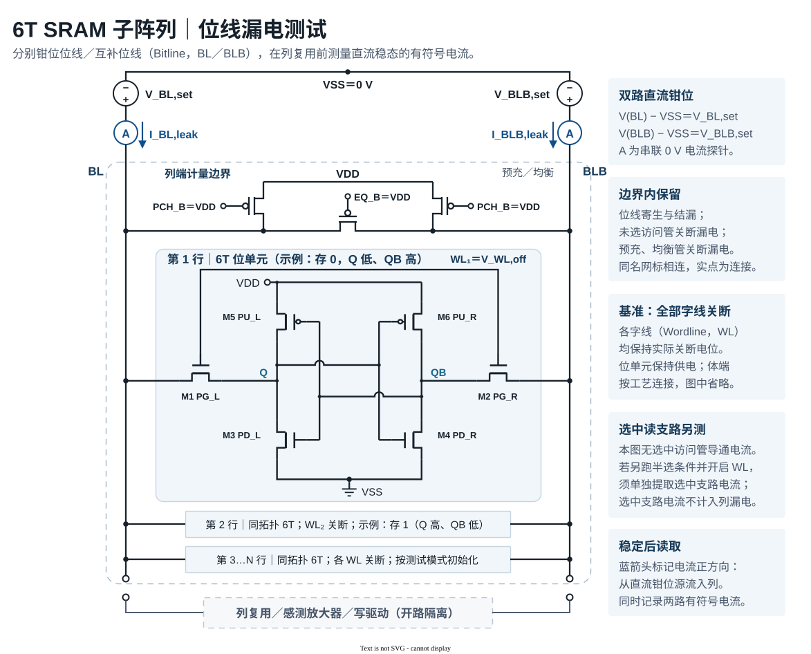

# BL Leakage

## 定义与适用范围

**位线漏电流**（Bitline Leakage Current）是子阵列在规定的数据、偏置及开关状态下，为维持一列位线（Bitline，BL）及互补位线（BLB）的端电位所需的稳态有符号电流。本文以差分 6T 静态随机存取存储器（Static Random Access Memory，SRAM）为例，在列选择器前的本地列端分别观察 $I_{\mathrm{BL,leak}}$ 和 $I_{\mathrm{BLB,leak}}$，单位 A/列（A/column）。两路钳位源的返回端接测试参考 VSS；电流从各自钳位源流入列为正，从列回流到源为负。须记录钳位电位相对该 VSS 的值，以及各访问管处的实际局部偏置。

令 $I_{\mathrm{CM}}=(I_{\mathrm{BL,leak}}+I_{\mathrm{BLB,leak}})/2$，$\Delta I=I_{\mathrm{BL,leak}}-I_{\mathrm{BLB,leak}}$。两量分别表征每侧平均净吸取电流和固定 BL 减 BLB 极性的电流失衡；同时保留两侧原值。钳位电流包含该边界内未选位单元从位线侧吸取或回灌的电流，以及仍与列线相连的关断外围支路电流。选中支路的 [Read Current](../Bitcell/Read_Current.md)、电源端的 [Standby Leakage](../Bitcell/Standby_Leakage.md) 和规定偏置下的单器件 [Ioff](../Device/Ioff.md) 须独立报告。[1, Secs. III–IV, Figs. 2–4] [2, Sec. III-A, Figs. 5–7] [7, Sec. III-D]

## 物理机制与变异

在两侧位线均为高电位、同列字线（Wordline，WL）均为关断电平时，低电位存储节点侧的关断访问管（Pass-Gate，PG）通常会从对应位线吸取更大的电流；相反数据会交换这一路径。列端电流为实际连接的支路有符号和，包含模型启用的亚阈值电流、结漏电及其他端口漏电。全 0、全 1、棋盘格和地址相关背景下应分别核对两侧符号；混合图样下的接近相抵，以及列越长漏电越大，都须在实际沿线电位和数据分布下验证。低供电压差时须同时核对最低选中读电流与列漏电尾部。[1, Secs. III–IV, Figs. 3–4] [3, Sec. 3.4, Fig. 11] [5, Sec. III-D, Eq. (19)] [7, Sec. III-D] [13, Sec. III, Eq. (14)]

在读访问中，以选中位单元的低存储节点侧为 $\ell$、预期保持较高位线电位的一侧为 $h$：读 $Q=0$ 时 $\ell=\mathrm{BL}$，读 $Q=1$ 时 $\ell=\mathrm{BLB}$。同列未选位单元对 $h$ 侧吸取的电流会压低高侧；若向 $\ell$ 侧回灌，也会削弱正确差分 $V_h-V_\ell$。两侧等量吸取电流仍可降低输入共模；负载或耦合不对称时还会改变差分。对单端 8T／10T 独立读口，须重新定义读位线及参考路径；其关断支路和漏电抑制方式见 [17, Secs. II-C, III, Figs. 4, 6] [18, Sec. II-D, Figs. 7–9]。[6, Sec. 2.4, Fig. 1] [9, Sec. IV, Figs. 9–11] [11, Apps. A, C, Eqs. (38)–(41), (47)–(50)] [12, Sec. 2.2, Eq. (1)]

**负位线辅助（Negative Bitline，NBL）工况**：写入时，低位线可能降至局部 $V_{\mathrm{SS}}$ 以下。即使未选 WL 维持低电平，位线侧端电位下降也可抬高 NMOS 的有效栅源电压；当未选 PG 发生明显导通时，存储高节点可经 PG 向负位线回灌，此时该侧按本文方向记负。须分别保存局部 BL、WL、存储节点和体端电位，按模型的端子定义及偏置范围检查 PG 工作区；对带 PN 结的 NMOS，还须核对体端与扩散端电位；当 BL 侧扩散端低于其 p 型体端时，该结偏置方向为正向，实际结电流按模型与偏置确定。WL 低电平不能单独证明 PG 关断或 PN 结反偏。文献的负压回灌结论来自 2 nm 纳米片阵列的写辅助仿真。[2, Sec. III, Figs. 5–6] [15, Sec. 8.3.1, Figs. 8.6–8.7]

## 列端边界与电流分解

| 工况／配置 | 列端包含的支路 | 报告量 |
| --- | --- | --- |
| 全部 WL 关断；预充和均衡关断；列选择前双路钳位 | 同列全部未选位单元、互连，以及测量边界内仍连接的关断外围支路 | 两侧原始稳态电流；若做基线校准，另报估计的位单元侧分量。 |
| 空列对照 | 去除被测位单元对 BL／BLB 的支路，保留等效列线、测量通路及同连接、同端压与同控制的外围 | 通路／外围基线；注明匹配差异。预充／均衡未物理断开时，其关态漏电仍在列端；列复用器（Multiplexer，MUX）保留并关断时，须注明其列侧器件、公共节点和后级感测放大器（Sense Amplifier，SA）／写驱动是保留还是物理隔离。 |
| 读访问或半选对照 | 保留实际预充释放、列选、SA 负载、邻线和 WL 刺激；标出每个实际选通的 PG | 分开保存未选支路、选通支路、外围导电电流及电压波形；PG 被选通或意外导通的工况须独立标注。 |

若以 $\mathbf I_{\mathrm{raw}}$ 和 $\mathbf I_{\mathrm{base}}$ 表示同一规定边界下的实列和空列两路稳态有符号电流，则估计位单元侧分量为 $\mathbf I_{\mathrm{cell}}\approx\mathbf I_{\mathrm{raw}}-\mathbf I_{\mathrm{base}}$。应按两侧独立扣除；基线须覆盖相同钳位电位、工艺、电压及温度（Process, Voltage and Temperature，PVT）、仪器通路、外围端压与控制。若删去位单元后使外围或局部列线工作点明显改变，须说明不匹配误差；仿真优先记录原电路中各支路的贡献。[3, Fig. 11] [14, Sec. 5.2.2]

对两条可用集中节点表示的位线，在浮置或外部有驱动的瞬态窗口，基尔霍夫电流定律（Kirchhoff's Current Law，KCL）为

$$
\mathbf I_{\mathrm{src}}=\mathbf J+\frac{\mathrm{d}\mathbf q}{\mathrm{d}t},\qquad
\mathbf J=\mathbf J_{\mathrm{uns}}+\mathbf J_{\mathrm{sel}}+\mathbf J_{\mathrm{peri}} .
$$

$\mathbf I_{\mathrm{src}}$ 是外部注入位线的电流（A，流入节点为正），$\mathbf J$ 是流出位线进入未选位单元、受控选通支路和外围的净导电电流（A，回灌取负）。NBL 工况中的 $\mathbf J_{\mathrm{uns}}$ 亦含未选 PG 意外导通的电流，须将其与仍关断支路的漏电分别报告。$\mathbf q$ 为两侧节点电荷（C）；从模型端口提取导电电流时，电荷变化项仅计一次。钳位稳态有 $\mathrm{d}\mathbf q/\mathrm{d}t=0$；释放钳位且无外部注入时有 $\mathbf I_{\mathrm{src}}=0$。若每侧可用近似恒定的对参考电容 $C_\ell,C_h$（F）表示，且互耦与变化的邻线电位可忽略，则浮置时

$$
\frac{\mathrm{d}(V_h-V_\ell)}{\mathrm{d}t}\approx \frac{J_\ell}{C_\ell}-\frac{J_h}{C_h},
\qquad
\frac{\mathrm{d}[(V_h+V_\ell)/2]}{\mathrm{d}t}\approx
-\frac12\left(\frac{J_\ell}{C_\ell}+\frac{J_h}{C_h}\right).
$$

两侧等容时，正确差分由 $J_\ell-J_h$ 决定，读 $Q=0/1$ 时未选支路分别取 BL 减 BLB／BLB 减 BL；须保留选通支路两侧电流。耦合不可忽略时，用含 BL／BLB 和活动邻节点的电荷或电容矩阵；沿线电压不能视为相同的列，须用 [列网络](BL_RC.md#测量与提取方法) 逐节点核算。预充重新接通、列选与 WL 跳变、SA 回冲期间的端口电流还含充放电及电荷耦合，须保留波形并分账。[1, Sec. III, Eqs. (7)–(8)] [6, Sec. 2.4, Fig. 1] [13, Sec. III, Eq. (14)]

## 测量与提取方法

### 仿真提取

图示全 WL 关断的实列测量配置：两只 0 V 电流探针分别串在钳位源与列端之间，两路钳位共用 VSS（示例为 0 V）。关断预充、均衡仍与列端相连，后级 MUX／SA／写驱动在图示边界外。空列对照按边界表移除位单元支路；完整外围或真实半选对照按实际接线另跑。

**【前置条件】** 使用寄生参数提取（Parasitic Extraction，PEX）网表，保留实际列高、抽头位置、互连和拟纳入边界的外围。记录 PVT、体端接法、局部 VDD／VSS、WL 低电平、初始数据、偏置和开关状态。检查模型和求解器的低电流有效范围。

**【步骤／方法】**

1. **写入并保持数据**：写入全 0、全 1、棋盘格、反相棋盘格及应用图样，覆盖读 0／读 1 对应的不利背景；关闭写驱动、全部 WL、预充及均衡，再启用双路钳位。对多段列保存近／中／远抽头电位。初始化完成后释放存储节点上的强制源并检查 $Q$/QB。
2. **提取稳态端口电流**：用同参考节点的两路钳位，在预充电位及实际读写覆盖的端压范围分别设置 BL／BLB，保存两个钳位源的探针端口顺序。只在数据保持且两路电流和节点电压在指定窗口内均收敛时取值；保存实际端压和电流极性。扫 PVT、WL 低电平、列高、图样和失配；按边界表同步取得空列基线、原电路支路电流。写辅助负压、半选条件及有效 WL 的情况另跑并用独立标签交付。
3. **提取浮置波形与读对照**：以相同初值预充，关闭预充、均衡及钳位，记录两侧电位与邻线、列选、WL；避开开关边沿，在指定窗口内求漂移及其平均电流。仅在集中电容及弱耦合近似有效、状态固定且无其他外部注入时，有 $J_k\approx-C_k\,\mathrm{d}V_k/\mathrm{d}t$，$k$ 代表 BL 或 BLB；所得为该窗口总净导电电流。实际读对照须保留真实列选及未再生的 SA 负载，保存选通 PG 与其余支路，按同窗局部电压核对 KCL 和感放输入差分。全 WL 关断时的漂移用于定位，实际读波形改变偏置时应按其局部偏置重算漏电。[2, Sec. III-A–B, Figs. 5–8] [9, Sec. IV, Figs. 9–11]

**注意事项**：禁止用瞬态开关电流或大信号平均漂移替代钳位稳态值（两者的电荷项、窗口和偏置不同）。

**【结果处理和验证】** 记录原始和扣除后两路电流、基线、稳态窗口、偏置与图样；比较列端与支路求和的 KCL 残差，并用更小的泄漏相关求解器容限或独立方法复核低电流结果。按设计预先规定的电流稳定容限、KCL 残差上限和数据保持条件判断提取有效性；失稳、翻转、超出求解或模型范围的样本单列。按同窗电荷与电压核对浮置结果，偏差超过误差预算时须回查耦合、分布 RC 和关断顺序。

### 硅片测试

**【前置条件】** 确认专用列焊盘或已表征的低漏电模拟复用路径可独立钳位 BL／BLB，或片上采样能读出预充释放后的电位。固定芯片、列地址、参考 VSS、数据与温度；记录相对功能列的负载及连接差异。

**【步骤／方法】**

1. **直接测电流**：用两路源测量单元（Source Measure Unit，SMU）以同一参考钳位 BL／BLB，先校零、验证力线端压及量程底噪，再用同温、同偏置、同开关状态的空列或匹配结构分别测两侧基线。写入目标图样并释放写驱动，关闭 WL、预充及均衡，待端压和电流稳定后成对读取。按实际电气边界区分测量通路与列外围基线，禁止重复扣除。
2. **采样位线漂移**：在原位预充后释放位线，用校准的片上采样器或感放参考电压扫描重建窗口两侧电位。核对采样负载、反冲、时间及电压精度，记录预充初始差分和采样共模。Chen 等在 40 nm 功能 SRAM 上给出了用参考扫描提取漏电压降的电路和图样；其图 10 的电流及压降趋势为仿真。只有窗口内连接和数据固定、外部及采样注入可忽略且电荷模型已校准时，才用节点电荷的起止差（起始减结束）除以窗口长度反推平均净导电电流；互耦显著时须纳入两侧位线和活动邻线的耦合电荷，并保留电压原值。[9, Sec. IV, Figs. 9–11]
3. **运行功能对照**：在感测窗口、温度和列地址相同时改变背景，分别验证读 0／读 1 响应。Patel 等提出不利背景的数据图样，并用模型对比列长与失效率；其硅片测试报告了感放所需的差分等量，未给出独立钳位的整列漏电。[1, Sec. III–V, Figs. 3–4, 10]

**注意事项**：基线残差或仪器不确定度覆盖待测差值时，须报告检测限、有符号不确定区间或未检出（避免把通路偏移当成列漏电）。

**【结果处理和验证】** 报告各侧电流和差分的不确定度，核对温稳、两路同步性、电流极性和回读数据。直接量测、漂移反推及功能代理分别交付；无独立列电压／电容标定时仅交付电压或功能结果。对同一结构、同一连接，在匹配的局部偏置下比对直接量测与浮置反推结果；漂移较大时沿实测偏置轨迹对钳位电流扫描结果取窗口平均，按误差预算检查一致性。

## 数据可视化与评估

| 图表 | 工程判读 |
| --- | --- |
| 两侧电流、$I_{\mathrm{CM}}$ 和 $\Delta I$ 对端压、温度、列高、WL 低电平和背景的扫描图 | 标出测试边界、基线校准、正负号和误差范围。分别检查净吸取与回灌尾部，定位关断外围贡献；用同列成对数据计算差分。 |
| 预充释放至采样的两侧波形、正确极性差分、共模与同窗净电流 | 对照无选通、实际读和半选；标记 WL、预充、列选及采样时刻，分别计算漂移、读差分和再生前共模裕量。用 [SA Decision Threshold](../Peripherial/SA_Decision_Threshold.md) 校准判定门槛。 |
| 按背景、极性、PVT 和列高分层的经验累积分布或分位数 | 保留列／片／感放标识、样本数、未检出与失效样本。尾部按共享列及 SA 分层，分别报告不利极性的单侧分位数与置信区间。 |

有设计预算时，按同偏置、同背景比对有害差分、共模和动态读裕量。可用电流裕量只在等容、弱耦合的近似下按同窗净差值判断，最终以感放实际输入和有效窗口验证。[1, Secs. III, V, Figs. 2, 10] [11, Secs. II–III] [13, Secs. III–IV] 读扰动与数据保持参见 [RSNM](../Bitcell/RSNM.md#数据分析与评价方法)；读访问失效概率应根据实际感放与时序另行估计。

**算例**：设读 $Q=0$，两侧等效电容各为 100 fF，浮置时总净导电电流 $J_{\mathrm{BL}}=4$ μA、$J_{\mathrm{BLB}}=1$ μA，且在计算窗口内近似恒定，则正确差分增长约 30 mV/ns，共模下降约 25 mV/ns。BLB 的吸取电流每增加 1 μA，正确差分增长率减小 10 mV/ns。

## 应用场景与指标关系

- **列高、预充保持与低供电读**：在最长列及不利背景下核对预充释放至采样的差分和共模；结合 [BL RC](BL_RC.md)、[Read Develop Time](Read_Develop_Time.md) 与感放门槛定位受限环节。比较列划分、预充电平或复用比后须复测功能读结果。[5, Sec. III-D, Eq. (19)] [7, Sec. III-D] [9, Sec. IV] [13, Sec. III, Eq. (14)]
- **读写半选与辅助偏置**：按实际 WL、列选及位线电位区分未选 PG 漏电、导通回灌和耦合。负位线辅助须同时检查目标位低电位到达时间，以及同列未选位能否保持原状态。[2, Sec. III-A, Figs. 5–7]
- **设计与工艺协同优化**（Design-Technology Co-Optimization，DTCO）：分别为位线漏电、共模漂移与感测差分设预算；配合器件 $I_{\mathrm{off}}$ 和电源端待机漏电解释材料、尺寸或体偏置变更后的变化来源。

## 参考文献

2026-11-17 核查 Zotero `02-SRAM-DTCO/SRAM-Metrics/Subarray`（`L9CVSGRT`）：精确标签 `BL Leakage` 原有 14 条，审阅补检后 18 条。保留原编号和归档，核验 11 篇独立期刊或会议研究 [1]–[3]、[5]–[7]、[9]、[11]、[13]、[17]–[18]，用于漏电路径、读写对照、模拟测试或统计方法；[4] 与 [5] 的重叠结果只计一次，[12] 的漏电公式引用 [6]，仅作应用参考。

[1] D. Patel, D. Wright, and M. Sachdev, “Sense amplifier offset characterisation and test implications for low-voltage SRAMs in 65 nm,” in Proc. IEEE European Test Symp., 2018, author manuscript. [DOI 10.1109/ETS.2018.8400696](https://doi.org/10.1109/ETS.2018.8400696). [公开文献](https://doi.org/10.1109/ETS.2018.8400696)；[Zotero](https://www.zotero.org/users/7333024/items/FHKBDBC9)。

**相关摘要：** 论文结合65 nm感放仿真和测量分析低电压SRAM边缘故障，分别考虑感放失调、单元导通能力与未选单元漏电。读取时不利背景可使另一根位线也放电，减少感放差分并暴露原本难以触发的失败。模型将差分形成与感放偏移分开，说明相同读电流并不保证相同可测故障概率。不利背景产生的漏电会放掉原本应保持高电平的位线，使可用差分下降。测试须分别注明背景、列深和位线偏置；该列漏电用于解释感测失败，不能与整个存储器供电端静态电流混用。

**原文定位：** §II–III，作者稿 PDF 第 2–3 页，式 (1)、(7)–(8)，图 2–3；§IV-A 图 4 为导通／漏电流比仿真，§V 图 10 为失效率预测。旧定位 [1, Sec. II–III, Figs. 2–4]、[1, Sec. III, Figs. 3–4] 的图 4 均位于 §IV-A；[1, Sec. II, V, Figs. 2, 10] 的图 2 位于 §III。

[2] H.-H. Liu et al., “Extended methodology to determine SRAM write margin in resistance-dominated technology node,” IEEE Trans. Electron Devices, 2022, author manuscript. [DOI 10.1109/TED.2022.3165738](https://doi.org/10.1109/TED.2022.3165738). [公开文献](https://doi.org/10.1109/TED.2022.3165738)；[Zotero](https://www.zotero.org/users/7333024/items/9HKACZ7P)。

**相关摘要：** 论文指出先进节点的位线电阻、电容与半选单元访问管漏电会损害负位线辅助写入。位线在有限时间内未充分放电时，静态写裕量可能高估实际可写性；负压加深还会意外开启未选访问管。作者扩展瞬态写裕量方法，使驱动波形、寄生及辅助偏置一起进入判断，不能只用理想固定低电平代表真实位线。此处漏电来自写辅助偏置下被意外开启的未选访问管，可能向负位线回灌电流。其条件不同于正常读出或保持，提取时应保留电流方向和辅助电平；加深负压不能被简单视为无代价的加速。

**原文定位：** §II–III，作者稿 PDF 第 2–3 页，图 2–7；§III-A 图 6 为 256 位列分八组的 PG 源漏电流仿真，图 7 为写裕量。

[3] F. Duan, R. Castagnetti, R. Venkatraman, O. Kobozeva, and S. Ramesh, “Design and use of memory-specific test structures to ensure SRAM yield and manufacturability,” in Fourth International Symposium on Quality Electronic Design, 2003. Proceedings., 2003, pp. 119-124. [公开文献](https://doi.org/10.1109/ISQED.2003.1194719)；[DOI](https://doi.org/10.1109/ISQED.2003.1194719)；[Zotero](https://www.zotero.org/users/7333024/items/H85PIUTS)

**相关摘要：** 论文用保持SRAM局部版图环境的测试阵列检查可制造性，测量金属桥接、栅间桥接以及访问管漏电。大批重复单元可暴露普通过程监控结构遗漏的漏电尾部，版图调整后再验证改善。这里的桥接电流和工艺偏置测试不等同于正常功能列的未选单元漏电；引用时必须标注测试结构、归一化单元数及具体漏电路径。此条对本指标仅作测试方法与缺陷识别的间接支撑，尤其要区分桥接短路尾部与正常晶体管关断漏电。原文按大量重复结构及单元数归一化，不能直接换算成一根功能位线的正常漏电规格。

**原文定位：** §3.4，p.124（PDF 第 6 页），图 11：访问管结、栅和沟道漏电测试结构；早先的图 4–6 对应桥接缺陷。

[4] S. Mukhopadhyay, H. Mahmoodi, and K. Roy, “Statistical design and optimization of SRAM cell for yield enhancement,” in IEEE/ACM International Conference on Computer Aided Design, 2004. ICCAD-2004., 2004, pp. 10-13. [公开文献](https://doi.org/10.1109/ICCAD.2004.1382534)；[DOI](https://doi.org/10.1109/ICCAD.2004.1382534)；[Zotero](https://www.zotero.org/users/7333024/items/GDX5LJIK)

**相关摘要：** 论文将参数变异引起的读扰、写入、访问时间和保持失效分别建模，再合并为阵列良率。写入时访问管与上拉管竞争，内部节点由净电流放电；读取时选中单元驱动位线负载，同列未选单元漏电会削弱有效差分。器件仿真与阈值统计模型用于分析尺寸、面积、漏电与失效概率的折衷。读取模型扣除不利未选单元漏电，随列深增加可能抵消选中单元驱动。本页应使用该读路径电流而非文中另列的单元总漏电，后者还包含栅和结漏电并服务于待机功耗估算。

**原文定位：** §3.4，pp.11–12（PDF 第 2–3 页），式 (11)。

[5] S. Mukhopadhyay, H. Mahmoodi, and K. Roy, “Modeling of failure probability and statistical design of SRAM array for yield enhancement in nanoscaled CMOS,” IEEE Transactions on Computer-Aided Design of Integrated Circuits and Systems, vol. 24, no. 12, pp. 1859-1880, 2005. [公开文献](https://doi.org/10.1109/TCAD.2005.852295)；[DOI](https://doi.org/10.1109/TCAD.2005.852295)；[Zotero](https://www.zotero.org/users/7333024/items/P33WUEER)

**相关摘要：** 论文建立纳米SRAM读、写、访问与保持失效模型，结合阵列规模、冗余和相关性估计良率。写入用访问管与上拉管净电流给内部节点放电，读取则由有效列电流驱动位线负载；同列漏电与参数分布尾部进入时序分析。该研究用于统计尺寸优化，模型预测应与芯片实测区分，不能将不同失效模式合并为单一延迟。访问失败模型中的未选单元漏电用于计算有效差分建立，而全单元漏电用于功耗优化，两者边界不同。引用本指标需注明列深和数据背景，并同时检查选中读电流；仅给总漏电下降不能证明感测裕量改善。

**原文定位：** §II-B–C、§III-D，pp.1861–1862、1865–1866（PDF 第 3–4、7–8 页），图 7(a)、式 (19)。

[6] M. H. Abu-Rahma, K. Chowdhury, J. Wang, Z. Q. Chen, S. S. Yoon, and M. Anis, “A methodology for statistical estimation of read access yield in SRAMs,” in Proceedings of the 45th Annual Design Automation Conference, 2008, pp. 205-210. [公开文献](https://doi.org/10.1145/1391469.1391522)；[DOI](https://doi.org/10.1145/1391469.1391522)；[Zotero](https://www.zotero.org/users/7333024/items/2WRYLJJM)

**相关摘要：** 研究用读电流、感放失调和感测窗口的统计分布估计读访问良率，并以45 nm存储器数据验证趋势。列复用电阻使感测线响应落后于原始位线，未选单元漏电削弱差分；延长字线窗口虽增加信号，也增加再充电开销。各误差来源须联合评估，不能由单元静态指标或平均读取电流独立推算阵列失效率。统计读模型说明未选单元漏电会减少感放可见差分，列复用又影响信号传播。漏电引起的信号损失应与复用电阻及感放失调分开建模，不能用同一访问失败概率反推出唯一的列漏电数值。

**原文定位：** §2.4，p.207（PDF 第 3 页），图 1：复用延迟和对侧未选位单元漏电；§3 比对读良率。

[7] T. S. Doorn, E. J. W. Ter Maten, J. A. Croon, A. Di Bucchianico, and O. Wittich, “Importance sampling monte carlo simulations for accurate estimation of SRAM yield,” in ESSCIRC 2008 - 34th European Solid-State Circuits Conference, 2008, pp. 230-233. [公开文献](https://doi.org/10.1109/ESSCIRC.2008.4681834)；[DOI](https://doi.org/10.1109/ESSCIRC.2008.4681834)；[Zotero](https://www.zotero.org/users/7333024/items/SLU75CBK)

**相关摘要：** 论文明确区分总单元漏电与位线漏电：前者决定保持功耗，可按大量单元平均电流估计；后者来自被访问列的未选单元，会与选中单元读电流竞争。最不利背景使漏电放掉本应保持高电平的一侧，当其总量接近最弱读电流时就可能无法感测。统计方法用于小概率尾部，不能以全阵列平均漏电代表最坏列。本页应提取每列未选单元漏电之和，并明确数据背景和读位线偏置。总保持漏电除以位数不能代替该列电流，平均列也不能代表最不利尾部；同时需记录它削弱的是哪一侧有效差分。

**原文定位：** §III-D，p.233（PDF第4页）。

[8] Z. Guo, “Large-scale variability characterization and robust design techniques for nanoscale SRAM,” Doctoral dissertation, EECS Department, University of California, Berkeley, 2009. [公开文献](https://www2.eecs.berkeley.edu/Pubs/TechRpts/2009/EECS-2009-190.html)；[原文]( <http://www2.eecs.berkeley.edu/Pubs/TechRpts/2009/EECS-2009-190.html>)；[Zotero](https://www.zotero.org/users/7333024/items/A56QIF3W)；DOI：Zotero未收录或尚未核实。

**相关摘要：** 论文分析独立栅反馈单元的稳定性与速度折衷：反馈削弱访问管以改善读稳定性，也改变读电流和字线负载。列级模型分别累加两根位线的数据相关漏电；特定背栅偏置会在位线降低后使未选访问管重新导通，阻止全摆幅放电。因此需在感放所需的小差分区间评价速度，不能用最终电平替代感测建立过程。两根位线的漏电符号和大小随存储背景及背栅偏置变化，某一侧可能向正在放电的位线补充电流。列模型须保留方向而非只报绝对总和，特别不能将独立栅结构的供电漏电当作普通六管列漏电。

**原文定位：** §5.3.4，书内 pp.172–174（PDF 第 197–199 页），图 5.12，独立栅访问管反馈（PGFB）6T 仿真。

[9] Y. H. Chen et al., “Compact measurement schemes for bit-line swing, sense amplifier offset voltage, and word-line pulse width to characterize sensing tolerance margin in a 40 nm fully functional embedded SRAM,” IEEE Journal of Solid-State Circuits, vol. 47, no. 4, pp. 969-980, 2012. [公开文献](https://doi.org/10.1109/JSSC.2012.2185180)；[DOI](https://doi.org/10.1109/JSSC.2012.2185180)；[Zotero](https://www.zotero.org/users/7333024/items/RJ8M4HFH)

**相关摘要：** 论文在40 nm功能性SRAM中用外部直流参考与片上感放比较，间接测量真实访问时序下的位线摆幅。测量处理感放失调后，扫描参考寻找输出翻转点；改变背景数据可分离漏电导致的位线压降。方案同时测量字线脉宽，便于把不足的感测裕量归因于单元驱动、漏电、感放或控制时序。第 IV 节提出漏电所致位线压降的提取法，其图 10 给出随背景数据、列长度和脉宽变化的仿真趋势。若换算电流，必须使用对应电容与观察窗口，并注明瞬态平均性质，不能把电压降直接报告为每列静态漏电。

**原文定位：** §IV，pp.972–973（PDF 第 4–5 页），图 9–11；图 12 在 §V，对应字线脉宽测量。

[10] M. H. Abu-Rahma, and M. Anis, “Nanometer variation-tolerant SRAM: circuits and statistical design for yield,” New York, NY, Springer New York, 2013. [公开文献](https://doi.org/10.1007/978-1-4614-1749-1)；[DOI](https://doi.org/10.1007/978-1-4614-1749-1)；[Zotero](https://www.zotero.org/users/7333024/items/RA2TPQV2)

**相关摘要：** 本书把动态读写窗口与良率、功耗联合讨论。写入有限脉冲需覆盖非线性状态翻转，静态裕量不能代替时间；读取须在感放开启前形成足够差分，并考虑列复用、单元电流和漏电。第4章分离阵列、外围开关功耗与保持漏电，说明延长字线可提高感测裕量，也增加位线摆幅和恢复开销。本书把列漏电纳入读取良率，强调它与读电流、位线电容及感测窗口共同作用。第4章总保持功耗还含外围和电源路径，不能直接转换为列漏电；需按读偏置和不利背景单独抽取电流。

**原文定位：** §4.3；§5.4.4，书内 pp.139–140（PDF 第 146–147 页），式 (5.13)、图 5.18。

[11] Heechai Kang, Jisu Kim, Hanwool Jeong, Young Hwi Yang, and Seong-Ook Jung, “Architecture-aware analytical yield model for read access in static random access memory,” IEEE Transactions on Very Large Scale Integration (VLSI) Systems, vol. 23, no. 4, pp. 752-765, 2015. [公开文献](https://doi.org/10.1109/TVLSI.2014.2321897)；[DOI](https://doi.org/10.1109/TVLSI.2014.2321897)；[Zotero](https://www.zotero.org/users/7333024/items/Q8SUR7UC)

**相关摘要：** 论文指出多个单元共享感放与感测时序，读失败概率具有架构相关性。模型分别描述选中单元形成的差分和列漏电，再与感放失调、采样窗口结合；阵列划分与冗余也会改变良率。部分器件及列参数来自既有研究，解析估计和SPICE验证应区别于该工作自身实测，不能把所有位失败都当作独立事件。模型分离单元形成的差分与漏电形成的差分损失，并考虑共享感放带来的相关失败。若需安培／列，应回到所用偏置与电容模型，不能把差分电压分布或全阵列失败率直接写成静态漏电统计。

**原文定位：** §II–III，PDF 第 2–5 页，图 1–3；附录 A、C，PDF 第 12–13 页，式 (38)–(41)、(47)–(50)。

[12] D. Skurikhin, and A. Korshunov, “Read access optimization for enhancement of SRAM yield-reliability trade-off,” in 2017 IEEE East-west Design & Test Symposium (EWDTS), 2017, pp. 1-4. [公开文献](https://doi.org/10.1109/EWDTS.2017.8110100)；[DOI](https://doi.org/10.1109/EWDTS.2017.8110100)；[Zotero](https://www.zotero.org/users/7333024/items/ANNVMSD6)

**相关摘要：** 论文从时钟、字线、差分到感放使能的关系讨论读访问优化，以足够输入信号覆盖失调作为成功条件。所选单元读电流需扣除同列未选单元造成的不利漏电，背景数据和列深均会改变有效电流；可编程延迟链用于调整采样。其优化面向良率与可靠性折衷，局部信号形成、控制链和最终输出时间需要分开解释。其有效读电流公式扣除同列未选单元的关断电流，不利背景决定抵消方向。它支持按列深和数据模式评估读失败风险，但没有把电源总待机漏电当作该差分电流，引用应保持这一边界。

**原文定位：** §2.2，PDF 第 2 页，图 2、式 (1)。

[13] S. Gupta, and B. H. Calhoun, “Dynamic read VMIN and yield estimation for nanoscale SRAMs,” IEEE Transactions on Circuits and Systems I: Regular Papers, vol. 68, no. 3, pp. 1171-1182, 2021. [公开文献](https://doi.org/10.1109/TCSI.2020.3044836)；[DOI](https://doi.org/10.1109/TCSI.2020.3044836)；[Zotero](https://www.zotero.org/users/7333024/items/CJ93JPNL)

**相关摘要：** 研究把动态读失败表达为给定窗口内位线差分不足以克服感放失调。模型结合读电流、行数决定的位线电容、列数相关的字线上升时间及控制脉冲变异，并考虑未选单元漏电和低电压非高斯尾部。阵列良率同时受数据通路与时序通路影响，不能仅由平均读电流或静态读稳定性推断。式(14)把有效读电流写成选中单元电流减同列未选访问管漏电之和。该电流对应给定背景与偏置的差分损失，不能等同电源端保持电流；统计提取还需保留漏电分布及其低电压敏感性。

**原文定位：** §III，p.1174（PDF 第 4 页），式 (14)–(16)、图 5。

[14] 刘蕊, “SRAM存储单元阵列阈值电压偏差检测,” 硕士学位论文, 浙江大学, 杭州, 2024. [公开文献](https://doi.org/10.27461/d.cnki.gzjdx.2024.000924)；[DOI](https://doi.org/10.27461/d.cnki.gzjdx.2024.000924)；[Zotero](https://www.zotero.org/users/7333024/items/L3E3LX3U)

**相关摘要：** 论文以电流比较间接提取阵列晶体管阈值，指出亚阈值附近的测试电流容易受位线漏电影响。测量前先关闭全部字线，把目标列接入判定电路并扫描参考，得到该偏置下的背景漏电，再在正式测量的参考电流中抵消。方法保留正常阵列结构，区分静态压降补偿与漏电补偿；补偿符号和大小随被测器件模式而变。本页可采用其全部字线关闭时的背景电流测量步骤，但电流属于测试所设位线电压。扣除方法用于阈值提取，不能不加说明当作实际读操作漏电；应保留比较器参考、模式和电流方向。

**原文定位：** §5.2.2，书内p.59（PDF第72页）。

[15] H. H. Liu, and F. Catthoor, “Circuit-technology Co-optimization of SRAM design in advanced CMOS nodes,” Cham, Springer Nature Switzerland, 2025. [公开文献](https://doi.org/10.1007/978-3-031-76109-6)；[DOI](https://doi.org/10.1007/978-3-031-76109-6)；[Zotero](https://www.zotero.org/users/7333024/items/CHVFC3IE)

**相关摘要：** 本书贯通单元、子阵列和宏级仿真。局部指标由含寄生和外围的电路得到，宏模型再加入树形互连、控制驱动及核心至数据通路；两级统计边界不可混用。先进节点的单元缩小未必等比例改善访问性能，线阻、电容和写辅助代价可能抵消收益。宏级比较采用明确容量、树形结构、引脚位置及工艺条件，并讨论写入可行性的约束。第8章讨论负位线或提升字线过强时非目标访问管导通，反而拖慢写入甚至造成失败。这里是辅助偏置下的位线漏电，应与正常保持及读取偏置分开；单元电源漏电章节的数值不能直接挪用。

**原文定位：** §8.3.1，书内 p.197 起（PDF 第 204 页起），图 8.6–8.7。

[16] S. Shen et al., “OpenYield: An Open-Source SRAM Yield Analysis and Optimization Benchmark Suite,” arXiv:2508.04106v2, 2025. [公开文献](https://doi.org/10.48550/arXiv.2508.04106)；[DOI](https://doi.org/10.48550/arXiv.2508.04106)；[Zotero](https://www.zotero.org/users/7333024/items/Z4REBP9X)

**相关摘要：** OpenYield生成包含单元、译码、字线驱动、列复用、预充电、写驱动和感放的SRAM层级。位线与字线采用分布式π形寄生网络，考虑未选单元漏电和外围变异。示例使用FreePDK45与统计SPICE仿真；电源网压降、老化和空间相关变异并非默认模型，结论应限定于实际启用的效应。框架直接比较同列闲置单元存零或存一时的读延迟，反映漏电耦合的数据依赖。该结果证明漏电影响而不直接提供通用安培／列数值，若提取电流需固定两根位线电压及全部未选字线偏置。

**原文定位：** §III-A、§IV-B(2)，PDF 第 4、6 页，图 7；同一 FreePDK45 测试阵列的背景数据读延时对照。

[17] N. Verma and A. P. Chandrakasan, “A 256 kb 65 nm 8T subthreshold SRAM employing sense-amplifier redundancy,” IEEE Journal of Solid-State Circuits, vol. 43, no. 1, pp. 141–149, 2008. [公开文献](https://doi.org/10.1109/JSSC.2007.908005)；[DOI](https://doi.org/10.1109/JSSC.2007.908005)；[Zotero](https://www.zotero.org/users/7333024/items/94NS3U8F)。

**相关摘要：** 对照 6T 差分读与 8T 单端读，分析未选支路形成的读位线漏电和潜在误判；通过控制未选位单元读缓冲器的低端电位抑制漏电。读口和参考电位须按实际拓扑定义，文中未报告本文定义的双侧静态电流。

**原文定位：** §II-C、§III-A，pp.142–143（PDF 第 2–3 页），图 4、6。

[18] T.-H. Kim, J. Liu, J. Keane, and C. H. Kim, “A 0.2 V, 480 kb subthreshold SRAM with 1 k cells per bitline for ultra-low-voltage computing,” IEEE Journal of Solid-State Circuits, vol. 43, no. 2, pp. 518–529, 2008. [公开文献](https://doi.org/10.1109/JSSC.2007.914328)；[DOI](https://doi.org/10.1109/JSSC.2007.914328)；[Zotero](https://www.zotero.org/users/7333024/items/QRLTXRPI)。

**相关摘要：** 比较 10T 独立读口在不同数据依赖条件下的漏电方向和读位线摆幅。某些未选通读缓冲支路会向读位线回灌；论文用仿真比较结构，130 nm 样片验证的是这种拓扑的 SRAM 功能与低压能力。

**原文定位：** §II-D，pp.522–523（PDF 第 5–6 页），图 7–9。
