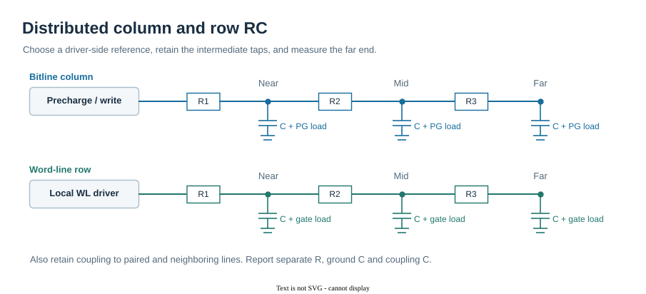
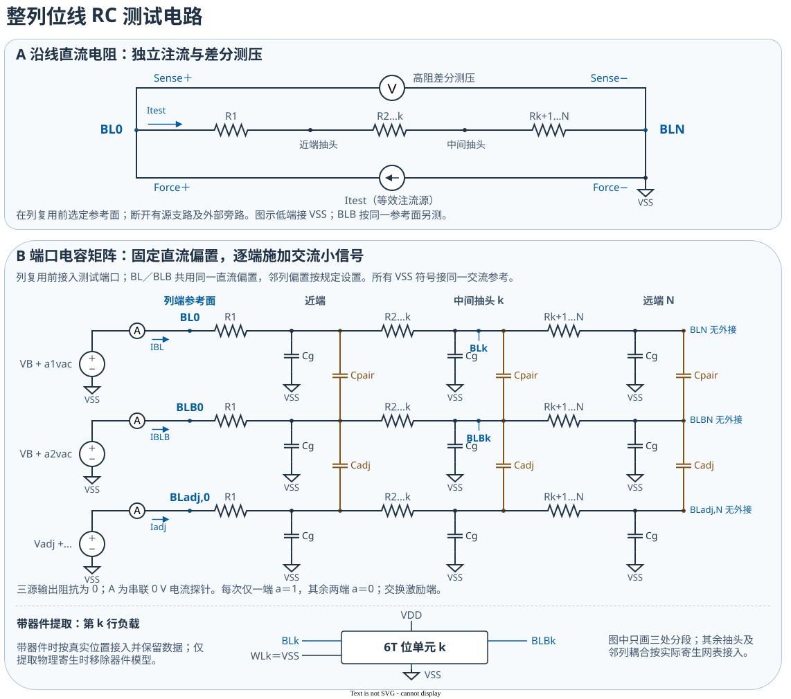

# BL RC

## 定义与适用范围

**子阵列位线电阻与电容**（Subarray Bitline Resistance and Capacitance，BL RC）描述列端至各位单元抽头的分布式寄生网络。以列复用器（Column Multiplexer）前、位线（Bitline，BL）与互补位线（BLB）各自的列端为基准，记为 `BL_0`／`BLB_0`；最远列内抽头记为 `BL_N`／`BLB_N`。若预充与写驱动位于不同端，须在版图和网表中分别标出物理端点；“近／远”均须注明相对于哪个端口。列复用器后为感测放大器（Sense Amplifier，SA）的实际输入端，应与列端分别命名。[2, Sec. 5.6, Fig. 10] [4, Sec. II, Fig. 3] [5, Sec. III-C, Fig. 9]

| 报告量 | 电气边界 | 交付内容 |
| --- | --- | --- |
| **物理电阻**（Ω） | 无源主线及指定抽头支路；有源通路断开 | BL／BLB 各段导线、接触及通孔电阻；列端至近／中／远抽头的端到端电阻。列端至访问管端子的结果另列是否含抽头支路。 |
| **物理电容**（F） | 无源寄生提取（Parasitic Extraction，PEX）网表 | 各段对参考节点电容、BL–BLB 互耦、邻列与交叉字线耦合；保留端点归属及分段。 |
| **带器件的端口阻容**（Ω、F） | 指定偏置、开关状态、终端及频带／时间窗口 | 单列小信号端口电阻与导纳；分别注明选中和未选访问管（Access Transistor，PG）、预充／均衡、写驱动器、列复用器和 SA 负载的归属。 |

单位节距阻容见 [CELL_BL RC](../Bitcell/CELL_BL_RC.md)。列高 $N$、列端与抽头定义、分段数、线层、工艺角及温度必须随整列数据交付。

## 物理机制与寄生来源

- **沿线电阻**：电流沿主导线与跨层通孔传播，在选中位单元处分流至抽头支路。单路径下，从列端至抽头的电阻为路径上各段之和；存在跨层搭接或并行导线时，用网络求两端等效电阻。预充管、写驱动器、列复用器的导通阻抗与 PG—下拉管（Pull-down，PD）的读放电通路另列，避免计入金属线阻。[4, Sec. II, Figs. 3–4] [5, Sec. III-C, Fig. 9] [7, Figs. 3–5] [17, Secs. II–III, Fig. 3]
- **沿线电容**：主线、通孔与邻近导体形成对参考节点及跨网耦合。关闭的 PG、预充／均衡管、写驱动及列复用开关仍可加载结电容与重叠电容。启用列复用器后，公共节点、未选复用支路及 SA 输入的电容按实际连接影响列端导纳和传输波形。工艺层次改变或加宽走线会同时改变互连电阻与耦合。[5, Sec. III-C, Fig. 9] [7, Fig. 4] [8, Sec. II-B, Figs. 5, 7] [14, Sec. III, Figs. 6–8]
- **邻线条件**：物理耦合 $c_{ij}$ 以 F 计，为非负的两节点元件；流入端口 $i$ 的耦合电流为 $c_{ij}\,\mathrm{d}(V_i-V_j)/\mathrm{d}t$。在相同幅度与边沿速率的局部近似下，邻线静止、同向切换及反向切换分别使此项呈现约 $c_{ij}$、零和 $2c_{ij}$ 的等效负载；邻线浮置时由其实际终端和耦合决定。应保留两端节点与实际波形，区分同列 BL–BLB 差分建差和邻列外加切换。[3, Extract Parasitics] [14, Sec. III, Fig. 6]

**重复段拼接**：用单位节距阻容重建整列时，按相邻抽头之间的实际拓扑拼接，另接两端、分段边界和公共节点。仅当段间几何一致时使用节距数乘单位值；端节点的对参考节点电容及相邻导体的耦合按归属去重。存在局部位线、全局位线或双端连接时，保留各分段及开关端口。[10, Secs. II-E, III-A–B, Fig. 10] [12, Fig. 11] [14, Sec. III, Figs. 7–9] [15, Secs. II-A–C, Figs. 3, 6–8]

## 驱动端、抽头与感测端边界

| 情况 | 激励与观测 | 判读 |
| --- | --- | --- |
| **列端驱动** | 预充或写驱动从实际连接点施加激励；观测近／中／远抽头与选中 PG 端子。 | 驱动阻抗与绕线决定恢复或写入波形；写入低电平应在目标单元处检查。 |
| **选中单元放电** | 预充释放后打开该行字线（Wordline，WL）；选中 PG—PD 拉低存储为 0 一侧的局部位线；互换存储状态再测另一侧。 | 近端与远端的放电根位置不同；比较抽头、列端与 SA 输入的建差时间。 |
| **列复用器后感测** | 保留实际列选择与预充时序，在有效选通期间量测 SA 两输入的差分与共模；记录感测使能时刻。 | 列端差分用于分析局部位线；SA 输入差分用于接口和判决验收。若存在局部／全局位线或双端驱动，按每级、每端分别标记边界。 |

对于单根节点驱动、线性且各电容已对参考节点化简的 RC 树，节点 $i$ 的 Elmore 一阶矩为 $\tau_i=\sum_j R_{\mathrm{shared}}(i,j)C_j$（s）。其中 $R_{\mathrm{shared}}$ 是从根到节点 $i$ 和 $j$ 的共同路径电阻（Ω），$C_j$ 是节点 $j$ 对参考节点的电容（F）。可把线性源电阻放在树根前；将选中单元等效为线性放电路径时，须以该抽头为相应根侧。该公式用于比较分布与位置、初选分段；指定阈值的延时和双端驱动、互耦切换、复用器非线性及偏置相关读电流应使用完整分布网表做瞬态验证。[1, pp. 55–57] [2, Sec. 5.6, Fig. 10] [5, Sec. III-C, Figs. 9–10] [15, Secs. II-A–C, Fig. 3]

## 测量与提取方法

### 版图与仿真提取

**【前置条件】** 对通过版图与原理图一致性检查（Layout Versus Schematic，LVS）的子阵列版图做 PEX，保留接触、通孔、耦合及 PG 端点。记录提取角、耦合阈值与被折入参考节点的电容；在三维抽取与紧凑模型的端子电容重叠处核对归属。建立两个网表视图：无源物理视图保留导体与耦合、断开有源电流返回；带器件视图保留全部实际支路并给定偏置。若模拟参考节点与 VSS 分开，须记录两者连接。[3, Extract Parasitics] [10, Secs. II-E, III-A] [14, Sec. III] [17, Sec. III, Fig. 3]

**【步骤／方法】**

1. **提取端到端电阻**：按图 A 对 BL 两端注入直流电流 $I$，正向定义为流入 `BL_0`、从 `BL_N` 流出。以端点电压差除以 $I$，得到 $R_{0,N}=[V(\mathrm{BL}_0)-V(\mathrm{BL}_N)]/I$。移动回流及远端观察点至近／中抽头复测，再换至 BLB。对单路径与逐段求和核对；对带并联路径的网表保留网络等效值。测带器件的小信号电阻矩阵时，在指定稳定工作点逐端 $j$ 注入电流增量，记录 $R_{ij}=\Delta V_i/\Delta I_j$（Ω），须注明每个端口的回流参考及其余端口的终端。矩阵对角项为该终端条件下的驱动点电阻，非对角项为传输电阻，均与物理两端测阻分开报告。
2. **提取电容矩阵**：按 [CELL_BL RC](../Bitcell/CELL_BL_RC.md#测量与提取方法) 汇总本列对参考节点及各对导体的 PEX 电容，保留各个耦合元件的真实位置。图 B 中逐个向列端 $j$ 施加小交流电压，其他独立端口保持指定直流电位及零交流电压。电流以流入被测网络为正；使用 $e^{\mathrm{j}\omega t}$ 约定，测 $Y_{ij}=\Delta I_i/\Delta V_j$（S），在端口导体近似等电位且频率扫描呈稳定平台时，取 $C_{ij}=\operatorname{Im}(Y_{ij})/\omega$（F，$\omega=2\pi f$）。物理无源矩阵中，$C_{ij}=-c_{ij}$（$i\ne j$），$C_{ii}=c_{i,\mathrm{ref}}+\sum_{j\ne i}c_{ij}$；若所有独立耦合端均纳入，行和为 $c_{i,\mathrm{ref}}$。其他交流固定而未单列的导体归入参考项；若邻端浮置，标注该终端并报告约化后的端口值。用理想源钳位时交流源阻抗为零；使用实际夹具时须校准电压、电流至被测端子。
3. **测带器件的端口负载**：在实际预充值、读小摆幅及写偏置范围内选取稳定直流工作点，分别固定 WL 关断／选中、数据极性及列选择，按步骤 2 指定非激励端的交流终端。记录 $\operatorname{Re}(Y_{ij})$、频带及控制状态。未形成低频平台时交付 $Y(f)$ 和网表；存储状态翻转及 SA 再生阶段用完整瞬态波形。大信号有效电容须在已注明窗口内分离净电容充电量与器件导通电流；不能分离时交付端口电压和电流波形。
4. **验证降阶网络**：保留近／中／远抽头、实际列端负载和必要耦合。先在全 PEX 与降阶网表上比较同源阻抗、同终端的列端阶跃；再用[读建差测试电路](Read_Develop_Time.md#测量与提取方法)的预充、列选择和感测时序，对三个位置和两种极性运行读瞬态。写入采用[子阵列写延时测试电路](Write_Delay.md#测量与提取方法)和实际写驱动／辅助波形。记录两侧位线、SA 输入差分和共模、目标单元写低电平／存储节点及关键阈值交越；声明邻列切换模式、预充及源阻抗。[4, Sec. II–III, Figs. 3–4, 8–9] [5, Sec. III-C, Fig. 10]

**注意事项**：禁止用写驱动器至导通 PG 或 SA 的总导通阻抗代替物理位线电阻（结果包含器件通道及外围阻抗）。

**注意事项**：禁止在 PEX 与紧凑模型中重复计入同一端子电容（位线负载会被高估）。

**【结果处理和验证】** 核对端点、参考节点及电流守恒；对无源物理矩阵检查互易性、耦合元件非负及行和。在同角、同偏置和同终端下比较全 PEX 与降阶的端口导纳、抽头波形峰值误差、阈值交越时间误差和邻线耦合峰值。各误差须满足项目容限；未通过时保留相关抽头并加密相应线段，重新验证。

### 硅实测

**【前置条件】** 制作不同列高、周边与边缘等效的长短列测试结构。BL／BLB 两端须有四线（Kelvin）引出，匹配开路、短路和空列参考；另外准备可预充和访问多个行位置的功能列。标记测量参考面，记录测试焊盘、夹具、温度、偏置及开关状态。

**【步骤／方法】**

1. **四线电阻**：按图 A 强制两端电流，独立引线高阻感测端点。用 $[\Delta V(+I)-\Delta V(-I)]/(2I)$ 消除零点偏移和热电势，并用不同电流幅值核对线性与自热。
2. **独立电容**：按参考结构去嵌焊盘、引线与测试复用开关；用等效空列或长度差分处理剩余端部。逐端测交流导纳；无多端接口时，固定或浮置邻线后测端口导纳，或施加已知电压阶跃、积分净充电量得到 $C_{\mathrm{eff}}=\Delta Q/\Delta V$，其中 $\Delta Q$ 为去除可识别漏电及夹具瞬态后的电荷（C）。分别扫预充偏置与 WL 关断时的数据模式，记录实际积分窗口和可分辨下限。
3. **功能波形交叉验证**：通过可访问抽头或片上采样观测列端阶跃以及近／中／远位置的读差分或写低电平；记录采样负载、数据极性、共模及时间参考。普通宏若只能观测接口，按近／中／远地址报告可测时序代理量。将同条件的直接阻容测量与瞬态拟合相比较，分别标注直接量和功能代理量。

**注意事项**：禁止用单端单条时间常数独立反推 R 与 C（驱动阻抗、分布式网络与有效电容共同决定波形）。

**注意事项**：空列改变邻近几何时须标注差分量（差值同时包含电场边界变化）；同一寄生若已通过去嵌扣除，禁止再次扣除。

**【结果处理和验证】** 用校验件核对去嵌残差，对长短列的线性拟合分别记录斜率、截距和不确定度。若独立端口不可用或耦合超出夹具分辨率，报告终端条件下的端口总值或分辨上限。以波形和时序误差限验证目标模型。

## 数据可视化与评估

- **布线与负载**：按列高、金属／通孔角及 BL 端点分别画 $R_{0,k}$（Ω）、对参考节点电容与各对互耦（F）。注明电压和数据模式；画出 BL、BLB 及二者差值。工艺角给出名义和极端值；统计报告记录样本数、列位置、同层跨段相关性及所用模型。
- **近／中／远端与误差**：在同一时间轴叠加全 PEX、简化网络与硅片可观测波形，在列端与 SA 输入分别标出读差分阈值和共模，在写侧标出目标抽头低电位及交越。按位置、边沿、邻线模式、时序与角点列出最大偏差、测试不确定度和是否通过。
- **原文案例**：CACTI 的分布模型可用于架构筛选。[2, Secs. 5.6, 8, Figs. 10, 13(b)] Liu 等在 2 nm 纳米片模型中比较 256 行高密度列（38 Ω/cell、30 aF/cell）和 128 行高性能列（18 Ω/cell、33 aF/cell），并考察负位线辅助（Negative Bitline，NBL）和未选 PG 漏电改变写入波形；这些参数与波形均为建模结果。[4, Table II, Figs. 4, 8–9] [4, Sec. III, Fig. 14] A14 分段设计还分别列出不含器件电容的局部／全局线路参数，比较前须统一边界。[15, Sec. II, Tables II–III]

## 应用场景与指标关系

- **设计与工艺协同优化**（Design–Technology Co-Optimization，DTCO）：用阻容预算筛选列高、分段、复用比、线层、预充及写驱动。驱动、列高和噪声目标相同时，降低阻容通常有利于读建差或降低写驱动负担；加宽和换层后须同时检查邻线耦合、单元面积与外围代价。[8, Sec. III-A, Fig. 10] [10, Sec. III, Fig. 10] [14, Sec. IV, Figs. 9–10] [15, Secs. IV–V]
- **慢路径诊断**：结合 [BL Leakage](BL_Leakage.md) 和 [Read Current](../Bitcell/Read_Current.md) 解释 [Read Develop Time](Read_Develop_Time.md)；若列端建差已达标而 SA 输入未达标，检查列复用器和公共节点负载。分析 [WD](Write_Delay.md) 时，对比列端和目标单元抽头的写低电平，区分沿线压降、驱动强度和迟滞放电。[4, Secs. III–IV, Figs. 7–9] [5, Sec. III-C, Figs. 9–10]

## 参考文献

2026-11-17，Zotero `02-SRAM-DTCO/SRAM-Metrics/Subarray`（`L9CVSGRT`）内精确标签 `BL RC` 由 9 条增至 17 条，核验其中 11 篇独立期刊或会议研究支持本页的物理阻容、全列建模或读写边界。Mathur 2020 与 2022 的重叠埋入式位线结果合计一次。在线文档、报告、学位论文、专著、预印本和理论基础单列。保留原编号及历史补引来源。

[1] W. C. Elmore, “The transient response of damped linear networks with particular regard to wideband amplifiers,” J. Appl. Phys., vol. 19, no. 1, pp. 55–63, 1948. [DOI 10.1063/1.1697872](https://doi.org/10.1063/1.1697872). [公开文献](https://doi.org/10.1063/1.1697872)；[Zotero](https://www.zotero.org/users/7333024/items/JEWAL8BK)。

**相关摘要：** Elmore从线性网络的拉普拉斯响应研究阶跃延迟与上升时间，用响应矩建立易计算的时域特征。其适用前提包括所讨论的单调瞬态，主要示例是放大器与无源网络，并非SRAM实测。该文是由阻容网络推导时间特征的理论来源；原始电阻、电容、网络拓扑和由此得到的时常必须分别记录。用于位线分析时，应先建立包括线段和负载的实际网络，再求响应矩。理论不会给出特定SRAM列的欧姆或法拉数值，也不能用一个RC乘积反推出唯一的电阻、电容，非线性读电流还需另行建模。

**原文定位：** §1–3，pp.55–58（PDF第1–4页）。

[2] N. Muralimanohar, R. Balasubramonian, and N. P. Jouppi, “CACTI 6.0: A tool to model large caches,” HP Labs, Tech. Rep. HPL-2009-85, 2009. [公开文献](https://shiftleft.com/mirrors/www.hpl.hp.com/techreports/2009/HPL-2009-85.pdf)；Zotero 无独立同名题录，附件归属见定位说明。

**相关摘要：** CACTI 6.0将缓存划分为bank、mat与子阵列，估算译码、字线、位线、感放、复用、输出和跨bank互连。报告改进分布式字线与位线模型，并增加多种线路和网络结构；组织分割缩短局部线，却增加外围及路由开销。模型用于架构探索，必须保留容量、组织与互连假设，不能当作任意工艺版图的直接测量。图10的位线网络包括接入／下拉器件等效电阻、分布线阻和负载、列复用电容。应把金属寄生与器件导通项分离，再依据列深组织网络；由模型得到的时间常数不是物理位线电阻或电容本身。

**原文定位：** §1–3、§5.5–5.6，报告pp.3–5、17–18，图9–10。

**定位更正：** 旧引用 [2, Sec. 6.1.2, Fig. 10] 和 [2, Sec. 6.1, 7, Figs. 10, 13(b)] 在本版报告中应以 §5.6 图 10 和 §8 图 13(b) 为准。归档同版文件在 [Zotero](https://www.zotero.org/users/7333024/items/JYDVTQLK) 的 CACTI 5.0 题录下另附。

[3] The OpenROAD Project, “Parasitics extraction,” OpenROAD documentation. [原文](https://openroad.readthedocs.io/en/latest/main/src/rcx/README.html)；Zotero：本次检索范围内未匹配记录。

**相关摘要：** OpenROAD官方文档说明OpenRCX从已布线LEF／DEF及工艺规则提取导线电阻、对地电容和耦合电容，并把结果关联到导线与通孔对象。提取考虑邻线距离和上下层布线环境，可输出SPEF；耦合阈值会把较小耦合转为对地项。不同工艺角、上下文深度及通孔合并设置会改变结果，使用时应记录配置。本页可据SPEF逐段统计同一位线的导线与通孔电阻，并分列对地和耦合电容。工具提取不自动包含所有晶体管偏置相关电容，需与器件模型合并且避免重复计入；总RC也不能直接当读延迟。

**原文定位：** 官方网页“Parasitics Extraction”“Extract Parasitics”“Write SPEF”。

[4] H.-H. Liu et al., “Extended methodology to determine SRAM write margin in resistance-dominated technology node,” IEEE Trans. Electron Devices, vol. 69, no. 6, pp. 3113–3117, 2022. [DOI 10.1109/TED.2022.3165738](https://doi.org/10.1109/TED.2022.3165738). [公开文献](https://doi.org/10.1109/TED.2022.3165738)（作者稿）；[Zotero](https://www.zotero.org/users/7333024/items/9HKACZ7P)。

**相关摘要：** 论文指出先进节点的位线电阻、电容与半选单元传输管漏电会损害负位线辅助写入。位线在有限时间内未充分放电时，静态写裕量可能高估实际可写性；负压加深还会意外开启未选传输管。作者扩展瞬态写裕量方法，使驱动波形、寄生及辅助偏置一起进入判断，不能只用理想固定低电平代表真实位线。论文分别讨论位线电阻造成的电压损失、电容充放电和未选传输管漏电，说明仅用理想位线会高估写入能力。寄生抽取须保留列长与辅助偏置，不能把漏电引起的慢放电全部解释为金属RC增加。

**原文定位：** §II–IV，作者稿图 2–9、14 及表 II。旧引用 [4, Sec. III–V, Fig. 14] 在归档作者稿中的实际位置为 §III 图 14。

[5] B. S. Amrutur, and M. A. Horowitz, “Speed and power scaling of SRAM's,” IEEE Journal of Solid-State Circuits, vol. 35, no. 2, pp. 175-185, 2000. [公开文献](https://doi.org/10.1109/4.823443)；[DOI](https://doi.org/10.1109/4.823443)；[Zotero](https://www.zotero.org/users/7333024/items/CH2EXX7I)

**相关摘要：** 论文用解析模型探索SRAM组织、容量和技术缩放，包含译码、字线、位线、感放及输出复用。研究以读路径为关键路径，只建模读取动态能量，外部输出负载被排除；门尺寸主要按最小时延设定，低能量方案未必全局最优。模型明确线长和负载的作用，并与电路仿真验证，应用时必须保留这些假设。位线模型除单元和导线负载，还包含列复用开关与感放输入电容；读电流及字线上升时间参与延迟计算。用于本页应先单列物理电阻、电容，再讨论由其导出的时延，避免把驱动效应归入线阻。

**原文定位：** §III-A–C，pp.177–180（PDF第3–6页），式(2)–(7)、图4–11。

[6] S. Thoziyoor, N. Muralimanohar, and N. P. Jouppi, “CACTI 5.0,” Hewlett-Packard Laboratories, Tech. Rep. HPL-2007-167, Oct. 19, 2007. ；[Zotero](https://www.zotero.org/users/7333024/items/JYDVTQLK)；DOI：Zotero未收录或尚未核实。

**相关摘要：** 归档附件实际为2007年CACTI 5.0报告，作者为Thoziyoor、Muralimanohar和Jouppi，不能按Zotero的2008年四作者题录引用。报告将存储器分为bank、mat及子阵列，建模译码、位线、感放、复用和请求／回复树。地址与输入数据树可门控，输出树使用不同驱动结构；阵列组织搜索需同时考虑时延、功耗与布局开销。图22展示单元至感放输入的位线读路径，包含接入管、下拉管、列复用及相关电容。该等效网络用于时延估算，读取电阻中有器件导通项，不能全部记作金属位线电阻；整列与每段负载应分开。

**原文定位：** §3–5，报告pp.8–27（PDF第9–28页）。

[7] Q. Song, C. Y. Peng, H. G. Zhou, and S. B. Tan, “Time delay model for SRAM compiler,” Applied Mechanics and Materials, vol. 373-375, pp. 1561-1566, 2013. [公开文献](https://doi.org/10.4028/www.scientific.net/AMM.373-375.1561)；[DOI](https://doi.org/10.4028/www.scientific.net/AMM.373-375.1561)；[Zotero](https://www.zotero.org/users/7333024/items/CJ32UAW9)

**相关摘要：** 论文为65 nm编译器建立简化时延模型，将访问分成译码、字线、位线和感放。字线用驱动电阻与栅电容表示，位线用读晶体管等效电阻、结电容和预充管电容表示，并与版图抽取仿真比较。部分导线电阻被忽略，感放时延视为固定值；模型适用性受阵列尺寸和工艺限制，不能直接泛化到互连主导节点。模型位线电容按行数累加接入管结电容，并额外加预充管负载；放电电阻主要是读取串联晶体管等效值。它未完整保留现代金属分布电阻，因而只能支撑负载组成和简化模型，不能作为通用位线PEX。

**原文定位：** pp.1562–1565（PDF第2–5页），图3–5、式(1)–(9)。

[8] T. H. Bao et al., “Circuit and process co-design with vertical gate-all-around nanowire FET technology to extend CMOS scaling for 5nm and beyond technologies,” in 2014 44th European Solid State Device Research Conference (ESSDERC), 2014, pp. 102-105. [公开文献](https://doi.org/10.1109/ESSDERC.2014.6948768)；[DOI](https://doi.org/10.1109/ESSDERC.2014.6948768)；[Zotero](https://www.zotero.org/users/7333024/items/BBASQA5H)

**相关摘要：** 论文在垂直环栅纳米线器件与工艺协同设计中，分析紧密金属间距造成的互连变异。电阻和电容分别由工艺假设及统计模型得到，二者变异程度并不相同；SRAM例子通过加宽位线牺牲部分单元面积以改善读访问良率和速度。该研究连接几何、寄生及统计时序，不能把观察到的延迟改善直接当作电阻或电容的等比例下降。该条直接支撑位线几何与寄生统计的联合提取。使用图7和图10时应区分单位长度参数、其分布与阵列读延迟；加宽位线的收益包含器件和负载效应，不能倒推唯一的位线电阻值。

**原文定位：** §II-B、§III-A，pp.103–104（PDF第2–3页），图5、7、10。

[9] H. Nichols, “Statistical Modeling of SRAMs,” M.S. thesis, University of California, Santa Cruz, Mar. 2022. [公开文献](https://escholarship.org/uc/item/7vx9n089)；[Zotero](https://www.zotero.org/users/7333024/items/BTUF3HG9)；DOI：Zotero未收录或尚未核实。

**相关摘要：** 附件为Hunter Nichols的2022年加州大学圣克鲁兹分校硕士论文，Zotero作者与年份有误。论文在OpenRAM中建立时序图，组合解析和统计模型预测访问特性。图构建会排除预充电等不属于读关键路径的连接，但仍需保留真实负载；各级输入电容、输出负载和转变时间共同决定传播，统计模型依赖训练配置覆盖范围。解析模型从工艺参数和连接图估计线负载，结合读取路径得到延迟。其等效电阻还含器件驱动部分，因此本页应提取导线与器件项的来源和单位，不能将时序图输出的传播时间当作寄生参数。

**原文定位：** §2.1、§3.1，书内pp.6–7、12–20。

[10] H. H. Liu et al., “CFET SRAM DTCO, interconnect guideline, and benchmark for CMOS scaling,” IEEE Transactions on Electron Devices, vol. 70, no. 3, pp. 883-890, 2023. [公开文献](https://doi.org/10.1109/TED.2023.3235701)；[DOI](https://doi.org/10.1109/TED.2023.3235701)；[Zotero](https://www.zotero.org/users/7333024/items/W99KL789)

**相关摘要：** 论文对A14至A3的SRAM进行器件、互连和子阵列协同分析，使用完整外围与288列、256行阵列，并考察距译码、感放及写驱动最远的单元。寄生参数由器件模型和三维抽取联合提供；增加驱动能力也增大电容，性能改善会饱和。写辅助采用概念性电压源，比较能耗时需注明尚未包含具体辅助发生器的全部实现代价。图10分别报告每单元位线电阻和电容，不能把二者合并为一个延迟数字。位线加宽可缓解线阻却改变面积和电容，构建整列时还需计入行数、列复用及预充负载，并注明抽取层次。

**原文定位：** §III-A–B、III-D–E，pp.886–889（PDF第4–7页），图10、14–15。

[11] H. H. Liu, and F. Catthoor, “Circuit-technology Co-optimization of SRAM design in advanced CMOS nodes,” Cham, Springer Nature Switzerland, 2025. [公开文献](https://doi.org/10.1007/978-3-031-76109-6)；[DOI](https://doi.org/10.1007/978-3-031-76109-6)；[Zotero](https://www.zotero.org/users/7333024/items/CHVFC3IE)

**相关摘要：** 本书贯通单元、子阵列和宏级仿真。局部指标由含寄生和外围的电路得到，宏模型再加入树形互连、控制驱动及核心至数据通路；两级统计边界不可混用。先进节点的单元缩小未必等比例改善访问性能，线阻、电容和写辅助代价可能抵消收益。宏级比较采用明确容量、树形结构、引脚位置及工艺条件，并讨论写入可行性的约束。第6章逐项列出每单元位线电阻、电容，并追踪线宽和单元缩放的影响。需要按列组织构建分布网络，不能将每单元数值当作整列；位线线阻对写入裕量的影响也不同于电容造成的瞬态压降。

**原文定位：** §2.3.2、§2.4.2、§6.2、§7.1–7.5，书内pp.36、42、137–139、174–181。

[12] W. Peng et al., “PPA scaling of flip FET technology down to A2 node enabled by architecture innovations: self-aligned gate, 2T design with embedded power rail and ultra-stacked 4-tier transistors,” in 2025 Symposium on VLSI Technology and Circuits (VLSI Technology and Circuits), 2025, pp. 1-3. [公开文献](https://doi.org/10.23919/VLSITechnologyandCir65189.2025.11074822)；[DOI](https://doi.org/10.23919/VLSITechnologyandCir65189.2025.11074822)；[Zotero](https://www.zotero.org/users/7333024/items/98D5AA4T)

**相关摘要：** 论文提出双面及多层晶体管结构，结合器件实验和设计投影讨论向A2缩放。SRAM部分比较不同单元结构与阵列折叠方式，分别缩短行或列的有效线长，并展示每单元字线、位线寄生及最差位置的读写指标。器件工艺演示与阵列电路预测属于不同证据层级，不能把所有SRAM性能结果表述为完整存储器实测。图11给出每单元位线寄生及行列折叠示意，图12才是固定阵列性能。折叠降低被访问线段长度，不能把图中每单元参数和整列有效负载混同；接触、跨层连接及外围电容仍应明确计入范围。

**原文定位：** SRAM design部分，PDF第2–3页，图11–12。

[13] S. Shen et al., “OpenYield: An Open-Source SRAM Yield Analysis and Optimization Benchmark Suite,” arXiv:2508.04106v2, 2025. [公开文献](https://doi.org/10.48550/arXiv.2508.04106)；[DOI](https://doi.org/10.48550/arXiv.2508.04106)；[Zotero](https://www.zotero.org/users/7333024/items/Z4REBP9X)

**相关摘要：** OpenYield生成包含单元、译码、字线驱动、列复用、预充电、写驱动和感放的SRAM层级。位线与字线采用分布式π形寄生网络，考虑未选单元漏电和外围变异。示例使用FreePDK45与统计SPICE仿真；电源网压降、老化和空间相关变异并非默认模型，结论应限定于实际启用的效应。框架用可配置分段数和每段参数生成位线π网络，适合检查分布效应对读访问的影响。其默认数值来自典型布局假设，不能标为本项目版图抽取值；线电容和接入器件负载也需分列。

**原文定位：** §III-A、IV，PDF第3–6页，图4–7。

[14] R. Mathur et al., “Buried interconnects for sub-5 nm SRAM design,” IEEE Trans. Electron Devices, vol. 69, no. 3, pp. 1041–1047, 2022. [DOI](https://doi.org/10.1109/TED.2022.3143078)；[公开文献](https://doi.org/10.1109/TED.2022.3143078)（期刊早期版）；[Zotero](https://www.zotero.org/users/7333024/items/H35G9VFR)。

**相关摘要：** 作者对 N5 位单元的布线与通孔提取三维阻容，拼接到 258 行 × 136 列的关键路径网表，再比较读差分、写入和访问时间。图 6 分列耦合成分，图 7 给出每节距寄生；仿真可用于评估模型拼接和布线取舍。

**原文定位：** §III–IV，图 6–10，早期版 PDF 第 4–6 页。

[15] H.-H. Liu et al., “Future design direction for SRAM data array: Hierarchical subarray with active interconnect,” IEEE Trans. Circuits Syst. I, Reg. Papers, vol. 71, no. 12, pp. 6495–6506, 2024. [DOI](https://doi.org/10.1109/TCSI.2024.3410518)；[公开文献](https://doi.org/10.1109/TCSI.2024.3410518)（作者稿）；[Zotero](https://www.zotero.org/users/7333024/items/FKMH67JE)。

**相关摘要：** 作者将 A14 子阵列分成局部与全局位线，比较标准、常规分段及有源互连分段。表 II 的局部 MINT 位线为 16 Ω/cell、56.6 aF/cell，全局 M2 位线为 6.54 Ω/cell、37.3 aF/cell；表中电容排除器件电容。按层级实例化线段及开关，才能解释不同分段的仿真读写波形。

**原文定位：** §II-A–C、IV，图 3、6–8、15，表 II–III。

[16] R. Mathur et al., “Buried bitline for sub-5 nm SRAM design,” in IEDM Tech. Dig., 2020, pp. 20.2.1–20.2.4. [DOI](https://doi.org/10.1109/IEDM13553.2020.9372042)；[公开文献](https://doi.org/10.1109/IEDM13553.2020.9372042)；[Zotero](https://www.zotero.org/users/7333024/items/M8TVQJ29)。

**相关摘要：** 三维求解对照埋入式位线的深度、厚度、导体和衬底耦合；图 9–12 将阻容配置与子阵列拼接及仿真流程对应。与 [14] 的重叠埋入式位线研究只计一次。

**原文定位：** §II–III，图 7–12，表 II–III。

[17] M. Karner et al., “Variability-aware DTCO flow: Projections to N3 FinFET and nanosheet 6T SRAM,” in Proc. SISPAD, 2021. [DOI](https://doi.org/10.1109/SISPAD54002.2021.9592527)；[公开文献](https://doi.org/10.1109/SISPAD54002.2021.9592527)；[Zotero](https://www.zotero.org/users/7333024/items/2NIBZCPG)。

**相关摘要：** 作者用三维提取和器件紧凑模型构造位单元 SPICE 网表，保留连接局部互连与访问管的电阻网络。此例支持构造整列前核对重复单元及端点；原文未给整列阻容数值。

**原文定位：** §II–III、V-B，图 2–3、9–11。

[18] X. Cheng et al., “A novel design for SRAM bitcell with 3-complementary-FETs,” Microelectronics Journal, vol. 173, Art. no. 107180, 2026. [DOI](https://doi.org/10.1016/j.mejo.2026.107180)；[公开文献](https://doi.org/10.1016/j.mejo.2026.107180)（期刊出版版）；[Zotero](https://www.zotero.org/users/7333024/items/Y7YQGDG6)。

**相关摘要：** 原文基于三互补场效应晶体管结构估算通往下层访问管的局部金属电阻，并抽取布局电容；上下层及两侧读写路径不对称。该结果用于区分抽头接入支路与主干，并支持两种存储极性独立验证，证据范围是位单元模型。

**原文定位：** §3.1、§4.1–4.2，图 8、10–11。

[19] G. Pasandi and S. M. Fakhraie, “A 256-kb 9T near-threshold SRAM with 1k cells per bitline and enhanced write and read operations,” IEEE Trans. Very Large Scale Integr. (VLSI) Syst., vol. 23, no. 11, pp. 2438–2446, 2015. [DOI](https://doi.org/10.1109/TVLSI.2014.2377518)；[公开文献](https://doi.org/10.1109/TVLSI.2014.2377518)（arXiv v2 作者稿）；[Zotero](https://www.zotero.org/users/7333024/items/2RID45U5)。

**相关摘要：** 作者将 9T 读支路独立，比较 90 nm 256 kb 的 1k 单元长列与 6T 组织。可用来核对列高取舍及拓扑改变后的漏电边界；读出良率与性能均由仿真评估。

**原文定位：** §III–IV，图 3–4，表 III–IV。
