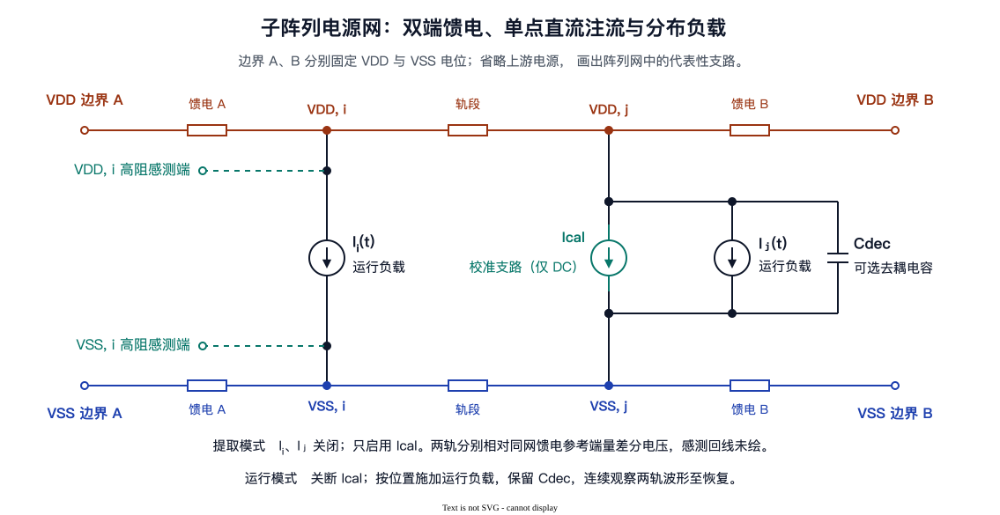

# R_VDD & R_VSS

## 定义与适用范围

**子阵列 VDD／VSS 等效电阻（Subarray VDD/VSS Effective Resistance，$R_{\mathrm{VDD}}$／$R_{\mathrm{VSS}}$）**描述静态随机存取存储器（Static Random-Access Memory，SRAM）子阵列供电网络（Power Delivery Network，PDN）从指定供电边界到局部端口的直流（Direct Current，DC）电阻响应，单位为 Ω。报告值须绑定供电端及其终端条件、注流端 $j$、感测端 $i$ 和温度。局部端口可取位单元电源抽头、上拉管（Pull-Up，PU）或下拉管（Pull-Down，PD）的源端，或同电源域驱动器的电源引脚。[1, Analyze Power Grid] [2, Fig. 3]

以相同馈电电位和其他负载下无校准电流的基线为参考。$\Delta V_{X,i}$ 为端口 $i$ 相对同网指定馈电参考端的电位增量（V）；$X$ 为 VDD 或 VSS。$\Delta I_{\mathrm{VDD},j}$ 为从局部 VDD 取出的增量电流，$\Delta I_{\mathrm{VSS},j}$ 为流入局部 VSS 的增量电流，均按负载方向取正，单位为 A。定义正向压降量 $d_{\mathrm{VDD},i}=-\Delta V_{\mathrm{DD},i}$，正向回流抬升量 $d_{\mathrm{VSS},i}=+\Delta V_{\mathrm{SS},i}$，则

$$
R^X_{ij}=\frac{d_{X,i}}{\Delta I_{X,j}},\qquad
\Delta \!\left(V_{\mathrm{DD},i}-V_{\mathrm{SS},i}\right)
=-d_{\mathrm{VDD},i}-d_{\mathrm{VSS},i}.
$$

第二式以两条馈电参考端的电位均固定为条件。$R^X_{jj}$ 是注流点的自电阻；$R^X_{ij}$（$i\ne j$）是该馈电条件下的转移电阻。跨两轨放置单个校准电流源时，两轨的增量电流均等于该源的电流，量得的是配对负载下的响应。在固定馈电、两轨之间无 DC 耦合的被动网中，该测试一次给出两轨各自的一列。若共享上游阻抗或导通的跨轨支路使两轨相互耦合，须注明配对注流条件；提取独立端口的耦合矩阵时，须分别激励各轨，定义回流端并感测两轨。运行时两轨各端口的电流须按实际连接记录。

| 报告量 | 工程边界 |
| --- | --- |
| **单元节距／源端支路电阻**（Ω/cell、Ω） | [CELL_R_VDD & CELL_R_VSS](../Bitcell/CELL_R_VDD_CELL_R_VSS.md) 给出重复轨段或抽头到源端的局部量。 |
| **子阵列端口电阻**（Ω） | 从列明的子阵列馈电参考面出发，含实际并联馈电、轨段、换层通孔及约定的局部支路。 |
| **静态电源网压降（IR Drop）与瞬态供电电压**（V） | 分别对应指定的稳态电流分布和运行电流波形；瞬态还取决于去耦电容和上游供电阻抗。 |
| **宏／封装端口阻抗**（Ω） | 参考面移至宏引脚、凸点或板端后，须另列计入的上级电网、封装及夹具。频率响应以复阻抗 $Z^X_{ij}(f)$ 表示，不能用 DC 阻值代替。 |

## 物理机制与布图变异

电源从供电条带或背面馈电通孔分流至局部电源轨，再经支路送至负载；VSS 收集回流。狭窄共享段、换层通孔和接触等可形成局部瓶颈。负载共享的路径使同一行或多个驱动器的电流在部分支路叠加；各节点的压降取决于分流，比较位置时须同时核对馈电方向、轨道横纵连通及激活范围。对固定边界且两轨无直流耦合的线性电阻网，$\mathbf d_X=\mathbf R^X\Delta\mathbf I_X$，其中列向量 $\Delta\mathbf I_X$ 含各端口电流增量（A），$\mathbf d_X$ 为相应电压增量（V）。可将某节点压降除以总电流作为该负载图样的换算系数；只有各端口电流按同一比例缩放时，才可沿用该系数。[3, Fig. 15.2.2] [4, Secs. III–IV, Figs. 2, 5–8] [5, Secs. 2, 4, Figs. 2, 4(a)]

通孔阵列、层间跨接、条带宽度和抽头间距须按版图抽取，按工艺设计套件（Process Design Kit，PDK）的互连工艺角和温度比较；减小间距或加宽条带会改变布线占用、分流及寄生电容。Intel 4 的 256×120 高电流 6T 阵列分区对照中，改用周边 PowerVia 馈电后，最大 VSS 等效电阻由边缘 C 移到中央 D。在 1.1 V 条件下，两种方案的最慢读访问均在 A 点。电阻和延时取自仿真，所报告的最低工作电压（Minimum Operating Voltage，$V_{\min}$）分布与电压–频率图来自硅片。[3, Figs. 15.2.2, 15.2.6]

## 子阵列电源网络与测量边界

- **固定物理参考面**：记录各 VDD／VSS 馈电点的坐标、金属层、电源域、设定电位或上游终端阻抗。常用边界为子阵列与存储体电源条带的接口。若供电条带仍有阻抗，在它的上游固定理想源，将条带纳入网表；禁止在同一条带中间增设理想钳位（会短接真实馈电路径）。采用凸点或封装参考面时，单列上级电网和外部阻抗。使用独立上游参考端且馈电电位随工况变化时，同时记录馈电波形，区分芯片内部压降和入口电位变化。[1, Analyze Power Grid] [6, Secs. II–IV, Fig. 1, Tables I–II] [7, Figs. 7, 9–10]
- **拼接局部和子阵列网表**：保留中心与边缘的共享轨段、跨接、换层通孔、位单元抽头及共网外围电路引脚。感测点在位单元抽头时不含抽头到源端支路，移至器件源端时按 [CELL_R_VDD & CELL_R_VSS](../Bitcell/CELL_R_VDD_CELL_R_VSS.md) 计入该支路。对照 PDK 的提取参考面，核对紧凑模型中已有的访问电阻和接触项；共享元件只计一次。可从重复铺排的位单元拼接，但须保留跨接、真实阵列边缘和馈电支路。[2, Fig. 3] [8, Sec. III, Figs. 8–9]
- **区分 DC 与动态负载**：纯电阻测试关闭有源负载并待去耦电容电流为零。工作时，预充电、字线驱动、位单元放电、感测放大器和写驱动可能从不同电源域取流或回流；按物理引脚、电源域及访问时序构建电流分布。去耦电容在负载上升时短时供电，随后经电源网再充电，能改变瞬态峰值及恢复时间。动态仿真须保留局部去耦及其接入寄生；涉及封装、凸点或共享供电回路时，纳入该边界的电阻、电容及必要的寄生电感。若使用小信号阻抗，在偏置、电源终端和其他激励固定时扫频；功能开关和电源门控按实际状态做瞬态仿真。[4, Secs. III–V] [6, Sec. IV] [9, Sec. III, Figs. 3–6] [10, Sec. IV, Figs. 13–14]

## 测量与提取方法

### 版图与仿真提取

**【前置条件】** 使用通过版图与原理图一致性检查（Layout Versus Schematic，LVS）的子阵列版图，执行寄生提取（Parasitic Extraction，PEX），保留两轨各层条带、换层通孔、局部轨及约定的源端支路。记录提取角、温度、约简阈值、各馈电终端和端口坐标。准备一份保留完整馈电的被动电阻网表及一份含有源器件和寄生电容的运行网表。

图示以 A、B 两对同网等电位馈电端为例。DC 模式关闭运行负载，从 $j$ 处 VDD 吸取电流并经 $j$ 处 VSS 注回；高阻感测线分别读取 $i$ 点两轨电位。感测回线接到各自指定馈电参考端。运行模式关断校准支路，按位置施加负载并保留去耦电容。图中省略实际二维网格、独立电源域及上游电源。

**【步骤／方法】**

1. **核对网表和馈电**：检查两轨连通性、开路条带、全局同名节点和短接；确认所有电源端终端与测试定义一致。OpenROAD PDNSim 可用 `check_power_grid` 检查连接，以 `analyze_power_grid` 分轨分析静态压降并导出节点电压、支路电流；需要校准电流与局部端口时，用保留目标局部寄生的供电网表执行 SPICE 测试。`write_pg_spice` 按单轨导出；用于纯电阻提取时，移除实例的 DC 电流源，核对两轨节点命名和馈电终端。缺少位单元级连接时，补用相应 PEX 网表。[1, Analyze Power Grid, Write PG Spice]
2. **逐点施加校准电流**：先记录零增量基线，再从 $j$ 取流／注流，保持其他端口电流及馈电条件不变。记录 $i=j$ 和 $i\ne j$ 的两轨电位、各馈电端分流和注流实际值。纯线性电阻网表可用 **1 A 数值归一**：求解的差分电压数值对应 Ω，乘以实际注流电流即可给出相同边界下的压降。含器件或实际硅片时，用满足偏置和热条件的小电流做至少两档差分，按 $\Delta V/\Delta I$ 的符号约定求斜率；仅在允许双向扫描且保持同一状态时用正反极性扣除零偏。轮换近端、内部、角部和关键驱动器端口，形成对角项和需要的转移项。
3. **复算实际静态与瞬态工况**：从后仿真或校准台架取得各局部端口的读、写、待机或唤醒电流。在线性电阻网用电阻矩阵与稳态负载向量复算；两轨存在直流耦合时，使用包含跨轨响应的完整矩阵。另以相同负载、源位置和边界的静态供电分析核对。瞬态从对应初态运行实际读写与唤醒序列，保存两条轨的全波形、差分供电压差、馈电电流、去耦电流、峰值时刻和恢复时间。用提取后的受控电流源替代有源负载时，须在同一端口移除被替代负载；局部供电会显著反作用于取流时，用含有源器件的完整 PEX 模型闭合验证。[4, Secs. III–V, Figs. 2–4]

**注意事项**：禁止把工作图样下的峰值压降直接换算成一个通用的 $R_{\mathrm{VDD}}$ 或 $R_{\mathrm{VSS}}$（空间电流分布与瞬态边界未被分离）。

**【结果处理和验证】** 对每轨检查自电阻非负、DC 比例性与矩阵叠加残差。无跨轨导通的被动电阻网，用馈电端增量电流的代数和核对校准电流；有跨轨耦合时，将其他支路的增量电流一并计入电流守恒检查。纯线性互易网使用相同馈电边界和成对端口时，可用 $R^X_{ij}=R^X_{ji}$ 查错。示例：每轨的 A–$i$、$i$–$j$、$j$–B 均为 1 Ω，A、B 同电位固定，则 $R^X_{jj}=2/3$ Ω、$R^X_{ij}=1/3$ Ω；从 $j$ 跨轨吸取 1 mA 时，$i$ 处 VDD 下降与 VSS 抬升各约 0.333 mV。用完整 PEX 或独立静态分析核对代表性同时负载；残差异常时检查参考面、约简及各域的电流分配。验收按各位置、模式和互连角的压降与恢复预算执行。

### 硅片专用结构及运行代理

**【前置条件】** 专用测试结构须复现同层、同馈电拓扑及端部连接。在各轨的边界与局部点预留独立注流线和高阻感测线，采用四端开尔文量测（Four-Terminal Kelvin Measurement）。校准可访问的夹具、探针及感测路径；按待机或固定控制状态锁定偏置、关断可切换负载，检查保护器件、访问开关及漏电路径。已有通孔链与独立测点可校验某一组合路径，但与子阵列网格的电流分配须分列。[7, Fig. 7] [11, Figs. 5, 7, Methods: Backside power delivery network test structure]

**【步骤／方法】**

1. **测量两条轨的 DC 斜率**：按图从局部 VDD 取流并向 VSS 回流；若两轨测试需要独立激励，按接线约定分别对单轨注流及回流，保持其余馈电终端不变。对两轨分别同步测量馈电端和局部端的电位，扣除稳定本底，用多档实际电流拟合斜率。选择注流范围时兼顾量测分辨率、夹具压降、自热与器件工作区，按边界及位置分别报告。
2. **记录运行压降及功能代理**：在已知地址、数据、访问时序与并行范围下，量测馈电端及可访问抽头的两轨波形；保存传感器位置、参考电位、带宽与时间对齐条件。无局部测点时，可用复制支路、已校准负载或功能扰动测量验证模型，报告实际可观测量及不可分离的路径。Nakata 等同时观测 40 nm SRAM 的片外受控跌落和片内局部电源；Khellah 等改变施加扰动与字线脉冲的相对相位和频率并记录结果。两者支撑动态工况验证。[9, Sec. III, Figs. 7–11] [12, Secs. 3.1–3.2, Figs. 13–16]

**注意事项**：禁止把宏入口测值、专用通孔／互连测试链斜率或扰动下的功能失效率标为两轨的子阵列局部硅测电阻（端口和路径不同）。

**【结果处理和验证】** 报告基线漂移、重复误差、电流线性、夹具去嵌范围、样本数与测点覆盖。对照模型时，复现相同的端口和终端；片内监测与宏端观测分别归档。上述独立研究未给出对同一功能子阵列在相同边界下逐点直接量测的双轨电阻矩阵。[3, Figs. 15.2.2, 15.2.6] [7, Figs. 7, 9–10] [12, Sec. 3.1, Fig. 14]

## 数据可视化与评估

| 交付图表 | 标注与判据 |
| --- | --- |
| **两轨自电阻地图与转移矩阵** | 标注每个馈电和感测位置、金属层、工艺角、温度及 Ω。译码器、边缘位单元和中央位单元分组；报告随馈电、跨接和边界改变的热点位置。 |
| **静态压降地图及分流** | 分别绘制 VDD 下陷、VSS 静态抬升及局部供电压差（mV），注明负载向量、并行访问和源布置。用支路电流、电流密度和节点间压降归因；只对同一电流贯穿的串联段叠加路径电阻。 |
| **瞬态波形与窗口统计** | 对齐预充、读、写、唤醒与恢复窗口，列出局部供电压差的低点、两轨各自的极值和恢复至指定容差带的时间。两轨峰值时刻不同时，逐时刻求差分供电压差。 |
| **角与分布对照** | 固定网表参考面、源配置和操作窗口，比较金属角与温度；分析操作图样或统计变异时保留电流和供电网络的空间对应关系，报告样本数、极值／分位及测量不确定度。 |

## 应用场景与指标关系

- **分配电源网预算**：用热点和分流定位应加宽的条带、薄弱通孔和抽头空档；对照正／背面馈电、凸点位置及同时访问数，复算面积、寄生电容、静态压降和瞬态恢复。[3, Figs. 15.2.1–15.2.5] [6, Secs. II–IV]
- **复核读写裕量**：在 PEX 电路中施加同一位置的两轨波形，并保留相对字线、位线及体端的电位。按工作条件验证[读静态噪声裕量（RSNM）](../Bitcell/RSNM.md)、[数据保持电压（DRV）](../Bitcell/DRV.md)和[写延时（WD）](Write_Delay.md)。稳态裕量采用对应静态偏置；短时下陷按其相对读写窗口的时序检查功能与延时。[3, Figs. 15.2.2–15.2.4] [9, Sec. III]
- **验证辅助电路恢复**：带单元电源降压辅助或局部电源门控时，分别保存供电开关状态及恢复波形，检查相邻半选／未选单元以及下一个访问能否在规定时限开始。写辅助造成的有意电位变化须与供电网损失分开记录。[3, Fig. 15.2.4] [12, Secs. 3.1–3.2]

## 参考文献

2026-11-17，Zotero Subarray 集合（`L9CVSGRT`）精确标签 `R_VDD & R_VSS` 初检为 0；补检核验 11 篇期刊／会议原始研究。原有 OpenROAD 工具文档 [1] 保留。

[1] The OpenROAD Project, “IR drop analysis,” OpenROAD documentation. [原文](https://openroad.readthedocs.io/en/latest/main/src/psm/README.html)；Zotero：本次检索范围内未匹配记录。

**相关摘要：** OpenROAD的PDNSim执行静态供电网分析，可报告节点电压、支路电流和电流密度，并检查悬空电源网。电压源位置可由凸点、条带或顶部节点定义，也可导出供电网SPICE模型；外部串联电阻属于另设边界。求得的压降依赖电流分布与源位置，不能把某一工作负载下的最大压降本身当成网络电阻。本页等效电阻应在明确固定电源节点与注入点后，以受控电流测试求取。静态多负载压降、封装外部电阻和动态供电跌落属于不同边界；该工具支持前两类网络建模，不直接定义动态阻抗。

**原文定位：** 官方网页“Analyze Power Grid”“Write Spice Power Grid”“Set PDNSim Power Source Settings”。

[2] M. Karner et al., “Variability-aware DTCO flow: Projections to N3 FinFET and nanosheet 6T SRAM,” in Proc. SISPAD, 2021. [DOI 10.1109/SISPAD54002.2021.9592527](https://doi.org/10.1109/SISPAD54002.2021.9592527). [公开文献](https://doi.org/10.1109/SISPAD54002.2021.9592527)；[Zotero](https://www.zotero.org/users/7333024/items/2NIBZCPG)

**相关摘要：** 论文将TCAD器件变异模型与完整三维单元寄生抽取结合，在N3 FinFET和纳米片六管SRAM中分析统计性能。PEX生成含器件、电阻与电容的电路，几何及金属栅变化通过相关模型进入SPICE。图3展示单元内部连接电阻，方法证明局部互连不可忽略，但不直接定义整个宏的供电网等效电阻。其抽取方法可作为局部供电连接建模依据，但论文没有给出本页从固定供电源到阵列注入点的统一等效阻值。不能用器件串联电阻或单元互连图替代宏电源网，仍需完整供电拓扑及边界测试。

**原文定位：** §III–V，PDF第2–3页，图3–6。

[3] D. Kim et al., “15.2 A 2048×60m4 SRAM design in Intel 4 with an around-the-array power-delivery scheme using PowerVia,” in ISSCC Dig. Tech. Papers, 2024, pp. 278–280. [DOI 10.1109/ISSCC49657.2024.10454501](https://doi.org/10.1109/ISSCC49657.2024.10454501) · [公开文献](https://doi.org/10.1109/ISSCC49657.2024.10454501) · [Zotero](https://www.zotero.org/users/7333024/items/PLNKQVE2)

**相关摘要：** Intel 4 高电流 6T SRAM 对照正面分布式 V4 馈电与阵列周边 PowerVia 馈电，两种方案均经正面局部网把电流分配至阵列。图 15.2.2 对 256×120 分区内四个位置列出 VSS 等效电阻与读延时仿真；供电方向改变了最差电阻位置。图 15.2.6 的最低工作电压和电压–频率测试为硅片数据。

**原文定位：** Figs. 15.2.1–15.2.6，pp. 278–279。

[4] S. Shen, Z. Liu, and W. Yu, “SRAM-PG: Power delivery network benchmarks from SRAM circuits,” in Proc. ISQED, 2024. [DOI 10.1109/ISQED60706.2024.10528743](https://doi.org/10.1109/ISQED60706.2024.10528743) · [公开文献](https://doi.org/10.1109/ISQED60706.2024.10528743)（arXiv v1） · [Zotero](https://www.zotero.org/users/7333024/items/QVFYBW2Q)

**相关摘要：** 对四种 SRAM 设计生成版图后的供电网 RC 网表，分别定位电源端和器件端，基于后仿真电流波形建立节点负载。输入供电端保留多个节点；仿真给出静态与瞬态压降，支持校核电压响应和电流分布的关系。

**原文定位：** Secs. III–V，Figs. 1–14；[会议出版版](https://numbda.cs.tsinghua.edu.cn/papers/isqed24_1.pdf)。

[5] M.-F. Chang, K.-A. Wen, and D.-M. Kwai, “Supply and substrate noise tolerance using dynamic tracking clusters in configurable memory designs,” in Proc. ISQED, 2004, pp. 297–302. [DOI 10.1109/ISQED.2004.1283689](https://doi.org/10.1109/ISQED.2004.1283689) · [公开文献](https://doi.org/10.1109/ISQED.2004.1283689) · [Zotero](https://www.zotero.org/users/7333024/items/SMIE2Z3M)

**相关摘要：** 0.18 μm SRAM 案例说明同一字线下的位单元读电流流经共享 VSS；两处跨接之间的中部位置比跨接附近更容易出现局部抬升。512 个位单元／行的示例给出阵列中部 114 mV VSS 抬升；原文未交代该数值的硅片量测方法。

**原文定位：** Secs. 2, 4，Figs. 2, 4(a)，Table 3。

[6] S. S. T. Nibhanupudi et al., “A holistic evaluation of buried power rails and back-side power for sub-5 nm technology nodes,” IEEE Transactions on Electron Devices, vol. 69, no. 8, pp. 4453–4459, 2022. [DOI 10.1109/TED.2022.3186657](https://doi.org/10.1109/TED.2022.3186657) · [公开文献](https://doi.org/10.1109/TED.2022.3186657) · [Zotero](https://www.zotero.org/users/7333024/items/LBN2M4RH)

**相关摘要：** 用 iN6 Cortex-A53 设计比较正面供电、正面加埋入式电源轨及背面供电三类拓扑，并区分电源网层、供电间距及封装条件对静态与瞬态结果的影响。对象为逻辑设计，支持供电层级和源端边界的划分。

**原文定位：** Secs. II–IV，Fig. 1，Tables I–II。

[7] P. Jain, D. Jiao, X. Wang, and C. H. Kim, “Measurement, analysis and improvement of supply noise in 3D ICs,” in Symp. VLSI Circuits Dig. Tech. Papers, 2011, pp. 46–47. [IEEE 5986417](https://ieeexplore.ieee.org/document/5986417/) · [公开文献](https://ieeexplore.ieee.org/document/5986417/) · [Zotero](https://www.zotero.org/users/7333024/items/DXSVXBWX)

**相关摘要：** 150 nm 三层全耗尽绝缘体上硅（Fully Depleted Silicon-on-Insulator，FD-SOI）测试芯片以开尔文感测区分焊盘和硅通孔贡献，另在 393 kbit SRAM 中演示多层供电。开尔文压降分解取自专用激励和测点。

**原文定位：** “Supply Noise Measurement”与“Multi-Story Power Delivery for 3D ICs”，Figs. 7, 9–10。

[8] R. Mathur et al., “Buried interconnects for sub-5 nm SRAM design,” IEEE Transactions on Electron Devices, vol. 69, no. 3, pp. 1041–1047, 2022. [DOI 10.1109/TED.2022.3143078](https://doi.org/10.1109/TED.2022.3143078) · [公开文献](https://doi.org/10.1109/TED.2022.3143078) · [Zotero](https://www.zotero.org/users/7333024/items/H35G9VFR)

**相关摘要：** 对常规布线和不同埋入式互连的位单元执行三维寄生提取，拼接网表对比子阵列读写结果。图 7 量化字线和位线阻容，图 8–9 说明组装与电路验证边界；论文未报告子阵列两轨端口电阻。

**原文定位：** Secs. II–III，Figs. 2–4, 7–9。

[9] M. Khellah et al., “Effect of power supply noise on SRAM dynamic stability,” in Symp. VLSI Circuits Dig. Tech. Papers, 2007, pp. 76–77. [DOI 10.1109/VLSIC.2007.4342772](https://doi.org/10.1109/VLSIC.2007.4342772) · [公开文献](https://doi.org/10.1109/VLSIC.2007.4342772) · [Zotero](https://www.zotero.org/users/7333024/items/MC7UPYEF)

**相关摘要：** 用仿真分析 SRAM 供电噪声相对字线脉冲的相位、频率与幅度。65 nm 测试芯片通过外加扰动与位单元写翻转试验对照失效，验证动态工况；未分离量测 VDD／VSS 网格电阻。

**原文定位：** Sec. III，Figs. 3–11。

[10] J. Gu, R. Harjani, and C. H. Kim, “Design and implementation of active decoupling capacitor circuits for power supply regulation in digital ICs,” IEEE Transactions on Very Large Scale Integration (VLSI) Systems, vol. 17, no. 2, pp. 292–301, 2009. [DOI 10.1109/TVLSI.2008.2004543](https://doi.org/10.1109/TVLSI.2008.2004543) · [公开文献](https://doi.org/10.1109/TVLSI.2008.2004543) · [Zotero](https://www.zotero.org/users/7333024/items/TFIY3GP9)

**相关摘要：** 0.18 μm 数字测试芯片上改变扰动源与电压感测器的相对位置，并测量分布式有源去耦下的电源、回流与差分电压波形。数据表明测点和负载位置会改变局部供电扰动；此为通用数字测试结构的结果。

**原文定位：** Sec. IV，Figs. 13–15。

[11] K. J. P. Jacobs, “Inkjet-printed electrical interconnects for high resolution integrated circuit diagnostics,” Communications Engineering, vol. 2, Art. no. 21, 2023. [DOI 10.1038/s44172-023-00073-4](https://doi.org/10.1038/s44172-023-00073-4) · [公开文献](https://doi.org/10.1038/s44172-023-00073-4) · [Zotero](https://www.zotero.org/users/7333024/items/HGC7J228)

**相关摘要：** 通过重分布引线访问由埋入式钨电源轨、纳米硅通孔和背面金属组成的测试链。以组合电阻和光束诱导电阻变化测量定位异常通孔，可校验该结构中的互连与通孔模型。

**原文定位：** Figs. 5, 7；Methods 中 “Backside power delivery network test structure”。

[12] Y. Nakata et al., “A 40-nm resilient cache memory for dynamic variation tolerance delivering ×91 failure rate improvement under 35% supply voltage fluctuation,” IEICE Transactions on Electronics, vol. E97-C, no. 4, pp. 332–341, 2014. [DOI 10.1587/transele.E97.C.332](https://doi.org/10.1587/transele.E97.C.332) · [公开文献](https://doi.org/10.1587/transele.E97.C.332) · [Zotero](https://www.zotero.org/users/7333024/items/I6D3FY77)

**相关摘要：** 40 nm 测试芯片以片上监测器测量 SRAM 存储块的局部供电波形，并与施加扰动的片外全局电源测点同步对比。两处波形不同，表明宏端数据不能代替局部感测；论文还报告受控扰动下的缓存失效结果。

**原文定位：** Secs. 3.1–3.2，Figs. 13–16。
