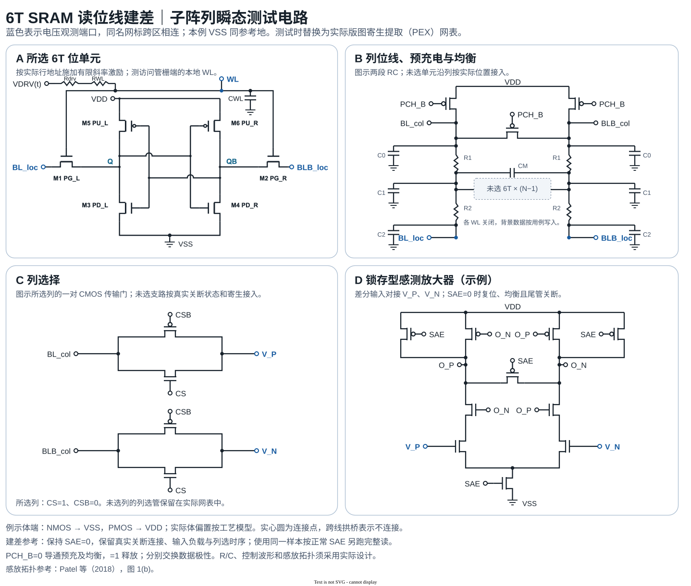
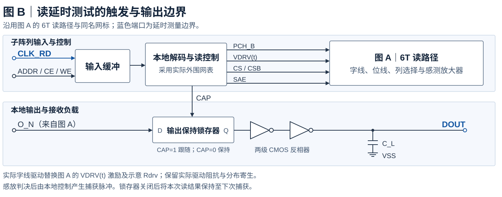

# RD (Read Delay)

## 定义与适用范围

**子阵列读延时**（Subarray Read Delay，RD，单位 s）是从子阵列接口**接受指定读命令**到本地数据输出首次有效的时间。本页以带差分感测和输出保持的 6T 静态随机存取存储器（Static Random Access Memory，SRAM）为例。

- **起点 $t_0$**：在子阵列输入端，取被接受的本地读时钟或请求有效沿通过规定门槛的时刻；示例用上升沿半幅。半幅为同条件稳定低、高电平的中点，电压以该端口本地 VSS 为参考。先确认地址、读允许及写禁止满足建立与保持要求，且本次命令确实被接受；译码和字线传播均从这个接口边界计入。异步或握手实现须记录实际触发信号、接受条件、极性和门槛；从已译码的字线开始测量时另报局部路径，不计为本文 RD。
- **原始观察**：保存输出端 `DOUT` 对接收端 VSS 的电压、首个目标方向门槛交点及后续回穿。分别用接收端判据 $V_{\mathrm{DOUT}}\ge V_{\mathrm{IH}}$（期望 1）和 $V_{\mathrm{DOUT}}\le V_{\mathrm{IL}}$（期望 0），同时核对输出已驱动、未被其他源争用，以及该结果属于本次命令。
- **终点 $t_{\mathrm{DV}}$**：取本次命令对应、持续合格到接收窗口末端的首个时刻。接收端在 $t_{\mathrm{S}}$ 采样时，输出须不晚于 $t_{\mathrm{S}}-t_{\mathrm{SU}}$ 进入有效区，并连续保持至 $t_{\mathrm{S}}+t_{\mathrm{H}}$；$t_{\mathrm{SU}}$、$t_{\mathrm{H}}$ 为规定的建立和保持时间。异步接口按规定建立／稳定窗口判定。毛刺或回穿后重新合格时，取持续合格区间的起点，禁止将下一笔返回的数据计入当前读。明确输出负载、接收阈值、采样窗分别相对哪个命令计时。
- **相邻读出同值**：若 `DOUT` 在本次读前已处于目标电平，有设计定义且可关联本次返回的 `VALID` 时，联合其有效沿与数据保持判定并单列；无 `VALID` 时，只观测 `DOUT` 可记录电平保持；有内部事件可结合本次 SA 判决和捕获确认返回。提取延时改用相反前值触发输出翻转。禁止把无交点的同值读填为 0。

$$
t_{\mathrm{RD}}=t_{\mathrm{DV}}-t_0 .
$$

库表征的 50%→50% 传播延时须另列，并报告时钟沿、输入转换时间、负载和输出转换时间所用阈值。OpenRAM 固定版本以时钟负沿为表征起点，并单独确定最小时钟周期；引用其他版本须重新核对边沿。[1, Characterization Measurements, Power/Delay Characterization]

## 物理机制与变异

读触发经输入缓冲和行列译码启动局部读。预充和均衡释放后，字线（Wordline，WL）到达选中位单元，低电位存储节点侧的位线（Bitline，BL）经访问管（Access Transistor，PG）和下拉管（Pull-down，PD）放电。放电差分经列选择传到感测放大器（Sense Amplifier，SA）。本地感放使能（Sense Amplifier Enable，SAE）启动再生；在输入极性、共模及差分满足判决条件后，SA 输出驱动后级锁存和输出缓冲。读 0 与读 1 的差分极性、锁存器输入和输出边沿按实际连线核对。[3, Secs. III-A–C] [5, pp. 1562–1565] [12, Sec. II, Fig. 1] [13, Sec. II-A, Fig. 1]

| 环节 | 主要变异与波形线索 |
| --- | --- |
| 本地控制和选通 | 输入边沿、译码扇出、字线分布 RC 及驱动压降改变局部 WL 到达时刻；预充、列选和复制路径的偏斜改变可用建差窗口。 |
| 建差与判决 | 位线分布 RC、列选择导通阻抗、位单元读电流及未选单元漏电改变感放输入差分；感放失调、输入共模、供电压差和使能边沿改变判决时间及失败概率。 |
| 捕获和输出 | SA 输出负载、锁存关闭时刻及输出级阻抗共同决定数据何时能驱动接收端。外接负载和耦合可增加输出转换时间，或使输出退回无效区。 |

在同一次完整读中记录 $t_0$、所选访问管处 WL 半幅 $t_{\mathrm{WL}}$、有效差分交点 $t_A$、本地 SAE 的规定交点 $t_{\mathrm{SAE}}$、实际输入采样时刻 $t_{\mathrm{obs}}$、SA 输出达到后级接收门槛并保持至捕获的时刻 $t_{\mathrm{SA}}$、后级捕获事件及 $t_{\mathrm{DV}}$。$t_A$ 按 [Read Develop Time](Read_Develop_Time.md) 的有符号差分判据提取；再生回扰遮住交点时标记不可观测，另用保持采样前条件的对照仿真诊断。差分建立和 SAE 复制路径可能并行，预充、列选与译码也可能重叠。各事件用同一 $t_0$ 对齐；只有同一事务中前后相接、不重叠的区间可加和。例如当 $t_0\le t_{\mathrm{SAE}}\le t_{\mathrm{SA}}\le t_{\mathrm{DV}}$ 且后级以 SA 稳定后的数据为准，按下式对账：[3, Secs. III-A–C] [9, Sec. 3.1] [13, Sec. II-A, Fig. 1]

$$
t_{\mathrm{RD}}
=(t_{\mathrm{SAE}}-t_0)+(t_{\mathrm{SA}}-t_{\mathrm{SAE}})
 +(t_{\mathrm{DV}}-t_{\mathrm{SA}}).
$$

第一段覆盖 SAE 规定交点之前的译码、字线传递及 [位线建差](Read_Develop_Time.md) 等事件；为定位竞态，应对照 $t_{\mathrm{obs}}-t_A$ 及采样前的差分和共模。直接耦合 SA 的取样参考须在再生回扰传入 SA 输入之前；禁止在上式中再加建差时长（会重复计入同一窗口）。若捕获与 SA 再生重叠，以实测起止端点报告 RD，附并行事件图。

## 子阵列接口与指标边界

| 口径 | 起止位置 | 交付用途 |
| --- | --- | --- |
| 子阵列 RD | 本地接受触发 → 带规定负载的本地输出有效 | 包含定义内译码、WL、建差、SA 与输出级。 |
| 读位线建差、SAE 及 SA 再生 | 局部 WL 半幅 → SA 输入合格差分；本地 SAE 或实际采样是控制／采样事件；再生到 SA 输出达到指定判决幅度 | 三类量分别报告，用于检查差分和 SA 的时序裕量。 |
| 宏接口读延时 | 宏端口接受请求 → 宏数据端有效 | 随设计计入输入树、预译码、全局数据复用／输出树和宏接口锁存；按实测负载交付。 |
| 缓存访问时间 | 缓存请求 → 数据和命中状态可供使用 | 随体系结构计入标签判定、路选、银行仲裁、流水线等路径；记录接口及周期数。 |
| 最小读周期 | 相邻两次合法读命令可被接受的最短间隔 | 验证后级保持、阵列复位、预充和均衡恢复；对流水线分别报告吞吐和首笔延时。[14, Sec. II-A, Table I] |

宏内请求树和回复树可能因组织方式与标签路径重叠，按实际关键路径预算。[4, Secs. 3–5] 库中的最小时钟周期须以连续合法读及恢复验证；$1/f_{\max}$ 给出该测试条件下的周期边界，不能替代从输入到有效数据的延时。[1, Characterization Options, Timing Measurement Checks] [10, Sec. III, Fig. 4]

## 测量与提取方法

### 仿真提取

图 A 复用 [子阵列读夹具与时序](Read_Develop_Time.md#测量与提取方法)：两侧分布位线、线间耦合、预充与均衡、CMOS 传输门列选择及 SAE 控制的锁存型 SA。图 B 从 `CLK_RD` 接受读命令，以实际字线驱动替换图 A 示例的 `VDRV(t)` 激励及 `Rdrv`，保留实际输出阻抗与分布 RC；`PCH_B`、`CS`／`CSB` 和 `SAE` 接入图 A 的同名端。完整读使用正常 SAE 时序。该连接读 $Q=0$ 时 $V_P<V_N$ 且判决后的 `O_N` 为低；读 $Q=1$ 时反向。输出锁存器在本地 `CAP=1` 时跟随 `O_N`，`CAP` 下降沿关闭锁存；须满足该沿的建立与保持要求；应在 SA 复位前关闭，保持到下次开启；其后经同相 CMOS 缓冲驱动 `DOUT`，$C_L$ 接接收端参考 VSS。后仿真采用实际输出拓扑与负载；无输出锁存的设计按真实复位及前值记录两种输出边沿。

**【前置条件】** 使用寄生参数提取（Parasitic Extraction，PEX）网表，保留本地输入缓冲、行列译码、时序发生电路、驱动、同列未选单元、关断列选支路、互连耦合、感放、锁存与输出缓冲。配置供电压差 $V_{\mathrm{DD}}-V_{\mathrm{SS}}$、体偏置、工艺／电压／温度（Process, Voltage and Temperature，PVT）、RC 角、输入转换时间、输出等效负载 $C_L$ 或接收网表、地址、目标数据和各级截止。裁剪时先用相同负载及波形对照完整 PEX。[13, Secs. II–III]

**【步骤／方法】**

1. **建立初值与前值**：通过实际写路径写入被测位置和背景。先读相反的数据建立前值，经过正常预充及均衡后发出目标读；分别测输出上升、下降及生产使用的连续读序列。示例预充阶段 PCH_B 为低；进入读窗口时预充与均衡关断，所选列的 CS／CSB 为高／低。记录释放前的位线共模和残差，核对行列地址及控制接受条件。
2. **运行带载瞬态**：保存本地输入、译码输出、两侧 PG 栅端 WL、预充／均衡、列选、SA 输入、SAE、SA 输出、锁存控制、`DOUT`、选中位单元的 $Q$/QB。用真实接收器或规定负载检查输出；若含 `CAP`，按锁存器的实际建立／保持及释放条件判定捕获。采样步长须分辨最快回穿，并用减小最大步长验证交点收敛。
3. **提取并验证有效区间**：插值提取 $t_0$ 和首个输出目标方向交点；从接收窗口末端回溯持续有效区间，复核事件归属和建立截止，记录 $t_{\mathrm{DV}}$、原始交点及诊断事件。独立采用安全读回确认被测单元仍保持原数据。将下一条合法读提前，单独扫最小可用周期；检查两笔数据、输出保持、预充及 SA 复位。
4. **覆盖快慢路径**：扫描工艺角、供电、温度、输入转换时间、输出负载、两极性、近／远行列、相邻线与同列数据背景及失配。保留每个样本地址、SA 实例、配置、观测截止和状态；对 Liberty 另提规定的半幅延时及转换时间。[1, Characterization Options, Timing Measurement Checks] [8, Secs. IV–V] [13, Secs. II–III]

**注意事项**：禁止以独立理想脉冲替换 WL、SAE 或捕获控制后仍报告完整 RD（会删除真实传播和竞态）；独立扫描只用于定位可用窗口。

**【结果处理和验证】** 提交时钟与输出双极性的 RD、起止电压、负载、步长收敛结果及失败状态。以输出接受窗和安全读回作为独立通过条件。例：$t_0=100$ ps，读 1 在 185 ps 首次跨过 $V_{\mathrm{IH}}$ 后回落，在 220 ps 重跨并保持至 270 ps，且建立截止为 250 ps，则原始过阈延时为 85 ps，RD 为 120 ps。若 220 ps 才开始合格而建立截止为 210 ps，记为超时，另列实测出数时间。

**文献仿真复核**：Liu 等对 288 列、256 行、4:1 列复用子阵列选取距行译码、SA 和写驱动最远的位单元。采用论文的器件和寄生模型，A5/A3 的 PMOS PG 方案先预放电、选通后由一侧 BL 充电，差分达到 150 mV 后触发感测；直接从输入时钟的半幅量到 SA 数据输出半幅。图 15 比较采用 27 °C 的典型角。这是模型下的最差位置仿真，终点在 SA 输出；本文的带载输出有效延时须另提。Song 等的 65 nm 模型以译码、字线、位线和感测分项拟合 PEX 结果，感测常量按作者实现校准。[11, Secs. III-A–B, III-D–E, Table II, Figs. 14–15] [5, pp. 1562–1565, Figs. 3–5]

### 硅片测试

**【前置条件】** 配置自动测试设备（Automatic Test Equipment，ATE）或片上采样器，确认能否观测与仿真同边界的局部接受点及本地输出。固定芯片、地址和供电温度，确认测试模式、激励边沿、输出负载、阈值、采样孔径及判据。用已知边沿或等效旁路标定通道固定延迟、时钟偏斜、抖动、增益／阈值和带宽，量化探测器对本地节点的加载。

**【步骤／方法】**

1. **直接测局部或宏端点**：对已知互补数据发出合法读，用同一时基捕获两波形。用校准后的时间轴提取原始门槛交点和持续有效的稳定交点，分别记录两种输出边沿；回穿异常须核对带宽、采样时间基准和重复性。参考路径仅可去掉已验证可分离且负载、极性、带宽可比的测量偏移。只能接触宏管脚时交付宏端口测量值。
2. **用片上测试取得功能代理**：仅有数字结果时，逐相位比较期望数据，按目标错误率报告相邻的最晚不合格／最早持续合格相位、步长及试验次数，复核不连续的通过区间。逐相位重复读仅给出数字采样边界，不能证明某一次输出波形连续合格。若片上自测试（Built-In Self-Test，BIST）只支持扫 WL 脉宽、SAE 或整周期，分别报告临界脉宽、感测时序边界或频率通过区。扫边界时每个样本复位、重新写入原值，并独立读回检查能否保持状态。
3. **核对文献实测边界**：Kim 等的 130 nm、480 kb、10T 样片分四个阵列象限测访问时间与最高工作频率。按图 17，0.20 V 时，128 到 1024 位单元／位线的访问时间约从 2 μs 增至 10 μs。图 20 是 0.17 V 时钟与读数据的功能波形；图 19 的旁路校准仅针对复制的行译码路径。原文未给出本文的本地双阈值和保持窗，图 17 的结果列为测试宏数据。[17, Sec. III, Figs. 14, 17, 19–20]
4. **复核临界 WL 脉宽代理**：Toh 等在 45 nm 样片利用片上可编程脉冲和本地 WL 采样器校准脉宽，扫到 SA 能正确锁存的最短 WL 脉宽；另用多次短 WL 脉冲作低扰动读回。动态测量使用校准至 10 ps 分辨率的 WL 脉宽，图 14 是 1024 个位单元、0.8 倍标称供电的临界值分布。该代理排除了 WL 驱动与 SA 本身传播延时。[2, Sec. II-A, III–IV, Fig. 14] [2, Secs. III, V-A–B, Figs. 8–10, 13–14]

**注意事项**：禁止把测试节拍、临界 WL 脉宽或 SAE 延迟直接换算成 RD（相应功能边界含不同路径且可能受 SA 失调影响）。

**【结果处理和验证】** 报告实测端口、校准后的时间及幅度不确定度、实际负载、通过窗口、失败比例和样本数。结果按子阵列直接测量、宏端点测量和功能代理分表；在有重叠端点的样片上检验代理残差和适用范围，缺少验证时保留其原始口径。

## 数据可视化与评估

| 图表 | 记录与判读 |
| --- | --- |
| 同轴事件波形 | 标明启动、WL、有效差分、SAE、SA 输出、锁存、DOUT 原始交点／稳定交点、接收窗及下一笔读；按事件时差定位控制、建差、再生或输出瓶颈。 |
| RD 与输入转换时间／负载／供电曲面、行列热图 | 各组采用相同阈值、保持条件和错误率目标；分开上升／下降、前值、背景、RC 角及近／远端。 |
| 经验累积分布（Empirical Cumulative Distribution Function，ECDF）及状态比例 | 给出成功样本的条件分位数、测试样本数及地址范围；按同列和共享 SA 分层，区分片内、芯片间和重复读。功能失败率附置信区间。[RSNM](../Bitcell/RSNM.md#数据分析与评价方法) |
| 周期／采样相位双轴通过图 | 固定负载和数据背景，分别标出采样截止失效和恢复不足；用于设置接收窗、最大可用频率及保护时间。 |

有效观测到规格截止仍未合格时，按所见分类为**迟到／超时、错误数据、疑似亚稳态或控制失败**；确认亚稳须有 SA 节点持续近等电位或迟滞分辨的波形，只有数字比较结果时记为未解析失败。读回发生翻转时另标**读扰**，即使本次输出正确也计入读扰失败率。探头失锁、波形步长不足或触发条件无效时标为**无效测试**并补测。采集提前结束，且未见候选有效起点、后续仍可能及时合格时，才记为**右截尾**，用最后可靠观测时刻减去起点作为延时下界。若已出现候选起点但保持证据不足，另标未判定，按现有证据报告时间区间。截尾不等于通过或功能失败，禁止代入截止值计算延时分位数；超出观测范围的尾部分位数报告界限或不可估。[8, Secs. IV–V] [12, Secs. II–III]

## 应用场景与指标关系

- **收敛本地读时序**：同时检查最慢地址的输入接受到 WL、有效差分采样裕量、再生和捕获，再决定改译码／WL 驱动、列高／复用比、SAE 或输出缓冲。改变感测时序时，按同一目标读失效率复核 [感放判决门槛](../Peripherial/SA_Decision_Threshold.md)、[读位线建差](Read_Develop_Time.md) 及 [读稳定性](../Bitcell/RSNM.md)。[12, Secs. II–III] [13, Secs. II–III]
- **确定恢复和吞吐约束**：在真实连续读节拍下验证输出保持、WL 撤销、均衡及 SA 复位。分别交付读延时上限和最小合法周期，便于时序库和系统接收端选择约束。[10, Sec. III, Fig. 4] [14, Sec. II-A, Table I]
- **设计与工艺协同优化**（Design-Technology Co-Optimization，DTCO）：在相同边界、负载、工况与目标失效率下联合评估 RD 和 [读能量 RE](Read_Energy.md)。预算宏级 [能量延时积 EDP](../Macro/EDP.md) 时，按宏接口重提延时和每次访问能量，纳入 [全局访问树](../Macro/Tree_Delay_Energy_Percent.md)。[4, Secs. 3–5] [11, Secs. III-D–E] [16, Figs. 11–12]

## 参考文献

2026-11-17 核查 Zotero `02-SRAM-DTCO/SRAM-Metrics/Subarray`（`L9CVSGRT`）的精确标签 `RD (Read Delay)`：初检 14 条，补检后 16 条；15 条的本地 PDF 与仓库归档 SHA-256 一致，[6] 的本地附件缺失，保留官方全文入口。按原文核验可用的独立期刊／会议研究共 10 篇：[2]、[3]、[5]、[8]、[10]–[14]、[17]；其余作为边界背景保留，[7] 按原文为硕士论文。保留全部原编号及归档。

补检使用 Crossref 和 OpenAlex，关闭 Sci-Hub。审阅作业 `f8f515a0b4be` 的 30 条候选，保留两条确切 DOI：给已有 Toh 条目补标签并复用 PDF，新建 Kim 条目；自动获取超时后以 NTU 公开出版版补挂同一条目，续跑核验两个附件均可读。预检作业 `3555a1a0cf16` 检得 24 条候选，首选 BATT 未取得可核验 PDF，转用已核验的硅测证据，预检作业在批准前取消、未写入 Zotero。

[1] VLSIDA, “Characterization,” OpenRAM, revision 2f7b3866418ac1ce17ad959207a1489033d8c577. [原文](https://github.com/VLSIDA/OpenRAM/blob/2f7b3866418ac1ce17ad959207a1489033d8c577/docs/source/characterization.md)；Zotero：本次检索范围内未匹配记录。

**相关摘要：** 该固定版本的官方文档说明OpenRAM用SPICE生成时序与功耗表，也支持解析模型。表征按工艺、电压、温度、输入边沿及输出负载展开，最小时钟周期通过搜索确定；内部位线、节点和感放使能检查用于验证功能。动态功耗和漏电分别处理，解析结果依赖工艺参数，不能与完整后仿真混为同一精度。该版本把读出表格中的延迟定义为负时钟沿到输出数据，而输出边沿和最小周期另行表征。与本页比较应保持具体触发沿、有效电平和负载条件，不能把周期倒数或位线发展时间替代读取延迟。

**原文定位：** 网页“Characterization Measurements”“Analytical Characterization”“Power/Delay Characterization”，固定提交2f7b386。

[2] S. O. Toh, Z. Guo, T.-J. K. Liu, and B. Nikolić, “Characterization of dynamic SRAM stability in 45 nm CMOS,” IEEE J. Solid-State Circuits, vol. 46, no. 11, pp. 2702–2712, 2011. [DOI 10.1109/JSSC.2011.2164300](https://doi.org/10.1109/JSSC.2011.2164300). [公开文献](https://doi.org/10.1109/JSSC.2011.2164300)；[Zotero](https://www.zotero.org/users/7333024/items/PTWVUSQP)。

**相关摘要：** 论文在45 nm芯片中用可编程字线和采样电路表征动态稳定性，读写成功由有限脉冲后的状态或感放结果判断。作者校准真实本地脉宽，并区分读访问失败、读扰和写失败；不同列的感放失调会影响读取统计。静态裕量与动态指标并非一一对应，因此必须明确脉冲条件、观察节点和成功判据。原文读取时间主要指使感放成功的临界字线窗口，排除了字线驱动与感放本身延迟。因此该文仅支撑读访问组成和失败机制，不能直接提供本页完整请求到输出边界的延迟数值。

**原文定位：** §II、§IV，pp.2703–2707（PDF第2–6页），图2、6及字线波形。

[3] B. S. Amrutur, and M. A. Horowitz, “Speed and power scaling of SRAM's,” IEEE Journal of Solid-State Circuits, vol. 35, no. 2, pp. 175-185, 2000. [公开文献](https://doi.org/10.1109/4.823443)；[DOI](https://doi.org/10.1109/4.823443)；[Zotero](https://www.zotero.org/users/7333024/items/CH2EXX7I)

**相关摘要：** 论文用解析模型探索SRAM组织、容量和技术缩放，包含译码、字线、位线、感放及输出复用。研究以读路径为关键路径，只建模读取动态能量，外部输出负载被排除；门尺寸主要按最小时延设定，低能量方案未必全局最优。模型明确线长和负载的作用，并与电路仿真验证，应用时必须保留这些假设。完整读路径包含译码、局部字线、位线、感放及输出复用，部分结构可并行，不能把所有门延迟机械相加。其外部负载被排除，使用总读时间时应说明与实际宏输出有效判据的差别。

**原文定位：** §III-A–C，pp.177–180（PDF第3–6页），式(2)–(7)、图4–11。

[4] S. Thoziyoor, N. Muralimanohar, and N. P. Jouppi, “CACTI 5.0,” Hewlett-Packard Laboratories, Tech. Rep. HPL-2007-167, Oct. 19, 2007. ；[Zotero](https://www.zotero.org/users/7333024/items/JYDVTQLK)；DOI：Zotero未收录或尚未核实。

**相关摘要：** 归档附件实际为2007年CACTI 5.0报告，作者为Thoziyoor、Muralimanohar和Jouppi，不能按Zotero的2008年四作者题录引用。报告将存储器分为bank、mat及子阵列，建模译码、位线、感放、复用和请求／回复树。地址与输入数据树可门控，输出树使用不同驱动结构；阵列组织搜索需同时考虑时延、功耗与布局开销。读访问模型沿请求进入子阵列、位线感测和数据回复的路径累加延迟。用于局部读延迟时应截取子阵列边界，排除bank间树和标签比较；报告整体缓存时间不能直接充当本页数值。

**原文定位：** §3–5，报告pp.8–27（PDF第9–28页）。

[5] Q. Song, C. Y. Peng, H. G. Zhou, and S. B. Tan, “Time delay model for SRAM compiler,” Applied Mechanics and Materials, vol. 373-375, pp. 1561-1566, 2013. [公开文献](https://doi.org/10.4028/www.scientific.net/AMM.373-375.1561)；[DOI](https://doi.org/10.4028/www.scientific.net/AMM.373-375.1561)；[Zotero](https://www.zotero.org/users/7333024/items/CJ32UAW9)

**相关摘要：** 论文为65 nm编译器建立简化时延模型，将访问分成译码、字线、位线和感放。字线用驱动电阻与栅电容表示，位线用读晶体管等效电阻、结电容和预充管电容表示，并与版图抽取仿真比较。部分导线电阻被忽略，感放时延视为固定值；模型适用性受阵列尺寸和工艺限制，不能直接泛化到互连主导节点。总时延模型由译码、字线、位线和感放四项组成，并以时钟至输出的版图仿真验证。其位线终点和感放常数属于特定实现，不能把分项时常直接视为完整读延迟或通用于先进工艺。

**原文定位：** pp.1562–1565（PDF第2–5页），图3–5、式(1)–(9)。

[6] B. Chen, “Timing Characterization of an SRAM Generated from OpenRAM: An Open-Source Memory Compiler,” M.S. thesis, University of California, Santa Cruz, June 2016. [官方全文 PDF](https://escholarship.org/content/qt5kq8c8p1/qt5kq8c8p1.pdf)（已核验，尚未本地归档）；[原文]( <https://escholarship.org/uc/item/5kq8c8p1>)；[Zotero](https://www.zotero.org/users/7333024/items/WQEEXQVC)；DOI：Zotero未收录或尚未核实。

**相关摘要：** Chen的2016年硕士论文介绍OpenRAM接口级SPICE表征：构造写入、清除数据总线和读回序列，二分搜索可行时钟周期，并输出延迟和平均功率。文中读延迟从正时钟沿计至数据总线有效，和最小时钟周期分别测量；这一版本与后来的负沿定义不可混用。对本页应用应保持输出负载、输入边沿和测试数据一致，并注明其结果为寄生回标前表征。公开官方全文已经核验，下载请求受站点限制，当前没有本地PDF归档。

**原文定位：** §5.2.2–5.2.5，书内pp.46–49（官方PDF第56–59页）。

[7] A. Dosi, “6T-SRAM 1Mb Design with Test Structures and Post Silicon Validation,” M.S. thesis, Arizona State University, Aug. 2017. [公开文献](https://keep.lib.asu.edu/items/155708)；[Zotero](https://www.zotero.org/users/7333024/items/C5Y4VDC4)；DOI：Zotero未收录或尚未核实。

**相关摘要：** Dosi的2017年硕士论文实现带测试结构的1 Mb SRAM，展示子阵列读写波形。读操作经历译码、字线激活、感测线差分形成、感放判决与输出锁存；写数据经驱动器及列选择到达单元。论文强调预充、字线和感放之间的竞态约束，各局部传播延迟与完整访问延迟需按图中起止信号分别记录。时序图分开给出时钟、字线、位线、感放和数据输出。引用读延迟时须从所选请求边沿到有效输出，不能只采用某段位线放电值；输出锁存与负载条件也应随工作角记录。

**原文定位：** §2.2.3、§2.4.2–2.4.3，书内pp.12–15、23–26。

[8] T. Haine, J. Segers, D. Flandre, and D. Bol, “Gradient importance sampling: an efficient statistical extraction methodology of high-sigma SRAM dynamic characteristics,” in 2018 Design, Automation & Test in Europe Conference & Exhibition (DATE), 2018, pp. 195-200. [公开文献](https://doi.org/10.23919/DATE.2018.8342002)；[DOI](https://doi.org/10.23919/DATE.2018.8342002)；[Zotero](https://www.zotero.org/users/7333024/items/34BPPVWD)

**相关摘要：** 论文用梯度重要性抽样提取SRAM高西格玛动态失效。写案例采用理想驱动、六只单元晶体管变化；读案例还包含感放与同列未选单元，背景数据取不利方向。研究在低电压28 nm FDSOI模型中比较失效概率估计与蒙特卡洛，重点是稀有事件提取效率；两种案例的电路边界不同，不能作为相同层级的访问时间直接对比。读取案例纳入感放及未选单元，所以比单元电流模型更接近列级访问判据。但理想控制和测试电路边界仍与完整子阵列不同，失败概率的读取时间限制不应直接当成宏读延迟。

**原文定位：** §IV–V，pp.198–199（PDF第4–5页），图2–4。

[9] H. Nichols, “Statistical Modeling of SRAMs,” M.S. thesis, University of California, Santa Cruz, Mar. 2022. [公开文献](https://escholarship.org/uc/item/7vx9n089)；[Zotero](https://www.zotero.org/users/7333024/items/BTUF3HG9)；DOI：Zotero未收录或尚未核实。

**相关摘要：** 附件为Hunter Nichols的2022年加州大学圣克鲁兹分校硕士论文，Zotero作者与年份有误。论文在OpenRAM中建立时序图，组合解析和统计模型预测访问特性。图构建会排除预充电等不属于读关键路径的连接，但仍需保留真实负载；各级输入电容、输出负载和转变时间共同决定传播，统计模型依赖训练配置覆盖范围。论文以时钟至目标输出位为读取延迟，沿时序图累加实际路径；预充电先于读操作，不作为同一因果路径上的串联阶段。表征还改变输入边沿和输出负载，引用必须保留这一查表条件。

**原文定位：** §2.1、§3.1，书内pp.6–7、12–20。

[10] J. Lee, J. Park, S. Kim, and H. Jeong, “Bayesian learning automated SRAM circuit design for power and performance optimization,” IEEE Transactions on Circuits and Systems I: Regular Papers, vol. 70, no. 12, pp. 4949-4961, 2023. [公开文献](https://doi.org/10.1109/TCSI.2023.3313874)；[DOI](https://doi.org/10.1109/TCSI.2023.3313874)；[Zotero](https://www.zotero.org/users/7333024/items/PFB6PZIF)

**相关摘要：** 论文以贝叶斯学习调整SRAM电路参数，在动态功耗、访问速度和功能约束间搜索。大实例的金属负载随重复叶单元增加，作者利用不同容量间的关系降低优化仿真成本，并用后仿真检验候选设计。时序约束不仅包括外部访问，也涉及读写内部裕量和控制竞态；仅满足平均延迟不能保证所有操作和工艺角都成功。读取访问时间是优化目标之一，内部竞态和动态裕量则保证可行性。评估应采用通过约束检查的后仿真结果，并报告容量、负载与工作角；动态平均功率改善不能推断同等读延迟改善。

**原文定位：** §II–III，pp.4950–4955（PDF第2–7页）。

[11] H. H. Liu et al., “CFET SRAM DTCO, interconnect guideline, and benchmark for CMOS scaling,” IEEE Transactions on Electron Devices, vol. 70, no. 3, pp. 883-890, 2023. [公开文献](https://doi.org/10.1109/TED.2023.3235701)；[DOI](https://doi.org/10.1109/TED.2023.3235701)；[Zotero](https://www.zotero.org/users/7333024/items/W99KL789)

**相关摘要：** 论文对A14至A3的SRAM进行器件、互连和子阵列协同分析，使用完整外围与288列、256行阵列，并考察距译码、感放及写驱动最远的单元。寄生参数由器件模型和三维抽取联合提供；增加驱动能力也增大电容，性能改善会饱和。写辅助采用概念性电压源，比较能耗时需注明尚未包含具体辅助发生器的全部实现代价。读延迟明确从时钟半幅计到感放输出半幅，感放在位线差分达到规定幅度后开启。该边界包含局部控制和判决，适合子阵列读延迟比较，但不含宏级树形互连与核心接口。

**原文定位：** §III-A–B、III-D–E，pp.886–889（PDF第4–7页），图10、14–15。

[12] T. Yoon, and H. Jeong, “Machine learning-based read access yield estimation and design optimization for high-density SRAM,” IEEE Transactions on Computer-Aided Design of Integrated Circuits and Systems, vol. 42, no. 8, pp. 2618-2630, 2023. [公开文献](https://doi.org/10.1109/TCAD.2022.3225066)；[DOI](https://doi.org/10.1109/TCAD.2022.3225066)；[Zotero](https://www.zotero.org/users/7333024/items/Y9LBTSB6)

**相关摘要：** 论文用机器学习估计高密度SRAM读良率，联合优化感放尺寸和使能延迟链。读成功要求实际使能时刻的差分克服失调，窗口受字线和感放控制路径变异影响；延后使能可提高裕量，却增加访问延迟。贝叶斯优化在目标良率约束下寻找速度方案，结论依赖阵列组织、器件变异和所选工作条件，不能跨配置直接比较。优化对象的访问延迟包含控制、感测和输出过程，须与单纯字线至感放窗口分开。感放变大或使能变晚可能改善良率却影响总延迟，比较应使用同一容量和良率约束下的配对结果。

**原文定位：** §II–III，pp.2619–2622（PDF第2–5页），图1、式(4)。

[13] I. Jeon, H. Park, T. Yoon, and H. Jeong, “High efficiency variation-aware SRAM timing characterization via machine-learning-assisted netlist extraction,” IEEE Transactions on Circuits and Systems II: Express Briefs, vol. 71, no. 3, pp. 1391-1395, 2024. [公开文献](https://doi.org/10.1109/TCSII.2023.3318577)；[DOI](https://doi.org/10.1109/TCSII.2023.3318577)；[Zotero](https://www.zotero.org/users/7333024/items/6YYYAIT2)

**相关摘要：** 论文从后仿真网表提取关键路径，用机器学习调整保留的寄生负载，使裁剪电路近似原电路时序与变异。作者分开标注时钟至字线、时钟至感放使能和时钟至输出延迟，要求感放启动前差分足够。方法旨在降低统计表征成本，裁剪精度仍以完整网表为准，不能因移除非关键支路就忽略其电容作用。论文明确把时钟至最终输出作为关键读访问指标，同时保留字线和使能路径。裁剪网表通过寄生校准提高表征效率，应用于本页时应记录完整网表参考误差，而不是把算法加速倍数当电路加速。

**原文定位：** §II-A、§III，pp.1392–1394（PDF第2–4页），图1–4。

[14] S. Kim, J. Lee, D. Kim, J. Park, S. Lee, and H. Jeong, “Simultaneous optimization of various-sized SRAM instances through machine learning-driven transistor sizing and leafcell circuit pool construction,” IEEE Transactions on Circuits and Systems I: Regular Papers, vol. 72, no. 7, pp. 3376-3389, 2025. [公开文献](https://doi.org/10.1109/TCSI.2025.3531948)；[DOI](https://doi.org/10.1109/TCSI.2025.3531948)；[Zotero](https://www.zotero.org/users/7333024/items/8KHXGGHN)

**相关摘要：** 论文通过贝叶斯优化建立不同尺寸叶单元的电路池，同时优化多种容量SRAM。访问时间和周期时间分列，设计还受读写动态裕量与多种信号竞态限制；局部尺寸改变需在多个实例及工艺电压温度条件下检验。优化给出的功耗与速度属于完整实例表征，不能把周期缩短或平均功率变化直接当成位线建立时间变化。文中把访问时间与周期时间作为不同约束；前者对应请求至读输出，后者还受恢复及下一次操作限制。叶单元池优化的收益应按相同容量和工艺角比较，不能用频率倒数替代访问延迟。

**原文定位：** §II-A、§III，pp.3377–3382（PDF第2–7页），表I。

[15] H. H. Liu, and F. Catthoor, “Circuit-technology Co-optimization of SRAM design in advanced CMOS nodes,” Cham, Springer Nature Switzerland, 2025. [公开文献](https://doi.org/10.1007/978-3-031-76109-6)；[DOI](https://doi.org/10.1007/978-3-031-76109-6)；[Zotero](https://www.zotero.org/users/7333024/items/CHVFC3IE)

**相关摘要：** 本书贯通单元、子阵列和宏级仿真。局部指标由含寄生和外围的电路得到，宏模型再加入树形互连、控制驱动及核心至数据通路；两级统计边界不可混用。先进节点的单元缩小未必等比例改善访问性能，线阻、电容和写辅助代价可能抵消收益。宏级比较采用明确容量、树形结构、引脚位置及工艺条件，并讨论写入可行性的约束。第2章把读延迟定义为时钟半幅至感放输出半幅，并以规定差分触发感放。此定义适用于含外围的子阵列，宏级读时延另有树和控制开销，技术比较应固定输出负载和阵列大小。

**原文定位：** §2.3.2、§2.4.2、§6.2、§7.1–7.5，书内pp.36、42、137–139、174–181。

[16] W. Peng et al., “PPA scaling of flip FET technology down to A2 node enabled by architecture innovations: self-aligned gate, 2T design with embedded power rail and ultra-stacked 4-tier transistors,” in 2025 Symposium on VLSI Technology and Circuits (VLSI Technology and Circuits), 2025, pp. 1-3. [公开文献](https://doi.org/10.23919/VLSITechnologyandCir65189.2025.11074822)；[DOI](https://doi.org/10.23919/VLSITechnologyandCir65189.2025.11074822)；[Zotero](https://www.zotero.org/users/7333024/items/98D5AA4T)

**相关摘要：** 论文提出双面及多层晶体管结构，结合器件实验和设计投影讨论向A2缩放。SRAM部分比较不同单元结构与阵列折叠方式，分别缩短行或列的有效线长，并展示每单元字线、位线寄生及最差位置的读写指标。器件工艺演示与阵列电路预测属于不同证据层级，不能把所有SRAM性能结果表述为完整存储器实测。图12给出固定阵列中最差位置单元的性能，折叠可缩短相应线长并缓解寄生。若用于本页，应注明文中读延迟的端点和仿真范围；图示提升不能自动外推为完整宏接口读速度。

**原文定位：** SRAM design部分，PDF第2–3页，图11–12。

[17] T.-H. Kim, J. Liu, J. Keane, and C. H. Kim, “A 0.2 V, 480 kb subthreshold SRAM with 1 k cells per bitline for ultra-low-voltage computing,” IEEE Journal of Solid-State Circuits, vol. 43, no. 2, pp. 518–529, 2008. [DOI](https://doi.org/10.1109/JSSC.2007.914328)；[NTU 开放归档](https://hdl.handle.net/10356/84782)；[公开文献](https://doi.org/10.1109/JSSC.2007.914328)；[Zotero](https://www.zotero.org/users/7333024/items/QRLTXRPI)。

**相关摘要：** 130 nm CMOS 样片为 480 kb、10T 亚阈值 SRAM，四个象限的位线分别接 128、256、512 和 1024 个位单元。图 17 分别给出四个象限的实测访问时间和最高工作频率，图 20 验证最低读供电下的出数波形。图 19 的去嵌用于复制行译码路径；论文未披露供本文完全复用的本地接受信号、接收阈值与保持窗，访问时间数值用于说明硅片宏级比较。

**原文定位：** §III，pp. 526–528（PDF 第 9–11 页），图 14、17、19–20。
