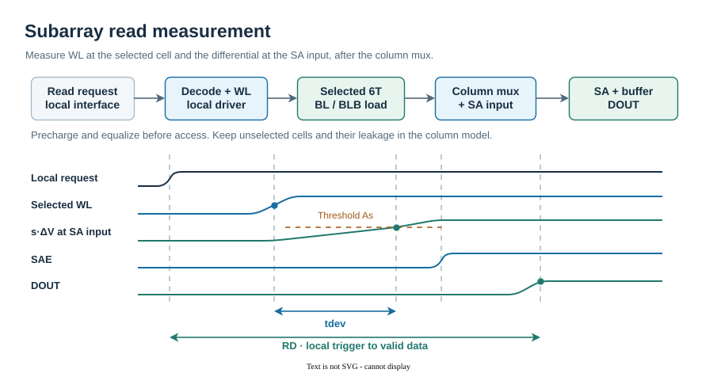
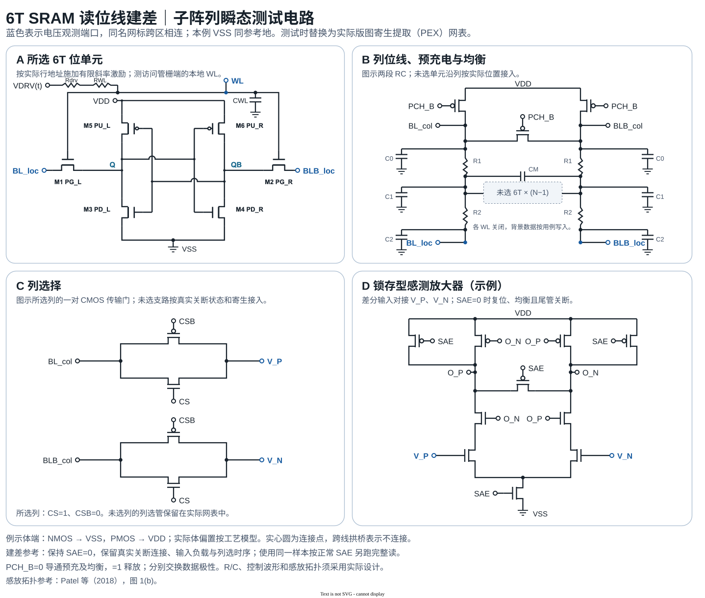

# Read Develop Time

## 定义与适用范围

**读位线建差时间**（Read Develop Time，$t_{\mathrm{dev}}$）是子阵列内，从选中位单元的局部字线（Wordline，WL）上升至半幅，到所选感测放大器（Sense Amplifier，SA）输入端建立规定极性和幅度的差分、并保持至采样参考时刻的时间，单位 s。本文以采用电压差分感测的 6T 静态随机存取存储器（Static Random Access Memory，SRAM）为例。其他拓扑须注明读使能、感测端口和信号类型。

- **起点 $t_{\mathrm{WL}}$**：在选中位单元的放电侧访问管栅端测 WL 对本地 VSS 的电压。取读有效沿首次向上通过 $V_{\mathrm{WL,L}}+(V_{\mathrm{WL,H}}-V_{\mathrm{WL,L}})/2$ 的时刻。高、低电平取同一偏置、驱动和位置的实际稳定值；短脉冲无平台时，用同配置校准脉冲取得参考值并记录。若提取网表拆分两侧栅端，同时保存对侧 WL 波形。未跨半幅的样本单列为 WL 未达标。
- **输入极性**：$V_P,V_N$ 分别是列选择后对应位线（Bitline，BL）和互补位线 BLB 的 SA 输入电位，以 SA 本地 VSS 为参考；$V_{\mathrm{CM}}=(V_P+V_N)/2$。$Q$/QB 为存储节点和互补存储节点。定义 $d(t)=s[V_P(t)-V_N(t)]$。按图示接线，读 $Q=0$ 时 BL 放电，$s=-1$；读 $Q=1$ 时 BLB 放电，$s=+1$。列选择反接时按实际连线重定 $s$。
- **终点 $t_A$**：从 $t_{\mathrm{WL}}$ 起，取 $d(t)$ 达到 $A_s>0$ 且持续合格至采样参考时刻 $t_{\mathrm{obs}}$ 的首个时刻，$t_{\mathrm{dev}}=t_A-t_{\mathrm{WL}}$。期间须保持有效列连接、预充与均衡关闭、共模在门槛标定范围内。如有回穿，取最后一个持续合格区间的起点。
- **采样参考 $t_{\mathrm{obs}}$**：按正常读的实际感测方式标定。带输入隔离的 SA 取隔离前的有效采样时刻；直接耦合的 SA 取启动再生使输入受扰之前的采样点。记录本地使能的边沿方向、阈值及采样参考相对该边沿的偏移。延后使能的建差对照须沿用正常读的 $t_{\mathrm{obs}}$。
- **阈值 $A_s$**：采用在相同 $V_{\mathrm{CM}}$ 范围、输入波形与源阻抗、使能边沿、输出负载、判决时限及目标失效率下标定的 [感放判决门槛](../Peripherial/SA_Decision_Threshold.md)。共模随时间变化时，须验证门槛覆盖该轨迹；超出校准范围须按实际波形重标。没有标定门槛时，按明确给出的电压扫描 $t_{\mathrm{dev}}(A_s)$，并标明为测试阈值。文献采用过供电压差的 10% 作为模型终点，属于比较条件。[3, Sec. 3.2] [5, Sec. II-C] [16, pp. 1563–1565]

图中 SAE（Sense Amplifier Enable，感放使能）标记控制时刻；建差取感测前的差分，SAE 后的差分画法仅为时序示意。[子阵列读延时 RD](Read_Delay.md) 从本地读触发计至读输出有效，包含译码、字线传递、建差、SA 再生及定义内的输出缓冲。读稳定性以原存储状态能否保持判定；Toh 等的临界读 WL 脉宽则以最短能正确读出的脉宽判定，另有读扰翻转试验。[1, Sec. II-A, Fig. 2] [1, Sec. II-B, Fig. 3]

## 物理机制与变异

预充及均衡释放后，两条位线解除预充钳位，仍接实际列选择、寄生及漏电支路。WL 开启时，低电位存储节点侧的位线经访问管（Access Transistor，PG）和下拉管（Pull-down，PD）放电。选中单元的瞬态 [读电流](../Bitcell/Read_Current.md) 以从位线流入单元为正；低节点抬升、局部 WL 电位、位线偏置、供电压降及器件失配共同改变该电流。未选单元可从两侧吸取不同的 [位线漏电](BL_Leakage.md)，尤其在长列或低供电下可减小、增大或反转正确差分，须保留同列数据背景。[5, Sec. II-C] [6, Eq. (3), Fig. 2(a)] [9, Sec. 2] [24, Sec. III, Eq. (14)]

在忽略耦合、每侧可等效为集中电容的近似下，设 $I_P,I_N$ 为两条等效节点的净放电电流（A，流出节点为正），$C_P,C_N$ 为对应电容（F），则

$$
\frac{\mathrm{d}d}{\mathrm{d}t}\approx s\!\left(\frac{I_N}{C_N}-\frac{I_P}{C_P}\right),\qquad
\frac{\mathrm{d}V_{\mathrm{CM}}}{\mathrm{d}t}\approx -\frac{1}{2}\!\left(\frac{I_P}{C_P}+\frac{I_N}{C_N}\right).
$$

两侧均放电时，共模可明显下降而差分仍小。单侧小摆幅且正向净电流近似恒定时，可用 $\Delta t\approx C_{\mathrm{eff}}\Delta V/I_{\mathrm{net}}$ 估算该段时间；$\Delta V$ 为待补足的差分，$I_{\mathrm{net}}$ 的符号按正确差分的方向合成。两侧电流、负载或耦合显著时，须使用实测波形或分布网络。预充释放、列选切换和相邻线耦合可引起阶跃或回穿；是否达标以有效窗口的持续交点判定。[2, Secs. 5.5–5.6, Figs. 9–10] [5, Sec. II-C] [27, Sec. III-C]

## 局部位线与感测端口边界

| 观测位置 | 记录量 | 工程用途 |
| --- | --- | --- |
| 选中位单元 | 两个访问管的局部 WL、$Q$/QB、局部 BL/BLB（图中 `BL_loc`/`BLB_loc`）及选中支路电流 | 区分 WL 到达、单元驱动和读扰动；局部位线差分用于定位问题。 |
| 列选择前 | `BL_col`/`BLB_col`、预充／均衡控制及本地列选 | 检查分布位线传递、关断残留、未选支路漏电及列选电荷共享。 |
| 列选择后 | $V_P,V_N$、$d(t)$、$V_{\mathrm{CM}}$、本地 SAE | 在实际 SA 输入负载上提取建差，并核对使能时的差分及共模预算。 |

局部差分与 SA 输入差分之间包含 [位线分布 RC](BL_RC.md)、列选择管的导通阻抗、寄生与 SA 输入负载。选中位置和 [字线分布 RC](WL_RC.md) 决定局部 WL 的到达与边沿。若用裁剪网表代替完整子阵列，须同时核对 WL、两侧 SA 输入电压和使能前差分，覆盖近／远行列及两种数据方向。[2, Secs. 5.5–5.6] [14, Sec. VII, Fig. 19] [17, Secs. II–III] [29, Secs. II–III]

## 测量与提取方法

### 仿真提取

图示包含有限驱动与分布 RC、6T 位单元、PMOS 预充及均衡、CMOS 传输门列选择和电流锁存型差分 SA。后仿真须采用实际外围拓扑、复位连接和工艺对应的体端接法；SA 图示用于标明输入、使能及负载边界。[32, Sec. II, Fig. 1(b)]

**【前置条件】** 使用寄生参数提取（Parasitic Extraction，PEX）网表，保留选中支路、同列未选位单元、关断的列选择支路、有效邻线、SA 及输出负载。设定工艺、电压及温度（Process, Voltage and Temperature，PVT）、RC 角、体偏置、行列地址、上周期数据、同列及相邻列背景、初始 SA 复位状态和采样截止。按实际供电、输入边沿、预充/均衡及列选控制顺序运行。

**【步骤／方法】**

1. **写入、预充及均衡**：经写路径写入目标位和背景，释放写驱动，按实际时序预充及均衡。记录释放前后的局部位线及 SA 输入共模和残差，确认 WL 尚未选通、预充管和均衡管按预期关断。
2. **运行两次瞬态**：对同一失配样本和初始状态先运行完整读，确定 $t_{\mathrm{obs}}$，记录局部 SAE、读输出及回读；再把 SA 的再生使能移至该截止后测建差，保留 SA 输入负载、关态连接及其他控制。若使能与预充、列选或 WL 共用控制，须在对照中复现这些局部波形；比较两次仿真在采样前的 $V_P,V_N$ 和使能条件。
3. **抽取波形端点**：保存 WL、两组位线、$V_P,V_N$、SAE、预充／均衡、列选和 $Q$/QB。插值求所选 WL 的上升半幅。从 $t_{\mathrm{obs}}$ 回溯差分、共模及开关状态连续合格的区间；只在有效样点之间对差分阈值交点插值。若窗口开启时差分已合格，以首个有效时刻及其分辨率报告。对读 0／读 1、近／远行和列、供电温度、模型角、背景数据和失配样本重复。
4. **运行对照**：在相同控制刺激下额外关闭被测行 WL，比较释放预充和切换列选时的残余差分；对照只用于定位耦合和漏电。若关闭 WL 改变其他控制，须重放实际局部波形。必要时减小最大瞬态步长、提高保存分辨率，复核交点及未被遗漏的回穿。

**注意事项**：禁止用 $\lvert V_P-V_N\rvert$ 判定合格（反极性可能同时具有较大幅度）。

**注意事项**：禁止把 SA 再生或预充残差造成的过阈值计作位单元建差（会缩短报告值）；如设计有意预置差分，须注明预置条件并分别报告初值与选通后的增量。

**【结果处理和验证】** 记录 $t_{\mathrm{WL}},t_A,t_{\mathrm{obs}}$、本地 SAE 边沿参考、采样时的差分和共模、状态及波形。确认本次选通所生的差分在 $t_{\mathrm{WL}}$ 前已合格且保持时，标记为 $t_{\mathrm{dev}}\le 0$；可观测到更早交点时另记其相对时间。有效采样时差分不足、反极性或回穿后未恢复时，记为该窗口建差失败；若记录 $t_{\mathrm{obs}}-t_{\mathrm{WL}}$，只作为该窗口给出的观测界限。若仅因采集限长而提前停止有效观测，则单列右截尾，保存实际截止而不判功能失败。若 SAE 过早、列选择提前断开或预充过早重启导致无有效窗口，记为控制时序失败；共模越界或缺少阈值校准单列，补测后再判。完整读另查输出是否按时有效，并在 WL 撤销后确认 $Q$/QB 恢复到原逻辑。

**提取自检示例**：设 $t_{\mathrm{WL}}=100$ ps、$t_{\mathrm{obs}}=220$ ps、$A_s=20$ mV。若 $d(160\,\mathrm{ps})=15$ mV、$d(180\,\mathrm{ps})=25$ mV 且保持至采样，线性插值得 $t_{\mathrm{dev}}=70$ ps。若 $d(190\,\mathrm{ps})$ 回落至 15 mV、$d(210\,\mathrm{ps})$ 恢复至 25 mV 并保持，改记 100 ps。若信号为反极性或退阈后未恢复，则记录窗口 120 ps 内未达标。

### 硅片测试

**【前置条件】** 确认测试结构能观测选中位置 WL、所选 SA 的输入，或能独立编程本地 WL／SAE 时序。固定同一芯片、地址、SA 实例、数据方向、背景、预充状态、供电、温度及输出判决期限；记录探测模式与正常读模式的连接差异。

**【步骤／方法】**

1. **观测模拟波形**：用同一时间基准驱动低负载片上采样器或校准探针，扫描采样时刻，重建局部 WL 与两条 SA 输入端电压。校准时钟路径固定延迟、采样孔径及抖动、增益、差分偏移、共模范围和带宽；通过已知电压／边沿和带载对照量化探测电容及采样反冲。统计瞬时差分须对两路同步采样。若只能跨周期逐侧量测，须保持同一地址和存储状态，重建重复读的典型轨迹并保留不确定度。
2. **测单侧摆幅代理**：Chen 等在 40 nm、32 kb 功能 SRAM 上以外部参考替代 SA 的一侧输入，通过扫描参考并校准 SA 失调，估计所选位线在指定使能时刻的电压。若用两侧的此类估计重建差分，须分别校准两条路径，与完整读核对负载、共模和时序。互换被测端口时保持同一存储状态；反向写入另测。[14, Secs. II–V, VII, Figs. 4–8, 11–12, 19, 23–24]
3. **测功能代理**：只能观测读输出时，在固定 WL 波形下扫 SAE，或在明示 SAE 时序下扫局部 WL 脉宽；按目标错误率和输出截止找出最早合格采样点或最短合格脉宽，并用独立的安全读回检查读扰。Toh 等在 45 nm 样片用本地 WL 上／下沿半幅校准脉宽，动态指标的测量分辨率为 10 ps；读访问测量以 SA 正确读出为判据。[1, Secs. II-A, III, V, Figs. 2, 8–10, 13–14]

**注意事项**：禁止把功能扫时序结果直接标作 $t_{\mathrm{dev}}$（结果还受 SA 失调、输入轨迹和再生期限影响）。

**【结果处理和验证】** 用与仿真同口径的已校准波形提取两个交点；记录时间和电压不确定度。代理结果须保留扫描步长、功能判据、试验次数和失败原因。在能同时观测模拟端点和功能边界的同一批样本上校验代理的偏差、离散性和适用范围；无法完成相关性校验时，单独交付代理结果。

## 数据可视化与评估

| 图表 | 工程判读 |
| --- | --- |
| 同轴波形：WL、预充、列选、SAE、两侧局部位线及 SA 输入、$d$、$V_{\mathrm{CM}}$、$Q$/QB | 标半幅、$A_s$、$t_A$、$t_{\mathrm{obs}}$；定位误极性、早期尖峰、退阈、共模越界及读扰动。 |
| 差分门槛扫描、行列位置热图及分层经验累积分布（Empirical Cumulative Distribution Function，ECDF） | 标出两极性、PVT、列深／复用比、背景、样本数、失败及截尾数；仅用达标样本画分布时，须标明为条件分布。尾部比较使用同一窗口和阈值。 |
| 时间／电压裕量与完整读结果 | 并列 $t_{\mathrm{obs}}-t_{\mathrm{WL}}-t_{\mathrm{dev}}$、$d(t_{\mathrm{obs}})-A_s$、输出有效比例及读扰比例；时间未达标时保留可用窗口和失效标志。 |

对每个样本同时保留读电流、列漏电、控制边沿和 SA 实例标识，按共享列及 SA 分层；同一 SA 的重复读须与器件间样本区分。Toh 等在 0.8 倍标称供电下观察到读访问时间的多峰分布，与列间 SA 失调有关；其式 (1) 与图 14 用于说明该硅片上静态电流、失调和功能读时间的关系。分位数越过可观测范围时，报告边界或未能估计，并给出功能失效率及置信区间。统计参见 [RSNM](../Bitcell/RSNM.md#数据分析与评价方法)。[1, Eq. (1), Sec. V-B, Fig. 14] [17, Secs. II–III] [23, Secs. II–III]

## 应用场景与指标关系

- **分配 SAE 时序**：固定判决时限和目标失效率，以最慢路径和长尾样本的 $d$、共模和可用窗口拟定使能边沿，再用完整读确认输出及时且数据保持。缩小门槛或提前使能时，须重新验证读失效率；复制位线时序须核对其与实际列的跟踪误差。[18, Sec. III-B] [21, Secs. 2.1–2.2] [23, Sec. II] [28, Sec. II]
- **定位版图及电路瓶颈**：局部差分慢时查 WL 边沿、低侧读电流、预充状态和邻近漏电；局部差分正常而 SA 输入慢时查位线分段、列选阻抗、复用比及感放输入负载。调整列高、预充电位和列选择后，在同一门槛及背景下重测。
- **比较设计方案**：设计与工艺协同优化（Design-Technology Co-Optimization，DTCO）中，以建差约束诊断速度瓶颈，与 [RD](Read_Delay.md)、[读能量 RE](Read_Energy.md) 和 [读稳定性 RSNM](../Bitcell/RSNM.md) 联合评估。[17, Sec. III] [18, Secs. II–III]

## 参考文献

2026-11-17 核查 Zotero `02-SRAM-DTCO/SRAM-Metrics/Subarray`（`L9CVSGRT`）的精确标签 `Read Develop Time`：命中 29 条，28 条的本地 PDF 与归档一致；[7] 的 Zotero 附件文件缺失，仓库已有可读原文。保留原有 31 篇归档及编号；[1]、[2] 是专题标签外来源，[32] 复用已有归档说明图示 SA 拓扑。核验 14 篇独立期刊／会议研究用于建差、感测和时序表征：[5]、[6]、[9]、[14]、[16]–[18]、[21]、[23]、[24]、[27]–[29]、[31]。

[1] S. O. Toh, Z. Guo, T.-J. K. Liu, and B. Nikolić, “Characterization of dynamic SRAM stability in 45 nm CMOS,” IEEE J. Solid-State Circuits, vol. 46, no. 11, pp. 2702–2712, 2011. [DOI 10.1109/JSSC.2011.2164300](https://doi.org/10.1109/JSSC.2011.2164300). [公开文献](https://doi.org/10.1109/JSSC.2011.2164300)；[Zotero](https://www.zotero.org/users/7333024/items/PTWVUSQP)（专题标签外）。

**相关摘要：** 论文在45 nm芯片中用可编程字线和采样电路表征动态稳定性，读写成功由有限脉冲后的状态或感放结果判断。作者校准真实本地脉宽，并区分读访问失败、读扰和写失败；不同列的感放失调会影响读取统计。静态裕量与动态指标并非一一对应，因此必须明确脉冲条件、观察节点和成功判据。临界读脉宽是感放刚能正确判决的功能性建立窗口，明确排除字线驱动和感放传播延迟。它受失调及真实边沿影响，不能直接等同外部请求到输出有效时间，也不等同读扰翻转临界时间。

**原文定位：** §II、§III–V，pp.2703–2708（PDF 第 2–7 页）。[1, Sec. II-A, III, Figs. 2, 8] 定位读访问判据与测试接口。旧定位 [1, Sec. III–IV, Figs. 8–9, 13–14] 中的图 13–14 位于 §V；[1, Eq. (1), Sec. IV-B, Fig. 14] 中的式 (1) 和图 14 位于 §V-B。图 6 为写入波形。

[2] N. Muralimanohar, R. Balasubramonian, and N. P. Jouppi, “CACTI 6.0: A tool to model large caches,” HP Labs, Tech. Rep. HPL-2009-85, 2009. [公开文献](https://shiftleft.com/mirrors/www.hpl.hp.com/techreports/2009/HPL-2009-85.pdf)；Zotero：本次检索范围内未匹配记录。

**相关摘要：** CACTI 6.0将缓存划分为bank、mat与子阵列，估算译码、字线、位线、感放、复用、输出和跨bank互连。报告改进分布式字线与位线模型，并增加多种线路和网络结构；组织分割缩短局部线，却增加外围及路由开销。模型用于架构探索，必须保留容量、组织与互连假设，不能当作任意工艺版图的直接测量。分布位线模型包含单元读路径、列复用和电容负载，可用于解释小差分形成过程。发展时间应从整条访问模型中单列，不能把译码、感放放大及跨bank网络延迟都累加到这一局部指标。

**原文定位：** §1–3、§5.5–5.6，报告 pp.3–5、17–18。旧定位 [2, Sec. 6.1, Figs. 9–10] 中的图 9–10 位于 §5.5–5.6。

[3] S. Mukhopadhyay, H. Mahmoodi-Meimand, and K. Roy, “Modeling and estimation of failure probability due to parameter variations in nano-scale SRAMs for yield enhancement,” in 2004 Symposium on VLSI Circuits. Digest of Technical Papers (IEEE Cat. No.04ch37525), 2004, pp. 64-67. [公开文献](https://doi.org/10.1109/VLSIC.2004.1346504)；[DOI](https://doi.org/10.1109/VLSIC.2004.1346504)；[Zotero](https://www.zotero.org/users/7333024/items/N5DUAP56)

**相关摘要：** 论文把器件参数变异映射到SRAM功能和速度失败概率。读出由位线负载与电流估计差分建立，写入跟踪高节点被拉至对侧反相器翻转点。有限字线窗口会造成动态失败，作者用不同分布拟合访问和写入尾部；结果服务于单元尺寸及良率设计，不是包含译码、感放和输出的完整访问路径表征。读取采用位线差分达到电源电压一成的标准，电容包括接入管扩散与导线贡献。统计提取应区分达到差分与单元遭读扰翻转，两者为不同物理事件。

**原文定位：** §3.2、§3.4，pp.64–65（PDF第1–2页）。

[4] S. Mukhopadhyay, H. Mahmoodi, and K. Roy, “Statistical design and optimization of SRAM cell for yield enhancement,” in IEEE/ACM International Conference on Computer Aided Design, 2004. ICCAD-2004., 2004, pp. 10-13. [公开文献](https://doi.org/10.1109/ICCAD.2004.1382534)；[DOI](https://doi.org/10.1109/ICCAD.2004.1382534)；[Zotero](https://www.zotero.org/users/7333024/items/GDX5LJIK)

**相关摘要：** 论文将参数变异引起的读扰、写入、访问时间和保持失效分别建模，再合并为阵列良率。写入时传输管与上拉管竞争，内部节点由净电流放电；读取时选中单元驱动位线负载，同列未选单元漏电会削弱有效差分。器件仿真与阈值统计模型用于分析尺寸、面积、漏电与失效概率的折衷。访问时间以位线差分达到电源电压的一成为终点，并计入不利列漏电。它可支撑发展时间模型，但不包含外部请求译码和最终输出缓冲；统计窗口须采用相同差分标准。

**原文定位：** §3.3–3.4，pp.11–12（PDF第2–3页）。

[5] S. Mukhopadhyay, H. Mahmoodi, and K. Roy, “Modeling of failure probability and statistical design of SRAM array for yield enhancement in nanoscaled CMOS,” IEEE Transactions on Computer-Aided Design of Integrated Circuits and Systems, vol. 24, no. 12, pp. 1859-1880, 2005. [公开文献](https://doi.org/10.1109/TCAD.2005.852295)；[DOI](https://doi.org/10.1109/TCAD.2005.852295)；[Zotero](https://www.zotero.org/users/7333024/items/P33WUEER)

**相关摘要：** 论文建立纳米SRAM读、写、访问与保持失效模型，结合阵列规模、冗余和相关性估计良率。写入用传输管与上拉管净电流给内部节点放电，读取则由有效列电流驱动位线负载；同列漏电与参数分布尾部进入时序分析。该研究用于统计尺寸优化，模型预测应与芯片实测区分，不能将不同失效模式合并为单一延迟。模型访问终点是指定小差分，失败条件为所需时间超过允许窗口。应用于本页应保留列电容、有效读电流和差分标准，避免与读扰翻转时间及完整输出延迟混用。

**原文定位：** §II-B–C、§III-C–D，pp.1861–1862、1865–1866（PDF第3–4、7–8页）。

[6] Qikai Chen, S. Mukhopadhyay, A. Bansal, and K. Roy, “Circuit-aware Device Design Methodology for Nanometer Technologies: A Case Study for Low Power SRAM Design,” in Proceedings of the Design Automation & Test in Europe Conference, 2006, pp. 1-6. [公开文献](https://doi.org/10.1109/DATE.2006.243868)；[DOI](https://doi.org/10.1109/DATE.2006.243868)；[Zotero](https://www.zotero.org/users/7333024/items/NJAJZIR3)

**相关摘要：** 论文从电路指标反推器件参数，将SRAM访问速度与漏电共同作为优化目标。降低掺杂可提高读电流并减小结电容，但过低掺杂增大漏电，最终损伤读出；体偏置和源偏置又改变有效驱动。器件与电路联合仿真说明，减少静态功耗时必须重新检验读路径和阵列负载，不能仅追求器件导通／关断电流比。其访问时间指读取时形成预定差分的时间，只是完整存储器读延迟的一部分。器件优化应同时保留位线电容及不利漏电，不能仅以导通电流比值估算速度收益。

**原文定位：** §II–III，PDF第2–4页，式(1)–(3)。

[7] K. Agarwal and S. Nassif, “Statistical analysis of SRAM cell stability,” in Proc. 43rd ACM/IEEE Design Automation Conference, 2006, pp. 57–62. [公开文献](https://doi.org/10.1145/1146909.1146928)；[DOI](https://doi.org/10.1145/1146909.1146928)；[Zotero](https://www.zotero.org/users/7333024/items/8C2792B6)

**相关摘要：** 论文以阈值变异解释SRAM读稳定、写入和访问失败，使用延迟倒数近似正态并建立线性敏感性模型。三个失败事件通过联合分布组合，而不是独立相加；作者在工业65 nm SOI模型中用大量蒙特卡洛验证。该变换依赖所考察工作区，不能无验证地推广至亚阈值或不同器件结构。读访问指预充位线在有限字线窗口内形成可触发感放的差分，属于本页局部判据。模型没有把译码及输出传播放入同一时间，提取时须注明差分要求和变异条件，不能与读扰临界时间混用。

**原文定位：** §IV–VII，pp.60–62（PDF第4–6页），式(17)–(21)。

[8] M. Khellah et al., “Wordline & bitline pulsing schemes for improving SRAM cell stability in low-vcc 65nm CMOS designs,” in 2006 Symposium on VLSI Circuits, 2006. Digest of Technical Papers., 2006, pp. 9-10. [公开文献](https://doi.org/10.1109/VLSIC.2006.1705286)；[DOI](https://doi.org/10.1109/VLSIC.2006.1705286)；[Zotero](https://www.zotero.org/users/7333024/items/5UISD9ID)

**相关摘要：** 论文研究65 nm低电压SRAM的字线与位线脉冲配合。缩短字线激活可在读扰翻转前隔离单元，但仍需保留足够差分；写入和读改写又要求满足状态翻转条件。作者以硅数据校准的变异模型分析方案，强调脉宽、位线预处理、器件强弱及电源电压的耦合，不能仅按单一稳定性指标选择脉冲。字线窗口存在双向约束：足够长以建立差分，又足够短以防读扰。可作为建立时间与稳定性联合选择的依据，所报告的可行脉宽不等同于完整存储器读访问延迟。

**原文定位：** §II–III，pp.9–10（PDF第1–2页），图1–4。

[9] M. H. Abu-Rahma, K. Chowdhury, J. Wang, Z. Q. Chen, S. S. Yoon, and M. Anis, “A methodology for statistical estimation of read access yield in SRAMs,” in Proceedings of the 45th Annual Design Automation Conference, 2008, pp. 205-210. [公开文献](https://doi.org/10.1145/1391469.1391522)；[DOI](https://doi.org/10.1145/1391469.1391522)；[Zotero](https://www.zotero.org/users/7333024/items/2WRYLJJM)

**相关摘要：** 研究用读电流、感放失调和感测窗口的统计分布估计读访问良率，并以45 nm存储器数据验证趋势。列复用电阻使感测线响应落后于原始位线，未选单元漏电削弱差分；延长字线窗口虽增加信号，也增加再充电开销。各误差来源须联合评估，不能由单元静态指标或平均读取电流独立推算阵列失效率。列复用会使感放端信号落后于位线，本指标终点应放在实际感放输入。读取电流和失调的尾部决定所需窗口，不能以平均电流及单一名义差分代替良率要求。

**原文定位：** §2–3，pp.206–208（PDF第2–4页）。

[10] A. Pavlov, and M. Sachdev, “CMOS SRAM Circuit Design and Parametric Test in Nano-Scaled Technologies: Process-Aware SRAM Design and Test,” Springer Publishing Company, Incorporated, 2008. [公开文献](https://doi.org/10.1007/978-1-4020-8363-1)；[Zotero](https://www.zotero.org/users/7333024/items/TWKBDGFL)；DOI：Zotero未收录或尚未核实。

**相关摘要：** 本书解释感放需要足够输入差分才能可靠判决，而更大位线摆幅需要更长建立时间和更多恢复电荷。固定延迟链或具有相似行列负载的复制路径，可协调字线关闭、感放开启和预充电。复制单元及位线用于跟踪工艺、电源和温度引起的速度变化，但不直接代表实际最慢单元和全部失调分布。其贡献是说明感测使能如何跟随位线建立，而非给出通用数值。采用复制路径时还须确认最坏实际列在感放输入端达到目标差分，复制延迟与目标建立时间不能直接画等号。

**原文定位：** §2.7、§2.9.1–2.9.2，书内pp.27、35–37。

[11] Z. Guo, “Large-scale variability characterization and robust design techniques for nanoscale SRAM,” Doctoral dissertation, EECS Department, University of California, Berkeley, 2009. [公开文献](https://www2.eecs.berkeley.edu/Pubs/TechRpts/2009/EECS-2009-190.html)；[原文]( <http://www2.eecs.berkeley.edu/Pubs/TechRpts/2009/EECS-2009-190.html>)；[Zotero](https://www.zotero.org/users/7333024/items/A56QIF3W)；DOI：Zotero未收录或尚未核实。

**相关摘要：** 论文分析独立栅反馈单元的稳定性与速度折衷：反馈削弱传输管以改善读稳定性，也改变读电流和字线负载。列级模型分别累加两根位线的数据相关漏电；特定背栅偏置会在位线降低后使未选传输管重新导通，阻止全摆幅放电。因此需在感放所需的小差分区间评价速度，不能用最终电平替代感测建立过程。小差分分析说明，最终不能放至地不代表早期信号建立一定失败。提取发展时间需固定感放阈值、列深和不利背景，并把字线驱动与位线放电两个分量分别记录。

**原文定位：** §1.2、§5.3.4，书内pp.10–11、170–174（PDF第35–36、195–199页）。

[12] S. O. Toh, Z. Guo, and B. Nikolic, “Dynamic SRAM stability characterization in 45nm CMOS,” in 2010 Symposium on VLSI Circuits, 2010, pp. 35-36. [公开文献](https://doi.org/10.1109/VLSIC.2010.5560259)；[DOI](https://doi.org/10.1109/VLSIC.2010.5560259)；[Zotero](https://www.zotero.org/users/7333024/items/5YV9U9A5)

**相关摘要：** 该45 nm芯片通过可编程脉冲、字线采样和后续读回测试动态稳定性。阵列采用较少列数，抑制字线寄生造成的位置相关误差；实际脉宽与控制码存在非线性，必须在本地字线上校准。静态读裕量会高估读扰失败，静态写裕量又不能可靠识别动态写入异常，说明脉冲时域测量具有独立价值。该文主要量测动态稳定性，图中读失败计数明确针对读扰而非读访问时间。它对本指标提供脉冲产生和校准方法，不能把读稳定性临界脉宽当作感放前差分建立时间。

**原文定位：** Implementation and Results，pp.35–36（PDF第1–2页），图4–6。

[13] S. O. Toh, “Nanoscale SRAM variability and optimization,” dissertation, UC Berkeley, 2011. [公开文献](https://www2.eecs.berkeley.edu/Pubs/TechRpts/2011/EECS-2011-144.html)；[原文]( <https://escholarship.org/uc/item/6c77c95k>)；[Zotero](https://www.zotero.org/users/7333024/items/LYDRHR6E)；DOI：Zotero未收录或尚未核实。

**相关摘要：** 论文以45 nm测试芯片和片上采样器测量实际访问窗口。窄阵列减小沿行传播的脉冲畸变，脉宽以本地字线上升、下降半幅交点定义并校准；短脉冲的边沿占比不可忽略。实验单独测量感放失调，以解释静态读电流与动态访问表现并非完全一致，避免把测试电路的系统误差归入单元变异。文中临界读脉宽以感放能够正确读出为成功边界，明确排除字线驱动与感放自身传播延迟。该功能性代理依赖感放失调和脉冲形状，不能直接并入完整请求到输出延迟。

**原文定位：** §1.3.2、§1.5.2、§2.3，书内pp.6、9、17–19。

[14] Y. H. Chen et al., “Compact measurement schemes for bit-line swing, sense amplifier offset voltage, and word-line pulse width to characterize sensing tolerance margin in a 40 nm fully functional embedded SRAM,” IEEE Journal of Solid-State Circuits, vol. 47, no. 4, pp. 969-980, 2012. [公开文献](https://doi.org/10.1109/JSSC.2012.2185180)；[DOI](https://doi.org/10.1109/JSSC.2012.2185180)；[Zotero](https://www.zotero.org/users/7333024/items/RJ8M4HFH)

**相关摘要：** 论文在 40 nm、32 kb 功能 SRAM 中以外部直流参考替代感放一侧输入，另一侧接所选位线。在指定使能时刻扫参考寻找输出翻转点，并校准感放失调，估计单侧位线电压。改变背景数据可分析漏电导致的位线压降，改变字线脉宽可检查摆幅变化。用于重建双端差分时，须另外验证两侧的测试模式与正常读出的端口阻抗、共模和时序。

**原文定位：** §III–V，pp.972–974（PDF第4–6页），图8–12。

[15] M. H. Abu-Rahma, and M. Anis, “Nanometer variation-tolerant SRAM: circuits and statistical design for yield,” New York, NY, Springer New York, 2013. [公开文献](https://doi.org/10.1007/978-1-4614-1749-1)；[DOI](https://doi.org/10.1007/978-1-4614-1749-1)；[Zotero](https://www.zotero.org/users/7333024/items/RA2TPQV2)

**相关摘要：** 本书把动态读写窗口与良率、功耗联合讨论。写入有限脉冲需覆盖非线性状态翻转，静态裕量不能代替时间；读取须在感放开启前形成足够差分，并考虑列复用、单元电流和漏电。第4章分离阵列、外围开关功耗与保持漏电，说明延长字线可提高感测裕量，也增加位线摆幅和恢复开销。第5章从感测窗口解释统计读取失败，第4章说明延长字线的功耗代价。提取时应使用经过列复用的感放输入差分，将输入失调约束与建立时间绑定，不能只读原始位线。

**原文定位：** §3.2.2、§4.3、§5.3–5.4，书内pp.51–55、99–103、130–136。

[16] Q. Song, C. Y. Peng, H. G. Zhou, and S. B. Tan, “Time delay model for SRAM compiler,” Applied Mechanics and Materials, vol. 373-375, pp. 1561-1566, 2013. [公开文献](https://doi.org/10.4028/www.scientific.net/AMM.373-375.1561)；[DOI](https://doi.org/10.4028/www.scientific.net/AMM.373-375.1561)；[Zotero](https://www.zotero.org/users/7333024/items/CJ32UAW9)

**相关摘要：** 论文为65 nm编译器建立简化时延模型，将访问分成译码、字线、位线和感放。字线用驱动电阻与栅电容表示，位线用读晶体管等效电阻、结电容和预充管电容表示，并与版图抽取仿真比较。部分导线电阻被忽略，感放时延视为固定值；模型适用性受阵列尺寸和工艺限制，不能直接泛化到互连主导节点。位线项以预充电压下降到指定比例为终点，是小摆幅读取的近似。它可支撑发展时间估算，但总时延另加译码、字线和感放项，引用须明确采用其中哪一部分。

**原文定位：** pp.1562–1565（PDF第2–5页），图3–5、式(1)–(9)。

[17] Heechai Kang, Jisu Kim, Hanwool Jeong, Young Hwi Yang, and Seong-Ook Jung, “Architecture-aware analytical yield model for read access in static random access memory,” IEEE Transactions on Very Large Scale Integration (VLSI) Systems, vol. 23, no. 4, pp. 752-765, 2015. [公开文献](https://doi.org/10.1109/TVLSI.2014.2321897)；[DOI](https://doi.org/10.1109/TVLSI.2014.2321897)；[Zotero](https://www.zotero.org/users/7333024/items/Q8SUR7UC)

**相关摘要：** 论文指出多个单元共享感放与感测时序，读失败概率具有架构相关性。模型分别描述选中单元形成的差分和列漏电，再与感放失调、采样窗口结合；阵列划分与冗余也会改变良率。模型以既有研究的实测数据核验；本页可用其给定感测时刻的差分概率模型反求目标良率所需窗口。窗口与感放被多单元共享，须保留阵列失败相关性。

**原文定位：** §II–III，PDF第2–5页，图1–3。

[18] J. Boley, P. Beshay, and B. Calhoun, “Virtual prototyper (ViPro): an SRAM design tool for yield constrained optimization,” IEEE Transactions on Very Large Scale Integration (VLSI) Systems, vol. 23, no. 12, pp. 3109-3113, 2015. [公开文献](https://doi.org/10.1109/TVLSI.2014.2385832)；[DOI](https://doi.org/10.1109/TVLSI.2014.2385832)；[Zotero](https://www.zotero.org/users/7333024/items/68JPTI4S)

**相关摘要：** ViPro连接单元、外围与存储器层级模型，搜索满足良率要求的设计。读约束由最弱单元电流、列电容、感放失调及共享关系决定；写入采用最小成功脉宽。局部电路通过表征或模型进入层次化能量、延迟及面积估算，避免只优化单元而忽略外围代价；结果仍取决于模板和工艺模型的适用范围。读临界脉宽取决于最弱读取电流、每列单元数及共享感放的失调要求。它是良率约束下的建立窗口估计，外围或宏级传播延迟不能无区分地计入该局部时间。

**原文定位：** §II-C–D、§III-B，PDF第2–3页，图3。

[19] B. Hilgers, “SRAM Compiler for Automated Memory Layout Supporting Multiple Transistor Process Technologies,” M.S. thesis, California Polytechnic State University, San Luis Obispo, July 2015. [公开文献](https://doi.org/10.15368/theses.2015.125)；[DOI](https://doi.org/10.15368/theses.2015.125)；[Zotero](https://www.zotero.org/users/7333024/items/R2NUF6TS)

**相关摘要：** Hilgers的硕士论文实现跨工艺自动SRAM版图生成，讨论预充电与单元读出。该实现没有加入感放，预充后由选中单元将位线拉向低电平形成逻辑输出；差分感放仅作背景介绍。因此它可说明位线充放电和负载影响，但不能提供感放输入阈值下的阵列读发展时间，使用时需保留这一结构差异。该条属于间接方法参考，不能提取标准感放前建立时间。若迁移到有感放结构，需重新确定观察节点与最小差分，并加入列复用及感放输入电容再表征。

**原文定位：** §2.2–2.3、§2.6，书内pp.8–12、19（PDF第20–24、31页）。

[20] A. Dosi, “6T-SRAM 1Mb Design with Test Structures and Post Silicon Validation,” M.S. thesis, Arizona State University, Aug. 2017. [公开文献](https://keep.lib.asu.edu/items/155708)；[Zotero](https://www.zotero.org/users/7333024/items/C5Y4VDC4)；DOI：Zotero未收录或尚未核实。

**相关摘要：** Dosi的2017年硕士论文实现带测试结构的1 Mb SRAM，展示子阵列读写波形。读操作经历译码、字线激活、感测线差分形成、感放判决与输出锁存；写数据经驱动器及列选择到达单元。论文强调预充、字线和感放之间的竞态约束，各局部传播延迟与完整访问延迟需按图中起止信号分别记录。读取波形在感测线形成足够差分后才开启感放，应取本地字线至感放输入这一段。感放输出和数据输出另有传播过程，写驱动或时钟至字线延迟均不应加入发展时间。

**原文定位：** §2.2.3、§2.4.2–2.4.3，书内pp.12–15、23–26。

[21] D. Skurikhin, and A. Korshunov, “Read access optimization for enhancement of SRAM yield-reliability trade-off,” in 2017 IEEE East-west Design & Test Symposium (EWDTS), 2017, pp. 1-4. [公开文献](https://doi.org/10.1109/EWDTS.2017.8110100)；[DOI](https://doi.org/10.1109/EWDTS.2017.8110100)；[Zotero](https://www.zotero.org/users/7333024/items/ANNVMSD6)

**相关摘要：** 论文从时钟、字线、差分到感放使能的关系讨论读访问优化，以足够输入信号覆盖失调作为成功条件。所选单元读电流需扣除同列未选单元造成的不利漏电，背景数据和列深均会改变有效电流；可编程延迟链用于调整采样。其优化面向良率与可靠性折衷，局部信号形成、控制链和最终输出时间需要分开解释。本页应从字线有效开始至差分满足感放要求结束，另记可编程感测延迟。延迟链调整改变可用窗口，但不会消除列漏电，仍需检验背景数据和最弱读单元。

**原文定位：** §2.1–2.2，PDF第1–2页，式(1)。

[22] S. Shen, L. Pang, T. Shao, M. Ling, X. Shi, and L. Shi, “TYMER: a yield-based performance model for timing-speculation SRAM,” in 2020 57th ACM/IEEE Design Automation Conference (DAC), 2020, pp. 1-6. [公开文献](https://doi.org/10.1109/DAC18072.2020.9218623)；[DOI](https://doi.org/10.1109/DAC18072.2020.9218623)；[Zotero](https://www.zotero.org/users/7333024/items/FB2NUP2Q)

**相关摘要：** TYMER研究时序推测SRAM：较早感测可缩短正常访问，但差分不足会触发后续检测和纠错。模型联系字线窗口、错误概率、额外恢复周期及工艺电压温度变化，并通过仿真与芯片数据验证。优化对象是含失败恢复的平均有效性能，提高时钟频率或吞吐率不表示每次读取都缩短同样比例，建立窗口必须与错误容限一起报告。对发展时间的直接启示是须注明允许错误率和感测时刻。推测性早采样不证明差分已可靠建立，纠错后的平均速度也不能替代无错误读出的最小建立窗口。

**原文定位：** §II–III，PDF第2–4页，图1–3。

[23] G. Baek, and H. Jeong, “High-density SRAM read access yield estimation methodology,” IEEE Access, vol. 9, pp. 128288-128301, 2021. [公开文献](https://doi.org/10.1109/ACCESS.2021.3111762)；[DOI](https://doi.org/10.1109/ACCESS.2021.3111762)；[Zotero](https://www.zotero.org/users/7333024/items/ZVIBD7DV)

**相关摘要：** 论文把高密度SRAM读良率表达为位线差分、感放失调与控制延迟的联合概率。可用窗口为公共控制点至感放延迟减去至字线延迟；复制路径跟踪部分全局变化，局部失配仍需统计。模型处理行列规模与感放共享，并用先进节点仿真验证，不能直接将其当成实测宏访问时间或固定的单元固有延迟。模型可计算感放采样时的信号建立裕量，分辨字线和使能到达的统计影响。公共控制点至感放的绝对延迟不是局部发展时间，两路径相减后的窗口才与差分形成对应。

**原文定位：** §II–III，pp.128289–128293（PDF第2–6页），图1–2、式(2)–(5)。

[24] S. Gupta, and B. H. Calhoun, “Dynamic read VMIN and yield estimation for nanoscale SRAMs,” IEEE Transactions on Circuits and Systems I: Regular Papers, vol. 68, no. 3, pp. 1171-1182, 2021. [公开文献](https://doi.org/10.1109/TCSI.2020.3044836)；[DOI](https://doi.org/10.1109/TCSI.2020.3044836)；[Zotero](https://www.zotero.org/users/7333024/items/CJ93JPNL)

**相关摘要：** 研究把动态读失败表达为给定窗口内位线差分不足以克服感放失调。模型结合读电流、行数决定的位线电容、列数相关的字线上升时间及控制脉冲变异，并考虑未选单元漏电和低电压非高斯尾部。阵列良率同时受数据通路与时序通路影响，不能仅由平均读电流或静态读稳定性推断。本指标应提取字线开启至感放输入达到所需差分的区间，并记录使能窗口的统计分布。延长窗口能改善感测成功率，但不能把控制链的全部延迟归为位线发展时间。

**原文定位：** §III–IV，pp.1174–1177（PDF第4–7页），式(14)、图5。

[25] 庞亮, “低电压SRAM良率建模与快速分析研究,” 博士学位论文, 东南大学, 南京, 2023. [公开文献](https://doi.org/10.27014/d.cnki.gdnau.2023.000217)；[DOI](https://doi.org/10.27014/d.cnki.gdnau.2023.000217)；[Zotero](https://www.zotero.org/users/7333024/items/HHJ9LZJ5)

**相关摘要：** 该博士论文以低电压SRAM读写良率为对象，用高维替代模型减少SPICE抽样，再通过泛化支持外围参数调整。基础章节区分读访问、写入及读扰失败，指出低电压长尾分布使高斯外推不可靠。优化在给定工艺和单元结构下确定外围要求，静态裕量与动态时序分别评估；题录年份以封面2023年为准。基础章节把读访问失败定义为窗口内差分不足，是本页可用的局部判据。快速统计方法服务于该失败事件，不能把算法运行时间或完整系统时钟周期解释为位线建立时间。

**原文定位：** §2.2.2、§3.1–3.3，书内pp.15–16、25–45。

[26] B. S. Reniwal, P. Singh, A. P. Shah, and S. K. Vishvakarma, “Energy efficient and reliable embedded nanoscale SRAM design,” Boca Raton, CRC Press, 2023. [公开文献](https://doi.org/10.1201/9781003213451)；[DOI](https://doi.org/10.1201/9781003213451)；[Zotero](https://www.zotero.org/users/7333024/items/Q47DS2TG)

**相关摘要：** 本书分别定义PT10T读取信号建立、写入节点转换和阵列读写能量。电源门控降低保持功耗，也改变稳定性和有效驱动；低阈值器件用于缓解亚阈值速度损失。第3章给出不同单元比较及8 kb阵列在0.3 V、室温和相应最坏工艺角下的后仿真，单元波形和阵列统计必须分开引用。PT10T读取由读字线激活开始，以所用感放要求的差分为判据。这是局部读取区间，不是译码到输出总延迟；书中对比还限定阈值器件类型和工艺角，跨单元比较应同时保留。

**原文定位：** §3.4.3、§3.4.7，书内pp.99、102–103，图3.24–3.25、表3.8。

[27] S. Shen, P. Cao, M. Ling, and L. Shi, “A timing yield model for SRAM cells at sub/near-threshold voltages based on a compact drain current model,” IEEE Transactions on Computer-Aided Design of Integrated Circuits and Systems, vol. 42, no. 4, pp. 1223-1234, 2023. [公开文献](https://doi.org/10.1109/TCAD.2022.3194812)；[DOI](https://doi.org/10.1109/TCAD.2022.3194812)；[Zotero](https://www.zotero.org/users/7333024/items/MIQDANJL)

**相关摘要：** 论文由紧凑漏极电流模型推导亚阈值与近阈值SRAM时序良率。低电压使电流对阈值变化敏感，延迟分布呈偏斜长尾，作者采用统计变换处理稀有失败。读过程追踪位线差分，写过程考虑内部节点放电与另一节点再生；模型与SPICE比较，并讨论阵列规模及目标良率对所需窗口的影响。读取的随机量为达到感测差分所需时间，低电压时由电流分布映射而来。用于发展时间统计须给定差分幅度和电容，不能将目标良率下的尾部时间替换为典型单元均值。

**原文定位：** §II–III，pp.1224–1227（PDF第2–5页）。

[28] T. Yoon, and H. Jeong, “Machine learning-based read access yield estimation and design optimization for high-density SRAM,” IEEE Transactions on Computer-Aided Design of Integrated Circuits and Systems, vol. 42, no. 8, pp. 2618-2630, 2023. [公开文献](https://doi.org/10.1109/TCAD.2022.3225066)；[DOI](https://doi.org/10.1109/TCAD.2022.3225066)；[Zotero](https://www.zotero.org/users/7333024/items/Y9LBTSB6)

**相关摘要：** 论文用机器学习估计高密度SRAM读良率，联合优化感放尺寸和使能延迟链。读成功要求实际使能时刻的差分克服失调，窗口受字线和感放控制路径变异影响；延后使能可提高裕量，却增加访问延迟。贝叶斯优化在目标良率约束下寻找速度方案，结论依赖阵列组织、器件变异和所选工作条件，不能跨配置直接比较。感放尺寸既改变失调，又影响判决速度和输入负载，所以建立阈值不能脱离感放设计。应单列位线形成窗口，完整访问延迟的变化不能全部归因于位线放电。

**原文定位：** §II–III，pp.2619–2622（PDF第2–5页），图1、式(4)。

[29] I. Jeon, H. Park, T. Yoon, and H. Jeong, “High efficiency variation-aware SRAM timing characterization via machine-learning-assisted netlist extraction,” IEEE Transactions on Circuits and Systems II: Express Briefs, vol. 71, no. 3, pp. 1391-1395, 2024. [公开文献](https://doi.org/10.1109/TCSII.2023.3318577)；[DOI](https://doi.org/10.1109/TCSII.2023.3318577)；[Zotero](https://www.zotero.org/users/7333024/items/6YYYAIT2)

**相关摘要：** 论文从后仿真网表提取关键路径，用机器学习调整保留的寄生负载，使裁剪电路近似原电路时序与变异。作者分开标注时钟至字线、时钟至感放使能和时钟至输出延迟，要求感放启动前差分足够。方法旨在降低统计表征成本，裁剪精度仍以完整网表为准，不能因移除非关键支路就忽略其电容作用。字线到感放使能之间是可用发展窗口，时钟到输出则是完整读延迟。裁剪验证应检查输入差分与使能关系，仅保证最终输出时间接近不足以确认局部信号裕量正确。

**原文定位：** §II-A、§III，pp.1392–1394（PDF第2–4页），图1–4。

[30] S. Shen et al., “OpenYield: An Open-Source SRAM Yield Analysis and Optimization Benchmark Suite,” arXiv:2508.04106v2, 2025. [公开文献](https://doi.org/10.48550/arXiv.2508.04106)；[DOI](https://doi.org/10.48550/arXiv.2508.04106)；[Zotero](https://www.zotero.org/users/7333024/items/Z4REBP9X)

**相关摘要：** OpenYield生成包含单元、译码、字线驱动、列复用、预充电、写驱动和感放的SRAM层级。位线与字线采用分布式π形寄生网络，考虑未选单元漏电和外围变异。示例使用FreePDK45与统计SPICE仿真；电源网压降、老化和空间相关变异并非默认模型，结论应限定于实际启用的效应。文中读取时间包含使能后形成差分及感放转换，位线建立只是其中一段。用于本指标时应从波形单独提取字线到感放输入阈值的区间，并保留列复用及感放使能条件。

**原文定位：** §III-A、IV，PDF第3–6页，图4–7。

[31] X. Cheng et al., “A novel design for SRAM bitcell with 3-complementary-FETs,” Microelectronics Journal, vol. 173, Art. no. 107180, 2026. [公开文献](https://doi.org/10.1016/j.mejo.2026.107180)；[DOI](https://doi.org/10.1016/j.mejo.2026.107180)；[Zotero](https://www.zotero.org/users/7333024/items/QJ3K3I2Z)

**相关摘要：** 论文以三只互补场效应晶体管构成存储单元，比较上下层纳米片数量对两侧读写路径的影响。位线预充后浮置，器件驱动和寄生负载共同决定信号建立；上下层不对称使两种数据的读取速度不同，写入也需分别检验。归档全文为2026年期刊版，与Zotero所记2025年预印本不同。读取从字线半幅计至位线下降指定电压，属于局部信号建立；该终点与其他文献的感放失调阈值不同，比较前必须统一差分幅度和数据方向，不能视为请求至输出延迟。

**原文定位：** §4.1–4.2，PDF第8–9页，图10–11。

[32] D. Patel, D. Wright, and M. Sachdev, “Sense amplifier offset characterisation and test implications for low-voltage SRAMs in 65 nm,” in Proc. IEEE European Test Symp., 2018, author manuscript. [DOI](https://doi.org/10.1109/ETS.2018.8400696)；[公开文献](https://doi.org/10.1109/ETS.2018.8400696)。

**相关摘要：** 论文比较电流锁存型与电压锁存型差分感放，说明输入失调、失配及工作条件如何影响所需差分。图 1(b) 用于说明本页的电流锁存型 SA 示例；定量提取须使用被测宏实际 SA 输入连接及负载。

**原文定位：** §II，作者稿 PDF 第 1–2 页，图 1。
