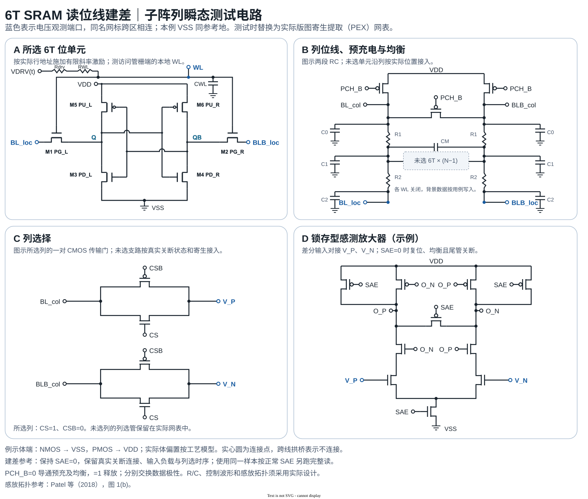
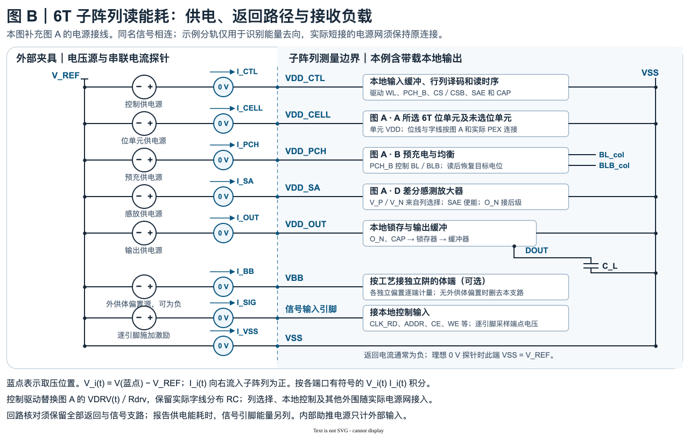

# RE (Read Energy)

## 定义与适用范围

**子阵列读能量**（Subarray Read Energy，RE）是静态随机存取存储器（Static Random Access Memory，SRAM）子阵列在指定读序列和完整计量窗口内，从规定供电端净取得、按成功读事务归一化的能量，单位 J/access。以下以差分 6T 电路为测试示例。单次读的总能量和扣除待机基线的增量能量为：

$$
E_{\mathrm{gross}}=\sum_{i\in S}\int_{t_0}^{t_1} V_i(t) I_i(t)\,\mathrm{d}t,\qquad
E_{\mathrm{inc}}=E_{\mathrm{gross}}-\int_{t_0}^{t_1}P_{\mathrm{idle}}(t)\,\mathrm{d}t .
$$

$S$ 为本次纳入的供电端集合，$V_i=V(i)-V_{\mathrm{REF}}$ 为边界测点对共同参考节点的瞬时电压，$I_i$ 为穿过同一边界**流入子阵列**的电流，单位分别为 V 和 A。以 $E_{\mathrm{gross}}$ 为主，另报 $E_{\mathrm{inc}}$。基线 $P_{\mathrm{idle}}$ 须在同一窗口长度、偏置、温度、存储数据和待机控制模式下测得；另做时钟／地址照常翻转但禁止读的空操作对照时，单列为活动匹配基线。读与待机的泄漏路径可不同，故增量能量包含读引起的泄漏变化。[1, Characterization Measurements, Power/Delay Characterization] [2, Sec. 5–6] [7, Secs. 5.2.2–5.2.5] [9, Sec. III-B]

- **计量窗打开 $t_0$**：在本地读请求及其归属的地址／控制变化、唤醒或预充动作中，取最早一项开始前的规定采样点。从已预充、已就绪相位开始时，须把本次读之后的再预充和恢复计入。若起点为休眠状态，须延伸到返回同一休眠状态；只测唤醒至就绪时，单列唤醒及首次预充能量。记录开窗事件、信号极性、门槛和与本地请求的时间偏移。
- **计量窗关闭 $t_1$**：数据在规定负载和接收窗内有效后，等待字线（Wordline，WL）关闭、位线／互补位线（Bitline，BL／BLB）再预充并均衡，确认感测放大器（Sense Amplifier，SA）和本地控制复位、辅助电源与本地供电恢复到选定相位的容差内。记录允许偏差和保持时间。跨窗的去耦电容充放电、偏置储能和输出负载必须对账：若单次读前后输出值不同，报告该有向转换；比较周期能量时用闭合序列使周期首尾的输出、控制和储能状态匹配，或单列未恢复的储能变化。
- **连续和混合访问**：预充或恢复与相邻读重叠时，按相同相位截取稳态的整数个循环，首尾条件一致，整段积分一次。混入写、重试或空操作时，须另给事务构成；仅当能分离其能量时，才将结果标为纯读 RE。

## 物理机制与变异

常规差分 6T 读从 BL／BLB 已预充开始。本地译码和 WL 驱动充放电，选中位单元经访问管（Access Transistor，PG）及下拉管（Pull-down，PD）从一侧位线吸取放电电流。列选择将差分送入 SA，SA 再生、锁存和缓冲驱动输出；WL 关闭后预充网络补回位线电荷。未接到输出的列也可能随被选 WL 发生放电，计量时须按实际活动列数统计。[4, Secs. III-A–C] [5, Secs. 3–5] [6, Sec. 4.3] [8, Secs. 3.2–3.4]

若恒压预充轨与回流端压差为 $V_{\mathrm{PCH}}$，一条位线的等效电容为 $C_{\mathrm{BL}}$，且仅该轨为位线补回电压摆幅 $\Delta V_{\mathrm{BL}}$ 对应的电荷，则该轨为再预充提供的能量近似为 $V_{\mathrm{PCH}} C_{\mathrm{BL}}\Delta V_{\mathrm{BL}}$。该式用于量级检查；均衡时的电荷共享、耦合、并行活动和电源压降须由瞬态测量覆盖。相同电荷已通过供电积分计入时，禁止再加位线电容估算值（会重复计量）。[4, Sec. III-C] [6, Sec. 4.3]

| 变动项 | 对读能量的作用及记录项 |
| --- | --- |
| 阵列组织和读图样 | 子阵列行列数、列复用、分段和门控决定参与充放电的线长、位线数和外围级数；分别记录请求位数、实际激活列数、存储图样及读 0／1。 |
| 摆幅和时序 | WL 脉宽或感放使能（Sense Amplifier Enable，SAE）时刻改变位线摆幅与补充电荷。缩小摆幅可降低再预充能量，须同时核对读判决和误码；读时助推源的恢复及转换损耗可能抵消收益。[4, Sec. III-C] [11, Secs. III–IV] [17, Sec. V, Fig. 8, Table II] |
| 输出和供电状态 | 翻转方向、同时翻转位数、输出负载和输入活动改变外围能量；工艺、电压、温度（Process, Voltage and Temperature，PVT）及访问间隔共同改变有功与待机占比。[12, Sec. V, Fig. 20] [13, Sec. V, Figs. 20–22] |

## 子阵列接口与指标边界

- **供电范围**：从本地读命令至本地输出，列出位单元、预充／均衡、行列译码与 WL 驱动、SA、读辅助和输出级的归属。图 B 把输出负载 $C_{\mathrm{L}}$ 接在本地输出与子阵列回流节点之间并纳入计量；其他方案可另选接收边界，须声明输出负载、外部接收器电源及输入发生器的归属。共享轨若同时为边界外电路供电，须用局部探针隔离，或按共有边界报告并单列有依据的去嵌结果。
- **参考节点与回流**：所有边界电流按同一流入方向取符号，包括 VSS、体偏置和独立回流端。共用 VSS 与参考节点等电位时，该回流端的功率项为零，仍测电流核对。若回流有压降或多个独立回路，使用各回流端对同一参考的带符号电压、电流。仅当独立双端供电口的两端电流等量反向时，才可用一个差分压差与该口的输入电流作功率，计算后不再加同一对端口的单端项。对所有跨界导线（含输入、外置输出负载及独立回流）检验带符号电流之和接近零；此时完整端口功率与共同参考的选取无关。供电小计未纳入有功信号端时，单列信号功率及归属，禁止将供电小计当作闭合端口能量。
- **负电压与助推**：保留瞬时 $VI$ 的符号，例如负偏置轨 $V_i<0$、其电流流出边界 $I_i<0$ 时仍为正输入功率；能量回送时该端口功率为负。边界内稳压器或电荷泵只在其外部输入处计量；输出域可作诊断，不与输入相加。边界外生成的助推、体偏置等按实际跨界端计入；需计生成电路损耗时，另报包含其输入的扩展边界。[9, Sec. III-B] [12, Sec. III]
- **事务和位数**：记录逻辑请求数 $N_{\mathrm{req}}$、物理命令接受数 $N_{\mathrm{acc}}$（含已接受的重试）、成功返回数 $N_{\mathrm{ok}}$（按逻辑请求去重）、失败与重试、逻辑请求位数 $B_{\mathrm{req}}$、实际验收位数 $B_{\mathrm{del}}$（同一请求的重复返回只计一次）及被激活的物理列数。整窗总能量或增量能量分别记为 $E_{\mathrm{win}}$，各自除以 $N_{\mathrm{ok}}$ 为该序列的 J/access；有失败或重试时，该比值包含它们的耗能，另列成功样本能量、失败率及按 $N_{\mathrm{acc}}$ 归一化的结果。分别报告 $E_{\mathrm{win}}/B_{\mathrm{req}}$（J/请求位）和 $E_{\mathrm{win}}/B_{\mathrm{del}}$（J/交付位），分母为零时标为不可用。定宽、全成功且每次交付请求的全部位时，二者相等。地址变化、输出翻转和读写占空随序列记录。

## 测量与提取方法

**图 A｜6T 读通路。** 采用 [位线建差测试图](Read_Develop_Time.md#测量与提取方法) 的位单元、预充、列选择与 SA，并接 [读延时接口图](Read_Delay.md#测量与提取方法) 的锁存、输出缓冲和负载。

**图 B｜读能量分轨供电接法。** 在图 A 的 A／B／D 区分别把原 VDD 接至 `VDD_CELL`／`VDD_PCH`／`VDD_SA`。译码、WL 驱动和读控制改用 `VDD_CTL` 供电的实际电路；输出级由 `VDD_OUT` 供电。保留 `PCH_B`、`CS/CSB`、`SAE`、`O_N`、`CAP` 和 `DOUT` 的原连接；各控制波形由本地实际驱动产生。须保留实际共用供电网和寄生；不能对外分轨时，在总入口计量，内部分支仅用于归因。按端口标注取被测电路侧电压和流入电流，`VBB` 为可选独立体偏置，按工艺设计套件（Process Design Kit，PDK）的阱和体端连线接入。

### 版图后仿真

**【前置条件】** 使用包含器件及寄生参数提取（Parasitic Extraction，PEX）结果的子阵列网表。保留 WL、BL／BLB、供电与回流网络的分布电阻、互电容、供电去耦和实际外围。记录 PDK 与提取规则版本、PVT、阵列组织／列复用、读取位宽、测试地址、存储图样、刺激边沿、端接负载及局部回流边界。初始化所需位单元，待偏置及预充稳定后开始计量，初始化写入在窗外。

**【步骤／方法】**

1. **接入探针**：在每个纳入端口串联 0 V 探针，约定网表节点顺序为 `外侧 内侧`。例如 `V_IPCH src_pch dut_pch 0`，保存 `I(V_IPCH)` 与 `V(dut_pch,V_REF)`；先用已知电阻负载核对仿真器电流方向。记录子阵列侧各端电压，包括回流、电源与可选偏置。共享驱动的供电能量测一次。
2. **施加与记录事务**：先跑一组固定地址、固定数据／输出前值的单次读，再跑读 0／1、地址重复／改变、输出保持／翻转、最远／最近的选中位置及指定并行位宽。保存端口电压电流和请求、WL、BL／BLB、SAE、捕获、`DOUT`、恢复波形；用 [RD](Read_Delay.md) 的接收窗口检验结果，并以存储状态或窗外回读验证未发生读扰。输入驱动若外置并跨界传能，测其端口功率。
3. **积分和对照**：对齐电压与电流采样时间，逐点计算 $V_i I_i$，在开窗和闭窗处插值后按实际采样间隔做梯形积分；按读取条件另跑同温、同偏置和同起始状态的待机窗口。保持图样、活动和正常读接受率不变，再跑稳态重复序列，交叉检查逐轨和总能量。将每轨的功率或能量分解到预充、控制、判决和输出时可用它们的供电分区；取时窗分段时只加不重叠的区间。[1, Power/Delay Characterization] [16, Secs. III–V] [18, Sec. IV]

**注意事项**：禁止用理想 WL、SAE 或预充激励代替待计量的真实驱动（驱动能量将转移到激励源）。若仅需隔离某阶段，另报裁剪边界并记录所有外置激励端的能量。

**【结果处理和验证】** 按预先规定的误差预算，将最大步长至少减半并收紧电流容差，直至各重要供电轨与总积分的变化均低于各自限值；检查回流对账、闭窗容差、功能通过和窗外残留充电。交付网表／模型版本、供电图、原始波形、积分窗、计数、每轨有符号积分、总量及扣基线结果。

### 硅片测试

**【前置条件】** 使用可独立引出子阵列供电／回流的测试芯片或专用测试结构，核对电源域图和板上电源走线。为各轨选低负担、已校准的四端分流器或电流量测通道；在被测边界端做开尔文电压采样，标定分流阻值、增益、零点、相位和带宽，确认探针引入的压降下仍满足目标偏置、频率和读成功率。记录板上及片上去耦位置和热稳态。

**【步骤／方法】**

1. **波形积分**：以前述读事务触发电压、电流及逻辑采集，在匹配的活动、偏置和时间窗内重复触发求每轨能量；若各轨分次采集，先验证序列相位、活动和温度可重现。记录去耦的充放电位置；分流器在去耦上游时，单次瞬态可能看不到实际电流峰，须覆盖充电补偿或用闭合周期积分。
2. **平均法交叉验证**：将相同闭合读序列持续执行至热稳态，取整数个序列的平均总功率 $\overline{P}_{\mathrm{read}}$ 与实际成功读率 $f_{\mathrm{ok}}=N_{\mathrm{ok}}/T$。用 $\overline{P}_{\mathrm{read}}/f_{\mathrm{ok}}$ 得总能量；测同温、同偏置待机功率 $\overline{P}_{\mathrm{idle}}$ 后，用 $(\overline{P}_{\mathrm{read}}-\overline{P}_{\mathrm{idle}})/f_{\mathrm{ok}}$ 得净增量。供电有可观压降、纹波或多相变化时，用同步乘积的平均值；仅在轨压稳定且误差在预算内时用标称或实测均值与平均电流之积。
3. **封装与子阵列对账**：同一测试序列下，比较逐轨周期积分与平均法。若封装内有稳压转换、共享时钟／全局互连、测试控制、I/O 或其他子阵列，按封装入口报告实测宏或测试芯片能量。只有可测或可按独立对照校准的分量才从总量去嵌；扣除后报告残差、共享项和不确定度。无法探测局部供电端时，将有独立辅测支持的局部分量标为去嵌估计；无辅测时只可用模型估计。[11, Sec. IV-B, Figs. 16–17] [12, Sec. V, Figs. 19–20]

**注意事项**：禁止用标称时钟频率替代成功读率（空周期、拒收和错误会改变有效访问数）。

**【结果处理和验证】** 对照测试机接收窗口、数据一致性及窗外回读，登记电压误差、温漂、电流探头噪声、分流损耗、同步及带宽误差。比较 $\sum_i E_i$ 与同边界平均功率乘窗长，确认偏差落在组合不确定度内；超差先检查电源旁路、共回流、通道零点及重复序列的首尾状态。只对通过的读条件报告达标值，失效点另列。

## 数据可视化与评估

- **波形与积分**：按同一时间轴画 $V_i$（V）、$I_i$（A）、$V_i I_i$（W）和累计能量（J）；标出开窗、接受命令、SAE、数据有效、回充结束及闭窗。单列各轨总／增量及回送电荷，有静态扣除时同时给出待机窗口和温度。
- **扫点与合格判据**：扫 PVT、时钟／读周期、供电与负载时，固定非扫描变量；比较时按容量、活跃行列、请求宽度、接收负载、活动序列、边界和待机差分口径对齐。对每点同时报读延时、错误和通过数；只在相同时序与读成功率约束下比较能量。用 [SA Decision Threshold](../Peripherial/SA_Decision_Threshold.md) 检查缩小摆幅后是否仍满足采样判据。分开报告典型筛选点、最坏条件、重复测量区间和按应用访问序列加权的预算结果。
- **原文量纲对照**：Trivedi 等的 2 nm xBIT Fig. 15.2.6 比较同为 $256\times256$、32 行／BL、列复用比 1:1 的 1R1W 实例；TT、25 °C、0.5 V 与 0.9 V 时，表中 `Dynamic (pJ)` 分别较 8T 低 31% 和 36%。Fig. 15.2.7 指标为 0.5 V 下 $0.61\,\mathrm{\mu W}/\mathrm{MHz}$，量纲等于每时钟周期 $0.61\,\mathrm{pJ}$；成功读率、读写活动与局部供电边界未配齐时，保留原归一化口径。[3, Figs. 15.2.6–7]
- **周期与电压对照**：Sinangil 等的 65 nm、64 kb 8T 样片在约 0.4 V 达到小于 11 pJ/access 的总能量最低点，每周期访问 128 位；该样片宏级访问曲线分出有功和漏电能量，适合验证降低电压时须同时核对访问周期。Liu 等按操作时段积分完整子阵列有功功率；其口径需先核对预充恢复、待机扣除和访问位数，才可与本页总量对比。[12, Sec. V, Fig. 20] [9, Sec. III-B, Fig. 15]

## 应用场景与指标关系

RE 用于比较预充摆幅、列复用、分段、存储体组织、输出门控及感测时序。[读电流](../Bitcell/Read_Current.md) 和 [位线建差时间](Read_Develop_Time.md) 可定位位线的放电与补充电荷需求；判断节能是否可用时须同时核对 [RD](Read_Delay.md) 和读稳定性。宏级 [EDP](../Macro/EDP.md) 需使用同一边界的能量与延时，并单列子阵列之外的全局访问和输出负载；设计技术协同优化（Design-Technology Co-Optimization，DTCO）按每次成功访问的 RE 或有效交付位能耗设预算。[4, Sec. III] [9, Secs. III-D–E] [11, Sec. IV]

## 参考文献

2026-11-17 补检：Zotero `02-SRAM-DTCO/SRAM-Metrics/Subarray`（`L9CVSGRT`）的精确标签 `RE (Read Energy)` 从 7 条补至 16 条，其中 11 篇为独立期刊／会议原始研究 [3] [4] [9] [11]–[18]。OpenAlex、Crossref 按题名和 DOI 检索，结合引用追踪及全文审阅，作业 `3995cd7cade5`、`3c311fa5914a` 均完成，未使用 Sci-Hub。其余题录用于口径或方法，未计入 11 篇。

[1] VLSIDA, “Characterization,” OpenRAM, revision 2f7b3866418ac1ce17ad959207a1489033d8c577. [原文](https://github.com/VLSIDA/OpenRAM/blob/2f7b3866418ac1ce17ad959207a1489033d8c577/docs/source/characterization.md)；Zotero：本次检索范围内未匹配记录。

**相关摘要：** 该固定版本的官方文档说明OpenRAM用SPICE生成时序与功耗表，也支持解析模型。表征按工艺、电压、温度、输入边沿及输出负载展开，最小时钟周期通过搜索确定；内部位线、节点和感放使能检查用于验证功能。动态功耗和漏电分别处理，解析结果依赖工艺参数，不能与完整后仿真混为同一精度。解析动态功率用开关电容、电压平方和频率估算，SPICE输出则含操作平均功率。转换读能量须使用相应访问周期并说明是否含保持漏电、预充恢复和外围，不能把功率表数值直接标为单次能量。

**原文定位：** 网页“Characterization Measurements”“Analytical Characterization”“Power/Delay Characterization”，固定提交2f7b386。

[2] N. Muralimanohar, R. Balasubramonian, and N. P. Jouppi, “CACTI 6.0: A tool to model large caches,” HP Labs, Tech. Rep. HPL-2009-85, 2009. [公开文献](https://shiftleft.com/mirrors/www.hpl.hp.com/techreports/2009/HPL-2009-85.pdf)；Zotero：未找到独立题录，已核对 [CACTI 5.0 题录所附 6.0 报告](https://www.zotero.org/users/7333024/items/MG3MCJIZ) 的同版文件。

**相关摘要：** CACTI 6.0将缓存划分为bank、mat与子阵列，估算译码、字线、位线、感放、复用、输出和跨bank互连。报告改进分布式字线与位线模型，并增加多种线路和网络结构；组织分割缩短局部线，却增加外围及路由开销。模型用于架构探索，必须保留容量、组织与互连假设，不能当作任意工艺版图的直接测量。读取能量随被激活子阵列、列复用及互连类型改变，低摆幅线路与分割同时影响速度。用于本页需截取相同子阵列边界，注明标签和跨bank网络是否排除；宏或缓存总能量不能无条件均分成局部能量。

**原文定位：** §1–3、§5.5–5.6，报告pp.3–5、17–18，图9–10。

[3] M. Trivedi et al., “A 350mV single-rail SRAM using a custom-logic-bitcell in 2nm-CMOS-nanosheet technology for mobile and edge-AI applications,” in IEEE ISSCC Dig. Tech. Papers, paper 15.2, 2026. [DOI 10.1109/ISSCC49663.2026.11409350](https://doi.org/10.1109/ISSCC49663.2026.11409350). [公开文献](https://doi.org/10.1109/ISSCC49663.2026.11409350)；[Zotero](https://www.zotero.org/users/7333024/items/2DMRRST6)

**相关摘要：** 论文展示2 nm纳米片逻辑位单元SRAM，通过局部／全局读写通路与控制优化降低功耗，写端采用银行级时钟混合减少无效切换。宏布局、字节门控及位单元选择共同影响性能和能量，比较还依赖电源和容量条件。该文提供特定芯片架构证据，不能把单元、局部通路和整个宏的测量范围互相替换。原文能量比较针对所展示宏架构，局部读位线、全局通路和字节门控共同决定活动。它可说明降低读能量的实现方式，但不能直接当作本页局部子阵列能量；每位和每次访问的归一化也应保持一致。

**原文定位：** ISSCC paper 15.2，PDF第1–3页，图15.2.2–15.2.7。

[4] B. S. Amrutur, and M. A. Horowitz, “Speed and power scaling of SRAM's,” IEEE Journal of Solid-State Circuits, vol. 35, no. 2, pp. 175-185, 2000. [公开文献](https://doi.org/10.1109/4.823443)；[DOI](https://doi.org/10.1109/4.823443)；[Zotero](https://www.zotero.org/users/7333024/items/CH2EXX7I)

**相关摘要：** 论文用解析模型探索SRAM组织、容量和技术缩放，包含译码、字线、位线、感放及输出复用。研究以读路径为关键路径，只建模读取动态能量，外部输出负载被排除；门尺寸主要按最小时延设定，低能量方案未必全局最优。模型明确线长和负载的作用，并与电路仿真验证，应用时必须保留这些假设。论文只建模读动态能量，分别统计行列译码与输出通路的开关电容，外围和线长均影响结果。保持漏电及外部负载未纳入同一范围，引用需说明这与全电源、完整恢复窗口的访问能量不同。

**原文定位：** §III-A–C，pp.177–180（PDF第3–6页），式(2)–(7)、图4–11。

[5] S. Thoziyoor, N. Muralimanohar, and N. P. Jouppi, “CACTI 5.0,” Hewlett-Packard Laboratories, Tech. Rep. HPL-2007-167, Oct. 19, 2007. ；[Zotero](https://www.zotero.org/users/7333024/items/JYDVTQLK)；DOI：Zotero未收录或尚未核实。

**相关摘要：** 归档附件实际为2007年CACTI 5.0报告，作者为Thoziyoor、Muralimanohar和Jouppi，不能按Zotero的2008年四作者题录引用。报告将存储器分为bank、mat及子阵列，建模译码、位线、感放、复用和请求／回复树。地址与输入数据树可门控，输出树使用不同驱动结构；阵列组织搜索需同时考虑时延、功耗与布局开销。读取能耗由译码、位线、感放和路由活动分别估算；门控和阵列分割改变被激活负载。将模型用于子阵列读能量时须扣清树形网络及标签阵列范围，不能把全缓存动态能量直接按单元数平均。

**原文定位：** §3–5，报告pp.8–27（PDF第9–28页）。

[6] M. H. Abu-Rahma, and M. Anis, “Nanometer variation-tolerant SRAM: circuits and statistical design for yield,” New York, NY, Springer New York, 2013. [公开文献](https://doi.org/10.1007/978-1-4614-1749-1)；[DOI](https://doi.org/10.1007/978-1-4614-1749-1)；[Zotero](https://www.zotero.org/users/7333024/items/RA2TPQV2)

**相关摘要：** 本书把动态读写窗口与良率、功耗联合讨论。写入有限脉冲需覆盖非线性状态翻转，静态裕量不能代替时间；读取须在感放开启前形成足够差分，并考虑列复用、单元电流和漏电。第4章分离阵列、外围开关功耗与保持漏电，说明延长字线可提高感测裕量，也增加位线摆幅和恢复开销。第4章给出读取开关功率与位线摆幅、电容和频率的关系，可在明确访问频率后转换为操作能量。较长字线增加摆幅及补充电荷；总功率另含外围与漏电，不能混作单次位线动态能量。

**原文定位：** §3.2.2、§4.3、§5.3–5.4，书内pp.51–55、99–103、130–136。

[7] B. Chen, “Timing Characterization of an SRAM Generated from OpenRAM: An Open-Source Memory Compiler,” M.S. thesis, University of California, Santa Cruz, June 2016. [官方全文 PDF](https://escholarship.org/content/qt5kq8c8p1/qt5kq8c8p1.pdf)；[公开文献](https://escholarship.org/uc/item/5kq8c8p1)；[原文]( <https://escholarship.org/uc/item/5kq8c8p1>)；[Zotero](https://www.zotero.org/users/7333024/items/WQEEXQVC)；DOI：Zotero未收录或尚未核实。

**相关摘要：** Chen的2016年硕士论文介绍OpenRAM接口级SPICE表征：构造写入、清除数据总线和读回序列，二分搜索可行时钟周期，并输出延迟和平均功率。功率在整个操作时钟周期内求平均，能量必须用相同测量窗口换算并保留每次访问位宽；不可将平均功率数值直接标为读能量。寄生回标前的表征也不能当作完整后仿真结果。本页引用其测量边界和转换依据，不给出未经配对周期校验的能量数字。已核对官方全文与 Zotero 本地附件，归档了同一学位论文。

**原文定位：** §5.2.2–5.2.5，书内pp.46–49（官方PDF第56–59页）。

[8] 张重达, “基于14nm FinFET工艺的低功耗Single Port SRAM Compiler设计,” 硕士学位论文, 苏州大学, 苏州, 2023. [公开文献](https://doi.org/10.27351/d.cnki.gszhu.2023.002939)；[DOI](https://doi.org/10.27351/d.cnki.gszhu.2023.002939)；[Zotero](https://www.zotero.org/users/7333024/items/P3862KE4)

**相关摘要：** 论文实现14 nm FinFET单端口SRAM编译器，通过局部／全局位线分层、字线分级和多电压域降低功耗。层次位线减少单次访问需要充放电的单元负载，写路径另以电容耦合产生负电平加速驱动。文中同时讨论动态功耗与门控保持漏电；能量引用须保留供电域、操作频率和访问范围，不能把总功率或静态降幅直接作为单次操作能量。位线分层通过只激活局部段及所需全局段减少读取电荷，章节中给出的电荷与功率关系支持能量机理分析。若要得到每次读能量，仍需积分实际电源并计入感放、全局传输和预充恢复。

**原文定位：** §3.2–3.4，书内pp.25–31（PDF第31–37页），图3.4–3.9。

[9] H. H. Liu et al., “CFET SRAM DTCO, interconnect guideline, and benchmark for CMOS scaling,” IEEE Transactions on Electron Devices, vol. 70, no. 3, pp. 883-890, 2023. [公开文献](https://doi.org/10.1109/TED.2023.3235701)；[DOI](https://doi.org/10.1109/TED.2023.3235701)；[Zotero](https://www.zotero.org/users/7333024/items/W99KL789)

**相关摘要：** 论文对A14至A3的SRAM进行器件、互连和子阵列协同分析，使用完整外围与288列、256行阵列，并考察距译码、感放及写驱动最远的单元。寄生参数由器件模型和三维抽取联合提供；增加驱动能力也增大电容，性能改善会饱和。写辅助采用概念性电压源，比较能耗时需注明尚未包含具体辅助发生器的全部实现代价。读能量由完整子阵列在操作时间内的有功功率积分得到，包含外围而不是单元保持功耗。跨设计比较应保持积分窗口、访问位宽和供电范围一致；平均功率的降低不能直接等同单次读能量降低。

**原文定位：** §III-A–B、III-D–E，pp.886–889（PDF第4–7页），图10、14–15。

[10] H. H. Liu, and F. Catthoor, “Circuit-technology Co-optimization of SRAM design in advanced CMOS nodes,” Cham, Springer Nature Switzerland, 2025. [公开文献](https://doi.org/10.1007/978-3-031-76109-6)；[DOI](https://doi.org/10.1007/978-3-031-76109-6)；[Zotero](https://www.zotero.org/users/7333024/items/CHVFC3IE)

**相关摘要：** 本书贯通单元、子阵列和宏级仿真。局部指标由含寄生和外围的电路得到，宏模型再加入树形互连、控制驱动及核心至数据通路；两级统计边界不可混用。先进节点的单元缩小未必等比例改善访问性能，线阻、电容和写辅助代价可能抵消收益。宏级比较采用明确容量、树形结构、引脚位置及工艺条件，并讨论写入可行性的约束。读能量明确定义为整子阵列在操作区间内功率积分，位线负载与所用读时间共同影响结果。该口径未必等同本页完整准备到恢复周期，采用数值时须注明是否包含预充恢复及全部供电域。

**原文定位：** §2.3.2、§2.4.2、§6.2、§7.1–7.5，书内pp.36、42、137–139、174–181。

[11] H.-H. Liu et al., “Future Design Direction for SRAM Data Array: Hierarchical Subarray With Active Interconnect,” *IEEE Transactions on Circuits and Systems I: Regular Papers*, vol. 71, no. 12, pp. 6495–6506, 2024. [DOI](https://doi.org/10.1109/TCSI.2024.3410518)；[KU Leuven 作者稿](https://lirias.kuleuven.be/retrieve/913275b5-a108-48a9-b523-7f949cafecb4)；[公开文献](https://doi.org/10.1109/TCSI.2024.3410518)；[Zotero](https://www.zotero.org/users/7333024/items/FKMH67JE)。

**相关摘要：** 比较 14 Å 兼容节点（A14）6T 子阵列的标准、常规分段和有源互连分段实现，分别报告子阵列读能量和含 H 树的宏级分解。16 MB、中心引脚宏模型中的互连贡献取决于子阵列尺寸，宏级增益须单列，子阵列能量也须保留所用行列及工艺条件。

**原文定位：** §III–IV，图 12、15–17、19–20；出版版 pp. 6495–6506（归档为作者稿）。

[12] M. E. Sinangil, N. Verma, and A. P. Chandrakasan, “A Reconfigurable 8T Ultra-Dynamic Voltage Scalable (U-DVS) SRAM in 65 nm CMOS,” *IEEE Journal of Solid-State Circuits*, vol. 44, no. 11, pp. 3163–3173, 2009. [DOI](https://doi.org/10.1109/JSSC.2009.2032493)；[MIT 机构档案](https://hdl.handle.net/1721.1/53553)；[公开文献](https://doi.org/10.1109/JSSC.2009.2032493)；[Zotero](https://www.zotero.org/users/7333024/items/SFTQMUPB)。

**相关摘要：** 65 nm 低功耗 CMOS 的 64 kb、8T 样片按电压分解每访问有功、漏电和总能量。最低总能量在约 0.4 V，为小于 11 pJ/access（每周期访问 128 位）。继续降压会使可用访问周期变长，漏电能量反而增大。该数据用于宏级电压／访问时间评价。

**原文定位：** §III–V，尤其 pp. 3171–3172（归档 PDF 第 10–11 页），图 16–20。

[13] N. Verma and A. P. Chandrakasan, “A 256 kb 65 nm 8T Subthreshold SRAM Employing Sense-Amplifier Redundancy,” *IEEE Journal of Solid-State Circuits*, vol. 43, no. 1, pp. 141–149, 2008. [DOI](https://doi.org/10.1109/JSSC.2007.908005)；[作者组 PDF](https://www.princeton.edu/~nverma/VermaLabSite/Publications/2008/2008_verma_jssc_jan.pdf)；[公开文献](https://doi.org/10.1109/JSSC.2007.908005)；[Zotero](https://www.zotero.org/users/7333024/items/94NS3U8F)。

**相关摘要：** 256 kb、8T 样片在 350 mV 可工作于 25 kHz；该最低供电点处整宏漏电功率为 2.2 µW，约占总功率 85%。图 22 区分随工作频率变化的总功率和漏电功率；用于核对待机基线及频率对能量折算的影响，需取得实际读计数再折算。

**原文定位：** §V–VI，pp. 147–148（PDF 第 7–8 页），图 20–22。

[14] G. Pasandi and S. M. Fakhraie, “A 256-kb 9T Near-Threshold SRAM With 1k Cells per Bitline and Enhanced Write and Read Operations,” *IEEE Transactions on Very Large Scale Integration (VLSI) Systems*, vol. 23, no. 11, pp. 2438–2446, 2015. [DOI](https://doi.org/10.1109/TVLSI.2014.2377518)；[arXiv 作者稿](https://arxiv.org/abs/1812.10011v2)；[公开文献](https://doi.org/10.1109/TVLSI.2014.2377518)；[Zotero](https://www.zotero.org/users/7333024/items/2RID45U5)。

**相关摘要：** 在同容量 256 kb、90 nm CMOS 的仿真中，9T 与 6T 设计分别用 1k 与 64 个位单元／BL，在各自最低可用供电 350 mV 与 725 mV 下比较。表 III 的读功率为读 0 和 1 的平均值，分别为 25.68 µW 与 376.5 µW。该对照同时改变拓扑、组织和供电；原表量纲为功率，缺同窗访问计数时不得直接换算成本页 RE。

**原文定位：** §IV-F，表 III（arXiv v2 PDF 第 8 页）。

[15] T.-H. Kim, J. Liu, J. Keane, and C. H. Kim, “A 0.2 V, 480 kb Subthreshold SRAM With 1 k Cells Per Bitline for Ultra-Low-Voltage Computing,” *IEEE Journal of Solid-State Circuits*, vol. 43, no. 2, pp. 518–529, 2008. [DOI](https://doi.org/10.1109/JSSC.2007.914328)；[NTU 机构档案](https://hdl.handle.net/10356/84782)；[公开文献](https://doi.org/10.1109/JSSC.2007.914328)；[Zotero](https://www.zotero.org/users/7333024/items/QRLTXRPI)。

**相关摘要：** 130 nm、480 kb 的 10T 样片由四种位线长度的象限组成。图 16 分列整宏静态漏电和最高工作频率下的功耗，图 17 分列各象限实测频率和延时；在 0.2 V、27 °C 下，1k 位单元／BL 象限的最高频率为 100 kHz。整宏功耗与单象限频率边界不同，不能直接相除得到子阵列 RE。

**原文定位：** §III，pp. 526–527（PDF 第 9–10 页），图 14、16–17。

[16] J. Boley, P. Beshay, and B. Calhoun, “Virtual Prototyper (ViPro): An SRAM Design Tool for Yield Constrained Optimization,” *IEEE Transactions on Very Large Scale Integration (VLSI) Systems*, vol. 23, no. 12, pp. 3109–3113, 2015. [DOI](https://doi.org/10.1109/TVLSI.2014.2385832)；[公开文献](https://doi.org/10.1109/TVLSI.2014.2385832)；[Zotero](https://www.zotero.org/users/7333024/items/68JPTI4S)。

**相关摘要：** 基于 SPICE 分别提取位单元、WL／BL 驱动器、SA 和带载输出的能量／时延，并计入阵列泄漏；全局互连用长度及技术参数建模。满足目标芯片良率而加长 WL 脉宽后，局部能量可与名义模型明显不同。该文支持按同一良率约束比较和按层次拆分能量。

**原文定位：** §III-C、IV-B、V，图 3–5（归档提前出版版第 3–5 页）。

[17] J. S. Shah, D. Nairn, and M. Sachdev, “An Energy-Efficient Offset-Cancelling Sense Amplifier,” *IEEE Transactions on Circuits and Systems II: Express Briefs*, vol. 60, no. 8, pp. 477–481, 2013. [DOI](https://doi.org/10.1109/TCSII.2013.2268312)；[公开文献](https://doi.org/10.1109/TCSII.2013.2268312)；[Zotero](https://www.zotero.org/users/7333024/items/U79HMR2D)。

**相关摘要：** 180 nm 硅测试结构用于比较两种 SA 的判决和失调；文中另列 SA 延时、功耗和能量以及产生偏置抵消控制信号的代价。更小的所需判决差分允许降低 BL 摆幅；组件数据只用于感测与预充权衡，全子阵列读能量须另测。

**原文定位：** §IV–VI，pp. 480–481（PDF 第 4–5 页），图 6–8、表 II。

[18] M. R. Guthaus, J. E. Stine, S. Ataei, B. Chen, B. Wu, and M. Sarwar, “OpenRAM: An Open-Source Memory Compiler,” in *Proc. IEEE/ACM ICCAD*, 2016, pp. 1–6. [DOI](https://doi.org/10.1145/2966986.2980098)；[UC eScholarship](https://escholarship.org/uc/item/8x19c778)；[公开文献](https://doi.org/10.1145/2966986.2980098)；[Zotero](https://www.zotero.org/users/7333024/items/DYJK5C4I)。

**相关摘要：** 编译器用 SPICE 刺激及测量语句生成不同工艺、规模与配置的时序和功耗模型。论文比较容量、位宽和存储体组织对版图、时序及功耗的影响；库平均功耗与子阵列完整读周期积分的边界须分开标记。

**原文定位：** §4.4–5，pp. 4–6（归档 PDF 第 4–6 页），图 5。仓库版与 Zotero 六页附件的全文一致，文件哈希不同。
