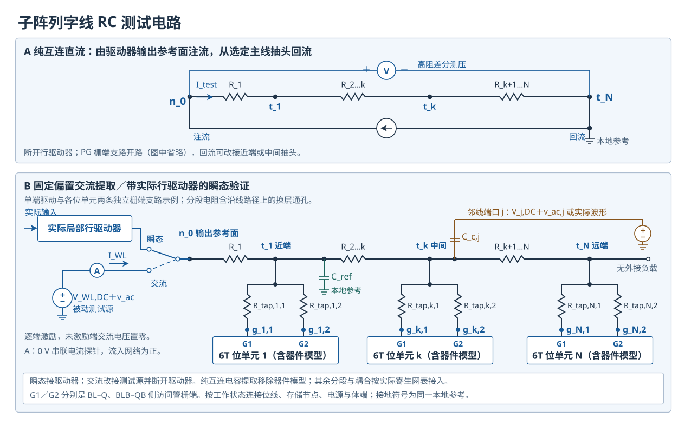

# WL RC

## 定义与适用范围

**子阵列字线电阻与电容**（Subarray Wordline Resistance and Capacitance，WL RC）描述从实际局部字线（Wordline，WL）驱动器输出参考面 $n_0$ 出发，经选中整行主线和各抽头，到同一行全部访问管（Pass-Gate，PG）栅端的分布式负载。沿 WL 延伸方向计列节距：单端驱动示例中，$N$ 为该局部行的物理列节距数，$t_1$、$t_k$、$t_N$ 为近、中、远主线抽头；$g_{k,p}$ 为第 $k$ 列第 $p$ 只 PG 的栅端。常规差分 6T 位单元每列有两只 PG，$p=1,2$；其他拓扑、虚设列和修复列按实际连接计数。报告实际行长、节距数、驱动位置和观察端点。[1, Sec. 5.5, Fig. 9] [8, Sec. III-A, Fig. 10] [12, Secs. II, IV, Figs. 1–3]

| 报告量 | 电气边界与单位 |
| --- | --- |
| **物理电阻** | 主线各段及 $n_0\to t_k$ 的端到端等效电阻（Ω）；另列 $t_k\to g_{k,p}$ 的栅接触支路及 $n_0\to g_{k,p}$ 的指定路径。驱动器导通电阻另报。 |
| **几何电容** | 寄生提取（Parasitic Extraction，PEX）网络中各节点对指定参考导体的电容和各对导体间的耦合电容（F）；保留全行分布及对端。 |
| **带负载的端口有效电容** | 对 $n_0$ 报告指定端接和偏置下的小信号电容，或指定边沿与窗口下的电荷等效电容（F）；需包含实际挂接的 PG。 |
| **功能时间量** | 从声明的触发端到主线抽头或栅端的传播时间、局部边沿与有效脉宽（s）。边沿定义见 [WL Slew](WL_Slew.md)。 |

单位节距量见 [CELL_WL RC](../Bitcell/CELL_WL_RC.md)。整行应提供分段网表及端口映射，便于按实际驱动和负载重建波形。

## 物理机制与寄生来源

- **主线与接触**：金属主线、换层通孔和金属跨接决定沿行电阻；局部互连、通孔和栅接触决定主线至 PG 栅端的支路电阻。两只 PG 共用的电阻只实例化一次；主线端到端测阻时栅支路开路。若存在并联跨接，按网络求等效值；仅在唯一串联路径中才可逐段相加。[8, Sec. II-E, Figs. 7–8] [13, Sec. III, Figs. 6–9] [14, Secs. II-B–C, Tables II–III]
- **几何耦合**：WL 相对参考导体、邻行 WL、位线（Bitline，BL）／互补位线（BLB）、电源网及上下金属层均可形成电容。对节点 $i$，以流入几何电容的电流为正，节点对参考导体的电容为 $C_{i,\mathrm{ref}}$，两节点间正值电容为 $C_{ij}$，则 $i_i=C_{i,\mathrm{ref}}\,\mathrm{d}v_i/\mathrm{d}t+\sum_{j\ne i}C_{ij}\,\mathrm{d}(v_i-v_j)/\mathrm{d}t$，电压均相对同一参考节点。以非零 WL 局部斜率为基准，邻线静止、同斜率同向切换、等斜率幅值反向切换对应的等效贡献分别为 $C_{ij}$、$0$、$2C_{ij}$；分布波形须按实际幅度和相位计算。[2, Extract Parasitics] [13, Sec. III, Fig. 6]
- **器件和偏置**：PG 栅端电荷取决于 WL 电压及源端、漏端、体端电位。6T 的两只 PG 源漏两端分别连接 BL 与 Q、BLB 与 QB，体端按工艺设计套件（Process Design Kit，PDK）端子定义连接；存储节点 Q／QB、BL 终端、局部 VSS 和体偏置在实际读写时可以变化。固定其余端子时，可在指定偏置单列各 PG 的微分栅端电容；读写瞬态须保留端子电荷模型。核对模型内栅电阻、重叠／边缘电容与 PEX 的归属。[3, Sec. II, Figs. 2, 6] [12, Secs. II, IV]

## 选中字线与驱动边界

以单端 6T 行为例，控制信号进入**实际局部驱动器**，由驱动器输出 $n_0$ 经首段通孔／走线进入主线，沿行依次到 $t_1$、$t_k$、$t_N$，再经各自的栅接触到达 $g_{k,p}$；$t_N$ 和 $g_{N,p}$ 分别是远端主线与远端栅端。物理阻容从输出参考面量起；驱动器内部寄生、上拉／下拉能力和输入边沿在动态仿真中恢复。分段、双端或中心驱动须分别标记驱动出口、支路、电源和观察端，按实际拓扑识别最慢位置；禁止用全局 WL 或译码器输入代替局部驱动器输出。[4, Secs. III-A–B, Fig. 4] [12, Secs. II–IV, Figs. 1–3] [14, Sec. II, Figs. 3, 6–8]

将重复节距模型扩展到 $N$ 列时，保留首末非重复段、补偿或虚设列、跨接、终端和分段边界，并用完整行 PEX 校验。[5, Secs. 3–5] [7, Secs. 2.1, 3.1] [9, Secs. 6.2, 7.1–7.5] [10, Figs. 11–12] [11, Sec. III-A]

## 测量与提取方法

图 A 断开驱动器和有源负载，在 $n_0$ 注流、于指定主线抽头返回；图 B 接入实际驱动器做瞬态，或隔离驱动器、由交流（Alternating Current，AC）源激励 $n_0$。图 B 的 $t_N$ 保留远端栅支路且不接外部测试端接。图示每列两路分立栅接触，省略部分重复列及 6T 模型内部锁存器；实际参考节点和体端按版图及器件模型连接。读、写位线与单元接线分别见 [读建差测试电路](Read_Develop_Time.md#测量与提取方法) 和 [6T 晶体管级写入测试电路](assets/Write_Time_6T_testbench.drawio.svg)；需逐管固定端子偏置时，参照 [单节距栅端交流提取电路](../Bitcell/assets/CELL_WL_RC_testbench.drawio.svg)。

### 版图与仿真提取

**【前置条件】** 在通过版图与原理图一致性检查（Layout Versus Schematic，LVS）的整行版图上，参考 [行列分布网络图](BL_RC.md#测量与提取方法) 定位各端口。记录版图与模型版本、层栈、工艺及互连角、温度、局部 $V_{\mathrm{DD}}$／$V_{\mathrm{SS}}$、体端偏置、耦合阈值及通孔简化规则。按 [CELL_WL RC](../Bitcell/CELL_WL_RC.md#测量与提取方法) 区分几何与器件负载。必须命名参考节点，只有明确同网时才与 VSS 等同；动态供电网、浮置导体及体端均保留实际端接。[2, Extract Parasitics] [13, Sec. III, Figs. 8–9]

**【步骤／方法】**

1. **测主线与栅支路的直流电阻**：在纯电阻网表中隔离局部驱动、移除有源返回路径，打开栅支路末端。按图 A 从 $n_0$ 注入小直流（Direct Current，DC）电流，在所测 $t_k$ 引出相同电流，以高阻探针测压差，求 $R_{\mathrm{line},k}=(V_{n_0}-V_{t_k})/I$。依次将回流切换至近、中、远端。测 $R_{\mathrm{tap},k,p}$ 时，改在 $t_k$ 注流并在 $g_{k,p}$ 回流，另一栅支路开路；或直接由 PEX 电阻网络求值。仅在主线与所测支路串接且无绕行时，两者之和等于 $n_0$ 至该栅端的电阻。测试电流不经栅氧、器件体端或功能电源回路。
2. **提取全节点几何电容矩阵**：从 PEX 网表逐一记录电容端点，汇总对参考导体、邻行 WL、BL／BLB、供电网及其他导体的正值电容。对线性无源几何网络，矩阵对角项为 $C_{i,\mathrm{ref}}+\sum_{j\ne i}C_{ij}$、非对角项为 $-C_{ij}$；保存节点顺序和被合并为对参考节点项的导体。可在纯互连网中轮流激励各可达端口 $j$，其余独立端口置 AC 零电压，按流入端口 $i$ 的增量电流求 $Y_{ij}=\Delta I_i/\Delta V_j$（S）。在 $e^{j\omega t}$ 约定下，只有选定端口内近似等电位且 $\operatorname{Im}Y_{ij}/\omega$ 存在低频平台时，才以该量（F）复核对应的端口矩阵；内部电容和浮置节点以 PEX 连接为准。$\omega=2\pi f$，$f$ 为交流频率（Hz）。[2, Extract Parasitics] [13, Sec. III, Fig. 6]
3. **测指定终端下的有效负载**：在图 B 隔离实际驱动器，在 $n_0$ 设置 WL 直流工作点并注入小 AC 信号。扫 WL 低、中、高电位、两种存储状态及预充和代表性读写偏置；不稳定工作点用声明的 Q／QB 钳位，或改用瞬态。以流入 $n_0$ 的电流为正，在指定终端与平台频带取 $C_{\mathrm{eff,AC}}=\operatorname{Im}Y_{00}/\omega$。其余独立端口不施加交流激励；分别记录邻行的固定 AC 电位、浮置或有限阻抗端接。邻行也施加小信号时，须注明各激励相对 $n_0$ 的幅度和相位，并报告该条件下的输入响应；实际的同向／反向切换用瞬态验证。带器件或浮置终端的端口矩阵不用于反推原始几何分量。也可在可独立辨识传导电流基线 $I_{\mathrm{cond}}(t)$ 时，按同一参考面在非零有符号电压变化 $\Delta V_{n_0}$ 的窗口 $[t_a,t_b]$ 内求 $C_{\mathrm{eff,sw}}=\int_{t_a}^{t_b}[I_{n_0}(t)-I_{\mathrm{cond}}(t)]\,\mathrm{d}t/\Delta V_{n_0}$；分别记录边沿、窗口、邻线相位、负载与结束状态。
4. **以完整行网表校核波形**：恢复实际驱动器、锁存器、位线及外围电路时序。分别设置读预充、读建差及写驱动，保留同行已选与半选列，扫行长、输入边沿、工艺／电压／温度（Process, Voltage and Temperature，PVT）、字线助推／降压和邻线切换。记录驱动器输入、$n_0$、各 $t_k$ 及 $g_{k,p}$ 的上升／下降波形。建议分别报驱动器输入至 $n_0$、$n_0$ 至各抽头及栅端的同向 50% 交越时间差，门限按各端预设的高低电平计算。按相同门限定义比较 10%→90%／90%→10% 边沿、峰值及连续高于功能门限的有效脉宽。单列未到门限、多次交越、过冲及功能失败。[3, Secs. II–IV, Figs. 6, 8, 13] [4, Secs. III-B–C] [15, Secs. II–III, Figs. 3–6]

**注意事项**：禁止以 PG 栅端的自然稳态电流求栅支路电阻（栅极绝缘使电阻测量缺少规定的回流路径）。

**注意事项**：禁止把已含器件的有效电容叠加到完整 PEX 与紧凑模型上（负载会重复计入）。

**【结果处理和验证】** 对照网表验证连通性、正反注流斜率、交流激励及频带收敛与几何矩阵对称性。无有效注流回路或超出测试顺从范围时，标记开路或超量程并核对网表，禁止记为零线阻（该点未得到有效斜率）。长行无稳定 AC 平台时交付 $Y(f)$、实际端接及分布网络；传导基线不能分离时保留原始电流和积分电荷。时序模型按近／中／远端和实际 PG 栅端对照完整行 PEX，按项目门限验收幅度、时延、边沿、脉宽和功能结果。必要时提高分段精度直至误差收敛。[1, Sec. 8, Fig. 13(a)] [12, Secs. IV–VI, Fig. 5]

**一阶时序估算**：在线性单端 RC 树中，将负载在指定偏置线性化并折算成对同一交流参考节点的电容后，节点 $x$ 的响应一阶矩为 $\tau_{\mathrm{E}}(x)=\sum_j C_jR_{\mathrm{common}}(j,x)$（s），其中 $C_j$ 为节点 $j$ 对参考节点的电容（F），$R_{\mathrm{common}}(j,x)$ 为激励源至 $j$ 与至 $x$ 所共用的路径电阻（Ω）。例如单端均匀梯形网络每节距由串联电阻 $r$ 和段末对参考负载 $c$ 构成，远主线端的线项为 $rcN(N+1)/2$；驱动器、支路和末端项按各自节点计入。一阶矩用于 RC 预算和模型筛选；带有运动节点间耦合的网络、阈值时延及短脉冲验收须使用完整波形。Song 等的 65 nm 编译器模型忽略邻近单元间线阻，适用范围须按几何与负载验证。[1, Sec. 5.5, Fig. 9] [6, Figs. 3–5] [12, Secs. IV–VI, Fig. 5] [16, Sec. 2, Eqs. (3)–(5)]

### 硅实测

**【前置条件】** 制作与目标端口、金属层、铺排周期、通孔及屏蔽相匹配的长短行结构，分别留纯互连、带 PG 负载和实际驱动采样结构。准备开路／短路、已知负载和空驱动对照，记录焊盘、探针、开关／驱动、采样器及各参考面。

**【步骤／方法】**

1. **线阻与接触**：主线两端使用独立的注流线和高阻感测线；可用正反等幅小电流消除零点和热电势，以多长度和多电流验证端效应与线性。测栅接触时，使用材料、层和几何匹配的接触链或交叉桥 Kelvin 测试结构；记录取样端及电流拥挤修正。接触链结果是复制结构的电阻，功能行栅端电阻须按实际版图映射。[19, Secs. II–IV, Figs. 1–2, 6–9]
2. **电容与端口参考面**：用匹配对照去嵌焊盘、探针、开关及驱动级负载，注明去嵌后参考面，再测低频导纳，或在已知本地摆幅及终端下量测净充电电荷。以多长度斜率、截距及测量残差检验端部负载；长短相减和去嵌覆盖同一项时只扣一次。采用周期性充电法时，可用匹配参考结构的平均电流差除以重复频率及本地摆幅；须验证每周期达到指定电位、充放电开关无重叠，并确认漏电及驱动电流差已校准。[20, Sec. II, Figs. 1–4, Eqs. (1)–(2)]
3. **本地波形与功能代理量**：在可达的近／中／远端用低负载片上抽头采样，校准门限、采样相位、带宽和时间码，并以同端点、同负载与仿真对照。若只能获得复制脉冲、译码输出、读建差、写成功率或接口时序，记录真实测点及触发，并以其校准功能模型；独立阻容需要额外注流、充电或多端观测支持。[3, Secs. III–IV-A, Figs. 8–10, 13] [17, Secs. II–IV, Figs. 5–6, 9]

**注意事项**：禁止由一次时延或脉宽反解唯一的整行 R 和 C（驱动强度、负载分布及采样路径共同决定结果）。

**【结果处理和验证】** 分开交付去嵌后的测试结构阻容、片上抽头实测波形和功能代理量。用未拟合的长度、位置或电压复测，报告重复性及校准不确定度；低于测量分辨率时给出上限或标为不可分辨。Toh 等在 45 nm CMOS 芯片的每条 WL 配置采样器，并用子采样校准真实局部脉宽；Wang 等的 55 nm 256 kb 测试芯片以环振校准本地脉宽监测。两项均为波形或脉宽证据，未给出独立的整行 WL R、C 硅测。[3, Sec. III, IV-A, Figs. 8, 13] [17, Secs. III–IV, Fig. 6, Table II]

## 数据可视化与评估

- **按长度和位置检查**：以行物理长度或 $N$ 为横轴，分图报告各位置主线电阻、栅支路电阻和对端电容，标明截距及残差。以堆叠形式拆分对参考导体、邻行和交叉线电容；将带器件的端口有效值单独按偏置、邻线终端和边沿作图。
- **按波形和分位验收**：叠加实际驱动输出、近／中／远抽头及 PG 栅端波形，对完整 PEX、缩减网络和可用硅测分别标注来源。画位置相关的传播时间、边沿、选通平台／峰值和有效脉宽残差；按项目预设门限判定。时序角分析应保留金属与通孔的相关性、局部供电和驱动角；报告样本数、位置分位和量测不确定度。
- **按端口边界比较工艺**：Mathur 等以 imec N5 规则和三维场求解比较多种互连，在 258 行 × 136 列仿真结构中保留文中所用的最差位置；其逐单元 WL 阻容与耦合拆分来自提取。Liu 等的 A14 主动互连分段设计假设钌线，M1 局部 WL 每 150 nm 节距估算为 9.45 Ω、164 aF，电容排除器件；全局 WL 和垂直连接另列。两个结果的工艺、拓扑和建模边界须随数据报告。[13, Sec. III, Figs. 6–9] [14, Sec. II-C, Table III]

## 应用场景与指标关系

- **布线与驱动**：设计与工艺协同优化（Design–Technology Co-Optimization，DTCO）时，用完整网络比较行长、驱动位置与尺寸、线层、跨接和分段方式。在同驱动、负载和终端下，降低寄生通常可改善远端栅端的到达时间与边沿。调整驱动尺寸、插入缓冲或更换线层时，同时复核读写波形、能量与面积；分段方案须计入全局选择路径及其供电。[4, Secs. III, V] [8, Sec. III-A, Fig. 10] [12, Secs. II, V–VI, Fig. 5] [14, Sec. II, Figs. 3, 6–8]
- **读写预算与辅助**：将实际 PG 栅端波形作为 [WL Slew](WL_Slew.md)、[Read Develop Time](Read_Develop_Time.md) 与 [Write Time](Write_Time.md) 的局部条件。对读建差不足、半选扰动或写失败分别核对有效脉宽、选通摆幅和行内位置；比较字线助推、降压或脉宽时同时复核相关位线及供电条件。[3, Sec. II, Figs. 2, 6] [15, Secs. II–III, Figs. 1–2, 6–7] [18, Sec. II, Table II]

## 参考文献

2026-11-17，Zotero Subarray（`L9CVSGRT`）的精确标签 `WL RC` 由 8 条补至 18 条。14 篇期刊／会议研究有可读全文；预印本、学位论文、专著、报告及在线工具文档另计。19 份 PDF 均与可读 Zotero 附件的 SHA-256 一致；CACTI 6.0 全文仍附于 CACTI 5.0 题录。

[1] N. Muralimanohar, R. Balasubramonian, and N. P. Jouppi, “CACTI 6.0: A tool to model large caches,” HP Labs, Tech. Rep. HPL-2009-85, 2009. [公开文献](https://shiftleft.com/mirrors/www.hpl.hp.com/techreports/2009/HPL-2009-85.pdf)；[Zotero 核对](https://www.zotero.org/users/7333024/items/JYDVTQLK)（该 PDF 附于 CACTI 5.0 题录，未匹配独立题录）。

**相关摘要：** CACTI 6.0将缓存划分为bank、mat与子阵列，估算译码、字线、位线、感放、复用、输出和跨bank互连。报告改进分布式字线与位线模型，并增加多种线路和网络结构；组织分割缩短局部线，却增加外围及路由开销。模型用于架构探索，必须保留容量、组织与互连假设，不能当作任意工艺版图的直接测量。图9按每单元线段构造分布字线，包含驱动电阻、驱动扩散电容和接入管栅负载。整行时常随列数非线性变化，不能把每单元线阻电容直接当整行值，或把驱动器电阻误标为金属字线电阻。

**原文定位：** Secs. 1–3, 5.5–5.6，报告 pp. 3–5, 17–18，Figs. 9–10；模型校验见 Sec. 8, Fig. 13(a)，报告 p. 21。原标记 [1, Sec. 6.1.1, Fig. 9]、[1, Sec. 6.1.1, Figs. 9, 13(a)]、[1, Sec. 6.1.1, Fig. 13(a)] 的章节号按本归档更正。

[2] The OpenROAD Project, “Parasitics extraction,” OpenROAD documentation. [原文](https://openroad.readthedocs.io/en/latest/main/src/rcx/README.html)；Zotero：本次检索范围内未匹配记录。

**相关摘要：** OpenROAD官方文档说明OpenRCX从已布线LEF／DEF及工艺规则提取导线电阻、对地电容和耦合电容，并把结果关联到导线与通孔对象。提取考虑邻线距离和上下层布线环境，可输出SPEF；耦合阈值会把较小耦合转为对地项。不同工艺角、上下文深度及通孔合并设置会改变结果，使用时应记录配置。用于字线时应确认远端测点与所有分支，分离导线、通孔和接入管门负载。耦合项是否保留或接地影响有效电容，因此需保存抽取角和参数；提取所得物理网络还需驱动模型才能得到延迟或边沿。

**原文定位：** 官方网页“Parasitics Extraction”“Extract Parasitics”“Write SPEF”。

[3] S. O. Toh, Z. Guo, T.-J. K. Liu, and B. Nikolić, “Characterization of dynamic SRAM stability in 45 nm CMOS,” IEEE J. Solid-State Circuits, vol. 46, no. 11, pp. 2702–2712, 2011. [DOI 10.1109/JSSC.2011.2164300](https://doi.org/10.1109/JSSC.2011.2164300). [公开文献](https://doi.org/10.1109/JSSC.2011.2164300)；[Zotero](https://www.zotero.org/users/7333024/items/PTWVUSQP)。

**相关摘要：** 论文在45 nm芯片中用可编程字线和采样电路表征动态稳定性，读写成功由有限脉冲后的状态或感放结果判断。作者校准真实本地脉宽，并区分读访问失败、读扰和写失败；不同列的感放失调会影响读取统计。静态裕量与动态指标并非一一对应，因此必须明确脉冲条件、观察节点和成功判据。实测字线脉冲会受行负载和分布寄生影响，窄阵列与本地采样用于压低并校准系统误差。该文支持RC对脉冲畸变的机制，但没有提供可迁移的整行寄生表，不能由校准误差反推唯一线阻电容。

**原文定位：** Secs. II–IV-A，pp. 2703–2707（PDF 第 2–6 页），Figs. 2, 6, 8–10, 13。

[4] B. S. Amrutur, and M. A. Horowitz, “Speed and power scaling of SRAM's,” IEEE Journal of Solid-State Circuits, vol. 35, no. 2, pp. 175-185, 2000. [公开文献](https://doi.org/10.1109/4.823443)；[DOI](https://doi.org/10.1109/4.823443)；[Zotero](https://www.zotero.org/users/7333024/items/CH2EXX7I)

**相关摘要：** 论文用解析模型探索SRAM组织、容量和技术缩放，包含译码、字线、位线、感放及输出复用。研究以读路径为关键路径，只建模读取动态能量，外部输出负载被排除；门尺寸主要按最小时延设定，低能量方案未必全局最优。模型明确线长和负载的作用，并与电路仿真验证，应用时必须保留这些假设。模型考虑长局部字线的电阻、电容及驱动链，并把远端边沿反馈到位线延迟。这里既有分布导线也有接入管栅负载，不能仅按长度乘单一电容得到完整RC；缓冲插入会同时改变时序和能耗。

**原文定位：** §III-A–C，pp.177–180（PDF第3–6页），式(2)–(7)、图4–11。

[5] S. Thoziyoor, N. Muralimanohar, and N. P. Jouppi, “CACTI 5.0,” Hewlett-Packard Laboratories, Tech. Rep. HPL-2007-167, Oct. 19, 2007. ；[Zotero](https://www.zotero.org/users/7333024/items/JYDVTQLK)；DOI：Zotero未收录或尚未核实。

**相关摘要：** 归档附件实际为2007年CACTI 5.0报告，作者为Thoziyoor、Muralimanohar和Jouppi，不能按Zotero的2008年四作者题录引用。报告将存储器分为bank、mat及子阵列，建模译码、位线、感放、复用和请求／回复树。地址与输入数据树可门控，输出树使用不同驱动结构；阵列组织搜索需同时考虑时延、功耗与布局开销。报告建模行译码驱动和各层路由，字线负载随子阵列组织变化。用于本指标要区别导线电阻电容、接入管门电容和驱动器等效电阻；由这些量得到的时延或能量只是模型输出，不能反标成原始寄生。

**原文定位：** §3–5，报告pp.8–27（PDF第9–28页）。

[6] Q. Song, C. Y. Peng, H. G. Zhou, and S. B. Tan, “Time delay model for SRAM compiler,” Applied Mechanics and Materials, vol. 373-375, pp. 1561-1566, 2013. [公开文献](https://doi.org/10.4028/www.scientific.net/AMM.373-375.1561)；[DOI](https://doi.org/10.4028/www.scientific.net/AMM.373-375.1561)；[Zotero](https://www.zotero.org/users/7333024/items/CJ32UAW9)

**相关摘要：** 论文为65 nm编译器建立简化时延模型，将访问分成译码、字线、位线和感放。字线用驱动电阻与栅电容表示，位线用读晶体管等效电阻、结电容和预充管电容表示，并与版图抽取仿真比较。部分导线电阻被忽略，感放时延视为固定值；模型适用性受阵列尺寸和工艺限制，不能直接泛化到互连主导节点。简化字线模型按列数累加单元栅电容，以驱动器电阻形成时常，并假设邻近单元间线阻可忽略。该假设应明确标出，不能把所得等效驱动电阻当作实际金属字线电阻用于先进节点比较。

**原文定位：** pp.1562–1565（PDF第2–5页），图3–5、式(1)–(9)。

[7] H. Nichols, “Statistical Modeling of SRAMs,” M.S. thesis, University of California, Santa Cruz, Mar. 2022. [公开文献](https://escholarship.org/uc/item/7vx9n089)；[Zotero](https://www.zotero.org/users/7333024/items/BTUF3HG9)；DOI：Zotero未收录或尚未核实。

**相关摘要：** 附件为Hunter Nichols的2022年加州大学圣克鲁兹分校硕士论文，Zotero作者与年份有误。论文在OpenRAM中建立时序图，组合解析和统计模型预测访问特性。图构建会排除预充电等不属于读关键路径的连接，但仍需保留真实负载；各级输入电容、输出负载和转变时间共同决定传播，统计模型依赖训练配置覆盖范围。时序图通过端口负载和工艺参数形成字线传播估计，驱动电阻与线寄生在解析模型中协同作用。用于本页应追溯各分量，保留门电容和金属电容的区分，统计预测的延迟不能替代物理抽取。

**原文定位：** §2.1、§3.1，书内pp.6–7、12–20。

[8] H. H. Liu et al., “CFET SRAM DTCO, interconnect guideline, and benchmark for CMOS scaling,” IEEE Transactions on Electron Devices, vol. 70, no. 3, pp. 883-890, 2023. [公开文献](https://doi.org/10.1109/TED.2023.3235701)；[DOI](https://doi.org/10.1109/TED.2023.3235701)；[Zotero](https://www.zotero.org/users/7333024/items/W99KL789)

**相关摘要：** 论文对A14至A3的SRAM进行器件、互连和子阵列协同分析，使用完整外围与288列、256行阵列，并考察距译码、感放及写驱动最远的单元。寄生参数由器件模型和三维抽取联合提供；增加驱动能力也增大电容，性能改善会饱和。写辅助采用概念性电压源，比较能耗时需注明尚未包含具体辅助发生器的全部实现代价。图10分别列出每单元字线电阻与电容，驱动尺寸和沟道结构还会改变栅负载。使用时应按列数构建分布字线并保留驱动端与远端位置，不能把每单元参数直接作为整行，也不能以读延迟代替线阻。

**原文定位：** §III-A–B、III-D–E，pp.886–889（PDF第4–7页），图10、14–15。

[9] H. H. Liu, and F. Catthoor, “Circuit-technology Co-optimization of SRAM design in advanced CMOS nodes,” Cham, Springer Nature Switzerland, 2025. [公开文献](https://doi.org/10.1007/978-3-031-76109-6)；[DOI](https://doi.org/10.1007/978-3-031-76109-6)；[Zotero](https://www.zotero.org/users/7333024/items/CHVFC3IE)

**相关摘要：** 本书贯通单元、子阵列和宏级仿真。局部指标由含寄生和外围的电路得到，宏模型再加入树形互连、控制驱动及核心至数据通路；两级统计边界不可混用。先进节点的单元缩小未必等比例改善访问性能，线阻、电容和写辅助代价可能抵消收益。宏级比较采用明确容量、树形结构、引脚位置及工艺条件，并讨论写入可行性的约束。第6章给出每单元字线电阻及电容，单元几何和沟道尺寸共同决定负载与读写性能。整行参数需说明列数和分段方式；字线阻值下降与驱动变强可能共同改善延迟，不能把两种机制混为一项。

**原文定位：** §2.3.2、§2.4.2、§6.2、§7.1–7.5，书内pp.36、42、137–139、174–181。

[10] W. Peng et al., “PPA scaling of flip FET technology down to A2 node enabled by architecture innovations: self-aligned gate, 2T design with embedded power rail and ultra-stacked 4-tier transistors,” in 2025 Symposium on VLSI Technology and Circuits (VLSI Technology and Circuits), 2025, pp. 1-3. [公开文献](https://doi.org/10.23919/VLSITechnologyandCir65189.2025.11074822)；[DOI](https://doi.org/10.23919/VLSITechnologyandCir65189.2025.11074822)；[Zotero](https://www.zotero.org/users/7333024/items/98D5AA4T)

**相关摘要：** 论文提出双面及多层晶体管结构，结合器件实验和设计投影讨论向A2缩放。SRAM部分比较不同单元结构与阵列折叠方式，分别缩短行或列的有效线长，并展示每单元字线、位线寄生及最差位置的读写指标。器件工艺演示与阵列电路预测属于不同证据层级，不能把所有SRAM性能结果表述为完整存储器实测。折叠示意分别改变行列连接，图中每单元字线寄生与整条被访问字线长度属于不同尺度。提取应注明折叠方向、跨层连接和列数，不能把线长减半直接写成每单元字线电容减半。

**原文定位：** SRAM design部分，PDF第2–3页，图11–12。

[11] S. Shen et al., “OpenYield: An Open-Source SRAM Yield Analysis and Optimization Benchmark Suite,” arXiv:2508.04106v2, 2025. [公开文献](https://doi.org/10.48550/arXiv.2508.04106)；[DOI](https://doi.org/10.48550/arXiv.2508.04106)；[Zotero](https://www.zotero.org/users/7333024/items/Z4REBP9X)

**相关摘要：** OpenYield生成包含单元、译码、字线驱动、列复用、预充电、写驱动和感放的SRAM层级。位线与字线采用分布式π形寄生网络，考虑未选单元漏电和外围变异。示例使用FreePDK45与统计SPICE仿真；电源网压降、老化和空间相关变异并非默认模型，结论应限定于实际启用的效应。字线采用可配置π形网络，驱动器根据分布负载设定，并联动译码输出边沿与器件变异。模型参数是可复现实验输入，非自动完成的工艺PEX；比较时应报告分段数、线参数和门负载，另测远端边沿。

**原文定位：** §III-A、IV，PDF第3–6页，图4–7。

[12] B. Wu, J. E. Stine, and M. R. Guthaus, “Fast and area-efficient SRAM word-line optimization,” in Proc. IEEE ISCAS, 2019. [DOI 10.1109/ISCAS.2019.8702518](https://doi.org/10.1109/ISCAS.2019.8702518)；[公开文献](https://doi.org/10.1109/ISCAS.2019.8702518)；[UC eScholarship](https://escholarship.org/uc/item/98s4c1hp)；[Zotero](https://www.zotero.org/users/7333024/items/6XAKBJZW)。

**相关摘要：** 比较单缓冲器、均匀分段与非均匀分段 WL。以 FreePDK45 和预测互连参数构建 256–2048 位长的 6T 行，将两只访问管等效为一项栅负载。分布式 π 段和一阶矩用于优化，SPICE 用于验证；分段须计全局线及每段缓冲器。结果属于 45 nm 模型仿真。

**原文定位：** Secs. II, IV–VI，Figs. 1–5，机构档案 PDF 第 2–6 页。

[13] R. Mathur et al., “Buried interconnects for sub-5 nm SRAM design,” IEEE Trans. Electron Devices, vol. 69, no. 3, pp. 1041–1047, 2022. [DOI 10.1109/TED.2022.3143078](https://doi.org/10.1109/TED.2022.3143078)；[公开文献](https://doi.org/10.1109/TED.2022.3143078)；[Zotero](https://www.zotero.org/users/7333024/items/H35G9VFR)。

**相关摘要：** 基于 imec N5 工艺输入与三维场求解，分列高密度单元 WL／BL 对邻线等导体的电容，并对高密度和高电流单元比较每节距阻容。用提取网表搭建 258 行 × 136 列子阵列关键路径验证最差单元的操作时序。所报阻容来自提取，时序来自仿真。

**原文定位：** Sec. III，Figs. 6–9，归档早期版 PDF 第 4–5 页。

[14] H.-H. Liu et al., “Future design direction for SRAM data array: Hierarchical subarray with active interconnect,” IEEE Trans. Circuits Syst. I, Reg. Papers, vol. 71, no. 12, pp. 6495–6506, 2024. [DOI 10.1109/TCSI.2024.3410518](https://doi.org/10.1109/TCSI.2024.3410518)；[公开文献](https://doi.org/10.1109/TCSI.2024.3410518)；[Zotero](https://www.zotero.org/users/7333024/items/FKMH67JE)。

**相关摘要：** 在 A14 子阵列比较常规分段与采用主动互连的分段方案，分别列出局部 WL、全局 WL 和垂直通孔的阻容估算。钌线假设下，后者 M1 局部 WL 150 nm 节距的值为 9.45 Ω、164 aF，排除器件电容。该模型用于层级连接和线层权衡，不提供硅测 RC。

**原文定位：** Secs. II-B–C，Figs. 3, 6–8，Tables II–III。

[15] M. Khellah et al., “Wordline & bitline pulsing schemes for improving SRAM cell stability in low-Vcc 65nm CMOS designs,” in Proc. IEEE Symp. VLSI Circuits, 2006, pp. 9–10. [DOI 10.1109/VLSIC.2006.1705286](https://doi.org/10.1109/VLSIC.2006.1705286)；[公开文献](https://doi.org/10.1109/VLSIC.2006.1705286)；[Zotero](https://www.zotero.org/users/7333024/items/5UISD9ID)。

**相关摘要：** 经硅校准的 65 nm 统计仿真比较脉冲 WL、脉冲 BL 和读改写，说明缩短 WL 脉宽受读建差或写裕量约束。另有 90 nm 芯片验证脉冲 BL 稳定性。用于本页的是功能波形的脉宽约束，不是整行阻容量测。

**原文定位：** Secs. II–III，Figs. 1–7, 9–10，pp. 9–10。

[16] W. C. Elmore, “The transient response of damped linear networks with particular regard to wideband amplifiers,” J. Appl. Phys., vol. 19, no. 1, pp. 55–63, 1948. [DOI 10.1063/1.1697872](https://doi.org/10.1063/1.1697872)；[公开文献](https://doi.org/10.1063/1.1697872)；[Zotero](https://www.zotero.org/users/7333024/items/JEWAL8BK)。

**相关摘要：** 对单调阶跃响应，以归一化脉冲响应的一阶矩描述时延；上升时间另有定义。用于线性 RC 估算时，必须与固定电压门限交越和实际有限脉冲区分。

**原文定位：** Sec. 2，Fig. 2，Eqs. (3)–(5)，p. 56。

[17] S. C. Wang et al., “Design and implementation of dynamic word-line pulse write margin monitor for SRAM,” in Proc. IEEE APCCAS, 2012, pp. 116–119. [DOI 10.1109/APCCAS.2012.6418985](https://doi.org/10.1109/APCCAS.2012.6418985)；[公开文献](https://doi.org/10.1109/APCCAS.2012.6418985)；[Zotero](https://www.zotero.org/users/7333024/items/JJZP7KWC)。

**相关摘要：** 用本地 WL 脉冲产生器、时间量化监测和环振校准对 55 nm UMC Standard Performance CMOS 的 256 kb 6T 测试芯片进行动态写裕量表征，报告脉宽监测分辨率 10–20 ps。该分辨率属于监测电路；脉宽与写失败结果不拆分为线阻、几何电容或栅负载。

**原文定位：** Secs. II–IV，Figs. 3–6, 9，Table II，pp. 116–119。

[18] H.-H. Liu et al., “Extended methodology to determine SRAM write margin in resistance-dominated technology node,” IEEE Trans. Electron Devices, vol. 69, no. 6, pp. 3113–3117, 2022. [DOI 10.1109/TED.2022.3165738](https://doi.org/10.1109/TED.2022.3165738)；[公开文献](https://doi.org/10.1109/TED.2022.3165738)；[Zotero](https://www.zotero.org/users/7333024/items/9HKACZ7P)。

**相关摘要：** 2 nm 纳米片仿真对照 256 位/WL 的高密度和高性能设计，Table II 分别列出 WL 20／23 Ω/cell 和 79／86 aF/cell。全文重点验证 BL 寄生与写辅助对写裕量的作用；WL 表值是模型输入，未给出独立 WL 硅测或栅接触电阻。

**原文定位：** Sec. II，Table II，作者稿 PDF 第 2 页。

[19] N. Stavitski et al., “Cross-bridge Kelvin resistor structures for reliable measurement of low contact resistances and contact interface characterization,” IEEE Trans. Semicond. Manuf., vol. 22, no. 1, pp. 146–152, 2009. [DOI 10.1109/TSM.2008.2010746](https://doi.org/10.1109/TSM.2008.2010746)；[公开文献](https://doi.org/10.1109/TSM.2008.2010746)；[Zotero](https://www.zotero.org/users/7333024/items/SVZMUV5U)。

**相关摘要：** 比较金属–金属交叉桥 Kelvin 结构的接触面积、重叠尺寸及电流拥挤造成的测量偏差。适用于计划栅接触复制结构的四端量测与几何修正；所报电阻率不用于 SRAM 的栅接触模型。

**原文定位：** Secs. II–IV，Figs. 1–2, 6–9，pp. 147–150。

[20] J. C. Chen, B. W. McGaughy, D. Sylvester, and C.-M. Hu, “An on-chip, attofarad interconnect charge-based capacitance measurement (CBCM) technique,” in IEDM Tech. Dig., 1996, pp. 69–72. [DOI 10.1109/IEDM.1996.553124](https://doi.org/10.1109/IEDM.1996.553124)；[公开文献](https://doi.org/10.1109/IEDM.1996.553124)；[公开全文](https://citeseerx.ist.psu.edu/document?doi=29c33cf980dac8e59364c134c9b7896b42a10184&repid=rep1&type=pdf)；[Zotero](https://www.zotero.org/users/7333024/items/L9AGPLJR)。

**相关摘要：** 在双金属工艺用非重叠开关驱动匹配测量／参考结构，由电源平均电流差、重复频率和摆幅求电容，以不同频率和电压拟合自检。适用于独立导体或邻线几何的复制结构；用于带 PG 的行时须另控制终端、电压依赖和传导电流。

**原文定位：** Secs. II–III，Figs. 1–4，Eqs. (1)–(2)，pp. 69–72。
