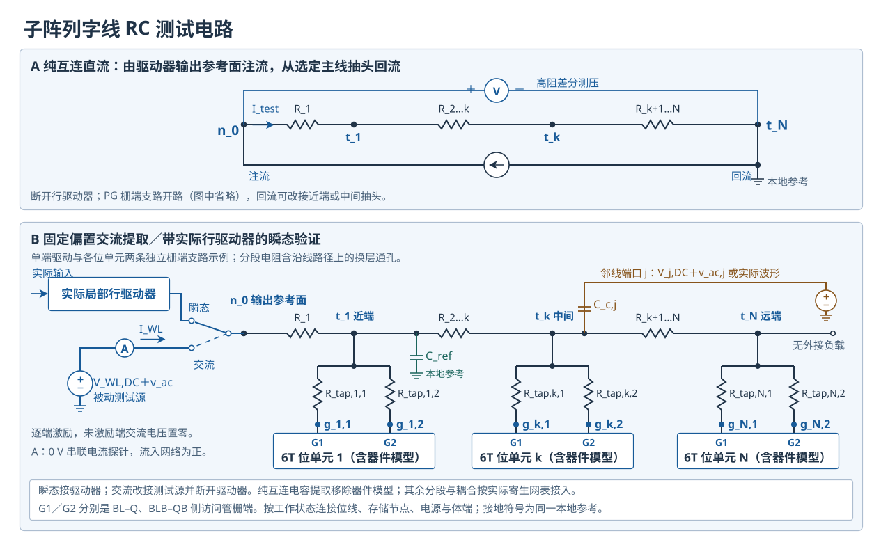
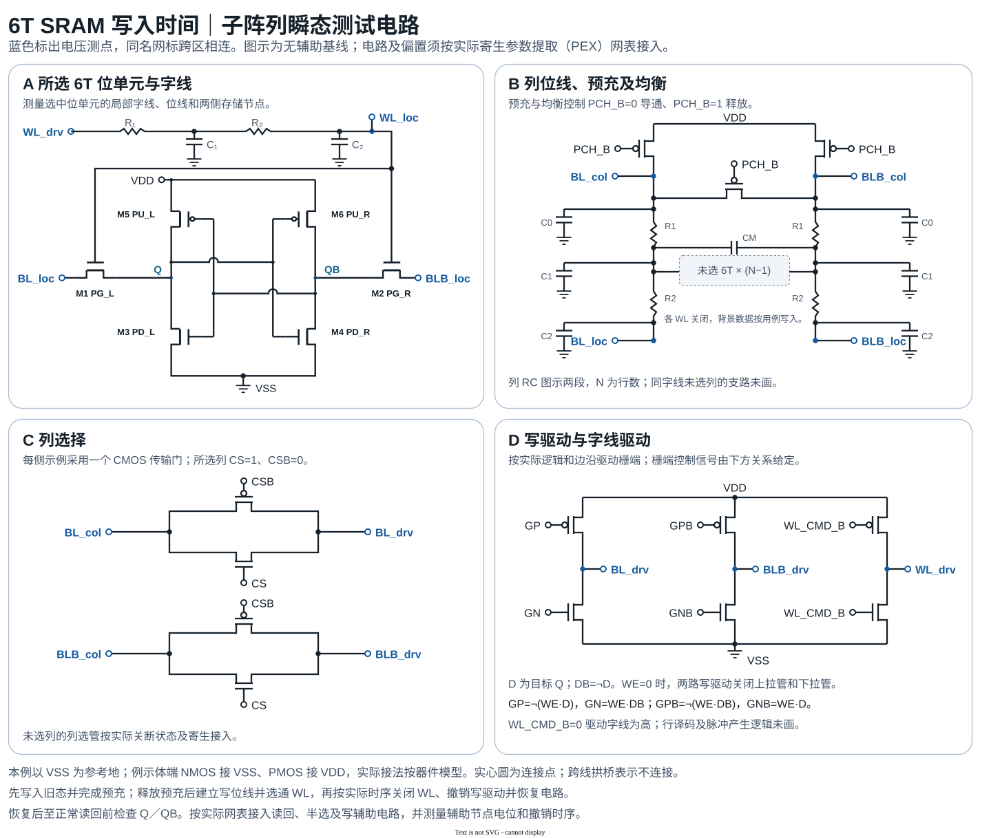

# WL Slew

## 定义与适用范围

**字线转换时间**（Wordline Slew）是子阵列中，指定局部字线（Wordline，WL）测点在同一边沿内通过两个指定电压门限的时间，单位 s，常用 ps。本文以高有效的差分 6T 静态随机存取存储器（Static Random Access Memory，SRAM）为例，在带整行实际负载的访问管（Access Transistor，PG）栅端验收；驱动器出口及主线抽头用于定位。时延模型中的字线到达时间或脉宽须分别报告。[1, Sec. 5.2, 6.1.1, Fig. 9] [2, Sec. III, V-A, Fig. 13]

在同一电压参考节点下，设低、高参考电位为 $V_{\mathrm L}$、$V_{\mathrm H}$，且 $\Delta V=V_{\mathrm H}-V_{\mathrm L}>0$。令 $V_p=V_{\mathrm L}+p\Delta V$，$p$ 是从低电位算起的摆幅比例；$t_p^\uparrow$、$t_p^\downarrow$ 为同一测点在有效上升沿、下降沿通过 $V_p$ 的时间。默认使用 **10%→90% 上升、90%→10% 下降**：

$$
t_{\mathrm r}=t_{0.9}^{\uparrow}-t_{0.1}^{\uparrow},\qquad
t_{\mathrm f}=t_{0.1}^{\downarrow}-t_{0.9}^{\downarrow}.
$$

若规格使用 **20%→80% 上升、80%→20% 下降**，将两门限改为 $V_{0.2}$、$V_{0.8}$，在结果中注明。禁止按固定系数折算非线性边沿（交越间距取决于波形）。转换时间为正；对应平均转换速率上升为 $+0.8\Delta V/t_{\mathrm r}$、下降为 $-0.8\Delta V/t_{\mathrm f}$，单位 V/s，20%／80% 口径用 $0.6\Delta V$。[15, Sec. 3.3]

| 报告量 | 端点和用途 |
| --- | --- |
| 局部边沿转换时间 | 同一栅端、同一边沿的两个门限，用于检查开通和关断波形。 |
| 字线到达延时 | 从指定控制端到局部栅端的对应交越时间差；例如控制端与输出端各自的半幅交越，须注明触发端、极性和阈值。线内传播另用驱动器出口为起点。 |
| 半幅脉宽 | 同一测点、同一连续高于半幅的区段，以两端的 $t_{0.5}^{\downarrow}-t_{0.5}^{\uparrow}$ 计宽；回穿后的各段单列并标记中断。 |
| 可用选通窗口 | 指定功能判据连续成立，并与读感测前建差或写位线有效窗口重叠的时间；可按校验过的固定 WL 电压门限定义电压代理量，不能直接用半幅宽度或 PG 标称阈值代替。 |

例如，同一测点的 $V_{\mathrm L}=0.02\,\mathrm{V}$、$V_{\mathrm H}=0.72\,\mathrm{V}$，对应 10% 和 90% 门限分别为 $0.09\,\mathrm{V}$、$0.65\,\mathrm{V}$。若上升交点为 40、110 ps，下降交点依次为 330、375 ps，则上升为 70 ps、下降为 45 ps；这些交点不能单独确定半幅脉宽或可用选通窗口。

## 物理机制与变异

- **驱动与分布负载**：末级驱动器的上拉、下拉电流分别给行负载充、放电。金属和通孔电阻、沿线电容、栅接触电阻与同行多只 PG 的栅端电荷共同确定边沿；单端长行通常在远端较慢。驱动器输入已经缓变时，出口也可能先受限制。双端、中心驱动、分段或中继需实际探测各段慢点。[1, Sec. 5.5, Fig. 9] [3, Sec. III-B, Eq. (2)] [8, Secs. II, IV] [11, Secs. III–IV, Table IV] [15, Secs. 3.3, 4.1]
- **偏置和耦合**：两只 PG 的源漏两端分别接位线（Bitline，BL）与存储节点 $Q$、互补位线 BLB 与互补存储节点 QB；两路栅端负载随位线、存储节点和体端偏置变化。相邻线的方向、幅度及相对时序可改变有效负载，反向切换通常增大同位置耦合电流；相位错开可能产生回穿。较急的局部边沿可增大瞬时耦合电流，驱动加强也可能抬高同时开关电流峰值。[8, Sec. IV] [13, Secs. 2–4]
- **电源与制造变异**：工艺、电压和温度（Process, Voltage and Temperature，PVT）、驱动器失配、局部 VDD 跌落和 VSS 抬升改变驱动能力；互连电阻、电容及接触变异改变空间分布。上升与下降受不同器件、供电路径及辅助电路控制，须分别查角。驱动出口已慢时优先查输入、上拉／下拉与电源，出口正常而沿行变差时优先查分布负载与线阻；正式归因需单独替换变量并复核共享电源和耦合。[3, Secs. III-B–C] [7, Secs. III–IV] [12, Sec. V, Fig. 8]

## 局部字线与测量边界

使用 [WL RC 网络](WL_RC.md#测量与提取方法) 的节点定义：$n_0$ 为末级驱动器输出；$t_1$、$t_k$、$t_N$ 是近、中、远主线抽头；$g_{k,1}$、$g_{k,2}$ 为第 $k$ 列两只 PG 的实际栅端。驱动出口、抽头和栅端须分别命名，防止把主线抽头的值当作接触电阻后的栅端结果。6T 同行未选列也连接该 WL；修复／虚设位按实际连接加负载。半选位和有耦合的邻行按操作模式设定。

| 门限口径 | 设定与报告要求 |
| --- | --- |
| 标称或功能参考 | 操作前按该模式声明固定低、高参考电位；无辅助时可采用指定本地标称 VSS、VDD，字线助推（Wordline Boost）或字线降压（Wordline Underdrive）须注明目标高电位。若签核沿用无辅助绝对电压门限，仍按该门限报告，降压脉冲可能达不到门限。 |
| 实际局部摆幅 | 对同一测点、同一操作与电源配置，取预先定义的低、高稳态窗；窗内波动和趋势须在规定容差内。记录参考窗、电位和峰值；电源跌落或回弹显著时另存实际本地 VDD、VSS 波形，同时报告固定参考的结果。 |
| 无稳定平台 | 使用该模式预定义的目标参考值，或同驱动、同偏置且不改变辅助及供电行为的长脉冲校准值；标注来源和实际极值。无可用参考值时交付波形及可独立定义的功能时间。 |

以上百分比门限固定在各自声明的电压坐标下。若以本地 VSS 为测量参考，WL 和标定电平都以该节点为差分负端，并另存其相对公共参考节点的波形。禁止用瞬时供电压差或脉冲峰值重设门限（会掩盖欠摆和电源失效）。分别报告字线波形、PG 栅源偏置和功能代理；PG 的 $V_{\mathrm{GS}}$ 以模型源端为负端，源端电位可随读写变化。

多级助推须分别规定助推进入、撤销及最终关断的搜索窗和门限；撤助推已低于助推 90% 门限时，最终关断在该口径下不可提取，可另用最终关断前后的参考电平报告。禁止跨助推撤销和最终关断拼接 90%→10%（两段由不同的控制事件触发）。[16, Sec. 2.2, Figs. 3–4]

## 测量与提取方法

本页使用图 B 的**瞬态**接法：实际输入接局部驱动器，输出经 $n_0$、分段主线、各抽头和栅支路到 $g_{k,p}$；不接图 A 的注流回路或图 B 的交流测试源。参考节点与邻线端口按实际供电和耦合网表连接。

图中 D 区末级反相器由 `WL_CMD_B` 驱动，输出 `WL_drv` 对应 $n_0$；A 区 `WL_loc` 接所画两只 PG 栅端，两路接触拆分时按首图分别记录。该图是无辅助写偏置示例；省略译码逻辑、同行未选列和完整行长，实际仿真用首图的整行负载。读操作使用 [读建差测试电路](Read_Develop_Time.md#测量与提取方法) 所示预充与读终端。

### 版图后瞬态仿真

**【前置条件】** 使用经版图与原理图一致性检查（Layout Versus Schematic，LVS）的寄生提取（Parasitic Extraction，PEX）网表与匹配的器件模型，涵盖行驱动、整行 PG、栅支路、邻线耦合、实际列终端和局部供电网络。记录模型版本、互连角、PVT、体端连接、行长与铺排、数据背景、输入边沿、辅助档位、控制时序和参考节点。预先规定门限口径、边沿搜索窗、最低合格停留时长、绝对电压／时间容差及验收规格。

**【步骤／方法】**

1. **建立实际读写偏置**：按正常操作初始化 $Q$/QB，完成位线预充及均衡，再按设计时序释放。读时保留位线负载、未选漏电和感测触发；写时对两种旧态分别设置差分位线、列选和辅助。施加实际行控制边沿及相邻切换，包含空闲、同向、反向及项目规定的相对相位。
2. **保存边沿与平台**：从选通前到撤销后运行瞬态分析；记录控制输入、驱动输出、近／中／远抽头及两侧栅端、局部驱动电源、位单元电源、BL／BLB、$Q$/QB 和相关辅助信号。扫描行长、驱动强度、指令脉宽、PVT 与互连角，另做同一样本固定理想供电的诊断对照。必要时减小最大积分步长及输出间距，复算交越时间，直至达到项目时间容差。
3. **提取同一边沿的交点**：为上升、下降分别限定与控制边沿对应的搜索窗。对门限两侧的相邻采样点线性插值并检查方向。存在回穿时，保留逐门限首过、稳定交点及次数；在每个边沿，先选终止门限沿预期方向通过且保持规定时长的最早交点，再取此前最后一次同向通过起始门限、期间未回穿起始门限的交点。找不到有效组合时标明原因，不生成签核转换时间。
4. **校验边沿与功能**：分别计量到达延时、半幅脉宽、可用选通窗口和过冲／下冲。以同一输入、负载、参考口径和坐标对照全 PEX 与缩减模型，再检查读建差、读扰动、写入及半选保持。辅助退出与下降沿联动时，保存辅助与有效选通的实际重叠窗口。[2, Secs. II–III, Figs. 2–8] [9, Figs. 1–2, 6–7]

**注意事项**：禁止用施加在 WL 栅端的理想电压源作子阵列签核波形（会旁路实际驱动与分布负载）。

**【结果处理和验证】** 达到两个有效门限但超过规格的慢边沿保留数值并标记超限。完整脉冲未到门限或仅有短毛刺越过门限时，标记未达到有效门限，报告极值、回穿及停留时间。观测截断且已过起始门限时，记录当前尝试的持续下界（观测截止减起始交点）；只有能确认该边沿不会回穿起始门限、终止交点必在截止后时，才可将其作为签核转换时间的右截尾下界。未见起始点、幅度饱和或波形无法归入同一边沿时，标记不可判或报告可证实的交越区间。过冲、下冲和多次交越单列，即使主边沿时间合格也须复核电压及功能规格。

### 硅片局部波形测量

**【前置条件】** 优先使用同一功能行可访问的近、远端低负载采样结构；注明测点在主线还是栅端、采样器接入电容和扇出、对照行、时钟及电压参考。使用复制行时记录负载与供电差异。普通宏仅提供外部焊盘或读写功能数据时，应报告其测量端及代理量。

**【步骤／方法】**

1. **标定传输路径**：用同电压和温度的已知电平标定采样门限或增益、偏移；用已知相位参考标定延迟码映射、采样孔径、重复抖动和通道间偏移。使用匹配参考路径或经验证的注入端逐段核对焊盘／探针读出带宽及采样头响应；比较有／无采样器结构，或用带探头负载的仿真评估测量扰动。
2. **重建节点波形**：对同一数据、地址和可重复操作扫相位，测取足以覆盖上升、下降及局部平台的样本；比较器型采样器须附门限扫描或幅度标定。重复采样以估计交越时刻的不确定度，并注明所取统计量。Toh 等在 45 nm 芯片上用传输门对 WL 做子采样、校准采样时钟并平均以减小抖动的影响；其局部脉宽测量分辨率与转换时间的不确定度须分别评估。[2, Sec. III, Figs. 8–9; Sec. V-A, Fig. 13] [5, Implementation and Results, Figs. 4–6]
3. **核对参考与代理**：用相同采样负载、参考电压、时钟定义和 PVT 对照全 PEX。Chen 等的 40 nm 片上脉宽复制法与 Wang 等的 55 nm 边沿锁存监测可作脉宽对照；两者都不单独给出同一边沿上的两个幅度交点。[10, Sec. V, Figs. 12–13] [14, Secs. II–IV, Figs. 5–6]

**注意事项**：禁止用外部驱动边沿、数字脉宽计数或重复采样的平均波形代替单次局部转换时间分布（测点、观测量和统计对象不同）。

**【结果处理和验证】** 输出重建波形、时间与幅度误差、重复数、带宽和校准后交点，区分直接观测与代理。若前端响应已证实只会展宽所测边沿，可报告带不确定度的上界；响应、抖动卷积或过冲影响未能界定时，标记为带宽受限估计或不可分辨。不能分离抖动与单次边沿时，只报告重复波形的有效转换时间，不外推单次尾部。

## 数据可视化与评估

| 图表 | 坐标与判读 |
| --- | --- |
| 时间对齐波形 | 横轴时间（ps），纵轴电压（V）；叠加控制、驱动出口、近／中／远栅端及本地供电，标注参考电平与有效交点，图注记录读／写偏置、PVT、地址、数据和辅助模式。回穿时分开标首过与稳定交点，并标明探头负载或仿真来源。 |
| 沿行分布和设计扫图 | 横轴为驱动起点到测点的距离（例如 µm）或物理列号；纵轴分别绘上升、下降（ps）、到达时间和可用窗口。在远端转换时间热图上，以行长（µm 或列数）和局部供电压差（V）为两轴，颜色表示转换时间，单独标记无交点、带宽受限和超限的条件。 |
| 角与统计分布 | 按行位置、PVT、互连角、数据与辅助模式分层，给出有效样本数、典型值及规定高尾分位、置信区间、超限／无效／截尾数；同一芯片或同行相关样本分组报告。重复触发用于估计时间抖动，不能充当独立芯片样本。 |

**数据对比规范**：统一驱动输入、负载、测点、参考节点、门限及交点规则后比较；同时列出实际摆幅与有效脉宽。不得剔除未达门限样本后将剩余分位解释为总体验收通过率。典型值用于驱动选择；签核用规定慢角、最差测点及目标分位，在测量不确定度跨过限值时报告不可确认，并提高分辨率或复测。

## 应用场景与指标关系

- **读取**：在触发及局部摆幅相近时，较慢上升沿可推迟 PG 达到有效导通，压缩感测前用于形成位线差分的时间；较慢下降会延长弱导通，改变读扰动及关断与下一次预充的间隔。应以实际局部 WL／BL／BLB 波形验证 [Read Develop Time](Read_Develop_Time.md) 和 [Read Delay](Read_Delay.md) 的门限与读扰判据。[2, Sec. II-A, Figs. 2–3] [3, Sec. III-C, Eq. (7)] [7, Secs. III–IV] [11, Sec. IV, Fig. 10]
- **写入**：比较字线边沿时须同时对齐写位线建立、辅助电位及其撤销时序。远端边沿变慢可能缩短字线与有效写驱动的重叠；缓慢关断也会改变位单元再生、半选暴露或位线释放条件。用 [Write Time](Write_Time.md) 和 [Write Delay](Write_Delay.md) 的写成、保持与读回判据验证；缩短边沿或增大助推均须同步核对过冲、半选及电流峰值。[2, Sec. II-C, Figs. 6–7] [9, Figs. 1–2, 6–7] [11, Sec. IV-C, Fig. 10(d)]
- **约束分配**：设计与工艺协同优化（Design–Technology Co-Optimization，DTCO）按最差的实际栅端分配远端边沿、到达时间、最小可用窗口及电压范围。用同负载比较驱动尺寸、跨接降阻、行长、分段／中继与辅助电平；复核前级负载、能耗、[供电网络](R_VDD_R_VSS.md)和邻线耦合。[8, Secs. IV–VI] [11, Secs. III–IV, Table IV]

## 参考文献

2026-11-17，Zotero `02-SRAM-DTCO/SRAM-Metrics/Subarray`（`L9CVSGRT`）的精确标签 `WL Slew` 由 5 条补至 15 条。16 份全文均与 Zotero 附件 SHA-256 一致：新增归档 4 份，复用 12 份。13 篇期刊／会议论文中，[2] 与 [5] 的同一芯片结果合计一次，[10]、[14] 仅作脉宽代理对照，其余 10 项独立研究支持字线边沿、辅助波形或提取方法。学位论文及 CACTI 报告另计。已核验的公开硅片资料未给出完整的多位置、多 PVT 局部栅端边沿分布。

[1] N. Muralimanohar, R. Balasubramonian, and N. P. Jouppi, “CACTI 6.0: A tool to model large caches,” HP Labs, Tech. Rep. HPL-2009-85, 2009. [公开文献](https://shiftleft.com/mirrors/www.hpl.hp.com/techreports/2009/HPL-2009-85.pdf)；[Zotero 核对](https://www.zotero.org/users/7333024/items/JYDVTQLK)（该 PDF 附于 CACTI 5.0 题录，未找到独立题录）。

**相关摘要：** CACTI 6.0将缓存划分为bank、mat与子阵列，估算译码、字线、位线、感放、复用、输出和跨bank互连。报告改进分布式字线与位线模型，并增加多种线路和网络结构；组织分割缩短局部线，却增加外围及路由开销。模型用于架构探索，必须保留容量、组织与互连假设，不能当作任意工艺版图的直接测量。分布字线网络说明远端转变受驱动及沿线负载共同影响，能够为边沿估计提供模型。报告中的时常和传播延迟不能直接等同本页指定阈值间的转变时间，比较需要统一测点及电压百分比。

**原文定位：** §1–3、§5.5–5.6，报告pp.3–5、17–18，图9–10。

[2] S. O. Toh, Z. Guo, T.-J. K. Liu, and B. Nikolić, “Characterization of dynamic SRAM stability in 45 nm CMOS,” IEEE J. Solid-State Circuits, vol. 46, no. 11, pp. 2702–2712, 2011. [DOI 10.1109/JSSC.2011.2164300](https://doi.org/10.1109/JSSC.2011.2164300). [公开文献](https://doi.org/10.1109/JSSC.2011.2164300)；[Zotero](https://www.zotero.org/users/7333024/items/PTWVUSQP)。

**相关摘要：** 论文在45 nm芯片中用可编程字线和采样电路表征动态稳定性，读写成功由有限脉冲后的状态或感放结果判断。作者校准真实本地脉宽，并区分读访问失败、读扰和写失败；不同列的感放失调会影响读取统计。静态裕量与动态指标并非一一对应，因此必须明确脉冲条件、观察节点和成功判据。论文提供本地字线波形与脉宽校准，短脉冲时边沿占用明显比例。用于本页应从同一波形独立测量上升转变时间，不能用上升到下降半幅间的脉宽、驱动延迟或校准分辨率代替slew。

**原文定位：** §II、§III、§V-A，pp.2703–2708，图 2、6、8–9、13。旧稿定位 [2, Sec. III, IV-A, Fig. 13] 和 [2, Sec. III, IV-A, Figs. 8, 13] 中，§IV-A 为阵列组织；图 13 位于 §V-A。论文给出约 75 ps 上升和 30 ps 下降的实测结果，未标明边沿幅度阈值。

[3] B. S. Amrutur, and M. A. Horowitz, “Speed and power scaling of SRAM's,” IEEE Journal of Solid-State Circuits, vol. 35, no. 2, pp. 175-185, 2000. [公开文献](https://doi.org/10.1109/4.823443)；[DOI](https://doi.org/10.1109/4.823443)；[Zotero](https://www.zotero.org/users/7333024/items/CH2EXX7I)

**相关摘要：** 论文用解析模型探索SRAM组织、容量和技术缩放，包含译码、字线、位线、感放及输出复用。研究以读路径为关键路径，只建模读取动态能量，外部输出负载被排除；门尺寸主要按最小时延设定，低能量方案未必全局最优。模型明确线长和负载的作用，并与电路仿真验证，应用时必须保留这些假设。论文以局部字线末端上升时间修正位线延迟，并由电路仿真建立与最后一级驱动延迟的近似关系。该经验比例不是普适定义，采用时应记录负载、测点和转变范围，不能把slew写成电压变化率。

**原文定位：** §III-A–C，pp.177–180（PDF第3–6页），式(2)–(7)、图4–11。

[4] S. Thoziyoor, N. Muralimanohar, and N. P. Jouppi, “CACTI 5.0,” Hewlett-Packard Laboratories, Tech. Rep. HPL-2007-167, Oct. 19, 2007. ；[Zotero](https://www.zotero.org/users/7333024/items/JYDVTQLK)；DOI：Zotero未收录或尚未核实。

**相关摘要：** 归档附件实际为2007年CACTI 5.0报告，作者为Thoziyoor、Muralimanohar和Jouppi，不能按Zotero的2008年四作者题录引用。报告将存储器分为bank、mat及子阵列，建模译码、位线、感放、复用和请求／回复树。地址与输入数据树可门控，输出树使用不同驱动结构；阵列组织搜索需同时考虑时延、功耗与布局开销。报告讨论门链、线路电阻和负载如何决定时序，足以支撑驱动与边沿的联系。但其传播延迟和缓冲设计指标不能直接换成字线10%至90%时间，需采用原始波形或明确的slew模型另行提取。

**原文定位：** §3–5，报告pp.8–27（PDF第9–28页）。

[5] S. O. Toh, Z. Guo, and B. Nikolic, “Dynamic SRAM stability characterization in 45nm CMOS,” in 2010 Symposium on VLSI Circuits, 2010, pp. 35-36. [公开文献](https://doi.org/10.1109/VLSIC.2010.5560259)；[DOI](https://doi.org/10.1109/VLSIC.2010.5560259)；[Zotero](https://www.zotero.org/users/7333024/items/5YV9U9A5)

**相关摘要：** 该45 nm芯片通过可编程脉冲、字线采样和后续读回测试动态稳定性。阵列采用较少列数，抑制字线寄生造成的位置相关误差；实际脉宽与控制码存在非线性，必须在本地字线上校准。静态读裕量会高估读扰失败，静态写裕量又不能可靠识别动态写入异常，说明脉冲时域测量具有独立价值。实验在字线末端观测真实脉冲，报告约 75 ps 上升和 30 ps 下降，说明边沿和寄生畸变会限制动态测试精度；该会议论文与 [2] 使用同一试验芯片。原文未注明幅度阈值，保留其报告口径。

**原文定位：** Implementation and Results，pp.35–36（PDF第1–2页），图4–6。

[6] S. O. Toh, “Nanoscale SRAM variability and optimization,” dissertation, UC Berkeley, 2011. [公开文献](https://www2.eecs.berkeley.edu/Pubs/TechRpts/2011/EECS-2011-144.html)；[原文]( <https://escholarship.org/uc/item/6c77c95k>)；[Zotero](https://www.zotero.org/users/7333024/items/LYDRHR6E)；DOI：Zotero未收录或尚未核实。

**相关摘要：** 论文以45 nm测试芯片和片上采样器测量实际访问窗口。窄阵列减小沿行传播的脉冲畸变，脉宽以本地字线上升、下降半幅交点定义并校准；短脉冲的边沿占比不可忽略。实验单独测量感放失调，以解释静态读电流与动态访问表现并非完全一致，避免把测试电路的系统误差归入单元变异。文中波形显示短脉冲中上升、下降转变占明显比例，脉宽按半幅交点校准。用于本页需另从本地波形提取指定幅度区间的上升时间，不能把脉冲宽度、传播延迟或采样分辨率当作字线slew。

**原文定位：** §1.3.2、§1.5.2、§2.3，书内pp.6、9、17–19。

[7] S. Gupta, and B. H. Calhoun, “Dynamic read VMIN and yield estimation for nanoscale SRAMs,” IEEE Transactions on Circuits and Systems I: Regular Papers, vol. 68, no. 3, pp. 1171-1182, 2021. [公开文献](https://doi.org/10.1109/TCSI.2020.3044836)；[DOI](https://doi.org/10.1109/TCSI.2020.3044836)；[Zotero](https://www.zotero.org/users/7333024/items/CJ93JPNL)

**相关摘要：** 研究把动态读失败表达为给定窗口内位线差分不足以克服感放失调。模型结合读电流、行数决定的位线电容、列数相关的字线上升时间及控制脉冲变异，并考虑未选单元漏电和低电压非高斯尾部。阵列良率同时受数据通路与时序通路影响，不能仅由平均读电流或静态读稳定性推断。模型把列数相关的字线上升时间纳入读取分析，说明边沿减慢会推迟有效驱动及差分建立。它未给出可跨工艺直接使用的固定slew值，本页提取需注明本地测点、转变阈值和驱动负载。

**原文定位：** §III–IV，pp.1174–1177（PDF第4–7页），式(14)、图5。

[8] B. Wu, J. E. Stine, and M. R. Guthaus, “Fast and area-efficient SRAM word-line optimization,” in Proc. IEEE ISCAS, 2019. [DOI 10.1109/ISCAS.2019.8702518](https://doi.org/10.1109/ISCAS.2019.8702518)；[公开文献](https://doi.org/10.1109/ISCAS.2019.8702518)；[Zotero](https://www.zotero.org/users/7333024/items/6XAKBJZW)。

**相关摘要与定位：** §II、§IV–VI、图 1–3、5。使用实际字线缓冲拓扑、π 型缩减网络和门查表，按驱动输入转换时间、门尺寸和有效负载估算输出延时与转换时间；分段和缓冲的设计结果与 SPICE 对照。最终栅端签核须复查分布网络。

[9] M. Khellah et al., “Wordline & bitline pulsing schemes for improving SRAM cell stability in low-Vcc 65nm CMOS designs,” in Proc. IEEE Symp. VLSI Circuits, 2006, pp. 9–10. [DOI 10.1109/VLSIC.2006.1705286](https://doi.org/10.1109/VLSIC.2006.1705286)；[公开文献](https://doi.org/10.1109/VLSIC.2006.1705286)；[Zotero](https://www.zotero.org/users/7333024/items/5UISD9ID)。

**相关摘要与定位：** 图 1–2、6–7。65 nm 研究用仿真字线脉冲及位线波形评估选通时长对读稳定性、建差与写裕量的影响。所示波形适用于辅助和窗口比较，未报告统一口径的局部转换时间。

[10] Y.-H. Chen et al., “Compact measurement schemes for bit-line swing, sense amplifier offset voltage, and word-line pulse width to characterize sensing tolerance margin in a 40 nm fully functional embedded SRAM,” IEEE J. Solid-State Circuits, vol. 47, no. 4, pp. 969–980, 2012. [DOI 10.1109/JSSC.2012.2185180](https://doi.org/10.1109/JSSC.2012.2185180)；[公开文献](https://doi.org/10.1109/JSSC.2012.2185180)；[Zotero](https://www.zotero.org/users/7333024/items/RJ8M4HFH)。

**相关摘要与定位：** §V、图 12–13。40 nm 实现复用实际时序路径取得可外测的脉宽代理，原文评估模式间的偏差。该方法校核脉宽；局部幅度和两个同沿交点仍需单独测量。

[11] R. Mathur et al., “Buried interconnects for sub-5 nm SRAM design,” IEEE Trans. Electron Devices, vol. 69, no. 3, pp. 1041–1047, 2022. [DOI 10.1109/TED.2022.3143078](https://doi.org/10.1109/TED.2022.3143078)；[公开文献](https://doi.org/10.1109/TED.2022.3143078)；[Zotero](https://www.zotero.org/users/7333024/items/H35G9VFR)。

**相关摘要与定位：** §III–IV、表 IV、图 10。imec N5 规则的宏仿真在 SS、0.63 V、−40 °C 下比较布线方案的 10% 至 90% 字线和位线转换时间。读裕量变化包含两类信号边沿的共同作用；写入结果也包含其他通路的阻容与时序。

[12] H. Homayoun, M. Makhzan, and A. Veidenbaum, “ZZ-HVS: Zig-zag horizontal and vertical sleep transistor sharing to reduce leakage power in on-chip SRAM peripheral circuits,” in Proc. IEEE ICCD, 2008, pp. 699–706. [DOI 10.1109/ICCD.2008.4751937](https://doi.org/10.1109/ICCD.2008.4751937)；[作者组 PDF](https://www.ece.ucdavis.edu/~hhomayou/files/iccd-08-circuit.pdf)；[公开文献](https://doi.org/10.1109/ICCD.2008.4751937)；[Zotero](https://www.zotero.org/users/7333024/items/EHPJCEHJ)。

**相关摘要与定位：** §IV–V、图 8(b)。作者在 65 nm、1.08 V 的提取后 HSPICE 仿真中比较多种电源门控方案的带负载驱动器上升、下降及传播时间。原文比较的是驱动器端口，不能直接用作最远 PG 栅端的签核值。

[13] A. B. Kahng, S. Muddu, and E. Sarto, “On switch factor based analysis of coupled RC interconnects,” in Proc. ACM/IEEE DAC, 2000, pp. 79–84. [DOI 10.1145/337292.337318](https://doi.org/10.1145/337292.337318)；[作者组 PDF](https://vlsicad.ucsd.edu/Publications/Conferences/108/c108.pdf)；[公开文献](https://doi.org/10.1145/337292.337318)；[Zotero](https://www.zotero.org/users/7333024/items/G57BX3LL)。

**相关摘要与定位：** §2–4。相邻线的切换方向、边沿形状和时间偏移共同影响耦合互连响应与等效系数。该研究支持在 PEX 中保留实际耦合及激励；其分析针对通用互连。

[14] S. C. Wang et al., “Design and implementation of dynamic word-line pulse write margin monitor for SRAM,” in Proc. IEEE APCCAS, 2012, pp. 116–119. [DOI 10.1109/APCCAS.2012.6418985](https://doi.org/10.1109/APCCAS.2012.6418985)；[公开文献](https://doi.org/10.1109/APCCAS.2012.6418985)；[Zotero](https://www.zotero.org/users/7333024/items/JJZP7KWC)。

**相关摘要与定位：** §II–IV、图 5–6。55 nm 测试芯片用边沿感测、延迟链与环振标定测量 WL 脉宽；可验证数字监测路径和局部脉宽代理的适用范围，不能由此反推边沿时间。

[15] C. V. Kashyap, C. J. Alpert, F. Liu, and A. Devgan, “Closed form expressions for extending step delay and slew metrics to ramp inputs,” in Proc. ACM ISPD, 2003, pp. 24–31. [DOI 10.1145/640006.640009](https://doi.org/10.1145/640006.640009)；[ACM SIGDA 会议档案](https://www.cs.york.ac.uk/rts/docs/SIGDA-Compendium-1994-2004/papers/2003/ispd03/pdffiles/02_3.pdf)；[公开文献](https://doi.org/10.1145/640006.640009)；[Zotero](https://www.zotero.org/users/7333024/items/VQRHGL76)。

**相关摘要与定位：** §3.3、式 (12)、§4。对有限输入斜坡扩展 RC 网络阶跃响应的延时和 10%→90% 转换时间模型；输入边沿和线网的阶跃转换时间须分别处理。辅助控制、动态非线性负载和非单调边沿采用实际瞬态波形。

[16] H. Morimura and N. Shibata, “A 1-V 1-Mb SRAM for portable equipment,” in Proc. IEEE/ACM ISLPED, 1996, pp. 61–66. [DOI 10.1109/LPE.1996.542731](https://doi.org/10.1109/LPE.1996.542731)；[会议档案](https://www.cecs.uci.edu/~papers/compendium94-03/papers/1996/islped96/pdffiles/03_3.pdf)；[公开文献](https://doi.org/10.1109/LPE.1996.542731)；[Zotero](https://www.zotero.org/users/7333024/items/ZEXHLIA2)。

**相关摘要与定位：** §2.2、图 3–4。在 1 V 工作的设计中，局部子字线的模拟波形先助推到高于供电，再回落至选通状态；表征须将助推回落与最终关断分开。该例不提供统一百分比边沿时间。
