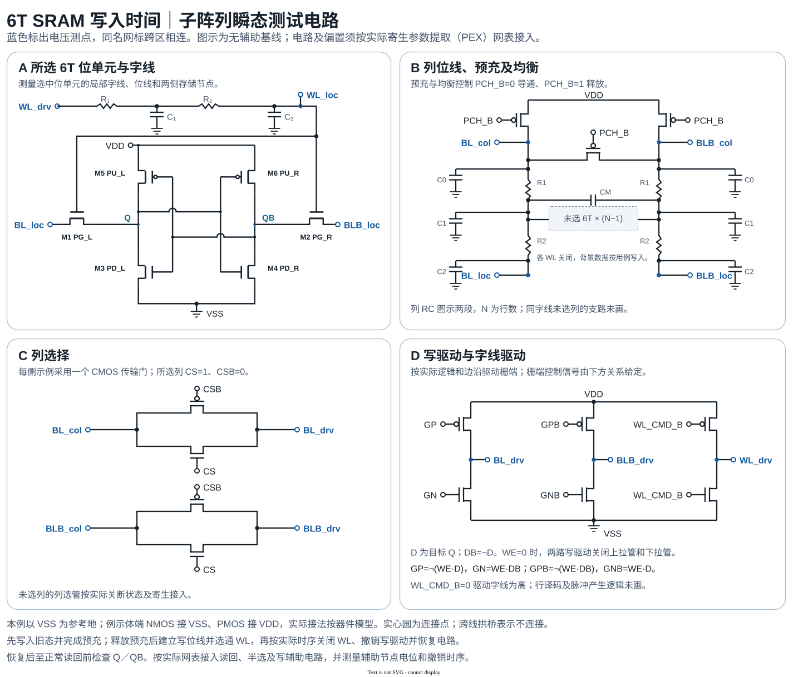
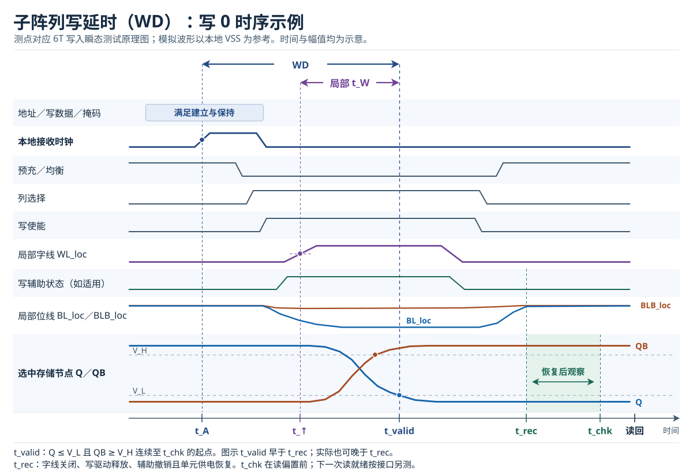

# WD (Write Delay)

## 定义与适用范围

**子阵列写延时**（Subarray Write Delay，WD）是子阵列本地接口接受写请求至选中位单元新状态有效的时间，单位 s。本文以差分 6T 静态随机存取存储器（Static Random Access Memory，SRAM）为例，分别测量写 0（$Q:1\to0$）和写 1（$Q:0\to1$），并验证初始旧态。写入与旧态相同的数据时，可另测功能与功耗，无翻转延时样本。

- **请求接受时刻 $t_{\mathrm A}$**：对于同步接口，在子阵列接口取接受写命令的有效时钟沿半幅；地址、数据、掩码和写控制须满足建立与保持时间。对于握手接口，取协议规定的接受事件，并声明有效极性、测点和阈值。半幅取同一测点低、高参考电平的中点；记录输入边沿及电位参考。发生在 $t_{\mathrm A}$ 之前的预译码和数据建立另记相对时刻；宏输入缓冲及全局互连传播另行表征。
- **状态有效时刻 $t_{\mathrm{valid}}$**：写 0 时要求存储节点 $Q$ 不高于 $V_{\mathrm L}$、互补存储节点 QB 不低于 $V_{\mathrm H}$，写 1 时交换两节点。以写辅助撤销后恢复的位单元 VDD／VSS 电位 $V_{\mathrm{DD,hold}}$、$V_{\mathrm{SS,hold}}$ 为基准，在同一参考节点下设定固定门槛。例如取 $\Delta V_{\mathrm{hold}}=V_{\mathrm{DD,hold}}-V_{\mathrm{SS,hold}}$，$V_{\mathrm L}=V_{\mathrm{SS,hold}}+0.1\Delta V_{\mathrm{hold}}$、$V_{\mathrm H}=V_{\mathrm{SS,hold}}+0.9\Delta V_{\mathrm{hold}}$；签核门槛须按保持与后续读取规格确定。
- **确认规则**：在规定确认截止 $t_{\mathrm{chk}}$ 前，取一直合格至该截止的双节点连续区间起点作 $t_{\mathrm{valid}}$，并要求其不晚于写有效期限。将字线（Wordline，WL）关闭、写驱动与写辅助释放、位单元电源恢复到规定范围的最晚时刻记为 $t_{\mathrm{rec}}$，这些条件须持续至确认截止。从 $\max(t_{\mathrm{valid}},t_{\mathrm{rec}})$ 至 $t_{\mathrm{chk}}$ 须覆盖规定的最短观察时长，之后再施加读偏置，以正常读回验证目标位与半选位。恢复和读回用于验证终点；终点可在恢复前或后。文献的 *data flip* 须核对起点、电平门槛和验证期。[1, Sec. I–II, Figs. 1, 3] [2, Sec. II-C, Fig. 6] [10, Sec. 2.4.2, Table 2.4]

| 指标 | 起止事件或提取条件 |
| --- | --- |
| 子阵列写延时 $\mathrm{WD}=t_{\mathrm{valid}}-t_{\mathrm A}$ | 固定功能写波形，起点经本地译码、列复用、写控制与驱动至目标位，取已确认的状态有效事件。多位写入中，掩码内所有应翻转位均须通过，取其最晚状态有效时刻；同值写入位核对目标值，掩码关闭位核对原值。无应翻转位时不提取 WD。 |
| 局部写入时间 $t_{\mathrm W}$ | [Write Time](Write_Time.md)：由位单元侧 WL 上升半幅 $t_{\uparrow}$ 计至同一 $t_{\mathrm{valid}}$。 |
| 临界写脉宽 $t_{\mathrm{W,min}}$ | 扫局部 WL 上升至下降半幅的宽度，求目标位成功写入的最短宽度；子阵列可用窗口还须满足半选保持。外部最小功能写窗口或最小时钟周期须按所扫描的接口量另报。[2, Sec. II-C, Fig. 6] [5, Sec. 5.2.2] |
| 写后恢复与最早后续访问 | 分别记录单元保持条件的恢复、位线（Bitline，BL）／互补位线 BLB 的预充均衡。按接口约束扫下一次读／写，报告从 $t_{\mathrm A}$ 到最早可接受的后续命令，注明端口、地址冲突和判定窗口。 |
| 写确认（Write Acknowledge，ACK） | 若接口有 ACK，另报从接受到 ACK 的时间及其协议含义；ACK 或最早成功读回须校准与双节点状态事件的关系后才可用作 WD 代理。 |

## 物理机制与变异

行译码与末级 WL 驱动决定访问管（Access Transistor，PG）的开启；列译码、写使能、预充释放及写驱动决定单元侧的 BL／BLB 波形。两条路径可并行。常规 6T 写 0 时，写驱动经列选择和 BL 吸取放电电流，正方向从原高存储节点流向写驱动；BLB 保持高电位。低侧访问管克服上拉管（Pull-up，PU），拉低原高节点；对侧下拉管（Pull-down，PD）随之减弱，交叉耦合反馈抬高互补存储节点。写 1 时交换两侧。实际位线摆幅、PG 栅端边沿和本地供电决定翻转与再生速度。两侧器件失配和线间耦合可导致方向差异，须用同一物理位配对比较。[3, Secs. IV–V] [6, Sec. 2.4.2, Fig. 2.20] [13, Sec. 4.2, Fig. 11]

位线分布阻容、列选择导通电阻和未选位单元漏电会改变写入端的电平、边沿及负位线辅助（Negative Bitline，NBL）的到达时刻；同列未选行的访问管在负电位下可能部分导通。字线助推（WL Overdrive）提高访问管驱动，单元电源降压辅助（Cell VDD Lowering）削弱锁存器保持能力。须记录辅助有效范围与实际建立／撤销波形，并检查同行未选列、同列未选行和掩码屏蔽位。用无写扰动的正常保持偏置对照识别静态保持失败，单列该类样本。[1, Sec. II–III, Figs. 3, 8–9] [14, Sec. III, Figs. 4–6]

## 写通路边界与测点

| 测点 | 用途 |
| --- | --- |
| 本地接口、行列译码 | 保存接收时钟或握手、写控制、地址、数据及掩码，以及行列选择和末级 WL 驱动的输入／输出，定位请求接受至选通的传播。 |
| 写驱动、列选择、预充及辅助 | 记录预充／均衡、写驱动使能、列选择门控、驱动侧与列选择后的 BL／BLB，以及辅助控制和实际局部偏置，区分驱动能力、开关阻抗、位线 RC 及辅助传播。 |
| 位单元端与读回 | 记录选中位单元的局部 WL（两侧独立提取时均保存）、BL／BLB、$Q$/QB、VDD／VSS；保存受影响未选位的原态及恢复后数据。读回时另记读使能、读时序、感测判据及数据结果。 |

同一次写入的事件差可拆为 $\mathrm{WD}=(t_{\uparrow}-t_{\mathrm A})+(t_{\mathrm{valid}}-t_{\uparrow})$。WL 半幅以写低侧访问管栅端的同配置高、低电平为基准；无半幅时，仍可按接口和状态判据检查 WD，局部时间与脉宽不提取，并单列波形异常。若 $t_{\mathrm{valid}}<t_{\uparrow}$，保存事件次序和带符号的局部时间差；预译码、预驱动或 WL 半幅早于 $t_{\mathrm A}$ 时也保留相对时刻。若目标位在请求接受前已进入最终合格区间，记录为边界异常，不计入 WD 样本。分析并行路径时，可标出 BL、WL 和辅助达到声明诊断门槛的各时刻；只有其最晚时刻位于 $[t_{\mathrm A},t_{\mathrm{valid}}]$ 内，才可按该点分段。**注意事项**：禁止把请求至 WL、请求至位线建立、请求至辅助建立和 $t_{\mathrm W}$ 直接求和（会重复计入并行过程）。

**仿真原文示例**：Dosi 在 16 KB 6T 存储体（bank）、典型工艺角（Typical-Typical，TT）的写时序图中分别标出 WENA 至 SAN 为 544 ps、列选择 `synt` 至 BL 为 477 ps、`Blt` 至 `bit` 为 132 ps。它们对应不同的信号边沿；须用同次写波形从实际接受沿提取全路径时间。[6, Sec. 2.4.2, Table 2-2, Fig. 2.20]

## 测量与提取方法

图示无辅助的写通路基线。$Q$/QB 经访问管与 `BL_loc`／`BLB_loc` 相连，`WL_loc` 接两只访问管栅端。写驱动输出经列选择和分布 RC 接至位单元。WD 网表用本地接口驱动实际译码、列选择、预充／均衡、写控制和辅助支路；另接实际体端、未选负载及读链，保存驱动端和位单元端测点。[写路径与时序](Write_Time.md#测量与提取方法)

时序图的预充／均衡轨道表示功能有效状态，对应原理图的 `PCH_B` 低电平。图中为写 0 的一种事件顺序，$t_{\mathrm{valid}}$ 先于恢复，且目标电平持续至 $t_{\mathrm{chk}}$；实际次序须由仿真或校准的测点确定。

### 仿真提取

**【前置条件】** 使用寄生参数提取（Parasitic Extraction，PEX）网表；记录工艺、电压与温度（Process, Voltage and Temperature，PVT）、RC 角、失配样本、供电和体偏置、写数据、掩码并发负载、行列地址、相邻活动、预充状态、辅助波形及作用范围。覆盖行列的近近、近远、远近、远远组合及布线特异点。按同一规格固定写控制窗、建立／保持、写有效期限、确认截止、观察时长、恢复容差及读回间隔。裁剪网表须保留真实控制路径、分布 RC、未选漏电与耦合、供电及负载；用完整子阵列对照代表性位置的波形和写入边界。[8, Sec. III-B] [12, Sec. III-A]

**【步骤／方法】**

1. **预置与基线检查**：用正常操作写入相反旧态和指定背景，验证目标位与半选位的旧态和读链。在同一 PVT 的正常保持偏置下做等时长无写命令的对照，识别原本无法保持的位；恢复至规定预充及辅助初态。
2. **施加本地写命令**：从子阵列接口施加已声明的波形，保持固定功能写窗。保存接受、驱动、局部 WL／BL／BLB、实际辅助、$Q$/QB 及恢复波形。按实际设计关闭 WL、撤销写驱动和辅助、恢复位单元供电与预充均衡，检查非重叠时序。分别复测方向、地址、背景、掩码及同时写入位数；跨 PVT 或辅助档位按同一口径重提。
3. **提取与复核终点**：对波形插值提取 $t_{\mathrm A}$ 和双节点最终连续合格区间，保留越阈后回弹信息。确认写有效期限及恢复后连续保持，以正常读回验证目标位与半选位。缩小仿真步长复算临界样本，直至 WD 和通过判定在声明精度内一致。在相同写配置下另扫下一读间隔；用可靠读链比较最早后续读与充分恢复后的读回，并独立扫最小功能写窗。[15, Secs. II-A, III-B.3, Figs. 7–8]

**注意事项**：禁止用节点交叉、单节点越阈或读回时刻替代 $t_{\mathrm{valid}}$（越阈可能回弹，读偏置也可能改变未完成的写入）。

**【结果处理和验证】** 交付合格 WD、同轨迹的 $t_{\uparrow}$、$t_{\mathrm W}$、位线与辅助时序、恢复及读回间隔。分别标记未翻转、回弹、超时、静态保持失败、半选受扰、读链失败或结果不可判。达到有效期限但未稳定为规格失败；仅因记录或校准受限而无法确认时，报告可证明的截尾边界或不可判状态。即使目标位达到电气终点，半选失败的事务也不能计入通过样本。

### 硅片测试

**【前置条件】** 有片上监测位单元时，校准本地接受事件与双节点采样相位，以同结构未加载对照量化缓冲负载、通道偏差及相位分辨率。声明参考电压、温度、地址、重复次数和可接受失败率；已知数据的读回对照须覆盖所用读时序。

**【步骤／方法】** 每次重置同一旧态和背景，固定写条件；对同一次操作同步采集双节点波形，或重复写入并扫共同采样相位，记录各相位的双节点通过比例。覆盖释放、恢复至确认截止，再正常读回。扫相位不能逐轨迹核实持续合格时，报告统计估计、相位分辨率、重复数与通过率口径。Toh 等在 45 nm 测试芯片上以校准的局部 WL 脉宽及写后读回测临界写脉宽，文中所用脉宽校准分辨率为 10 ps。[2, Sec. III, IV-C, Fig. 15]（图 15 实际位于 §V-C；校准见 §V-A。）

**注意事项**：禁止用未校准的代理或读回误码推断内部节点速度（读链、访问互斥及预充恢复也决定最早可观察读回）。

**【结果处理和验证】** 能直接采集双节点且核实连续条件时，交付 WD 及校准误差；其余情形分别交付估计区间、ACK 延时或固定读间隔下的最小功能写窗口。报告最早功能读回须指明扫读命令的发出或接受时间、是否同址和同端口、读结果及其允许延时；对受读链限制的点另列原因。

## 数据可视化与评估

| 图表 | 标注及判读 |
| --- | --- |
| **对齐波形** | 横轴时间（ps 或 ns），纵轴电位（V）或逻辑状态；对齐接受、行列、写与预充控制、辅助、驱动侧与局部 WL／BL／BLB、$Q$/QB 及供电。标出阈值、有效期限、$t_{\mathrm{rec}}$、$t_{\mathrm{chk}}$ 和读回时刻。相同控制下远端位线慢先查驱动、列选择和 [BL RC](BL_RC.md)；位线相近而翻转差异大时查失配和实际辅助。 |
| **分位曲线与地址热图** | 按方向、行列、PVT、辅助及背景分层，标注样本数、通过率、置信区间、分辨率和截尾数量。条件分位只针对合格事务；另按可判定试验报期限内写失败率、半选失败率和合并失败率，未判样本单列。 |
| **对照矩阵** | 并列 WD、局部写入时间、实际脉宽、最小功能窗口和下一读就绪；比较前统一接口边界、负载、初始及目标条件、有效门槛、观察期限、成功率和后续读条件。 |

跨方向的单物理位签核按任一方向不合格计为该位不合格；重复试次单列成条件失败率。共享行列、供电或芯片的相关样本按组统计。尾部数据不足时，按 [RSNM](../Bitcell/RSNM.md#数据分析与评价方法) 报独立样本的失败率置信界；采用重要性抽样等模型时须与实测或直接蒙特卡洛的重叠区域校验，声明模型范围与有效样本量。[3, Secs. IV–VII] [16, Secs. IV–V]

**原文对照**：Liu 等在 2 nm 仿真中以 BLB 为 0.7 V，WL 选通时开始拉低 BL，以 $-2\,\mathrm{V/ns}$ 代表其 2 GHz 的斜率假设；最远位单元原低节点达满摆幅 90% 时确定写驱动电压裕量。[1, Sec. I–II, Figs. 1, 3] 图 8、9、14 比较不同寄生、斜率及方法下的写裕量，给出位线和辅助时序的诊断证据，未用本页的请求至双节点稳定判据。[1, Sec. III–V, Figs. 8–9, 14]（图 8、9、14 均见 §III。）Liu 与 Catthoor 的子阵列 WD 从 CLK 半幅计至翻转节点达 $0.9V_{\mathrm{DD}}$，并区分概念辅助与电容产生的实际辅助；对比时须另核对双节点及恢复观察口径。[10, Table 2.4]

## 应用场景与指标关系

设计技术协同优化（Design-Technology Co-Optimization，DTCO）用 WD 分配本地接受至状态有效的延时预算，并以 [WL Slew](WL_Slew.md)、[BL RC](BL_RC.md) 和局部写入时间定位译码、选通、驱动或再生瓶颈。更短的 WD 有助于缩短写周期；可用周期由预充、恢复、操作互斥、最小写窗口及接口条件共同决定。改变驱动、列复用和写辅助时同步核对 [WE](Write_Energy.md)、[WM](../Bitcell/WM.md) 和半选保持；须将静态保持失败与动态写失败一并纳入良率预算。[8, Secs. III-B, III-E, Fig. 15] [14, Sec. III] [15, Sec. III] [17, Sec. III-B, Fig. 4]

## 参考文献

2026-11-17 核验 Zotero `02-SRAM-DTCO/SRAM-Metrics/Subarray`（`L9CVSGRT`）的精确标签 `WD (Write Delay)`：初检 11 条，补检至 17 条，均有可读归档。可独立支持写入路径、瞬态、验证或统计方法的期刊／会议研究共 10 篇：[1]、[2]、[3]、[8]、[11]、[13]–[17]；[13] 的 Zotero 预印本题录与期刊归档按同一研究计。补检作业 `bcea82f29766` 已完成，审阅 Crossref 的 7 条定向查询所得 21 项候选后，复用 6 篇全文；未使用 Sci-Hub。

[1] H.-H. Liu et al., “Extended methodology to determine SRAM write margin in resistance-dominated technology node,” IEEE Trans. Electron Devices, 2022, author manuscript. [DOI 10.1109/TED.2022.3165738](https://doi.org/10.1109/TED.2022.3165738). [公开文献](https://doi.org/10.1109/TED.2022.3165738)；[Zotero](https://www.zotero.org/users/7333024/items/9HKACZ7P)

**相关摘要：** 论文指出先进节点的位线电阻、电容与半选位单元访问管漏电会损害负位线辅助写入。位线在有限时间内未充分放电时，静态写裕量可能高估实际可写性；负压加深还会意外开启未选访问管。作者扩展瞬态写裕量方法，使驱动波形、寄生及辅助偏置一起进入判断，不能只用理想固定低电平代表真实位线。文中数据翻转时间随写驱动斜率、位线寄生和负压改变，能解释完整写延迟中的局部瓶颈。直接引用时需保留起止节点与辅助波形，不能把内部翻转时间或辅助建立时间独立当作请求至稳定状态延迟。

**原文定位：** §I–IV，作者稿 PDF 第 1–5 页，图 1、3、8–9、14。

[2] S. O. Toh, Z. Guo, T.-J. K. Liu, and B. Nikolić, “Characterization of dynamic SRAM stability in 45 nm CMOS,” IEEE J. Solid-State Circuits, vol. 46, no. 11, pp. 2702–2712, 2011. [DOI 10.1109/JSSC.2011.2164300](https://doi.org/10.1109/JSSC.2011.2164300). [公开文献](https://doi.org/10.1109/JSSC.2011.2164300)；[Zotero](https://www.zotero.org/users/7333024/items/PTWVUSQP)

**相关摘要：** 论文在 45 nm 芯片中用可编程字线和采样电路表征动态稳定性，读写成功由有限脉冲后的状态或感放结果判断。作者校准真实本地脉宽，并区分读访问失败、读扰和写失败；不同列的感放失调会影响读取统计。静态裕量与动态指标并非一一对应，因此必须明确脉冲条件、观察节点和成功判据。动态写临界脉宽反映有限驱动能否最终改变存储值，属于最短窗口而非完整传播延迟。它为本页提供稳定性约束；若报告请求至写完成时间，仍须加入实际控制路径并声明节点有效及保持判据。

**原文定位：** §II-C、§III、§V-A、§V-C，pp.2704–2707（PDF 第 3–6 页），图 6、8–9、13、15。

[3] K. Agarwal and S. Nassif, “Statistical analysis of SRAM cell stability,” in Proc. 43rd ACM/IEEE Design Automation Conference, 2006, pp. 57–62. [公开文献](https://doi.org/10.1145/1146909.1146928)；[DOI](https://doi.org/10.1145/1146909.1146928)；[Zotero](https://www.zotero.org/users/7333024/items/8C2792B6)

**相关摘要：** 论文以阈值变异解释SRAM读稳定、写入和访问失败，使用延迟倒数近似正态并建立线性敏感性模型。三个失败事件通过联合分布组合，而不是独立相加；作者在工业65 nm SOI模型中用大量蒙特卡洛验证。该变换依赖所考察工作区，不能无验证地推广至亚阈值或不同器件结构。写时间与字线窗口比较形成失败事件，研究重点是单元统计切换而非请求至输出的完整路径。用于本页只可解释局部延迟分量，仍需补实际译码、写驱动及最终稳定状态的表征条件。

**原文定位：** §IV–VII，pp.60–62（PDF第4–6页），式(17)–(21)。

[4] M. H. Abu-Rahma, and M. Anis, “Nanometer variation-tolerant SRAM: circuits and statistical design for yield,” New York, NY, Springer New York, 2013. [公开文献](https://doi.org/10.1007/978-1-4614-1749-1)；[DOI](https://doi.org/10.1007/978-1-4614-1749-1)；[Zotero](https://www.zotero.org/users/7333024/items/RA2TPQV2)

**相关摘要：** 本书把动态读写窗口与良率、功耗联合讨论。写入有限脉冲需覆盖非线性状态翻转，静态裕量不能代替时间；读取须在感放开启前形成足够差分，并考虑列复用、单元电流和漏电。第4章分离阵列、外围开关功耗与保持漏电，说明延长字线可提高感测裕量，也增加位线摆幅和恢复开销。动态写章节将写时间描述为字线使能后内部节点翻转，强调非高斯分布及有限窗口。该局部起点不包含请求译码，因此可用于解释写延迟组成，不能直接当作完整子阵列请求到稳定状态的数值。

**原文定位：** §3.2.2、§4.3、§5.3–5.4，书内pp.51–55、99–103、130–136。

[5] B. Chen, “Timing Characterization of an SRAM Generated from OpenRAM: An Open-Source Memory Compiler,” M.S. thesis, University of California, Santa Cruz, June 2016. [官方全文 PDF](https://escholarship.org/content/qt5kq8c8p1/qt5kq8c8p1.pdf)；[公开文献](https://escholarship.org/uc/item/5kq8c8p1)；[原文]( <https://escholarship.org/uc/item/5kq8c8p1>)；[Zotero](https://www.zotero.org/users/7333024/items/WQEEXQVC)；DOI：Zotero未收录或尚未核实。

**相关摘要：** Chen的2016年硕士论文介绍OpenRAM接口级SPICE表征：构造写入、清除数据总线和读回序列，二分搜索可行时钟周期，并输出延迟和平均功率。其写成功主要由后续读回确认，接口表征不直接观察内部两节点到达有效电平的时刻。因此可用于验证写周期可行性，不能直接提供本页请求至存储节点稳定的写延迟。需要内部网表测点才能进一步区分控制、驱动与节点再生。官方全文和本地归档均已核验。

**原文定位：** §5.2.2–5.2.5，书内pp.46–49（官方PDF第56–59页）。

[6] A. Dosi, “6T-SRAM 1Mb Design with Test Structures and Post Silicon Validation,” M.S. thesis, Arizona State University, Aug. 2017. [公开文献](https://keep.lib.asu.edu/items/155708)；[Zotero](https://www.zotero.org/users/7333024/items/C5Y4VDC4)；DOI：Zotero未收录或尚未核实。

**相关摘要：** Dosi的2017年硕士论文实现带测试结构的1 Mb SRAM，展示子阵列读写波形。读操作经历译码、字线激活、感测线差分形成、感放判决与输出锁存；写数据经驱动器及列选择到达单元。论文强调预充、字线和感放之间的竞态约束，各局部传播延迟与完整访问延迟需按图中起止信号分别记录。写波形分别标出控制至位线、写驱动至感测线及位线至内部节点的传播。完整写延迟应从实际请求沿到存储节点有效计时，不能把各图中不同基准的差值直接相加或选最短一段代表全路径。

**原文定位：** §2.2.3、§2.4.2–2.4.3，书内pp.12–15、23–26。

[7] 庞亮, “低电压SRAM良率建模与快速分析研究,” 博士学位论文, 东南大学, 南京, 2023. [公开文献](https://doi.org/10.27014/d.cnki.gdnau.2023.000217)；[DOI](https://doi.org/10.27014/d.cnki.gdnau.2023.000217)；[Zotero](https://www.zotero.org/users/7333024/items/HHJ9LZJ5)

**相关摘要：** 该博士论文以低电压SRAM读写良率为对象，用高维替代模型减少SPICE抽样，再通过泛化支持外围参数调整。基础章节区分读访问、写入及读扰失败，指出低电压长尾分布使高斯外推不可靠。优化在给定工艺和单元结构下确定外围要求，静态裕量与动态时序分别评估；题录年份以封面2023年为准。基础定义以字线至内部状态翻转描述写时间，后续模型估计该事件的失败尾部。该口径不含请求至字线传播，不能直接替代本页延迟；若需完整值，须把实际控制路径和稳定终点一并表征。

**原文定位：** §2.2.2、§3.1–3.3，书内pp.15–16、25–45。

[8] H. H. Liu et al., “CFET SRAM DTCO, interconnect guideline, and benchmark for CMOS scaling,” IEEE Transactions on Electron Devices, vol. 70, no. 3, pp. 883-890, 2023. [公开文献](https://doi.org/10.1109/TED.2023.3235701)；[DOI](https://doi.org/10.1109/TED.2023.3235701)；[Zotero](https://www.zotero.org/users/7333024/items/W99KL789)

**相关摘要：** 论文对A14至A3的SRAM进行器件、互连和子阵列协同分析，使用完整外围与288列、256行阵列，并考察距译码、感放及写驱动最远的单元。寄生参数由器件模型和三维抽取联合提供；增加驱动能力也增大电容，性能改善会饱和。写辅助采用概念性电压源，比较能耗时需注明尚未包含具体辅助发生器的全部实现代价。写延迟在最远单元、由写裕量确定的辅助电压下表征。辅助加深能提高驱动，却改变寄生充电及能量；若与本页完整写延迟比较，须明确时钟起点、节点翻转终点和辅助源的实现边界。

**原文定位：** §III-A–B、III-D–E，pp.886–889（PDF第4–7页），图10、14–15。

[9] B. S. Reniwal, P. Singh, A. P. Shah, and S. K. Vishvakarma, “Energy efficient and reliable embedded nanoscale SRAM design,” Boca Raton, CRC Press, 2023. [公开文献](https://doi.org/10.1201/9781003213451)；[DOI](https://doi.org/10.1201/9781003213451)；[Zotero](https://www.zotero.org/users/7333024/items/Q47DS2TG)

**相关摘要：** 本书分别定义PT10T读取信号建立、写入节点转换和阵列读写能量。电源门控降低保持功耗，也改变稳定性和有效驱动；低阈值器件用于缓解亚阈值速度损失。第3章给出不同单元比较及8 kb阵列在0.3 V、室温和相应最坏工艺角下的后仿真，单元波形和阵列统计必须分开引用。其写延迟从写字线触发计到目标节点达到高、低电平规定比例，区分写入数据方向。它是单元局部转换，不含完整请求路径，也不等同于最短成功脉宽；对比时应同时保留边沿和节点阈值。

**原文定位：** §3.4.3、§3.4.7，书内pp.99、102–103，图3.24–3.25、表3.8。

[10] H. H. Liu, and F. Catthoor, “Circuit-technology Co-optimization of SRAM design in advanced CMOS nodes,” Cham, Springer Nature Switzerland, 2025. [公开文献](https://doi.org/10.1007/978-3-031-76109-6)；[DOI](https://doi.org/10.1007/978-3-031-76109-6)；[Zotero](https://www.zotero.org/users/7333024/items/CHVFC3IE)

**相关摘要：** 本书贯通单元、子阵列和宏级仿真。局部指标由含寄生和外围的电路得到，宏模型再加入树形互连、控制驱动及核心至数据通路；两级统计边界不可混用。先进节点的单元缩小未必等比例改善访问性能，线阻、电容和写辅助代价可能抵消收益。宏级比较采用明确容量、树形结构、引脚位置及工艺条件，并讨论写入可行性的约束。第 2 章将写延时定义为时钟半幅至确认数据翻转，并区分概念与实际写辅助；表 2.4 以翻转节点达到 90% 供电电压作为终点门槛。它与最短可写脉宽不同，采用数据时需保留辅助波形、最坏位置及写后检查范围。

**原文定位：** §2.3.2、§2.4.2、§6.2、§7.1–7.5，书内 pp.36、42、50（表 2.4）、137–139、174–181。

[11] W. Peng et al., “PPA scaling of flip FET technology down to A2 node enabled by architecture innovations: self-aligned gate, 2T design with embedded power rail and ultra-stacked 4-tier transistors,” in 2025 Symposium on VLSI Technology and Circuits (VLSI Technology and Circuits), 2025, pp. 1-3. [公开文献](https://doi.org/10.23919/VLSITechnologyandCir65189.2025.11074822)；[DOI](https://doi.org/10.23919/VLSITechnologyandCir65189.2025.11074822)；[Zotero](https://www.zotero.org/users/7333024/items/98D5AA4T)

**相关摘要：** 论文提出双面及多层晶体管结构，结合器件实验和设计投影讨论向A2缩放。SRAM部分比较不同单元结构与阵列折叠方式，分别缩短行或列的有效线长，并展示每单元字线、位线寄生及最差位置的读写指标。器件工艺演示与阵列电路预测属于不同证据层级，不能把所有SRAM性能结果表述为完整存储器实测。折叠结构通过缩短相应字线或位线改善最差位置的写相关性能。图中电路投影仍需核对写入起止与辅助条件，不能仅由互连减半推断完整请求到数据稳定延迟同样减半。

**原文定位：** SRAM design部分，PDF第2–3页，图11–12。

[12] S. Shen et al., “OpenYield: An Open-Source SRAM Yield Analysis and Optimization Benchmark Suite,” arXiv:2508.04106v2, 2025. [公开文献](https://doi.org/10.48550/arXiv.2508.04106)；[DOI](https://doi.org/10.48550/arXiv.2508.04106)；[Zotero](https://www.zotero.org/users/7333024/items/Z4REBP9X)

**相关摘要：** OpenYield生成包含单元、译码、字线驱动、列复用、预充电、写驱动和感放的SRAM层级。位线与字线采用分布式π形寄生网络，考虑未选单元漏电和外围变异。示例使用FreePDK45与统计SPICE仿真；电源网压降、老化和空间相关变异并非默认模型，结论应限定于实际启用的效应。文中写时间从字线激活且位线有效驱动起，至内部节点达到规定电平。该起点比外部写请求晚，属于局部翻转时间；用于本页需补前级控制和译码传播，并确认两节点最终稳定而非仅单节点过阈。

**原文定位：** §III-A、IV，PDF第3–6页，图4–7。

[13] X. Cheng et al., “A novel design for SRAM bitcell with 3-complementary-FETs,” Microelectronics Journal, vol. 173, Art. no. 107180, 2026. [公开文献](https://doi.org/10.1016/j.mejo.2026.107180)；[DOI](https://doi.org/10.1016/j.mejo.2026.107180)；[Zotero](https://www.zotero.org/users/7333024/items/QJ3K3I2Z)

**相关摘要：** 论文以三只互补场效应晶体管构成存储单元，比较上下层纳米片数量对两侧读写路径的影响。位线预充后浮置，器件驱动和寄生负载共同决定信号建立；上下层不对称使两种数据的读取速度不同，写入也需分别检验。归档全文为2026年期刊版，与Zotero所记2025年预印本不同。写性能随上下层器件强弱而变，属于局部单元切换的比较。其起点并非完整子阵列请求，不能把该局部延迟直接替代本页要求的请求至节点有效时间；还需补译码、驱动与写后稳定判据。

**原文定位：** §4.1–4.2，PDF第8–9页，图10–11。

[14] D. Kim, V. Chandra, R. Aitken, D. Blaauw, and D. Sylvester, “Variation-aware static and dynamic writability analysis for voltage-scaled bit-interleaved 8-T SRAMs,” in Proc. ISLPED, 2011, pp. 145–150. [DOI](https://doi.org/10.1109/ISLPED.2011.5993627)；[公开文献](https://doi.org/10.1109/ISLPED.2011.5993627)；[Zotero](https://www.zotero.org/users/7333024/items/LCBZ8CJB)

**相关摘要：** 研究在位交织 8T SRAM 中同时施加对写入和半选保持不利的失配条件。加长 WL 脉冲可以提高目标位的写通过率，却可能扩大同行未选列的扰动。文中的窗口给出两类约束相交的范围，用于说明半选签核，适用条件为该 8T 拓扑与偏置；并非本页 6T 接口写延时的数值。

**原文定位：** §§II–IV，图 4–10。

[15] S. Nalam, V. Chandra, R. C. Aitken, and B. H. Calhoun, “Dynamic write limited minimum operating voltage for nanoscale SRAMs,” in Proc. DATE, 2011, pp. 1–6. [DOI](https://doi.org/10.1109/DATE.2011.5763081)；[公开文献](https://doi.org/10.1109/DATE.2011.5763081)；[Zotero](https://www.zotero.org/users/7333024/items/K8NTP2WA)

**相关摘要：** 论文区分充分恢复后检查存储节点与紧随写入的读操作两种口径。前者用节点差分作为判据，后者用写后读的位线差分作为判据；在所模拟配置中更早读回可提高所需临界写脉宽。适用于设计写后读对照及识别恢复限制。

**原文定位：** §§II-A、III-B.3、IV，图 7–8。

[16] T. Haine, J. Segers, D. Flandre, and D. Bol, “Gradient importance sampling: an efficient statistical extraction methodology of high-sigma SRAM dynamic characteristics,” in Proc. DATE, 2018, pp. 195–200. [DOI](https://doi.org/10.23919/DATE.2018.8342002)；[公开文献](https://doi.org/10.23919/DATE.2018.8342002)；[Zotero](https://www.zotero.org/users/7333024/items/34BPPVWD)

**相关摘要：** 论文用梯度重要性抽样提取 28 nm FDSOI、0.45 V、典型工艺角及室温下的罕见失效。写入案例使用理想驱动，只考虑写 1 的 6T 位单元变异，并以直接蒙特卡洛作对照。可复用尾部校验思路；若用于完整 WD，须将实际控制、驱动及位置相关变异纳入模型。

**原文定位：** §§IV–V，图 2–4、表 I–II。

[17] J. Lee, J. Park, S. Kim, and H. Jeong, “Bayesian learning automated SRAM circuit design for power and performance optimization,” IEEE Trans. Circuits Syst. I, Reg. Papers, vol. 70, no. 12, pp. 4949–4961, 2023. [DOI](https://doi.org/10.1109/TCSI.2023.3313874)；[公开文献](https://doi.org/10.1109/TCSI.2023.3313874)；[Zotero](https://www.zotero.org/users/7333024/items/PFB6PZIF)

**相关摘要：** 论文在 28 nm SRAM 优化中，以 WL 激活后位线驱动使存储节点翻转的时间与 WL 脉宽之比作为写入约束，并单独约束周期与动态功耗。改变写驱动、列复用及子阵列组织时可沿用这类约束拆分；文中的局部翻转比值须按其门槛和最差变异设置解释。

**原文定位：** §§III-B、IV，图 4，式（13）–（14）。
