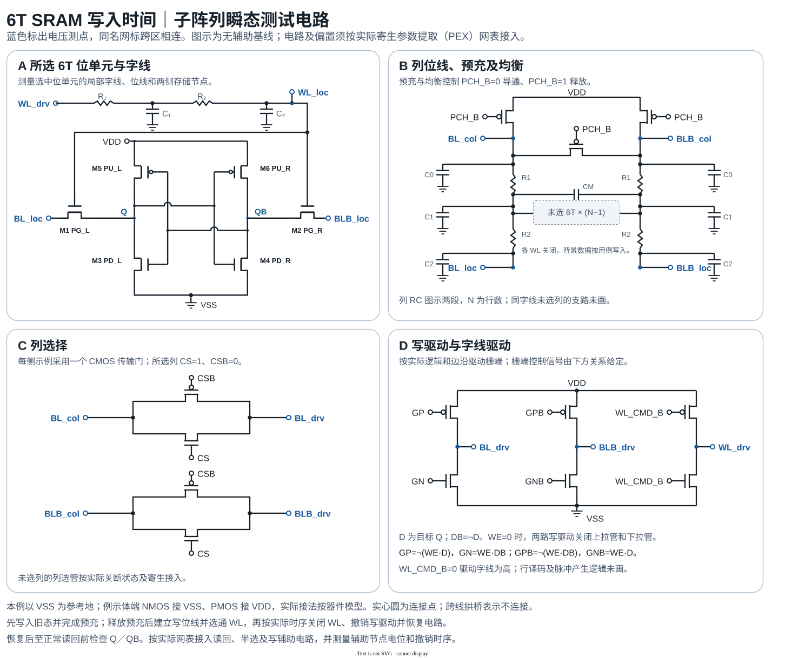
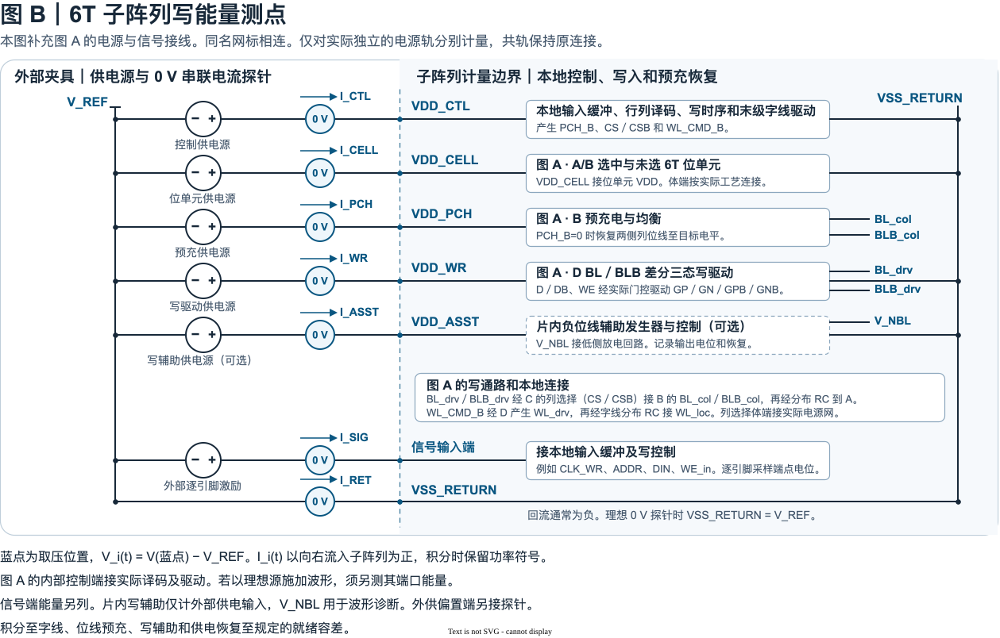

# WE (Write Energy)

## 定义与适用范围

**子阵列写能量**（Subarray Write Energy，WE）是静态随机存取存储器（Static Random Access Memory，SRAM）子阵列在规定写序列中，从指定供电端净取得、按成功写事务归一化的能量，单位 J/access。写位宽、掩码、数据变化、阵列组织及供电边界均属测量条件。总供电能量和扣除待机基线的增量能量分别为：

$$
E_i=\int_{t_0}^{t_1}V_i(t)I_i(t)\,\mathrm{d}t,\qquad
E_{\mathrm{gross}}=\sum_{i\in S}E_i,\qquad
E_{\mathrm{inc}}=E_{\mathrm{gross}}-\int_{t_0}^{t_1}P_{\mathrm{idle}}(t)\,\mathrm{d}t .
$$

$S$ 为纳入的供电端及其回流端；$V_i=V(i)-V_{\mathrm{REF}}$（V）为被测侧端口相对共同参考节点的电压，$I_i$（A）以穿过该端口**流入子阵列**为正。保留各端口 $VI$ 的符号，所得能量单位为 J。积分与[读能量](Read_Energy.md#测量与提取方法)采用同一电气约定；写入的终态和待机基线须按数据变化配对。以总能量为主，另报基线、增量及归一化分母。工作过程中的漏电与待机不同，增量包含写入引起的漏电变化。[1, Characterization Measurements, Power/Delay Characterization] [4, Secs. 5.2.2–5.2.5] [6, Sec. III-B] [8, Sec. 2.3.2]

- **开窗 $t_0$**：取本次归属的外部输入切换、本地唤醒、预充或写控制中最早动作之前的规定相位。用正常写入预置旧态与背景，并在窗外确认；从已就绪状态开窗时，本次补充预充和恢复仍计入。
- **闭窗 $t_1$**：确认新态在规定期限内达到并持续满足保持判据，且字线（Wordline，WL）关闭、写驱动和列选择释放、位线／互补位线（Bitline，BL／BLB）按设计再预充／均衡，本地控制、位单元供电、写辅助源和去耦回到规定就绪相位后闭窗。记录恢复容差、持续时间和下一次可接受访问的条件；固定周期法另报实际窗长。终态为新数据；核对换态引起的存储节点及边界内储能变化，另标未恢复的储能。读回验证、初始化和为下次同方向测量而恢复旧态的写入均在窗外。
- **单次写与闭合序列**：分别报告 0→1、1→0 与两种同值重写。连续写存在恢复重叠或跨周期供电时，按相同相位截取热／电稳态下整数个完整序列，首尾匹配数据、输入、控制、辅助和去耦状态。交替写中两向均为被测操作，整段只积分一次。模拟应用活动时可用能回到初态的地址和数据序列，须明示掩码、比特翻转率、占空和操作计数。
- **待机匹配**：使用相同温度、供电、保持偏置、控制模式及窗口长度。单次变换可分别测旧态和新态待机，声明所用基线；两者差异显著时同时报告相对两种基线的增量或预先约定的状态驻留权重。周期测量按实际数据图样的驻留权重匹配待机功率；保持同样时钟或总线活动但禁止写的对照须另列。

## 物理机制与变异

以差分 6T 位单元从 $Q=1$、QB$=0$ 写 0 为例：解除预充并选通写驱动及列选择后，驱动器吸取 BL 的放电电流，BLB 保持高侧偏置。WL 选通访问管（Access Transistor，PG）；低侧驱动与位单元上拉管（Pull-up，PU）竞争，存储节点 $Q$ 降低，互补存储节点 QB 升高，锁存器再生至新态。写 1 交换两侧。写驱动、数据与控制配线、译码和 WL 驱动的切换，位单元的竞争与再生，以及释放后的回充均可消耗供电能量。[3, Sec. I–II, Figs. 1, 3] [5, Secs. 3.2–3.4] [6, Secs. III-B, III-E] [10, Sec. III]

| 测量变量 | 能量来源与记录口径 |
| --- | --- |
| **翻转与同值写** | 同值写可照常激活驱动、WL、BL 与预充。分别保持或改变接口数据前值和地址；同掩码、同控制活动下的能量差可用于诊断，仍含竞争和漏电差。 |
| **掩码与半选** | 按写 1／写 0 和开掩码位数记录实际活动的写驱动、字节和列。同一 WL 上的未写列可出现读式位线放电并需回充；负位线还可使同列未选行的访问管部分导通，增加漏电及回充需求。写字线或驱动门控的作用域以实现为准，须检查半选位保持原态。[2, Figs. 15.2.3, 15.2.5–6] 若半选保护含内部读和写回，该路径属于写操作；用于验收的独立读回仍在窗外。[3, Secs. II–IV] [13, Sec. III-A, Fig. 3] [14, Sec. II-F, Fig. 13] |
| **位线、驱动和写辅助** | 位线长度、列复用、分段、写驱动尺寸、局部 WL 脉宽、工艺／电压／温度（Process, Voltage and Temperature，PVT）及失配改变放电幅度、竞争时间和恢复电荷。负位线辅助（Negative Bitline，NBL）、字线助推（WL Overdrive）和单元电源降压辅助（Cell VDD Lowering）须同时计其生成、施加和恢复；若降低写电压，应同时检查换态及半选通过率。[3, Sec. III] [6, Secs. III-B, III-E] [9, Sec. IV] [16, Figs. 26.4.3–26.4.5] |

在恒压预充轨独立给一条等效电容为 $C_{\mathrm{BL}}$ 的位线补电，回流电位固定且电荷共享可忽略时，回充能量近似为 $V_{\mathrm{PCH}}C_{\mathrm{BL}}\Delta V_{\mathrm{BL}}$。$V_{\mathrm{PCH}}$ 为预充轨对该回流端压差，$\Delta V_{\mathrm{BL}}$ 为位线电位恢复幅度，单位分别为 V、V，$C_{\mathrm{BL}}$ 单位为 F。该式供量级核查；有共享电荷、负压耦合及寄生时，以实际端口积分为准。[6, Sec. III-E] [10, Sec. III]

## 子阵列接口与指标边界

- **计量范围**：包括本地数据／掩码接收、行列译码、WL 驱动、写控制及驱动、列选择、位单元、预充／均衡和边界内写辅助。声明全局 I/O、时钟树、输入测试器及共享稳压器的归属。在同一网供电时测真实共用入口，内部探针仅用于分项诊断。未供给本地子阵列的其他负载须实测去嵌或另报为更大边界结果。
- **回流与信号端**：VSS、独立回流及体偏置端采用同一流入方向。被测回流端与参考等电位时功率项为零，仍记录其电流；有压降时按被测端实际电位计入。仅当独立双端口电流等量反向时，可用压差乘输入电流替代两个单端项。核对所有跨界导线的电流代数和；有功信号端须记录其端口功率与归属。只积分指定供电端时，结果报为该参考下的供电小计。
- **辅助与负轨**：边界内电荷泵或稳压器只在外部输入计量，输往辅助节点的功率单列诊断。辅助轨由边界外提供时，计入其跨界端及回流；要包括发生器损耗，另报扩展到发生器输入的能量。NBL 低侧节点可能由浮动耦合电容产生，按真实接法取跨界功率。对外供负轨，若 $V_i<0$ 且 $I_i<0$，该端口仍向边界输送正功率；回送能量按负值保留。理想辅助源的结果须注明不含实际发生器代价。[3, Figs. 5–7] [5, Fig. 3.9] [6, Sec. III-B] [8, Secs. 2.3.2, 2.4.2]
- **事务与位数**：记录逻辑请求数 $N_{\mathrm{req}}$、接口实际接受命令数 $N_{\mathrm{acc}}$（含已接受的重试）、成功请求数 $N_{\mathrm{ok}}$（去重）、失败及重试次数，另记实际阵列写操作数 $N_{\mathrm{phy}}$（含内部写回及重试所执行的写，须声明按局部写脉冲或实际子操作计数）、活跃物理列数、开掩码位数、成功交付位数 $B_{\mathrm{del}}$ 和实际翻转位数。$B_{\mathrm{del}}$ 只计成功请求中掩码允许写且验收正确的请求位，同值写计入，屏蔽位、重复重试及额外物理写入不计；掩码全关时交付位数为零。整窗总／增量能量各自除以 $N_{\mathrm{ok}}$ 得成功事务口径，除以 $N_{\mathrm{acc}}$ 得接受命令口径，除以 $N_{\mathrm{phy}}$ 得实际阵列写口径，除以 $B_{\mathrm{del}}$ 得 J/交付位。分母为零时标为不可用。窗内有失败和重试时，以上比值保留其耗能，单次成功样本能量另报；如按总线宽度或实际翻转位归一，单列并标明分母。

## 测量与提取方法

**图 A｜6T 写通路。** 复用[局部写入时间测试图](Write_Time.md#测量与提取方法)中的位单元、预充／均衡、列选择和互补三态写驱动。驱动端 `BL_drv/BLB_drv` 经列选择及分布寄生接 `BL_loc/BLB_loc`，局部 `WL_loc` 接选中位单元访问管栅端。该图的理想激励用于写波形对照。

**图 B｜写能量供电与回流接法。** 用由 `VDD_CTL` 供电的实际本地控制驱动图 A 的写通路；位单元、预充／均衡和实际写驱动分别示为 `VDD_CELL`、`VDD_PCH` 和 `VDD_WR` 供电。复用实际 VDD／VSS、阱、体端与局部寄生连接。NBL 发生器可由边界内 `VDD_ASST` 域驱动，低侧辅助输出仅作诊断；未启用时保留基准驱动接法。图 A 的 `WE` 为内部写使能，由本地控制根据写请求生成；外置激励以图 B 的 `WE_in` 为接口示例。禁止为分项测量拆分实际共用网（会改变压降和回流）。

### 版图后仿真

**【前置条件】** 使用工艺设计套件（Process Design Kit，PDK）器件模型及寄生参数提取（Parasitic Extraction，PEX）网表，保留 WL、BL／BLB、供电与回流、局部数据配线、去耦、未选支路和偏置。记录 PVT、提取角、失配样本、行列位置、阵列组织、输入边沿、数据和地址活动、掩码与外部负载；预设写有效期限、保持门槛、半选判据、恢复容差及规定读回时刻。

**【步骤／方法】**

1. **校准探针**：每个纳入端口串联 0 V 测流源。例如 `V_IWR src_wr dut_wr 0`，以外侧至内侧为正，保存 `I(V_IWR)` 和 `V(dut_wr,V_REF)`。先用已知压差与电阻负载校验功率极性；按同一接法记录回流、各轨及必要的信号端。
2. **施加写序列**：在窗外正常写入并核对初始化图样，从指定相位依次测 0→1、1→0、两种同值重写及代表性掩码。包括地址保持／翻转、近／远端，按规格扫写脉宽、恢复间隔和写辅助配置。记录每轨电压电流、数据／掩码、`WE`、`PCH_B`、`CS/CSB`、局部 WL 和 BL／BLB、$Q$/QB、供电及辅助波形；同时检查同行未选列和同列未选行的代表波形。
3. **验证功能、积分和基线**：按[局部写入时间](Write_Time.md#定义与适用范围)和[子阵列写延时](Write_Delay.md)的有效期限检查应写位的新状态、屏蔽位及半选位的保持状态；确认按设计释放并完成恢复，在闭窗后核对当前数据。按事件给出的窗端插值，以原始采样时间对 $VI$ 作梯形积分；同条件另跑待机和纯写闭合序列。分阶段积分使用不重叠的时间区间。裁剪网表用于机制定位，须用完整子阵列验证波形及能量差。[1, Power/Delay Characterization] [4, Secs. 5.2.2–5.2.5] [6, Sec. III-B] [15, Secs. III–V]

**注意事项**：禁止用理想 WL、BL 或控制电平的激励代替待计量的实际驱动（会把驱动能量移到激励源）。

**注意事项**：禁止在电源积分外加同一回充或辅助输出估算值（会重复计量）。

**【结果处理和验证】** 缩小最大步长并收紧电流容差，直至重要供电轨及总积分的变化满足各自的误差预算；核对回流、窗端余量和读取验证。交付能量分项、原始波形、积分边界、基线、实际计数和时序结果；分别登记目标位未写成、超时、辅助或预充未恢复、屏蔽／半选失效、读回无法确认。恢复超时的样本另报故障及实取窗口的能量，禁止作为完整通过值（计量边界不等价）。

### 硅片测试

**【前置条件】** 核对子阵列可引出的电源及回流、片上和板上去耦归属及稳压范围。选低负担、已校准的四端分流器或电流通道；在计量端做开尔文电压采样，校准电流零点、增益、相位、带宽及分流压降下的实际偏置。用已知数据先验证读链可靠性。

**【步骤／方法】**

1. **同步采集**：在所测偏置和温度下触发写序列并同步采样各轨；分次采集时验证重复相位、切换活动与温度。上游供电探针需覆盖去耦补充电荷，测量窗口可取闭合重复序列。按可读范围检查目标与半选数据；最终读回不能验证中间重复写的成功率时，用配对的验证序列保留相同写入前缀、间隔及数据背景，在抽查目标写完成后才插入读回，按抽查通过率估计成功数并报告不确定度。采用隔离单写抽查时，须先验证其可代表连续写。[4, Sec. 5.2.4] [11, Sec. V] [12, Sec. V]
2. **用平均功率交叉验证**：将相同写序列持续运行至热稳态。对整周期的实际净输入功率取平均 $\overline{P}_{\mathrm{write}}$，按窗口实际成功率 $f_{\mathrm{ok}}=N_{\mathrm{ok}}/(t_1-t_0)$ 计算总量 $\overline{P}_{\mathrm{write}}/f_{\mathrm{ok}}$ 及增量 $(\overline{P}_{\mathrm{write}}-\overline{P}_{\mathrm{idle}})/f_{\mathrm{ok}}$。仅在轨压波动引起的误差符合预算时，用平均电流乘轨压估计该轨功率。复核活动、待机偏置和写验证条件；验收读回或初始化若混入平均窗，须隔离测量才能报告纯写能量。

**注意事项**：禁止用写时钟频率直接替代成功写率（空周期、拒收或失败会改变事务数）。

**【结果处理和验证】** 对同边界的周期积分和平均法做能量对账，记录温漂、零点、同步和采样误差。只有封装供电可测时按宏或测试芯片边界报告；共享外围、I/O、读回和稳压器损耗须经独立测量，或用相同偏置、相同目标活动的旁路对照校准后才可去嵌，注明残差和不确定度。内部写延时及恢复点不可直接观察时，写后最早合法访问作为就绪代理量。

## 数据可视化与评估

| 图表 | 标注及判读 |
| --- | --- |
| **对齐波形与累计积分** | 同时画 $V_i$（V）、$I_i$（A）、$V_iI_i$（W）、累计能量（J）及 WL、BL／BLB、写使能、恢复事件。观察峰值、回送、恢复后是否仍有供电补偿。 |
| **能量分项及图样对照** | 以 J/access 或 J/交付位给出供电轨分项，以及 0→1、1→0、同值和掩码对照；标注物理列数、并行位宽、半选背景和实际翻转率，可与全掩码或时钟活动对照比较。 |
| **能量–电压／脉宽／有效字节扫图** | 同时显示写延时、恢复时间、目标写入与半选通过率；按 PVT、地址、辅助方式和样本分组。只有同时满足时序、保持及规定通过率的点参与比较。 |

对比时统一计量边界、窗口、待机基线、容量和活动列、负载、掩码、翻转活动、归一分母、成功规则及 PVT。典型点用于诊断；能量预算采用目标工作负载及 PVT 分布，并报告重复测量和去嵌不确定度。

**原文对照**：Liu 等在 288 列 × 256 行的子阵列仿真中，按操作时间对整子阵列有功功率积分，典型角 27 °C 的图 15 给出写能量，A5／A3 使用概念辅助源。另一项分层子阵列仿真在 1024 列 × 512 行、典型角 27 °C 下，采用同一有源互连（Active Interconnect，AIC）分层方案；对后端逻辑，N22 全耗尽绝缘体上硅（Fully Depleted Silicon on Insulator，FDSOI）实现相较 A14 叉片型碳纳米管场效应晶体管（Forksheet Carbon Nanotube Field-Effect Transistor，FS CNFET）实现，写裕量低 54 mV、写能量高 38%。[6, Secs. III-B, III-E, Fig. 15] [9, Sec. IV, Fig. 19(b), Table IV]

**硅片与口径对照**：Trivedi 等的 2 nm xBIT 门控选定字节的写字线；图 15.2.6 中同为 256 × 256、32 行／BL、复用比 1:1 的单读单写实例，在典型角、25 °C、0.5 V／0.9 V 时，表列动态能量相对基准 8T 分别低 31%／36%。图表未分出纯写、掩码或实际切换活动，按原宏级动态指标引用。[2, Figs. 15.2.5–6]

**其他提取口径**：Reniwal 等报告 8 kb PT10T 阵列在 0.3 V、27 °C、慢慢工艺角（Slow–Slow，SS）后仿真写 1 的平均能量为 0.16 pJ，原表统计考虑 $6\sigma$ 工艺变异，未明示访问位宽和恢复端点。Pasandi 等的表 III 同列不同组织和供电下的平均写功率，表内写延时以内部节点相等为终点；须取得功率所用的实际测量窗，才能换算写能量。Yamaoka 等以写副本控制 WL 关断时刻，报告 32 kb 模块后仿真的写功率下降 18%；原值保留为功率变化。[7, Sec. 3.4.7, Table 3.8] [13, Sec. IV-F, Table III] [16, Figs. 26.4.3–26.4.5]

## 应用场景与指标关系

WE 用于比较写驱动尺寸、数据／字节门控、位线分段和写辅助。在同样写成功及半选保持的条件下，联合[写延时](Write_Delay.md)、[局部写入时间](Write_Time.md)、[写裕量](../Bitcell/WM.md)和 [BL RC](BL_RC.md) 判断能量、写窗口、远端可写性及下次访问就绪的折中。不同写驱动尺寸还需核对位线实际负载和允许的最小裕量。[17, Sec. III-B, Fig. 4] [18, Sec. IV, Table III]

Liu 和 Catthoor 的 A3.h3p 仿真中，HD-2（576 列 × 128 行）相对同容量 HD-1（288 列 × 256 行）的写延时改善 11%，有功写能量为 2.1 倍；该章按写延时积分，数值适用于该窗和辅助条件。[8, Sec. 6.5.1.4, Fig. 6.22(d)]

设计技术协同优化（Design-Technology Co-Optimization，DTCO）按工作负载分别统计写、[读](Read_Energy.md)和待机；宏级 [EDAP](../Macro/EDAP.md) 或 [EDP](../Macro/EDP.md) 使用同一层级的能量与延时，另接全局互连、I/O 和共享辅助的实测或模型分项。[6, Secs. III-D–E] [8, Secs. 7.1–7.5] [9, Sec. IV]

## 参考文献

2026-11-17 补检：Zotero `02-SRAM-DTCO/SRAM-Metrics/Subarray`（`L9CVSGRT`）的精确标签 `WE (Write Energy)` 从 5 条补至 18 条。核验写能量、写驱动、写辅助或测量边界相关的 12 篇独立期刊／会议原始研究 [2] [3] [6] [9] [11]–[18]；[10]、[19] 仅作方法参考。检索覆盖 Crossref、OpenAlex（后者返回限流错误），审阅作业 `3896bc9cbdce` 复用 14 篇全文，候选耗尽（作业目标 15 篇），无缺附件、无新下载，未使用 Sci-Hub。保留原有编号；18 份归档全文均有可读 Zotero 对应附件，17 份 SHA-256 一致，Guthaus 会议论文六页提取文本一致。

[1] VLSIDA, “Characterization,” OpenRAM, revision 2f7b3866418ac1ce17ad959207a1489033d8c577. [原文](https://github.com/VLSIDA/OpenRAM/blob/2f7b3866418ac1ce17ad959207a1489033d8c577/docs/source/characterization.md)；Zotero：本次检索范围内未匹配记录。

**相关摘要：** 该固定版本的官方文档说明OpenRAM用SPICE生成时序与功耗表，也支持解析模型。表征按工艺、电压、温度、输入边沿及输出负载展开，最小时钟周期通过搜索确定；内部位线、节点和感放使能检查用于验证功能。动态功耗和漏电分别处理，解析结果依赖工艺参数，不能与完整后仿真混为同一精度。单次写能量须从相应写操作的平均功率和测量窗口得到，并区分静态漏电与动态部分。功能验证中的读回或清除总线属于其他操作，不能把整段测试序列的平均功耗直接归为一次写入能量。

**原文定位：** 网页“Characterization Measurements”“Analytical Characterization”“Power/Delay Characterization”，固定提交2f7b386。

[2] M. Trivedi et al., “A 350mV single-rail SRAM using a custom-logic-bitcell in 2nm-CMOS-nanosheet technology for mobile and edge-AI applications,” in IEEE ISSCC Dig. Tech. Papers, paper 15.2, 2026. [DOI 10.1109/ISSCC49663.2026.11409350](https://doi.org/10.1109/ISSCC49663.2026.11409350). [公开文献](https://doi.org/10.1109/ISSCC49663.2026.11409350)；[Zotero](https://www.zotero.org/users/7333024/items/2DMRRST6)

**相关摘要：** 论文展示2 nm纳米片逻辑位单元SRAM，通过局部／全局读写通路与控制优化降低功耗，写端采用银行级时钟混合减少无效切换。宏布局、字节门控及位单元选择共同影响性能和能量，比较还依赖电源和容量条件。该文提供特定芯片架构证据，不能把单元、局部通路和整个宏的测量范围互相替换。局部写时钟混合减少无效切换，体现控制分布对写能量的贡献。文章比较范围是具体宏组织，不能把整体收益全归于位单元；需要保留访问位宽、字节门控及电压条件，且不能用读取能量替代写入能量。

**原文定位：** ISSCC paper 15.2，PDF第1–3页，图15.2.2–15.2.7。

[3] H.-H. Liu et al., “Extended methodology to determine SRAM write margin in resistance-dominated technology node,” IEEE Trans. Electron Devices, 2022, author manuscript. [DOI 10.1109/TED.2022.3165738](https://doi.org/10.1109/TED.2022.3165738). [公开文献](https://doi.org/10.1109/TED.2022.3165738)；[Zotero](https://www.zotero.org/users/7333024/items/9HKACZ7P)。

**相关摘要：** 论文指出先进节点的位线电阻、电容与半选单元访问管漏电会损害负位线辅写辅助入。位线在有限时间内未充分放电时，静态写裕量可能高估实际可写性；负压加深还会意外开启未选访问管。作者扩展瞬态写裕量方法，使驱动波形、寄生及辅助偏置一起进入判断，不能只用理想固定低电平代表真实位线。更强负位线辅助可能改善写入，却需要额外充放电并引发半选漏电。本文主要是写裕量方法参考，未提供本页统一窗口的完整写能量；若做能耗评估须计入辅助发生、恢复及全部供电端口。

**原文定位：** §II–IV，作者稿PDF第2–5页，图2–7。

[4] B. Chen, “Timing Characterization of an SRAM Generated from OpenRAM: An Open-Source Memory Compiler,” M.S. thesis, University of California, Santa Cruz, June 2016. [官方全文 PDF](https://escholarship.org/content/qt5kq8c8p1/qt5kq8c8p1.pdf)；[公开文献](https://escholarship.org/uc/item/5kq8c8p1)；[原文]( <https://escholarship.org/uc/item/5kq8c8p1>)；[Zotero](https://www.zotero.org/users/7333024/items/WQEEXQVC)；DOI：Zotero未收录或尚未核实。

**相关摘要：** Chen的2016年硕士论文介绍OpenRAM接口级SPICE表征：构造写入、清除数据总线和读回序列，二分搜索可行时钟周期，并输出延迟和平均功率。写功率取整个操作周期的平均值，获得写能量需使用该周期积分，并区分测试序列里的后续读回。若把多周期总功耗平均后归入一次写入，会混入其他操作；供电与访问宽度也必须一致。该条作为测量口径参考，已核对归档的官方全文。

**原文定位：** §5.2.2–5.2.5，书内pp.46–49（官方PDF第56–59页）。

[5] 张重达, “基于14nm FinFET工艺的低功耗Single Port SRAM Compiler设计,” 硕士学位论文, 苏州大学, 苏州, 2023. [公开文献](https://doi.org/10.27351/d.cnki.gszhu.2023.002939)；[DOI](https://doi.org/10.27351/d.cnki.gszhu.2023.002939)；[Zotero](https://www.zotero.org/users/7333024/items/P3862KE4)

**相关摘要：** 论文实现14 nm FinFET单端口SRAM编译器，通过局部／全局位线分层、字线分级和多电压域降低功耗。层次位线减少单次访问需要充放电的单元负载，写路径另以电容耦合产生负电平加速驱动。文中同时讨论动态功耗与门控保持漏电；能量引用须保留供电域、操作频率和访问范围，不能把总功率或静态降幅直接作为单次操作能量。写电路利用电容耦合加速局部写驱动，以缩短字线活动并降低动态功耗。该机理不直接给出完整每次写能量，须计入产生负电平、恢复及不同供电域开销，不能把写功率降幅照搬为能量降幅。

**原文定位：** §3.2–3.4，书内pp.25–31（PDF第31–37页），图3.4–3.9。

[6] H. H. Liu et al., “CFET SRAM DTCO, interconnect guideline, and benchmark for CMOS scaling,” IEEE Transactions on Electron Devices, vol. 70, no. 3, pp. 883-890, 2023. [公开文献](https://doi.org/10.1109/TED.2023.3235701)；[DOI](https://doi.org/10.1109/TED.2023.3235701)；[Zotero](https://www.zotero.org/users/7333024/items/W99KL789)

**相关摘要：** 论文对A14至A3的SRAM进行器件、互连和子阵列协同分析，使用完整外围与288列、256行阵列，并考察距译码、感放及写驱动最远的单元。寄生参数由器件模型和三维抽取联合提供；增加驱动能力也增大电容，性能改善会饱和。写辅助采用概念性电压源，比较能耗时需注明尚未包含具体辅助发生器的全部实现代价。写能量以整子阵列有功功率在写操作时间内积分得到，并采用由写裕量确定的概念辅助电压。更强辅助可能缩短翻转却提高能耗；真实升压电容与发生电路的额外能量不能假设已全部计入。

**原文定位：** §III-A–B、III-D–E，pp.886–889（PDF第4–7页），图10、14–15。

[7] B. S. Reniwal, P. Singh, A. P. Shah, and S. K. Vishvakarma, “Energy efficient and reliable embedded nanoscale SRAM design,” Boca Raton, CRC Press, 2023. [公开文献](https://doi.org/10.1201/9781003213451)；[DOI](https://doi.org/10.1201/9781003213451)；[Zotero](https://www.zotero.org/users/7333024/items/Q47DS2TG)

**相关摘要：** 本书分别定义PT10T读取信号建立、写入节点转换和阵列读写能量。电源门控降低保持功耗，也改变稳定性和有效驱动；低阈值器件用于缓解亚阈值速度损失。第3章给出不同单元比较及8 kb阵列在0.3 V、室温和相应最坏工艺角下的后仿真，单元波形和阵列统计必须分开引用。表3.8单列写入一种数据的能量，与前文平均写功率不同。该表是指定规模阵列的后仿真，不能当作单管或纯位线能量；还应核对数据方向、访问位宽及写后恢复是否纳入统计范围。

**原文定位：** §3.4.3、§3.4.7，书内pp.99、102–103，图3.24–3.25、表3.8。

[8] H. H. Liu, and F. Catthoor, “Circuit-technology Co-optimization of SRAM design in advanced CMOS nodes,” Cham, Springer Nature Switzerland, 2025. [公开文献](https://doi.org/10.1007/978-3-031-76109-6)；[DOI](https://doi.org/10.1007/978-3-031-76109-6)；[Zotero](https://www.zotero.org/users/7333024/items/CHVFC3IE)

**相关摘要：** 本书贯通单元、子阵列和宏级仿真。局部指标由含寄生和外围的电路得到，宏模型再加入树形互连、控制驱动及核心至数据通路；两级统计边界不可混用。先进节点的单元缩小未必等比例改善访问性能，线阻、电容和写辅助代价可能抵消收益。宏级比较采用明确容量、树形结构、引脚位置及工艺条件，并讨论写入可行性的约束。写能量按整子阵列操作区间积分，受位线负载、翻转时间和写辅助电压共同影响。书中区分概念源与实际电容辅助，引用应注明实现方式；不能因延迟更小就推断完整写能量也更小。

**原文定位：** §2.3.2、§2.4.2、§6.2、§6.5.1.4、§7.1–7.5，书内pp.36、42、137–139、157–158、174–181。

[9] H.-H. Liu et al., “Future Design Direction for SRAM Data Array: Hierarchical Subarray With Active Interconnect,” *IEEE Transactions on Circuits and Systems I: Regular Papers*, vol. 71, no. 12, pp. 6495–6506, 2024. [DOI](https://doi.org/10.1109/TCSI.2024.3410518)；[KU Leuven 作者稿](https://lirias.kuleuven.be/retrieve/913275b5-a108-48a9-b523-7f949cafecb4)；[公开文献](https://doi.org/10.1109/TCSI.2024.3410518)；[Zotero](https://www.zotero.org/users/7333024/items/FKMH67JE)。

**相关摘要：** 对比标准、常规分段和有源互连（Active Interconnect，AIC）分段子阵列，逐项报告写延时、写裕量及写能量。图 19(b) 分离子阵列写能量，并标出标准方案写失败。含 H 树的 16 MB 宏结果需保留其外部互连范围。

**原文定位：** §III–IV，图 15–17、19–20，表 IV；出版版 pp. 6495–6506（归档为作者稿）。

[10] B. S. Amrutur, and M. A. Horowitz, “Speed and power scaling of SRAM's,” IEEE Journal of Solid-State Circuits, vol. 35, no. 2, pp. 175-185, 2000. [公开文献](https://doi.org/10.1109/4.823443)；[DOI](https://doi.org/10.1109/4.823443)；[Zotero](https://www.zotero.org/users/7333024/items/CH2EXX7I)

**相关摘要：** 对线长、负载电容、译码分级及位线充放电建立量级模型并同电路仿真对照。论文假定读为关键通路，动态能量模型针对读路径；用于解释共用外围电容，不作为写能量实测或统计窗的依据。

**原文定位：** §III-A–C，pp. 177–180，式（2）–（7）。

[11] M. E. Sinangil, N. Verma, and A. P. Chandrakasan, “A Reconfigurable 8T Ultra-Dynamic Voltage Scalable (U-DVS) SRAM in 65 nm CMOS,” *IEEE Journal of Solid-State Circuits*, vol. 44, no. 11, pp. 3163–3173, 2009. [DOI](https://doi.org/10.1109/JSSC.2009.2032493)；[MIT 机构档案](https://hdl.handle.net/1721.1/53553)；[公开文献](https://doi.org/10.1109/JSSC.2009.2032493)；[Zotero](https://www.zotero.org/users/7333024/items/SFTQMUPB)。

**相关摘要：** 65 nm、64 kb 的 8T 测试芯片采用三档可调行虚拟电源写辅助，观察短路电流与恢复行为；图 9 给写后接读的辅助波形。图 20 约 0.4 V、低于 11 pJ/access 是宏级访问总能量，按 128 位／周期测量，未单列写能量。

**原文定位：** §III-B、§V，图 7–9、20（归档 PDF 第 6–7、11 页）。

[12] N. Verma and A. P. Chandrakasan, “A 256 kb 65 nm 8T Subthreshold SRAM Employing Sense-Amplifier Redundancy,” *IEEE Journal of Solid-State Circuits*, vol. 43, no. 1, pp. 141–149, 2008. [DOI](https://doi.org/10.1109/JSSC.2007.908005)；[作者组 PDF](https://www.princeton.edu/~nverma/VermaLabSite/Publications/2008/2008_verma_jssc_jan.pdf)；[公开文献](https://doi.org/10.1109/JSSC.2007.908005)；[Zotero](https://www.zotero.org/users/7333024/items/94NS3U8F)。

**相关摘要：** 65 nm、256 kb 的 8T 样片使用写字线助推及分行位单元电源降压；辅助驱动连接影响非访问行的漏电。0.35 V、25 kHz 时漏电约占总功率的 85%；图 22 是总功率与漏电，不是写能量曲线。

**原文定位：** §III-B、§V-C，pp. 144–145、148，图 9–10、22。

[13] G. Pasandi and S. M. Fakhraie, “A 256-kb 9T Near-Threshold SRAM With 1k Cells per Bitline and Enhanced Write and Read Operations,” *IEEE Transactions on Very Large Scale Integration (VLSI) Systems*, vol. 23, no. 11, pp. 2438–2446, 2015. [DOI](https://doi.org/10.1109/TVLSI.2014.2377518)；[arXiv 作者稿](https://arxiv.org/abs/1812.10011v2)；[公开文献](https://doi.org/10.1109/TVLSI.2014.2377518)；[Zotero](https://www.zotero.org/users/7333024/items/2RID45U5)。

**相关摘要：** 90 nm、256 kb 阵列仿真比较 9T（350 mV、1024 位单元／BL）与 6T（725 mV、64 位单元／BL）。表 III 报两种写方向平均功率 32.75 µW 与 456.12 µW；另用共享电源支路示例量化未选背景对写功率的影响，最终设计改用按行共享电源。

**原文定位：** §III-A，图 3；§IV-F，表 III（arXiv v2 PDF 第 8 页）。

[14] T.-H. Kim, J. Liu, J. Keane, and C. H. Kim, “A 0.2 V, 480 kb Subthreshold SRAM With 1 k Cells Per Bitline for Ultra-Low-Voltage Computing,” *IEEE Journal of Solid-State Circuits*, vol. 43, no. 2, pp. 518–529, 2008. [DOI](https://doi.org/10.1109/JSSC.2007.914328)；[NTU 机构档案](https://hdl.handle.net/10356/84782)；[公开文献](https://doi.org/10.1109/JSSC.2007.914328)；[Zotero](https://www.zotero.org/users/7333024/items/QRLTXRPI)。

**相关摘要：** 130 nm、480 kb 10T 样片用列复用和未选列读出后写回保护半选位；写时序必须计入内置读写回活动。图 16 所示最低电压下总功耗未拆分写分量。

**原文定位：** §II-F、§III，pp. 525–527，图 13、16–17。

[15] J. Boley, P. Beshay, and B. Calhoun, “Virtual Prototyper (ViPro): An SRAM Design Tool for Yield Constrained Optimization,” *IEEE Transactions on Very Large Scale Integration (VLSI) Systems*, vol. 23, no. 12, pp. 3109–3113, 2015. [DOI](https://doi.org/10.1109/TVLSI.2014.2385832)；[公开文献](https://doi.org/10.1109/TVLSI.2014.2385832)；[Zotero](https://www.zotero.org/users/7333024/items/68JPTI4S)。

**相关摘要：** 以 SPICE 模型分解位单元、WL／BL 驱动和外围的能量，加入全局互连与阵列漏电；同时约束目标良率并评估 WL 脉宽。该结果支持在一致的时序与良率判据下比较分项能量。

**原文定位：** §III-C、§IV-B、§V，图 3–5（归档提前出版版第 3–5 页）。

[16] M. Yamaoka et al., “Low-power embedded SRAM modules with expanded margins for writing,” in *IEEE ISSCC Dig. Tech. Papers*, 2005, pp. 480–481. [DOI](https://doi.org/10.1109/ISSCC.2005.1494078)；[公开文献](https://doi.org/10.1109/ISSCC.2005.1494078)；[Zotero](https://www.zotero.org/users/7333024/items/2IXCRYWB)。

**相关摘要：** 写副本按器件速度调节字线脉宽；快速器件可提前关闭 WL，以减小未选列位线摆幅及回充负担。论文报告 32 kb 模块在实际负载后仿真中的写功率降低 18%，该数值按原功率口径引用。

**原文定位：** ISSCC paper 26.4，PDF 第 1 页正文，图 26.4.3–26.4.5。

[17] J. Lee, J. Park, S. Kim, and H. Jeong, “Bayesian learning automated SRAM circuit design for power and performance optimization,” IEEE Transactions on Circuits and Systems I: Regular Papers, vol. 70, no. 12, pp. 4949-4961, 2023. [公开文献](https://doi.org/10.1109/TCSI.2023.3313874)；[DOI](https://doi.org/10.1109/TCSI.2023.3313874)；[Zotero](https://www.zotero.org/users/7333024/items/PFB6PZIF)

**相关摘要：** 用 28 nm 实例模型和后仿真联合优化电路尺寸，对写入窗口及写裕量设约束。图 2 的功耗为读、写功耗之和；比较只写活动需独立取窗和计数。

**原文定位：** §III-A–B，图 2–4；§IV，表 III。

[18] S. Kim, J. Lee, D. Kim, J. Park, S. Lee, and H. Jeong, “Simultaneous optimization of various-sized SRAM instances through machine learning-driven transistor sizing and leafcell circuit pool construction,” IEEE Transactions on Circuits and Systems I: Regular Papers, vol. 72, no. 7, pp. 3376-3389, 2025. [公开文献](https://doi.org/10.1109/TCSI.2025.3531948)；[DOI](https://doi.org/10.1109/TCSI.2025.3531948)；[Zotero](https://www.zotero.org/users/7333024/items/8KHXGGHN)

**相关摘要：** 跨不同规模实例优化写驱动尺寸。缩小驱动可降写功率，同时减慢 BL 建立、增加翻转时间并降低写裕量；列高增大时需复核负载变化。

**原文定位：** §II-A，图 2；§IV，表 III 后的外围尺寸与功耗分析。

[19] M. R. Guthaus, J. E. Stine, S. Ataei, B. Chen, B. Wu, and M. Sarwar, “OpenRAM: An Open-Source Memory Compiler,” in *Proc. IEEE/ACM ICCAD*, 2016, pp. 1–6. [DOI](https://doi.org/10.1145/2966986.2980098)；[UC eScholarship](https://escholarship.org/uc/item/8x19c778)；[公开文献](https://doi.org/10.1145/2966986.2980098)；[Zotero](https://www.zotero.org/users/7333024/items/DYJK5C4I)。

**相关摘要：** OpenRAM 以 SPICE 刺激生成时序和功耗模型，按容量、位宽及存储体组织比较实例。该文支持表征配置归档；写功率积分窗口的具体例子见 Chen 学位论文 [4]。

**原文定位：** §4.4–5，pp. 4–6，图 5。归档与 Zotero 可读的六页附件逐页文本一致，PDF 文件哈希不同。
