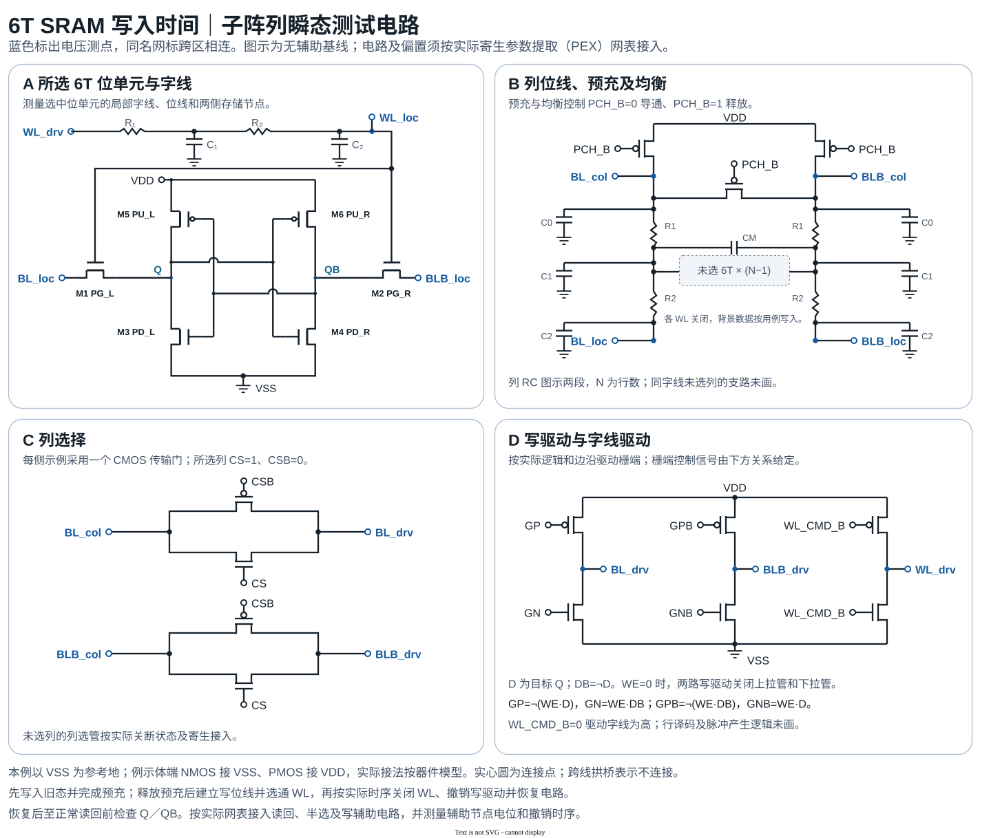
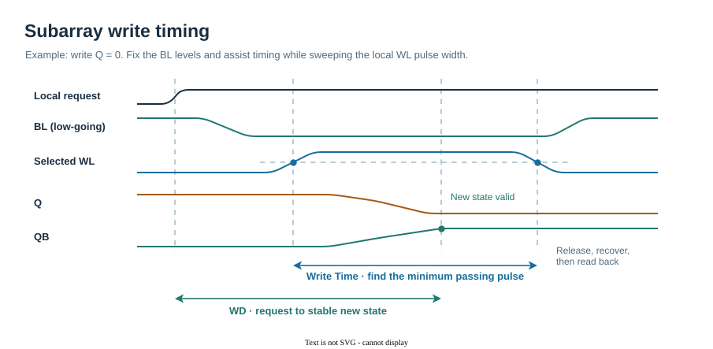

# Write Time

## 定义与适用范围

**局部写入时间**（Local Write Time，$t_{\mathrm W}$）是子阵列在指定写波形下，从选中位单元的局部字线（Wordline，WL）通过上升半幅，到存储节点 $Q$ 和互补存储节点 QB 持续达到目标电平的时间，单位 s。本文以差分 6T 静态随机存取存储器（Static Random Access Memory，SRAM）为例。每次在正常保持偏置下写入并验证相反旧态，写 0（$Q:1\to0$）和写 1（$Q:0\to1$）分别测量。

- **局部起点 $t_{\uparrow}$**：在写低侧访问管的栅端测量 WL，以本地 VSS 为参考，取有效上升沿首次通过 $V_{\mathrm{WL,L}}+(V_{\mathrm{WL,H}}-V_{\mathrm{WL,L}})/2$ 的时刻。高、低参考值取同一测点和驱动配置的稳定电平；短脉冲无平台时，用同配置校准脉冲确定参考值，并另记实际峰值与边沿。若网表分开提取两侧栅端，另存对侧 WL。下降半幅 $t_{\downarrow}$ 取同一有效脉冲的关断沿；多次回穿须单列波形异常。未达到半幅时，局部时间和半幅脉宽均不提取。
- **有效终点 $t_{\mathrm{valid}}$**：写 0 时要求 $Q$ 低、QB 高；写 1 时要求 $Q$ 高、QB 低。以该样本在写辅助撤销后恢复的位单元 VDD／VSS 电位 $V_{\mathrm{DD,hold}}$、$V_{\mathrm{SS,hold}}$ 定义固定门槛，在同一参考节点下测量 $Q$/QB。例如以 $\Delta V_{\mathrm{hold}}=V_{\mathrm{DD,hold}}-V_{\mathrm{SS,hold}}$ 为满摆幅，取 $V_{\mathrm H}=V_{\mathrm{SS,hold}}+0.9\Delta V_{\mathrm{hold}}$、$V_{\mathrm L}=V_{\mathrm{SS,hold}}+0.1\Delta V_{\mathrm{hold}}$；签核门槛须按保持与后续读取规格确定。要求高节点不低于 $V_{\mathrm H}$、低节点不高于 $V_{\mathrm L}$，取截止前最后一个连续合格区间的起点作 $t_{\mathrm{valid}}$。通过条件：$t_{\mathrm{valid}}$ 不晚于规定的写有效期限；WL 关闭、写驱动释放且辅助与位单元供电恢复后，两节点仍连续合格至少规定的观察时长，并在读偏置影响位单元前完成确认。

| 量 | 测量边界与判据 |
| --- | --- |
| 局部写入时间 $t_{\mathrm W}=t_{\mathrm{valid}}-t_{\uparrow}$ | 在给定局部 WL／位线波形和写辅助条件下，报告选中位单元到目标状态的时间；须再验证正常读回。 |
| 临界写脉宽（Critical Write Wordline Pulse Width，$t_{\mathrm{W,min}}$） | 扫描 $t_{\downarrow}-t_{\uparrow}$，在规定写有效期限、保持及读回条件下求选中位单元最短成功的局部 WL 脉宽；子阵列可用窗口还须满足半选保持。Toh 等以有限脉冲后的正确存储值判断临界可写性。[1, Sec. II-C, Fig. 6] |
| 子阵列写延时（Subarray Write Delay，[WD](Write_Delay.md)） | 从本地接口接受写请求计至同一状态有效事件，包含请求到局部 WL 的传播；宏外部最小写控制窗口及下次访问就绪时间须另报。 |

临界脉宽附近，局部 WL 关闭后仍可能完成再生，故 $t_{\mathrm W}$ 可大于当次 WL 脉宽；节点交叉或单侧越过翻转点只能作诊断。立即读回及允许充分恢复时所得的临界写脉宽须分别报告。[8, Sec. 3.3, Figs. 8–10] [11, Secs. II–III, Figs. 7–8] [15, Sec. II, Fig. 1]

## 物理机制与变异

写 0 时，写驱动经列选择吸取位线（Bitline，BL）的放电电流，互补位线 BLB 保持高电位，选中 WL 使两个访问管（Access Transistor，PG）导通。BL 侧访问管先克服上拉管（Pull-up，PU）把原高节点 $Q$ 拉低；对侧下拉管（Pull-down，PD）逐步减弱，对侧上拉管和 BLB 通路将 QB 抬高，交叉耦合反馈加速翻转。写 1 时交换 BL／BLB 和 $Q$/QB 的作用。失配会改变竞争强度与再生速度，须按同一单元配对比较两方向。[3, Sec. 3.2] [8, Sec. 3.3] [18, Sec. II] [23, Secs. II–III]

字线分布电阻和电容改变两侧 PG 的选通时刻与驱动强度；写驱动和列选择的有限导通电阻、位线分布 RC、未选位单元漏电决定实际局部写低、高电位及到达时间。负位线辅助（Negative Bitline，NBL）使低侧位线低于本地 $V_{\mathrm{SS}}$；负压可能使同列未选行的访问管部分导通，抵消写驱动的放电能力。字线助推（WL Overdrive）和单元电源降压辅助（Cell VDD Lowering）分别改变 PG 驱动与锁存器保持能力；须检查辅助到达、撤销和恢复阶段。目标位写入变快时仍须检查同行未选列的读扰动以及同列未选行的偏置扰动。[1, Sec. II-C, Figs. 6–7] [2, Sec. II–III, Figs. 3, 8–9] [10, Sec. III, Figs. 5–8]

## 写通路边界与测点

| 测点 | 记录量及用途 |
| --- | --- |
| 本地接口与控制 | 写请求、有效数据、行列地址、掩码、预充／均衡、写使能与辅助时序；用于对齐 WD 和定位控制竞态。 |
| 驱动与列选择 | 驱动侧差分输出、列选择两端的 BL／BLB 及列选择门控；比较驱动侧和单元侧波形，区分驱动能力、开关阻抗及 [位线分布 RC](BL_RC.md)。 |
| 选中位单元 | 两侧局部 WL、BL／BLB、$Q$/QB 和本地 VDD／VSS；按实际波形提取半幅、摆幅、恢复时刻及 $t_{\mathrm W}$。 |
| 半选位单元 | 同行未选列和同列未选行的代表性近／远端；保存其局部 WL、BL／BLB、辅助作用域和最弱背景位的 $Q$/QB，恢复后核对原数据。 |

裁剪网表须保留实际写驱动、列选择、预充／均衡、末级 WL 驱动、分布寄生及影响漏电与耦合的未选支路。用完整子阵列对照近、远行列的局部波形与写成边界；只在位单元端施加理想电压时，报告为孤立单元对照。[2, Sec. II, Figs. 2–4]

## 测量与提取方法

图示以 VDD／VSS 供电的无辅助写通路为基线：选中存储节点 $Q$/QB 分别经访问管接 `BL_loc`／`BLB_loc`；`WL_loc` 接两访问管栅端。写驱动三态输出 `BL_drv`／`BLB_drv` 经列选择接 `BL_col`／`BLB_col`，再经位线分布 RC 到达位单元。后仿真须接入实际体端、行列控制、写辅助、未选行列及读回电路。

时序图中 “Write Time · find the minimum passing pulse” 标出临界脉宽扫描对象；局部 $t_{\mathrm W}$ 从同一上升半幅计到 “New state valid”。终点为示意，实际须按双节点门槛和恢复观察窗验证。图示写 0，仅画出低侧 BL；BLB、辅助及预充恢复须按实际波形核对。

### 仿真提取

**【前置条件】** 使用寄生参数提取（Parasitic Extraction，PEX）网表，指定工艺、电压与温度（Process, Voltage and Temperature，PVT）、RC 角、失配样本、行列地址、负载、体偏置、初始数据图样及相邻线活动。声明局部 WL 半幅、目标电平、写有效期限、恢复容差、最短观察时长和确认截止、读回间隔、读判据、半选保留条件和时间分辨率。改变 PVT、供电或辅助配置后重新确认参考值及采样条件。

**【步骤／方法】**

1. **预置旧态及恢复初始偏置**：用正常写操作置入目标位的相反旧态和半选背景，验证原状态。运行预充／均衡至规定电平，释放预充；在地址及数据有效后按实际设计选通写驱动、列选择、局部 WL 与写辅助。若 NBL 等辅助与 WL 重叠启动，记录低侧位线下降、辅助建立及重叠的实际时序。
2. **施加固定写脉冲并提取 $t_{\mathrm W}$**：记录接口、驱动和各局部测点。按规定时序关闭 WL、释放写驱动和列选择、撤销辅助，恢复供电并重新预充／均衡。保存各阶段动作顺序与发生时刻；按设计的非重叠约束检查预充与写驱动。对 $t_{\uparrow}$ 及两个目标电平的有效交点插值，验证从 $t_{\mathrm{valid}}$ 至确认截止持续合格，再以正常读回核对目标位和半选位。按方向和地址重复。
3. **扫描临界写脉宽**：保持写数据、外部负载、位线驱动电平与边沿、相对 WL 上升沿的建立条件及辅助控制规则不变，只调整 WL 指令宽度。声明随下降沿联动的释放动作；每点记录实际局部 WL／BL／BLB 波形以及辅助持续时间。若选择固定绝对读回时刻或相对写结束的固定间隔，明确其参考事件，并按所选口径执行整组扫描。从正常通过宽度扫至允许最小值，在局部宽度随命令单调且通断判据单调的边界上二分，直至区间满足分辨率。发生重复不一致或多个通过窗口时保留扫点及重复计数。[1, Sec. II-C, Figs. 6–7] [2, Sec. II–III, Figs. 3, 8–9] [15, Sec. II]
4. **复核边界**：在同一失配样本重新初始化，复测边界两侧并缩小仿真步长；按规格测试最早合法读回，必要时另测充分恢复后的读回。保持全部使用条件一致时，两者的差值可定位写后恢复限制。[11, Secs. II–III, Figs. 7–8]

**注意事项**：禁止把节点交叉、驱动端负压达到设定值或读回成功单独当作双节点稳定事件（恢复和读操作均会改变单元状态）。

**【结果处理和验证】** 交付固定脉冲的 $t_{\mathrm W}$、局部 WL 半幅宽度及单调区间内的临界范围 `(最后失败宽度, 首个通过宽度]`。分别登记未达 WL 半幅、未翻转、回弹、超时、半选受扰及读回无法确认；读偏置早于约定恢复与稳定观察完成时，标记为时序窗口不满足。若 $t_{\mathrm{valid}}$ 早于 WL 上升半幅，单列事件次序、带符号时间差和所用门槛；需改变起点时，以声明的更早局部事件重提。达到测试规格时限仍未达标为功能失败；若仅因记录或扫描受限而无法判定，报告最后有效观测时刻或已测最大有效脉宽的截尾边界。最低宽度仍通过时仅报告上界；非单调时报告通过范围及其邻近失效条件。

### 硅片测试

**【前置条件】** 使用可编程写脉冲和片上 WL 采样器的测试结构时，在每个 PVT 和地址组标定控制代码与局部 WL 的上升、下降半幅、脉冲峰值及边沿时间；记录近／远端差异、量化、非线性、重复抖动、采样偏差和探针负载。若测 $Q$/QB，须标定两路内部节点采样对读写边界的影响。扫窗前规定每点重复次数、允许失败率及置信水平。

**【步骤／方法】** 先以已知数据执行正常读回对照，验证读链在同电压、同温度和相同读窗口能够可靠判决且不会改写旧态。每次通过正常写操作预置相反旧态，再按写脉冲代码、目标方向、地址和背景扫写并重复读回。分别记录立即读回和充分恢复后读回；评估两种口径时，各自以其读时序的对照为准。Toh 等的 45 nm 芯片用可编程脉冲及片上 WL 采样器校准，报告所用字线脉宽校准分辨率为 10 ps，结果见第 V-A 节图 13；芯片和测试架构见第 III–IV 节。[1, Sec. III–IV, Figs. 8–9, 11, 13, 15]

**注意事项**：禁止用读链未校准的误码直接判定写失败（感测与写后读扰均可改变读回结果）。

**【结果处理和验证】** 局部 WL 可测时，按失败率置信上界不超过规格的最窄测点报告读回判据下的临界脉宽，并注明相邻失败或不可判点、量化及校准误差；$Q$/QB 可测时另报直接取得的 $t_{\mathrm W}$。读操作可能推动仍在翻转的位单元完成写入。Toh 等采用多次最小脉宽读回，或先恢复标称电源再读回；变更读回偏置或间隔的结果须分别报告。[1, Secs. II-C.2, III] 普通宏只能调整外部写控制窗或时钟时，报告该接口最小功能窗口、读回间隔与置信区间；有本地映射标定时可另报换算的局部脉宽与不确定度。最早无冲突的成功读回是就绪代理量。

## 数据可视化与评估

| 图表 | 标注及判读 |
| --- | --- |
| **对齐波形** | 以时间轴（例如 ps）对齐写请求、列选、写使能、预充、辅助控制与实际电压、驱动端与局部 BL／BLB、局部 WL、$Q$/QB 及位单元供电（V）。标出半幅、双节点阈值和确认截止；驱动端正常而远端位线到达不足时查列选择和位线 RC，双节点越阈后回弹时查释放与供电恢复。 |
| **脉宽–供电压差二维扫图** | 在每个方向、背景、地址和 PVT 标注实际局部宽度、$V_{\mathrm{DD}}-V_{\mathrm{SS}}$（V）、样本数及目标位／半选失效。区分最小写通过和半选允许窗口；非单调时以两判据同时通过的扫点为准。 |
| **分位曲线与地址热图** | 对固定波形的 $t_{\mathrm W}$ 及临界 $t_{\mathrm{W,min}}$ 分别画高尾分位，按方向、芯片、行列位置、PVT 与辅助档位分层，标注时间分辨率、截尾和置信区间。同一物理位任一方向失败按一位计，重复试次另报条件失败率；共享列、芯片和测试路径作为相关组。 |

**统计判据**：典型值用于波形诊断；生产脉宽须覆盖目标尾部，并加入脉宽量化、抖动和校准不确定度，复核半选允许上限。零失效上界和独立样本量见 [RSNM](../Bitcell/RSNM.md#数据分析与评价方法)。样本覆盖不到要求的尾部时，可用有校验的统计抽样或模型估计，须标明有效样本数、模型范围与置信区间。[15, Secs. II–III] [19, Secs. IV–V] 临界可写性与静态裕量的离群样本及写辅助对照见 Toh 等第 V-C、V-E 节图 15、20。[1, Sec. IV-C, Figs. 15, 20]

**原文对照**：Liu 等在 2 nm 节点仿真中初始 $Q=1$、QB$=0$，BL 在 WL 激活时开始下拉，持续整个 WL 选通窗，BLB 保持 0.7 V；以最远位单元的原低节点 QB 达到满摆幅的 90% 来搜索写驱动最大允许电压。该研究以 $-2\,\mathrm{V/ns}$ 作为对应 2 GHz 的斜率假设；该提取给出限定波形与时间窗下的写裕量。[2, Sec. II, Fig. 3] Nalam 等的立即写后读采用下一次读操作的位线建差判据，而充分恢复口径检查松弛后的存储态；在该模型下，缩短写后可用恢复时间增加所需临界写脉宽。[11, Secs. II–III, Figs. 7–8]

## 应用场景与指标关系

设计技术协同优化（Design-Technology Co-Optimization，DTCO）用临界写脉宽约束局部 WL 最小窗口，用固定脉冲的 $t_{\mathrm W}$ 拆分位线建立和再生瓶颈，并用 WD 检查完整请求到状态有效的延时。结合 [WL Slew](WL_Slew.md)、[BL RC](BL_RC.md) 与两种写方向定位远端波形及写驱动不足；同样的静态 [WM](../Bitcell/WM.md) 或 [WSNM](../Bitcell/WSNM.md) 下仍须比较局部瞬态与写辅助时序。选择 NBL、字线助推或单元电源降压窗口时，须同时满足目标位写入、半选保持和下一次访问就绪要求。[10, Sec. III] [11, Sec. III] [16, Secs. II–III]

## 参考文献

2026-11-17 核验 Zotero `02-SRAM-DTCO/SRAM-Metrics/Subarray`（`L9CVSGRT`）的精确标签 `Write Time`：22 条，均有可读项目归档；其中 19 条为具有不同 DOI 的期刊或会议论文，其余为 2 篇学位论文与 1 部专著。将研究延伸版本合并计算后，至少 14 篇原始研究与写入瞬态或临界脉宽直接相关。文献 [2] 为本地归档补充来源，不计入精确标签结果。保留原有编号，区分直接指标及方法适用边界。

[1] S. O. Toh, Z. Guo, T.-J. K. Liu, and B. Nikolić, “Characterization of dynamic SRAM stability in 45 nm CMOS,” IEEE J. Solid-State Circuits, vol. 46, no. 11, pp. 2702–2712, 2011. [DOI 10.1109/JSSC.2011.2164300](https://doi.org/10.1109/JSSC.2011.2164300). [公开文献](https://doi.org/10.1109/JSSC.2011.2164300)；[Zotero](https://www.zotero.org/users/7333024/items/PTWVUSQP)

**相关摘要：** 论文在45 nm芯片中用可编程字线和采样电路表征动态稳定性，读写成功由有限脉冲后的状态或感放结果判断。作者校准真实本地脉宽，并区分读访问失败、读扰和写失败；不同列的感放失调会影响读取统计。静态裕量与动态指标并非一一对应，因此必须明确脉冲条件、观察节点和成功判据。写入以最短可成功脉冲及写后读回检验，而不是静态电压扫描。提取应使用本地校准后的脉宽并确保读回可靠，低电压下失败计数可能同时受读取限制，不能把两种失败混为写窗口不足。

**原文定位：** §II-C.2、§III、§V-A、§V-C、§V-E，pp.2704–2709（PDF第3–8页），图6、8–10、13、15、20。

[2] H.-H. Liu et al., “Extended methodology to determine SRAM write margin in resistance-dominated technology node,” IEEE Trans. Electron Devices, 2022, author manuscript. [DOI 10.1109/TED.2022.3165738](https://doi.org/10.1109/TED.2022.3165738). [公开文献](https://doi.org/10.1109/TED.2022.3165738)；[Zotero](https://www.zotero.org/users/7333024/items/9HKACZ7P)（未命中本页精确标签）

**相关摘要：** 论文指出先进节点的位线电阻、电容与半选单元传输管漏电会损害负位线辅助写入。位线在有限时间内未充分放电时，静态写裕量可能高估实际可写性；负压加深还会意外开启未选传输管。作者扩展瞬态写裕量方法，使驱动波形、寄生及辅助偏置一起进入判断，不能只用理想固定低电平代表真实位线。本文主要扫描辅助电压与有限时间的写可行性，说明字线宽度还不足以单独决定成功。它不是直接给出通用最短写脉宽；应用时必须连同位线建立、辅助持续和脉冲撤去后的稳定状态进行搜索。

**原文定位：** §II–IV，作者稿PDF第2–5页，图2–7。

[3] S. Mukhopadhyay, H. Mahmoodi-Meimand, and K. Roy, “Modeling and estimation of failure probability due to parameter variations in nano-scale SRAMs for yield enhancement,” in 2004 Symposium on VLSI Circuits. Digest of Technical Papers (IEEE Cat. No.04ch37525), 2004, pp. 64-67. [公开文献](https://doi.org/10.1109/VLSIC.2004.1346504)；[DOI](https://doi.org/10.1109/VLSIC.2004.1346504)；[Zotero](https://www.zotero.org/users/7333024/items/N5DUAP56)

**相关摘要：** 论文把器件参数变异映射到SRAM功能和速度失败概率。读出由位线负载与电流估计差分建立，写入跟踪高节点被拉至对侧反相器翻转点。有限字线窗口会造成动态失败，作者用不同分布拟合访问和写入尾部；结果服务于单元尺寸及良率设计，不是包含译码、感放和输出的完整访问路径表征。写时间由高节点降至对侧反相器翻转点确定，分布尾部用于估计超过窗口的概率。此定义提供解析约束，但最短成功脉冲还应检验字线关闭后的再生及最终存储值，不能仅按中间阈值宣告成功。

**原文定位：** §3.2、§3.4，pp.64–65（PDF第1–2页）。

[4] S. Mukhopadhyay, H. Mahmoodi, and K. Roy, “Statistical design and optimization of SRAM cell for yield enhancement,” in IEEE/ACM International Conference on Computer Aided Design, 2004. ICCAD-2004., 2004, pp. 10-13. [公开文献](https://doi.org/10.1109/ICCAD.2004.1382534)；[DOI](https://doi.org/10.1109/ICCAD.2004.1382534)；[Zotero](https://www.zotero.org/users/7333024/items/GDX5LJIK)

**相关摘要：** 论文将参数变异引起的读扰、写入、访问时间和保持失效分别建模，再合并为阵列良率。写入时传输管与上拉管竞争，内部节点由净电流放电；读取时选中单元驱动位线负载，同列未选单元漏电会削弱有效差分。器件仿真与阈值统计模型用于分析尺寸、面积、漏电与失效概率的折衷。写入模型的终点是高节点到达对侧反相器翻转电压，再与字线高电平时间比较。该解析时间可指导所需窗口，但不等于经脉冲关闭和读回验证的最短成功脉宽，状态再生条件仍需检查。

**原文定位：** §3.3–3.4，pp.11–12（PDF第2–3页）。

[5] S. Mukhopadhyay, H. Mahmoodi, and K. Roy, “Modeling of failure probability and statistical design of SRAM array for yield enhancement in nanoscaled CMOS,” IEEE Transactions on Computer-Aided Design of Integrated Circuits and Systems, vol. 24, no. 12, pp. 1859-1880, 2005. [公开文献](https://doi.org/10.1109/TCAD.2005.852295)；[DOI](https://doi.org/10.1109/TCAD.2005.852295)；[Zotero](https://www.zotero.org/users/7333024/items/P33WUEER)

**相关摘要：** 论文建立纳米SRAM读、写、访问与保持失效模型，结合阵列规模、冗余和相关性估计良率。写入用传输管与上拉管净电流给内部节点放电，读取则由有效列电流驱动位线负载；同列漏电与参数分布尾部进入时序分析。该研究用于统计尺寸优化，模型预测应与芯片实测区分，不能将不同失效模式合并为单一延迟。写模型以节点到达反相器翻转点计算时间，再判断有限字线内能否完成。它解释统计写失败，但若提取最小成功脉宽，还需验证关闭字线后的最终状态，不能只看两节点瞬时交叉。

**原文定位：** §II-B–C、§III-C–D，pp.1861–1862、1865–1866（PDF第3–4、7–8页）。

[6] M. Khellah et al., “Wordline & bitline pulsing schemes for improving SRAM cell stability in low-vcc 65nm CMOS designs,” in 2006 Symposium on VLSI Circuits, 2006. Digest of Technical Papers., 2006, pp. 9-10. [公开文献](https://doi.org/10.1109/VLSIC.2006.1705286)；[DOI](https://doi.org/10.1109/VLSIC.2006.1705286)；[Zotero](https://www.zotero.org/users/7333024/items/5UISD9ID)

**相关摘要：** 论文研究65 nm低电压SRAM的字线与位线脉冲配合。缩短字线激活可在读扰翻转前隔离单元，但仍需保留足够差分；写入和读改写又要求满足状态翻转条件。作者以硅数据校准的变异模型分析方案，强调脉宽、位线预处理、器件强弱及电源电压的耦合，不能仅按单一稳定性指标选择脉冲。字线与位线脉冲必须联合选择，保证目标单元写入且不破坏半选数据。能满足读扰限制的短脉宽不一定足以写入，因此本指标应来自写后成功判据，不能直接采用文中的读稳定性窗口。

**原文定位：** §II–III，pp.9–10（PDF第1–2页），图1–4。

[7] W. Dong, P. Li, and G. M. Huang, “SRAM dynamic stability: theory, variability and analysis,” in 2008 IEEE/ACM International Conference on Computer-aided Design, 2008, pp. 378-385. [公开文献](https://doi.org/10.1109/ICCAD.2008.4681601)；[DOI](https://doi.org/10.1109/ICCAD.2008.4681601)；[Zotero](https://www.zotero.org/users/7333024/items/GPS3KS3V)

**相关摘要：** 论文用非线性状态空间描述SRAM动态稳定性，单元两种稳定状态之间存在分界轨迹。写入是否成功取决于受驱动状态轨迹能否在字线关闭前跨过该边界，而不仅是某个时刻两个节点交叉。作者用时域噪声裕量分析有限脉冲和器件失配，建立变异下的接受区域，可解释静态裕量与动态结果不一致的情形。写动态裕量为外加脉冲持续时间减去状态轨迹跨越分界所需时间。该物理判据解释最小成功窗口，比较器件失配样本时应跟踪真实状态归宿，不能把内部节点相等的时刻当作充分成功条件。

**原文定位：** §3–4，pp.380–384（PDF第3–7页），图5、式(21)。

[8] J. Wang, S. Nalam, and B. H. Calhoun, “Analyzing static and dynamic write margin for nanometer SRAMs,” in Proc. International Symposium on Low Power Electronics and Design (ISLPED), 2008, pp. 129–134. [公开文献](https://doi.org/10.1145/1393921.1393954)；[DOI](https://doi.org/10.1145/1393921.1393954)；[Zotero](https://www.zotero.org/users/7333024/items/IK7GE8ZW)

**相关摘要：** 论文比较多种静态和动态写裕量定义，指出高节点刚到反相器翻转点可能过于乐观，要求完全降至地又过于悲观；失配时两个节点交叉也不能保证最终稳定状态正确。作者从状态吸引域和有限字线脉冲重新定义动态写成功，强调静态电压扫描忽略真实时间依赖，不能作为最小写窗口的充分判断。最短成功脉宽应以脉冲撤去后的正确状态为依据，并声明观察或读回时刻。该文关注最终本地字线而非驱动前控制信号，适合本页判据；若后续立即读取，还需检验恢复时间是否充足。

**原文定位：** §3，pp.131–132（PDF第3–4页），图6–9。

[9] S. O. Toh, Z. Guo, and B. Nikolic, “Dynamic SRAM stability characterization in 45nm CMOS,” in 2010 Symposium on VLSI Circuits, 2010, pp. 35-36. [公开文献](https://doi.org/10.1109/VLSIC.2010.5560259)；[DOI](https://doi.org/10.1109/VLSIC.2010.5560259)；[Zotero](https://www.zotero.org/users/7333024/items/5YV9U9A5)

**相关摘要：** 该45 nm芯片通过可编程脉冲、字线采样和后续读回测试动态稳定性。阵列采用较少列数，抑制字线寄生造成的位置相关误差；实际脉宽与控制码存在非线性，必须在本地字线上校准。静态读裕量会高估读扰失败，静态写裕量又不能可靠识别动态写入异常，说明脉冲时域测量具有独立价值。写失败计数随脉宽和电压变化，可定位动态可写边界；短脉冲对老化和器件失配更敏感。提取时应记录本地上升、下降边沿和读回方式，不能用静态电压裕量取代最小成功脉宽。

**原文定位：** Implementation and Results，pp.35–36（PDF第1–2页），图4–6。

[10] D. Kim, V. Chandra, R. Aitken, D. Blaauw, and D. Sylvester, “Variation-aware static and dynamic writability analysis for voltage-scaled bit-interleaved 8-T SRAMs,” in IEEE/ACM International Symposium on Low Power Electronics and Design, 2011, pp. 145-150. [公开文献](https://doi.org/10.1109/ISLPED.2011.5993627)；[DOI](https://doi.org/10.1109/ISLPED.2011.5993627)；[Zotero](https://www.zotero.org/users/7333024/items/LCBZ8CJB)

**相关摘要：** 论文研究电压缩放下位交织8T SRAM的写入与半选扰动。独立读端口不消除写端口的六管核心竞争；较长字线利于目标单元翻转，却增大同字线未选列受扰机会。分析采用不利器件失配及背景数据，比较字线提升和器件放大；评价最短可写窗口时，还必须确认存在不破坏半选数据的最大允许窗口。最短成功写脉宽必须与半选扰动允许的最长脉宽同时检验，只有两者之间存在交集才可运行。字线提升虽能缩短写入，也可能加重半选扰动，故不能单独按目标位写速度选最优方案。

**原文定位：** §III，pp.147–149（PDF第3–5页），图5–8。

[11] S. Nalam, V. Chandra, R. C. Aitken, and B. H. Calhoun, “Dynamic write limited minimum operating voltage for nanoscale SRAMs,” in 2011 Design, Automation & Test in Europe, 2011, pp. 1-6. [公开文献](https://doi.org/10.1109/DATE.2011.5763081)；[DOI](https://doi.org/10.1109/DATE.2011.5763081)；[Zotero](https://www.zotero.org/users/7333024/items/K8NTP2WA)

**相关摘要：** 论文把临界写字线脉宽定义为使单元成功翻转的最短脉冲，并比较不同观察时刻。若脉冲结束很久后才检查节点，得到较乐观边界；若立即读回并检查可感测差分，要求更严格。作者以统计阻断估计大阵列尾部，再定义动态裕量为可用脉宽减临界脉宽，讨论最低电压随容量和读回要求变化。本页最短写窗口应同时声明是在充分松弛后检查还是立即读回。前者可能允许接近亚稳态后缓慢恢复，后者约束更严；容量相关极端单元与名义单元的临界脉宽也应分开报告。

**原文定位：** §II–III，PDF第2–4页。

[12] S. O. Toh, “Nanoscale SRAM variability and optimization,” dissertation, UC Berkeley, 2011. [公开文献](https://www2.eecs.berkeley.edu/Pubs/TechRpts/2011/EECS-2011-144.html)；[原文]( <https://escholarship.org/uc/item/6c77c95k>)；[Zotero](https://www.zotero.org/users/7333024/items/LYDRHR6E)；DOI：Zotero未收录或尚未核实。

**相关摘要：** 论文以45 nm测试芯片和片上采样器测量实际访问窗口。窄阵列减小沿行传播的脉冲畸变，脉宽以本地字线上升、下降半幅交点定义并校准；短脉冲的边沿占比不可忽略。实验单独测量感放失调，以解释静态读电流与动态访问表现并非完全一致，避免把测试电路的系统误差归入单元变异。动态可写性由最短成功写字线脉冲确定，结束后通过读回确认状态；读回必须可靠，避免把读失败误认为写失败。该值不同于从外部请求开始的传播延迟，也不同于单次节点交叉时间。

**原文定位：** §1.3.2、§1.5.2、§2.3，书内pp.6、9、17–19。

[13] S. C. Wang et al., “Design and implementation of dynamic word-line pulse write margin monitor for SRAM,” in 2012 IEEE Asia Pacific Conference on Circuits and Systems, 2012, pp. 116-119. [公开文献](https://doi.org/10.1109/APCCAS.2012.6418985)；[DOI](https://doi.org/10.1109/APCCAS.2012.6418985)；[Zotero](https://www.zotero.org/users/7333024/items/JJZP7KWC)

**相关摘要：** 论文设计可编程动态写裕量监测器，用环振与分频产生字线脉冲，再用改进Skitter捕获本地字线边沿。延迟链单级延时通过校准环路估计，控制码对应的名义宽度与真实脉冲仍有误差。改变脉宽并读回单元，可获得动态写入失败边界；结果主要是监测电路设计与后仿真，测量分辨率和准确度应分别报告。本指标可由扫描真实本地脉宽并检验写后状态获得，必须使用校准后的测量宽度。脉冲发生器覆盖范围、Skitter量化精度与系统误差分别限制可提取的最短窗口，不能用控制码步长直接替代。

**原文定位：** §II–III，pp.117–119（PDF第2–4页），图2–8。

[14] M. H. Abu-Rahma, and M. Anis, “Nanometer variation-tolerant SRAM: circuits and statistical design for yield,” New York, NY, Springer New York, 2013. [公开文献](https://doi.org/10.1007/978-1-4614-1749-1)；[DOI](https://doi.org/10.1007/978-1-4614-1749-1)；[Zotero](https://www.zotero.org/users/7333024/items/RA2TPQV2)

**相关摘要：** 本书把动态读写窗口与良率、功耗联合讨论。写入有限脉冲需覆盖非线性状态翻转，静态裕量不能代替时间；读取须在感放开启前形成足够差分，并考虑列复用、单元电流和漏电。第4章分离阵列、外围开关功耗与保持漏电，说明延长字线可提高感测裕量，也增加位线摆幅和恢复开销。动态写章节强调静态方法假设无限字线宽度而遗漏真实瞬态。最小成功窗口需同时考虑位线驱动、有限脉冲和写后状态；分布长尾使平均翻转时间不能代表大阵列所需的写脉宽。

**原文定位：** §3.2.2、§4.3、§5.3–5.4，书内pp.51–55、99–103、130–136。

[15] J. Boley, V. Chandra, R. Aitken, and B. Calhoun, “Leveraging sensitivity analysis for fast, accurate estimation of SRAM dynamic write vmin,” in Design, Automation & Test in Europe Conference & Exhibition (DATE), 2013, 2013, pp. 1819-1824. [公开文献](https://doi.org/10.7873/DATE.2013.364)；[DOI](https://doi.org/10.7873/DATE.2013.364)；[Zotero](https://www.zotero.org/users/7333024/items/N9E7LUGD)

**相关摘要：** 论文通过敏感性分析快速估计动态写最低电压，临界脉宽由反复二分时域仿真确定。失配下内部两节点在字线关闭时交叉，并不保证最终写成功；临界时间分布具有长尾，少量普通蒙特卡洛难以可靠外推。接近静态失效边界时继续延长脉冲也无法消除失败，因而时间裕量与静态可写性应联合判断。二分搜索得到的临界脉宽比单次瞬态交叉更接近本页定义，关键在脉冲结束后是否落入正确稳定状态。设计应按容量对应尾部及实际电压选取窗口，静态不可写样本不能靠无限延长解决。

**原文定位：** §II–III，pp.1820–1822（PDF第2–4页），图1–3。

[16] J. Boley, B. Calhoun, V. Chandra, and R. Aitken, “Modeling SRAM dynamic VMIN,” in 2014 IEEE International Conference on IC Design & Technology, 2014, pp. 1-4. [公开文献](https://doi.org/10.1109/ICICDT.2014.6838609)；[DOI](https://doi.org/10.1109/ICICDT.2014.6838609)；[Zotero](https://www.zotero.org/users/7333024/items/3BSQAXKK)

**相关摘要：** 论文利用动态写时间模型估计不同容量SRAM的最低工作电压，并与统计阻断方法比较。大阵列要求更严苛的尾部单元，电压降低时所需临界脉宽增大。作者进一步比较负位线、字线提升和单元电源辅助；辅助不只改变传输管强度，也改变另一侧上拉再生，因此不能把不同辅助方案的静态写裕量直接当作同一动态速度收益。动态最低电压由最坏临界脉宽与给定字线窗口相交确定，不是单独的器件电压常数。比较辅助技术时需保持容量、目标良率和脉冲定义一致，并检验辅助撤去后存储状态是否稳定。

**原文定位：** §II–III，PDF第2–3页，图2–4。

[17] J. Boley, P. Beshay, and B. Calhoun, “Virtual prototyper (ViPro): an SRAM design tool for yield constrained optimization,” IEEE Transactions on Very Large Scale Integration (VLSI) Systems, vol. 23, no. 12, pp. 3109-3113, 2015. [公开文献](https://doi.org/10.1109/TVLSI.2014.2385832)；[DOI](https://doi.org/10.1109/TVLSI.2014.2385832)；[Zotero](https://www.zotero.org/users/7333024/items/68JPTI4S)

**相关摘要：** ViPro连接单元、外围与存储器层级模型，搜索满足良率要求的设计。读约束由最弱单元电流、列电容、感放失调及共享关系决定；写入采用最小成功脉宽。局部电路通过表征或模型进入层次化能量、延迟及面积估算，避免只优化单元而忽略外围代价；结果仍取决于模板和工艺模型的适用范围。工具把写临界脉宽作为动态约束而非静态电压裕量，结合单元尺寸与目标良率选择窗口。阵列优化应采用满足尾部样本的宽度，不能把名义翻转时间或外围控制延迟直接充当所需写脉宽。

**原文定位：** §II-C–D、§III-B，PDF第2–3页，图3。

[18] G. Narang, P. Sharma, M. Jain, and A. Grover, “Statistical analysis of 64Mb SRAM for optimizing yield and write performance,” in 2015 28th International Conference on VLSI Design, 2015, pp. 411-416. [公开文献](https://doi.org/10.1109/VLSID.2015.75)；[DOI](https://doi.org/10.1109/VLSID.2015.75)；[Zotero](https://www.zotero.org/users/7333024/items/RWDP4SFL)

**相关摘要：** 论文用实验设计与回归建立64 Mb SRAM写速度统计模型，比较单变量、多变量及非线性拟合。写过程既包括原高节点放电，也包括对侧上拉再生；只考虑单一传输管变化会遗漏关键敏感性。模型对给定写时间边界积分以估计失败概率，再映射至容量相关良率；它预测统计写速度，不能单凭回归式认定某个脉宽已通过实际读回。作者要求两个内部节点完成正确写入，以免后续读操作再次翻转。对写窗口的启示是同时追踪放电与上拉再生，不能仅以最先下降节点或最敏感单管的速度推定全阵列最小脉宽。

**原文定位：** §II–IV，pp.412–415（PDF第2–5页），式(2)–(11)。

[19] T. Haine, J. Segers, D. Flandre, and D. Bol, “Gradient importance sampling: an efficient statistical extraction methodology of high-sigma SRAM dynamic characteristics,” in 2018 Design, Automation & Test in Europe Conference & Exhibition (DATE), 2018, pp. 195-200. [公开文献](https://doi.org/10.23919/DATE.2018.8342002)；[DOI](https://doi.org/10.23919/DATE.2018.8342002)；[Zotero](https://www.zotero.org/users/7333024/items/34BPPVWD)

**相关摘要：** 论文用梯度重要性抽样提取SRAM高西格玛动态失效。写案例采用理想驱动、六只单元晶体管变化；读案例还包含感放与同列未选单元，背景数据取不利方向。研究在低电压28 nm FDSOI模型中比较失效概率估计与蒙特卡洛，重点是稀有事件提取效率；两种案例的电路边界不同，不能作为相同层级的访问时间直接对比。写案例在理想驱动下提取六管单元的动态尾部，适合比较统计抽样方法。其写延迟限制不自动包含字线传播、有限脉冲撤去与立即读回条件，因此本页仅作动态窗口估计的间接依据。

**原文定位：** §IV–V，pp.198–199（PDF第4–5页），图2–4。

[20] S. Gupta, and B. H. Calhoun, “Dynamic write VMIN and yield estimation for nanoscale SRAMs,” IEEE Transactions on Circuits and Systems I: Regular Papers, vol. 68, no. 12, pp. 5038-5048, 2021. [公开文献](https://doi.org/10.1109/TCSI.2021.3110484)；[DOI](https://doi.org/10.1109/TCSI.2021.3110484)；[Zotero](https://www.zotero.org/users/7333024/items/EWBMFCZJ)

**相关摘要：** 论文分析低电压写访问时间的长尾分布，以非线性对数变换近似正态统计，再推算动态写最低电压和良率。写入所需时间来自高节点放电与单元翻转，和可用字线窗口比较决定成功。超阈值下可用的简单倒数变换到亚阈值区不再可靠，模型必须随工作区变化验证；该方法不是由静态写噪声裕量直接换算时间。该模型处理有限字线窗口下所需写时间的尾部概率，可据目标良率确定脉宽。应用时需固定成功状态的观察条件，不能把拟合的内部节点延迟自动等同于写后立即读回也成功的最短脉冲。

**原文定位：** §II–III，pp.5039–5042（PDF第2–5页），图1–2。

[21] 庞亮, “低电压SRAM良率建模与快速分析研究,” 博士学位论文, 东南大学, 南京, 2023. [公开文献](https://doi.org/10.27014/d.cnki.gdnau.2023.000217)；[DOI](https://doi.org/10.27014/d.cnki.gdnau.2023.000217)；[Zotero](https://www.zotero.org/users/7333024/items/HHJ9LZJ5)

**相关摘要：** 该博士论文以低电压SRAM读写良率为对象，用高维替代模型减少SPICE抽样，再通过泛化支持外围参数调整。基础章节区分读访问、写入及读扰失败，指出低电压长尾分布使高斯外推不可靠。优化在给定工艺和单元结构下确定外围要求，静态裕量与动态时序分别评估；题录年份以封面2023年为准。论文的写失败判据比较内部翻转时间与可用字线窗口，适合动态良率分析。若用于本页，应进一步区分该节点阈值定义与经写后保持、读回验证的最短脉宽，不能无条件互换两种时间。

**原文定位：** §2.2.2、§3.1–3.3，书内pp.15–16、25–45。

[22] J. Lee, J. Park, S. Kim, and H. Jeong, “Bayesian learning automated SRAM circuit design for power and performance optimization,” IEEE Transactions on Circuits and Systems I: Regular Papers, vol. 70, no. 12, pp. 4949-4961, 2023. [公开文献](https://doi.org/10.1109/TCSI.2023.3313874)；[DOI](https://doi.org/10.1109/TCSI.2023.3313874)；[Zotero](https://www.zotero.org/users/7333024/items/PFB6PZIF)

**相关摘要：** 论文以贝叶斯学习调整SRAM电路参数，在动态功耗、访问速度和功能约束间搜索。大实例的金属负载随重复叶单元增加，作者利用不同容量间的关系降低优化仿真成本，并用后仿真检验候选设计。时序约束不仅包括外部访问，也涉及读写内部裕量和控制竞态；仅满足平均延迟不能保证所有操作和工艺角都成功。自动优化中的动态写裕量约束保证内部控制和目标单元能够完成写入，但论文主结果是实例功耗及访问性能。若需要最小写脉宽，仍须单独扫描本地字线窗口并保持相同写后检查条件。

**原文定位：** §II–III，pp.4950–4955（PDF第2–7页）。

[23] S. Shen, P. Cao, M. Ling, and L. Shi, “A timing yield model for SRAM cells at sub/near-threshold voltages based on a compact drain current model,” IEEE Transactions on Computer-Aided Design of Integrated Circuits and Systems, vol. 42, no. 4, pp. 1223-1234, 2023. [公开文献](https://doi.org/10.1109/TCAD.2022.3194812)；[DOI](https://doi.org/10.1109/TCAD.2022.3194812)；[Zotero](https://www.zotero.org/users/7333024/items/MIQDANJL)

**相关摘要：** 论文由紧凑漏极电流模型推导亚阈值与近阈值SRAM时序良率。低电压使电流对阈值变化敏感，延迟分布呈偏斜长尾，作者采用统计变换处理稀有失败。读过程追踪位线差分，写过程考虑内部节点放电与另一节点再生；模型与SPICE比较，并讨论阵列规模及目标良率对所需窗口的影响。模型中的写时间反映节点转换及再生所需窗口，可用于动态良率估计。最短脉冲提取仍应在关闭字线后确认稳定状态，并明确写入方向，避免把无限脉宽静态可写等同于时序可行。

**原文定位：** §II–III，pp.1224–1227（PDF第2–5页）。
